# AI Data Governance, Privacy, and Provenance

Part: [16 — Artificial Intelligence, Machine Learning, and Generative AI](PART_OVERVIEW.md) · Status: Revised (in-depth rewrite)

## 1. Introduction

A conventional application stores data in a few places that a team can name: a database, some object storage, a log pipeline, a backup. An AI system copies the same information into many more places, and several of those places do not look like data. A customer's support ticket becomes a row in a training set, a chunk of text, a vector of 1,024 floating-point numbers, a line in a prompt log, an entry in a response cache, a gradient update that nudges the weights of a fine-tuned model, and a sentence quoted in an answer that another customer reads. Each copy has its own storage engine, its own access path, its own retention clock, and its own owner. Governance is the discipline of knowing all of those copies, knowing why each one is allowed to exist, and being able to prove it.

This chapter teaches an architect how to do that for AI workloads. It does not replace legal counsel. It gives you the engineering vocabulary and the mechanisms so that when counsel says "we must be able to honor an erasure request within one month" or "we need to show where this answer came from", you can say what is feasible, what it costs, and what evidence the system can produce. Everything about law in this chapter is engineering guidance, not legal advice. Laws and court decisions change quickly in this area. Facts in this chapter were checked against public sources in October 2026 and are marked "at the time of writing" where they may move; verify current status with your counsel before relying on them.

### 1.1 What you should be able to do after this chapter

- Draw the data-flow map of an AI system and name, for each kind of data, where it persists and who can read it.
- Assign sensitivity tiers to raw and derived data, and explain why an embedding inherits the tier of its source.
- Separate the lawful basis, consent, and purpose for training, retrieval, and inference, and record them per source.
- Apply data minimization with measurable effect on prompt size, cost, and exposure.
- Describe what access, rectification, erasure, and objection rights cost operationally in an AI system, and recognize comparable regimes at a conceptual level.
- Read a license or vendor term sheet for the questions that matter: does the provider train on my data, how long is it kept, who are the subprocessors, where is it processed.
- Build and measure a PII (personally identifiable information) redactor, and explain its precision and recall with numbers.
- Explain differential privacy, federated learning, confidential computing, and synthetic data at an architect's level, including their limits.
- Reason about memorization, training-data extraction, membership inference, and embedding inversion as concrete leakage paths.
- Design deletion that reaches source, feature store, vector index, caches, logs, backups, and (honestly) trained models.
- Record lineage and provenance so that an answer can be traced to chunks, documents, and policy versions, and so that outputs can carry signed provenance.
- Write a logging policy, run a data protection impact assessment, handle a data exposure incident, and set up an operating model with a RACI (responsible, accountable, consulted, informed) chart and metrics.

### 1.2 Why this matters to a solution architect

Three properties of AI systems make data governance a design concern, not a paperwork step.

First, **derivation is cheap and invisible**. A pipeline that embeds documents creates a new, full-fidelity representation of them in minutes. Nobody files a ticket for that copy. If governance relies on people remembering to register each copy, the registry will be wrong within a month.

Second, **learned influence cannot be located by key**. In a database you delete a row by primary key. In a model you cannot point to the parameters that "hold" a record. The only fully verifiable ways to remove influence are to not have trained on the data or to retrain without it. That fact shapes every upstream decision about what goes into training at all.

Third, **the output is also data**. A generated answer can reproduce personal data, copyrighted text, or confidential content that the requester was never permitted to see. Outputs get logged, cached, rated by users, and sometimes fed back into training. The loop closes, and a governance gap at any point re-enters the system.

### 1.3 Scope and neighbouring chapters

This chapter owns AI-specific data rights, lineage, retention, and deletion mechanics. It recaps and links to topics owned elsewhere rather than re-teaching them.

| Topic | Owner | What this chapter does with it |
| --- | --- | --- |
| Encryption, key management, authentication, authorization, secrets, threat modeling | [Part 15 — Security](../15_Security/PART_OVERVIEW.md), for example [CH10 Encryption](../15_Security/CH10_Encryption.md), [CH05 ABAC](../15_Security/CH05_ABAC.md), [CH12 Threat Modeling](../15_Security/CH12_Threat_Modeling.md) | Uses them as controls; does not re-teach them |
| System composition of AI data paths, preparation boundaries | [Part 17 CH04 AI Data Architecture](../17_AI_Architecture/CH04_AI_Data_Architecture_and_Preparation_Boundaries.md) | Recaps the data path, adds rights and lineage |
| Retrieval-augmented generation (RAG) system design, per-tenant filtering at query time | [Part 17 CH05 RAG System Architecture](../17_AI_Architecture/CH05_Retrieval_Augmented_Generation_System_Architecture.md) | Defines what governance requires of retrieval; CH05 owns the mechanism |
| System-level enforcement of safety, privacy, and provenance controls | [Part 17 CH12 AI Safety, Security, Privacy, and Governance Architecture](../17_AI_Architecture/CH12_AI_Safety_Security_Privacy_and_Governance_Architecture.md) | Supplies the data-side policy that CH12 enforces |
| Vector index mechanics | [Part 16 CH26 Vector Databases](CH26_Vector_Databases_for_AI_Retrieval.md) | Uses index behavior (tombstones, compaction) in the deletion design |
| Lifecycle artifacts, registries, rollback | [Part 16 CH29 MLOps and LLMOps](CH29_MLOps_and_LLMOps.md) | Uses registry and lineage records |
| Fine-tuning and adapters | [Part 16 CH20 Fine-Tuning, PEFT, and LoRA](CH20_Fine_Tuning_PEFT_and_LoRA.md) | Uses adapter isolation as a deletion option |
| Evaluation of grounding and citation support | [Part 16 CH24 Generative AI Evaluation](CH24_Generative_AI_Evaluation_Guardrails_and_Hallucinations.md) | Uses it to test citation lineage |
| Fairness, transparency, oversight, safety governance, accountability | [Part 16 CH31 Responsible AI and Safety Governance](CH31_Responsible_AI_and_Safety_Governance.md) | Stops at the data boundary; CH31 owns the rest |

A useful test for ownership: if the question is "may we use this data, for this purpose, and can we prove what happened to it", it belongs here. If the question is "how do we stop a request from reaching a forbidden tool" it belongs to Part 17 CH12. If the question is "is the model fair to the people it affects" it belongs to CH31.

### 1.4 Terminology used in this chapter

The following terms are used consistently. A **data subject** is an identifiable person the data is about. A **controller** decides why and how personal data is processed; a **processor** processes it on the controller's behalf (the GDPR terms; other regimes use "business" and "service provider"). **Personal data** means information relating to an identified or identifiable person. A **derived artifact** is anything computed from source data: features, embeddings, chunks, summaries, caches, labels, fine-tuned weights. **Lineage** is the recorded graph of how artifacts were derived. **Provenance** is the recorded origin and history of an artifact, including who or what produced it and under what terms. **Tombstone** is a marker that blocks use of a record immediately while physical removal happens later.

## 2. The Data-Flow Map of an AI System

Governance begins with a map. You cannot classify, minimize, or delete what you cannot find. The first deliverable of any AI data governance effort is a data-flow map that lists every place data enters, transforms, persists, and leaves.

### 2.1 The nine data kinds

An AI system typically handles nine kinds of data. Not every system has all nine, but a design review should ask about each one explicitly.

1. **Sources.** The systems of record and external content the AI draws from: CRM (customer relationship management) records, ticketing systems, document repositories, web crawls, purchased datasets, user uploads.
2. **Training sets.** Snapshots of sources assembled for pretraining, fine-tuning, or preference tuning, with labels or instructions added.
3. **Features.** Engineered inputs for classical models, stored in a feature store with online and offline copies.
4. **Embeddings and chunks.** The text segments and vectors held in a vector index for retrieval, with metadata.
5. **Prompts and logs.** What is sent to the model, including system prompts, retrieved context, tool results, and user messages; plus the traces and logs that record it.
6. **Caches.** Prompt caches, semantic caches, response caches, and provider-side key-value caches.
7. **Fine-tuned weights.** Adapters or full models trained on the training sets.
8. **Outputs.** Generated answers, summaries, classifications, and actions, with the citations or scores they carry.
9. **Evaluation sets and feedback.** Golden sets, red-team prompts, thumbs-up and thumbs-down signals, human corrections, and any data harvested to improve the system.

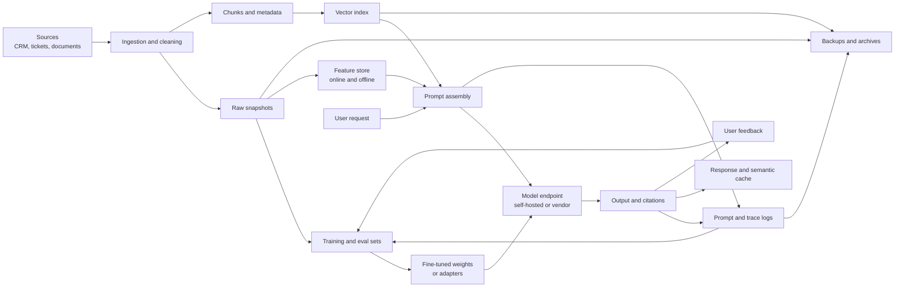

The diagram shows two things. The forward path runs from sources to a served answer. The back edges (feedback and logs flowing into training sets, and everything flowing into backups) are where governance usually fails, because they were added by different teams at different times for good local reasons. A log pipeline built for debugging becomes a training source when someone wants real prompts for fine-tuning. A feedback widget becomes a labeled dataset. A backup job copies the vector index, including chunks that were deleted from the live index yesterday.

### 2.2 Where each kind persists

The next table is the working inventory. For each kind it lists typical storage, who can usually read it, how long it tends to persist by default, and the characteristic governance trap. The retention values are common defaults in practice and are illustrative, not recommendations.

| Data kind | Typical storage | Typical readers | Default persistence | Governance trap |
| --- | --- | --- | --- | --- |
| Sources | Operational databases, document stores | Application teams | Years, per records schedule | Treated as the only copy that matters |
| Training sets | Object storage, data lake, dataset registry | ML engineers, platform | Indefinite (kept for reproducibility) | Reproducibility requirement conflicts with deletion |
| Features | Online key-value store plus offline warehouse | ML platform, analysts | Days online, years offline | Offline copy outlives the deletion of the source |
| Chunks and embeddings | Vector database, search index | Retrieval service, sometimes broad dashboards | Until reindex | Assumed non-sensitive because they look like numbers |
| Prompts and logs | Log platform, trace store, data warehouse | Developers, SRE (site reliability engineering), analysts | 30 to 400 days, often unbounded | Full prompts with retrieved personal data logged by default |
| Caches | In-memory stores, vector cache, provider KV | Serving layer | Minutes to days | A cached answer survives deletion of its source |
| Fine-tuned weights | Model registry, artifact store | Deployment pipeline | Until retired | Influence of deleted data persists |
| Outputs | Application database, chat history, tickets | Users, support staff | Per product policy | Output reproduces another person's data |
| Evaluation sets and feedback | Spreadsheets, eval stores, labeling tools | Evaluators, annotators, vendors | Indefinite | Real customer data copied into spreadsheets and shared with annotation vendors |
| Backups and archives | Snapshots, cold storage | Operators | Months to years | Restore resurrects deleted data |

Three observations follow. **Persistence is set by the most permissive store in the chain**, not by the source's retention. If a ticket is deleted after 24 months but a prompt log keeps full text for 400 days and a training snapshot is kept forever, the effective retention of that content is "forever". **Readership widens as data moves away from the source**. Source systems have access control reviewed by their owners. A log platform or a data lake often has broad read access because it was built for engineers. **Derived data is rarely labeled**. A table of vectors carries no visible classification.

### 2.3 Building the map in practice

Build the map from three evidence sources and reconcile them, because any single source is incomplete.

1. **Declared flows.** Interview each team and read the architecture diagrams. This finds the intended design.
2. **Observed flows.** Use network flow logs, egress proxy logs, service mesh telemetry, and cloud audit logs to find which services actually call the model endpoint, which buckets hold training snapshots, and which jobs read the source database. This finds the real design. It almost always shows at least one flow nobody mentioned.
3. **Derived flows from code and configuration.** Scan pipeline definitions, infrastructure-as-code, and notebooks for reads from sensitive sources and writes to new locations.

Each flow in the map gets a record with the fields in the table below. A map that stops at box-and-arrow diagrams cannot be queried, so keep the records in a catalog.

| Field | Why it is needed |
| --- | --- |
| Artifact identifier and type | Lets lineage queries find it |
| Parent artifact(s) and transformation version | Reconstructs derivation |
| Sensitivity tier (inherited, then possibly raised) | Drives access and retention |
| Permitted purposes | Blocks reuse for other purposes |
| Owner and steward | Names who answers questions and executes deletion |
| Storage location and region | Supports residency and breach scoping |
| Retention rule and maximum propagation delay | Makes deletion measurable |
| Deletion operation and completion signal | Makes deletion verifiable |

### 2.4 A worked count: fan-out of one record

A single support ticket from a customer in a mid-sized deployment fans out as follows (illustrative, but the pattern is typical).

- 1 row in the ticketing database, with 14 attachments in object storage.
- 1 nightly snapshot of the ticket table in the data lake, retained 7 days, plus one monthly snapshot retained 12 months.
- 3 chunks after splitting, each with 1 embedding, and the index keeps the previous document version for 7 days after reindex, so 6 vectors exist for a while.
- 1 appearance in a fine-tuning dataset snapshot.
- 4 log lines in the prompt log when the ticket was retrieved as context by 4 different agent sessions in the last 30 days, each containing the full ticket text.
- 2 cached responses that quote it.
- 1 annotation task in a labeling tool, created for quality evaluation.
- 3 backup generations of the vector index and 3 of the data lake.

Counting only the places where the ticket's text or a direct transformation of it persists gives: 1 database row plus 14 attachments, 2 snapshots, 6 vectors, 1 training dataset entry, 4 log entries, 2 cache entries, 1 annotation task, and 6 backup copies. That is 1 + 14 + 2 + 6 + 1 + 4 + 2 + 1 + 6 = 37 persisted items in about nine stores across at least five teams. When the customer exercises an erasure right, 37 items need a defined fate, and the data-flow map is what makes this number computable rather than guessed. We return to this record in the deletion section.

## 3. Data Classification and Sensitivity Tiers

Classification assigns each artifact a sensitivity tier that drives the controls applied to it. In an AI system the hard part is not defining the tiers but applying them to derived artifacts.

### 3.1 A tier model

Most organizations already have a classification scheme. Reuse it, and extend it for AI instead of inventing a parallel one. A four-tier scheme is a common baseline.

| Tier | Meaning | Examples in an AI system | Typical AI controls |
| --- | --- | --- | --- |
| T0 Public | Intended for public release | Published documentation, public web pages | Check license; no access control needed |
| T1 Internal | Business information not for release | Internal wikis, product plans, non-personal telemetry | Authenticated access, internal-only models |
| T2 Confidential personal or commercial | Personal data, customer content, contract terms | Support tickets, CRM notes, order histories, employee records | Purpose-bound, redaction before external calls, short log retention, tenant isolation |
| T3 Restricted | Special categories, regulated, or high-harm data | Health records, biometrics, financial account data, children's data, credentials, legal privileged material | Dedicated environment, no third-party model without specific approval, no training without explicit review, strongest retention limits |

"Special categories" under the GDPR (Article 9) include data revealing racial or ethnic origin, political opinions, religious or philosophical beliefs, trade union membership, genetic data, biometric data used to identify a person, health data, and data about sex life or sexual orientation. Processing them is prohibited unless one of a narrow set of conditions applies. For architecture, treat them as T3 by default. Payment card data has its own industry standard (PCI DSS, Payment Card Industry Data Security Standard), and health information in the United States is governed by HIPAA (Health Insurance Portability and Accountability Act), both discussed later.

### 3.2 Derived data inherits and can rise

The rule that prevents most mistakes is: **a derived artifact inherits the highest tier of any source it was computed from, until a documented transformation justifies lowering it.**

- A chunk of a T2 ticket is T2.
- An embedding of that chunk is T2. Research shows that embeddings can be inverted to recover text (Section 12), so a vector is not anonymous by construction.
- A summary generated from 500 T2 tickets is T2 unless a reviewed process shows individuals are not identifiable. An aggregate such as "median resolution time by product" is typically lower.
- A fine-tuned model trained on T2 data is T2 for access purposes, because it can memorize and emit training content.
- A prompt that combines a T1 policy document with a T2 customer record is T2.

Classification can also rise by **aggregation**. A set of individually T1 attributes (postcode, birth date, gender) can identify most people when combined, so the combination is treated as personal data. An AI system that joins data from separate sources can create sensitive inferences that no source contained, for example inferring a health condition from purchase history. Inferred special-category data is still special-category data from the standpoint of risk, and in many regimes also from the standpoint of law.

### 3.3 Sensitivity versus identifiability

Two axes are often conflated. **Sensitivity** is the harm if the data is disclosed or misused. **Identifiability** is the ease of linking the data to a person. They combine into a picture that helps decide control strength.

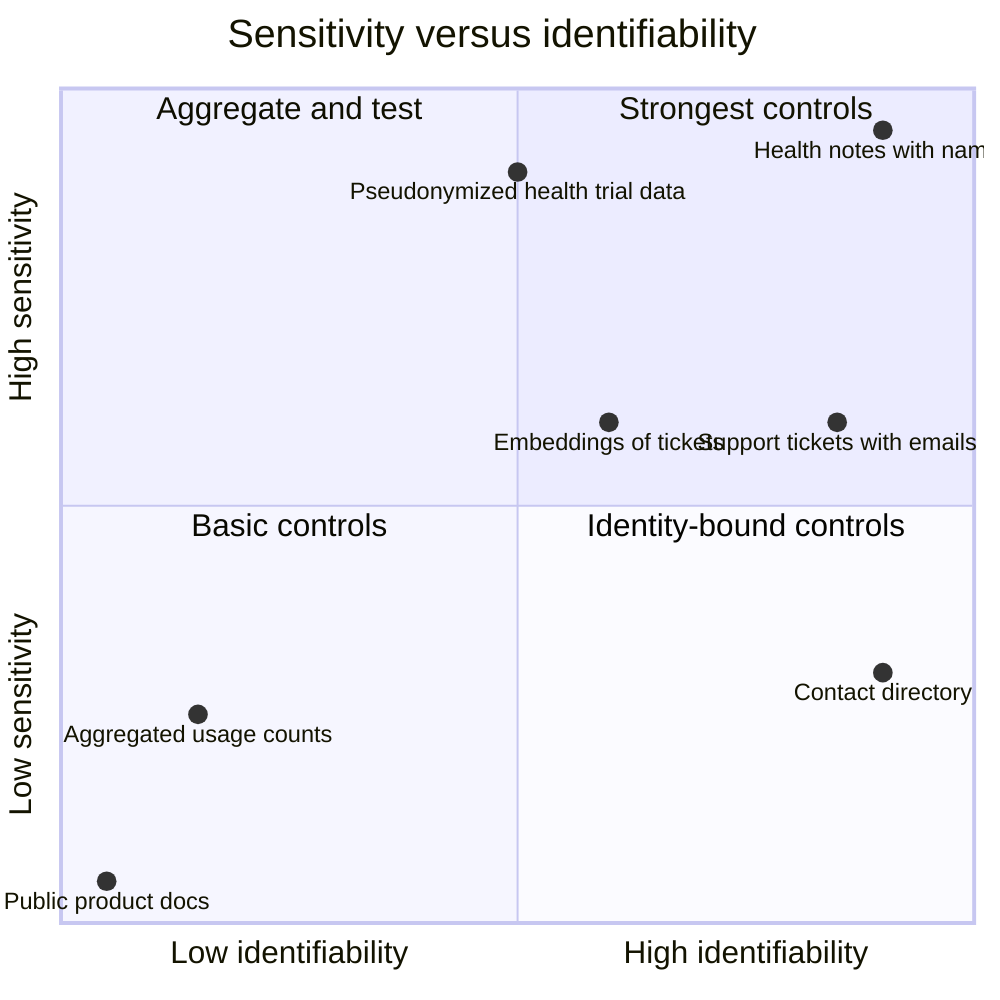

The quadrant shows why embeddings of tickets sit in the middle: moderately identifiable, because inversion and nearest-neighbour matching can recover people, and as sensitive as their source. Pseudonymized health data falls in the high-sensitivity, medium-identifiability region. It needs strong controls even though names were removed, because linkage with other data can re-identify it. The upper-left region, high sensitivity but low identifiability, is where aggregate statistics sit; those are candidates for lower tiers if tested.

### 3.4 Classification for prompts and conversation context

Prompts need special attention because they are assembled at run time. Classify at the level of the **prompt template and its slots**, not each prompt instance. A template that includes `{customer_profile}` is T2 whenever that slot is filled. The prompt assembly code should compute the maximum tier of its inputs and attach it to the request metadata. That metadata then drives routing decisions: a T3 request must not go to a model endpoint whose approval stops at T2. This is a data-side policy; the enforcement point, in the model gateway, is covered by [Part 17 CH12](../17_AI_Architecture/CH12_AI_Safety_Security_Privacy_and_Governance_Architecture.md).

### 3.5 Practical heuristics

- Label at the source and propagate through lineage. Never ask each downstream team to classify from scratch.
- Default unknown to the tier of the most sensitive plausible content. Unclassified data in an AI pipeline should be treated as T2 until reviewed.
- Prefer a small number of tiers with sharply different controls over many tiers that nobody can remember.
- Give each tier an explicit AI rule: which model hosting options are allowed, whether training is allowed, maximum log retention. A tier without AI rules is a label, not a control.
- Review classification when a pipeline changes its join logic, since joins create new sensitive combinations.

## 4. Lawful Basis, Consent, and Purpose Limitation

Data availability does not imply permission. The existence of a database table of customer messages does not mean the company may train a model on it, or send it to an external vendor, or expose it through a search feature to staff who never needed access. Regimes differ in detail, but they share a common pattern: use must rest on a legitimate ground and stay within a declared purpose.

### 4.1 The GDPR pattern as a reference model

The EU General Data Protection Regulation (GDPR) is the reference most global programs adopt because it is broad and prescriptive. Its core principles in Article 5 matter for AI: lawfulness, fairness, and transparency; purpose limitation; data minimization; accuracy; storage limitation; integrity and confidentiality; and accountability. Article 6 lists six lawful bases: consent, contract, legal obligation, vital interests, public task, and legitimate interests. Special categories need an additional Article 9 condition.

For an AI architect the practical content of this is that **every processing activity needs a recorded basis and purpose, and each distinct activity may need its own**. "Providing the customer support service" is a purpose. "Improving our language model with customer messages" is a different purpose. Reusing data collected for the first as input to the second is a compatibility question under purpose limitation (Article 5(1)(b) and Article 6(4)), and it often needs a fresh assessment, fresh notice, or a different basis.

### 4.2 Training, retrieval, and inference are different uses

The most useful governance move is to stop talking about "using the data in the AI" as a single act. Separate at least four uses, and record rights for each.

| Use | What happens to the data | Persistence of influence | Typical question |
| --- | --- | --- | --- |
| Retrieval | Data is indexed, chunks are fetched per query, shown to the model as context | In the index; removed when the index entry is removed | Is the user allowed to see this content? Is indexing within the original purpose? |
| Inference-time input | A user's data is sent to a model to produce an answer for that user | In logs, caches, and vendor retention if any | Does the vendor retain or train on it? |
| Training or fine-tuning | Data changes model parameters | In the weights, hard to remove | Is there a basis to train? Can we honor erasure and objection? |
| Evaluation and monitoring | Data is used to test or measure the system | In eval sets and metrics | Are real records in test sets? Who sees them? |

A system can have a sound basis for inference-time use and none for training. Customer support is a good example: using a customer's message to generate a reply for that customer is part of providing the service. Using the same message to train a general model that other customers will use is a new purpose.

Retrieval sits between them. Retrieval over documents the user already has the right to see, in a tenant-isolated way, resembles ordinary search. Retrieval that surfaces one customer's data to another is a disclosure, which is a security and privacy incident whatever the legal basis. Retrieval authorization is covered in Section 17.

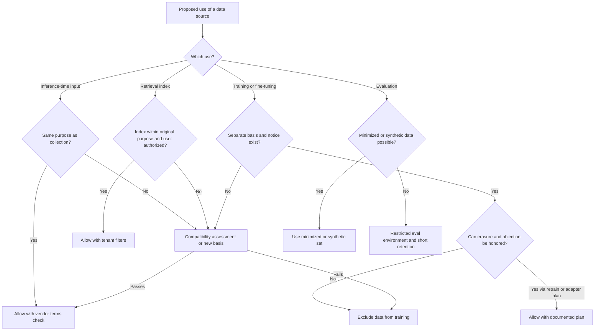

The decision tree makes the central point visible: the training branch has an extra gate, "can erasure and objection be honored", that the other branches do not. Because influence in weights is hard to remove, the practical response to a "no" is to exclude the data from training rather than train and hope.

### 4.3 Consent in AI contexts

Consent under the GDPR must be freely given, specific, informed, and unambiguous, and withdrawal must be as easy as giving it. Consent works poorly for large-scale training for three reasons. Withdrawal means a model may need retraining, which the controller must be prepared for. Consent from one population does not cover data about third parties that appears in the text (a customer's message mentions a colleague). Consent bundled into terms of service is unlikely to be specific.

Consent works better in a bounded, product-level feature, for example "Allow us to use your conversation to improve the assistant", off by default, stored with a timestamp and policy version, and tied to a mechanism that excludes the user's data from training sets when withdrawn. The architecture needs a **consent flag that travels with the record into the dataset builder** so that the dataset builder can filter on it. A consent database that the dataset builder never reads is decoration.

### 4.4 Legitimate interest and what regulators have said

Many organizations rely on legitimate interests (Article 6(1)(f)) for AI development. That basis requires a three-step test: a legitimate interest exists, the processing is necessary for it, and the interest is not overridden by the rights and freedoms of data subjects. The European Data Protection Board (EDPB) addressed AI models in [Opinion 28/2024 of 17 December 2024](https://www.edpb.europa.eu/news/news/2024/edpb-opinion-ai-models-gdpr-principles-support-responsible-ai_en), issued at the request of the Irish data protection authority. It covers three questions: when an AI model can be considered anonymous, whether and how legitimate interest can be used as a basis for developing or using AI models, and what follows if a model was developed using personal data processed unlawfully.

In summary, as the EDPB and commentators describe it: a model trained on personal data cannot be assumed anonymous in all cases, so anonymity needs a case-by-case assessment of whether personal data can be extracted or obtained by queries with a very low likelihood; legitimate interest is not a default basis and requires the three-step test with attention to the reasonable expectations of data subjects and mitigating measures; and unlawful processing in development can affect the lawfulness of later deployment depending on circumstances. Read the opinion itself and your counsel's advice for exact wording; this summary is for orientation.

The legal position was still moving at the time of writing. The European Commission's Digital Omnibus proposals on the GDPR include a provision that would let processing for AI development and operation rest on legitimate interest, with safeguards; the Council and Parliament positions were still being negotiated as far as public sources showed in October 2026, and I could not verify a final adopted text. Treat any claim that "the GDPR now permits AI training on legitimate interest" as unverified for your jurisdiction until counsel confirms.

### 4.5 Purpose limitation as an engineering control

Purpose limitation becomes real only if the system enforces it. Three mechanisms work together.

**Purpose tags on datasets and indexes.** Each dataset snapshot and index carries a set of permitted purposes, such as `support_retrieval` or `product_analytics`. A job that wants to build a fine-tuning set from a snapshot must declare the purpose `model_training`; the catalog checks that the purpose is in the source's permitted set and rejects the job otherwise.

**Purpose-scoped credentials.** The service identity used by the fine-tuning pipeline can read only datasets tagged for training. This turns a policy question into an authorization failure that shows up in logs.

**Purpose checks at assembly.** The dataset builder and the index builder call a policy function with (source, purpose) and record the decision. The decision record is part of the audit evidence. A pseudocode sketch:

```text
function build_dataset(source_ids, purpose):
    approved = []
    for s in source_ids:
        decision = policy.check(source=s, purpose=purpose, region=target_region)
        record(decision)            # who, when, source version, policy version, result
        if decision.allowed and consent_ok(s, purpose):
            approved.append(s)
    return snapshot(approved), manifest_of_decisions
```

The important part is not the code but the **manifest of decisions** that ships with the snapshot. Months later, when someone asks why a record was in the training set, the manifest answers.

### 4.6 Special cases: children, employees, and third parties in text

Children's data carries additional protection in most regimes; in the GDPR, consent for information society services for children below an age between 13 and 16 (set by member state) needs parental authorization. Employee data has an imbalance-of-power problem that undermines consent, so employers usually rely on other bases and works-council processes in some countries. Third parties named in free text, such as a customer describing a family member's illness, are data subjects who never interacted with you. You cannot ask them for consent, which is another reason free-text training corpora are risky: they contain data about people with no relationship to the service.

### 4.7 What to record per source

The minimum record per source, aligned with the original draft of this chapter and extended, is below. Keep it in the catalog next to the artifact it describes.

| Field | Example |
| --- | --- |
| Owner and contact | Support platform team, data steward named |
| Collection basis | Contract performance, notice version 2026-03 |
| Consent state | Per-record flag for "improve the service" |
| License or terms | Internal; or third-party license identifier |
| Permitted purposes | `support_retrieval`, `quality_eval`; not `model_training` |
| Geographic constraints | EU-origin data processed in EU regions only |
| Sensitivity tier | T2 |
| Retention | 24 months from ticket close |
| Downstream sharing limits | No third-party annotation vendor without review |
| Date and reviewer of last assessment | 2026-08-14, privacy counsel |

## 5. Data Minimization

Data minimization says that personal data must be adequate, relevant, and limited to what is necessary for the purpose (GDPR Article 5(1)(c)). Other regimes use the phrase "minimum necessary" (HIPAA) or "reasonably necessary and proportionate" (California). For AI systems this principle has a direct engineering form: **send the model, store in the index, and keep in the log only the fields the task needs.**

### 5.1 Why AI systems drift away from minimization

Language models accept free text, so the easy path is to paste the whole record. A developer building a support assistant retrieves the customer record, serializes all 40 fields into JSON, and appends it to the prompt, because the model might need any of them. That convenience has costs: more tokens (and therefore latency and spend), more personal data leaving the trusted boundary, more personal data in logs, and more irrelevant context that can distract the model. Minimization pays for itself in cost and often in quality, which makes it an easy argument to win with engineers.

### 5.2 Four levers

**Field selection.** Define, per task, an allowlist of fields. A "where is my order" task needs order ID, status, carrier, and expected date. It does not need the billing address, phone number, or payment token.

**Value transformation.** Replace identifiers with stable pseudonyms or coarse values: the customer's name becomes `CUSTOMER_A`, a birth date becomes an age band, a full address becomes a city and country. The task is preserved and the exposure drops.

**Row selection.** Retrieve only the records for the authenticated customer and the relevant time window, not the whole history.

**Time and scope limits.** Truncate conversation history; drop tool results once used; do not carry raw retrieved context across sessions.

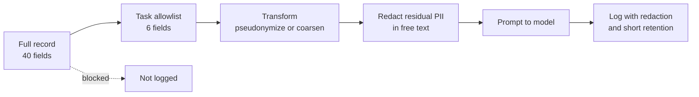

The figure puts minimization before the trust boundary and before logging. The dotted edge shows that fields outside the allowlist never reach the prompt or the logs, so a downstream leak cannot expose them.

### 5.3 Worked example: tokens, cost, and exposure

A support assistant handles 1,000,000 requests per month. Each request, in the first version, includes the full customer record.

- Full record: 40 fields at an average of 12 tokens each, 40 × 12 = 480 tokens.
- Allowlist version: 6 fields at 12 tokens each, 6 × 12 = 72 tokens.
- Reduction per request: 480 − 72 = 408 tokens, which is 408 / 480 = 85 percent of the record's tokens.
- Monthly reduction: 408 × 1,000,000 = 408,000,000 tokens.
- At an illustrative price of 1.00 currency unit per million input tokens, that saves 408 currency units per month. Real model prices differ by model and change often, so treat the price as a placeholder and substitute the current rate from your provider's price page.

The cost saving is small next to the exposure change. In the full-record version, 11 of the 40 fields are personal identifiers or contact details (name, email, phone, street address, city, postcode, birth date, account number, IP address, device ID, loyalty ID). The allowlist version carries 2 (first name and order ID, which is a pseudonymous reference). So per request, personal identifiers sent out drop from 11 to 2, a reduction of 9 of 11, about 82 percent. Over a month, the number of personal identifier values that crossed the boundary, and therefore sit in vendor-side retention windows and in your prompt logs, falls from 11,000,000 to 2,000,000.

There is a subtler benefit. If a prompt log leaks, the blast radius is set by what the prompt contained. Minimization limits what can leak without any further control.

### 5.4 Minimization in training data

For training and fine-tuning, minimization means removing columns, text spans, and records that the model does not need to learn the task. A classifier that routes tickets by topic has no need for names, emails, or order numbers in its training text; replacing them with placeholders typically costs little accuracy, because topic words carry the signal. Test this: train with and without the identifiers on a held-out set, and keep the identifier-free version if the metric difference is within the tolerance agreed with the product owner.

Minimization also applies to the **number of records**. Deduplicate; exact and near-duplicate text increases memorization risk (Section 12) and adds nothing to learning. Cap the number of examples per individual, so that one prolific customer cannot dominate and be memorized.

### 5.5 Minimization in retrieval indexes

A retrieval index is often built by dumping every document. Ask whether each source needs to be indexed at all. Indexing a full HR system to answer benefits questions indexes performance reviews that the assistant should never see. The safest chunk is the one that was never created. If a source mixes sensitive and non-sensitive content, split it at ingestion by section or field and index only the non-sensitive portion, or put the sensitive portion in a separate index with stricter access.

### 5.6 Heuristics

- Write the field allowlist next to the prompt template and review it like code.
- Measure personal identifiers per prompt as a metric (Section 25) and alert on increases.
- Prefer transformation to deletion when the model needs the relationship but not the value ("the same customer wrote twice").
- If the team says "the model might need it", ask for an evaluation that shows a quality loss without the field. Absent evidence, drop the field.

## 6. Data Subject Rights and Their Operational Cost in AI Systems

The GDPR gives individuals rights over their personal data. Other regimes grant similar rights with different names and deadlines. For AI systems, each right maps to concrete operations across the data-flow map, and some of those operations are costly or only partly possible.

### 6.1 The rights and what they ask of an AI system

| Right (GDPR article) | What the individual can ask | AI-specific operation | Difficulty |
| --- | --- | --- | --- |
| Access (15) | Confirmation of processing, a copy of the data, and information on purposes, recipients, retention | Find the person's data across sources, chunks, logs, prompts, feedback; explain use in training | Medium: needs identity resolution across stores |
| Rectification (16) | Correct inaccurate data | Fix the source, re-embed, purge stale caches; consider inaccurate model outputs about the person | Medium for stored data; hard for model-generated claims |
| Erasure (17) | Delete data when grounds apply | Delete across all derived artifacts; decide on model influence | High: see Sections 13 and 14 |
| Restriction (18) | Pause processing while disputes are resolved | Mark records as restricted so pipelines skip them | Medium |
| Portability (20) | Receive data provided by the person in a structured format | Export provided data, not necessarily derived embeddings | Low to medium |
| Objection (21) | Object to processing based on legitimate interests or public task, and absolutely to direct marketing | Exclude from future training and analytics; stop profiling | Medium for new runs; hard for existing models |
| Automated decisions (22) | Not be subject to solely automated decisions with legal or similarly significant effects, with exceptions | Provide human review, explanation, and contest path | Design and governance question; link to CH31 |

Article 12(3) requires the controller to respond without undue delay and in any event within one month of receipt, extendable by two further months where necessary considering complexity and the number of requests, with notice to the requester. Article 19 requires the controller to notify recipients to whom data was disclosed of rectification or erasure, unless impossible or disproportionate. That matters for AI because a model vendor or an annotation vendor can be such a recipient.

### 6.2 Identity resolution is the first cost

An access or erasure request names a person, usually with an email address. The AI system's stores reference that person in different ways: a customer ID in the CRM, a hashed email in a feature store, a free-text mention of the name in a ticket body, a session ID in a prompt log. Finding all of them requires an **identity graph** that maps identifiers to a data subject, plus text search for mentions.

Free-text mentions are the hard part. A support ticket from customer A that says "my colleague Dana Okoye also had this issue" contains personal data of Dana, who has no customer record. The standard approach is to search by name and contact details across text stores, accept that recall is imperfect, and document the method. The redactor in Section 10 shows how imperfect pattern-based detection is. A request that arrives with a name only, no ID, is a poor fit for exact lookup.

### 6.3 Worked cost model for a rights request

Take a team that receives 40 rights requests per month, 30 access and 10 erasure. Before building lineage-based tooling, each request requires an engineer to query nine stores by hand.

- Manual effort: 3.5 hours per request × 40 requests = 140 hours per month.
- With an identity graph and lineage-driven deletion jobs, each request needs 0.5 hours of review: 0.5 × 40 = 20 hours per month.
- Saving: 140 − 20 = 120 hours per month.
- At an illustrative loaded cost of 60 currency units per hour, the saving is 120 × 60 = 7,200 per month.

These are illustrative numbers. The point is the ratio: tooling that follows lineage reduces per-request effort by about 86 percent (120 of 140 hours), and the tooling cost is paid back by the first quarter in a team of this size. The same tooling also reduces the risk of missing a store, which is worth more than the labor.

Now consider deadlines. A one-month response window leaves roughly 30 days. In Section 13 the example deletion has stores with maximum propagation delays of 1, 2, 7, and 30 days, and a model artifact where retraining takes up to 90 days. The conclusion to draw: the request can be answered within a month, with evidence that the data has been blocked everywhere and physically deleted from nearly all stores, and a documented statement about the model. A policy that promised "complete removal from all models within one month" would be violated by design. Align promises with what the architecture can honor.

### 6.4 Rectification and inaccurate model output

Rectification is straightforward for stored records. It is difficult for generated statements. If a model writes a false claim about a named person, correcting the source does not change what the model says. Options include: adding the person to a suppression list so that outputs about them are blocked or routed to a refusal; adding corrective context in retrieval; constraining the model to answer from retrieved, verified sources only; and, for repeated problems, evaluating whether the deployment should answer questions about private individuals at all. Regulators and complainants have raised inaccurate-output complaints against model providers, and the accuracy principle applies to any controller whose system outputs personal data. Plan a documented process even if the technical fix is a block list.

### 6.5 Objection and restriction as pipeline filters

Objection and restriction are best implemented as **flags in the identity graph that every pipeline reads**. The dataset builder excludes subjects with an objection flag for training; the index builder excludes subjects with a restriction flag; the analytics job skips them. A flag that is stored but not read is the same failure as an unread consent flag. Add a test that creates a flagged synthetic subject and asserts that the subject appears in none of the outputs of the next pipeline run.

### 6.6 The honest position on trained models

For existing trained models, erasure and objection are the hardest rights. Section 14 treats the options in detail. Here is the summary an architect should give a privacy lead: for retrieval, caches, features, logs, and datasets, deletion is an engineering task with a known finish line. For model weights, the options are to avoid training on personal data in the first place, to isolate personal data in removable components such as per-tenant adapters, to retrain on a schedule that incorporates accumulated deletions, or to accept and document that a deployed model may retain statistical influence, supported by an assessment of whether the model can emit the person's data. State which of these the design uses before launch.

## 7. Comparable Regimes at a Conceptual Level

An architect usually designs once for several jurisdictions. The mechanisms in this chapter satisfy the shared core of most regimes. The differences affect deadlines, definitions, and what counts as sale or sharing. Verify specifics with counsel; the following is a conceptual map.

### 7.1 California: CCPA and CPRA

The California Consumer Privacy Act (CCPA), amended by the California Privacy Rights Act (CPRA), gives California residents rights to know what personal information is collected, to delete, to correct, to opt out of the sale or sharing of personal information, and to limit the use of sensitive personal information. Businesses must contract with service providers and contractors so that those parties use data only for specified business purposes. Response timelines are measured in tens of days (45 days with a possible extension) instead of the GDPR's month.

Two developments matter for AI. First, the California Privacy Protection Agency's regulations on cybersecurity audits, risk assessments, and automated decisionmaking technology (ADMT) were approved in September 2025 and became effective on 1 January 2026, with later compliance dates for some of the new duties, according to the agency's own announcement; check the agency's site for the date that applies to your use. Second, California's AB 2013, the Generative AI Training Data Transparency Act, requires developers of generative AI systems made available to Californians to post high-level documentation about training data by 1 January 2026. If you build and release a generative AI system, you are likely a "developer" for that law; if you only use a vendor's model, you probably are not, but your vendor is, and its public documentation is useful input to your own assessment.

For architecture, the CCPA's service-provider contract concept matters most. If a model vendor is a service provider, sending personal information to it for a specified purpose is not a sale. If the vendor may use the data to train its own general models, the relationship may not fit the service-provider definition. This is the legal reason the vendor-term questions in Section 9 matter.

### 7.2 HIPAA and health data

In the United States, HIPAA (Health Insurance Portability and Accountability Act) governs protected health information (PHI) held by covered entities (providers, health plans, clearinghouses) and business associates. Three concepts matter for AI.

**Business associate agreements (BAAs).** A vendor that processes PHI on a covered entity's behalf must sign a BAA. Sending PHI to a model endpoint without a BAA is a violation, regardless of the vendor's general privacy terms. Some vendors offer BAA-covered endpoints for specific services; others do not.

**De-identification.** The Privacy Rule recognizes two methods. Safe Harbor requires removal of 18 categories of identifiers (names, geographic units smaller than a state with limited exceptions, all elements of dates except year, telephone numbers, email addresses, social security numbers, medical record numbers, account numbers, device identifiers, URLs, IP addresses, biometric identifiers, full-face photographs, and other unique identifying numbers) and no actual knowledge that the remainder could identify the person. Expert Determination relies on a qualified expert's statistical finding that re-identification risk is very small. Free-text clinical notes make Safe Harbor hard to certify, because names and dates hide in narrative and a regex tool misses them (see the measured recall in Section 10).

**Minimum necessary.** Uses and disclosures should be limited to the minimum necessary, which supports the allowlist approach in Section 5.

### 7.3 Sector rules

- **Financial services.** In the United States, the Gramm-Leach-Bliley Act sets privacy and safeguards duties for financial institutions. In the EU, the Digital Operational Resilience Act (DORA) imposes requirements on ICT (information and communication technology) third-party risk, which include model and cloud vendors. PCI DSS applies to card data wherever it is stored, processed, or transmitted; a prompt log that contains card numbers brings the log platform into PCI scope, which is a strong reason to redact card numbers before logging.
- **Education.** In the United States, FERPA (Family Educational Rights and Privacy Act) limits disclosure of student records, and COPPA (Children's Online Privacy Protection Act) restricts collecting data from children under 13.
- **Other national laws.** The UK GDPR and Data Protection Act 2018, Brazil's LGPD (Lei Geral de Proteção de Dados), India's Digital Personal Data Protection Act 2023, and China's Personal Information Protection Law (PIPL) share the same architecture of lawful basis, rights, and cross-border restrictions, with different details. China's regime and some others contain particularly strict localization or transfer-assessment rules.
- **US state laws.** Many US states have comprehensive privacy laws of their own with CCPA-like rights and varied thresholds, and several have profiling and automated decision provisions. A multi-state product usually adopts the strictest common mechanism.

### 7.4 One design for several regimes

Rather than build per-law pipelines, build to a **strictest common set** of capabilities and parameterize deadlines and definitions.

| Capability | Satisfies |
| --- | --- |
| Identity graph and cross-store lookup | Access, know, and delete rights in all regimes |
| Deletion propagation with completion evidence | Erasure and delete rights |
| Purpose tags and consent flags | Purpose limitation, opt-out, sale and sharing restrictions |
| Residency tagging and region-pinned processing | Transfer limits, localization rules |
| Vendor register with terms and subprocessor list | Processor and service-provider contracts, BAA tracking |
| Minimization at prompt and log boundary | Minimization, minimum necessary |
| Impact assessment workflow | GDPR data protection impact assessment (DPIA), CCPA risk assessments, internal AI reviews |

## 8. Licensing and Copyright of Training and Retrieval Content

Personal data law asks who a record is about. Licensing and copyright law ask who owns the content and what they allow. Both apply to the same corpus, and passing one test says nothing about the other. This section describes the mechanisms and the state of the law as verified in October 2026. Court decisions here are fact-specific, differ by jurisdiction, and are under appeal in some cases, so treat the following as a map of the terrain, not a prediction.

### 8.1 Four questions for every content source

1. **Who owns it, and under what terms did we get it?** Ownership and license, or terms of service for web content and APIs.
2. **Does the license permit the intended use?** Reading, copying into an index, creating embeddings, training, redistribution of outputs, commercial use.
3. **What obligations come with the use?** Attribution, share-alike, notice retention, non-commercial limits.
4. **How did we acquire it?** Lawfully obtained copies and pirated copies are treated differently by courts (see below).

Record the answers in the source record. If the answers are unknown, the source is "unlicensed for AI use" until resolved.

### 8.2 Open licenses and what they require

An open license is still a license with conditions. Common families behave differently when content is copied into an index or used for training.

| License family | Typical obligations | AI-specific questions |
| --- | --- | --- |
| Public domain dedication (for example CC0) | None | Low risk; verify the dedication is valid for the content |
| Permissive software (MIT, BSD, Apache-2.0) | Keep copyright and license notices; Apache-2.0 adds a patent grant and notice rules | Do notices need to travel with generated code? Unsettled; log the source license for audit |
| Weak and strong copyleft (LGPL, GPL, AGPL) | Share source of derivative works under the same license; AGPL extends to network use | Whether a model trained on copyleft code is a derivative work is unresolved; many organizations exclude copyleft code from training or require review |
| Creative Commons Attribution (CC BY) | Attribution | Can a retrieval answer carry attribution? Citation lineage (Section 15) helps |
| CC BY-SA | Attribution and share-alike | Share-alike on outputs or models is untested; exclude or review |
| CC BY-NC | Non-commercial only | Excluded from commercial products; "non-commercial" for research data blocks product use |
| Model licenses such as Responsible AI Licenses (RAIL) | Use restrictions on models and sometimes on outputs | Check acceptable-use clauses, user thresholds, and downstream license inheritance |

For retrieval systems, attribution obligations are easier to meet than for training because the answer can cite the source. This is another reason to keep citation lineage: it supports both trust and license compliance.

### 8.3 Terms of use for web content and APIs

Websites and APIs often prohibit scraping, automated access, or use for training in their terms of service, and many publish machine-readable signals such as `robots.txt` entries for AI crawlers or opt-out metadata. Terms of service operate as contracts and can be enforced even when copyright law might permit the copying. Under EU law, the text and data mining (TDM) exception in Article 4 of the Digital Single Market Copyright Directive lets rightsholders reserve their rights by an appropriate machine-readable opt-out; a crawler that ignores a valid opt-out cannot rely on the exception. The EU AI Act's Article 53(1)(c) requires providers of general-purpose AI models to have a policy to comply with Union copyright law, including identifying and respecting such reservations. As a consumer of models rather than a builder, you inherit the risk through your vendor, so ask vendors about their policy.

Operationally: store, per crawled source, the crawl date, the robots and opt-out status at crawl time, and the terms version. Honor opt-outs on subsequent crawls and remove content from future training sets, with a documented process for the content already in existing models.

### 8.4 Dataset licenses and inheritance

Public datasets on model hubs carry licenses, and many are compilations of other licensed or scraped material. A dataset marked "MIT" can contain text whose original license is more restrictive. Research by the Data Provenance Initiative (Longpre and colleagues, 2023) audited thousands of widely used datasets and found frequent mislabeled or missing licenses, which is the reason to track the license of the underlying sources and not only the label on the compilation. Practical rules:

- Prefer datasets with documented sources (a datasheet; Section 15).
- Record dataset version, hash, and license text at download time, not just a link, since pages and licenses change.
- Treat synthetic data generated by a vendor model as subject to that vendor's output terms, which sometimes restrict using outputs to train competing models.
- Treat user-uploaded content as licensed only for the purposes in your terms; training rights need explicit wording.

### 8.5 Legal developments, described carefully

The following summaries were checked against public reporting and court coverage in October 2026. They illustrate how the law is developing; none is a general rule.

**United States, training as fair use.** In June 2025, two judges of the Northern District of California issued summary judgment rulings in authors' suits against model developers. In *Bartz v. Anthropic*, Judge Alsup held that training on lawfully acquired books was transformative fair use, but that downloading and retaining pirated copies in a central library was a separate act that fair use did not excuse. The parties settled the class claims for $1.5 billion, with reported payments of about $3,000 per work, and the court gave final approval in July 2026. The settlement addresses past copying of listed works and does not decide the broader question or release claims about outputs. In *Kadrey v. Meta*, Judge Chhabria ruled for Meta on the record before him, emphasizing that the plaintiffs had not shown market harm, and stated that the ruling did not mean such training is generally lawful; a claim about uploading works through BitTorrent continued at the last report. The common lesson for practitioners is that **how the data was acquired and retained can create liability even where the use in training is found to be fair use**.

**United States, non-generative use.** In *Thomson Reuters v. Ross Intelligence* (D. Del., 2025), the court rejected a fair-use defense for copying headnotes to train a non-generative legal search tool; the case went on interlocutory appeal, and I could not verify the outcome of the appeal. Courts are also hearing newspaper and other publisher suits, such as *New York Times v. OpenAI*, whose status you should check directly.

**Germany.** In *GEMA v. OpenAI* (Regional Court of Munich, November 2025, case 42 O 14139/24), the court held that song lyrics memorized in model parameters and reproduced in outputs infringed copyright and that the text and data mining exception did not cover that memorization. Reports describe the court treating memorization as a form of reproduction in the model. I could not verify whether appeals have changed this position.

**United Kingdom.** In *Getty Images v. Stability AI* (High Court, November 2025), the court rejected the secondary infringement claim, reasoning that the Stable Diffusion model does not store or contain copies of the training images and is not an "infringing copy". The court's reasoning concerned UK law and a model whose training took place outside the UK, so it is not a general holding about training.

**What this tells an architect.** First, jurisdictions diverge: a position acceptable in one may not be in another, and a global product carries the strictest exposure. Second, **memorization is the legal bridge between "training is transformative" and "the output infringes"**. Reducing verbatim regurgitation (deduplication, output filters, evaluation for extraction) lowers legal exposure as well as privacy exposure. Third, **acquisition is a distinct risk**: if you cannot show that content was lawfully obtained, you cannot cure the problem by pointing to a transformative use. Fourth, indemnities from vendors (some offer copyright indemnity for outputs under conditions) transfer some financial risk but do not remove the duty to configure and use the product as the indemnity requires.

### 8.6 Retrieval is different from training

Retrieval-augmented generation copies licensed content into an index and displays excerpts in answers. That is closer to quoting and search than to learning, and the law treats reproduction and display differently from training. The practical risks are different too: the index holds a full copy that can be removed on demand, the displayed excerpt is visible and attributable, and a license revocation can be honored by deleting the index entry. Because retrieval is removable, a licensor who will not agree to training rights may still agree to retrieval rights, often with attribution and link-back terms. Where you have a choice, license content for retrieval, and keep it out of training sets unless the license says otherwise.

### 8.7 A source-rights checklist

- License text or terms version captured and hashed.
- Permitted uses explicitly cover indexing, embedding, display, and training as applicable.
- Attribution and notice duties mapped to the product behavior.
- Opt-out status recorded, with a process to honor changes.
- Acquisition method documented (purchased, licensed, public domain, user-contributed, crawled).
- Revocation procedure tested: how long to remove the source from index, caches, and future training sets.

## 9. Third-Party Vendor Terms

Most AI systems use at least one external provider: a hosted model API, an embedding service, a managed vector database, an annotation vendor, an observability platform. Each one receives data. The contract determines what the vendor may do with it. Vendor terms change, differ across product tiers, and differ between the same provider's consumer, API, and enterprise offerings. The guidance here is about the questions to ask; look up the current answers in the provider's data processing agreement, product terms, and data usage documentation at the time of review.

### 9.1 The questions that matter

| Question | Why it matters | Where to look |
| --- | --- | --- |
| Does the provider train on my inputs or outputs? | Trained-in data may be unrecoverable and may surface to others | Data usage or privacy policy for the specific product tier |
| How long is data retained, and for what purpose? | Retention extends your exposure and your deletion duty | API data retention page; DPA |
| Are zero-data-retention (ZDR) or similar options available, for which endpoints, and under what conditions? | Removes provider-side storage of prompts and outputs | Provider documentation; sales or account management |
| Who can access stored data (support, safety review, abuse monitoring)? | Defines human access to your prompts | DPA; trust center |
| What are the subprocessors and where do they operate? | Each subprocessor extends the chain of custody | Subprocessor list and change notification terms |
| Where is data processed and stored? Can I pin a region? | Residency and transfer law | Regional endpoint documentation |
| What security attestations exist? | Baseline assurance | SOC 2 Type II, ISO/IEC 27001, and for health data the BAA |
| What happens on termination? | Deletion of your data and of fine-tuned artifacts | DPA; contract |
| Are there indemnities for IP claims on outputs? | Shifts some financial risk | Service terms, with conditions |
| Can output be used to train other models? | Restricts your own distillation or synthetic data plans | Terms of use |

At the time of writing, major model API providers commonly state that they do not train on data submitted through their business APIs by default, that they retain API inputs and outputs for a limited period for abuse monitoring (often measured in days to a month), and that they offer reduced or zero retention options for eligible customers under conditions. Consumer chat products often differ, with training on by default unless the user opts out. Cloud platforms that host third-party models typically state that customer prompts are not used to train the shared models and that data stays in the selected region. These generalities are a starting point, not an answer; the specifics change and the conditions (eligible endpoints, features excluded from ZDR such as certain stored-state or caching features) matter.

### 9.2 Court-ordered retention and legal hold

A zero-retention promise from a vendor can be overridden by legal process. In 2025, in the *New York Times v. OpenAI* litigation, a US court ordered the provider to preserve output logs that it would otherwise have deleted, which affected consumer and some API customers; the order was later narrowed, according to public reports I could not fully verify. The general lesson stands: **retention promises are subject to legal hold, and a vendor's legal exposure can change your data's persistence**. For T3 data, prefer self-hosted or private-deployment models, or a vendor arrangement with explicit zero-retention for the relevant endpoints and contractual notice of preservation orders, because a hold may reach what you assumed was gone.

### 9.3 Subprocessors and data paths

A single API call may cross several parties: your application, a gateway, the model provider, the provider's cloud host, and a safety-review vendor. The vendor register should draw this chain and record, for each hop, the legal entity, the region, the data categories, and the retention. When a provider adds a subprocessor, contracts usually require notice and sometimes a right to object. Subscribe to those notices and route them to the privacy team; otherwise the change occurs silently.

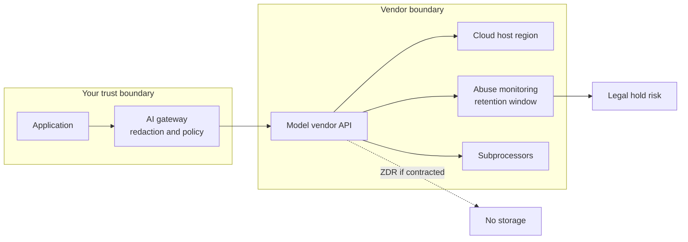

The figure marks where data leaves your control and where retention and human access can arise even under a "no training" promise. The gateway is the right place to enforce redaction and region choice (the enforcement mechanism is Part 17 CH12 and CH08). The vendor boundary shows three places where you need contractual answers: abuse monitoring retention, subprocessors, and legal hold.

### 9.4 Vendor selection by data tier

Use the tier model to constrain which hosting options are allowed.

| Tier | Typical allowed hosting | Conditions |
| --- | --- | --- |
| T0 | Any approved vendor | License check only |
| T1 | Business-tier vendor API | DPA, no training on inputs, regional endpoint if policy requires |
| T2 | Business-tier vendor API with redaction at gateway, or private deployment | DPA, zero or minimal retention, subprocessor review, logging controls |
| T3 | Private deployment in your environment or an approved isolated service with BAA or equivalent | Specific approval, no third-party training, dedicated keys, strongest retention limits |

### 9.5 Contract clauses to ask for

- A prohibition on using your inputs, outputs, and fine-tuning data to train or improve models for others.
- Defined retention with the right to request deletion and a deletion certificate on termination, including fine-tuned artifacts you created.
- Notice of subprocessor changes and of legal demands for your data, where law permits.
- Region commitments, and notice before any change in processing location.
- Incident notification within a stated number of hours, aligned with your own breach duties (the GDPR gives controllers 72 hours to notify the supervisory authority after becoming aware of a breach).
- Audit rights or independent attestations.
- For fine-tuning services, clarity about who owns the resulting weights and where they are stored.

### 9.6 Worked example: comparing two vendor options

A team compares two options for a support assistant that handles T2 tickets. Option A is a business-tier API with 30-day abuse monitoring retention and no training. Option B is the same vendor's ZDR-eligible endpoint, which excludes some features (for example, server-side stored conversation state), at a price premium.

- Prompt volume: 1,000,000 requests per month, each with a redacted prompt.
- Exposure window under A: each prompt persists up to 30 days at the vendor. Expected stored prompts at any time: about 1,000,000 prompts (one month of traffic).
- Exposure window under B: no vendor-side storage, so 0 stored prompts at the vendor in steady state, outside legal hold.
- Residual risk A: with a redaction recall of 0.91 on 30,000 PII spans per day (Section 10), about 2,700 PII spans per day escape redaction (30,000 × 0.09), which means roughly 81,000 spans sit in vendor storage at any time (2,700 × 30 days).
- Residual risk B: the same 2,700 leave your boundary per day, but none persist at the vendor.

The premium for B buys down a measurable exposure, 81,000 unredacted PII spans at rest, and also simplifies your deletion duty, since there is no vendor store to propagate deletions to. Whether the premium is justified depends on the data tier and the likelihood of a vendor-side incident; the calculation turns "vendor retention" from an adjective into a number the privacy lead can weigh.

## 10. PII Detection, Redaction, Tokenization, and Pseudonymization

Minimization decides which fields to send. Redaction handles personal data that remains inside free text, such as an email address a customer typed into a message. This section builds a detector, measures it, and explains why the measured numbers should change how you design around it.

### 10.1 Terms: four different transformations

These words are used loosely. Keep them separate, because they have different privacy and legal properties.

| Transformation | What it does | Reversible? | Linkable across records? | Typical use |
| --- | --- | --- | --- | --- |
| Redaction (masking) | Replaces the value with a fixed placeholder such as `[EMAIL]` | No | No | Logs, vendor prompts, training text |
| Tokenization (vault) | Replaces the value with a random token and stores the mapping in a protected vault | Yes, with vault access | Yes, if the same token is reused | Payment cards, identifiers that must be restored later |
| Pseudonymization | Replaces identifiers with keyed or random pseudonyms so that identification needs additional information kept separately | Yes, by whoever holds the key or table | Yes, via the pseudonym | Analytics, training sets that need record linkage |
| Anonymization | Alters data so individuals are not identifiable by any means reasonably likely to be used | No, by definition | No | Open release, though difficult to prove |

Under the GDPR, pseudonymized data is still personal data (Recital 26): the extra information that would re-identify it exists, and the data is only anonymous if re-identification is not reasonably likely by anyone. Treat the output of the redactor and the tokenization vault accordingly. A vault token for a card number removes the number from your logs, which can take log systems out of PCI scope, but the token and vault are still protected assets.

### 10.2 Detector families

**Pattern detectors with validity checks.** Regular expressions find shapes: emails, phone numbers, national ID formats, card numbers, IBANs (International Bank Account Numbers). Checksums cut false positives: card numbers must pass the Luhn algorithm, IBANs must satisfy the mod-97 test. These are cheap, fast, deterministic, and explainable, and they reliably find well-formed structured identifiers.

**Dictionary and gazetteer detectors.** Lists of known names, places, and customer-specific terms. Useful for known entities (your own customers' names from the CRM) because they have high precision for those entities.

**Statistical or neural named-entity recognition (NER).** A model tags spans as person, location, organization, and so on. It finds names and addresses that no pattern captures, at the cost of both false positives and false negatives, language dependence, and compute.

**LLM-based detectors.** A model prompted to find and label sensitive spans. Strong at context ("Chen said the patient") and unusual formats, but it adds latency, cost, and a new data flow (sending raw text to a model to find sensitive text), so it needs to run inside your trust boundary. Evaluate it like any other detector.

No single family covers everything. Production systems layer them: patterns first for structured identifiers, dictionary for known entities, NER or an LLM for names and addresses, then a policy rule for what to do with each label.

### 10.3 A runnable detector and its measured failures

The script [01_pii_redactor.py](../code/python/ai-data-governance-chapter/01_pii_redactor.py) implements a regex-plus-checks detector for emails, phone numbers, US social-security-number shapes, payment cards (with the Luhn check), and IBANs (with mod-97). It resolves overlapping matches by keeping the longest span, and it replaces each span with a keyed pseudonym of the form `<EMAIL:2229e2>`, where the suffix is the first six hex characters of an HMAC (keyed hash message authentication code, here HMAC-SHA-256) of the value. The key is a placeholder in the script; in production it comes from a secrets manager and is rotated by policy.

The core of the validity checks is short enough to quote.

```python
def luhn_ok(digits: str) -> bool:
    total, flip = 0, False
    for ch in reversed(digits):
        d = int(ch)
        if flip:
            d *= 2
            if d > 9:
                d -= 9
        total += d
        flip = not flip
    return total % 10 == 0

def iban_ok(raw: str) -> bool:
    s = raw.replace(" ", "")
    if not 15 <= len(s) <= 34:
        return False
    moved = s[4:] + s[:4]
    num = "".join(str(int(c, 36)) for c in moved)
    return int(num) % 97 == 1
```

The script scores itself on 16 hand-labelled texts that include easy positives (well-formed emails, phones, a valid card number), hard positives (names, a street address, an email written as "ana dot silva at example dot com", a phone number spelled out in words), and hard negatives (a tracking number that fails Luhn, a part number shaped like a phone number, an order number shaped like a social security number, an invalid IBAN). Running it prints:

```text
== Span scores on 16 labelled texts ==
TP=8 FP=2 FN=6
precision=0.800 recall=0.571 F1=0.667

== False negatives (PII that leaks) ==
  missed 'Maria Gonzalez'
  missed '14 Elm Street'
  missed 'ana dot silva at example dot com'
  missed 'four one five, five five five, zero one three four'
  missed 'Chen'
  missed 'Li Wei'

== False positives (over-redaction) ==
  flagged '123-45-6788' in: Order 123-45-6788 shipped via lane 4.
  flagged '555-123-4567' in: Part no. 555-123-4567 is back in stock.
```

Read the result as a set of failure categories, not only as a score.

- **Names and addresses are missed entirely** (4 of the 6 misses). Patterns have no notion of a person's name. Any text-heavy domain such as support, clinical notes, or HR will carry these, and they are often the most identifying content.
- **Obfuscated identifiers are missed** (2 of 6). People type "at" and "dot", spell out digits, insert spaces. A determined adversary does this on purpose; an ordinary customer does it to avoid spam filters.
- **Look-alikes are over-redacted** (2 false positives). A social-security-number-shaped order number and a phone-shaped part number cannot be told apart by shape. The checks (Luhn, mod-97) rescued the tracking number and the invalid IBAN, which is why checksums are worth adding wherever the identifier has one. Social security numbers and phone numbers have no checksum, so context is the only help.

The script also reports that recall on structured identifiers alone is 8 of 10: all eight pattern-shaped identifiers were found, and the two misses were the obfuscated ones.

### 10.4 Precision, recall, and the arithmetic of scale

Define, for detected spans compared to labeled spans:

- True positives (TP): detected spans that match a labeled PII span.
- False positives (FP): detected spans that are not PII.
- False negatives (FN): labeled PII spans that were not detected.

$$\text{precision} = \frac{TP}{TP + FP}, \qquad \text{recall} = \frac{TP}{TP + FN}, \qquad F_1 = \frac{2 \cdot \text{precision} \cdot \text{recall}}{\text{precision} + \text{recall}}$$

From the script's output: TP = 8, FP = 2, FN = 6.

$$\text{precision} = \frac{8}{8+2} = 0.800, \qquad \text{recall} = \frac{8}{8+6} = \frac{8}{14} \approx 0.571, \qquad F_1 = \frac{2 \times 0.800 \times 0.571}{0.800 + 0.571} \approx 0.667$$

Sixteen texts is a toy sample, and the corpus was built to contain hard cases, so the numbers do not predict production performance. The method does transfer: label a sample of real data, count TP, FP, and FN by category, and read the misses.

Now scale the measured rates to a service, labeling the assumption as illustrative. Suppose the service sees 30,000 PII spans per day in prompts.

- Detected true spans: 30,000 × 0.571 = 17,143 per day.
- Missed spans (leaks through the redactor): 30,000 − 17,143 = 12,857 per day.
- Spans flagged in total at precision 0.800: 17,143 / 0.800 = 21,429. Of these, false positives: 21,429 − 17,143 = 4,286 per day.

At this recall, the redactor lets 12,857 PII spans per day reach the vendor and the log, which is 43 percent of all PII. The redactor is useful for the structured identifiers it was built for, and it would be misleading to describe it as "PII protection" for free text.

**Layering.** If a second detector, say a name-and-address NER model, had recall 0.80 on the spans the regex misses and failures were independent, combined recall would be $1 - (1 - 0.571)(1 - 0.80) = 1 - 0.429 \times 0.20 = 0.914$, about 0.91. This is the figure used in the vendor comparison earlier. Independence is optimistic, since both detectors fail on obfuscated spans, so treat 0.91 as a ceiling to verify by measurement, not a design promise.

**Base rates and precision.** Precision depends on how common PII is. Consider a message-level detector with true positive rate 0.95 and false positive rate 0.01 applied to messages of which 3 percent contain PII.

- True detections per message: 0.03 × 0.95 = 0.0285.
- False detections per message: 0.97 × 0.01 = 0.0097.
- Precision = 0.0285 / (0.0285 + 0.0097) = 0.0285 / 0.0382 ≈ 0.746.

A detector that looks excellent on its false positive rate still has precision of about 75 percent when PII is rare, so roughly one flag in four is a mistake. Measure precision on a sample drawn from real traffic, not on a balanced test set.

### 10.5 Choosing the operating point by cost

Detectors expose a threshold or a policy choice (flag more aggressively or less). Choose it from expected cost, not from F1. Suppose a missed PII span has an expected cost of 50 units (breach handling, legal, reputational, spread over the probability it is exploited) and a false positive costs 0.2 units (a slightly degraded prompt or a human review). With 30,000 true PII spans per day:

- At recall 0.571 and precision 0.800: cost = 12,857 × 50 + 4,286 × 0.2 = 642,850 + 857 = 643,707 units per day.
- At recall 0.914 and precision 0.700 (more aggressive, assumed): detected = 27,420; flagged = 27,420 / 0.700 = 39,171; FP = 11,751; misses = 2,580. Cost = 2,580 × 50 + 11,751 × 0.2 = 129,000 + 2,350 = 131,350 units per day.

(The 27,420 comes from 30,000 × 0.914 = 27,420. The cost figures are illustrative; the ratio of 250 between the miss cost and the false positive cost is what drives the decision.) When a miss is far more expensive than an over-redaction, accept a lower precision for higher recall, and do not defend an F1-optimal threshold. The asymmetry reverses where over-redaction destroys the task, for example removing the product names a classifier needs, so the choice is per use.

### 10.6 Placement in the pipeline

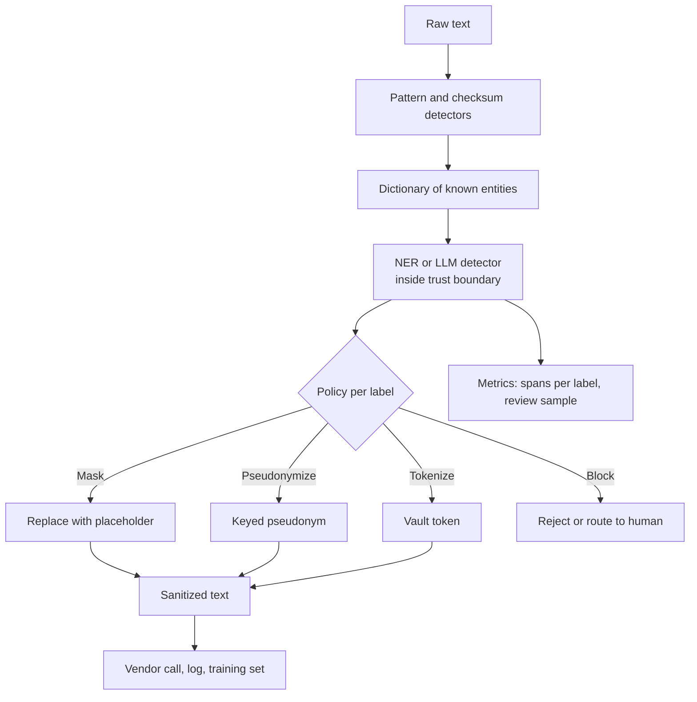

Place redaction at each boundary where text leaves a more trusted zone for a less trusted one: before a vendor call, before writing to logs, before writing to a training set, and before sharing with an annotation vendor. A single redaction pass at the front door is not enough, because tool results and retrieved documents enter the prompt later. Redact at the gateway on the assembled prompt, and again on the output before logging.

### 10.7 Pseudonymization design

Pseudonyms are only useful if they are consistent where the task needs linkage and unlinkable where it does not.

- **Keyed hash (HMAC) pseudonyms** are deterministic: the same input gives the same pseudonym under the same key, so records link. Without the key an attacker cannot compute the mapping, but an attacker who can guess candidate values (all emails at a company, all phone numbers in a range) and who has the key can confirm them. Keep the key in a secrets manager, separate from the data, and rotate it by policy. Plain unkeyed hashes of low-entropy values such as phone numbers are not pseudonymization: all 10^10 ten-digit numbers can be hashed in minutes, so the mapping is easily reversed.
- **Random tokens with a vault** are not computable from the input, so they resist guessing, and the vault enforces who may detokenize. The cost is a vault as a dependency and a new high-value target.
- **Format-preserving encryption** keeps the shape of the value (a 16-digit number stays 16 digits), which helps legacy systems, at the cost of key management and subtle security caveats. Use a reviewed library and mode; do not design your own.
- **Per-context scoping.** Use different keys or token namespaces for different purposes, so a pseudonym in the analytics dataset cannot be joined to one in the training dataset. This is a purpose-limitation control as much as a privacy control.

### 10.8 Re-identification risk after redaction

Removing direct identifiers does not remove identifiability. The classic result by Sweeney showed that a combination of postcode, birth date, and sex identified a large share of the US population. A simple measure is k-anonymity: a dataset is k-anonymous for a set of quasi-identifiers (attributes that are not unique alone but identifying together) if every combination appears at least k times. If after redaction a ticket still contains "a 47-year-old orthopaedic surgeon in a town of 3,000", that sentence may identify the author. Free text defeats k-anonymity analysis because the quasi-identifiers are not columns. For text, the practical controls are to minimize detail, test with a re-identification exercise (give an analyst the redacted text and a public data source and see who they can name), and restrict access, instead of claiming anonymity.

### 10.9 Testing the redactor in CI

- Keep a labeled corpus of real-style samples (synthetic or properly authorized) with spans, per language you support.
- Run precision and recall per label on every change to patterns or models, and fail the build on a drop beyond a tolerance.
- Add adversarial samples: obfuscations, unicode lookalike characters, zero-width characters inside identifiers, mixed scripts.
- Track a canary: seed test PII into non-production traffic and assert it never appears in a sink.
- Review a weekly random sample of redacted outputs by a human and record the leak rate.

## 11. Privacy-Enhancing Techniques at an Architect's Level

Redaction and minimization reduce what is exposed. Privacy-enhancing technologies (PETs) limit what can be learned even when computation uses sensitive data. An architect does not need to implement them, but needs to know what each guarantees, what it costs, and what it does not cover.

### 11.1 Differential privacy: the model and intuition

Differential privacy (DP), introduced by Dwork, McSherry, Nissim, and Smith in 2006, is a mathematical definition of privacy for a computation over a dataset. A randomized mechanism $M$ is $(\varepsilon, \delta)$-differentially private if for every pair of neighbouring datasets $D$ and $D'$ (differing in one individual's data) and every set of outputs $S$:

$$\Pr[M(D) \in S] \le e^{\varepsilon} \, \Pr[M(D') \in S] + \delta$$

Here $\varepsilon$ (epsilon) is the privacy loss parameter: smaller means stronger privacy, and $\delta$ is a small probability of failure of the bound (zero for "pure" DP). The intuition is that adding or removing any one person's data changes the output distribution by at most a factor of $e^{\varepsilon}$, so an observer of the output learns little about whether any individual was included.

The guarantee is about **one individual's participation**. It protects against the inference "was Alice in the data" and against learning Alice's specific values from the output. It does not stop the output from revealing facts about the population (a statistic that says smokers have higher cancer rates tells you something about Alice as a smoker without her being in the data).

**Epsilon in plain terms.** If the prior probability that Alice is in the dataset is 0.5 (odds 1:1), then after observing the output the posterior odds are at most $e^{\varepsilon}$ times the prior odds. The worst-case posterior probability is $e^{\varepsilon}/(1+e^{\varepsilon})$. The script [02_laplace_dp.py](../code/python/ai-data-governance-chapter/02_laplace_dp.py) computes:

| epsilon | Worst-case posterior (prior 0.5) |
| --- | --- |
| 0.1 | 0.525 |
| 1.0 | 0.731 |
| 5.0 | 0.993 |

At $\varepsilon = 0.1$ an observer's belief barely moves; at $\varepsilon = 1$ it moves from 50 percent to at most 73 percent; at $\varepsilon = 5$ the guarantee is nearly vacuous for a worst-case individual. This is why large epsilon values reported for some deployed systems deserve scrutiny: the number only means something when you also know the unit of privacy (one record, one user, one day of a user's data) and the number of queries.

### 11.2 The Laplace mechanism, derived and worked

For a numeric query $f$, define the **sensitivity** $\Delta f$ as the largest change in $f$ when one individual is added or removed:

$$\Delta f = \max_{D, D'} \lvert f(D) - f(D') \rvert$$

A counting query ("how many tickets mention a medical condition") has $\Delta f = 1$. The Laplace mechanism releases $f(D) + Z$, where $Z$ is drawn from the Laplace distribution with scale $b = \Delta f / \varepsilon$, whose density is

$$p(z) = \frac{1}{2b} \exp\left(-\frac{\lvert z \rvert}{b}\right)$$

**Why it is $\varepsilon$-DP.** For neighbouring datasets, $f(D)$ and $f(D')$ differ by at most $\Delta f$. For any output $y$ the ratio of densities is

$$\frac{p(y - f(D))}{p(y - f(D'))} = \exp\left(\frac{\lvert y - f(D') \rvert - \lvert y - f(D) \rvert}{b}\right) \le \exp\left(\frac{\lvert f(D) - f(D') \rvert}{b}\right) \le \exp\left(\frac{\Delta f}{b}\right) = e^{\varepsilon}$$

The first inequality is the triangle inequality, and the last step substitutes $b = \Delta f / \varepsilon$.

**Worked example.** The true count is 1,000, with $\Delta f = 1$.

- $\varepsilon = 1$: $b = 1$. The expected absolute error is $E\lvert Z \rvert = b = 1$. The probability that the error exceeds $t$ is $\Pr(\lvert Z \rvert > t) = e^{-t/b}$. For $t = 10$ that is $e^{-10} \approx 4.5 \times 10^{-5}$.
- $\varepsilon = 0.5$: $b = 2$. $\Pr(\lvert Z \rvert > 10) = e^{-5} \approx 0.0067$. A 95 percent error bound solves $e^{-t/2} = 0.05$, giving $t = 2 \ln 20 \approx 6.0$.
- $\varepsilon = 0.1$: $b = 10$. $\Pr(\lvert Z \rvert > 10) = e^{-1} \approx 0.368$. The released count is within ten of the truth only 63 percent of the time.

The script confirms these: for $\varepsilon = 0.1, 0.5, 1, 2, 5$ the mean absolute errors over 100,000 draws are 10.00, 2.00, 1.00, 0.50, 0.20, matching $b$. In the script's table the tail probability at $\varepsilon = 0.5$ prints as 0.0067.

**Utility depends on the count.** The same absolute error is a very different relative error. At $\varepsilon = 1$ (mean error 1): a true count of 10 has a 10 percent expected error, a count of 100 has 1 percent, and a count of 100,000 has 0.001 percent. DP works well for large aggregates and badly for small cohorts, which is also the cases in which privacy risk is highest. A dashboard that slices into groups of 10 users with $\varepsilon = 1$ per slice will produce noise that obscures the signal.

**Composition.** Every release spends privacy budget. Under basic composition, $k$ releases of $\varepsilon_i$ each cost $\sum \varepsilon_i$ in total. Twelve monthly releases at $\varepsilon = 0.5$ cost $12 \times 0.5 = 6.0$, a guarantee that has weakened a lot since each of them looked fine. Tighter composition theorems (advanced composition, Rényi DP accounting) give better totals for many mechanisms, but the principle holds: **budget is cumulative, so someone must own the ledger**. Releasing the same statistic repeatedly with fresh noise lets an attacker average the noise away.

### 11.3 Differential privacy in model training

DP-SGD (differentially private stochastic gradient descent), introduced by Abadi and colleagues in 2016, trains a model with a DP guarantee on the training examples. Per step, it clips each example's gradient to a norm bound $C$ (limiting the sensitivity of any one example), adds Gaussian noise proportional to $C$ to the summed gradients, and tracks cumulative privacy loss across steps with an accountant. The guarantee is on training-example participation: a DP-trained model's behavior changes little whether or not a given example was included, which directly limits membership inference and extraction of that example.

The costs are practical. Clipping and noise slow convergence, so accuracy falls, more so for small models and for smaller $\varepsilon$; the computation per step grows because gradients are per example; and the guarantee requires choosing the unit (record or user). Strong guarantees (small $\varepsilon$) generally need large datasets and often large batch sizes. For language model fine-tuning on private data, DP is an active research and engineering area, with libraries available, and results depend heavily on setup. For architects the decision rule is: use DP training when the training data is highly sensitive, the cohort is large, and you can accept a measured utility loss; otherwise use data minimization, deduplication, and retrieval in place of training on the sensitive data.

Distinguish **central DP** (a trusted curator adds noise to results) from **local DP** (each user adds noise before sending data). Local DP removes the trusted curator but needs far more noise for the same guarantee, which is why it is used for telemetry from millions of devices and rarely for rich enterprise analytics.

### 11.4 Federated learning

Federated learning (FL), introduced by McMahan and colleagues in 2017 with the federated averaging algorithm, trains a model across many clients without centralizing raw data. Each round, the server sends the current model to a set of clients, each client trains locally on its data and returns an update, and the server averages the updates.

Two settings differ in practice. **Cross-device** FL involves millions of phones with small local datasets and unreliable participation, as in keyboard prediction. **Cross-silo** FL involves a few organizations such as hospitals or banks with larger datasets and stable participation, often under legal barriers to data sharing.

What FL does and does not give:

- It keeps raw data on the client, which can resolve a transfer or sharing barrier and reduces the central store of sensitive data.
- It does not by itself guarantee privacy. Model updates (gradients) can leak information about the local data, and gradient inversion attacks have reconstructed training inputs from updates in some settings. FL is combined with **secure aggregation** (the server sees only the sum of updates, not individual ones), **differential privacy** (clipping and noise on updates), or both for stronger protection.
- It adds heterogeneity (clients have different data distributions), communication cost, and operational complexity, including how to evaluate, debug, and roll back a model you cannot inspect the data for.

FL is a fit when data cannot move for legal or contractual reasons and the parties will accept the engineering overhead. It is rarely a fit for a single enterprise whose data already sits in one warehouse; there, access control and minimization are simpler.

### 11.5 Secure enclaves and confidential computing

Confidential computing runs code in a hardware-protected **trusted execution environment** (TEE) where data in use is encrypted in memory and isolated from the host operating system, hypervisor, and cloud operator. Common mechanisms are confidential virtual machines (for example AMD SEV-SNP and Intel TDX) and, for accelerators, GPU confidential computing modes on recent datacenter GPUs. The environment produces a cryptographically signed **attestation** that states which hardware and which software measurement is running; a relying party (for example, your key management service) verifies the attestation before releasing keys or data.

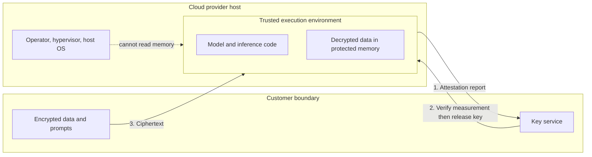

The figure shows the sequence that makes the technique useful: the key is released only after the environment proves what it is running, so even the cloud operator cannot read prompts or weights. It protects data **in use** from the infrastructure operator. Typical architect uses are running a private model on a public cloud for T3 data, protecting model weights from the host, and multi-party analytics where parties do not trust each other.

Limits to state plainly: a TEE does not stop the code inside from leaking data (a model that memorizes still memorizes), side-channel attacks on hardware TEEs have been published and are patched over time, you must verify attestation rather than assume it, and performance overhead exists and varies by workload. Treat confidential computing as strengthening the boundary against the operator, not as a replacement for access control or redaction.

### 11.6 Synthetic data and its privacy limits

Synthetic data is artificial data generated to resemble real data, produced by rules, statistical models, or generative models. It is attractive for test data, evaluation sets, and sharing with vendors. The privacy claim "synthetic data is not personal data" is true only when the generator does not leak real records or reveal facts about individuals.

Leakage routes:

- A generative model trained on real data can **memorize and reproduce** training records, which then appear in the synthetic set.
- Rare combinations of attributes in the synthetic data may match a real individual closely (a unique outlier).
- Membership inference can work against synthetic data releases in the same way as against models.

Checks before treating a synthetic set as low risk:

1. Compute the distance from each synthetic record to its closest real record (distance to closest record, DCR). Compare to the distance between real records and their nearest real neighbours; a synthetic record that sits much nearer to a real record than is typical is a likely copy. Flag exact and near-exact matches.
2. Run a membership inference attack (Section 12) against the generator or release.
3. Examine rare categories and outliers, which are the highest-risk records.
4. Where the stakes justify the utility loss, generate with a DP guarantee (DP training of the generator) so that the privacy claim is mathematical rather than empirical.
5. Evaluate utility: train a model on the synthetic data and test on real held-out data. If the synthetic set loses the signal you need, it is not useful, and one that preserves signal perfectly may be leaking.

There is a trade-off: privacy and fidelity pull in opposite directions. A synthetic set that retains the joint distribution of rare attributes retains the information that identifies rare people. Synthetic data from rules (invented names, fake order numbers) carries no real-person leakage and is the safest option for test environments, though it may not reproduce real edge cases.

### 11.7 Choosing among PETs

| Technique | Protects against | Cost | Does not protect against | Fit |
| --- | --- | --- | --- | --- |
| Redaction and pseudonymization | Exposure of identifiers in text and logs | Low | Linkage, undetected spans | Default for prompts, logs, training text |
| Differential privacy | Inference about any one individual from outputs or the model | Utility loss, expert tuning | Population-level inference, misuse of budget | Large-cohort aggregates; sensitive training with large datasets |
| Federated learning | Centralizing raw data | Operational complexity | Leakage from updates unless combined with secure aggregation and DP | Cross-organization training with legal barriers |
| Confidential computing | Operator and host access to data in use | Performance and attestation operations | Leaks by the code inside; side channels | Private inference or analytics on T3 data in shared infrastructure |
| Synthetic data | Real records in test and share sets | Generator quality work | Memorized or outlier records | Test data, evaluation sets, vendor sharing |

## 12. Memorization, Extraction, Membership Inference, and Embedding Inversion

The previous section reduced what a system exposes by design. This section covers what a trained or indexed system exposes by accident. The risks are concrete and measurable, and they set the case for excluding sensitive data from training.

### 12.1 Memorization

A model memorizes when it can reproduce parts of its training data that it saw few times, more precisely than generalization would explain. Large models memorize, and memorization increases with model size, with the number of times an example is repeated in the data, and with the length of the context used to prompt it (Carlini and colleagues, 2022, "Quantifying Memorization Across Neural Language Models"). Duplicated text is the greatest single driver: a license header, a boilerplate email signature, or a form letter that appears thousands of times is learned verbatim.

Two consequences. First, **deduplication is a privacy control**, not only a quality measure, and should be applied to training sets (exact and near-duplicate removal). Second, memorized content includes content that appeared once but was distinctive, like an API key pasted into a document or a phone number in a signature, so deduplication reduces but does not remove risk.

### 12.2 Training-data extraction

Carlini and colleagues (2021, "Extracting Training Data from Large Language Models") showed that an attacker with only query access to a language model (GPT-2) could recover verbatim training sequences, including personal information, by sampling many outputs and filtering for those that the model finds unusually likely. Nasr and colleagues (2023, "Scalable Extraction of Training Data from (Production) Language Models") reported extraction attacks on production chat models, including a prompting strategy that caused an aligned model to diverge from chat behavior and emit memorized training text at a rate far above normal. The lesson is that alignment and a polite refusal behavior do not remove memorized content, and a motivated attacker can search the space systematically.

For governance: if a model was trained on T2 or T3 data, you cannot assume the model is safe to expose broadly. Run an extraction evaluation before launch (prompt with prefixes of known training records and check for continuation; search generated text for strings matching canaries and known identifiers), and treat the model as having the access tier of its training data.

**Canaries.** A canary is a unique synthetic string inserted into the training set. After training, measure whether the model assigns it higher likelihood than comparable random strings, or can complete it. A model that completes canaries inserted once or twice shows memorization at that exposure level. Canaries make memorization testable without using real personal data, and they provide a regression test across training runs.

### 12.3 Membership inference

A membership inference attack (Shokri and colleagues, 2017) decides whether a given record was in a model's training set. It matters because membership itself can be sensitive: knowing that a person's record was in a cancer clinic's training data reveals a diagnosis. The simplest attack uses the model's loss. Training examples tend to have lower loss than unseen examples, so the attacker predicts "member" when the loss is below a threshold.

The script [04_membership_inference.py](../code/python/ai-data-governance-chapter/04_membership_inference.py) trains logistic regression with 100 features on 60 examples, a setting built to overfit, and attacks it with a loss threshold. With a fixed seed it prints:

```text
unregularized (overfit)  train acc=1.00 held-out acc=0.57 gap=0.43 | attack AUC=0.897 advantage=0.70
strong L2 (regularized)  train acc=1.00 held-out acc=0.58 gap=0.42 | attack AUC=0.774 advantage=0.33
```

Here AUC (area under the receiver operating characteristic (ROC) curve) is the probability that a randomly chosen member scores as more member-like than a randomly chosen non-member; 0.5 means the attacker is guessing and 1.0 means perfect. Advantage is the true positive rate minus the false positive rate at a median-loss threshold. The overfit model leaks strongly: AUC 0.897 and advantage 0.70, so the attacker is right about membership far more often than chance. Regularization lowered the leak to AUC 0.774 and advantage 0.33 without closing the generalization gap (train accuracy stayed at 1.00), which shows that the attack depends on the loss gap and not only on accuracy.

Caveats. This is a toy, with 120 examples, so the numbers vary with the random seed and should not be quoted as a general effect size. Attacks on large language models are harder because the loss distribution of members and non-members overlaps heavily on web-scale data, and published work has found that simple attacks perform near chance on some large models trained for one epoch, while stronger attacks (calibrated against reference models) do better. The honest summary: leakage rises with overfitting, duplication, and repeated epochs on small sensitive datasets, which are the fine-tuning conditions of many enterprise projects. A small fine-tuning set that is trained for many epochs is closer to the toy than to a web-scale pretraining run.

Defenses: reduce overfitting (early stopping, regularization, fewer epochs), deduplicate, limit what the API reveals (do not return token log-probabilities for sensitive models, since the loss attack needs them), and use DP training when the risk warrants it. Test with an attack on your own model using held-out members and non-members before release.

### 12.4 Embedding inversion

Embeddings are often assumed to be safely abstract. Research shows otherwise. Morris and colleagues (2023, "Text Embeddings Reveal (Almost) As Much As Text") introduced an iterative method that recovered a large share of short text inputs, reporting exact recovery of 92 percent of 32-token inputs for a particular embedding model, and demonstrated recovering personal information in clinical-note embeddings. The details depend on the embedding model, the text length, and attacker access to the embedding model, and shorter texts invert better. The architectural lesson: **an embedding is a lossy but sometimes recoverable copy of its source**, so a vector database needs the same access control, encryption, and deletion obligations as the source text.

Even without inversion, a vector index supports similarity search, which lets an attacker with read access find records near a known one (for example, find all tickets similar to a leaked one). That is why per-tenant filtering and index-level authorization matter (Section 17), and why shared indexes across tenants need careful design.

Mitigations: restrict who and what can query or export vectors; store embeddings of redacted text where the task allows; avoid exposing raw vectors through public APIs; consider adding noise or quantization when the use case tolerates it (this reduces inversion fidelity but also retrieval quality, so evaluate both); and treat vendor-hosted embedding calls as disclosures of the underlying text to the vendor.

### 12.5 Prompt and context leakage

Models can be induced to repeat their context. A system prompt may contain business rules or secrets, and retrieved passages may contain other users' data if retrieval is misconfigured. Prompt injection can instruct the model to disclose context. Data governance sets the rule that **nothing should be placed in a prompt that the requesting user is not entitled to see**, since the model cannot be trusted to withhold it. The enforcement of this at the system level is in [Part 17 CH12](../17_AI_Architecture/CH12_AI_Safety_Security_Privacy_and_Governance_Architecture.md); the data-side obligation is to minimize and to authorize before assembly.

### 12.6 A risk matrix for planning

| Leakage path | Needs attacker access to | Drivers | Primary controls |
| --- | --- | --- | --- |
| Memorized text in model outputs | Query access | Duplication, model size, repeated epochs | Deduplicate, avoid sensitive training, extraction tests, output filters |
| Membership inference | Query access, ideally scores or log-probabilities | Overfitting, small datasets | Regularize, limit scores returned, DP |
| Embedding inversion | Vectors and often the embedding model | Short text, exposed vectors | Access control, redaction before embedding |
| Similarity probing on index | Read or query access to the index | Shared indexes, weak filters | Tenant filters, per-tenant indexes |
| Prompt and context disclosure | Ability to send prompts | Injection, over-stuffed context | Minimize and authorize context |
| Log and cache leakage | Access to logs, caches | Verbose logging, long retention | Logging policy, redaction, short retention |

## 13. Retention and Deletion Propagation

Retention says how long data may exist. Deletion is what happens when the time is up, or when a person, a licensor, or a court says it must go. In an AI system both are harder than in a single database, because one source record has many descendants.

### 13.1 Retention by purpose and by store

Define retention by purpose and storage tier, not once for the whole system. A reasonable pattern:

| Store | Retention rule (illustrative) | Reason |
| --- | --- | --- |
| Source system of record | Per records schedule, for example 24 months after case close | Legal and business need |
| Prompt and response logs | 30 days full text (redacted), 13 months metadata only | Debugging and incident response need recent detail; trend analysis needs metadata |
| Response and semantic caches | Hours to days; invalidated on source change | Performance only |
| Vector index | Mirrors the source: removed within the propagation delay of source deletion | Derived from source |
| Feature store online | Days; offline per source retention | Serving and training |
| Training snapshots | Tied to the training run's audit period, deleted after the model is retired, unless legal reasons require retention | Reproducibility versus minimization |
| Evaluation sets | Reviewed annually; contain minimized or synthetic data | Regression testing |
| Backups | Fixed cycle, for example 35 days, with restore procedure that replays deletion ledger | Disaster recovery |

Indefinite retention increases both compliance exposure and breach impact. The cost of storing a log line for another year is tiny, and the cost of that line being in a breach is not. Tie retention to a stated purpose, review it, and automate expiry.

### 13.2 Deletion is a lineage impact query

When a deletion trigger arrives (a rights request, a consent withdrawal, a source expiry, a license revocation, a court order), the system should answer: **which artifacts descend from this record or source, and what must happen to each?** That is a graph traversal over the lineage records from Section 15. The script [03_deletion_propagation.py](../code/python/ai-data-governance-chapter/03_deletion_propagation.py) models one ticket's descendants and runs the traversal.

For the example record, the traversal finds 13 artifacts: the source ticket, a raw snapshot, two chunk versions and their two vectors, three feature rows, a training dataset, a fine-tuning run, the resulting model, and a cache entry. Each store type has an owner and a maximum propagation delay (illustrative values from the script):

| Artifact kind | Owner | Max delay (days) |
| --- | --- | --- |
| Source ticket | Support platform | 1 |
| Raw snapshot | Data platform | 7 |
| Chunks, vectors, cache | RAG team | 1 |
| Feature rows | ML platform | 2 |
| Training dataset | ML platform | 30 |
| Fine-tuning run record | ML platform | 0 |
| Model | ML platform | 90 |

The completion deadline is driven by the slowest store: the model, at 90 days. This is the arithmetic behind the earlier point that a one-month response cannot promise complete removal from a model. The honest response closes the rights request with: source, snapshot, retrieval, features, caches, and dataset deleted or blocked within their delays; and the model handled by a documented decision (Section 14).

### 13.3 Tombstones, purging, and the gap between them

Many stores cannot delete instantly or cheaply. A vector database marks deleted vectors and removes them physically during compaction. A columnar data lake file is immutable, so deleting a row means rewriting the file. An append-only log cannot edit lines. The pattern that resolves this is the **tombstone**: a marker that blocks serving of the record immediately, followed by asynchronous physical removal.

The script reports the distinction on the example: 6 artifacts are blocked by tombstone (source, two chunks, two vectors, cache), 2 are physically purged so far (source and cache), and 4 are "still stored but not retrievable" (the two chunks and two vectors). A rights-request tracker must show both counts. Closing the request on the tombstone alone claims a purge that has not happened; waiting for the purge before blocking serving leaves the data exposed during the delay.

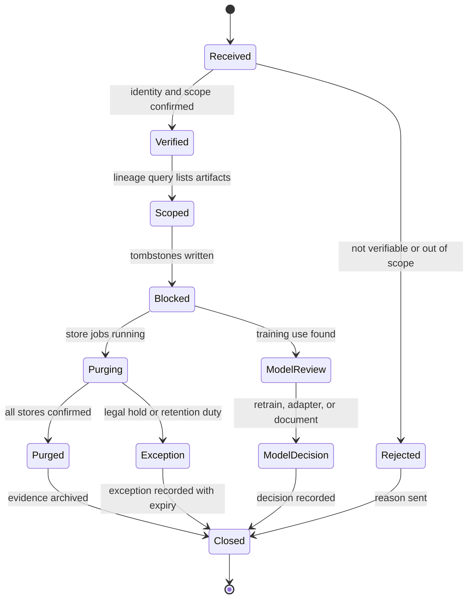

The state machine makes four points. The request cannot enter `Blocked` without a lineage query, so incomplete lineage shows up as an inability to scope. `Blocked` precedes `Purging`, so exposure stops before storage cleans up. Model review is a separate track that can finish later than the purge, because it has a different timeline. And exceptions are explicit states with expiry, not silent skips. Retention duties and legal holds are legitimate reasons to keep data (GDPR Article 17(3) lists exceptions such as legal obligations and legal claims), but they must be recorded and limited to the data they cover.

### 13.4 Store-by-store deletion mechanics

**Vector indexes.** Check how your engine deletes. Many approximate nearest neighbour indexes (for example graph-based indexes) mark entries deleted and rebuild or compact later, and some leave the deleted vector's neighbours intact until compaction. Verify with a query for the vector's exact text that nothing returns, and set a compaction schedule that meets the propagation delay. For higher assurance, rebuild the index periodically from the current source, which removes deleted content by construction; see [CH26](CH26_Vector_Databases_for_AI_Retrieval.md) for index mechanics.

**Feature stores.** The online store supports key deletion. The offline store holds history for training, often as immutable files. Use table formats with row-level delete support and run the vacuum or expire-snapshots operation to remove physical files, or rewrite partitions on a schedule.

**Caches.** Key caches by source version and invalidate by source ID on deletion. A semantic cache stores answers keyed by query embedding; an answer derived from a deleted record can match a new query. On deletion, purge entries whose provenance lists the source, which requires that cache entries carry their source IDs. If they do not, the only safe option is to flush the cache.

**Logs.** Treat prompt logs as the most likely hidden copy. The cleanest solution is to avoid the problem: redact before logging and keep full-text retention short, so that by the time a deletion request arrives most log content is gone. For longer-lived logs, per-subject encryption keys let you delete the key (crypto-shredding), which makes that subject's log entries unreadable without rewriting storage; the cost is key management at the subject level.

**Backups.** Backups are point-in-time copies that you cannot sensibly edit. Three controls apply together. Keep backup retention short and fixed so that data ages out. Replay the **deletion ledger** on every restore, before the restored system serves traffic. And if per-subject keys are used, delete the keys. The script shows the failure: restoring a backup without replay serves the deleted ticket and its chunk again (`['src:ticket-4412', 'src:ticket-5000', 'chunk:4412-v1', 'src:ticket-5001']`), and with replay serves only the surviving tickets (`['src:ticket-5000', 'src:ticket-5001']`). Regulators generally accept that backups are cleared on the normal cycle if the deleted data is put "beyond use" and not restored without re-deletion, but check with counsel which standard applies.

**Third parties.** For each external recipient (model vendor, annotation vendor, analytics tool), the rights request needs a deletion call or ticket and a recorded acknowledgement. Contracts should state the response time.

**Derived text.** Summaries, notes, and generated tickets that quote the subject are derived data. Lineage should cover them, and where it does not, text search is the fallback.

### 13.5 Verification and evidence

Deleting is not done until it is checked. For each store, define a **probe**: a query that would return the record if it were present, for example a text search for a unique token from the record, a vector query using the record's text, a cache lookup, and a feature fetch by ID. Run the probes after the propagation delay and store the results. The probe set doubles as a regression test: seed a synthetic subject through the pipelines, delete it, and assert that every probe is empty. Run this synthetic deletion test weekly in production, because deletion pipelines break silently when a new store is added without registering it.

The closure record should contain the request ID, artifact IDs found, per-store operation and completion time, probe results, exceptions with approver and expiry, and the model decision. It should not copy the sensitive content. Evidence that contains the data you deleted undermines the deletion.

### 13.6 Worked example: the full 37-item fan-out

Return to the fan-out count in Section 2.4: 37 persisted items across about nine stores. A deletion request must account for each one. Group them by treatment:

- **Delete by key** (immediate): 1 database row, 14 attachments, 2 cache entries. Total 17.
- **Tombstone then purge on schedule**: 6 vectors, 2 snapshots (7-day and 12-month), 1 annotation task. Total 9.
- **Rewrite or expire**: 1 training dataset entry, which requires rewriting the dataset snapshot and recording that the older version is retired. Total 1.
- **Redact or expire logs**: 4 log entries. Total 4.
- **Age out or key-shred**: 6 backup copies. Total 6.

The sum is 17 + 9 + 1 + 4 + 6 = 37. The count itself is the useful artifact: it shows the request touches six treatments, four teams, and one item (the dataset entry) that leads to the model question. Without the data-flow map the team would likely have handled the first group, forgotten the logs and annotation task, and not discovered the backup and training issues until audit.

## 14. Machine Unlearning: Honest Limits and Practical Options

### 14.1 The problem

A trained model's parameters are a compressed function of its training data. A deleted record's influence is spread across many parameters and entangled with the influence of other records. There is no operation that locates and removes a record's contribution. "Machine unlearning" is the research area that seeks such operations.

Two definitions help. **Exact unlearning** produces a model whose distribution is the same as a model trained without the record: the only general way is to retrain without it. **Approximate unlearning** modifies a trained model to behave as if the record were not in the training set, without full retraining, usually without a proof.

### 14.2 What approximate methods can and cannot do

Approximate methods for large language models include gradient ascent on the data to forget (making the model worse at predicting it), fine-tuning on counterfactual or refusal responses, and parameter editing. Benchmarks such as TOFU (Maini and colleagues, 2024) exist to measure forgetting on fictitious authors, and evaluations show a trade-off: forgetting more degrades the model's general ability, and measured forgetting on the target set does not prove the information is gone from the model. Follow-up work has shown that "unlearned" knowledge can sometimes be recovered by fine-tuning on related data or by jailbreak-style prompts, which indicates the model suppressed the output and did not erase the knowledge.

For governance, the position to adopt is this. **Do not state that a trained model has forgotten a record unless you have a method with an evaluated guarantee that your regulator accepts.** At the time of writing, no widely accepted certification exists for approximate unlearning of large models. The EDPB opinion discussed in Section 4 reasons that a model is anonymous only if personal data is very unlikely to be extractable; the practical path to meeting that bar is to test extraction and membership attacks on the specific model, and to design the training set so the question rarely arises.

### 14.3 Practical options

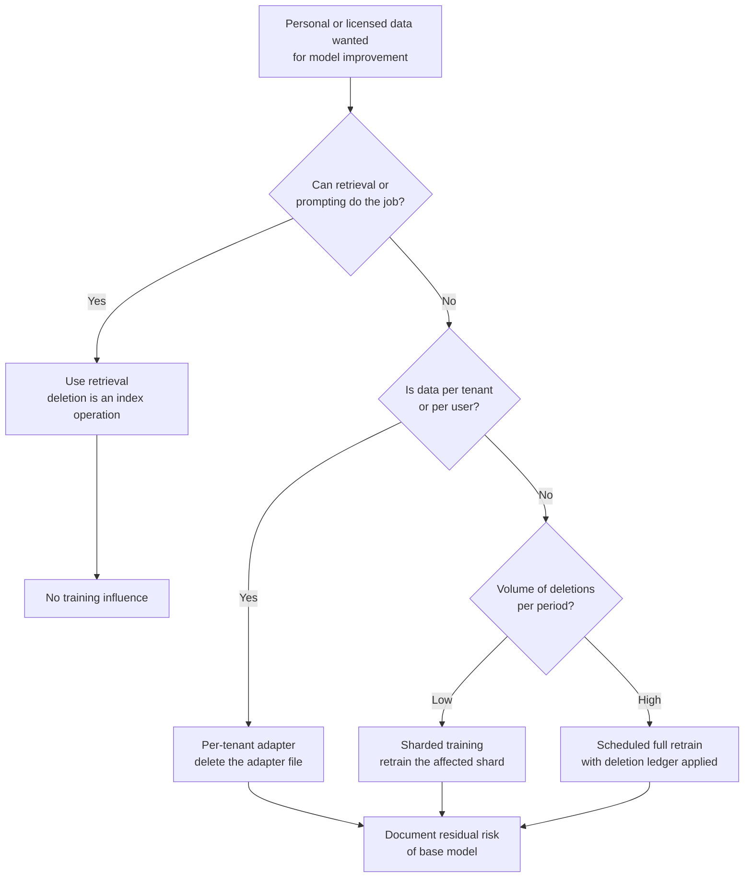

The decision tree orders the options by how well they keep deletion simple. The first question is the most valuable: if retrieval or in-context examples achieve acceptable quality, personal data never enters weights, and deletion is an index operation with a known finish line.

**Option 1: Do not train on it.** Keep personal and licensed content in retrieval, use it as in-context data per request, and train only on public, licensed, synthetic, or consented and minimized data. This is the default recommendation for enterprise assistants. It trades some quality (the model does not internalize the style or domain deeply) for governability.

**Option 2: Per-tenant or per-user adapters.** Parameter-efficient fine-tuning (LoRA, see [CH20](CH20_Fine_Tuning_PEFT_and_LoRA.md)) trains small adapter weights on top of a frozen base model. If each tenant's data trains only that tenant's adapter, deleting the tenant's data means deleting the adapter file, which is an exact and cheap operation for that data, and tenant isolation is preserved because adapters are loaded only for that tenant. Limits: the base model's training is untouched, so the base must not contain the tenant's data; per-record deletion within a tenant still requires retraining that tenant's adapter, which is small and cheap compared to a full model; and adapter serving adds operational complexity (many adapters, routing, memory).

**Option 3: Sharded training (SISA).** Bourtoule and colleagues (2021) proposed SISA training (Sharded, Isolated, Sliced, Aggregated). Partition the training data into $S$ shards, train a separate model (or sub-model) on each, and aggregate predictions. To delete a record, retrain only the shard that contained it, starting from the most recent checkpoint before the record was seen (slicing). The cost of one deletion falls to roughly $1/S$ of a full retrain, at the price of some accuracy loss from smaller training sets per model and an ensemble at inference time. SISA is well-matched to smaller classical models and less so to very large language model pretraining.

**Option 4: Scheduled retraining with a deletion ledger.** Retrain the whole model on a fixed cadence from the current dataset, which has had all deletions applied. Deletions are honored at the next retraining. The system documents the maximum latency (the cadence) and uses output controls during the gap.

**Option 5: Output suppression during the gap.** For a subject who has objected or asked for erasure, add them to a suppression list that blocks outputs naming them, plus an extraction test for their data. This is mitigation and not removal; record it as such.

**Option 6: DP training.** If the model was trained with differential privacy at a meaningful $\varepsilon$ and an appropriate privacy unit, the influence of any single record is bounded by construction, which supports an argument that removal of a single record would not materially change the model. That argument is statistical and depends on the unit and the budget.

### 14.4 Worked cost: sharded versus full retraining

A model needs 4,000 GPU-hours for a full training run (illustrative). The team gets deletions at a steady rate and applies them in monthly batches.

**Sharded with $S = 10$ equal shards.** Retraining one shard costs about 4,000 / 10 = 400 GPU-hours (ignoring slicing savings and ensemble overhead).

- With 2 deletions per month, spread at random across shards, the expected number of distinct shards affected is $S\left[1 - (1 - 1/S)^{n}\right] = 10\,[1 - 0.9^2] = 10 \times 0.19 = 1.9$. Expected cost: 1.9 × 400 = 760 GPU-hours, versus 4,000 for a full retrain, a saving of 81 percent.
- With 25 deletions per month the expected distinct shards are $10\,[1 - 0.9^{25}]$. Since $0.9^{25} \approx 0.0718$, this is $10 \times 0.9282 = 9.28$ shards. Expected cost: 9.28 × 400 = 3,712 GPU-hours, which is 93 percent of a full retrain. The saving has nearly vanished.

The principle: **sharding pays when deletions are few relative to shards, and the benefit disappears as the deletion count approaches the shard count**, because batching spreads deletions across almost every shard. At high deletion volume, either increase the shard count (with accuracy cost), retrain more often on smaller increments, or choose Option 1 or 2 so that deletions never reach shared weights.

**Per-tenant adapters.** Suppose an adapter costs 8 GPU-hours to retrain. A single tenant's record deletion costs 8 GPU-hours, which is 0.2 percent of the 4,000 GPU-hour model. Even 25 deletions in 25 different tenants cost 25 × 8 = 200 GPU-hours, far below the sharded figure, because the training units are small and isolated by design. The trade-off is that you pay for many adapters in storage and serving, and you give up cross-tenant learning.

### 14.5 Setting the statement you can make

For each deployed model, write one of these statements into the model's data card, and choose the one that is true:

1. "Trained only on data with no personal data and with licenses permitting training." Deletion requests for personal data do not touch this model.
2. "Trained on personal data under basis X. Erasure requests are honored by retraining on cadence Y, with maximum latency Z days. Until then, suppression applies."
3. "Per-tenant adapters trained on tenant data. Deletion removes the adapter. The base model contains no tenant data."
4. "Trained on personal data. Erasure from the model is not supported. Extraction and membership tests dated D show results R. Risk accepted by owner O on date D2."

The fourth statement is uncomfortable and honest. A governance process that cannot write it down is more likely to be hiding it than to be free of it.

## 15. Lineage and Provenance

Lineage and provenance answer two related questions: what did this artifact come from, and what has been done to it? Lineage is the graph of derivation. Provenance adds attribution and context: who or what produced the artifact, when, under what terms, with what tools. Both support audit, incident response, reproducibility, license revocation, and deletion.

### 15.1 What to record

Preserve the source version and transformation configuration, not only a descriptive dataset name. "customer_support_dataset_v3" is not provenance; a manifest of source IDs, versions, filters, code commit, and hashes is. At each transformation step, record:

| Field | Example |
| --- | --- |
| Artifact ID and content hash | `ds:train-v7`, SHA-256 of the manifest |
| Input artifacts with versions | `snap:raw-2026-09-01`, source query version |
| Transformation and parameters | `redactor@1.4.2`, dedup threshold 0.9, filter rule set 12 |
| Code and environment | Git commit, container image digest |
| Policy decisions | Purpose check results, consent filter version |
| Actor | Pipeline identity and the human who approved |
| Time and region | UTC timestamp, processing region |
| Output location and retention | Bucket path, expiry rule |

Standards help interoperability. OpenLineage is an open specification for emitting lineage events (jobs, runs, datasets) from data pipelines, with integrations for common orchestrators. The W3C PROV family defines a vocabulary of entities, activities, and agents for provenance. You do not have to adopt a standard to start, but emitting events in a standard format avoids a bespoke lineage database that only one team can query.

### 15.2 Dataset versioning

A dataset used for training must be reproducible: given the training run record, you can reconstruct the exact data. Options:

- **Content-addressed snapshots.** Store datasets as immutable files and reference them by hash. Any change creates a new hash.
- **Table formats with time travel.** Table formats that retain snapshots let you query a table as of a version, which supports reproduction.
- **Dataset version control tools.** Tools that track data files with metadata in a repository (git-style for data) link a code commit to a data version.

The tension is that reproducibility pushes toward keeping old snapshots, while deletion pushes toward removing records. Resolve it by policy: keep the **manifest** (IDs and hashes, with no content) forever, keep the **content** only for the audit period, and when a subject's record is deleted, mark the manifest entry as "content removed" with the reason. The manifest still proves what was used, even though the content is gone, and a reproduction attempt reports the removal.

### 15.3 Datasheets for datasets and data cards

Gebru and colleagues (2018, published 2021 as "Datasheets for Datasets") proposed that every dataset ship with a documented set of answers on motivation, composition, collection process, preprocessing, uses, distribution, and maintenance. Data cards are a related documentation format used by several organizations. The aim is to force the questions that determine fitness and risk before the dataset is used: Does it contain personal data? Was consent obtained? Which groups are under-represented? What uses are discouraged? Who maintains it, and how are errors reported?

A compact datasheet for an internal dataset might include:

| Section | Questions answered |
| --- | --- |
| Motivation | Why created, by whom, funded by whom |
| Composition | Instances, fields, personal or sensitive data, labels, known gaps and errors |
| Collection | Source systems, time range, sampling, notice or consent state |
| Preprocessing | Cleaning, redaction, deduplication, filtering rules and versions |
| Uses | Intended uses, uses prohibited by purpose limitation |
| Distribution | License, access, sharing restrictions |
| Maintenance | Owner, update cadence, deletion process, contact |

Model cards (Mitchell and colleagues, 2019) are the corresponding artifact for models. The data governance chapter's concern is the link between them: the model card names its training datasheets by version, so that a deletion or license event on a dataset leads to the models that used it.

### 15.4 Lineage graph and the entity model

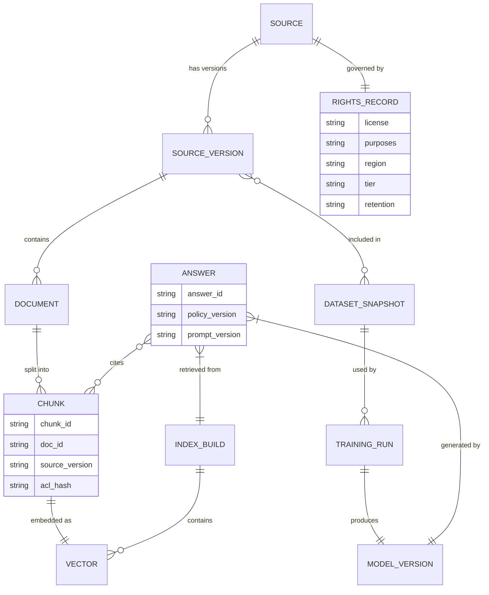

The model has three properties that matter. Every derived entity carries a pointer to its parent version, so a traversal can go from a source to everything below it. The `RIGHTS_RECORD` is attached to the source and inherited, so a rights change at the root is visible below. And the `ANSWER` entity links to the chunks, the index build, the model version, and the policy and prompt versions that were active when it was generated. The last link is what turns a served answer into an auditable event.

### 15.5 Source-to-chunk-to-answer citation lineage

For retrieval systems the most valuable lineage is at serving time. Every chunk in the index carries `chunk_id`, `doc_id`, `source_version`, and `acl_hash`. At query time, the retrieval service records which chunk IDs were retrieved and which were included in the prompt. The answer returned to the user carries citations that resolve to those chunks. The answer log stores the answer ID, the chunk IDs, the index build ID, the model and prompt versions, and the policy bundle version, with no copy of chunk text.

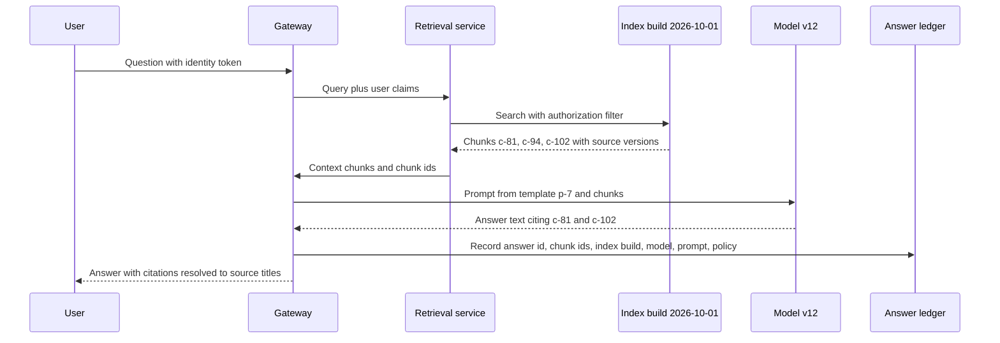

The sequence shows where lineage is captured: at the point where context is assembled and at the point where the answer is returned. Three outcomes follow. When a license is revoked, a query on the ledger for chunks from that source version lists every answer that used them, which is the impact assessment. When a user disputes an answer, the ledger shows which passages the model saw. And when evaluating citation quality, the ledger supplies the pairs to test (see [CH24](CH24_Generative_AI_Evaluation_Guardrails_and_Hallucinations.md) for claim-level grounding evaluation).

Be precise about what citation lineage proves. It proves what was retrieved and offered to the model, and which passages the output cites. It does not prove that the output is supported by the cited passage (the model can cite wrongly), nor that the passage is correct. Claim-level support is an evaluation question for CH24.

### 15.6 Cost of the ledger: worked arithmetic

A ledger that stores identifiers and not text is cheap. Suppose 1,000,000 answers per day, five chunk references per answer, and each reference stored as a 36-character identifier plus 8 bytes of overhead, about 44 bytes. The chunk references take 1,000,000 × 5 × 44 = 220,000,000 bytes, about 220 MB per day, plus perhaps 200 bytes per answer for IDs, versions, and timestamps (200 MB per day). Total about 420 MB per day, or roughly 153 GB per year before compression. Storing the full prompt text would be around 5 chunks × 800 tokens × about 4 bytes per token = 16 KB per answer, 16 GB per day, which is about 38 times the identifier-only ledger (16 GB / 0.42 GB ≈ 38), and it would also create a large store of personal data. Record identifiers by default and capture text only for sampled, redacted, short-retention debugging.

### 15.7 Opaque transformations

Lineage fails where a step is a black box: a manual spreadsheet export, a notebook that reads and writes without emitting events, or a vendor service that returns derived data without IDs. Track **lineage completeness** as a metric (the share of artifacts with a recorded parent chain to a source), and treat gaps as findings. When lineage is incomplete, the fallback is conservative: assume the artifact descends from the most sensitive source it could have touched.

## 16. Content Provenance for Outputs and Signed Manifests

Section 15 tracks the provenance of data going into the system. This section covers provenance of what comes out, and signed evidence about the system's own artifacts.

### 16.1 Why output provenance matters

Generated text, images, audio, and video can be mistaken for human-made or authentic content. Regulators have begun to require disclosure. Under the EU AI Act, Article 50 imposes transparency obligations: providers of AI systems that generate synthetic audio, image, video, or text must ensure outputs are marked in a machine-readable format and detectable as artificially generated, where technically feasible; deployers of systems that generate deepfakes, or text published to inform the public on matters of public interest, must disclose that the content is AI-generated, with exceptions; and people interacting with an AI system must be informed unless obvious. The Digital Omnibus amendment (Regulation (EU) 2026/1744) kept the Article 50 duties on their August 2026 application date and added a grace period until 2 December 2026 for machine-readable marking by generative AI systems already on the market before 2 August 2026, according to law-firm and industry analyses of the final text. Confirm applicability to your system with counsel.

### 16.2 C2PA and Content Credentials

The Coalition for Content Provenance and Authenticity (C2PA) publishes an open technical specification for attaching signed provenance to media. The user-facing label is Content Credentials. At the time of writing the [C2PA specifications site](https://c2pa.org/specifications/specifications/2.4/) lists version 2.4 as current (the preceding release was 2.3); check the site for the latest version before implementing.

The mechanism, in simplified form:

- **Assertions** are statements about the asset: how it was created (including an action indicating it was generated by a trained algorithmic model, with a digital source type value), what edits were applied, which tool was used, and optionally which ingredients (source assets) it was derived from.
- A **claim** bundles assertions with a **hard binding**: a cryptographic hash of the asset's bytes, so any alteration after signing is detectable.
- A **claim signature** is created with the signer's private key and an X.509 certificate chain. A verifier checks the signature, the certificate chain against a trust list, and the hash binding.
- The **manifest** (claim, assertions, signature) is embedded in the file or stored remotely and referenced. Manifests can chain: an edit creates a new manifest that references the previous one as an ingredient, producing an edit history.
- **Soft binding** uses watermarks or fingerprints to find the manifest when metadata has been stripped, since embedded metadata is easy to remove.

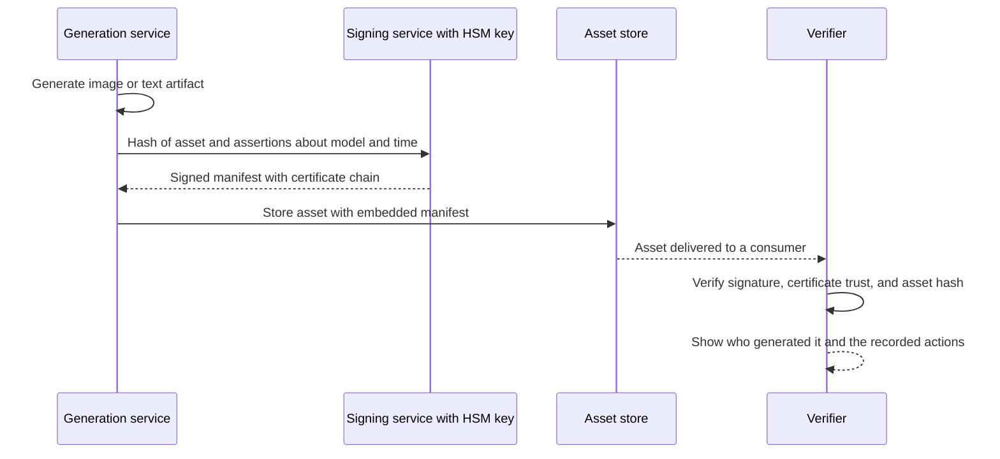

The figure shows that provenance is a signing workflow. The signing key is held in a hardware security module or key service, the assertions describe the generation event, and verification needs the asset, the manifest, and trust configuration. Key custody and certificate policy come from [Part 15 CH11 PKI](../15_Security/CH11_PKI.md) and [CH10 Encryption](../15_Security/CH10_Encryption.md).

### 16.3 What provenance does and does not prove

- A valid manifest proves that a party holding the signing key made the claims at signing time and that the asset has not changed since. It does not prove the content is true, that the signer is honest, or that the creation claims are correct.
- Absence of a manifest proves nothing. Metadata is stripped by many platforms, screenshots, and re-encoding. Treat the absence as "unknown".
- Text is the weakest case. Plain text has no container for embedded metadata, so provenance for text relies on watermarking of token choices (which has robustness limits, as paraphrasing can remove it) or on provenance recorded in the system that publishes the text.
- Do not put personal data in manifests unless necessary. A manifest travels with the asset; assertions about the operator, the prompt, or the user can expose information. Record the model, time, and tool; keep user and prompt details in your internal ledger.

### 16.4 Signed manifests for datasets and models

The same pattern applies to internal artifacts. A **signed manifest** for a dataset snapshot lists its source versions, filter rules, hashes, purpose approvals, and the rights decisions, and is signed by the pipeline identity. A **signed model manifest** lists the training run ID, dataset manifests, base model, evaluation results, and approvals. The deployment pipeline refuses to deploy a model without a valid manifest from the registry, and the serving layer records the manifest ID in each answer ledger entry.

Tooling in the software supply chain applies: in-toto style attestations describe steps and materials, Sigstore provides keyless signing and transparency logs, and model-signing efforts (for example in the OpenSSF community) extend signing to model files. See [Part 15 CH15 Supply Chain Security](../15_Security/CH15_Supply_Chain_Security.md) and [CH16 SBOM](../15_Security/CH16_SBOM.md) for the base practices. A machine learning bill of materials (ML-BOM) extends the idea to datasets and models, listing components with versions, licenses, and hashes.

The value is operational. When a dataset is found to contain unlicensed content, a query over signed manifests lists every model that used it, and the signatures establish that the manifests are what the pipeline produced, not what someone edited later.

## 17. Access Control in Retrieval and Per-Tenant Boundaries

Retrieval turns a data store into a source of prompts. If the retrieval layer returns something the requester should not see, the model will use it, and a model cannot reliably keep a secret. Governance must therefore require that authorization happens before content enters the prompt.

[Part 17 CH05](../17_AI_Architecture/CH05_Retrieval_Augmented_Generation_System_Architecture.md) owns the retrieval architecture. This section states what data governance requires of it, and gives the numbers that justify the requirements.

### 17.1 Requirements

1. **Authorization on the retrieval path uses the end user's identity**, not a broad service identity. A retrieval service that queries with a super-user account and then filters results in the model's prompt has already moved the data across the boundary.
2. **Every chunk carries access metadata**: tenant ID, owning group, ACL (access control list) hash or policy attributes, and sensitivity tier, copied from the source at ingestion and kept in sync.
3. **Filtering happens inside the index query (pre-filter)** or on a per-tenant index, not by post-filtering the top-k results.
4. **Permission changes propagate** within a stated time. A user removed from a group must lose access to the group's chunks within the defined window; a document with a tightened ACL must be updated in the index.
5. **Authorization decisions are logged** with the identity, policy version, and counts of allowed and denied chunks, not the content.

### 17.2 Why post-filtering fails: worked numbers

Suppose a shared index with a user who is authorized for 5 percent of chunks (typical in a multi-tenant system where the user sees only their own tenant's content, or in a large enterprise corpus where most documents are restricted). The retrieval step fetches the top $k = 10$ by similarity and then drops unauthorized chunks.

- If relevance is independent of authorization, the expected number of authorized chunks among the top 10 is 10 × 0.05 = 0.5.
- The probability that none of the 10 is authorized is $0.95^{10} \approx 0.599$.

So about 60 percent of queries return nothing useful, and the model answers from no context, often with a hallucination. The usual patch is to increase $k$ to 200 so that enough authorized results survive the filter, which costs latency and, more importantly, **means 190 unauthorized chunks were retrieved and handled by the retrieval service** (an exposure if the service logs them, caches them, or leaks scores). There is also a subtle leak: if the system tells the user "no results" versus "results exist but are restricted", the response reveals the existence of restricted content. Pre-filtering by metadata inside the vector query (supported by most vector databases) avoids both problems, at some cost to index structure and recall that the vector database chapter covers.

### 17.3 Per-tenant isolation options

| Pattern | Isolation strength | Cost | Notes |
| --- | --- | --- | --- |
| Shared index with tenant metadata filter | Logical; depends on the filter being applied every time | Lowest | A missing filter in one code path leaks across tenants; enforce in a data-access layer, not in call sites |
| Separate collection or namespace per tenant | Stronger logical; filter is part of the target | Low to medium | Good default for many tenants of moderate size |
| Separate index or cluster per tenant | Strong; separate resources and keys | High; fixed overhead per tenant | For regulated or large tenants; supports per-tenant keys and residency |
| Per-tenant encryption keys over shared storage | Cryptographic boundary on data at rest | Medium; key management | Does not by itself prevent a query layer bug |

A simple cost check, illustrative: if each separate index has a fixed overhead of 50 MB of memory for graph structure and caches, then 2,000 tenants cost 2,000 × 50 MB = 100 GB of overhead before holding any vectors. That is affordable for 200 large tenants (10 GB) and wasteful for 2,000 small ones, which is why a hybrid is common: shared index with strict filtering for small tenants, dedicated indexes for tenants that require them by contract or regulation.

### 17.4 Group expansion, stale ACLs, and the confused deputy

Common failures, each worth a test:

- **Stale ACLs.** The source system changed permissions, the sync job is hourly, and the index still holds the old ACL. Measure the lag and alert if it exceeds the window.
- **Group expansion drift.** Nested group membership resolved at ingestion time goes stale when the membership changes. Resolve group membership at query time from the identity provider, with chunks carrying group IDs instead of expanded user lists.
- **Confused deputy.** A tool or agent with broad permissions acts on behalf of a user with narrow ones. Pass the user's identity through, and enforce authorization at the data layer. See [Part 15 CH05 ABAC](../15_Security/CH05_ABAC.md) for attribute-based policy.
- **Derived content with stricter source.** A summary of a restricted document, cached and served to a user who cannot access the original. Cache keys must include the authorization context, or the cache must store the lineage so that the entry is served only if the user could read every source.

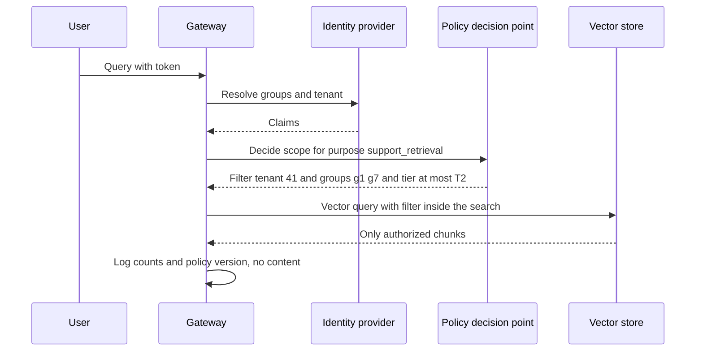

The sequence shows the authorization boundary: the filter is computed from fresh claims and a policy decision, and it is part of the search request. The model never receives content outside the user's scope, and the log contains counts and identifiers only.

### 17.5 Testing for leakage

- Seed each tenant with unique canary documents, and for each tenant's test user assert that no query returns another tenant's canary. Run this in the pipeline after every change to filters, schema, or index.
- Fuzz queries designed to hit canary text of other tenants, including semantic paraphrases, since the attacker's query need not contain exact words.
- Test permission revocation: remove a user's access, wait for the stated propagation window, and assert zero results.
- Include the cache layer, which can serve across users if keyed only on the query text.

## 18. Data Contracts and Quality Ownership

AI quality problems are often data problems with no owner. A source team renames a field, changes the meaning of a status code, or starts putting free text in a structured column, and the downstream chunker, feature job, or classifier degrades without any error. A data contract is an explicit, versioned agreement between a data producer and its consumers about schema, semantics, quality, and obligations.

### 18.1 What a contract for AI consumers contains

| Element | Example for a support ticket feed |
| --- | --- |
| Schema and types | Field names, types, allowed values, nullability |
| Semantics | "status = closed" means the customer confirmed resolution, not that an agent closed it |
| Classification | Per-field sensitivity tier; the free-text `body` is T2 and may contain T3 |
| Rights metadata | Purposes permitted, consent flag field, retention class |
| Quality expectations | Completeness above 99 percent for `customer_id`; duplicates under 0.5 percent; freshness under 15 minutes |
| Change policy | Notice period of 14 days for breaking changes; versioned schema |
| Deletion interface | Deletion events published on a topic, with the contract naming the delay |
| Ownership | Named producing team, on-call contact, escalation |

The contract adds two things that general data engineering practice often lacks: classification and rights metadata travel with the schema, and the deletion interface is a first-class part of the interface. A producer that deletes a record without publishing a deletion event has broken the contract.

### 18.2 Enforcement

Contracts are valuable when checked automatically. Validate incoming batches or streams against the schema and quality expectations at ingestion, quarantine violations, and alert the producer. Consumers register their dependency in the catalog, so a producer proposing a change sees who will be affected. For AI pipelines add checks that matter for models: distribution checks on key fields, a ceiling on the share of records containing detected PII in a column declared PII-free, and a check that chunk text length distributions have not shifted, which often signals a changed export format. The mechanics of drift monitoring belong to [CH29](CH29_MLOps_and_LLMOps.md); the governance point is that a detected PII-in-a-clean-column event is a contract breach with a named owner who must respond.

### 18.3 Quality ownership

Assign each dataset a **data owner** (accountable for purpose, access decisions, and retention) and a **data steward** (responsible for quality, metadata, and rights records day to day). Training sets and evaluation sets are datasets too, and need owners. A frequent gap is the evaluation set built by one engineer from production data, with no owner, no retention, and unlimited copies. Treat evaluation data as governed data: minimize, label with provenance, set an expiry, and record who may access it.

## 19. Cross-Border Transfer and Residency

Data protection regimes restrict moving personal data across borders, and some sectors and governments require it to stay in-country. AI workflows cross borders in more ways than ordinary applications: a prompt goes to a model endpoint in another region, a vendor's support staff in a third country view logs, a global training job reads data from several regions into one.

### 19.1 Mechanisms

Under the GDPR, transfers outside the European Economic Area require a mechanism: an **adequacy decision** by the European Commission, **standard contractual clauses (SCCs)** with a transfer impact assessment, **binding corporate rules** within a group, or a narrow derogation. For transfers to the United States, the EU-US Data Privacy Framework adequacy decision of 10 July 2023 allows transfers to certified organizations (the Data Privacy Framework, DPF). The EU General Court dismissed an annulment action against it on 3 September 2025 (Case T-553/23, *Latombe v Commission*); public sources at the time of writing indicated the applicant could appeal to the Court of Justice, and I could not verify the final outcome. Because two earlier transatlantic frameworks (Safe Harbor and Privacy Shield) were invalidated, design for a fallback: SCCs and region pinning in your architecture, not only DPF certification of the vendor.

Other jurisdictions apply their own tests, including security assessments and localization for certain data categories. For a multi-country product the practical step is to maintain a **residency matrix**: for each data class and each jurisdiction, where it may be stored, processed, and accessed (access from abroad counts as a transfer under many regimes), and by which mechanism.

### 19.2 Residency in an AI architecture

| Component | Residency question | Control |
| --- | --- | --- |
| Source and logs | Which region stores them? | Region-pinned storage with policy that denies cross-region replication for restricted classes |
| Vector index | Does the index sit in the same region as the source? | Regional indexes per residency zone |
| Model endpoint | Does inference happen in-region? Do prompts or outputs leave the region? | Regional endpoints; gateway enforces region from data tag |
| Training | Does training data move across regions? | Train regionally (or federated); move only models, not data, where permitted |
| Vendor support access | Can vendor staff outside the region see content? | Contract terms; support access controls; ZDR |
| Backups and DR | Where do replicas live? | Same-zone replicas only |
| Embedding calls | Where does the embedding service run? | Regional endpoint; treat it like inference |

The gateway should read the residency tag from the data (or the tenant) and select the endpoint, rejecting calls that have no compliant region instead of falling back to a default. Fallback routing for availability is a common cause of residency breaches: a regional endpoint fails and traffic silently fails over to another region. Decide in advance whether failover may cross regions, and encode the answer in the router.

### 19.3 Worked example: failover and residency

A gateway routes EU tenants to an EU endpoint with 99.9 percent availability. If the EU endpoint is unavailable, the router can fail over to a US endpoint. Suppose 0.1 percent of requests (the unavailable fraction) fail over. With 2,000,000 EU requests per day, 0.001 × 2,000,000 = 2,000 requests per day cross the border. Over a year that is about 730,000 requests (2,000 × 365), each carrying whatever personal data the prompt contained. Without a policy decision on failover, the system performs a transfer at that scale without a recorded mechanism. The correct design choices are to fail closed for restricted data (return an error or a degraded non-AI path), or to have a second compliant in-region provider, or to have a documented transfer mechanism covering the US endpoint and permit failover only for tiers where that is acceptable. The arithmetic turns an availability decision into a compliance decision.

## 20. Logging Policy for Prompts and Responses

Logs are the most common place for AI systems to accumulate personal data without anyone deciding to. Developers want full prompts to debug, security wants full prompts to investigate abuse, product wants them to improve quality, and each wish is legitimate. The policy has to reconcile them with minimization and retention.

### 20.1 What to log

Think in three layers with different retention.

| Layer | Content | Default retention | Access |
| --- | --- | --- | --- |
| Metadata | Request ID, timestamp, tenant, user pseudonym, model and prompt version, policy version, index build, chunk IDs, token counts, latency, safety verdicts, tool calls (names and argument hashes), cost | Long (13 months or per audit need) | Engineering, SRE, audit |
| Redacted content | Prompt and response text after redaction; retrieved chunk text omitted by default | Short (for example 30 days) | Restricted group, access logged |
| Raw content | Unredacted prompt and response | None by default; time-boxed capture for an incident with approval | Named individuals, with approval record |

The metadata layer is the audit trail: it supports the answer ledger, cost accounting, and incident scoping without holding the content. Keep it as rich as needed. The content layers are risk, so keep them narrow and short.

### 20.2 What to redact, and when

Redact personal identifiers and secrets before the log write, using the detector pipeline of Section 10 with a policy that favors recall for logs. Redact card numbers and credentials with the strictest settings, since leaking either into logs creates PCI and security exposure. Do not log retrieved chunk text when chunk IDs suffice. Do not log the system prompt on every request; log its version. Do not log tool results that include records; log the tool name and a result hash. Provider API keys must never appear in logs, which is a secrets-management matter ([Part 15 CH09](../15_Security/CH09_Secrets_Management.md)).

### 20.3 Using logs to improve the system

Logs are often proposed as a source of training or evaluation data. That is a new purpose. Require the same purpose check as any other source: is there a basis for this reuse, was notice given, is there an opt-out, and has the sample been redacted and minimized? A safe pattern is a dedicated **improvement sample** drawn from consenting or contractually permitted tenants, redacted, reviewed, stored with a short expiry, and tagged with its provenance, and not the general log store opened to the training pipeline.

### 20.4 Access, integrity, and monitoring

Access to content logs is a privileged action: individual lookup with reason codes, access logged, periodic review. Logs should be tamper-evident (append-only storage or hash chains) when used as audit evidence. Monitor the logging pipeline itself: sample logs for undetected PII at a fixed rate and track the leak rate. A log policy that is not checked drifts back to "log everything".

### 20.5 Worked example: retention arithmetic for logs

A service handles 1,000,000 requests per day. Redacted content averages 3 KB per request (prompt plus response), and metadata averages 0.5 KB.

- Redacted content at 30 days: 1,000,000 × 3 KB × 30 = 90,000,000 KB, about 90 GB resident.
- The same content at 400 days (a "keep it for a year just in case" default): 1,200 GB, 13.3 times as much (400 / 30).
- Metadata at 13 months (about 395 days): 1,000,000 × 0.5 KB × 395 = 197,500,000 KB, about 198 GB.

Storage cost is minor. What changes with retention is the number of person-records exposed in a breach. Assume 8 percent of redacted content still contains a residual PII span (a measured leak rate from the weekly sample, illustrative). At 30 days that is 30 days × 1,000,000 × 0.08 = 2,400,000 residual spans at rest; at 400 days it is 32,000,000. A breach of the 30-day store exposes about 7.5 percent of the spans of the 400-day store. The retention decision is a risk decision with a number attached.

## 21. Audit Evidence and the Impact Assessment Workflow

Controls that cannot be demonstrated do not exist for an auditor, a regulator, or a customer's security review. Evidence should be produced as a by-product of operating the system, not assembled before an audit.

### 21.1 The evidence set

| Claim | Evidence the system should produce |
| --- | --- |
| Each source has a recorded basis and permitted purposes | Catalog records with reviewer and date |
| Training sets were built within permitted purposes | Dataset manifest with purpose check decisions and consent filter version |
| Personal data is not sent to vendors outside terms | Vendor register, DPA, gateway config, redaction metrics |
| Rights requests are honored in time | Request tracker with timestamps, per-store completion, probe results |
| Deletion reaches all stores | Weekly synthetic deletion test results; lineage completeness metric |
| Retrieval enforces access | Authorization logs with policy versions; tenant-canary test results |
| Logs are minimized and expire | Log schema, retention configuration, expiry job runs, PII leak sampling |
| Models are traceable | Signed model manifests, registry records, answer ledger |
| Changes are reviewed | Approval records, impact assessments, exception register with expiry |

Store evidence in a location with its own retention and integrity controls, and avoid copying sensitive data into evidence.

### 21.2 DPIA and impact assessment workflow

A data protection impact assessment (DPIA) is required under GDPR Article 35 when processing is likely to result in a high risk to individuals, which commonly includes large-scale processing of special-category data, systematic monitoring, and use of new technologies with significant effects; many AI projects meet the test. Regulators publish lists of processing that always needs one. Where the AI Act applies, deployers of certain high-risk systems must also carry out a fundamental rights impact assessment (Article 27), and the AI Act allows it to complement a DPIA. California's regulations require risk assessments for certain processing as noted earlier. Rather than three workflows, run one assessment with modules.

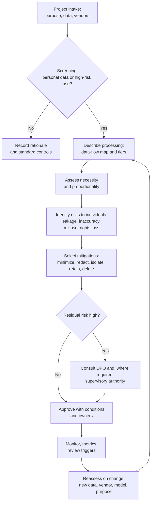

The workflow's key elements are the data-flow map as the starting artifact (an assessment based on a diagram that omits logs and caches is invalid), the explicit assessment of risks to individuals rather than risks to the company, conditions with named owners rather than a one-time sign-off, and a loop on change. Review triggers include a new data source, a vendor terms change, a new user group, a move from retrieval to training, a change in model, and an incident.

### 21.3 What an assessment should contain for an AI system

- Purposes and lawful basis for each of training, retrieval, inference, evaluation, and logging.
- The data-flow map with persistence and retention per store.
- Vendor chain, regions, retention, and training terms.
- Rights handling per store, with the model position from Section 14.
- Leakage risk evidence: extraction and membership tests, redaction recall, tenant isolation tests.
- Accuracy risk: what happens when the system gets a fact about a person wrong.
- Residual risks accepted, by whom, until when.

## 22. EU AI Act: Data and Record-Keeping Obligations

The EU Artificial Intelligence Act (Regulation (EU) 2024/1689) sets obligations by risk class and by role. This section covers the parts that concern data and records. It reflects what could be verified from public sources in October 2026; the schedule changed in 2026, so confirm dates with counsel.

### 22.1 Timeline as amended

The Act entered into force in August 2024 and applies in stages. Prohibited practices and AI literacy duties applied from 2 February 2025. Obligations for providers of general-purpose AI (GPAI) models applied from 2 August 2025, with the Commission's enforcement powers over GPAI providers starting on 2 August 2026 and a transition to 2 August 2027 for models placed on the market before August 2025. The Digital Omnibus on AI, published as Regulation (EU) 2026/1744 and in force from 27 July 2026, postponed the high-risk system obligations: those for stand-alone high-risk systems in Annex III now apply from 2 December 2027 (previously 2 August 2026), and those for AI embedded in products regulated under Annex I from 2 August 2028. The Article 50 transparency obligations continued to apply from 2 August 2026, with a grace period to 2 December 2026 for machine-readable marking by generative systems already on the market. See the [Council's press release](https://www.consilium.europa.eu/en/press/press-releases/2026/05/07/artificial-intelligence-council-and-parliament-agree-to-simplify-and-streamline-rules/) on the political agreement and the [AI Act Explorer page on the Omnibus](https://artificialintelligenceact.eu/ai-act-explorer/digital-omnibus/) for a summary; for dates that matter to your product, read the Official Journal text.

### 22.2 Data governance for high-risk systems (Article 10)

For high-risk AI systems that train models on data, Article 10 requires training, validation, and testing data sets to meet quality criteria, subject to data governance and management practices appropriate to the intended purpose. These practices cover design choices; data collection processes and the origin of data, and for personal data the original purpose of collection; preparation operations such as annotation, labelling, cleaning, updating, enrichment, and aggregation; the formulation of assumptions about what the data represents; assessment of availability, quantity, and suitability; examination for possible biases likely to affect health, safety, or fundamental rights; measures to detect, prevent, and mitigate those biases; and identification of data gaps. Data sets must be relevant, sufficiently representative, and, to the best extent possible, free of errors and complete in view of the intended purpose, with appropriate statistical properties for the persons or groups on whom the system is used. Article 10 also provides a narrow basis for processing special categories of personal data to detect and correct bias, under strict conditions. The Omnibus amendments touched this provision; read the consolidated text for the conditions that apply.

The mapping to this chapter is direct: the data-flow map, the source records (origin and original purpose), the dataset manifest (preparation operations), the datasheet (assumptions, gaps, bias examination), and the lineage graph together are the evidence for Article 10. A team that has built the artifacts of Sections 2, 4, and 15 has done most of the engineering.

### 22.3 Documentation and record-keeping (Articles 11, 12, 18, 19, 26)

- **Technical documentation (Article 11, Annex IV)** must be drawn up before a high-risk system is placed on the market and kept up to date, including data requirements and datasheets-type information.
- **Record-keeping (Article 12)** requires high-risk systems to allow automatic recording of events (logs) over their lifetime, to the extent needed to identify risks, support post-market monitoring, and enable oversight.
- **Retention.** Providers keep the automatically generated logs under their control for a period appropriate to the intended purpose, at least six months unless other law provides otherwise (Article 19); deployers likewise keep logs under their control for at least six months (Article 26). Providers keep technical documentation and related records for ten years after the system is placed on the market (Article 18).

These retention minimums interact with data protection. The Act's log minimum and the storage-limitation principle both apply, and the resolution is the layered logging policy of Section 20: keep metadata and event logs for the required period and keep content only where it is needed, with identifiers redacted. Define in advance which log fields are the "records" under Article 12 so that you can show they exist while still deleting content logs on schedule.

### 22.4 General-purpose AI model providers (Article 53)

If you provide a GPAI model (for example, you train a foundation model), Article 53 requires technical documentation, information for downstream providers, a policy to comply with Union copyright law (including identifying and respecting rights reservations under the text and data mining opt-out), and a sufficiently detailed public summary of the content used for training, using a template published by the Commission. Models with systemic risk have further duties in Article 55. If you only build on a provider's model, your supplier carries these duties, and you can request the documentation. If you fine-tune a model substantially, check whether you become a provider; the Commission has published guidance on this boundary, and you should read it with counsel.

### 22.5 Transparency (Article 50) and provenance

The marking and disclosure duties of Article 50 tie directly to Section 16. Plan the marking mechanism (C2PA manifests for media, watermarking for text where feasible) and a user-facing disclosure for chatbots, tied to the dates above.

### 22.6 Interplay with the GDPR

The Act does not displace the GDPR. A system can be lawful under one and not the other, and the same dataset is subject to both. Where the Act demands data for bias examination and the GDPR restricts special-category processing, Article 10's narrow provision is the bridge. Keep the two documentation tracks aligned so that the DPIA, the Article 10 data governance record, and the datasheet draw from the same source records and do not diverge.

## 23. Incident Handling for Data Exposure via AI

Data exposure through an AI system takes forms that ordinary incident playbooks do not name. A playbook should list them so that responders recognize them.

### 23.1 Incident types

- **Cross-tenant retrieval.** A user receives content from another tenant due to a filter bug or stale ACL.
- **Model output of memorized data.** The model emits personal data, secrets, or copyrighted text from training.
- **Prompt log exposure.** A log store with full prompts is misconfigured, accessed by an unauthorized party, or included in a vendor breach.
- **Vendor-side event.** The model provider reports an incident affecting inputs, outputs, or fine-tuned artifacts.
- **Unauthorized training use.** Data is found in a training set without basis, or a model has been trained on data after an objection.
- **Prompt injection exfiltration.** A document or tool result instructs the model to send data out through an output channel or tool call.
- **Residency breach.** A failover or misconfiguration moved data to a non-permitted region.
- **Deletion failure.** A restored backup or a stale cache serves deleted data.

### 23.2 Response sequence

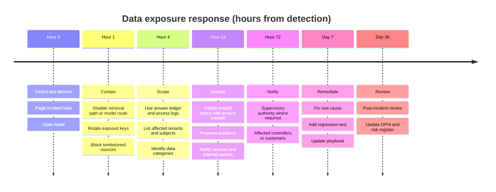

The timeline's hour markers are targets that should be tuned to your contracts. The 72-hour point reflects GDPR Article 33: a controller notifies the supervisory authority without undue delay and, where feasible, not later than 72 hours after becoming aware of a personal data breach, unless the breach is unlikely to result in a risk to individuals. Where the risk to individuals is high, Article 34 requires communication to the affected individuals. As a processor you notify the controller without undue delay, and your contracts usually set a shorter period. Other regimes have different clocks (HIPAA breach notification runs on a 60-day outer limit, and many US state laws set their own).

### 23.3 What makes AI incidents different

**Scoping needs the ledger.** To know who was exposed, you need the answer ledger and retrieval authorization logs. Without them the only defensible scope is "everyone". The cost of missing metadata is a larger notification.

**Containment may be a kill switch.** Disabling retrieval for a source, switching a tenant to a non-AI path, or routing to a different model are the fast levers; build them before you need them, and test them.

**Evidence preservation conflicts with deletion.** An incident can require preserving data that policy would delete. Use legal hold records with scope and expiry, and keep the preserved material in a restricted store.

**The model may carry the problem.** If a model memorized and emitted personal data, fixing the retrieval layer does not fix the model. The response may include suppression, output filtering, rollback to a prior model, retraining, or, if the data should not have been in the training set, a regulatory discussion. Section 14's statements apply.

**Vendors.** Include vendor contacts, contract notification clauses, and the process to request vendor-side deletion and logs in the playbook.

### 23.4 Worked example: scoping with and without lineage

A filter bug allowed cross-tenant retrieval for 6 hours in a shared index. Traffic was 40,000 queries per hour.

- Without an answer ledger: the possible exposure is all queries in the window, 6 × 40,000 = 240,000 queries, across all 1,900 tenants. The notification list is every tenant.
- With the ledger (chunk IDs, tenant of each chunk, tenant of each requester): query the ledger for answers where the chunk's tenant differs from the requester's tenant. Suppose this finds 312 answers affecting 47 requester-tenant and chunk-tenant pairs, 61 tenants in all.
- Notification scope falls from 1,900 tenants to 61, a reduction of 97 percent (1 − 61/1,900 = 0.968), and each notice can state precisely what was exposed.

The ledger paid for itself in one incident, and it is cheap, as the arithmetic in Section 15.6 showed.

## 24. Governance Operating Model and RACI

Tooling without ownership degrades. The operating model assigns people and decision rights.

### 24.1 Roles

- **Data owner.** Accountable for a dataset's purpose, access, retention, and rights decisions; typically a business leader.
- **Data steward.** Maintains metadata, quality, and rights records; first contact for questions.
- **Data protection officer (DPO) or privacy lead.** Advises on legal basis, DPIAs, and rights; independent where law requires a DPO.
- **AI governance or review board.** Cross-functional group (privacy, security, legal, product, ML engineering, the business owner) that approves high-risk uses, exceptions, and changes of purpose.
- **Platform team.** Builds and operates the catalog, lineage, deletion orchestration, redaction service, and gateway.
- **Model owner.** Accountable for the model's training data decisions, evaluation, and the data-card statement about deletion.
- **Security.** Owns access control, key management, logging integrity, incident response.
- **Legal.** Owns license review, vendor terms, and regulatory interpretation.

### 24.2 RACI

R means responsible, A accountable, C consulted, I informed. Only one A per row.

| Activity | Data owner | Steward | Privacy / DPO | Review board | Platform | Model owner | Security | Legal |
| --- | --- | --- | --- | --- | --- | --- | --- | --- |
| Register source and rights record | A | R | C | I | C | I | C | C |
| Approve use of source for training | C | C | C | A | I | R | I | C |
| Build redaction and gateway controls | I | I | C | I | R | C | A | I |
| Run rights requests end to end | I | C | A | I | R | C | C | I |
| Operate deletion propagation and tests | I | C | I | I | A | R | I | I |
| Vendor onboarding and term review | C | I | C | C | R | C | C | A |
| DPIA and impact assessment | C | C | A | C | C | R | C | C |
| Approve exceptions | C | I | C | A | I | R | C | C |
| Incident response | I | I | C | I | R | C | A | C |
| Data card and lineage completeness | C | R | I | I | C | A | I | I |

### 24.3 Cadence and decision rights

Run a lightweight weekly intake review for new data uses, a monthly metrics review, and a quarterly audit of deletion tests, vendor terms, and exception expiries. Give the review board a small number of clear decisions: approve or reject a new training use, approve or reject a new vendor for a tier, and approve exceptions with expiry. Boards that review everything become bottlenecks; make low-risk, standard patterns self-service through the catalog policy checks, and reserve the board for novel or high-tier uses.

## 25. Metrics

Metrics show whether governance is operating. Choose a small set with owners and thresholds.

| Metric | Definition | Direction | Example threshold |
| --- | --- | --- | --- |
| Source rights coverage | Share of sources with complete rights record | Up | 100 percent for T2 and T3 |
| Lineage completeness | Share of artifacts with a recorded parent chain to a source | Up | Above 95 percent; 100 percent for training sets |
| Unclassified artifacts | Count of artifacts without tier | Down | 0 |
| Rights request time | Median and 95th percentile days to closure | Down | 95th percentile under the legal deadline minus 5 days |
| Deletion completeness | Synthetic deletion test pass rate | Up | 100 percent weekly |
| Tombstone-to-purge lag | Days between block and physical removal | Down | Within documented maximum per store |
| PII per prompt | Mean detected identifiers per outbound prompt | Down | Set from baseline; alert on 20 percent increase |
| Redaction recall and precision | Measured on weekly labeled sample | Up | Recall target per label, for example 0.95 on structured identifiers |
| Residual PII in logs | Leak rate in sampled redacted logs | Down | Below 1 percent of sampled records |
| Cross-tenant canary leaks | Canary documents returned to wrong tenant | Down | 0 |
| Permission propagation lag | Time for ACL change to take effect in index | Down | Within stated window |
| Vendor register currency | Share of vendors with terms reviewed in the last 12 months | Up | 100 percent |
| Exceptions past expiry | Count | Down | 0 |
| Training data without basis | Datasets used in training lacking a purpose approval | Down | 0 |
| Incident time to scope | Hours from detection to affected-subject list | Down | Under 4 hours for tested incident types |

Use metrics for improvement and not as a score to be gamed. A rights coverage figure reaching 100 percent by creating empty records is worse than a lower honest number. Pair coverage metrics with sampling audits.

## 26. Failure Modes and Quality-Attribute Scenarios

### 26.1 Failure modes

| Failure | Cause | Consequence | Control |
| --- | --- | --- | --- |
| Fine-tuned on tickets with no deletion plan | Convenience, no purpose gate | Erasure and objection requests cannot be honored | Training purpose gate; adapters; retrieval first |
| Deleted data returns after restore | Backup restored without ledger replay | Reappearance of deleted content, possible breach | Replay ledger before serving; short backup cycle |
| Semantic cache serves a deleted or restricted answer | Cache not keyed by authorization or source | Disclosure | Cache entries carry source IDs and authorization context |
| Redactor misses names and obfuscated IDs | Pattern-only detection | 43 percent of PII spans in the Section 10 sample pass through | Layered detection; measured recall; minimization |
| Full prompts logged and kept a year | Default logging | Large breach surface | Layered logging policy |
| Shared index with post-filter authorization | Simplicity | Empty results or cross-tenant leakage | Pre-filter or per-tenant index |
| Embedding store treated as non-sensitive | Vectors look anonymous | Inversion and weak access control | Same tier as source |
| License change not propagated | No lineage from source to index | Continued use of revoked content | Revocation record and lineage query |
| Vendor changes terms or subprocessors | No monitoring | Silent change in exposure | Vendor register, notice subscriptions, review cadence |
| Silent regional failover | Availability routing ignores residency | Unrecorded transfers | Fail-closed by tier |
| Consent flag not read by dataset builder | Systems built separately | Training on opted-out data | Policy check in builder, test with flagged subject |
| Lineage gap | Manual steps, black-box vendor | Cannot scope impact or deletion | Completeness metric; conservative assumption |
| Evaluation set of real customer data shared with annotators | No owner, no policy | Unreviewed disclosure | Governed eval data, synthetic or minimized |
| Provenance treated as truth | Misreading signatures | False assurance | State what provenance proves |

### 26.2 Quality-attribute scenarios

| Scenario | Stimulus | Response | Measure |
| --- | --- | --- | --- |
| Erasure | A verified erasure request arrives for a customer | Lineage query, tombstones, purge, probe, model decision recorded | Blocked in all serving stores within 24 hours; purged within store delays; closure under 30 days |
| License revocation | A licensor revokes a content source | Revocation record blocks retrieval; index rebuilt; caches purged | Retrieval stops within 1 hour; zero hits on probe queries within 24 hours |
| Tenant isolation | A new filter code path is deployed | Canary suite runs in CI and in production monitoring | 0 cross-tenant canaries returned across 5,000 test queries |
| Vendor change | A model vendor adds a subprocessor | Notice routed to privacy; review within 10 working days | Review completed or vendor route disabled by deadline |
| Backup restore | A restore after outage | Ledger replay precedes traffic | Zero deleted records served, verified by probes |
| Log review | Weekly log sample | Human review of 500 redacted records | Residual PII rate under 1 percent |
| Incident | Reported cross-tenant answer | Contain, scope with ledger, notify | Containment under 1 hour; scope under 4 hours |

## 27. Comparison and Trade-Off Analysis

The central design decision is where personal and licensed content lives: in retrieval, in adapters, or in shared weights. The table compares them on the dimensions that govern deletion and rights.

| Dimension | Retrieval over sources | Per-tenant adapters | Shared fine-tuned model | Pretrained base only |
| --- | --- | --- | --- | --- |
| Deletion of a record | Index operation, known finish line | Retrain small adapter | Retrain or accept residual influence | Not applicable to your data |
| Rights requests | Straightforward | Straightforward per tenant | Hardest | Straightforward |
| Access control at answer time | Possible (pre-filter) | Per adapter | Not possible; model has no ACLs | Not applicable |
| Memorization and extraction risk | Low in weights; high if context leaks | Moderate within tenant | Highest, across users | Vendor's responsibility |
| Quality on domain tasks | Good if retrieval is good | Better style and domain fit | Best fit, risk of overfitting | Lowest domain fit |
| Operational complexity | Index pipeline, ACL sync | Adapter lifecycle and routing | Training pipeline | Lowest |
| License risk | Removable on demand | Tenant data, covered by tenant contract | Hard to undo | Vendor's |
| Preferred when | Default for enterprise knowledge | Per-tenant behavior needed | Public or consented data only | Generic tasks |

The recommendation follows from the deletion column: begin with retrieval over governed sources on a pretrained base, add per-tenant adapters when behavior must adapt and data is tenant-owned, and reserve shared fine-tuning for data you have the right to keep in weights. Each step to the right trades governability for fit.

## 28. Worked Case Study: Governing a Customer-Support RAG Assistant

### 28.1 Context

A software company serves 1,900 business tenants in the EU and North America. It will deploy an assistant that answers support agents' and customers' questions using three sources: public product documentation (T0), a knowledge base of internal troubleshooting articles (T1), and the tenant's own historical tickets and CRM notes (T2, with occasional T3 such as health information typed into tickets by customers of healthcare tenants). The model is accessed from a vendor under a business agreement. The team proposed to fine-tune a model on all tickets "to learn the company's voice", to log all prompts for a year, and to use a single shared index.

### 28.2 Decisions, with the alternatives rejected

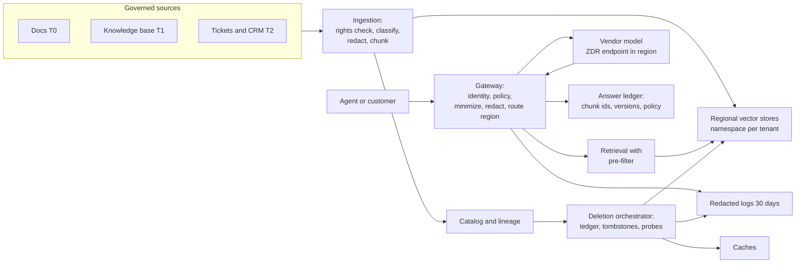

**Training: rejected fine-tuning on tickets.** The tickets contain personal data of customers and of third parties, in free text, across tenants, with no consent for training and an unresolved legitimate-interest assessment. Erasure requests would require retraining a shared model, and the draft cadence (quarterly retrain at 4,000 GPU-hours) would leave deletions outstanding for up to 90 days, which conflicts with the one-month response duty unless the model were excluded. Decision: no training on tickets. Retrieval over tickets, plus a style guide in the system prompt, gives the voice. A pilot of per-tenant adapters is deferred until a tenant asks for it and signs the data terms.

**Hosting: rejected the consumer tier and the default business tier retention.** The team selected the vendor's ZDR-eligible endpoint in the EU region, with a DPA, a prohibition on training, and subprocessor notice. T3 tenants (healthcare) are routed to a private deployment inside the company's cloud account, because no BAA-equivalent terms were available for the vendor path in the relevant jurisdictions. Failover from EU to another region is disabled for T2 and T3; the fallback is an error message and a manual path.

**Retrieval: rejected shared index with post-filtering.** At the typical tenant, authorized content is 0.05 percent of the index (a tenant holds roughly 1 in 2,000 of the chunks): with top-10 post-filtering, the probability of zero authorized results is $(1 - 0.0005)^{10} \approx 0.995$, which makes the assistant useless, and raising $k$ would expose unauthorized chunks to the retrieval service. Decision: a namespace per tenant in a regional vector store, with the tenant filter part of the target and a policy decision point computing group filters from fresh identity claims.

**Redaction and minimization.** The ingestion pipeline redacts structured identifiers in tickets before chunking and keeps the original in the source system only. The gateway applies an allowlist (order and product fields, not billing or contact fields) and a second redaction pass on the assembled prompt. The detector stack is regex-plus-checks for structured identifiers and an NER model for names and addresses, evaluated on a labeled sample of 2,000 messages per language. The pattern-only baseline measured recall of 0.57 on mixed spans, as in the Section 10 script; the layered stack measured 0.93 recall and 0.85 precision on the sample (illustrative figures from the project's evaluation). Applying the Section 10.4 arithmetic to the estimated 30,000 PII spans per day: 30,000 × (1 − 0.93) = 2,100 spans per day leave the boundary at the vendor, compared with 12,857 for the regex-only detector, an 84 percent reduction (1 − 2,100/12,857 = 0.837). The remaining exposure is accepted for T2 only because the endpoint is ZDR; T3 does not use the vendor path.

**Logs.** Metadata (request ID, tenant, model, prompt and policy versions, chunk IDs, token counts) kept 13 months; redacted content 30 days; raw content none. This replaces the one-year full-prompt plan. At the Section 20 volumes, the redacted content store holds 90 GB instead of 1,200 GB, and the count of residual PII spans at rest falls by about 92 percent (1 − 30/400 = 0.925).

**Lineage and citations.** Each chunk carries `chunk_id`, `doc_id`, `source_version`, tenant, tier, and `acl_hash`. The answer ledger stores chunk IDs, index build, model, prompt and policy versions. Citations in the UI resolve through the ledger. Revocation or deletion triggers a lineage query.

**Rights handling.** An identity graph maps customer IDs, hashed emails, and session IDs to a data subject. Rights requests run through the deletion orchestrator with the state machine of Section 13. The trial record in the earlier example (37 items, six treatments) was used as the acceptance test. Because there is no training on tickets, the model decision for each request is the standard statement 1 from Section 14.5.

**Governance.** The data owner is the head of support operations; stewards sit in each tenant's success team; the DPO owns the DPIA; the AI review board approves new sources and any proposal to train. The DPIA was completed before launch using the Section 21 workflow, with review triggers on new vendor, new source, and any move to training.

### 28.3 Validation evidence

The team collected the following before launch (figures are illustrative project results, stated to show what evidence looks like).

| Check | Method | Result |
| --- | --- | --- |
| Tenant isolation | 5,000 queries designed to retrieve other tenants' canary documents, including paraphrases | 0 canaries returned |
| Permission propagation | Remove 200 test users from groups, query after the 15-minute window | 0 chunks returned |
| Synthetic deletion | Seed a synthetic subject through ingestion, caches, logs, index; delete; run probes | All probes empty at day 2; backups age out at day 35 |
| Backup restore | Restore the index snapshot with and without ledger replay in staging | Without replay, 3 of 3 deleted test records reappeared; with replay, 0 |
| Redaction | Labeled sample of 2,000 messages | Recall 0.93, precision 0.85 overall; structured identifiers recall 0.99 |
| Extraction test | Not applicable: no custom training; vendor model tested only for system-prompt leakage | No system prompt leakage in 300 adversarial prompts |
| Rights request effort | Time per request in pilot | 0.5 hours versus 3.5 hours before lineage tooling |
| Incident drill | Simulated cross-tenant retrieval bug | Containment in 40 minutes; scope list produced from ledger in 2.5 hours |

### 28.4 Residual risks and review triggers

Accepted: a residual 2,100 undetected PII spans per day reach a ZDR vendor endpoint for T2 data; vendor legal-hold risk; accuracy of generated statements about individuals is mitigated by grounding and a suppression list, not eliminated. Review triggers: new data source, tenant request for adapters, vendor terms change, recall below 0.90 on the weekly sample, any canary leak, any rights request that cannot be closed in time, and any proposal to train on tickets.

## 29. Common Mistakes

| Mistake | Cause | Consequence |
| --- | --- | --- |
| Treating deletion of the source row as erasure | No map of derived artifacts | Chunks, vectors, caches, logs, and training sets keep the data |
| Assuming embeddings are anonymous | Vectors look like numbers | Inversion and weak access control |
| Claiming a model has forgotten data | Approximate unlearning marketed as erasure | False assurance to regulators and individuals |
| Relying on regex redaction for free text | Success on emails and cards | Names, addresses, and obfuscations leak |
| Logging full prompts by default | Convenience | Large store of personal data with broad access |
| Using the vendor's marketing page as the contract | No DPA review | Retention and training terms differ from assumptions |
| Training on whatever data is available | No purpose gate | Unlawful or unlicensed training that cannot be undone |
| Post-filtering retrieval results by permission | Simplicity | Empty answers or exposure of restricted content to the service |
| Restoring backups without replay | Disaster recovery ignores the ledger | Deleted data resurfaces |
| Adopting a signature or manifest as proof of truth | Misunderstanding provenance | Trusting content because it carries a credential |
| Writing the DPIA once | Treating it as a launch gate | Governance drifts from the system as it changes |
| Giving the board every decision | No self-service policy | Bottleneck and shadow projects |

## 30. Design-Review Checklist

- [ ] A current data-flow map lists every store of sources, snapshots, features, embeddings, prompts, logs, caches, weights, outputs, evaluation data, feedback, and backups.
- [ ] Every artifact has a sensitivity tier, an owner, a permitted-purpose set, a retention rule, and a deletion operation.
- [ ] Derived artifacts inherit the highest tier of their sources.
- [ ] Training, retrieval, inference, evaluation, and logging each have a recorded basis and purpose.
- [ ] Consent and objection flags are read by the dataset and index builders, and tested.
- [ ] Prompts send only allowlisted fields, and the personal-identifier count per prompt is measured.
- [ ] Vendor terms for each tier are reviewed: training, retention, ZDR, subprocessors, region, legal hold, termination.
- [ ] Source licenses and acquisition methods are recorded, with a revocation procedure.
- [ ] A redactor is measured on labeled data per label; recall, precision, and failure categories are known.
- [ ] Extraction and membership tests exist for any model trained on sensitive data; canaries are used.
- [ ] Deletion propagation is driven by lineage, uses tombstones, reports blocked and purged separately, and is tested weekly with a synthetic subject.
- [ ] Backups replay the deletion ledger before serving; backup retention is fixed.
- [ ] The model position on erasure is written in the data card.
- [ ] Retrieval filters by the end user's identity inside the query; tenant canary tests run in CI.
- [ ] An answer ledger links answers to chunk, index, model, prompt, and policy versions without storing content.
- [ ] Residency is enforced by the gateway; failover rules are explicit by tier.
- [ ] Logging has metadata, redacted-content, and raw-content layers with different retention.
- [ ] The DPIA exists, is current, and has review triggers.
- [ ] AI Act applicability, dates, and Article 10, 12, 50, and 53 duties are assessed with counsel.
- [ ] An incident playbook covers cross-tenant retrieval, memorized output, log exposure, and vendor events, with kill switches tested.
- [ ] Owners, a review board, and a RACI exist; metrics are reported monthly.

## 31. Exercises

1. **Map and count.** A document-summary assistant ingests contracts, embeds them, sends chunks to a vendor model, caches summaries, and logs prompts for 90 days. List every store where a contract's text or a derivation persists. For each, give the deletion operation and the likely owner. *Outline:* sources, snapshot, chunks, vectors, vendor retention, cache, prompt logs, backups, annotation tools, evaluation sets; deletion by key, tombstone and compaction, vendor call, cache purge by source ID, log expiry or key deletion, backup ledger replay.
2. **Minimization arithmetic.** A prompt includes a 60-field record at 10 tokens per field. The task needs 8 fields. How many tokens are saved per request, what percentage, and what is the monthly saving at 500,000 requests? *Answer:* 600 − 80 = 520 tokens, 520/600 = 86.7 percent; 520 × 500,000 = 260,000,000 tokens per month.
3. **Precision and recall.** A redactor flags 120 spans on a labeled sample, 96 of them correct. The sample has 150 PII spans. Compute precision, recall, and F1. *Answer:* precision 96/120 = 0.80; recall 96/150 = 0.64; $F_1 = 2 \times 0.80 \times 0.64/(0.80+0.64) = 1.024/1.44 \approx 0.711$.
4. **Base rate.** A message-level PII detector has true positive rate 0.98 and false positive rate 0.02. PII appears in 1 percent of messages. What is the precision? *Answer:* TP rate × prevalence = 0.0098; FP = 0.99 × 0.02 = 0.0198; precision = 0.0098/(0.0098 + 0.0198) = 0.331. Explain why a low prevalence collapses precision.
5. **Laplace mechanism.** A count query has sensitivity 1 and true value 400. With $\varepsilon = 0.25$, find the scale, the expected absolute error, and the probability the error exceeds 20. *Answer:* $b = 4$; expected error 4; $\Pr = e^{-20/4} = e^{-5} \approx 0.0067$. Then state the relative error and say whether releasing counts for groups of size 10 at this $\varepsilon$ is useful (expected error 4 on a count of 10 is 40 percent, so no).
6. **Sharded deletion.** With 8 shards, a full retrain costs 2,400 GPU-hours, and 6 random deletions arrive in a batch. Compute the expected distinct shards and the expected cost. *Answer:* $8[1 - (7/8)^6]$. Since $(7/8)^6 = 0.4488$, the expected shards are $8 \times 0.5512 = 4.41$; shard cost 300; expected cost 4.41 × 300 = 1,323 GPU-hours, 55 percent of a full retrain.
7. **Post-filter failure.** A user is authorized for 2 percent of chunks and the system retrieves the top 8 before filtering. Find the probability of zero authorized results and the value of $k$ needed for a 95 percent chance of at least one. *Answer:* $0.98^8 = 0.851$. For at least one with probability 0.95 need $1 - 0.98^k \ge 0.95$, so $k \ge \ln 0.05/\ln 0.98 = 148.3$, thus $k = 149$. Discuss why this is the wrong fix.
8. **Vendor choice.** Two vendor options for T2 data: A retains prompts 30 days, B is ZDR at a 20 percent price premium. Daily PII spans leaving your boundary are 2,000 after redaction. Compute the PII spans at rest at the vendor under A, and discuss when the premium is justified. *Answer:* 2,000 × 30 = 60,000 spans at rest under A versus 0 under B in steady state; justification depends on the tier, the cost of a vendor-side incident, and the legal hold risk.
9. **Deletion design.** A product uses per-tenant LoRA adapters, a shared vector index, and a semantic cache. Draw the deletion sequence for one tenant leaving the service, and state what remains in the base model. *Outline:* tenant offboarding, lineage query, adapter delete, namespace or filtered deletion in the index, cache purge by tenant, log expiry, vendor deletion, backup replay; the base model contains no tenant data if the adapter-only training rule held.
10. **Incident scoping.** After a 4-hour cross-tenant retrieval bug at 25,000 queries per hour with 800 tenants, the ledger shows 120 affected answers across 22 tenants. Compute the unscoped and scoped counts and the reduction. *Answer:* unscoped 4 × 25,000 = 100,000 queries and 800 tenants; scoped 120 answers and 22 tenants; tenant reduction 1 − 22/800 = 97.25 percent.

## 32. Summary

AI data governance follows information through every transformation and use. Start with a data-flow map of nine kinds of data and where each persists, because persistence is set by the most permissive store and derived data is rarely labeled. Classify derived artifacts at the tier of their sources, including embeddings and fine-tuned weights. Record the basis and purpose separately for retrieval, inference, training, and evaluation, and enforce them with purpose tags, scoped credentials, and decision manifests, not only policy documents.

Minimize before the boundary: allowlist fields, transform values, and redact residual text, knowing that pattern-based redaction in the chapter's sample reached 0.57 recall and misses names, addresses, and obfuscations. Privacy-enhancing techniques bound specific risks. Differential privacy gives a mathematical limit for large aggregates, federated learning avoids centralizing data but needs added protection, confidential computing protects data in use from the operator, and synthetic data leaks unless tested. Training data can be extracted, membership can be inferred, and embeddings can be inverted, so sensitive data belongs in controlled retrieval more often than in weights.

Make deletion operational through lineage-driven impact queries, tombstones, purges, probes, and backup ledger replay, and describe model influence honestly: retrain, shard, isolate in adapters, or document. Record provenance at the dataset, chunk, answer, and output levels, with signed manifests, and be precise about what a signature proves. Authorize retrieval with the end user's identity inside the query, test for tenant leakage with canaries, and keep layered logs with short content retention. Treat vendor terms, licenses, residency, EU AI Act duties, and rights regimes as inputs to the same catalog and workflow, assess them in one impact assessment, and run the operating model with owners, a RACI, and metrics. The law is changing; verify dates and decisions with counsel, and design so that the answer to the next requirement is a query over records you already keep.

## 33. Code Examples

- [01_pii_redactor.py](../code/python/ai-data-governance-chapter/01_pii_redactor.py): regex-plus-checks redactor with Luhn and IBAN validation, keyed pseudonyms, and measured precision, recall, and failure cases.
- [02_laplace_dp.py](../code/python/ai-data-governance-chapter/02_laplace_dp.py): Laplace mechanism for a counting query, with error tables, the likelihood-ratio bound, posterior bounds, and composition.
- [03_deletion_propagation.py](../code/python/ai-data-governance-chapter/03_deletion_propagation.py): lineage traversal for a deletion request, tombstone versus purge counts, and backup restore with and without ledger replay.
- [04_membership_inference.py](../code/python/ai-data-governance-chapter/04_membership_inference.py): loss-threshold membership inference against an overfit and a regularized toy model.

Related chapters: [Part 17 CH04](../17_AI_Architecture/CH04_AI_Data_Architecture_and_Preparation_Boundaries.md), [Part 17 CH05](../17_AI_Architecture/CH05_Retrieval_Augmented_Generation_System_Architecture.md), [Part 17 CH12](../17_AI_Architecture/CH12_AI_Safety_Security_Privacy_and_Governance_Architecture.md), [CH29 MLOps and LLMOps](CH29_MLOps_and_LLMOps.md), and [CH31 Responsible AI and Safety Governance](CH31_Responsible_AI_and_Safety_Governance.md).
