# Responsible AI and Safety Governance

Part: [16 — Artificial Intelligence, Machine Learning, and Generative AI](PART_OVERVIEW.md) · Status: Revised (in-depth rewrite)

## 1. Introduction

Most organizations that build or buy artificial intelligence (AI) systems can recite a list of responsible AI principles: fairness, transparency, accountability, privacy, safety, human oversight. Very few can answer the questions that decide whether those principles change anything. Who can stop this launch? What evidence did they see? Which affected group was measured, with how many cases, and what happened to the gap? What does a person do when the system gets their case wrong? Who was paged when it did? This chapter is about the mechanisms behind those questions: the intake forms, impact assessments, metrics, review gates, sign-offs, incident procedures, and audit trails that turn a principle into behavior that a team can be held to.

The chapter is written for solution architects and technical leads. You will not be asked to settle philosophical disputes about what fairness is. You will be asked to choose a fairness definition for a specific decision, defend that choice to a risk committee, compute it on real counts, and wire the result into a release gate. You will be asked to estimate how many human reviewers a design needs, because a review step that cannot be staffed is not a control. You will be asked to say which regulation applies to a feature and which engineering evidence satisfies it. Those are architecture tasks, and they are easy to get wrong in ways that look reasonable in a slide deck.

A note on scope and status. This is engineering and governance guidance, not legal advice. Regulatory text, application dates, and standards change, sometimes within a single quarter, and the October 2026 position described here should be re-verified with counsel and primary sources before you rely on it.

### 1.1 What you should be able to do after this chapter

After reading, you should be able to do the following.

- Explain why lists of principles fail without owners, evidence, and stop authority, and design the mechanism that each principle needs.
- Tier an AI use case by risk, run an intake, and write an impact assessment that scores harms by severity, likelihood, and reversibility and includes the voice of affected people.
- Name the places in the lifecycle where bias enters, compute the main group fairness metrics from a confusion matrix, explain why they cannot all hold at once, and choose among them for a decision.
- Choose among pre-processing, in-processing, and post-processing mitigations and state what each costs.
- Specify transparency artifacts (model cards, system cards, user disclosure) and explain what an explanation can and cannot establish.
- Assign accountability with a decision-rights table, and design human oversight that has capacity, context, and authority.
- Run a release decision for a safety-relevant system, including staged rollout, kill switches, and misuse assessment.
- Map obligations in the European Union (EU) Artificial Intelligence (AI) Act, the National Institute of Standards and Technology (NIST) AI Risk Management Framework (AI RMF), and International Organization for Standardization / International Electrotechnical Commission (ISO/IEC) 42001 to engineering controls and evidence.
- Run an AI incident process with severity, triage, disclosure, and a learning loop, and keep an incident register.
- Operate a governance model with gates, named signers, residual-risk acceptance, metrics, and audit, and recognize the common ways governance fails.

### 1.2 Scope and ownership

This chapter owns the governance lifecycle for AI: impact, fairness evidence, accountability, oversight requirements, safety release decisions, and incident response. Several neighbouring chapters own the techniques. The table says where to find them, and this chapter recaps them in a few sentences and links rather than re-teaching.

| Topic | Owner | What this chapter does with it |
| --- | --- | --- |
| Evaluation methods, hallucination measurement, guardrail design, red-team technique | [CH24 — Generative AI Evaluation, Guardrails, and Hallucinations](CH24_Generative_AI_Evaluation_Guardrails_and_Hallucinations.md) | Decides what evidence a release gate must demand from those methods and who reads it |
| Data rights, consent, lineage, retention, deletion, provenance | [CH30 — AI Data Governance, Privacy, and Provenance](CH30_AI_Data_Governance_Privacy_and_Provenance.md) | Uses the data record as an input to impact assessment and to the regulatory evidence file |
| System-level enforcement: policy engines, tool permission, approval services, audit logging | [Part 17 CH12 — AI Safety, Security, Privacy, and Governance Architecture](../17_AI_Architecture/CH12_AI_Safety_Security_Privacy_and_Governance_Architecture.md) | Specifies which controls must exist; Part 17 shows how to build and enforce them |
| Workflow integration of human review and escalation paths | [Part 17 CH09 — Human Oversight and AI-Assisted Workflow Integration](../17_AI_Architecture/CH09_Human_Oversight_and_AI_Assisted_Workflow_Integration.md) | Decides when review is required and what makes it meaningful; Part 17 builds the workflow |
| Security foundations: threat modeling, identity, secrets, supply chain | [Part 15 — Security](../15_Security/PART_OVERVIEW.md) | Treats security-adjacent harms (fraud, impersonation) as governance inputs |
| Leadership practice, stakeholder management, negotiation, risk management as a management skill | [Part 23 — Soft Skills](../23_Soft_Skills/PART_OVERVIEW.md) | Describes the decision structures; Part 23 covers how to lead people through them |
| Model evaluation statistics, validation, and metrics for predictive models | [CH06 — Model Evaluation, Validation, and Selection](CH06_Model_Evaluation_Validation_and_Selection.md) | Reuses confusion matrices and intervals; adds group-conditional reading |
| Operating models, registries, and release automation | [CH29 — MLOps and LLMOps](CH29_MLOps_and_LLMOps.md) | Specifies the governance state that the registry and pipeline must record |

### 1.3 Why governance is an architecture concern

There are three reasons a solution architect cannot hand this topic to a policy team and move on.

First, most governance decisions are constrained by architecture. Whether a person can contest a decision depends on whether the system stores the inputs and model version that produced it. Whether you can stop a harmful capability in minutes depends on whether a feature flag or kill switch exists and is tested. Whether you can show a regulator the evidence for a decision depends on whether logs were designed to be retained and queried. A policy that requires something the architecture cannot provide is fiction.

Second, governance has a cost in latency, staffing, and delivery speed that architects are asked to estimate. A gate that adds three weeks to every release will be bypassed. A human review step sized for 5 percent of traffic will fail if the model sends 25 percent. The arithmetic in this chapter exists so that you can size these controls before launch rather than discovering the shortfall in an incident.

Third, the legal exposure is real and attaches to systems, not to documents. The EU AI Act, discussed in section 16, applies obligations to providers and deployers of specific kinds of systems, with penalties that scale with global turnover. Even where no AI-specific law applies, existing law on discrimination, consumer protection, privacy, product liability, and sector regulation applies to automated decisions. Showing that a design anticipated these constraints is part of the architect's job.

## 2. From Principles to Practice

### 2.1 Why principle lists fail

Between roughly 2016 and 2020, hundreds of organizations published AI principles. Analyses of those documents found heavy overlap: fairness, transparency, accountability, privacy, safety, beneficence. Several studies of the field, including Jobin, Ienca and Vayena (2019), counted the recurring themes across dozens of guidelines, and a recurrent critique, for example in Mittelstadt (2019), was that principles without enforcement, professional norms, or accountability structures change little in practice. The pattern is easy to see from inside a company.

A principle such as "our AI systems are fair" fails in four specific ways when it has no mechanism behind it.

1. It has no trigger. Nothing in the delivery process forces anyone to ask the fairness question at a particular time. Teams under deadline pressure skip it because skipping it costs nothing visible.
2. It has no definition. "Fair" can mean equal selection rates, equal error rates, equal calibration, or equal treatment of similar individuals. Section 6 shows these cannot all hold. A principle that does not say which one applies to which decision permits every outcome.
3. It has no owner. When a fairness gap is discovered, nobody has the authority and the budget to fix it, so the finding becomes a ticket that ages.
4. It has no consequence. If a team can ship regardless of the result, then measuring is a courtesy.

The remedy is to translate each principle into a mechanism with five parts: a trigger (when the question is asked), a definition (what is measured and the threshold), an owner (who acts), evidence (what artifact proves it was done), and a consequence (what happens if the test fails). Table 2.1 shows this translation for the usual principle list. The right-hand columns are what you actually build.

| Principle | Trigger | Definition of done | Owner | Evidence | Consequence of failure |
| --- | --- | --- | --- | --- | --- |
| Fairness | Intake, and every model or data change | Chosen metric, groups, thresholds, and interval widths in the assessment | Model owner | Slice report with counts and intervals | Release blocked or scope reduced |
| Transparency | Pre-release | User disclosure text, model or system card, explanation method with documented limits | Product owner | Card and disclosure screenshot in the release record | Release blocked until disclosed |
| Accountability | Intake | Named owner per risk, decision-rights table | Executive sponsor | Signed decision-rights table | Intake rejected without owners |
| Privacy | Design | Data record, lawful basis, retention | Data steward | Data record from the [CH30](CH30_AI_Data_Governance_Privacy_and_Provenance.md) process | Build gate refused |
| Safety | Pre-release, and continuously | Evaluation and red-team results against stated thresholds, stop procedure tested | Model owner and security lead | Evaluation report, kill-switch test log | Staged rollout paused or cancelled |
| Human oversight | Design | Review trigger, capacity, authority, and fallback specified | Process owner | Capacity calculation, reviewer authority statement | Autonomy not granted |
| Recourse | Design and pre-release | Contact path, response time, human decider | Product owner | Tested contest procedure | Release blocked for consequential decisions |

Table 2.1 is not a template to copy. It is a demonstration of the test to apply to any principle: if you cannot fill the row, the principle is decoration.

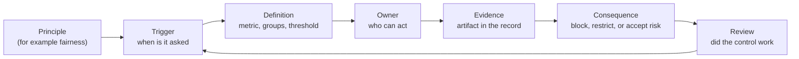

The diagram shows the minimum chain between a principle and behavior. A break anywhere gives a recognizable failure. No trigger gives skipped reviews. No definition gives arguments after the fact. No owner gives findings that age. No evidence gives claims nobody can check. No consequence gives optional controls. The feedback edge from review to trigger matters as well: controls decay when nobody asks whether they caught anything. A fairness review that has passed every system for two years is either evidence of excellent engineering or evidence that the review cannot fail, and you should find out which.

### 2.2 Ethics, risk management, and compliance are different jobs

Teams often merge three activities that deserve separate treatment because they have different questions and different audiences.

- Ethics asks what the organization ought to do, including cases where the law is silent or permissive. Its output is a position: for example, "we will not build emotion inference for hiring."
- Risk management asks what could go wrong, how likely and how bad, and what to do about it. Its output is a risk register with treatments and accepted residual risk.
- Compliance asks whether specific legal and contractual obligations are met. Its output is evidence that a given requirement was satisfied.

An AI governance program needs all three, and conflating them produces predictable errors. If compliance is treated as ethics, the organization does the minimum the law requires and stops. If ethics is treated as risk management, values get priced and traded against revenue without anyone saying so. If risk management replaces compliance, a risk the team has "accepted" turns out to be a legal prohibition that acceptance cannot cure. The engineering consequence is that a single intake process should feed all three: the same use-case record yields an ethical red-line check, a risk score, and a regulatory classification, and each has its own sign-off.

### 2.3 What "responsible" means for a builder

For a team shipping a feature, responsibility reduces to four commitments that can be checked.

1. Know who is affected. This includes people who never use the system but are scored, described, or acted on by it: applicants, patients, tenants, people in a photo, and customers of your customer.
2. Know how the system fails, for whom, and how often, measured and not guessed.
3. Keep a human with authority and capacity in the loop wherever the harm of a wrong decision is high, and say plainly where there is no such human.
4. Be able to stop it, explain what happened, and fix it, quickly.

The rest of this chapter elaborates these four. If a section seems abstract, ask which commitment it serves.

### 2.4 The cost of governance and the cost of its absence

Governance is not free, and a chapter that pretends otherwise will not be followed. A typical full assessment for a high-risk system might consume several person-weeks of a product owner, model owner, and risk partner, plus legal review and testing time. For a low-risk internal tool, the same process would be absurd. This is why tiering, section 3, comes first: it directs effort in proportion to risk. The cost of absence includes direct harm to people, remediation, regulatory penalties, loss of customers, and engineering time spent in emergency mode. Teams that have been through a public AI incident usually describe the same thing: the work they skipped would have taken a fraction of the time the incident consumed. That is anecdotal, and there is no reliable aggregate figure, so use it as motivation and not as an input to a business case.

## 3. Risk Tiering and Use-Case Intake

### 3.1 Why tier at all

A governance program that applies the same process to a spell-checker and a loan-decisioning model either buries the spell-checker in paperwork or lets the loan model through on a light process. Tiering matches effort to risk. It also gives teams a predictable path: a team that knows its use case is low tier knows the checks it will face and can plan for them, which reduces the temptation to avoid the process altogether.

Tiers should be defined by properties of the use, not of the model. The same large language model (LLM) can summarize meeting notes (low impact) or draft denial letters for insurance claims (high impact). Governance attaches to the use case, the data it touches, the decisions it informs, and the people it affects.

### 3.2 Dimensions that determine the tier

Five dimensions do most of the work,: impact, scale, autonomy, reversibility, and affected population.

- Impact on people. Does the output influence access to credit, jobs, housing, education, health care, benefits, legal outcomes, or safety? Does it affect physical or psychological wellbeing? Consequential decisions raise the tier by a large step.
- Scale. How many people are affected per day, and over what period? A defect in a system touching ten users is an annoyance. The same defect at ten million users is a systemic event.
- Autonomy. Does the system recommend, or act? A system that drafts text for a person to read differs from one that sends the email, moves the money, or deletes the file. The more steps between model output and real-world effect that involve a human with authority, the lower the risk, provided that human is real (section 10).
- Reversibility. Can the effect be undone? A mistaken product recommendation can be ignored. A mistaken account closure, a leaked medical record, or an erroneous report to law enforcement is hard or impossible to reverse.
- Affected population. Are the affected people vulnerable, such as minors, patients, people in financial distress, or people who cannot easily opt out? Is there a power imbalance between the deployer and the affected person, as with employers and applicants or governments and benefit claimants?

Two further dimensions matter in practice. Data sensitivity (special-category personal data, biometric data, children's data) interacts with privacy law and with the EU AI Act's definitions. Capability novelty (a new modality, tool use with side effects, agentic loops) raises uncertainty, so a first-of-kind capability should carry a higher tier until evidence accumulates.

### 3.3 A scoring scheme and its limits

A numeric scheme makes the tier reproducible. The scheme here is illustrative and meant to be adapted. For each credible harm identified in the assessment (section 4), score severity $S$ from 1 to 5, likelihood $L$ from 1 to 5, and a reversibility factor $R$ from 1 (easily undone) to 3 (irreversible). The harm score is

$$H = S \times L \times R$$

with symbols defined as above. The use-case score is the maximum $H$ over its credible harms, not the sum, because a single severe harm should not be diluted by many trivial ones. Tiers are cut points on that maximum. The script [02_risk_tiering_and_oversight.py](../code/python/responsible-ai-chapter/02_risk_tiering_and_oversight.py) implements it with these cut points: below 10 is T1 (low), 10 to under 24 is T2 (moderate), 24 to under 60 is T3 (high), and 60 or more is T4 (critical).

Running it on six illustrative harms gives these results.

| Use case | Harm | S × L × R | Harm score | Tier |
| --- | --- | --- | --- | --- |
| Credit model | Wrongful denial of credit | 4 × 3 × 2 | 24 | T3 |
| Credit model | Disparate error rates by group | 4 × 3 × 2 | 24 | T3 |
| Assistant | Confident wrong answer about policy | 2 × 4 × 1 | 8 | T1 |
| Assistant | Leak of another customer's data | 5 × 2 × 3 | 30 | T3 |
| Assistant | Toxic output to a user | 3 × 2 × 1 | 6 | T1 |
| Marketing copy | Off-brand wording | 1 × 3 × 1 | 3 | T1 |

The use-case tiers follow from the maximum: the credit model is T3 (24), the customer-support assistant is T3 (30, driven by the data leak), and the marketing-copy tool is T1 (3). Look at the assistant. Its most frequent harm, a wrong policy answer, scores only 8, while its rarest, a cross-customer leak, drives the tier. This is the intended behavior: the tier tracks the worst credible harm, and the governance for the assistant therefore concentrates on authorization and isolation of data, not on the common-but-mild wrong answer, which is handled by evaluation in [CH24](CH24_Generative_AI_Evaluation_Guardrails_and_Hallucinations.md).

The scheme has real limits and you should say so to your risk committee. The scores are ordinal judgments multiplied together, which gives a false sense of precision: a 5-by-2-by-3 harm is not "30 units" of anything. Likelihood estimates for novel systems are guesses. Multiplying treats severity and likelihood symmetrically, but many organizations should refuse certain severities regardless of likelihood. For that reason add two overrides that do not use the score.

- A category override. Certain use categories set a minimum tier irrespective of score. In the credit example, an automated decision about credit is at least T3 because it is regulated and consequential. Employment screening, education admission, essential services, law enforcement, and biometric categorization are similar. These track the high-risk areas in the EU AI Act (section 16) and equivalent regimes.
- A red-line check. A short list of prohibited uses, such as social scoring by public authorities and certain biometric and manipulative practices that the EU AI Act prohibits, is checked before scoring. A red-line hit ends the intake. No residual-risk acceptance can override it.

### 3.4 The intake form

Intake is the point where an idea becomes a governed use case. The intake form should be short enough that a product manager completes it in under an hour and specific enough that a reviewer can tier from it. The questions that carry most of the weight are these.

1. What is the system supposed to do, in one sentence, and what decision or action does its output feed?
2. Who are the users, who are the people affected by outputs (who may not be users), and are any of them in a protected or vulnerable class?
3. What data does it use for training, tuning, retrieval, and prompts? Does it include personal, sensitive, or third-party data? (Link to the [CH30](CH30_AI_Data_Governance_Privacy_and_Provenance.md) data record.)
4. Does the system act (send, write, spend, delete) or only suggest? Which tools or permissions does it hold?
5. What happens when it is wrong, and who can notice and correct that?
6. Is a model built in house, fine-tuned from an open-weight model, or accessed from a provider through an application programming interface (API)? Which provider and under what terms?
7. Which jurisdictions are the users and affected people in?
8. Who is the proposed accountable owner?

The last question matters more than it looks. An intake that cannot name an owner is rejected, because every later gate needs a person to sign. Questions 4 and 5 produce the autonomy and reversibility inputs; question 2 produces the affected-population input.

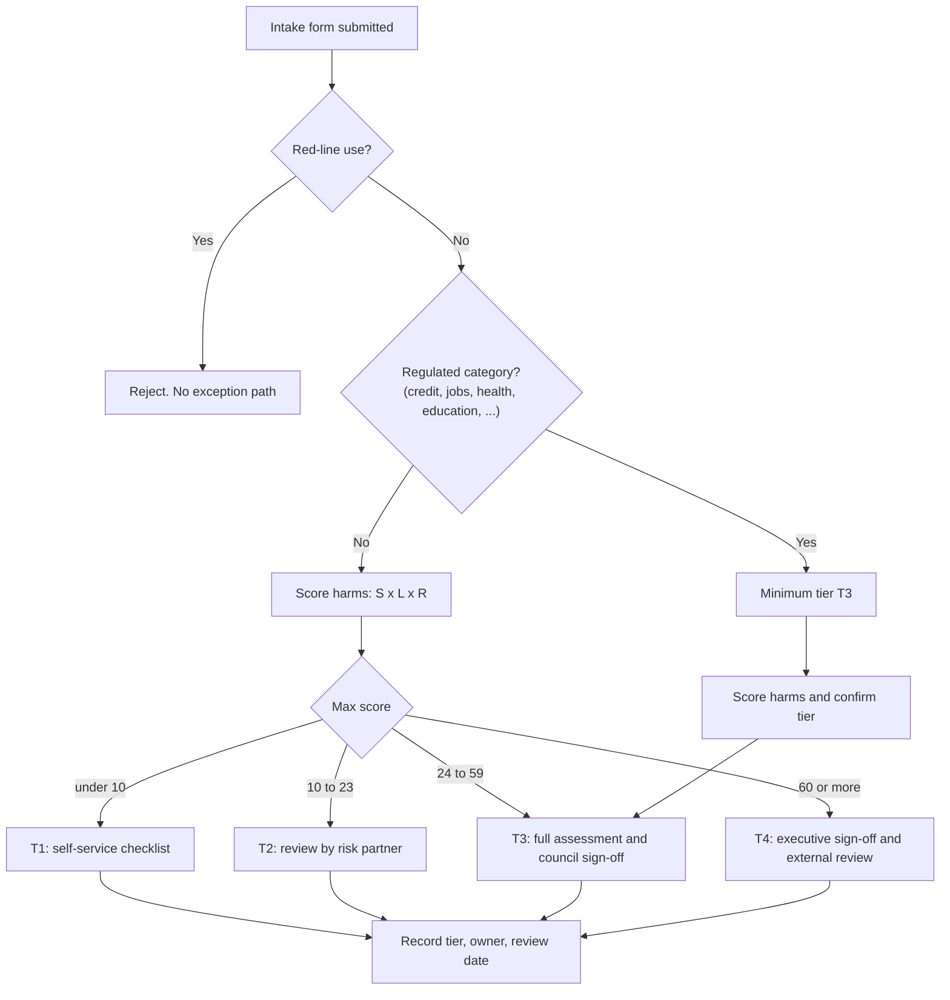

The decision tree sets the order of checks: red lines first, because they end the process; category second, because it sets a floor; score third. Notice that the regulated-category branch cannot lower a tier, only raise it. Each tier maps to a different process weight. T1 is a self-service checklist the team completes and files. T2 adds review by a risk partner from the second line (section 14). T3 requires the full assessment of section 4, evidence at each gate, and sign-off by the governance council. T4 adds executive sign-off and some form of independent review, which could be internal audit, an external assessor, or both. The final box records tier, owner, and a review date, because tier is not permanent (section 3.6).

### 3.5 Tier-dependent obligations

A tier is useful only if it determines what must be done. A starting mapping follows, to be adapted to the organization and to regulatory exposure.

| Control | T1 | T2 | T3 | T4 |
| --- | --- | --- | --- | --- |
| Intake record and named owner | Required | Required | Required | Required |
| Impact assessment | Checklist | Short form | Full, with affected-party input | Full, with external input |
| Group-level evaluation | Not required | If the output concerns people | Required with intervals | Required, independently reproduced |
| Red-team or adversarial test | Not required | Basic prompts and abuse cases | Required, structured | Required, independent team |
| Human review design | Not required | Documented | Capacity-sized and tested | Capacity-sized, tested, audited |
| Staged rollout | Optional | Recommended | Required | Required with predefined exit criteria |
| Tested stop mechanism | Optional | Required | Required, drilled | Required, drilled, with external notification plan |
| Sign-off | Product owner | Product owner and risk partner | Council | Council and executive sponsor |
| Review cadence | Annual | Annual | Semiannual, plus triggers | Quarterly, plus triggers |

The point of the table is proportionality. A team with a T1 use case should not need a meeting. A team with a T3 use case should expect weeks of work and plan for them in the schedule.

### 3.6 Re-tiering triggers

Tier is a function of the system as deployed. Re-run intake when any of these change: the model or provider version, the training or retrieval data, the user population or geography, the tools or permissions the system holds, the degree of autonomy, a related regulation, or the monitoring results (for example a rising complaint rate). A system that began as a drafting aid and gained a "send" button has changed tier, and the single most common governance gap in practice is a capability that crept in after the intake was filed. Make the trigger mechanical where possible: the model registry or deployment pipeline can refuse a release whose tools list differs from the approved record until a risk partner signs the change.

## 4. AI Impact Assessment

### 4.1 Purpose and place in the lifecycle

An AI impact assessment is a structured analysis of who a system affects, how it could harm them, how much, and what is done about it. It is done at design time, when changing the plan is cheap, and updated before release and after significant change. It is the artifact that connects the intake (what are we building) to the controls (what do we do about the risks) and to the release decision (is the remaining risk acceptable, and who says so). Related instruments exist under other names. Data protection impact assessments are required under the General Data Protection Regulation (GDPR) for processing likely to result in high risk to individuals' rights, and the EU AI Act requires deployers of certain high-risk systems to carry out a fundamental rights impact assessment. A single well-built assessment can feed these, as section 16.9 describes, though each regime has its own required content that must be checked.

### 4.2 Stakeholder mapping

Start with people, not with the model. List every group that is touched by the system and classify the relationship.

- Direct users: those who operate the system or read its outputs.
- Subjects: people whose data is processed or who are decided about, who may never interact with the system. A job applicant whose resume is scored is a subject.
- Bystanders and third parties: people incidentally affected, such as those named in a document, appearing in an image, or receiving a message the system generated.
- Operators and downstream builders: teams or customers who integrate the system and inherit its failures.
- Society and institutions: collective harms such as erosion of trust, information pollution, concentration of power, or labor-market effects.
- Workers in the supply chain: data annotators, content moderators, and others whose labor makes the system work (section 15).

For each group record the power they have over the system, the information they have about it, how they can exit, and their vulnerability. These four attributes show where harm is likely to go unnoticed: a group with little power, little information, and no exit is the group the system is most likely to harm without anybody hearing about it.

### 4.3 A harms taxonomy

A taxonomy keeps the assessment from fixating on whichever harm is most vivid. A practical version has seven families. These draw on published taxonomies of risks of language models and algorithmic harm, for example Weidinger et al. (2021) on ethical and social risks of language models, and Shelby et al. (2023) on sociotechnical harms of algorithm systems, but the grouping here is a working checklist and not a citation of either list.

1. Allocative harms: unfair denial or provision of opportunities and resources such as loans, jobs, housing, and services.
2. Quality-of-service harms: the system works worse for some groups, for example speech recognition with higher error for certain accents.
3. Representational harms: stereotyping, demeaning depiction, erasure, or exclusion of groups.
4. Informational harms: false or misleading information, privacy violations, leakage, and manipulation of beliefs.
5. Safety and physical harms: injury, self-harm facilitation, and dangerous instructions.
6. Economic and security harms: fraud, impersonation, intellectual property loss, and security compromise enabled or caused by the system.
7. Systemic and societal harms: erosion of autonomy, labor displacement, environmental cost, concentration of control, and degradation of the information environment.

For a generative assistant, families 3, 4, 5, and 6 are central. For a scoring model, families 1 and 2 are central. Any real system has some of each, and the discipline of walking all seven forces consideration of harms the team had not thought of.

### 4.4 Severity, likelihood, and reversibility

Score each credible harm using the scheme from section 3.3. Define the scale points concretely so that two assessors would score alike. An illustrative severity scale for individual harm follows.

| Severity | Description | Example |
| --- | --- | --- |
| 1 | Minor inconvenience, no lasting effect | A poor product suggestion |
| 2 | Time or money lost, easily recovered | A support answer that sends someone to the wrong page |
| 3 | Meaningful loss or distress, recoverable with effort | An erroneous fee, a wrongly flagged account |
| 4 | Significant loss of opportunity or rights | A wrongful loan denial, a lost job application |
| 5 | Severe or lasting harm to health, safety, liberty, or finances | Medical misdirection, wrongful accusation, large financial loss |

Likelihood should be tied to evidence where possible. If you can estimate the failure rate from evaluation, convert it to expected harmful events per period. Suppose a document-summary tool for benefits caseworkers drops a material condition in 1.5 percent of summaries and caseworkers process 8,000 summaries a month. Expected silent omissions are $0.015 \times 8000 = 120$ per month. If a caseworker catches two thirds of them (itself to be measured), $120 \times (1 - 2/3) = 40$ reach decisions. Forty wrongly informed decisions a month is a concrete number a council can argue about, and it is far more useful than "moderate".

Reversibility captures what scoring severity alone misses. A $200 wrongful charge that is refunded in a day and a $200 loss that causes an eviction have the same nominal amount and different consequences. Count the time and effort for a person to get the harm undone, and whether the system provides a path at all.

Also record exposure to compounding. Harms compound when decisions chain: a wrong credit decision lowers a score that feeds the next decision. A harm that feeds other automated systems has a higher effective severity than the single decision suggests.

### 4.5 Affected-party voice

An assessment written only by the builders reflects the builders' imagination. Seek input from affected people proportionate to the tier. Methods, from cheapest to most involved, include reviewing complaints and support tickets from similar systems, interviewing a few representatives of affected groups or advocacy organizations, convening a standing external advisory panel for T3 and T4 systems, and including an affected-community member in the design review. Pay people for their time when you ask for substantial input. Record what you heard and what you did with it, including suggestions you declined and why, because that record shows the input was considered and not merely collected.

Three failure patterns recur. Consultation theater asks for input after the design is fixed and cannot change it. Proxy consultation substitutes the opinions of internal staff for those of affected people. Averaging collapses the view of the small, most affected group into a large majority's comfort. The countermeasure for each is to ask early, to ask the actual group, and to report group-specific views separately.

### 4.6 Recourse

For any system that materially affects a person, specify recourse before launch: how a person learns that an automated system was involved, how they ask for a human to look at their case, what information the human uses, how long a response takes, who decides, and how a correction propagates. In some jurisdictions this is a legal right. Article 22 of the GDPR restricts decisions based solely on automated processing that have legal or similarly significant effects and provides safeguards including the right to obtain human intervention, to express a point of view, and to contest the decision. The EU AI Act also provides a right to explanation of individual decision-making for certain high-risk systems. Even without a legal compulsion, recourse is a control: it is how errors that evaluation missed come to light, and the contest rate is a monitoring signal.

Recourse is credible only if it is tested. Before release, run the contest path with a staff member playing the affected person using only the public instructions. Count the steps, the time, and what happens at each. Teams that do this routinely find that the contact form goes to a mailbox nobody reads.

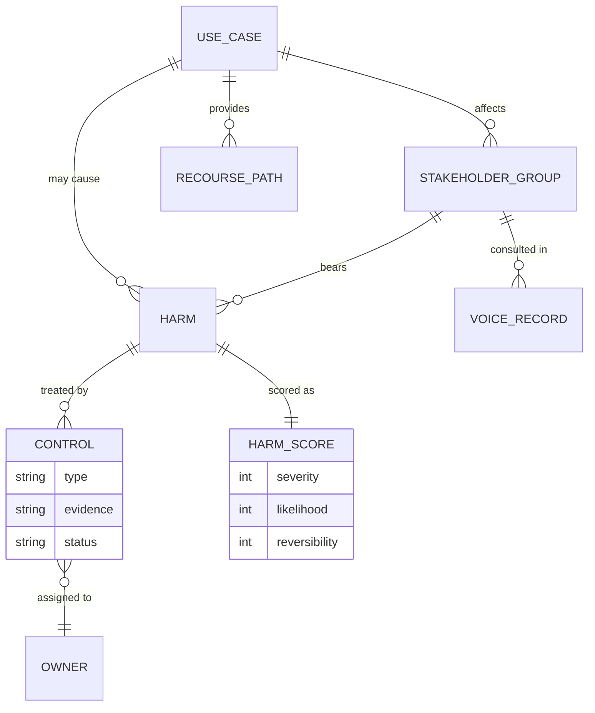

The entity diagram makes the assessment a data structure, not a document. Each harm belongs to at least one stakeholder group, has a score, is treated by one or more controls, and each control has an owner and evidence. This matters operationally. When the assessment is data, you can query it: which harms have no control, which controls have no owner, which stakeholder groups have no voice record. Those queries are the first checks of the pre-release gate. A prose assessment cannot be queried and tends to go stale at the first change.

### 4.7 Output of the assessment

The assessment ends with a decision-ready summary: the tier, the top harms with scores, the controls and their evidence, the residual risk after controls, the open questions, and a recommendation (proceed, proceed with conditions, redesign, or stop). The residual risk statement is the part that someone signs. Section 19 covers who may sign for how much.

## 5. Where Bias Enters the Lifecycle

### 5.1 Bias is a property of a pipeline

Teams often ask whether "the model is biased," as if bias lived in the weights. It is more accurate to say that bias can enter at several places between the world and the decision, and that fixing the model alone leaves most of them untouched. Suresh and Guttag (2021) give a widely used framework that separates the sources along the machine learning (ML) pipeline, and the grouping below follows its spirit with the five sources that matter most for governance.

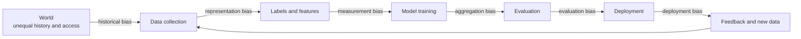

The diagram is a loop, and that is the main point. Biases at one stage become inputs to the next, and deployment produces the data that trains the next version. A lending model that denies credit to a group generates no repayment data on those denied, so the next training set lacks examples of people who would have repaid. The stages below explain each edge.

### 5.2 Historical bias

Historical bias exists in the world before any data is collected. If past hiring favored one group, a perfectly sampled and perfectly measured dataset of past hiring still encodes that preference, and a model trained to predict who was hired reproduces it. The model is accurate with respect to a biased process. Accuracy metrics cannot detect this, because the target itself is the problem. The remedy is a decision about the target: choose a label that measures what you actually want (job performance, say, and not who was hired in the past), or accept that the model should not automate the decision.

### 5.3 Representation bias

Representation bias arises when the data underrepresents a group or draws it from a different distribution than the one the system will face. A face-analysis dataset dominated by lighter-skinned faces yields higher error on darker-skinned faces, which Buolamwini and Gebru (2018) documented for commercial gender classification systems. A speech system trained on read speech in one accent underperforms on others. The signature of representation bias is an error that is higher for a group and falls when more representative data is added. It is visible in slice-based evaluation (section 8.4), but only if the test set itself contains enough examples of the group. A test set drawn from the same skewed source inherits the same blind spot.

### 5.4 Measurement bias

Measurement bias arises when the feature or label is a poor or differently accurate proxy for what you care about. Obermeyer et al. (2019) analyzed a widely used health-care risk algorithm that used past health-care cost as a proxy for health need. Because less money was spent on Black patients at the same level of illness, the algorithm underestimated their need. The label was an accurate measure of cost and a biased measure of need. Arrests used as a proxy for crime, complaints as a proxy for misconduct, and clicks as a proxy for satisfaction have the same structure. Check every label and feature by asking: who generates this measurement, does the process differ by group, and does the measurement mean the same thing across groups?

### 5.5 Aggregation bias

Aggregation bias arises when one model is fit to groups whose relationships between input and outcome differ. A single threshold or a single set of coefficients can be wrong for each group even though it is right on average. For example, a clinical marker can have different normal ranges across populations; a pooled model sets one range and misclassifies members of the minority group. The signature is that group-specific models perform better than the pooled model for the group. The tension is that group-specific treatment can itself raise legal and ethical issues (section 8.2), so the decision to model groups separately is a governance decision, not only a modeling one.

### 5.6 Evaluation and deployment bias

Evaluation bias arises when the benchmark does not resemble the deployment population, or when a single aggregate score hides group differences. A model with 90 percent accuracy overall might have 95 percent on the majority and 70 percent on a minority that makes up 10 percent of cases. Check: $0.9 \times 0.95 + 0.1 \times 0.70 = 0.855 + 0.07 = 0.925$, so a 92.5 percent aggregate would conceal a 25-point gap. Deployment bias arises when the system is used differently from how it was designed: a risk score meant as one input becomes the sole basis for a decision, or a tool designed for one population is applied to another. It also includes feedback loops, where model outputs change the behavior that generates the next data. Predictive policing is the standard example: patrols sent to areas the model flags produce more recorded incidents there, which the model reads as confirmation.

### 5.7 Using the taxonomy in practice

The taxonomy is useful as a review checklist. For each stage, write down the specific mechanism for your system, the evidence that it is or is not present, and the owner of the check. Table 5.1 shows the checklist applied to a credit model.

| Source | Question for a credit model | Evidence to gather |
| --- | --- | --- |
| Historical | Do past approvals reflect discriminatory practices or unequal access to credit-building products? | Review of historical policy changes, comparison with outcome-based labels |
| Representation | Are thin-file applicants and recent immigrants adequately represented? | Population counts versus applicant mix |
| Measurement | Is "default" measured the same way across groups, and does the label include only approved applicants? | Label definition review, reject-inference analysis |
| Aggregation | Does one scorecard fit all segments, or do relationships differ by segment? | Segment-level calibration |
| Evaluation | Is the test set from the population that will apply, including after policy changes? | Time-split and population comparison |
| Deployment | Will staff override the score in ways that correlate with group? | Override analysis by group after launch |

Treat the table as the beginning of work, not the end. The common failure is to complete the table with "no issue found" answers and no evidence, which is the checklist theater described in section 21.

## 6. Formal Fairness Definitions with a Worked Example

### 6.1 Setup and notation

Consider a binary decision system. For each person there is a true outcome $Y \in \{0, 1\}$ (for example, would repay a loan, $Y = 1$), a model decision $\hat{Y} \in \{0, 1\}$ (approve, $\hat{Y} = 1$), possibly a score $S$ from which the decision is made by thresholding, and a group attribute $A$ (for example, $A \in \{a, b\}$). The group attribute may be a protected characteristic such as sex, race, age, or disability, or a derived group such as a region. Note that $Y$ is the observed outcome, which can itself be biased by selective labels (you only see repayment for people you approved).

For each group, the confusion matrix has four cells: true positives (TP, $\hat{Y} = 1$ and $Y = 1$), false positives (FP, $\hat{Y} = 1$ and $Y = 0$), false negatives (FN, $\hat{Y} = 0$ and $Y = 1$), and true negatives (TN). The following rates are defined per group:

$$\text{selection rate} = P(\hat{Y} = 1 \mid A = g) = \frac{TP + FP}{n}$$

$$\text{TPR} = P(\hat{Y} = 1 \mid Y = 1, A = g) = \frac{TP}{TP + FN}$$

$$\text{FPR} = P(\hat{Y} = 1 \mid Y = 0, A = g) = \frac{FP}{FP + TN}$$

$$\text{PPV} = P(Y = 1 \mid \hat{Y} = 1, A = g) = \frac{TP}{TP + FP}$$

Here $n$ is the number of people in group $g$, TPR is the true positive rate (also called recall or sensitivity), FPR is the false positive rate, and PPV is the positive predictive value (precision). The base rate is $p_g = P(Y = 1 \mid A = g)$.

### 6.2 The worked table

The numbers below are illustrative, not real data. Group A has 1,000 people and group B has 500. The counts are chosen to show that the criteria disagree.

| Group | n | TP | FP | FN | TN | Base rate $p$ |
| --- | --- | --- | --- | --- | --- | --- |
| A | 1000 | 300 | 120 | 100 | 480 | 400/1000 = 0.400 |
| B | 500 | 60 | 80 | 40 | 320 | 100/500 = 0.200 |

The rates, computed by [01_fairness_metrics.py](../code/python/responsible-ai-chapter/01_fairness_metrics.py), are:

| Group | Selection rate | TPR | FPR | PPV | Accuracy |
| --- | --- | --- | --- | --- | --- |
| A | 420/1000 = 0.420 | 300/400 = 0.750 | 120/600 = 0.200 | 300/420 = 0.714 | 780/1000 = 0.780 |
| B | 140/500 = 0.280 | 60/100 = 0.600 | 80/400 = 0.200 | 60/140 = 0.429 | 380/500 = 0.760 |

Verify one by hand. For B, selection is $(60 + 80)/500 = 140/500 = 0.28$; PPV is $60/(60 + 80) = 60/140 = 0.4286$; the negatives number $80 + 320 = 400$, so FPR is $80/400 = 0.20$. Each criterion below is a statement about one column or a relation among columns.

### 6.3 Demographic parity

Demographic parity (also called statistical parity) requires equal selection rates:

$$P(\hat{Y} = 1 \mid A = a) = P(\hat{Y} = 1 \mid A = b)$$

In the table, $0.420 - 0.280 = 0.140$, a gap of 14 percentage points. The ratio of the lower to the higher selection rate, $0.280 / 0.420 = 0.667$, is the disparate impact ratio. In United States employment practice, the "four-fifths rule" of the Uniform Guidelines on Employee Selection Procedures uses a ratio below 0.8 as a rule-of-thumb indicator of adverse impact that invites closer review; it is a screening heuristic, not a legal safe harbor or a definition of discrimination. Here 0.667 falls below 0.8.

Demographic parity ignores the true outcome entirely. It is the natural criterion when you believe that the groups should receive the benefit at equal rates, and the label may not be trusted (for example, when historical bias contaminates $Y$). It can be satisfied by selecting poorly in one group, for instance by approving random people in group B to raise its rate, which harms the people selected unfairly and does not help those who qualified. It conflicts with accuracy whenever base rates differ and the label is trusted.

### 6.4 Equal opportunity and equalized odds

Equal opportunity requires equal true positive rates, so qualified people have equal chance of a favorable decision:

$$P(\hat{Y} = 1 \mid Y = 1, A = a) = P(\hat{Y} = 1 \mid Y = 1, A = b)$$

Here $0.750 - 0.600 = 0.150$. Equalized odds (Hardt, Price, and Srebro, 2016) requires equal TPR and equal FPR:

$$P(\hat{Y} = 1 \mid Y = y, A = a) = P(\hat{Y} = 1 \mid Y = y, A = b) \quad \text{for } y \in \{0, 1\}$$

Here the FPR gap is $0.200 - 0.200 = 0$ and the TPR gap is 0.150, so equalized odds fails because of the TPR gap (the max gap is 0.150). In words: the model is equally likely to wrongly approve unqualified applicants in either group, but it misses qualified applicants in B more often (40 percent of qualified B applicants are rejected versus 25 percent for A). If the harm of concern is wrongful denial, equal opportunity is the criterion that exposes it.

These criteria take the label as given. Their appeal is that they are conditional on the true outcome, so they do not penalize a model for reflecting real base rate differences. Their weakness is the same: if the label encodes measurement or historical bias, equalizing error rates relative to a biased label certifies the bias.

### 6.5 Predictive parity

Predictive parity requires equal PPV: among those the model approves, the same share are truly qualified in each group.

$$P(Y = 1 \mid \hat{Y} = 1, A = a) = P(Y = 1 \mid \hat{Y} = 1, A = b)$$

Here $0.714 - 0.429 = 0.286$. An approved applicant in A repays with probability 71 percent, while an approved applicant in B repays with probability 43 percent. A lender viewing this from the profit side would say the model treats B's approvals as riskier. The reason is mechanical: B has a lower base rate, so for the same FPR, a larger share of its positives are false. This is the center of the dispute in the well-known analysis of a recidivism risk score (ProPublica's 2016 analysis of COMPAS, and Northpointe's response): the critics pointed to unequal false positive rates, and the developer pointed to equal predictive values. Both were reading true statements, and section 7 shows why they cannot both be fixed.

### 6.6 Calibration within groups

A score is calibrated within groups when, for each score value $s$ and each group, the observed outcome rate equals the score:

$$P(Y = 1 \mid S = s, A = g) = s$$

Calibration lets a decision maker read the score the same way for everyone: a score of 0.8 means an 80 percent chance whatever the group. The script computes an illustrative calibration table:

| Group | Score bin | Count | Observed rate | Gap |
| --- | --- | --- | --- | --- |
| A | 0.2 | 400 | 0.210 | +0.010 |
| A | 0.5 | 300 | 0.500 | 0.000 |
| A | 0.8 | 300 | 0.820 | +0.020 |
| B | 0.2 | 250 | 0.280 | +0.080 |
| B | 0.5 | 150 | 0.507 | +0.007 |
| B | 0.8 | 100 | 0.540 | -0.260 |

For group A the score is well calibrated. For group B it is calibrated in the middle, understates risk at the low end by 8 points, and overstates by 26 points at the high end where only 100 people are available. Two cautions follow. First, the top-bin count for B is small, so the 0.540 has an interval of roughly plus or minus 10 points, and a reviewer should look at that before declaring miscalibration. Second, calibration within groups and predictive parity are close relatives: calibration implies equal PPV at a given threshold if the score distributions within the selected region match, and a model calibrated within groups usually has a related PPV gap when the groups' score distributions differ.

### 6.7 Individual fairness

Group criteria say nothing about two similar individuals who receive different decisions. Dwork et al. (2012) proposed individual fairness: similar individuals should receive similar outcomes. Formally, given a task-specific distance $d(x, x')$ between individuals and a distance $D$ between output distributions, require a Lipschitz condition

$$D(M(x), M(x')) \le L \cdot d(x, x')$$

where $M$ is the model's output distribution for an input, and $L$ is a constant that bounds how fast outputs may change with the input. The hard part is the metric $d$: it encodes a judgment about which differences between people are relevant, and that judgment is the whole fairness question in another form.

The script includes a toy check. Two applicants with credit scores of 700 and 705 and equal utilization (distance about 0.0059 after scaling) receive model scores of 0.62 and 0.35. With $L = 5$ the allowed difference is $5 \times 0.0059 = 0.029$ and the observed difference is 0.27, a violation. A second pair differing by 2 points and 0.01 utilization (distance 0.0103) gets scores of 0.62 and 0.60, within the limit of 0.051. In practice individual fairness is often tested through counterfactual pairs: change a protected attribute or a proxy (name, pronoun, neighborhood) and check whether the output changes. Counterfactual tests catch direct sensitivity but not indirect pathways where other features carry the information.

### 6.8 Uncertainty

Every rate above is an estimate. Group B has 100 qualified applicants. The Wilson 95 percent interval for $TPR_B = 0.60$ is $[0.502, 0.691]$, and for $TPR_A = 0.75$ with 400 qualified applicants it is $[0.705, 0.790]$. The intervals do not overlap here ($0.691 < 0.705$), which supports the claim of a real TPR gap, although non-overlap is a conservative test of difference. The width of B's interval (about 19 points) is the more important number for planning: with 100 positives you can only detect large gaps. If group B had 25 qualified applicants, the interval at the same TPR would span roughly 36 points and no conclusion of parity or disparity would be supportable. Report counts and intervals with every group metric, and treat a wide interval as missing evidence, not as a pass.

## 7. Impossibility Results and What They Mean for Decisions

### 7.1 The result

Kleinberg, Mullainathan, and Raghavan (2016) and Chouldechova (2017) showed that, except in degenerate cases, a score cannot simultaneously satisfy calibration (or equal PPV) and equal error rates across groups whose base rates differ. The Chouldechova version is easy to derive and worth deriving, because it tells you which quantities trade off.

Fix a group with base rate $p$, true positive rate TPR, false positive rate FPR, and positive predictive value PPV. Among $n$ people there are $np \cdot \text{TPR}$ true positives and $n(1 - p) \cdot \text{FPR}$ false positives. Then

$$\text{PPV} = \frac{p \cdot \text{TPR}}{p \cdot \text{TPR} + (1 - p) \cdot \text{FPR}}$$

Solve for FPR. Multiply both sides by the denominator: $\text{PPV}\,[p\,\text{TPR} + (1 - p)\,\text{FPR}] = p\,\text{TPR}$. Rearranging gives $\text{PPV}\,(1 - p)\,\text{FPR} = p\,\text{TPR}\,(1 - \text{PPV})$, hence

$$\text{FPR} = \frac{p}{1 - p} \cdot \frac{1 - \text{PPV}}{\text{PPV}} \cdot \text{TPR}$$

Suppose two groups have the same PPV and the same TPR, as predictive parity plus equal opportunity would demand. The factors $(1 - \text{PPV})/\text{PPV}$ and TPR are the same, so FPR is proportional to $p/(1 - p)$, the odds of the base rate. If $p_a \ne p_b$, then $\text{FPR}_a \ne \text{FPR}_b$. The script evaluates this with PPV and TPR both 0.7:

- Group A, $p = 0.40$: $\text{FPR} = (0.4/0.6) \times (0.3/0.7) \times 0.7 = 0.667 \times 0.4286 \times 0.7 = 0.200$.
- Group B, $p = 0.20$: $\text{FPR} = (0.2/0.8) \times (0.3/0.7) \times 0.7 = 0.25 \times 0.4286 \times 0.7 = 0.075$.

So equal PPV and TPR force a false positive rate of 20 percent in A and 7.5 percent in B. The two groups cannot have equal predictive value, equal TPR, and equal FPR, unless base rates match or the classifier is perfect (so $\text{PPV} = 1$ and $\text{FPR} = 0$).

### 7.2 What the result does and does not say

The result is a theorem about statistics, not a license to give up. It says three things that matter for governance.

First, the conflict is caused by differing base rates, and a base rate difference can itself be an artifact. If the label is biased by measurement (section 5.4), the "different base rates" may partly reflect different recording and not different behavior. Examine the base rate gap before accepting it as a fact of the world.

Second, no purely technical resolution exists. Choosing which criterion to satisfy means choosing which error to distribute unequally, and that is a values decision involving the people affected. A decision made by the model owner alone, hidden in a choice of loss function, is a governance failure even if the choice is reasonable.

Third, the impossibility holds exactly for the stated criteria. It does not forbid improving all of them somewhat, or choosing a model that is nearly calibrated and nearly equal in error rates, or changing the decision process (for example, adding a human review step for scores in the uncertain band) so that the residual disparity matters less.

### 7.3 Choosing a criterion: a decision procedure

A practical way to choose is to ask what the harm of a wrong decision is, to whom, and what the decision allocates. The decision tree below summarizes a procedure that many teams find workable. It is guidance for the discussion, not an algorithm that produces the answer.

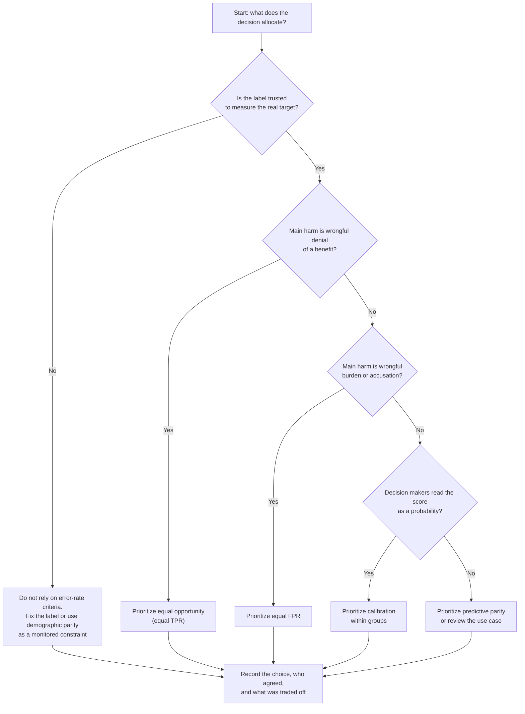

The tree reflects three common situations. When the main harm is that qualified people are turned away (loans, jobs, benefits), the false negative side of the table matters and equal opportunity is the usual anchor. When the main harm is a burden placed on people who did nothing (fraud flags, audit selection, risk-of-reoffense labels used to restrict liberty), the false positive side matters and equal FPR is the anchor. When a human reads the score as a probability to weigh with other evidence, calibration is what makes that reading valid. In each case the final box requires recording the choice, because later reviewers must be able to see that a trade-off was made on purpose, and with whose agreement.

### 7.4 Applying the decision to the worked table

Return to the table in section 6.2. The credit model has equal FPR (0.20) and a TPR gap (0.75 versus 0.60). If the harm of concern is wrongful denial of credit to qualified applicants, the gap in TPR is the finding: 40 percent of qualified applicants in B are rejected versus 25 percent in A. Suppose the team raises B's TPR to 0.75 by lowering B's threshold. At constant score distributions this increases B's FPR. As an illustration, suppose it rises from 0.20 to 0.27. Then, among B's 400 non-repayers, false approvals rise by $0.07 \times 400 = 28$, and true approvals rise by $0.15 \times 100 = 15$. The lender gains 15 good customers and takes on 28 more bad ones. Whether that is acceptable depends on loss given default, the profit on good loans, and regulatory view of group-specific thresholds. The numbers are illustrative; the point is that the trade-off is expressible in counts and money, which is how a risk committee can decide it, instead of arguing about the word "fair".

Also compute the cost in aggregate terms. If each false approval costs the lender an average loss of 8,000 and each additional good loan yields an average profit of 600, the net change is $15 \times 600 - 28 \times 8000 = 9{,}000 - 224{,}000 = -215{,}000$. That is illustrative, but it shows that the lender cannot justify equal opportunity on cost grounds alone and must either accept the cost as a deliberate fairness investment or find another way to close the gap, such as better features for B or a human review band. Presenting the cost to the decision maker with the arithmetic shown is more honest than asserting that fairness is free or that it is impossible.

## 8. Mitigation, Slice-Based Testing, and Generative Fairness

### 8.1 Three families of mitigation

Mitigation techniques are grouped by where in the pipeline they intervene.

Pre-processing changes the data before training. Examples are reweighing, where each example gets a weight so that the label and group are statistically independent in the weighted data (Kamiran and Calders, 2012), resampling to balance groups, relabeling suspect examples, and learning a representation that removes group information. Pre-processing is model-agnostic and keeps the training procedure standard. Its costs are that removing group information also removes information a legitimate predictor might need, and that proxies for group typically remain in other features.

In-processing changes the learning algorithm. Examples are adding a fairness penalty to the loss, imposing constraints (such as bounded TPR gaps) during optimization, and adversarial debiasing, where an adversary tries to predict the group from the model's output or representation and the model is trained to defeat it (Zhang, Lemoine, and Mitchell, 2018). In-processing can reach better trade-offs than post-processing for a fixed model class, but it needs control over training, complicates the training pipeline, is harder to apply to a third-party or pretrained model, and can be unstable.

Post-processing adjusts the outputs of a trained model. The standard method chooses group-specific thresholds (or randomizes decisions) to satisfy equalized odds or equal opportunity given the scores (Hardt, Price, and Srebro, 2016). It needs no retraining and works with any model, including a vendor model. The script shows a toy example: with the true-positive scores listed for each group, choosing threshold 0.60 for A and 0.40 for B yields TPR 0.75 in both. Costs: it needs the group attribute at decision time, which may be unlawful or unavailable; it explicitly treats groups differently, which is the subject of legal debate; and when scores are less informative for one group the technique equalizes by degrading the better-served group or by randomization, which some find unacceptable ("leveling down").

### 8.2 The legal and ethical complications of group-aware methods

Group-specific thresholds make the decision depend on a protected attribute. In some jurisdictions and domains, using a protected attribute in a decision rule is unlawful disparate treatment, even when the intent is to reduce disparate impact; credit and employment decisions in the United States are examples, and the details differ by statute and case law. In the EU, the GDPR restricts processing of special-category data, and the 2026 Digital Omnibus amendments to the AI Act broadened a legal basis for processing special-category data for bias detection and correction in the AI Act context (as reported by secondary sources at the time of writing; verify the text of Article 4a). That addresses testing for bias, which needs group labels, and does not by itself authorize using the attribute in decisions. Involve counsel before deploying group-aware mitigation, and prefer designs where group attributes are used only for measurement (held in a restricted store) and not as model inputs or decision inputs.

### 8.3 Costs and expected effects

Every mitigation has costs that belong in the decision record.

| Method | Typical accuracy cost | Needs group at decision time | Works on vendor model | Main risk |
| --- | --- | --- | --- | --- |
| Reweighing / resampling | Small to moderate | No | No (needs training access) | Proxies remain; instability with tiny groups |
| Fair representation learning | Moderate | No | No | Removes useful signal; hard to verify |
| Fairness-constrained training | Small to moderate | No | No | Constraint satisfied on training data only |
| Adversarial debiasing | Moderate | No | No | Training instability; partial removal |
| Group thresholds (post-processing) | Depends on score quality | Yes | Yes | Legal exposure; leveling down |
| Human review band | Review cost | No | Yes | Capacity and automation bias (section 10) |
| Better data or features for a group | Collection cost | No | Sometimes | Slow; may raise privacy questions |

The "typical accuracy cost" column is qualitative on purpose. Costs depend on the data, the model, and the criterion chosen, and published results vary widely, including cases where improved data for a group improves overall accuracy. Measure the trade-off on your own data, report it as a curve (fairness gap versus accuracy or profit across settings), and let the decision maker choose a point on the curve.

An often overlooked mitigation is to change the decision process. If a score is unreliable for a segment, route that segment to a human review band or a different channel, instead of forcing the model to be fair on inputs it handles poorly. Another is to change the target: if the label is the problem, relabel or redefine the outcome rather than correcting the model's output. Reviewing the use case itself belongs here too. Some systems should not be built because no mitigation brings the residual harm into an acceptable range.

### 8.4 Slice-based testing

Slice-based testing evaluates model quality on defined subsets of the data: demographic groups, languages, document types, input lengths, device types, geographies, and intersections. It is the operational form of fairness evaluation, and it is the check that aggregate metrics cannot replace. The procedure is as follows.

1. Define slices from the stakeholder map (section 4.2) and from known failure modes, before looking at results, to avoid cherry-picking.
2. For each slice, compute the chosen metrics with counts and intervals.
3. Compare each slice to the overall result and to a reference slice, and flag gaps beyond a threshold set in the assessment.
4. For flagged slices, investigate cause: label quality, representation, feature behavior.
5. Record the result, including slices that could not be evaluated for lack of data, which is itself a finding.

Intersections cause a combinatorial problem. With four attributes taking 2, 5, 3, and 4 values there are $2 \times 5 \times 3 \times 4 = 120$ intersectional slices. A test set of 10,000 items averages about 83 items per slice, and with a 20 percent positive rate that is about 17 positives per slice, where a Wilson 95 percent interval on a TPR near 0.75 is roughly plus or minus 0.19. Most slices cannot support a conclusion, and a handful of cells will look bad by chance. With 120 slices tested at a 5 percent error rate you expect about $120 \times 0.05 = 6$ false alarms. A Bonferroni correction, which divides the significance level by the number of tests, gives $0.05 / 120 \approx 0.00042$ per slice, which is conservative. Practical teams do three things: they prioritize slices by prior risk (a short list chosen from the harm assessment), they use hierarchical or pooled estimates for sparse intersections, and they collect more data for the slices that matter and cannot be evaluated. Reporting "not evaluable, n too small" is honest; reporting a point estimate from 17 cases is not.

### 8.5 Fairness for generative systems

Generative systems do not make a single binary decision, so the confusion-matrix criteria do not apply directly. The harms are mainly representational and quality-of-service harms, plus allocative harms when generated text feeds a decision (for example, a summary used in screening). Three families need measurement.

Stereotyping and social bias in output. Benchmarks such as BBQ (Bias Benchmark for Question Answering; Parrish et al., 2022) test whether a model's answers shift with social group in ambiguous and disambiguated contexts. A counterfactual approach is more general and adapts to your use case: build prompt pairs that differ only in a group cue (a name, pronoun, nationality, or dialect), generate responses, and compare them on the attribute that matters (sentiment, recommended action, competence descriptors, refusal). The metric is a paired difference, with a confidence interval from the paired design.

Representation in generated content. Ask whether images or text depict people of different groups in a stereotyped way for a neutral prompt ("a doctor", "a nurse", "a CEO"). Measure the distribution of depicted attributes over many samples against a stated reference and report the gap. The reference is a policy choice: reflect the real-world distribution, or a balanced one, or what the user's context calls for. State which and why.

Toxicity and harmful output. Datasets such as RealToxicityPrompts (Gehman et al., 2020) examine how readily models generate toxic continuations. Toxicity classifiers are themselves biased: Sap et al. (2019) found that classifiers rated tweets in African American English as more toxic than similar text in other dialects. A toxicity metric therefore needs its own slice evaluation, and a safety filter that over-blocks one dialect creates a quality-of-service harm while appearing to improve safety.

A worked example shows the arithmetic. Suppose you generate 2,000 responses for prompts with cue group $g_1$ and 2,000 for $g_2$ and a validated classifier flags 80 (4.0 percent) and 44 (2.2 percent) as toxic. The pooled rate is $124 / 4000 = 0.031$. The standard error of the difference is $\sqrt{0.031 \times 0.969 \times (1/2000 + 1/2000)} = \sqrt{3.0 \times 10^{-5}} = 0.00548$. The observed difference is $0.040 - 0.022 = 0.018$, so $z = 0.018 / 0.00548 = 3.28$, which is significant at the 5 percent level (and at the 0.1 percent level in a two-sided test). Report it as a relative increase of $0.040 / 0.022 = 1.82$, together with the interval, and note the assumptions: the prompts are independent, the classifier is valid across both groups, and the prompt set represents real use. The finding is a signal to investigate prompts, training data, and the safety tuning, using the evaluation methods in [CH24](CH24_Generative_AI_Evaluation_Guardrails_and_Hallucinations.md). This chapter's job is to say what threshold would block release and who owns the fix.

For assistants that produce text feeding decisions, such as summarizing applicants, apply the allocative tests too: run the same record with a group cue changed and measure changes in the summary, in downstream recommendations, and in omissions. Omission is the hard one to see: a summary that drops a qualification more often for one group never states anything false.

### 8.6 Fairness monitoring after launch

Fairness is not a launch property. Populations shift, upstream data changes, and the model's own decisions alter later data. Monitor group-level selection rates and, where outcomes are observed with a lag, error rates, with alert thresholds from the assessment. Where outcome labels are delayed or unobservable (loan performance takes months; a denied applicant's counterfactual outcome is never seen), monitor proxies and complaint rates by group, and plan periodic outcome audits with a holdout where a random sample receives a different treatment for learning. Such exploration has ethical constraints of its own and needs approval.

## 9. Transparency, Explainability, and Accountability

### 9.1 Three audiences, three kinds of transparency

Transparency is not one thing. The people who need to know something about an AI system differ, and so does what they need.

- Users and affected people need to know that an AI system is involved, what it is for, what it cannot do, how to get a human, and how to contest an outcome.
- Operators and downstream builders need to know capabilities, limitations, training data summary, evaluation results, known failure modes, intended and out-of-scope uses, and the conditions under which the evaluation holds.
- Oversight bodies (internal audit, regulators, assessors) need the evidence trail: assessments, decisions, versions, test results, incident records, and who signed.

Treat these as three outputs of one record. A common mistake is to write one document for all three, which serves none. A user disclosure needs two sentences and a link. An assessor needs the full file.

### 9.2 Model cards, system cards, and datasheets

Mitchell et al. (2019) proposed model cards as short structured documents accompanying a trained model, reporting intended use, factors (groups, environments), metrics, evaluation data, training data, ethical considerations, and caveats, with results disaggregated by factor. Gebru et al. (2021) proposed datasheets for datasets, documenting motivation, composition, collection, preprocessing, uses, distribution, and maintenance. Frontier model providers now publish system cards or model cards for major releases that describe evaluations and safeguards, which is a useful pattern to read before choosing a provider, with the caution that these are self-reported.

For a team building on models, the useful unit is a system card, because risk comes from the whole system: model, prompts, retrieval, tools, filters, human review, and the workflow around them. A model card tells you about the engine. A system card tells you about the vehicle. A minimal system card for an internal assistant includes the following.

| Field | Content |
| --- | --- |
| Purpose and out-of-scope uses | One paragraph each, with examples of uses that are not supported |
| Components and versions | Model identifier and version, prompt version, retrieval index version, tool list, filters |
| Data | Sources, rights basis, sensitive categories, retention (link to the [CH30](CH30_AI_Data_Governance_Privacy_and_Provenance.md) record) |
| Evaluation | Metrics, datasets, slices, counts, intervals, date, and who ran it |
| Known limitations | Failure modes found, with rates where measured |
| Safeguards | Input and output controls, permission limits, human review, rate limits |
| Oversight and recourse | Who reviews, what triggers review, how to contest |
| Owners and contacts | Named people and escalation path |
| Change log | Date, change, reason, re-assessment outcome |

Cards must be maintained. A card that does not change when the model changes is evidence of a process failure. Tie the card to the model registry (see [CH29](CH29_MLOps_and_LLMOps.md)) so that a release cannot proceed without a card version that matches the deployed artifacts. Be honest about limits: a card is a claim by the builder, and its value depends on whether the numbers in it were produced by a process someone checked.

### 9.3 User disclosure

When a person interacts with an AI system or is affected by one, tell them at the point of interaction. The reasons are respect for the person, informed choice (whether to rely, whether to seek a human), and legal duty in some regimes. Article 50 of the EU AI Act, discussed in section 16, requires that people be informed they are interacting with an AI system unless obvious from the context, and requires providers of systems generating synthetic audio, image, video, or text to mark outputs in a machine-readable format and detectable as artificially generated, with further duties for deployers of deepfakes and of AI-generated text published to inform the public on matters of public interest. Check the current text and any guidance for exact scope and exceptions.

Good disclosure has four properties. It is timely (before reliance, not buried in terms). It is specific (what the system does and does not do). It is actionable (how to reach a human). It is accurate (not "our advanced intelligence guarantees accuracy"). Poor disclosure takes the forms of a generic footer, a consent checkbox bundled with the terms of service, and anthropomorphic design that hides the nature of the system. For a chatbot, the minimum is a visible label and a way to reach a person. For a decision system, add what factors matter and how to request reconsideration.

### 9.4 Explanation: what each method can and cannot establish

People ask for explanations for different reasons: to understand a decision, to contest it, to trust the system, to debug it, or to meet a legal requirement. No single explanation serves all of these, so decide the purpose first.

Inherently interpretable models, such as sparse linear models, scorecards, short rule lists, and small trees, let a reader follow the computation. Rudin (2019) argued that for high-stakes decisions one should prefer interpretable models over post hoc explanations of black boxes when the accuracy loss is small, which is frequently true for tabular data. Consider this seriously for credit, hiring-adjacent, and health decisions: it removes a whole class of explanation risk.

Post hoc feature attribution methods such as LIME (Ribeiro, Singh, and Guestrin, 2016) and SHAP (Lundberg and Lee, 2017) estimate how much each input contributed to a prediction by perturbing inputs or averaging over feature subsets. Their limits are well documented. The attributions describe the model's local behavior, not the real-world causal effect of the feature. They depend on a background distribution and perturbation scheme that the method must choose. Correlated features share credit unpredictably. And the explanation of a black-box model can be manipulated: Slack et al. (2020) showed that a model can be built to behave discriminatorily on real inputs while presenting innocuous explanations under the perturbations LIME and SHAP use. An explanation is therefore evidence about a model, not proof that the model is sound.

Counterfactual explanations, introduced for this use by Wachter, Mittelstadt, and Russell (2017), state what would have to change for a different outcome: "approved if income were 4,000 higher or the balance 1,200 lower." They are intuitive and actionable, and they respect that people care about what they can do. Their risks are suggesting an action that is infeasible or that changes other factors, being unstable across nearby models, and giving the impression of causality. A good counterfactual lists only actionable features, flags changes that are impossible (age, past events), and is checked for plausibility.

For large language models, the output often includes a self-generated rationale. Such a rationale is text produced by the model, and studies, for example Turpin et al. (2023), have shown that stated chain-of-thought explanations can fail to reflect the factors that actually drove the answer, such as biases introduced into the prompt. Treat a generated rationale as a usable aid to a human reviewer and a poor basis for an audit. For decisions that need a true account, build the explanation from verifiable pieces the system recorded: retrieved sources with identifiers, tool calls and results, rules applied, and the model and prompt version. Those support a justification that someone else can check.

| Method | Good for | Cannot establish |
| --- | --- | --- |
| Interpretable model | Direct inspection, contesting, audit | That the features are fair or the label sound |
| SHAP or LIME attribution | Debugging, spotting reliance on odd features | Causal effect, absence of bias, stability across inputs |
| Counterfactual explanation | Telling people what to change | That the change causes the outcome in reality |
| Generated rationale from an LLM | Helping a reviewer read an output | The real cause of the output |
| Cited sources and recorded tool calls | Verifying a claim against evidence | That the model used the sources correctly |

### 9.5 Contestability

Contestability is the ability of a person to challenge an outcome and have it reconsidered by someone with authority. It requires four things from the architecture: the inputs and model version that produced the decision are stored and retrievable; the person can see enough about the basis to make an argument; a human decider is assigned and can change the outcome; and a correction propagates to downstream systems. If the decision was made with a vendor model that is later updated, reproducing the original output may be impossible, so store the output and the inputs, not only a pointer to the model. Define a response time and report on it. The contest rate and the reversal rate by group are monitoring signals: a high reversal rate means the model errs, and a reversal rate that differs by group means it errs unevenly.

### 9.6 Accountability: named owners and decision rights

Accountability means a specific person can be asked why a decision was made and has the authority to change it. Committee ownership means no ownership. The standard instrument is a responsibility assignment matrix, commonly called RACI, which assigns for each activity who is Responsible (does the work), Accountable (answers for it, one person), Consulted (gives input before), and Informed (told after). The matrix below shows an illustrative version across the lifecycle for a T3 system. The fourth column is the single accountable person.

| Activity | Product owner | Model owner | Data steward | Security lead | Risk partner | Council |
| --- | --- | --- | --- | --- | --- | --- |
| Intake and tiering | A | C | C | C | R | I |
| Impact assessment | A | R | C | C | R | I |
| Data rights and quality | C | C | A | I | C | I |
| Fairness evaluation | C | A | C | I | R | I |
| Red teaming and misuse | C | R | I | A | C | I |
| Human review design | A | C | I | I | C | I |
| Release decision | R | R | C | C | R | A |
| Monitoring and incident response | R | A | C | R | C | I |
| Residual-risk acceptance | R | C | C | C | C | A |
| Retirement | A | R | R | C | C | I |

Two rules make the matrix useful. Exactly one A per row. And the A for release is a body or person with the authority to say no that does not report to the delivery schedule. Where an external model provider is involved, the matrix cannot assign accountability to the provider. Your contract allocates some liability and information duties, but your organization remains accountable to its users and regulators for how it deploys the model. Record the provider's responsibilities as inputs (their documentation, their change notices) and not as substitutes for your own controls.

Decision rights are the other half: who may approve what. State them as authority limits, such as "a T2 system may be released by the product owner with risk-partner concurrence; a T3 system requires council approval; accepting a residual risk of score above 40 requires the executive sponsor." Section 19 treats the signing rules.

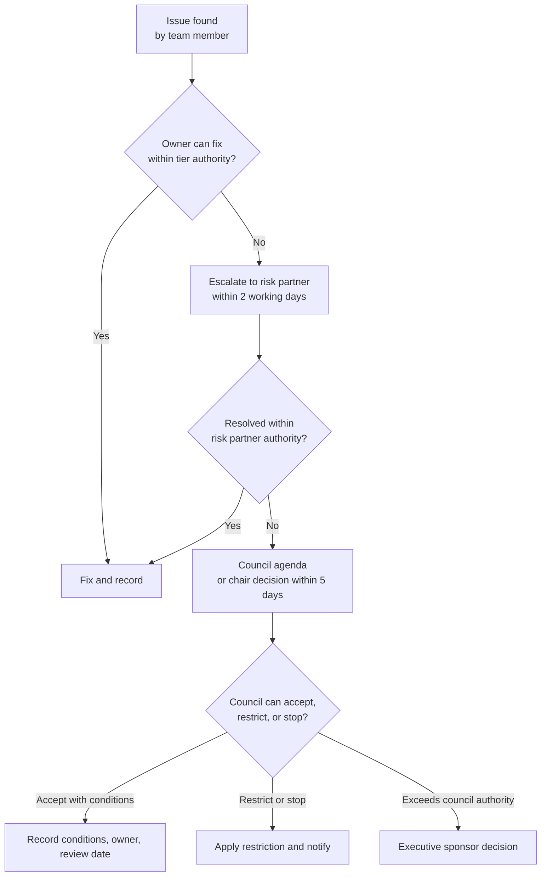

The escalation path puts time limits at each step. An escalation route with no deadlines is a place for issues to wait. Each box also has an outcome that is recorded, so the path produces an audit trail, and the final branch recognizes that some risks exceed what a council may accept and need an executive with the authority over the business objective. The failure this path prevents is the familiar one in which an engineer raises a concern, hears nothing, and ships because silence feels like permission. Employees should also have a protected route outside the line of command, for example an ethics or whistleblower channel, for the case where the line itself is the problem.

## 10. Meaningful Human Oversight

### 10.1 What oversight is for

Human oversight is a control that places a person in a position to detect and correct errors that the system cannot detect in itself, to apply values and context the system lacks, and to be accountable for a consequential decision. It is not a magic property of having a human somewhere in the process. Oversight is meaningful when four conditions hold: the person has relevant information, enough time, the competence to judge, and the authority to override without penalty. Remove one and the control exists on paper only. Regulators have taken the same view; Article 14 of the EU AI Act requires that high-risk systems be designed so that natural persons can effectively oversee them, including by being aware of automation bias, correctly interpreting output, deciding not to use the system or to disregard, override, or reverse its output, and interrupting its operation. The detailed workflow integration is built in [Part 17 CH09](../17_AI_Architecture/CH09_Human_Oversight_and_AI_Assisted_Workflow_Integration.md); this chapter sets the requirements.

### 10.2 Patterns of oversight

The terms in common use are these.

- Human in the loop: a person approves each action before it takes effect.
- Human on the loop: the system acts, and a person monitors and can intervene.
- Human in command: a person decides whether and how to use the system at all, and can shut it down.
- Post hoc review: decisions are sampled and audited after the fact.

The pattern should follow the tier. High-impact irreversible actions call for in-the-loop approval with exact-action confirmation. High-volume reversible actions can use on-the-loop monitoring with sampling and a fast rollback. Low-impact actions may use post hoc review. A single system can mix patterns by routing: a claims assistant might auto-approve small claims within strict rules, send medium claims to a reviewer, and send large or flagged claims to a senior adjuster.

### 10.3 Automation bias and rubber-stamping

Automation bias is the tendency to over-rely on automated suggestions, including accepting them when they conflict with other available information (Skitka, Mosier, and Burdick, 1999; Parasuraman and Manzey, 2010). It increases with workload, time pressure, and trust built by past accuracy. A reviewer who sees a correct recommendation 95 times in a row learns to approve without reading, which makes the 96th error pass. This is why high model accuracy can reduce effective oversight at the margin where it matters.

Rubber-stamping is the organizational version: the review step exists, approvals are recorded, and nothing is examined. It arises from structural causes more than from reviewer laziness: queue targets that reward speed, interfaces that show only the recommendation, no authority to reject, or a missing penalty for approving an error combined with a visible penalty for slowing the line. Countermeasures are designed into the task. Show the evidence and the model's uncertainty. Ask the reviewer to form an initial judgment before showing the recommendation, where feasible. Seed known-bad cases to measure detection. Rotate reviewers and cap session length. Make rejection cheap and safe.

### 10.4 Review capacity arithmetic

A human review control must be sized. Define the daily case volume $V$, the share routed to review $f$, the minutes per review $m$, and the productive hours per reviewer per day $h$. Reviewer-hours needed per day are

$$W = \frac{V \cdot f \cdot m}{60}$$

and the staffing need is $\lceil W / h \rceil$. The script [02_risk_tiering_and_oversight.py](../code/python/responsible-ai-chapter/02_risk_tiering_and_oversight.py) works the example. With $V = 1200$ cases per day, $f = 0.25$, $m = 6$ minutes, and $h = 5.5$ productive hours:

- Reviewed cases: $1200 \times 0.25 = 300$ per day.
- Load: $300 \times 6 / 60 = 30$ reviewer-hours per day.
- Staffing: $30 / 5.5 = 5.45$, so 6 reviewers.

Now suppose only 3 reviewers are funded. Available time per case is $3 \times 5.5 \times 60 / 300 = 3.3$ minutes, versus the 6 the design assumed. Utilization is $30 / (3 \times 5.5) = 1.82$, meaning demand is 182 percent of capacity, so queues grow without bound. In queueing theory, waiting time grows sharply as utilization approaches 1; a working rule is to keep planned utilization under about 0.8 to leave room for peaks and absences. The maximum flag rate that 3 reviewers can sustain at 6 minutes per case is $3 \times 5.5 \times 60 / (6 \times 1200) = 0.1375$, so about 13.8 percent.

Three conclusions follow. The flag rate is a design parameter that is bounded by staffing: if the model flags more than reviewers can examine, then either time per case falls (which converts oversight into rubber-stamping) or backlog grows (which delays people who are waiting for a decision). A model change that raises the flag rate from 14 to 25 percent is a staffing change, and the release process should treat it as one. And capacity should be re-tested when volume rises. The honest alternative to an unstaffable review is to reduce autonomy: narrow the scope, tighten the flag rule, or accept lower coverage and say so.

### 10.5 What an override rate can and cannot tell you

Override rate is the share of reviewed recommendations that the reviewer changed. Teams often read a low rate as success. The script shows why that is unsafe. Of 3,000 reviewed cases, suppose the model is wrong in 10 percent, which is 300 cases. An attentive reviewer who catches 80 percent overrides 240 cases (an override rate of 8.0 percent) and 60 wrong outputs ship. A rubber-stamping reviewer who catches 15 percent overrides 45 cases (1.5 percent) and 255 wrong outputs ship. The second reviewer's override rate looks excellent and the outcome is four times worse. The override rate confounds model quality with reviewer vigilance, and by itself it does not distinguish them.

To measure oversight quality, use an independent audit: a second reviewer or a stronger process re-examines a random sample of approved items. To estimate the miss rate to within plus or minus 5 percentage points at 95 percent confidence in the worst case ($p = 0.5$), you need $n = z^2 \cdot 0.25 / e^2 = 1.96^2 \times 0.25 / 0.05^2 = 384.2$, so 385 audited cases. Seeded cases (known errors injected into the queue and tracked) give a direct measure of detection rate without an audit panel, with the condition that seeded cases look realistic and reviewers know seeding happens in general, but not which cases.

### 10.6 When oversight is performative

Oversight is performative when it satisfies a requirement to have a human step and cannot change outcomes. The signs are:

- The reviewer sees only the recommendation and not the evidence or uncertainty.
- Time per case is shorter than the time needed to read the evidence.
- Approval rate is near 100 percent and has not changed for months.
- No reviewer has been disciplined for approving an error, and some have been for slowing the queue.
- The reviewer has no authority to reject, or rejection triggers a lengthy process.
- Nobody has measured detection of seeded errors.
- The system is down or slow and the process continues anyway, with approvals auto-filled.

A system with performative oversight should be classified as autonomous for tiering purposes, because that is how it behaves. This is an uncomfortable conclusion, and an accurate one. If a regulation requires effective human oversight, performative oversight does not satisfy it and can create liability, since the organization has documented a control it did not operate.

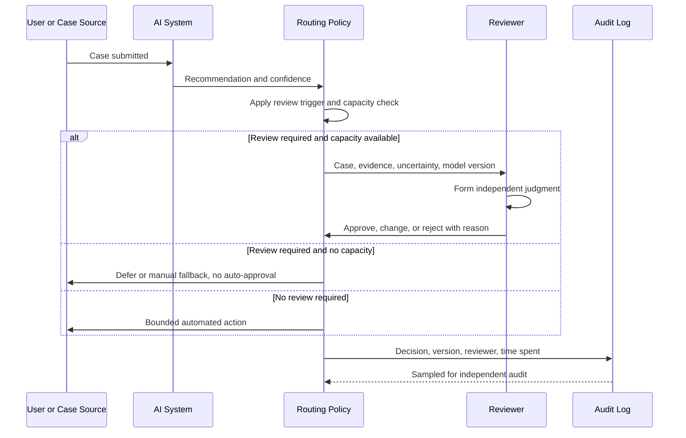

The sequence encodes the properties above. The router checks capacity, and when no reviewer is available it defers; it never silently auto-approves. The reviewer receives evidence, uncertainty, and the model version, and is expected to form a judgment before approving. The log records time spent, which allows detection of reviews that took 10 seconds. The audit loop samples decisions independently. The "no capacity" branch is the one most often missing in real systems, which tend to default to the automated path under load and so silently raise autonomy exactly when the system is stressed.

### 10.7 Authority, fallback, and outage

State the authority of the reviewer in writing: what they can do (approve, change, reject, escalate, pause the system), what protections they have, and what they must record. Protect reviewers from retaliation for rejections. Define the fallback when review is unavailable, such as an outage, a staffing gap, or a surge. Options in order of increasing risk: defer the decision and tell the person, route to a manual process, reduce the scope of automation to the safest subset, or in rare cases proceed with enhanced post hoc audit. The default should be one of the first two for consequential decisions. Every fallback should be tested, since an untested fallback usually fails when needed.

## 11. Safety Testing and Release Decisions

### 11.1 Scope of safety in this chapter

Safety here means preventing the system from causing serious harm through its outputs or actions, including misuse by others. [CH24](CH24_Generative_AI_Evaluation_Guardrails_and_Hallucinations.md) teaches how to measure quality and how to build guardrails and run red-team exercises. This chapter decides what testing is required before release for a given tier, how results feed a release decision, how the rollout is staged, and how the system is stopped and watched afterwards.

### 11.2 Capability evaluations and dangerous-capability assessment

A capability evaluation asks what the system can do, not only whether it does the intended task well. For most enterprise applications the relevant capability questions are practical: can the assistant be induced to reveal data from other users, call tools outside its intent, or produce content that violates policy? These belong in the red-team and adversarial test plan of [CH24](CH24_Generative_AI_Evaluation_Guardrails_and_Hallucinations.md), scaled to tier.

For frontier general-purpose models, developers also assess dangerous capabilities: whether a model gives meaningful uplift toward chemical, biological, radiological, or nuclear weapons, offensive cyber operations, or autonomous replication and other loss-of-control behaviors. The methods are an active research area. Typical practice combines automated benchmarks, expert-written task suites, uplift studies in which people with and without model access attempt a proxy task, and expert red teaming under controlled conditions. Results are interpreted against thresholds defined in the developer's safety framework (section 13). As a deployer you rarely run these evaluations. You rely on the provider's reported results, which is a reason to read system cards critically, to ask how the evaluation was elicited (a weakly prompted model underestimates capability), and to treat a "no dangerous capability found" statement as bounded by the elicitation effort.

### 11.3 Misuse assessment

A misuse assessment asks how a capable bad actor, or an ordinary user with bad intent, could use the system for harm, and what that would cost. The method is threat modeling applied to purpose: list attackers, goals, and paths, estimate the uplift the system provides over what the actor could do without it, and weigh the harm. The essential concept is counterfactual uplift. A system that explains information already available in a first-year textbook gives little uplift. A system that assembles scattered information into an actionable plan, debugs a failed attempt, or automates a task at scale gives more. Scale is also an uplift: a model that cannot do anything new but makes spam, phishing, or harassment ten thousand times cheaper changes the economics. Section 12 treats misuse in more depth.

### 11.4 What a release gate demands, by tier

The pre-release gate collects evidence and asks whether risk is acceptable. The evidence set depends on tier (section 3.5). A T3 system needs at least the following.

1. The assessment (section 4) is current and its top harms have controls with evidence.
2. Evaluation results, by slice, with counts and intervals, and each pre-agreed threshold either met or accepted as a residual risk with a signature.
3. A red-team report covering prompt injection, data exfiltration, tool misuse, policy bypass, and the misuse cases from the misuse assessment, with each finding fixed, mitigated, or accepted.
4. Human oversight design with a capacity calculation and fallback.
5. A tested stop mechanism and rollback plan, with a time-to-stop objective.
6. Monitoring and alert rules, and a named on-call owner.
7. User disclosure and recourse path, tested.
8. A residual-risk record signed by the person with authority for that level.

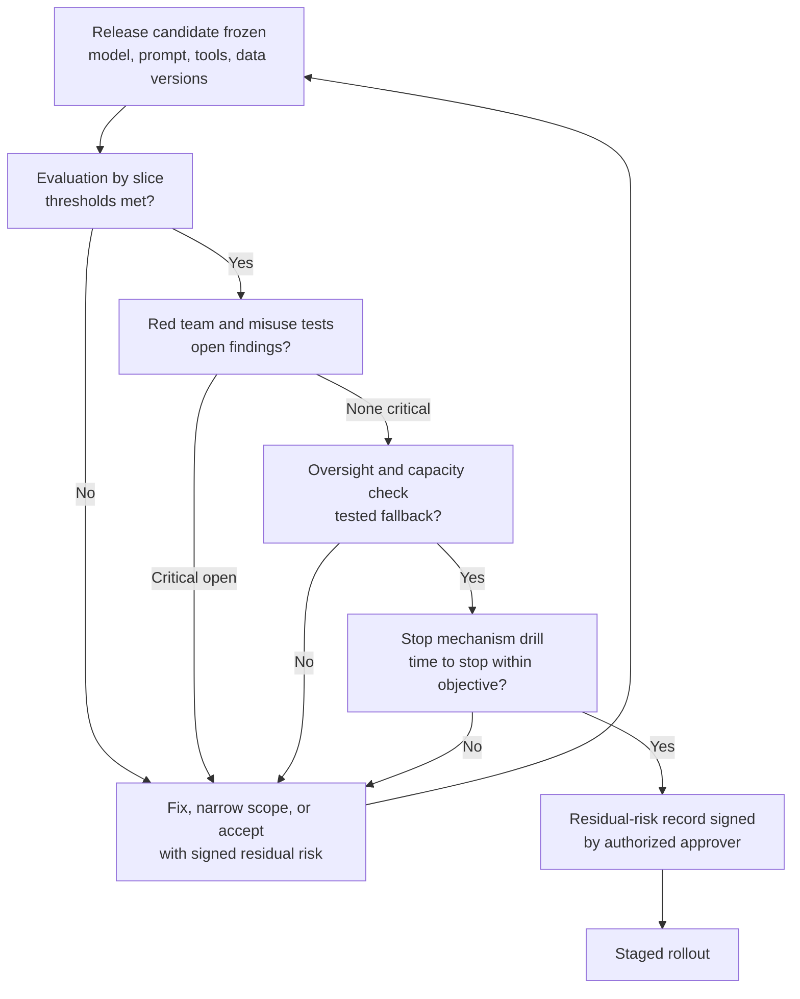

The gate is a sequence of checks, each of which can send the candidate back. The first box freezes the versions, because evidence about a system is evidence about specific versions: a prompt edit after the red team invalidates the red team for that behavior. The loop through X shows that failing a check does not end the project. The choices are to fix, narrow the scope, or accept the risk with a signature from someone with authority to accept it, which makes a failure visible as a decision instead of a quiet override. The release is not the end: the last box passes to a staged rollout.

### 11.5 Staged rollout and the statistics of small samples

Staged rollout exposes the system to a growing share of users while watching for harm. A typical sequence is internal dogfooding, a small pilot with consenting users, a canary share of production traffic, a broad rollout, and full availability, with exit criteria between stages. Each stage should have a maximum duration, a minimum number of cases, predefined stop thresholds, and a named decider.

Small samples limit what a stage can show. The "rule of three" says that if you observe zero events in $n$ independent trials, the 95 percent upper confidence bound on the event rate is about $3/n$. After 1,000 cases with zero severe incidents you can say only that the rate is likely below 0.3 percent. To support a claim that the rate is below 0.1 percent you need about 3,000 cases without an event; for 0.01 percent, about 30,000. If the harm has a severity at which one in a thousand is unacceptable, a 1,000-case pilot cannot demonstrate safety; it can only fail to find problems. Rare serious harms therefore need more than rollout monitoring. They need targeted adversarial testing and design controls that bound the harm regardless of rate, such as permission limits that make the harm impossible.

Rollout also has the problem of non-random exposure. Early users self-select and may be unrepresentative: they are more tolerant, more technical, or in one region. A clean pilot does not mean a clean population rollout. Include representatives of the groups in the stakeholder map in the pilot, and use slice monitoring in each stage.

### 11.6 Kill switches, containment, and graceful degradation

A kill switch is a control that quickly stops or restricts the system without a code deployment. Useful granularities include turning off the whole feature, disabling a tool or an integration, switching to a safer prompt or model version, lowering autonomy to suggestion-only, blocking a user or tenant, and enabling a stricter filter. Design requirements:

- It can be operated by on-call staff under a runbook, and by more than one person.
- It works when the model provider, the vector store, or the approval service is degraded, which means it must not depend on the failing component.
- Its effect is verified automatically (a synthetic probe) and not by assumption.
- It is drilled. Define a time-to-stop objective, for instance 15 minutes from decision to effect for T3 systems, and measure it in exercises.
- It preserves evidence: stopping must not delete logs or inputs needed for the investigation.
- It has a defined re-enable procedure with an owner and a check, because the quick way to stop is also a quick way to restart without fixing anything.

Graceful degradation is the companion: when a safeguard fails, the system falls back to a safer mode rather than failing open. If the content-safety classifier times out, the safe default for a consumer product is to withhold the response and apologize, not to send it unchecked. Decide the fail-open versus fail-closed choice per control in advance and record it. System enforcement patterns are in [Part 17 CH12](../17_AI_Architecture/CH12_AI_Safety_Security_Privacy_and_Governance_Architecture.md).

### 11.7 Monitoring for safety

Monitoring should connect to the harms in the assessment. For each top harm, name a leading signal and a lagging signal, a threshold, and an owner. A generative assistant might track the rate of refusals and policy-filter blocks (leading), user reports and escalations (lagging), prompt-injection detections, tool-call anomalies, groundedness spot-checks, and complaint themes by user segment. A scoring system might track input drift, score distribution drift, selection rates by group, override and contest rates, and delayed outcome performance. Alert thresholds should be set before launch from the pilot distribution, with two levels: investigate and stop. An alert nobody owns is noise, so each alert routes to a named on-call and a runbook.

Monitoring raises its own privacy question: logs of prompts and outputs contain personal data. Minimize and redact what you keep, set retention, and restrict access, following [CH30](CH30_AI_Data_Governance_Privacy_and_Provenance.md). The need for evidence and the duty of data minimization conflict, and the usual resolution is to keep structured metadata (versions, decisions, scores, flags) for longer than raw content, and to hold raw content for a short, justified period with access controls.

## 12. Misuse, Dual Use, and Security-Adjacent Harms

### 12.1 Misuse is a design input

Most AI governance discussion focuses on harms caused by the system working as designed, or by mistakes. Misuse is different: someone uses the system, correctly, for a purpose its builders did not want. A text generator drafts a persuasive scam message. A voice model clones a family member's voice. A code assistant writes a malicious script. An image model creates a fake document. The model did exactly what it was asked, and the harm lies in the intent of the person asking.

A system that is easy to use well is usually easy to use badly. Dual-use capability, meaning a capability with both beneficial and harmful applications, is the norm. You cannot remove it by removing a few keywords. You can raise the cost of misuse, reduce its scale, make it detectable, and shift responsibility, and you should do all four with controls matched to the severity of the worst plausible misuse.

### 12.2 A misuse threat model

Apply the structure of threat modeling from [Part 15](../15_Security/PART_OVERVIEW.md) to purpose-level abuse. For each system, fill in the following.

| Element | Question |
| --- | --- |
| Actor | Who would misuse this: scammers, harassers, competitors, insiders, state actors, curious teenagers? |
| Goal | What do they want to achieve: money, access, influence, harm to a person? |
| Path | What sequence of requests, tools, or outputs achieves it? |
| Uplift | How much easier does the system make this compared to what they could do without it? |
| Scale | Can the system automate the harm, repeating it across many victims? |
| Detection | Would we know? What signal appears in logs or usage patterns? |
| Control | What prevents, limits, or detects it, and who owns that control? |

The uplift and scale rows set priority. A request that only restates a textbook has low uplift. A workflow that lets a single user send a million personalized messages has high scale. Many high-priority misuse cases are about scale, which is why rate limits, account verification, and usage monitoring are central controls and not afterthoughts.

### 12.3 Controls, and their limits

Misuse controls fall into layers, and each layer has weaknesses that the next one should cover.

- Model-level: alignment training and refusal behavior. These reduce casual misuse and can be bypassed by determined users through jailbreaks, paraphrase, multi-turn manipulation, language switching, or role-play framings. They are probabilistic, not guarantees.
- Input and output classifiers: separate models or rules that screen prompts and responses. They add a layer, have false positives and false negatives, and can themselves be evaded. Their false-positive harm (blocking legitimate users, with uneven impact across dialects and topics) must be measured, as section 8.5 noted.
- Product design: narrowing the capability to what the use case needs. A support assistant that cannot browse, write code, or call external services cannot be turned into a scanner or a spam engine. Capability minimization is the most reliable control because it removes the harm path.
- Access controls and verification: authenticated users, tiered access to powerful features, know-your-customer checks for high-risk capabilities, and API keys with scopes.
- Rate limits and quotas: bound the scale of any single actor.
- Monitoring and enforcement: detect abuse patterns, investigate, suspend accounts, and where appropriate report to authorities. Providers' acceptable use policies are the contractual basis for enforcement.
- Provenance and marking: watermarks and content credentials make synthetic content traceable (with limits, section 12.5).

Defense in depth works only if the layers fail independently. A prompt filter and a model refusal both depend on the same model understanding of the request, so a clever paraphrase may defeat both. A rate limit and an account verification check fail for entirely different reasons, so combining them is stronger than adding another classifier.

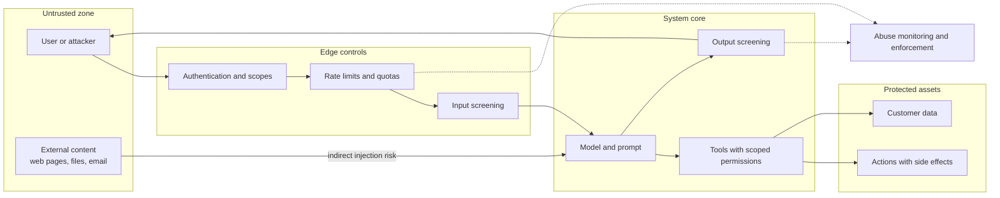

The diagram draws trust boundaries. The user is untrusted, and so is external content that the model reads, which is the path for indirect prompt injection: an instruction hidden in a web page or email that the model treats as a command. Controls sit at the edge (identity, scale), in the core (screening on both sides of the model), and at the assets (scoped tool permissions, which limit what a manipulated model can do). Monitoring collects signals from several layers, because abuse is typically visible in patterns across requests more than in any single message. The key implication is the one stated above: tool permission scoping and data isolation are not safety add-ons, they bound the harm when the model is fooled, and [Part 17 CH12](../17_AI_Architecture/CH12_AI_Safety_Security_Privacy_and_Governance_Architecture.md) shows how to enforce them.

### 12.4 Fraud, impersonation, and automated manipulation

Security-adjacent harms are those where AI changes the economics of an attack that already exists.

- Fraud and social engineering. Generative models write fluent, personalized phishing in any language and at low cost, removing the grammar errors that once signaled a scam. Voice cloning from a few seconds of audio supports impersonation of an executive or relative for payment fraud. Defenses at the organizational level are procedural: out-of-band verification for payment and credential changes, call-back procedures, and dual authorization, because content-based detection of synthetic voice is unreliable. As a builder you owe controls that prevent your product from being the fraud engine: abuse monitoring, limits on bulk personalized messaging, and consent verification for voice cloning.
- Impersonation and synthetic media. Deepfake images, audio, and video can be used for defamation, extortion, harassment, and political deception. Non-consensual intimate imagery is a particularly serious harm, and the EU AI Act, as amended by the Digital Omnibus on AI, now lists it and child sexual abuse material among prohibited practices (section 16.3). A product that generates or edits images of real people needs consent and identity checks, strict policies, and rapid takedown and reporting procedures.
- Automated manipulation. Systems that produce persuasive messages at scale, run fake accounts, or tailor persuasion to individual vulnerabilities threaten the information environment and individual autonomy. Manipulative techniques that materially distort behavior are prohibited under Article 5 of the EU AI Act where they cause or are likely to cause significant harm. Controls include rate and scale limits, platform identity verification, and refusal to run influence-operation workflows.
- Agentic misuse. An agent with tools can act on the world. A compromised agent can send messages, move funds, or exfiltrate data without a human typing each command. Treat tool permission, spending limits, and human approval for irreversible actions as governance controls, with the least-privilege design in Part 15 and Part 17.

### 12.5 Provenance, marking, and detection: what they can and cannot do

Content provenance aims to show where content came from. Two techniques are in use. Watermarks embed a signal in generated content, in pixels or token statistics, that a detector can find. Content credentials, such as those defined by the Coalition for Content Provenance and Authenticity (C2PA), attach signed metadata describing how content was created and edited. Article 50(2) of the EU AI Act requires providers of generative systems to mark outputs in a machine-readable format and make them detectable as artificially generated, as technically feasible.

Both approaches have limits that governance should state plainly. Metadata can be stripped by re-encoding or screenshotting. Watermarks in text are fragile under paraphrase, and image watermarks can be degraded by editing. Open-weight models can be run without any marking. Detection classifiers for synthetic content have false positives and false negatives and degrade as generators improve. The result is that provenance is a useful positive signal (signed content from a trusted source can be verified) and a weak negative signal (absence of a mark proves nothing). Do not build processes that treat "no watermark detected" as evidence of authenticity.

### 12.6 Responsible release of capability

When your organization controls the release of a model or capability, the decision about how to release it is itself a governance act. Options range from fully hosted behind an API with usage policies and monitoring, to hosted with restricted access for sensitive capabilities, to releasing weights openly. Hosted access preserves the ability to monitor, patch, and revoke. Open weights allow broad scientific and economic benefit and independent safety research, and they cannot be recalled or monitored once released. Count the lack of any recall option as part of the severity assessment: for capabilities with severe misuse potential, irreversibility raises the bar for open release. For capabilities with modest uplift, the benefits of openness often dominate. The decision should record the misuse assessment, the counterfactual availability of similar capabilities, and who approved the decision.

## 13. Frontier Safety Frameworks and Provider Usage Policies

### 13.1 Why a deployer needs to understand them

Most organizations deploy models they did not train. The provider's safety practices therefore shape the base risk of your system, and the provider's usage policy limits what you may do. You need a working understanding of both, at a conceptual level, to choose providers, to write contracts, and to answer a regulator who asks what you did to assess the model you rely on.

### 13.2 What frontier safety frameworks are

Several developers of the most capable general-purpose models have published voluntary frameworks for managing severe risks as capabilities grow. Examples at the time of writing include Anthropic's Responsible Scaling Policy, OpenAI's Preparedness Framework, and Google DeepMind's Frontier Safety Framework. They differ in detail and are revised periodically, so read the current published versions and not summaries, including this one. The shared structure is a conditional commitment:

1. Define categories of severe risk, typically misuse for chemical, biological, radiological, and nuclear weapons, offensive cyber operations, and risks from autonomous or self-improving systems.
2. Define capability thresholds, which are levels of measured capability at which the risk becomes serious.
3. Run evaluations during and after training to detect whether a model is approaching or has crossed a threshold, with a stated margin to account for imperfect elicitation.
4. Commit to safeguards that must be in place before a threshold-crossing model is deployed or further trained, for example stronger security of model weights, deployment restrictions, and enhanced monitoring.
5. Define governance: who decides, who can pause, how the framework is updated, and what is disclosed.

The logic is "if-then": if evaluations show capability X, then safeguards Y are required before proceeding. The attraction is that commitments are tied to evidence and are made before the pressure of a launch date arrives. The limitations are also well understood. The frameworks are voluntary and self-assessed. Thresholds and evaluation methods are still maturing, and evaluations can underestimate capability when elicitation is weak. Frameworks have been revised, sometimes loosening commitments, and compliance is judged largely by the developer. Independent comparisons of published frameworks (for example academic work grading the frameworks against criteria) have found large differences in coverage and rigor. Treat a framework as a signal of process maturity and as input to your due diligence, not as a safety guarantee.

Some jurisdictions have begun to make parts of this mandatory. The EU AI Act imposes obligations on providers of general-purpose AI models with systemic risk (section 16.5), and the Commission's General-Purpose AI Code of Practice, published in July 2025, includes a safety and security chapter that describes systemic-risk assessment and mitigation for those providers. California enacted a frontier AI transparency law (SB 53) requiring large frontier developers to publish a framework and report certain critical safety incidents; check its current status and thresholds before relying on this description.

### 13.3 Provider usage policies

Every model API comes with usage policies or acceptable use terms that prohibit categories of use, commonly including illegal activity, harassment, child safety violations, weapons development, deceptive influence operations, privacy violations, and, for some providers, high-stakes automated decisions without human review or disclosure. For a deployer, these terms matter in four ways.

- They are binding on you and, through you, on your users. Flow-down terms in your own agreements should reflect them.
- They can change. Providers revise policies and enforcement. A use that was permitted last year may be restricted now. Track change notices and review them in the same process as model version changes.
- They define what the provider monitors and may act on. Provider-side abuse monitoring may flag your tenant for a user's behavior, so you need your own detection and a procedure for handling provider enforcement notices.
- They allocate responsibility. Read what the provider commits to (data handling, incident notification, availability) and what it disclaims.

Provider selection should include governance due diligence: does the provider publish system cards with disaggregated evaluations, a safety framework, an incident notification commitment, a data-use position that fits [CH30](CH30_AI_Data_Governance_Privacy_and_Provenance.md), model deprecation notice periods, and a way to pin a model version so that your evidence stays valid? A silent provider update can change behavior in ways your evaluation no longer covers, which is the reason to pin versions and re-run the evaluation suite on each provider change.

### 13.4 Safety cases

A growing practice is to organize evidence as a safety case: a structured argument, with supporting evidence, that a system is acceptably safe for a defined context. It starts from a claim ("this assistant will not provide actionable synthesis routes for controlled substances in this deployment"), breaks it into sub-claims, and links each to evidence (evaluations, red-team results, architecture constraints, monitoring), stating the assumptions on which the argument depends. The format forces explicit assumptions and shows where the evidence is thin. For a T3 or T4 system, a one-page safety case is a good summary for the release decision. It also makes review easier for a council member who is not a specialist: they can challenge the weakest link instead of reading every report.

## 14. Governance Operating Model

### 14.1 Roles and structures

Governance needs people with defined jobs. A workable model for a mid-size or large organization has five elements.

- Product or system owner. The accountable person for a specific AI system through its lifecycle. They own the intake, the assessment, the budget for controls, and the day-to-day decisions within their authority.
- Model owner. Accountable for model quality, evaluation, and technical controls: the data scientist or ML engineering lead.
- AI governance working group. A cross-functional team of practitioners (engineering, data, security, privacy, legal, risk, user research) that reviews T2 and T3 intakes, maintains standards and templates, and handles escalations that do not need the council. It meets weekly or biweekly and turns requests around in days.
- Governance council (or AI risk committee). Senior leaders from business, technology, legal, risk, and security. It sets risk appetite and policy, approves T3 and T4 releases, accepts or declines residual risk above delegated limits, and reviews incidents and metrics. It meets monthly, with the authority to convene faster for an incident.
- Second line of defense. In the three-lines model used in risk management, the first line (business and engineering teams) owns and manages risk, the second line (risk, compliance, privacy, security oversight) sets standards and challenges the first line, and the third line (internal audit) provides independent assurance. The second line's value depends on its independence: a risk partner whose performance review is controlled by the product they review will not say no.

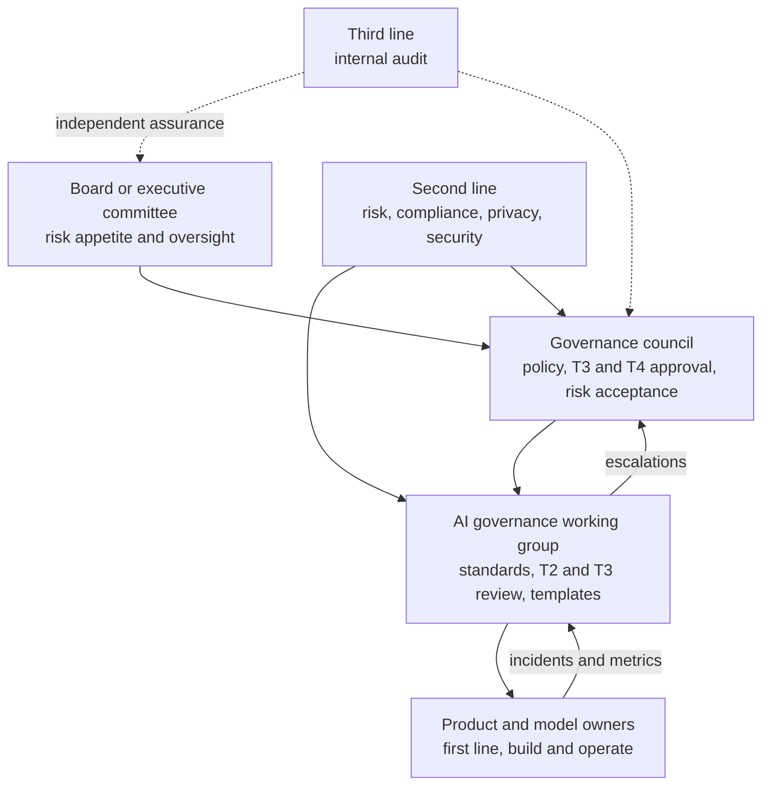

The figure shows two flows. Authority flows down: the board sets appetite, the council sets policy and approves what exceeds delegated limits, the working group applies the policy, and owners build within it. Information flows up: owners report incidents and metrics, the working group escalates, and the council reports to the board. Audit has a direct line to the board to preserve independence. The implications for design are a clear scope for each body, written delegation limits (section 9.6), and a rule that the second line has a reporting line outside the delivery organization.

### 14.2 Operating cadence and decision records

A council that meets without a standard agenda becomes a status meeting. A useful agenda has five fixed items: decisions requested (T3 and T4 gates, risk acceptances), incident review, metrics review, regulatory and provider changes, and a forward calendar of reviews due. Each decision produces a record: what was decided, on what evidence, by whom, with what conditions and review date, and which dissenting views were noted. The decision record is the unit of accountability and of audit.

### 14.3 Making the process light enough to use

Governance programs fail from friction as often as from neglect. Teams route around a process that adds weeks without value. Design principles that keep it usable:

- Tier first, so low-risk work moves fast.
- Build the process into existing tooling (the ticketing system, the model registry, the deployment pipeline) and not into a separate portal that nobody visits.
- Provide templates, worked examples, and a named contact, so the first assessment takes days and the tenth takes hours.
- Publish service levels for the governance function itself, such as T2 review within 5 working days and T3 council decision within 15, and report on whether they are met. A governance team that never meets its own deadlines loses authority.
- Automate evidence collection: evaluation reports, version records, and test logs should be attached to the gate by the pipeline, not typed by hand.

### 14.4 Buying versus building

Governance applies to purchased AI as much as built AI. For software-as-a-service products with embedded AI features, the intake should ask what the AI feature does, with what data, and whether it can be disabled. For purchased models and APIs, record version, terms, and evaluation results you ran yourself. Do not accept a vendor's assurance that its product is "responsible" in place of your own evaluation on your data and your population, since performance on a vendor benchmark does not transfer to your slices. Vendor risk reviews ([Part 23 CH15](../23_Soft_Skills/CH15_Vendor_Management.md) covers vendor management practice) should include the AI-specific questions in section 13.3.

## 15. Labor, Supply Chain, and Environmental Footprint

### 15.1 The human labor behind the system

Training and evaluating AI systems often depends on large amounts of human work: collecting and labeling data, writing demonstrations, ranking model outputs for preference training (see [CH14](CH14_Reinforcement_Learning_from_Human_Feedback.md)), reviewing flagged content, and red-teaming. Much of it is done by contractors, often in lower-wage countries and through intermediary vendors. Journalistic investigations, for example reporting by TIME in 2023 on content labelers working for an AI company, and academic work on data work such as that of Gray and Suri (2019) on "ghost work," have documented low pay, precarious contracts, and exposure of workers to graphic or traumatic material with limited support.

A responsible program treats these workers as stakeholders (section 4.2), not as an externality. Concrete practices, which procurement and engineering should require of vendors and of internal teams:

- Pay at or above a living wage in the worker's location, with the rate stated in the contract and verified.
- Informed consent and the right to opt out of harmful content tasks without penalty.
- Exposure limits and wellbeing support for harmful content: rotation, daily caps, access to counseling, and no quotas that punish skipping.
- Clear instructions and a path to ask questions and report problems, because ambiguous guidelines produce both worse labels and worse working conditions.
- Data protection for workers' own data.
- Audit rights over subcontractors, since the work is often passed down a chain.

A worked example gives a sense of scale. Suppose a safety-labeling project reviews 200,000 items at an average of 45 seconds each. Total effort is $200{,}000 \times 45 = 9{,}000{,}000$ seconds, which is 2,500 hours. If 20 percent of items contain harmful material, the exposure is $0.2 \times 2500 = 500$ hours. With a policy cap of 2 hours of harmful-content exposure per worker per day, the project needs $500 / 2 = 250$ worker-days of exposure capacity, which means at least 25 workers for 10 days, and more if rotations and breaks reduce the productive share. A plan that assumes a team of 5 doing it in a week has either broken the cap or underestimated the work. The arithmetic belongs in the vendor statement of work. Quality benefits from the same measures: tired, distressed, or underpaid annotators produce noisier labels, which feeds back into the fairness and quality problems of earlier sections.

### 15.2 Supply-chain ethics and provenance

The supply chain for an AI system includes datasets, pretrained models, open-source libraries, annotation vendors, cloud and accelerator providers, and the minerals and manufacturing behind the hardware. Responsible sourcing in practice asks four questions about each component. Where did it come from and under what license or consent? Who made it and under what conditions? What obligations travel with it (attribution, use restrictions, share-alike terms)? Who do we notify if a defect or an unlawful source is found? Keep a bill of materials for AI components: dataset versions with source and rights basis, base model identifier and license, fine-tuning data, evaluation sets, and third-party services, linked to the system card. The data side is owned by [CH30](CH30_AI_Data_Governance_Privacy_and_Provenance.md); the software supply chain foundation is in [Part 15](../15_Security/PART_OVERVIEW.md). The governance concern is that obligations can be traced, so that a takedown or license change can be acted on within days.

### 15.3 Environmental footprint

Training and serving AI consume electricity and, in data centers, water for cooling. The environmental cost is a governance issue for two reasons: the scale can be large, and it is often invisible to the teams making choices. Measurement is straightforward in principle. Energy in kilowatt-hours is

$$E = N \times P \times t \times \text{PUE}$$

where $N$ is the number of accelerators, $P$ is average power per accelerator in kilowatts, $t$ is the time in hours, and PUE (power usage effectiveness) is the facility's ratio of total energy to computing energy, typically between about 1.1 and 1.5 depending on the data center. Emissions in kilograms of carbon dioxide equivalent (CO2e) are

$$C = E \times I$$

where $I$ is the carbon intensity of the electricity in kg CO2e per kWh. The script [04_energy_and_carbon.py](../code/python/responsible-ai-chapter/04_energy_and_carbon.py) works two examples. All inputs are illustrative.

A fine-tuning job uses 8 accelerators at an average of 0.55 kW for 36 hours with PUE 1.2: $E = 8 \times 0.55 \times 36 \times 1.2 = 190.1$ kWh. The emissions depend heavily on where the job runs.

| Grid | Intensity (kg CO2e per kWh) | Emissions (kg CO2e) |
| --- | --- | --- |
| Low-carbon | 0.05 | 9.5 |
| Average | 0.40 | 76.0 |
| Coal-heavy | 0.75 | 142.6 |

The 15-fold spread between the low-carbon and coal-heavy grids is larger than almost any model-efficiency gain a team will achieve, which is why region and time selection is a first-order lever for flexible workloads like training.

An inference service handling 2,000,000 requests a day at a measured 0.9 Wh per request with PUE 1.2 uses $2{,}000{,}000 \times 0.9 / 1000 \times 1.2 = 2{,}160$ kWh per day, or 788,400 kWh per year. At 0.40 kg per kWh that is $788{,}400 \times 0.40 / 1000 = 315.4$ tonnes CO2e per year. If the one-off training energy were 120,000 kWh, serving would match it after $120{,}000 / 2160 \approx 56$ days. The lesson is that for widely used models, inference usually dominates lifetime energy, which makes serving efficiency (distillation, quantization, batching, caching; see [CH28](CH28_Inference_Optimization_and_Model_Serving.md)) a sustainability measure as well as a cost measure. A 40 percent reduction in energy per request saves 315,360 kWh and about 126.1 tonnes CO2e a year in this example.

Accounting caveats matter. Report the method: location-based emissions use the average grid intensity where the compute ran, and market-based emissions reflect energy purchase contracts, and the two can differ greatly. Include embodied emissions of hardware if you can, since manufacturing is a significant share for accelerators with short lifetimes. Cloud providers publish region-level carbon and sometimes energy data, but coverage and granularity vary, so check what yours provides. Water use depends on cooling design and location, and per-request figures published by providers vary by method and should be read with their methodology. Do not quote a per-query figure from a news article in a compliance document.

Governance actions are modest and concrete: estimate energy for large training and fine-tuning runs before approval, choose regions with cleaner grids when latency allows, schedule flexible jobs for lower-carbon hours, choose the smallest model that meets the quality threshold (a larger model needs a justification), cache and batch, and report the footprint of AI workloads to the sustainability function. Some regulation touches this: the EU AI Act requires general-purpose model providers to document known or estimated energy consumption, and the EU's energy-efficiency rules for data centers include reporting duties, so verify the current obligations with your sustainability and legal teams.

## 16. Regulation and Standards Map

### 16.1 How to use this section

This section is a map to what exists and how to turn it into engineering work. It is not legal advice and it is not complete. Application dates, thresholds, and guidance in this area change quickly, and some of the facts below come from official announcements and from secondary sources that summarize them. Before relying on any date or obligation in a decision, confirm it against the Official Journal of the European Union, the regulator's current guidance, and your counsel. The position described is as understood in October 2026.

### 16.2 The EU AI Act: structure

Regulation (EU) 2024/1689, the Artificial Intelligence Act, entered into force on 1 August 2024 and applies in stages. It regulates by risk and by role. The main categories are:

| Category | Treatment | Examples |
| --- | --- | --- |
| Prohibited practices | Banned (Article 5) | Social scoring, certain manipulative techniques, untargeted facial-image scraping |
| High-risk systems | Strict requirements before and after market placement (Articles 6 to 49, with Annexes I and III) | Credit scoring, recruitment screening, education admission, essential services, certain biometrics |
| Transparency obligations | Disclosure and marking duties (Article 50) | Chatbots, synthetic media, emotion recognition, deepfakes |
| General-purpose AI models | Obligations for providers (Articles 51 to 56) | Large language models, with extra duties for those with systemic risk |
| Minimal risk | No specific obligations, voluntary codes | Spam filters, game AI |

Roles matter. A provider develops an AI system or model and places it on the market under its own name. A deployer uses a system under its authority. Importers and distributors have their own duties. A deployer can become a provider by putting its name on a high-risk system, making a substantial modification, or changing its intended purpose so that it becomes high-risk. This is how an organization that fine-tunes a model for hiring screening can take on provider obligations without noticing. Include role analysis in the intake form.

### 16.3 Prohibited practices

Article 5 prohibitions apply from 2 February 2025. As originally adopted the list covers: AI that deploys subliminal or purposefully manipulative or deceptive techniques to materially distort behavior causing significant harm; AI that exploits vulnerabilities due to age, disability, or social or economic situation; social scoring leading to detrimental treatment; risk assessments predicting criminal offending based solely on profiling or personality traits; untargeted scraping of facial images from the internet or CCTV to build recognition databases; emotion recognition in workplaces and educational institutions (with medical and safety exceptions); biometric categorization that infers sensitive attributes such as race, political opinions, or sexual orientation; and real-time remote biometric identification in public spaces for law enforcement, subject to narrow exceptions. Sources that follow the 2026 amending regulation report that two more prohibitions, on non-consensual intimate imagery and on child sexual abuse material, were added to Article 5 with application from 2 December 2026. Penalties for prohibited practices are the highest tier, up to EUR 35 million or 7 percent of worldwide annual turnover, whichever is higher, with lower figures for small and medium-sized enterprises.

For engineering, the prohibitions turn into red-line checks at intake (section 3.3). The check needs a plain-language description of what the system infers about people, from what data, and for what decisions. The common pitfalls are emotion inference features added to a meeting or contact-center product and sold into workplaces, and recommender or "engagement" features that exploit the vulnerabilities of minors.

### 16.4 High-risk systems and their obligations

A system is high-risk if it is a safety component of, or is itself, a product under listed EU product-safety legislation that requires third-party conformity assessment (Annex I), or if it falls within the use areas of Annex III, subject to exemptions where it does not pose a significant risk of harm. The Annex III areas are: biometrics; critical infrastructure; education and vocational training; employment, worker management, and access to self-employment; access to essential private and public services and benefits, including credit scoring and certain insurance pricing; law enforcement; migration, asylum, and border control; and administration of justice and democratic processes.

Providers of high-risk systems must satisfy requirements that map neatly onto the topics of this chapter.

| Requirement (Article) | What it means | Engineering control and evidence |
| --- | --- | --- |
| Risk management system (9) | A continuous, documented process across the lifecycle | Intake, impact assessment, risk register, gate records (sections 3, 4, 18) |
| Data and data governance (10) | Relevant, representative, error-checked data, with bias examination | Data record from [CH30](CH30_AI_Data_Governance_Privacy_and_Provenance.md), slice report, bias analysis (sections 5 to 8) |
| Technical documentation (11) | Documentation sufficient to assess conformity | System card, architecture, evaluation reports, change log |
| Record-keeping (12) | Automatic logging of events | Audit log design with retention, version stamps (section 11.7) |
| Transparency to deployers (13) | Instructions for use, capabilities and limits | Model and system cards, instructions for use document |
| Human oversight (14) | Design enabling effective oversight | Oversight design, capacity calculation, override authority (section 10) |
| Accuracy, robustness, cybersecurity (15) | Appropriate and declared performance, resilience | Evaluation thresholds, red-team report, security testing |
| Quality management system (17) | Documented processes for compliance | Operating model, procedures, ISO/IEC 42001 alignment (section 16.7) |
| Post-market monitoring (72) and incident reporting (73) | Monitoring plan, reporting of serious incidents | Monitoring and incident process (sections 11.7 and 17) |

Deployers of high-risk systems have their own duties (Article 26): use the system according to instructions, assign competent human oversight, ensure input data is relevant for the intended purpose where they control it, monitor operation, keep logs they control, inform workers and affected people, and report serious incidents. Certain deployers, including public bodies and those using systems for credit scoring or life and health insurance pricing, must carry out a fundamental rights impact assessment before first use (Article 27). Natural persons subject to a decision based on an Annex III system that has legal or similarly significant effects have a right to a clear explanation of the role of the system in the decision (Article 86).

### 16.5 General-purpose AI models

Obligations on providers of general-purpose AI models have applied since 2 August 2025. All providers must keep technical documentation, give downstream providers the information they need to comply, publish a policy to comply with EU copyright law, and publish a sufficiently detailed summary of training content. Providers of models with systemic risk, presumed where cumulative training compute exceeds $10^{25}$ floating-point operations or where the Commission designates a model, must additionally perform model evaluations including adversarial testing, assess and mitigate systemic risks, report serious incidents to the Commission, and ensure adequate cybersecurity. The Commission published a General-Purpose AI Code of Practice in July 2025 as a voluntary route to demonstrating compliance, with transparency and copyright chapters and a safety and security chapter for systemic-risk models. Models placed on the market before 2 August 2025 have a transition to 2 August 2027. As of the amending regulation reported for 2026, the AI Office has direct supervisory and enforcement powers over these providers, including information requests, evaluations, and fines.

For a deployer building on a general-purpose model, the practical consequence is to request the provider's documentation (the downstream information the Act requires) and to record it in the system card. You are not exempt from your own obligations because the provider holds some. If you fine-tune a model substantially or integrate it into a high-risk system, you may become a provider of that system.

### 16.6 Transparency duties, and how timelines stand

Article 50 sets duties that matter for most generative products: people must be told when they interact with an AI system unless obvious; providers of systems generating synthetic audio, image, video, or text must mark outputs in a machine-readable, detectable form; deployers of emotion-recognition or biometric categorization must inform exposed people; and deployers of deepfakes, and of AI-generated text published to inform the public on matters of public interest, must disclose the artificial origin, with exceptions. These duties were scheduled to apply from 2 August 2026, and reports of the 2026 amending regulation say that generative systems already on the market before that date have until 2 December 2026 to implement the marking duty.

The timeline, as understood in October 2026, is below. Dates for the staged application of the high-risk rules were the subject of an amendment, the Digital Omnibus on AI, which the European Commission proposed in November 2025. The Council announced on 29 June 2026 that it had given final approval, and secondary sources report it as Regulation (EU) 2026/1744, published on 24 July and in force from 27 July 2026. Those sources agree on the new application dates of 2 December 2027 for stand-alone (Annex III) high-risk systems and 2 August 2028 for high-risk systems embedded in regulated products (Annex I). Confirm each date against the Official Journal text.

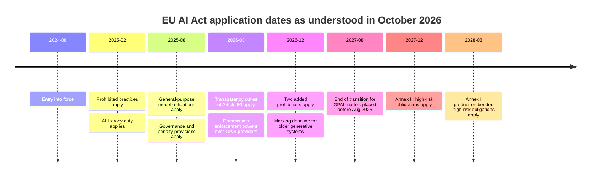

The timeline makes one point clear, and a second easy to miss. The clear one is that the high-risk deadline moved later, to December 2027, and the earlier August 2026 date no longer governs. The easy-to-miss one is that the delay applies only to part of the Act. Prohibitions, AI literacy, general-purpose model duties, and transparency duties continue to apply on their own dates, and new prohibitions arrive in December 2026. A program that stood down all EU AI Act work when the high-risk date moved would miss near-term duties. The delay also does not make high-risk preparation optional: conformity assessment for a high-risk system is a multi-quarter program, and harmonized standards that support presumption of conformity were still being finalized in 2026 (secondary sources report the first, a quality management system standard, was approved in July 2026).

AI literacy (Article 4) obliges providers and deployers to take measures to support sufficient AI literacy among staff and others operating AI systems on their behalf. Reports on the amendment say it softened the duty from ensuring a sufficient level to taking measures to support it. Keep records of training, roles covered, and content, since the duty is assessed on measures taken.

Penalties scale by type of infringement. At the time of writing, the upper tiers are EUR 35 million or 7 percent of worldwide turnover for prohibited practices, EUR 15 million or 3 percent for most other obligations including those on high-risk systems and general-purpose model providers, and EUR 7.5 million or 1 percent for supplying incorrect information to authorities, with lower caps for small and medium-sized enterprises. Verify the current figures.

### 16.7 NIST AI RMF and ISO/IEC 42001

The NIST AI Risk Management Framework (AI RMF 1.0, NIST AI 100-1, published January 2023) is a voluntary framework that organizes AI risk management into four functions.

- Govern: policies, accountability, culture, and processes that make risk management happen across the organization. This function is cross-cutting and underlies the others.
- Map: establish context, intended purpose, stakeholders, and potential impacts of a specific system, and categorize its risks.
- Measure: analyze and track risks with quantitative and qualitative methods, including evaluations of trustworthiness characteristics such as validity, safety, security, explainability, privacy, and fairness with harmful bias managed.
- Manage: prioritize and treat risks, decide on responses, allocate resources, and plan for incidents and for the post-deployment period.

NIST also published a Generative AI Profile (NIST AI 600-1, July 2024) that lists risks specific to generative systems and suggested actions. At the time of writing, NIST has stated that the AI RMF is being revised and no replacement version has been finalized, so verify which version applies. The AI RMF is not certifiable and imposes no legal obligation by itself, but it is widely used as a vocabulary and as a benchmark in procurement and in US state laws that reference it.

ISO/IEC 42001:2023 specifies requirements for an AI management system (AIMS). It follows the structure of other ISO management system standards, such as ISO/IEC 27001 for information security: context of the organization, leadership, planning (including AI risk assessment and AI system impact assessment), support, operation, performance evaluation, and improvement, using a plan-do-check-act cycle. An annex lists controls on policies, internal organization, resources, assessing impacts, the AI system lifecycle, data, information for interested parties, use, and third-party relationships. Unlike the NIST framework, an organization can be audited against ISO/IEC 42001 and certified by an accredited body. Related standards include ISO/IEC 23894 (guidance on AI risk management) and ISO/IEC 42005 (guidance on AI system impact assessment), which is useful for the assessment of section 4. Check their current status before citing.

How the instruments relate: the EU AI Act is law with specific obligations. NIST AI RMF is a risk vocabulary and process guide. ISO/IEC 42001 is a certifiable management system. A single operating model can satisfy all three if designed once and mapped. The EU quality management obligation for high-risk providers is where a management-system standard gives the most reuse, since a harmonized standard that supports presumption of conformity is the intended route. NIST publishes a crosswalk between the AI RMF and ISO/IEC 42001 that helps with mapping.

| This chapter's control | EU AI Act | NIST AI RMF | ISO/IEC 42001 theme |
| --- | --- | --- | --- |
| Intake and tiering | Risk classification, Articles 5 and 6 | Map | Planning, AI risk assessment |
| Impact assessment | Article 9, Article 27 | Map | AI system impact assessment |
| Fairness and data evidence | Article 10 | Measure | Data controls, performance evaluation |
| Human oversight design | Article 14 | Manage | Operation, use controls |
| Accountability and operating model | Article 17 | Govern | Leadership, roles |
| Release gates and residual-risk sign-off | Articles 9 and 43 | Manage | Operational planning and control |
| Monitoring and incidents | Articles 72 and 73 | Manage | Performance evaluation, improvement |
| Documentation and system cards | Article 11 | Govern, Map | Documented information |
| Supplier due diligence | Article 25 | Govern | Third-party relationships |

### 16.8 Sector rules and other regimes

Many binding rules for AI come from existing sector law, applied to a new technology. Examples to check for your domain, which are indicative and not exhaustive:

- Data protection law, in particular the GDPR: lawful basis, purpose limitation, data minimization, data protection impact assessments, and the restriction on solely automated significant decisions in Article 22. Owned by [CH30](CH30_AI_Data_Governance_Privacy_and_Provenance.md) for the data side.
- Credit and financial services: fair-lending and equal-credit rules, adverse-action notice requirements that require reasons for denial (in the United States, the Equal Credit Opportunity Act and Regulation B), and model risk management supervisory guidance such as the Federal Reserve and OCC guidance SR 11-7 for banks, which requires validation, documentation, and governance of models.
- Employment: anti-discrimination law, and local rules on automated employment decision tools, such as New York City Local Law 144 requiring bias audits and notices.
- Health: medical device regulation for software that diagnoses or treats, and health data privacy rules.
- Consumer protection: rules on unfair or deceptive practices, which regulators have applied to misleading AI claims.
- US state AI statutes: several states have adopted or considered laws on high-risk automated decisions, with effective dates that have shifted. Check the current status in each state where you operate.
- Frontier model transparency laws, such as California's SB 53 (section 13.2).

Jurisdictional scope depends on where users and affected people are, and not only where the company is. The intake question on jurisdictions (section 3.4) feeds a regulatory classification step that counsel owns.

### 16.9 From obligation to evidence

The test of a regulatory mapping is whether, for each obligation, a named control exists and an artifact proves it operated. A useful working format is a control register with these columns: obligation and source, control, owner, artifact and where it is stored, test frequency, last test date and result. For example, for Article 14 human oversight on a credit model: control is "reviewer queue with evidence view and override," owner is the process owner, artifact is the capacity calculation and a monthly seeded-case detection report, tested monthly, last result 91 percent of seeded errors caught. An auditor or regulator can follow that row from the legal requirement to a number. Obligations with no row are gaps, rows with no artifact are claims, and rows whose last test is old are decaying controls. Run the register as data and query it.

## 17. AI Incident Response and Reporting

### 17.1 What counts as an AI incident

An AI incident is an event in which an AI system's behavior or use causes, or nearly causes, harm or a policy breach. Examples include discriminatory outcomes discovered in monitoring, harmful or illegal content shown to users, leakage of personal or confidential data, unauthorized tool actions by an agent, a prompt-injection compromise, a serious error propagated to many decisions, misuse by a customer, a provider outage or silent model change that breaks safeguards, and a safety control that failed open. Near misses count: the safeguard that caught a bad output at the last step shows that a failure mode exists. Public repositories, such as the AI Incident Database, collect reported incidents and are a source of scenarios to test your design against.

Incidents differ from ordinary software incidents in three ways. Detection is harder, because the system keeps running and produces plausible output. The harm may be statistical, visible only in aggregate. And the cause may be distributed across data, model, prompt, retrieval, and workflow, so root-cause analysis needs a record of all versions in effect.

### 17.2 Severity

Define severity so that responders and executives share vocabulary. An illustrative scheme based on harm and scale follows, and the script [03_governance_gates_and_incidents.py](../code/python/responsible-ai-chapter/03_governance_gates_and_incidents.py) implements it.

| Severity | Criteria | Containment target | Notification |
| --- | --- | --- | --- |
| SEV1 | Serious harm (rights, safety, significant money) to any person, or moderate harm to 1,000 or more people | 60 minutes | Executive sponsor immediately, legal and privacy, regulators and affected people as required |
| SEV2 | Moderate harm to fewer than 1,000 people, or minor harm to 1,000 or more | 4 hours | Council chair, owners |
| SEV3 | Minor harm to fewer than 1,000 people, or a near miss | 24 hours | Owners, tracked in register |

The script's register shows the arithmetic with three sample incidents. INC-001 affected 12 people with minor harm and was contained in 50 minutes, SEV3 with a 1,440-minute target, within target. INC-002 caused moderate harm to 2,300 people and took 240 minutes to contain, which is SEV1 (moderate harm at scale) with a 60-minute target: missed. INC-003 caused serious harm to 40 people and took 90 minutes, SEV1: missed. Mean time to contain across the three was $(50 + 240 + 90)/3 = 127$ minutes. The point of the exercise is the comparison with targets: an average of 127 minutes sounds fine and hides that both SEV1 incidents missed their target. Report by severity.

### 17.3 Triage and containment

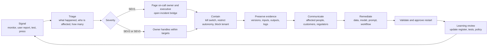

The sequence sets an order of operations. Contain first, using the kill switch designed in section 11.6, because every minute of operation adds affected people. Preserve evidence second, before the investigation changes the state: freeze the model, prompt, retrieval index, tool, and policy versions, and capture inputs and outputs, with redaction and access limits to meet privacy duties. Communicate third, with accuracy over speed for external statements and speed over polish for internal ones. Fix and validate fourth, with re-evaluation sized to the change, and restart approved by the same authority that approved the release for that tier. The loop back to the signal at the end stands for the learning review feeding detection: each incident should produce at least one new test, monitor, or policy change.

Three triage questions decide most outcomes. What is the worst-case harm if this continues for another day? Is the harm ongoing or finished? Is the affected group identifiable, so they can be told and helped? A common mistake is to treat an incident as closed when the system is fixed, without remediating the people already harmed, such as reversing decisions, correcting records, and compensating.

### 17.4 Disclosure and reporting

Disclosure obligations may arise from several sources at once, and the clocks run in parallel, so identify them in advance and not during the incident.

- Data protection: a personal data breach triggers notification to the supervisory authority within 72 hours of awareness, where feasible, under the GDPR, and to affected individuals when the risk to them is high.
- EU AI Act: providers of high-risk systems must report serious incidents to market surveillance authorities (Article 73), with deadlines that depend on the kind of incident and that the Act sets in days, with shorter periods for widespread infringements and for incidents involving death; providers of general-purpose models with systemic risk report serious incidents to the AI Office. Deployers inform the provider and authorities where relevant. Confirm the periods and definitions in the text and any guidance.
- Sector regulators and contracts: financial, health, and critical-infrastructure regulators have their own rules, and customer contracts often set notification windows.
- Frontier developers: laws such as California's SB 53 require reporting of critical safety incidents by covered developers to a state authority on specified timelines. Verify scope.
- Voluntary disclosure and public postmortems: these build trust where appropriate, and legal review should decide scope.

Draft templates for each channel in advance, and name who decides to notify. The legal question of whether an event meets a threshold for reporting is usually answered with incomplete facts, so decide the rule for acting under uncertainty before an incident, typically by notifying and updating.

### 17.5 The incident register

The register is the memory of the program. Each record should hold: identifier and date, detection source, system and versions in effect, description, severity and the reasoning, affected population and count, harm type, time of detection, containment, and resolution, root-cause category (data, model, prompt, retrieval, tooling, workflow, oversight, provider change, misuse), actions taken for affected people, notification decisions and dates, corrective and preventive actions with owners and due dates, and the lessons recorded. Review the register for patterns: repeated root causes, long detection delays, incidents found by users instead of monitors, and corrective actions past due. Detection source is a key metric: the share of incidents first reported by users or the press measures the weakness of internal monitoring.

### 17.6 Blameless learning

The learning review follows the blameless postmortem practice from site reliability engineering: ask what conditions allowed the failure and what would prevent it, and not who is to blame. Individuals who report problems must not be penalized, or the next problem will go unreported. A good review produces specific changes: a new test case from the failing input class, a monitor on the leading indicator that was missed, a gate criterion that would have blocked the release, a runbook edit, and a policy clarification. Track these to completion, and feed patterns to the council. A review that ends with "improve vigilance" has produced nothing.

## 18. Lifecycle Governance Gates as a State Machine

### 18.1 Why model the lifecycle as states

Governance is easier to operate when the lifecycle is explicit: a system is always in one state, moves between states only through defined transitions, and each transition has required evidence and required signers. A state machine can be implemented in the model registry and deployment pipeline so that a system cannot reach production without the required records. It also makes bypasses visible: a transition that happened without the evidence is a recorded exception.

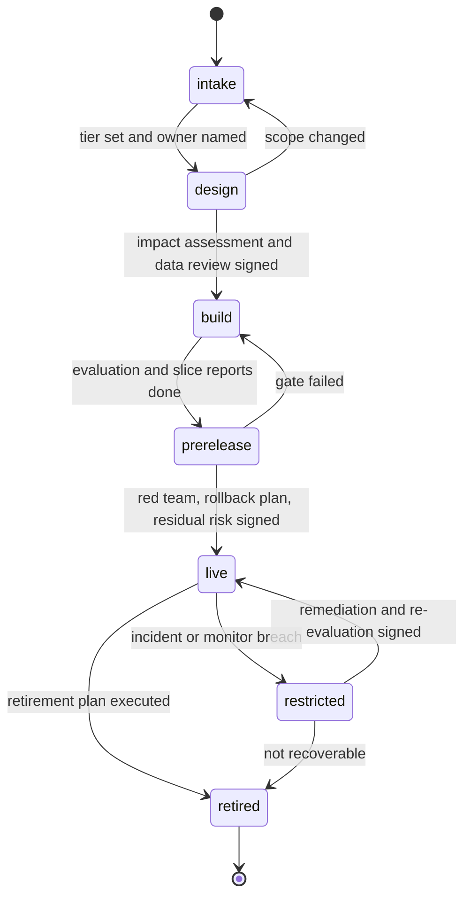

The states and their gates are as follows. Intake: use case recorded, red-line and category checks done, tier set, accountable owner named. Design: impact assessment with stakeholder input, data review, control design including oversight and recourse, regulatory classification. Build: implementation with evaluation set built, fairness slices defined before results are seen. Pre-release: frozen candidate, evaluation by slice, red-team and misuse results, oversight capacity test, stop-mechanism drill, system card, residual-risk record. Live: staged rollout, monitoring, scheduled reviews. Restricted: a degraded state in which autonomy is reduced or a capability is disabled after an incident or a monitor breach. Retired: decommissioned, with data retention and deletion handled and users notified. The restricted state matters: without it, the only options after trouble are "carry on" and "turn it off," which pushes teams toward carrying on.

### 18.2 Gate checks in code

The script [03_governance_gates_and_incidents.py](../code/python/responsible-ai-chapter/03_governance_gates_and_incidents.py) encodes the transitions as a table of required evidence and signers, and adds a council chair signature for T3 and T4 releases. A short run shows how it behaves.

```text
      intake -> design       APPROVED
      design -> build        APPROVED
       build -> pre_release  APPROVED
 pre_release -> live         REJECTED: missing evidence ['residual_risk_record'] signers ['council_chair']
 pre_release -> live         APPROVED
        live -> intake       REJECTED: no such transition
final state: live
```

The first attempt to go live was refused, with the missing evidence and the missing signer named. The second supplied both and passed. The attempt to move a live system back to intake was rejected because no such transition exists; a change that needs re-assessment moves the system to the restricted state or triggers a new intake record, so the history is preserved. Implementing this in a real pipeline means making the deployment job query the registry for the system's gate state and refuse to deploy a version whose record lacks the approvals. The gate is only as strong as the rule that the pipeline cannot be bypassed, which makes it a platform feature and not a team habit.

### 18.3 Change triggers inside Live

Live is not a static state. Define which changes route a system through a lighter or full re-review, and automate detection where possible:

| Change | Review |
| --- | --- |
| Model provider version change | Re-run evaluation suite and slices, compare to baseline, risk partner approval if outside tolerance |
| Prompt edit affecting policy or tone | Targeted evaluation and red-team replay |
| New tool or permission | Full pre-release gate for the new capability |
| New data source in retrieval or training | Data record update, rights check, evaluation |
| New user population or jurisdiction | Re-tier, impact assessment update |
| Monitoring threshold breach | Move to Restricted, investigate |
| Regulatory change | Control register update and gap review |

Maintain a regression suite of past incidents and red-team findings, and run it on every change. This turns the incident register into a durable safeguard.

### 18.4 Retirement

Retirement is a lifecycle event with obligations. Decide the criteria: loss of owner, inability to meet evidence or recourse requirements, provider deprecation, repeated incidents, unfavorable cost-benefit, or a regulatory change. Executing retirement means notifying users and affected people, honoring pending contests, handling data per retention rules (see [CH30](CH30_AI_Data_Governance_Privacy_and_Provenance.md)), archiving the evidence for the period needed for audit and legal claims, revoking credentials and tool permissions, and updating the registry. An orphaned system, running with no owner, is a common source of incidents.

## 19. Residual-Risk Acceptance and Who Signs

### 19.1 What residual risk is

After controls are in place, some risk remains. Residual risk is the risk that remains after treatment. Releasing a system always accepts some of it, whether or not anyone says so. Governance makes the acceptance explicit: the risk is described, quantified as far as evidence allows, and signed by a person with authority proportional to its size. The alternative is implicit acceptance by the engineer who ships on a Friday.

### 19.2 The residual-risk record

A residual-risk record contains: the risk (harm, who bears it, how it arises), its pre-control and post-control scores, the controls in place and their evidence, the reason the remaining risk cannot be reduced further now (cost, feasibility, benefit), compensating measures such as extra monitoring or narrower scope, the conditions under which acceptance lapses (a metric breach, a date, a change), the review date, and the signature. Always state the people who bear the risk and whether they were consulted, since the signers are often not those who bear it.

### 19.3 Delegated authority

Authority to accept risk should follow the harm score, with higher scores signed by more senior people and with limits for what cannot be accepted at all. An illustrative delegation, using the score of section 3.3:

| Residual score | Who may accept | Conditions |
| --- | --- | --- |
| Under 10 | Product owner | Recorded in the intake |
| 10 to 23 | Product owner with risk partner concurrence | Review date within 12 months |
| 24 to 59 | Governance council | Compensating controls and review within 6 months |
| 60 or more | Executive sponsor on council recommendation | External review, board notified, review within 3 months |
| Any prohibited use | No one | Cannot be accepted |
| Any known unlawful outcome | No one | Cannot be accepted; fix or stop |

The last two rows are not a score, and they matter most. Risk acceptance is a tool for managing uncertainty and trade-offs, not for waiving legal requirements. A residual-risk form that lists "possible violation of anti-discrimination law" as acceptable has misunderstood its purpose.

### 19.4 Pressure, independence, and the right to dissent

Acceptance decisions come under schedule and revenue pressure. Safeguards include signers who do not report to the delivery executive, a written record of dissent that stays attached to the decision, an expiry date on every acceptance so that it is revisited, and a rule that an acceptance is invalid if the facts it relied on change. Where a signer is also the beneficiary, escalate. A residual-risk register that only ever contains accepted items, with none declined, indicates a process that approves everything. Track the decline and send-back rate, and treat a rate near zero as a warning (section 20).

## 20. Governance Metrics and Audit

### 20.1 Measuring governance health

Governance should be managed with measurements, otherwise it is judged by anecdote. A set of metrics that reveals real function, grouped by what question each answers:

| Question | Metric | Warning sign |
| --- | --- | --- |
| Is the inventory complete? | Share of AI systems in production that are in the registry with a tier and owner; shadow-AI discoveries per quarter | Below 100 percent, or discoveries from procurement and expense audits |
| Does the process operate? | Share of T2 and above releases with complete gate evidence; exceptions granted | Releases without evidence, many exceptions |
| Is it usable? | Median days from intake to decision by tier against service levels | Medians that exceed the service level, or teams avoiding intake |
| Does the gate ever say no? | Rate of declines, send-backs, and scope reductions at gates | Near zero for a year |
| Are the controls working? | Seeded-error detection rate in human review; fairness gap trend by slice; red-team findings open past due | Falling detection, widening gaps, aging findings |
| Can we respond? | Time to contain by severity vs targets; share of incidents first detected internally | Missed SEV1 targets, user-detected incidents |
| Do we learn? | Corrective actions closed on time; repeat root causes | Repeats, overdue actions |
| Do people understand? | Training coverage for roles, and test-based literacy checks | Coverage without comprehension evidence |
| Is the footprint tracked? | Energy and CO2e per 1,000 requests, by system | Unknown, or rising without justification |

Several of these are deliberately about whether the process can fail. A governance function that reports only on volume (assessments completed, trainings delivered) is measuring its own activity. The decline rate and the seeded-error detection rate measure its effect.

### 20.2 Audit

Audit gives independent assurance that governance operates as described. Internal audit (the third line) or an external assessor tests a sample of systems against the policy and standards: is the system in the registry with the right tier, did the assessment cover the required elements, was evidence real and current, were signers authorized, were incidents handled to target, do controls in the register actually operate? Auditors work from the evidence trail, which is why artifacts must be retained and queryable. Reproduction is the strongest test: an auditor re-runs the evaluation on the recorded version and data and compares to the reported result, or re-reviews a sample of human decisions. For T4 systems, build independent reproduction into the gate.

Audit findings need owners and deadlines, and the board or council needs to see them. An ISO/IEC 42001 certification audit examines the management system, not individual models, so it is complementary to, not a substitute for, system-level assurance. Algorithmic audits by external parties, such as bias audits required for certain hiring tools, examine system outputs and need access to data and the model, which has to be planned for in contracts.

## 21. Common Failure Patterns

### 21.1 Ethics washing

Ethics washing is publishing principles, forming an advisory board, or announcing a code of conduct while the delivery process is unchanged. The signs are principles with no mechanism (section 2), an ethics team with no authority over releases, a board that has never delayed a product, and public claims that exceed internal evidence. The cost is credibility and, increasingly, legal exposure for misleading statements about AI capabilities or safeguards. The remedy is the five-part chain: trigger, definition, owner, evidence, consequence. Every public claim should trace to an internal artifact.

### 21.2 Checklist theater

Checklist theater is completing forms without doing the work. A team ticks "bias tested" because someone ran an aggregate accuracy metric. A reviewer approves 40 assessments an hour. The signs are identical answers across systems, assessments completed after the build, no findings ever recorded, and an abundance of "not applicable." The cause is incentive and design: checklists that ask yes/no questions invite yes answers. Prefer questions that need evidence ("attach the slice report with counts") and sample completed assessments for challenge by a reviewer who re-derives a result.

### 21.3 Late-stage review

When governance first sees a system at pre-release, the design is fixed, the schedule is committed, and the only available outcomes are approval or a painful delay. Reviewers then face pressure to approve, and teams learn to treat review as an obstacle. Fix it by moving the first touch to intake, giving the assessment real influence over design, and using lightweight design consultations during the build. Measure the stage at which the first material finding is raised: findings after build are a sign of late review.

### 21.4 Unowned risk

Unowned risk arises at boundaries: between product and platform teams, between your team and a vendor, between data engineering and modeling, between model owner and the people who handle complaints. A risk register in which many entries have a team name and no person, or a shared inbox as owner, indicates this. Cross-team harms, such as a retrieval index that exposes data one team owns to an assistant another team built, are the typical case. The remedy is the single accountable owner per risk and a rule that a risk without an owner blocks the gate.

### 21.5 Other recurring patterns

- Metric fixation. A single fairness or safety number becomes the goal, and the system is tuned to the metric while the harm it was meant to proxy remains. Use several measures and qualitative review, and change the test set periodically.
- Test-set leakage in safety evaluation. Red-team prompts leak into training or into the prompt-engineering loop, so the system is tuned to pass them. Hold out a private set.
- Governance by the vendor. Accepting a provider's assertion of safety as the evidence. Run your own evaluation.
- Frozen governance. Policies written for the previous generation of technology, such as models that only classify, are applied unchanged to agents that act. Review the tier definitions when capability changes.
- Documentation as a substitute for control. A detailed system card for a system that has no kill switch.
- Privacy and governance at odds. Logging everything for evidence and violating minimization, or deleting everything and losing the ability to investigate. Decide the retention design deliberately (section 11.7).
- One-way ratchets. Autonomy granted in a pilot is never reviewed. Autonomy should expire without renewal.

## 22. Alternatives and Trade-offs in Governance Design

### 22.1 Governance structures compared

Organizations choose among a few structures, and the choice depends on size, risk profile, and culture. The table compares the three most common.

| Structure | How it works | Strengths | Weaknesses | Fits |
| --- | --- | --- | --- | --- |
| Centralized review board | One body reviews every T2 and above system | Consistent decisions, clear authority, concentrated expertise | Bottleneck, distance from the work, reviewers lack system context | Smaller organizations, early programs, high-risk regulated domains |
| Federated or embedded | Each business unit has trained risk partners and applies shared standards, with central escalation | Speed, context, scales with the number of systems | Inconsistency, local pressure on partners, standards drift | Large organizations with many AI use cases |
| Pipeline-enforced controls with light human review | Gates and evidence checks live in tooling, humans review exceptions and T3 and above | Scales, consistent, cheap per release | Needs platform investment, only checks what can be encoded | Mature platforms with a model registry and deployment pipeline |

Most programs end up with a hybrid: a central council for T3 and T4 decisions and policy, embedded risk partners for T2, and pipeline enforcement for the evidence checks. Start centralized while the number of systems is small and the standards are still being written, then federate as volume grows, and encode checks in the pipeline as they stabilize. Moving too early to a federated model, before standards exist, produces inconsistent decisions that are hard to reverse.

### 22.2 Quality-attribute scenarios

Governance requirements can be written as testable scenarios, in the stimulus, response, and measure format used for other architectural qualities.

| Quality | Stimulus | Response | Measure |
| --- | --- | --- | --- |
| Stoppability | A SEV1 incident is declared for a T3 assistant | On-call disables the tool-calling capability using the runbook | Capability disabled and verified by probe within 15 minutes, evidence preserved |
| Reviewability | A model update raises the review flag rate from 10 to 18 percent | Router detects capacity breach, defers excess cases, pages the process owner | No auto-approvals, backlog age under 4 hours, staffing change requested within 1 day |
| Contestability | An applicant requests human reconsideration | A named reviewer receives inputs, version, and explanation, and decides | Response within 10 working days, reversal propagated to downstream systems within 1 day |
| Fairness drift | Monthly group TPR gap exceeds 0.08 for two consecutive months | Alert to model owner and risk partner, investigation opened, system moved to Restricted if the gap exceeds 0.12 | Investigation opened within 5 working days |
| Traceability | A regulator asks why a specific decision was made 14 months ago | Team retrieves inputs, outputs, model, prompt, and reviewer record | Complete record retrieved within 2 working days |
| Change control | The provider announces a new model version | Pinned version retained, candidate evaluated on regression suite and slices, release gated | No production change without re-evaluation evidence |

These scenarios let a design review ask a concrete question: which component implements this response, and when was it last tested?

## 23. Worked Case Study: A Credit-Line Model and a Support Assistant

### 23.1 Context

A mid-size consumer lender plans two AI systems. The first is a model that recommends whether to grant a credit-line increase to existing customers who request one. The second is a generative assistant that answers customer questions about products, policies, and the status of their requests, using retrieval over policy documents and a read-only status service. The lender operates in the EU and in the United States. The same governance process applies to both, and the cases show how the pieces fit and where the decisions are hard. All numbers are illustrative.

### 23.2 Intake and tiering

Credit decisions fall in a regulated category, so the credit model is at least T3. The harm assessment gives wrongful denial of credit a score of $4 \times 3 \times 2 = 24$ and disparate error rates by group also 24, which is T3 on the scoring scheme as well. In the EU the use case falls under Annex III (access to essential services, creditworthiness evaluation of natural persons), so the high-risk obligations will apply on the dates in section 16.6, and the lender decides to build to the standard now. The assistant's worst credible harm is a leak of another customer's data, scored $5 \times 2 \times 3 = 30$, which is also T3. Its common harm, a confident wrong policy answer, scores $2 \times 4 \times 1 = 8$. Both systems have a named product owner and model owner and an executive sponsor. A check of the prohibited list finds no red-line use. The assistant is configured not to infer emotion from voice or text, because the lender's contact center uses the same platform and emotion inference in a workplace is a prohibited practice for employee-facing use; the setting is documented as a deliberate exclusion.

### 23.3 Credit model: fairness decisions

The assessment's stakeholder map identifies applicants, thin-file customers, customers with protected characteristics, call-center agents, and the lender's collections team. A consultation with a consumer advocacy group and a review of complaint data raise a concern: customers with short credit histories are denied at high rates even when they repay.

Evaluation on a held-out sample gives the confusion matrices of section 6.2. Group A (1,000 customers) has TPR 0.750, FPR 0.200, PPV 0.714 and selection rate 0.420. Group B (500 customers, a thin-file and protected-class overlap segment) has TPR 0.600, FPR 0.200, PPV 0.429 and selection rate 0.280. The disparate impact ratio is 0.667. The team had to decide which criterion governs.

Decision 1: equal opportunity (equal TPR) is the primary criterion. The main harm is wrongful denial to customers who would have repaid. FPR is already equal, so equalized odds reduces to closing the TPR gap. The label is "repaid within 12 months," which exists only for customers who were granted an increase in the past, so selective labels are a known weakness (section 5.4). The team therefore also monitors selection rate by group as a secondary signal and does not claim that TPR parity proves fairness.

Rejected alternative: demographic parity. It would require raising approvals in B to near the level in A (0.42) although B's base rate is 0.20, which at the same FPR would approve many customers who do not repay, harming those customers through debt. The team judged the label trustworthy enough for this use that error-rate criteria apply.

Rejected alternative: remove the protected attribute and proxies and call it fair. Fairness through unawareness does not remove the correlation carried by other features, as the measurement and representation analysis showed that thin file and postcode are strong proxies. The attribute is held out of the model and kept only in a restricted evaluation store, so that gaps can be measured.

Rejected alternative: group-specific thresholds. The toy post-processing in the script reaches equal TPR with threshold 0.60 for A and 0.40 for B. Counsel advised that using the protected attribute in the decision rule creates direct disparate-treatment exposure in the United States credit setting. The option is documented as rejected with the reason, and revisited if the legal position changes.

Chosen mitigation: improve the information available for group B, since the gap arises mainly from missing signal. The team adds rent-payment and utility-payment history as features where the customer consents, and uses a scorecard model with monotone constraints, which is interpretable and supports adverse-action reasons. It adds a human review band for scores near the threshold.

Result on the second evaluation (illustrative): group B TPR rises from 0.60 to 0.68 and FPR rises from 0.20 to 0.22, while group A is unchanged. The TPR gap falls from 0.150 to 0.070. The Wilson 95 percent interval for B's TPR with 100 qualified customers is about $[0.583, 0.763]$, which contains A's 0.750. The correct statement is that the gap narrowed and that the sample cannot distinguish the remaining gap from zero, not that parity has been achieved. The cost is $0.02 \times 400 = 8$ additional false approvals in B against $0.08 \times 100 = 8$ additional true approvals. With the illustrative figures of 8,000 average loss per false approval and 600 profit per good loan, the net effect is $8 \times 600 - 8 \times 8000 = 4{,}800 - 64{,}000 = -59{,}200$ per evaluation cohort, a cost the council accepts as a deliberate fairness investment and records as such. The team plans to expand the sample to bring the interval width under 0.12 before the next review.

### 23.4 Credit model: oversight, recourse, and release

The review band covers scores in the uncertain region and is sized at 10 percent of 1,200 requests a day, which is 120 cases. At 6 minutes per case that is $120 \times 6 / 60 = 12$ reviewer-hours a day, and with 5.5 productive hours per reviewer the need is $12 / 5.5 = 2.2$, so 3 reviewers, for a planned utilization of $12 / 16.5 = 0.73$. The maximum flag rate for three reviewers is 13.8 percent (section 10.4), so the band has headroom of 3.8 points. The router defers cases above capacity to a next-day queue and tells the customer, and never auto-approves. Reviewers see the score, the top reasons, the data sources, and the customer's stated purpose, and they can approve, decline, or request information. Seeded cases are injected at 2 percent, with a target detection rate of 85 percent.

Recourse: every decline carries reasons and instructions, and a customer can request human reconsideration through a named team with a 10-working-day service level. The path is tested by a staff member before release, which discovers that the original web form did not include the application reference, and the form is changed.

The release gate checks the items of section 11.4. Slice evaluation covers six pre-defined slices, and two are flagged "not evaluable, fewer than 30 positives." The red team covers manipulation of stated income and the effect of data-entry errors. The stop mechanism returns the system to the previous scorecard and a manual process within 30 minutes, tested in a drill. The residual-risk record names the remaining TPR gap, the cost accepted, and the review date six months out. Because the harm score is 24, the council signs. The rollout is staged: 5 percent of requests for two weeks, then 25 percent, with exit criteria on gap, complaints, and review backlog.

### 23.5 Support assistant: decisions and rejected alternatives

The assistant uses retrieval over product and policy documents and a read-only status service. Its tier is T3 because of the data-leak harm.

Decision 2: authorization lives outside the model. The status tool takes the authenticated customer's identifier from the session, never from the model's text. A prompt-injection that tells the model to look up another account cannot succeed, because the tool does not accept an account argument from the model. Rejected alternative: passing the account identifier in the prompt and instructing the model to use only the user's own. That control depends on the model obeying text and fails under injection.

Decision 3: no autonomous actions. The assistant answers and files a request for a human to act; it cannot change limits, waive fees, or send messages outside the session. Rejected alternative: autonomous fee waivers up to a limit. Fee waivers are reversible and small, but the team judges that the added approval logic and abuse exposure do not justify the saving at launch, and revisits after six months of data.

Decision 4: disclose and offer a human. The chat opens with a visible label that the customer is talking to an AI assistant and a button to reach a person at any time, consistent with the Article 50 duty, and answers about credit decisions refer the customer to the reconsideration process instead of explaining a decision the assistant does not have the information to explain. Rejected alternative: a persona with a human name, which tests slightly better on satisfaction and conflicts with the disclosure duty.

Safety evidence. Evaluation per [CH24](CH24_Generative_AI_Evaluation_Guardrails_and_Hallucinations.md) measures groundedness on policy questions and refusal behavior. A fairness check uses 400 paired prompts that differ in name and dialect cues, and compares the assistant's refusal, tone, and escalation recommendations, finding no significant difference in refusal and a small difference in escalation offers by dialect, which the team traces to a classifier threshold and corrects. The red team runs injection through uploaded documents and through retrieved content, attempts cross-account lookups, and attempts to extract the system prompt, with findings fixed or accepted.

Staged rollout statistics. Stage 1 serves 1,000 conversations to employees and records zero severe incidents. By the rule of three the 95 percent upper bound on the severe-incident rate is $3 / 1000 = 0.3$ percent, which is too weak to justify broad exposure given the harm severity. Stage 2 therefore runs 3,000 conversations to a consenting customer group before broad rollout, which supports a bound of $3 / 3000 = 0.1$ percent. The team states plainly that this bound is not a claim of safety against rare harms, which are bounded instead by the permission design of Decision 2. The kill switch can disable retrieval, disable the status tool, or take the assistant offline, with a 15-minute objective that is verified in a drill.

### 23.6 Operating and learning

In month three, a provider announces a new model version. The pinned version stays in production while the team replays the regression suite and the slice evaluation against the candidate. The candidate shows a lower groundedness score on one product line, and the team defers the upgrade, which the registry records as a decision. In month four, a customer complains that the assistant gave an incorrect statement about a fee. Triage assigns SEV3 (minor harm, 12 customers identified through logs), containment is a corrected policy document and a re-index within 50 minutes, evidence is preserved, and the 12 customers are contacted. The review finds that the policy document was updated without a corresponding index refresh, and adds a freshness monitor and a test to the pipeline. The incident register records the root cause category as retrieval, detection source as customer report, and the action items with owners.

At the first six-month review, governance metrics show: registry coverage of AI systems 100 percent after the discovery of two unregistered marketing tools; median T3 decision time 11 working days against a 15-day target; two send-backs at gates in the period; seeded-error detection 88 percent in the review band; credit model TPR gap 0.06 with an interval still too wide to settle; and the assistant's cost of 0.9 Wh per request reported to the sustainability team. The council extends the credit model's rollout and asks for a larger evaluation sample.

### 23.7 What the case shows

The decisions in the case are traceable to a harm, a criterion, an owner, and a number. Rejected alternatives are on the record with reasons, which is what allows the next team to revisit one when circumstances change. The residual risk is named and signed by someone with authority. The system limits damage by design (authorization outside the model, no autonomous actions) in addition to measuring it. Reading the case against the failure patterns of section 21 is a useful exercise: where could each have occurred, and which mechanism prevented it?

## 24. Common Mistakes

| Mistake | Cause | Consequence |
| --- | --- | --- |
| Treating a principle list as a control | No trigger, owner, or evidence behind the principle | Nothing changes in delivery, and a claim exists that nobody can substantiate |
| Reporting only aggregate accuracy | Convenient single metric | A large gap for a subgroup remains hidden, as in the 92.5 percent example of section 5.6 |
| Declaring parity from a small sample | No intervals reported | A conclusion rests on 17 cases and flips on re-sampling |
| Optimizing one fairness metric and calling it fair | Misunderstanding the impossibility results | The harm moves to the error type the metric ignores |
| Using fairness through unawareness | Belief that removing the attribute removes bias | Proxies carry the information, and the group cannot be measured at all |
| Adding a human reviewer without sizing capacity | No arithmetic | Review time collapses and oversight becomes rubber-stamping, or a backlog harms customers |
| Reading a low override rate as quality | Confusing model accuracy with reviewer vigilance | A rubber-stamp reviewer ships four times more errors in the example of section 10.5 |
| Putting authorization in the prompt | Faith in instructions to the model | Prompt injection exposes other users' data |
| No tested stop mechanism | Assumption that a rollback can be improvised | Containment takes hours rather than minutes, and SEV1 targets are missed |
| Closing an incident when the code is fixed | Focus on the system, not the people | Affected people are never contacted or compensated |
| Accepting a residual risk that is unlawful | Misusing risk acceptance as a waiver | Legal exposure, and a signed record that shows knowledge |
| Standing down all regulatory work when one date moves | Reading a delay as a repeal | Prohibitions, transparency, and general-purpose duties are missed |
| Trusting a vendor's safety claim as evidence | Skipping own evaluation | Behavior on your population is unknown, and a silent update changes it |
| Storing everything or nothing in logs | No retention design | Either a privacy violation or an uninvestigable incident |
| Late-stage review | Governance first engaged at pre-release | Findings arrive when only approval or delay remain, and teams resent the process |

## 25. Design-Review Checklist

Use this list in architecture and release reviews. A "no" needs either a fix or a signed acceptance.

1. Is the use case in the registry with a tier, a named accountable owner, and a review date?
2. Did the intake check red lines, regulated categories, jurisdictions, and the provider or deployer role?
3. Does the impact assessment name stakeholders (including non-users and workers), harms by family, scores for severity, likelihood, and reversibility, and the voice of affected people?
4. Is the fairness criterion chosen for this decision, with reasons, rejected alternatives, and the people who agreed?
5. Are group metrics reported with counts and intervals, and are unevaluable slices listed?
6. Were labels and features checked for measurement and historical bias?
7. Are mitigation costs stated as numbers, and have counsel reviewed group-aware methods?
8. For generative output, are stereotyping, representation, and toxicity measured with paired designs and validated classifiers?
9. Is there a system card matched to the deployed versions, and a user disclosure that is timely and accurate?
10. Are explanations produced by methods whose limits are documented, and can a person contest an outcome with a human decider and a response time?
11. Is there a decision-rights table with exactly one accountable person per decision, and a timed escalation path?
12. Does human oversight have defined triggers, evidence shown, authority to override, a capacity calculation, and a no-capacity fallback that does not auto-approve?
13. Is oversight quality measured by seeded cases or independent audit and not only by override rate?
14. Are red-team and misuse results current for the frozen versions, with critical findings closed?
15. Are tool permissions, data access, and spending limits enforced outside the model?
16. Is there a kill switch with a time-to-stop objective that has been drilled, and does it preserve evidence?
17. Is staged rollout defined with exit criteria, and are small-sample limits understood?
18. Are monitoring signals tied to each top harm, with thresholds, owners, and runbooks?
19. Has the regulatory classification been recorded, and is each obligation mapped to a control, an owner, and an artifact?
20. Are incident severity, containment targets, notification duties, and the register in place?
21. Is the residual risk recorded and signed by someone with the authority for its size, and does the acceptance expire?
22. Are provider terms, version pinning, and change-notice handling covered?
23. Are annotator and supply-chain conditions, and the energy and carbon estimate, documented?
24. Are retirement criteria and the retirement plan written?

## 26. Exercises

1. A hiring-support tool summarizes resumes for recruiters. List its stakeholders, assign severity, likelihood, and reversibility scores to three harms, compute the harm scores, and give the tier under the scheme in section 3.3. State what would change the tier.
2. Given group P with TP = 90, FP = 60, FN = 30, TN = 320 and group Q with TP = 30, FP = 40, FN = 30, TN = 400, compute selection rate, TPR, FPR, and PPV for each group, and state which of demographic parity, equal opportunity, equalized odds, and predictive parity hold.
3. Using the Chouldechova identity, find the FPR that equal PPV of 0.8 and equal TPR of 0.6 would require in groups with base rates 0.5 and 0.1. What does the result tell a decision maker?
4. A review queue receives 2,000 cases a day with a 15 percent review rate. Reviews take 5 minutes and a reviewer has 6 productive hours. How many reviewers are needed, and what is the maximum review rate that 4 reviewers can sustain? What should the router do when the rate exceeds that?
5. A pilot of 1,500 conversations finds no severe incidents. What upper bound on the severe-incident rate does the rule of three give, and how many conversations are needed to claim a bound of 0.05 percent? Why might the claim still be misleading?
6. Write the decision-rights table for a T3 system: who may release, who may accept a residual risk with score 40, who may stop the system in an incident, and who may re-enable it.
7. Map the following to engineering evidence for an Annex III credit system: human oversight, data governance, record-keeping, post-market monitoring. Name the artifact and an owner for each.
8. A training job on 16 accelerators draws 0.6 kW each for 72 hours at PUE 1.3. Compute the energy, and the emissions on grids of 0.06 and 0.55 kg CO2e per kWh. What does the comparison suggest about scheduling?
9. A team argues that its human-in-the-loop control is sufficient because reviewers approved 99.2 percent of recommendations. Describe two measurements that would show whether the control works, and the sample size for one of them.
10. List five signs that a governance program is performing ethics washing, and for each name the metric from section 20 that would expose it.

### Answers and outlines

1. Stakeholders: applicants (subjects), recruiters (users), hiring managers, candidates with unusual formats or non-native writing, and the vendor's annotators. Example harms: omitted qualification ($S=4$, $L=3$, $R=2$, score 24), biased summary wording ($3 \times 3 \times 2 = 18$), leak of applicant data ($5 \times 2 \times 3 = 30$). The maximum is 30 and the category is employment, so T3. Allowing the tool to reject or rank candidates automatically would raise the severity or likelihood and could reach T4 or an Annex III high-risk classification in the EU.
2. P has n = 500: selection (90+60)/500 = 0.300, TPR = 90/120 = 0.750, FPR = 60/380 = 0.158, PPV = 90/150 = 0.600. Q has n = 500: selection (30+40)/500 = 0.140, TPR = 30/60 = 0.500, FPR = 40/440 = 0.091, PPV = 30/70 = 0.429. None of the criteria holds: selection differs by 0.160, TPR by 0.250, FPR by 0.067, PPV by 0.171.
3. FPR = p/(1-p) × (1-PPV)/PPV × TPR. For $p=0.5$: $1 \times 0.25 \times 0.6 = 0.150$. For $p=0.1$: $0.1111 \times 0.25 \times 0.6 = 0.0167$. The high base rate group would suffer nine times the false positive rate. Equal PPV and TPR cannot coexist with equal FPR unless base rates match, so the decision maker must choose which error to equalize.
4. Load: $2000 \times 0.15 = 300$ cases, $300 \times 5 / 60 = 25$ hours, $25 / 6 = 4.17$, so 5 reviewers. Four reviewers sustain $4 \times 6 \times 60 / (5 \times 2000) = 0.144$, or 14.4 percent. When exceeded, defer or use manual fallback; do not auto-approve; page the process owner.
5. $3/1500 = 0.2$ percent. For 0.05 percent, $n = 3 / 0.0005 = 6000$ conversations. The claim may mislead if the pilot population is unrepresentative, if conversations are not independent, or if harms are adversarial and rare so ordinary users do not trigger them.
6. Release: council (T3). Accept residual score 40: council, with executive notification if policy requires. Stop in an incident: on-call owner or any named incident commander, without prior approval. Re-enable: model owner plus risk partner, with evidence of remediation and re-evaluation, and council notified.
7. Human oversight (Article 14): oversight design, capacity calculation, seeded-error report, owner is the process owner. Data governance (Article 10): data record, representativeness and bias analysis, owner is the data steward. Record-keeping (Article 12): log specification and retention configuration, owner is the platform lead. Post-market monitoring (Article 72): monitoring plan and monthly report, owner is the model owner.
8. $E = 16 \times 0.6 \times 72 \times 1.3 = 898.6$ kWh. At 0.06: 53.9 kg CO2e. At 0.55: 494.2 kg CO2e. The ratio is about 9.2, so choosing the region or time for flexible jobs has a large effect compared to most efficiency work.
9. Seeded known-error cases and the detection rate, and an independent audit sample of approved items. A sample of 385 supports a plus or minus 5 point estimate at 95 percent confidence in the worst case. A 99.2 percent approval rate is consistent with both a good model and a rubber-stamp reviewer.
10. Principles without owners (inventory coverage and owner fields), an ethics board that never delays a release (decline and send-back rate), public claims without internal evidence (control register rows with no artifact), assessments completed after the build (stage of first finding), and incidents learned from the press (share first detected internally).

## 27. Summary

Responsible AI governance converts principles into mechanisms. Each principle needs a trigger, a definition, an owner, evidence, and a consequence, or it is decoration. Intake and tiering direct effort in proportion to risk, using impact, scale, autonomy, reversibility, and affected population, plus category and red-line checks that scores cannot override. The impact assessment turns stakeholders, harms, and recourse into data that can be queried.

Fairness is a set of definitions, not one. Demographic parity, equal opportunity, equalized odds, predictive parity, calibration within groups, and individual fairness measure different things, and when base rates differ the group criteria cannot all hold. The choice of criterion is a values decision tied to the harm, recorded with its trade-offs and expressed in counts and money. Mitigations act before, during, or after training, and each has costs and legal limits. Slice-based testing needs counts, intervals, and honesty about what cannot be evaluated. Generative systems need paired, validated measurement of stereotyping, representation, and toxicity.

Transparency has three audiences and explanations have limits. Accountability needs named owners, decision rights, and a timed escalation path. Human oversight is meaningful only with evidence, time, competence, authority, and capacity, which can be computed. Override rates cannot distinguish a good model from a rubber stamp, so measure with seeded cases and audits.

Safety release decisions rest on evaluation by slice, red-team and misuse results, tested stop mechanisms, and staged rollout whose statistics are understood. Misuse is a design input, bounded most reliably by capability minimization, scoped permissions, and rate limits. Frontier safety frameworks and provider policies are inputs to due diligence, not guarantees. Labor conditions, supply-chain provenance, and energy and carbon are part of the system's responsibility, and the arithmetic is simple enough to include in every approval.

The regulatory picture in October 2026 has the EU AI Act in staged application, with prohibitions, general-purpose model duties, and transparency duties already or soon in effect and the high-risk obligations delayed to December 2027 and August 2028 by the 2026 amending regulation, as reported by official and secondary sources that you should verify. NIST AI RMF offers a risk vocabulary and ISO/IEC 42001 a certifiable management system. Map each obligation to a control, an owner, and an artifact. Run incident response with severity, containment first, evidence preservation, parallel notification clocks, and a learning loop that changes tests and policy. Model the lifecycle as gates with evidence and signers, accept residual risk only at the right authority level, never for unlawful outcomes, and measure governance by whether it ever says no and whether its controls work. The recurring failures are ethics washing, checklist theater, late review, and unowned risk, and each has a mechanism that counters it.

## 28. Code Examples

The scripts use only the Python standard library and print the results quoted in this chapter.

- [01_fairness_metrics.py](../code/python/responsible-ai-chapter/01_fairness_metrics.py) computes selection rate, TPR, FPR, PPV, the group gaps, Wilson intervals, a calibration table, the Chouldechova identity, toy group thresholds, and an individual-fairness check.
- [02_risk_tiering_and_oversight.py](../code/python/responsible-ai-chapter/02_risk_tiering_and_oversight.py) scores harms as severity times likelihood times reversibility, assigns tiers, sizes human review capacity, and shows how rubber-stamping hides behind a low override rate.
- [03_governance_gates_and_incidents.py](../code/python/responsible-ai-chapter/03_governance_gates_and_incidents.py) implements the lifecycle gate state machine with evidence and signer checks and an incident register with severity and time-to-contain.
- [04_energy_and_carbon.py](../code/python/responsible-ai-chapter/04_energy_and_carbon.py) computes training and inference energy and emissions with grid and efficiency sensitivities.

## 29. Further Reading

- Barocas, Hardt, and Narayanan, *Fairness and Machine Learning* (2023), for the definitions and impossibility results in depth.
- Mitchell et al., "Model Cards for Model Reporting" (2019), and Gebru et al., "Datasheets for Datasets" (2021).
- Kleinberg, Mullainathan, and Raghavan (2016) and Chouldechova (2017) on the incompatibility of fairness criteria.
- Hardt, Price, and Srebro (2016) on equality of opportunity in supervised learning.
- Suresh and Guttag (2021) on a framework for understanding sources of harm in the ML lifecycle.
- The [NIST AI Risk Management Framework](https://www.nist.gov/itl/ai-risk-management-framework) and its Generative AI Profile (NIST AI 600-1).
- The [European Commission's AI Act pages](https://digital-strategy.ec.europa.eu/en/policies/regulatory-framework-ai) and the Official Journal text of Regulation (EU) 2024/1689 and its 2026 amending regulation.
- ISO/IEC 42001:2023, ISO/IEC 23894:2023, and ISO/IEC 42005.
- Neighbouring chapters: [CH24](CH24_Generative_AI_Evaluation_Guardrails_and_Hallucinations.md), [CH30](CH30_AI_Data_Governance_Privacy_and_Provenance.md), [Part 17 CH09](../17_AI_Architecture/CH09_Human_Oversight_and_AI_Assisted_Workflow_Integration.md), [Part 17 CH12](../17_AI_Architecture/CH12_AI_Safety_Security_Privacy_and_Governance_Architecture.md), and [Part 23](../23_Soft_Skills/PART_OVERVIEW.md).
