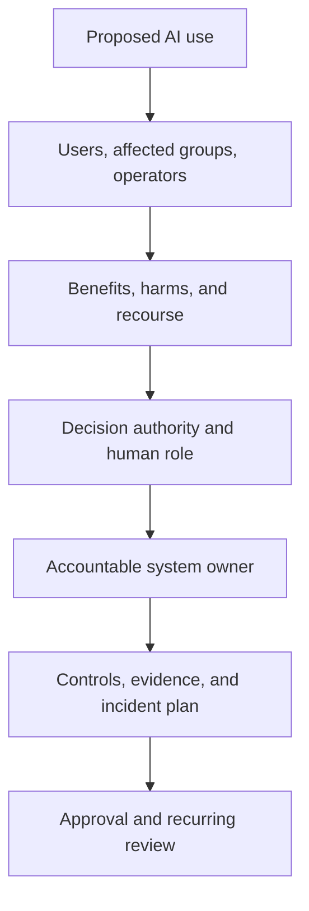
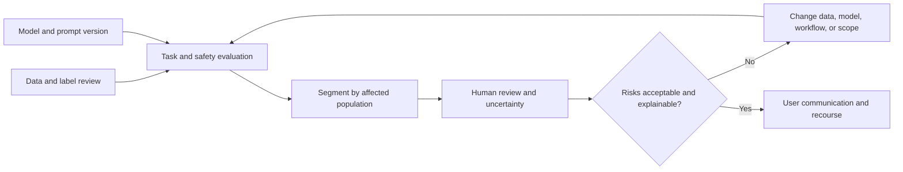
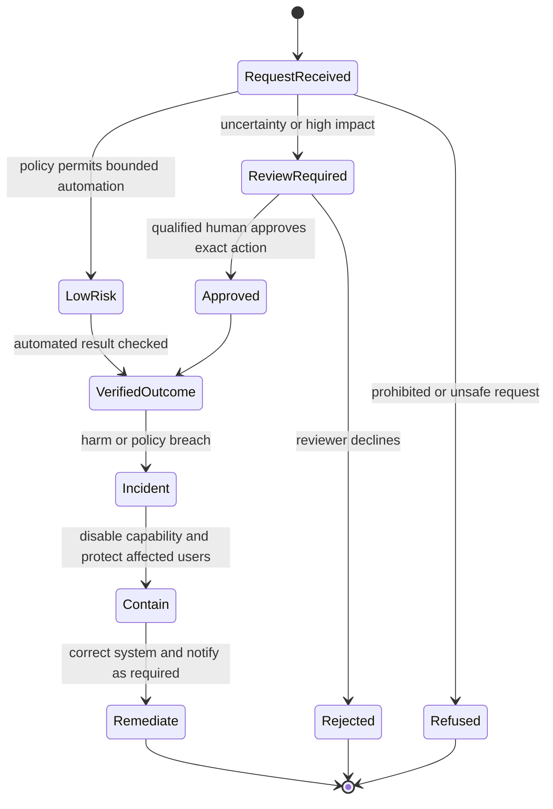
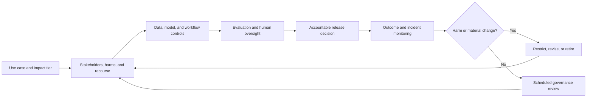

# Responsible AI and Safety Governance

Part: [16 — Artificial Intelligence, Machine Learning, and Generative AI](PART_OVERVIEW.md)

Responsible AI governance assigns accountability for fairness, transparency, privacy, safety, misuse, human oversight, and lifecycle impacts. It connects principles to system-specific harms, controls, evidence, and response. It is not a one-time ethics checklist or a claim that a model is universally safe. [Part 17 CH12 — AI Safety Architecture](../17_AI_Architecture/CH12_AI_Safety_Security_Privacy_and_Governance_Architecture.md) owns system-level enforcement; [Part 15 — Security](../15_Security/PART_OVERVIEW.md) owns security foundations; [Part 23 — Soft Skills](../23_Soft_Skills/PART_OVERVIEW.md) owns leadership and stakeholder practices.

## Impact, Stakeholders, and Accountability

Identify affected groups, decision authority, recourse, and potential harm before deployment. Assess intended and foreseeable misuse, who bears error cost, whether users can contest outcomes, and who can stop the system. High-impact decisions require clear accountability even when a model or external provider is involved.

Define a risk tier based on impact, scale, autonomy, reversibility, and affected population. Assign owners for data, model, evaluation, policy, user communication, and incident response. Escalate unresolved high-impact risks to an authority able to change or stop deployment.

## Fairness, Transparency, and Evaluation

Fairness is context-specific: define the groups, outcomes, and error costs that matter. Aggregate metrics can hide disparate error or access patterns. Evaluate relevant segments with adequate sample sizes and uncertainty, and document trade-offs when fairness criteria conflict. [CH24 — Generative AI Evaluation](CH24_Generative_AI_Evaluation_Guardrails_and_Hallucinations.md) owns evaluation and red-team techniques; this chapter owns governance decisions about affected groups, accountability, recourse, and reassessment. Transparency includes communicating AI involvement, limitations, provenance, and how a user can seek human review.

Do not use a single fairness metric as proof of fairness. Record population, labels, exclusions, uncertainty, and residual harms. Provide a recourse path when users are materially affected by an automated decision.

Different fairness criteria answer different questions. Selection-rate parity compares who receives a favorable outcome; equalized-odds analysis compares true-positive and false-positive rates across groups; calibration asks whether a score has comparable outcome meaning. These criteria can conflict when group base rates differ, so select measures from the use case's harm model and applicable obligations rather than optimizing one convenient statistic. Report sample sizes and uncertainty for every subgroup; a wide interval is not evidence of parity. Review feature and label provenance as well, because historical decisions can encode unequal access or measurement error that a post-hoc metric cannot repair.

A worked example shows why these criteria can conflict rather than being interchangeable choices. Suppose group A has a true underlying favorable-outcome rate of 30% and group B has 10%, reflecting a real difference in the population being scored (not a labeling artifact). A model achieving equalized odds (matching true-positive and false-positive rates across both groups) will necessarily produce different selection rates (30%-ish for A, 10%-ish for B), so it cannot simultaneously satisfy selection-rate parity unless the underlying base rates are forced to match through policy, not the model. Neither criterion is "more correct" in the abstract; the choice depends on whether the harm model treats equal opportunity (equalized odds) or equal outcome (selection-rate parity) as the relevant standard for this specific decision, and that is a governance decision, not a statistical one.

## Safety, Misuse, and Human Oversight

Safety controls should match capability and impact. They may include input and output checks, restricted tool scopes, rate limits, human approval, staged rollout, and emergency shutdown. Guardrails can fail under paraphrase, multilingual input, context changes, or tool interactions; evaluate combinations and bypasses.

Human oversight must be meaningful: reviewers need relevant context, authority to reject, sufficient time, and accountability. Do not use nominal approval to rubber-stamp model output. Define when human review is required, what evidence is shown, how decisions are recorded, and what happens during reviewer or policy-system outage.

Specify oversight as a decision contract: which uncertainty or impact triggers review, what evidence and limitations the reviewer sees, what actions they may take, how much time is available, and who receives an escalation. The reviewer must be able to pause or reverse the action where feasible, not only approve a preselected result. [Part 17 CH09 — Human Oversight Architecture](../17_AI_Architecture/CH09_Human_Oversight_and_AI_Assisted_Workflow_Integration.md) owns workflow and system integration; this chapter determines when oversight is ethically and operationally required.

Measure review workload, completion time, disagreement, override reasons, and outcomes with context. A low override rate can mean good model quality or automation bias; a high rate can mean model failure or a deliberately conservative reviewer. Sample decisions independently and assess whether reviewers had sufficient evidence and authority. When review capacity is exhausted or the approval service is unavailable, define a safe defer, restrict, or manual fallback rather than silently increasing autonomy.

## Incident Response and Lifecycle Governance

AI incidents can involve harmful output, data exposure, discriminatory outcomes, unauthorized tool actions, model drift, or provider changes. Prepare detection, triage, containment, user communication, evidence preservation, and recovery. Preserve model, prompt, data, tool, and policy versions with the incident record while minimizing sensitive content.

```mermaid
flowchart LR
    Signal[User report, monitor, or evaluation] --> Triage[Assess harm and affected population]
    Triage --> Contain[Limit exposure or disable capability]
    Contain --> Preserve[Preserve versions and evidence]
    Preserve --> Notify[Notify owners and affected parties]
    Notify --> Fix[Correct control, data, model, or workflow]
    Fix --> Validate[Re-evaluate and approve restart]
    Validate --> Learn[Update governance and training]
```

Governance continues after launch. Reassess when model versions, data sources, user population, autonomy, policy, or deployment context changes. Sunset systems when owners, evidence, recourse, or safe operation cannot be maintained.

## Worked Case and Review Checklist

A hiring-support system summarizes applications but does not make final decisions. The team evaluates accuracy and error by applicant group, tells reviewers that AI assistance is used, preserves source citations, and requires a human to verify qualifications. The system cannot reject candidates or update records autonomously. A complaint about missing experience triggers review of source parsing, model version, affected records, and potential remediation.

Before launch, the owner defines the intended action as summarization, not ranking or rejection, and lists which qualifications may be extracted from which evidence. Evaluation checks missed and unsupported qualifications by applicant group, reports sample sizes and uncertainty, and includes application formats that parse poorly. Reviewers see source excerpts and can correct a summary; they cannot approve a hiring decision based only on the generated text. A candidate can request correction or human reconsideration through an identified owner. If a subgroup error rate rises or source citations are missing, the capability is restricted while affected cases are reviewed. This gives the oversight requirement a trigger, an accountable responder, and a remedy rather than treating “human in the loop” as a sufficient control.

Review affected stakeholders, authority, use tier, fairness and uncertainty, transparency, user recourse, safety controls, human oversight, misuse, incident response, evidence retention, model/data changes, and retirement criteria.

## Questions and Summary

1. Map affected stakeholders, decision authority, and recourse for an AI-assisted workflow.
2. Why can aggregate accuracy hide unequal harm?
3. Design a meaningful human approval step for a consequential tool action.
4. Define containment and evidence-preservation steps for harmful output.
5. Which changes should trigger a renewed responsible-AI review?

Responsible AI is accountable system governance grounded in context and evidence. Assess benefits and harms, evaluate affected groups, communicate limitations, preserve meaningful human recourse, and prepare incident response. Governance is continuous; it changes with the model, data, users, and system authority.
