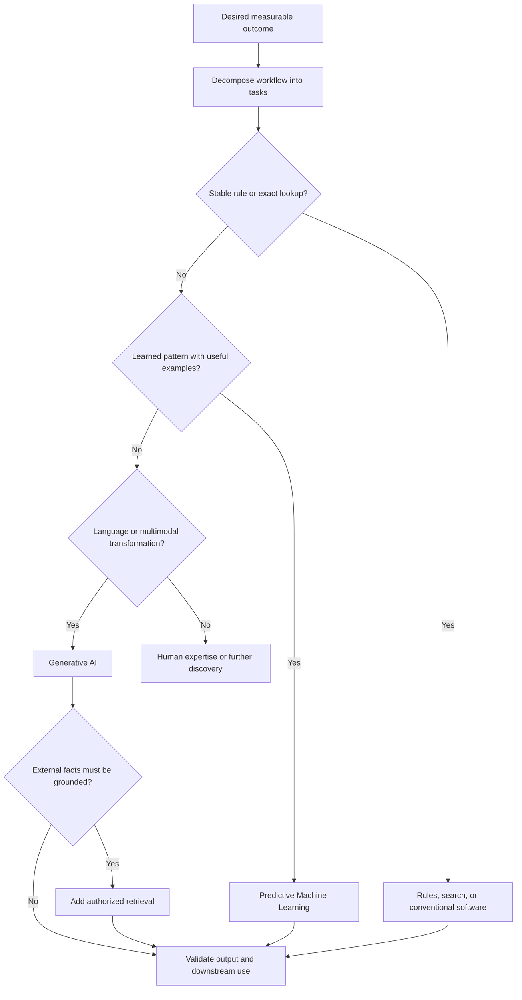
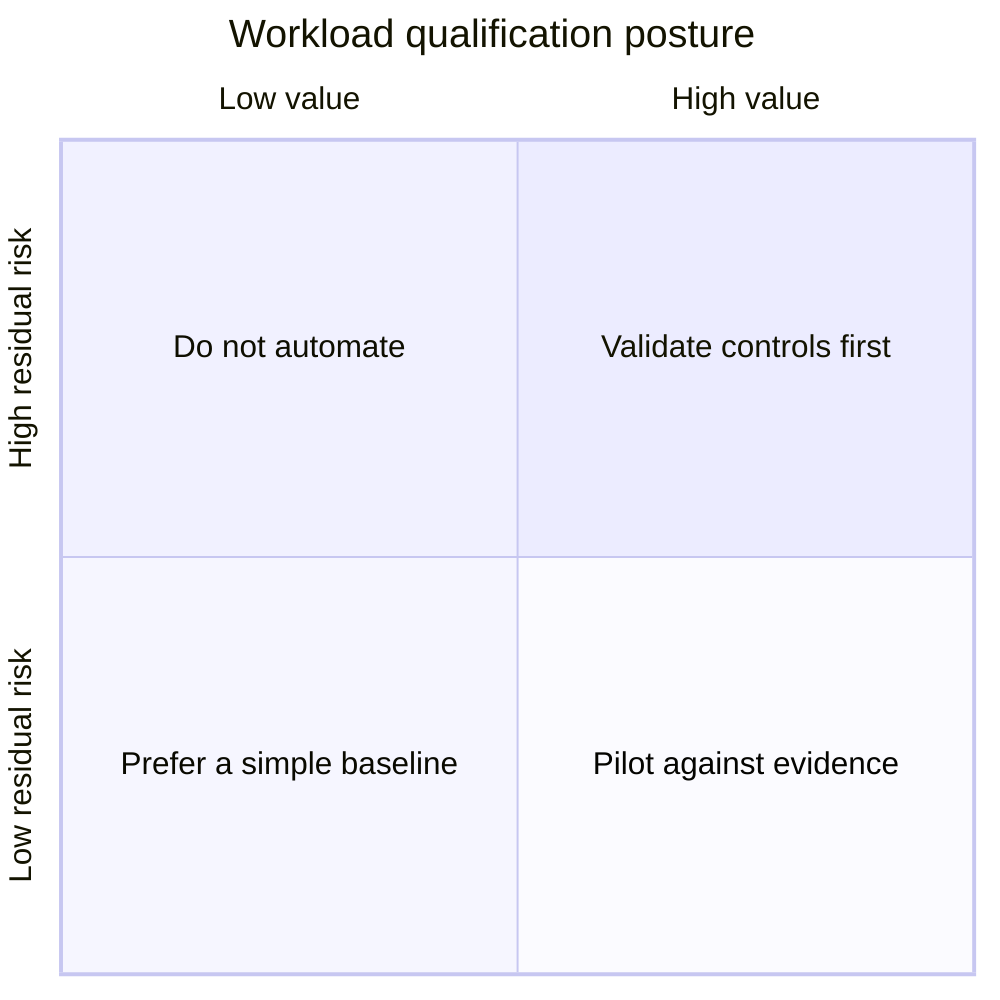
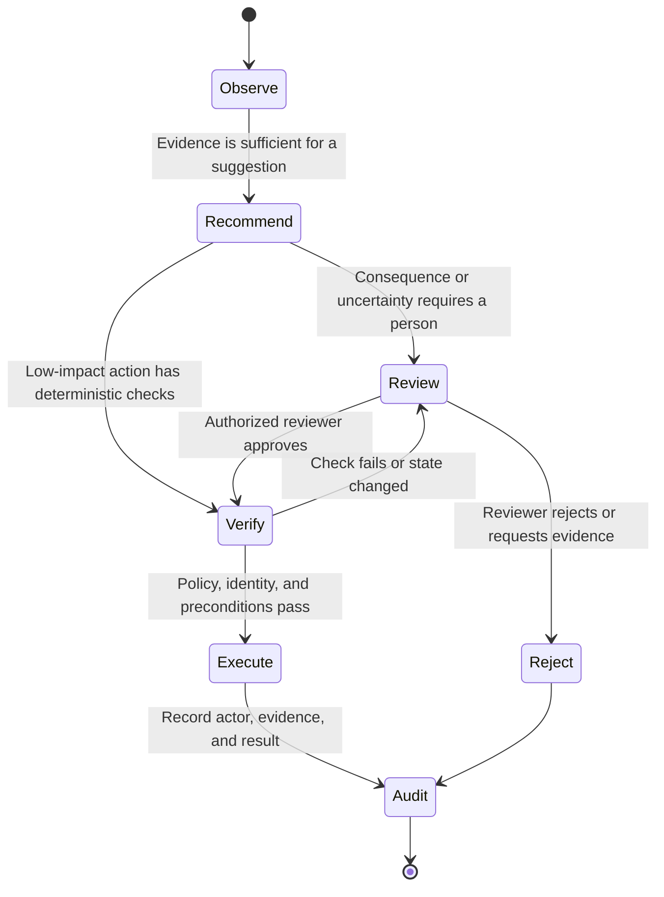
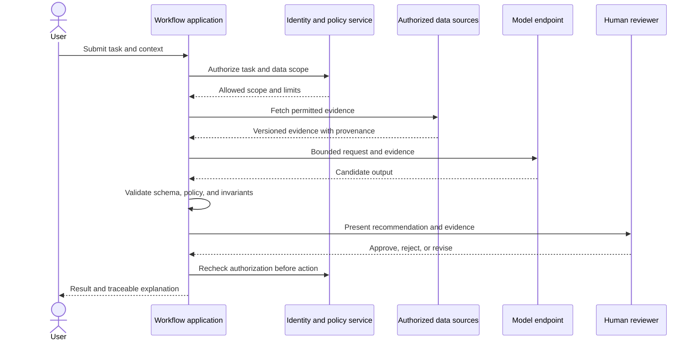
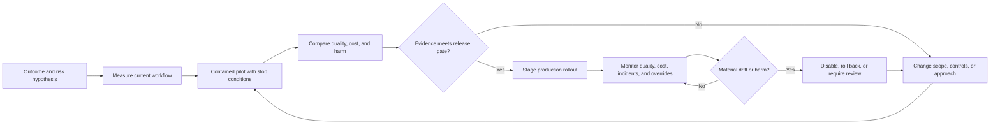

# AI Workload Qualification and Architecture Foundations

Part: [17 — AI Architecture](PART_OVERVIEW.md)

Artificial Intelligence (AI) is an architectural choice, not a synonym for automation. A workload should use a learned model only when its uncertain behavior improves a measurable outcome enough to justify the data, operating, safety, and governance cost. This chapter provides a qualification method and an architecture problem statement for making that decision.

Part 16 owns model families, training algorithms, retrieval techniques, and agent mechanics. This chapter selects and composes those capabilities; it does not re-teach them. Part 07 owns distributed-system reliability foundations, Part 15 owns security foundations, and Part 21 owns architecture-description notation. Here, those topics are applied to the specific question of whether and how a workload should use AI.

## Start With the Decision

Do not start with a model or a vendor demonstration. Name the decision or work product that should change. Specify who acts on it, when the decision is made, what evidence is available at that time, and how to observe success. “Use a large language model to improve support” is not a testable objective. “Reduce the median time to resolve eligible support cases by 15% without increasing reopened cases or exposing another tenant's data” is closer to an architecture-driving requirement.

Decompose the workflow into bounded tasks. Some tasks may be deterministic, such as validating an identifier or enforcing an access policy; others may involve classifying ambiguous text, summarizing evidence, retrieving documents, or proposing a multi-step action. A workflow can combine techniques. The task boundary, not the product label, determines where a model belongs.

The diagram is a screening aid, not a promise that every task fits one box. For example, a claims workflow may use rules to reject malformed submissions, a classifier to route ambiguous cases, retrieval to show policy evidence, and a human to approve a consequential exception. Keep the system deterministic wherever explicit contracts solve the problem adequately.

## Compare Against a Non-AI Baseline

The relevant comparison is not “AI versus nothing.” Candidate baselines include existing rules, search, conventional software, a human-only process, and a smaller model or narrower automation. Measure the current cost and quality of the workflow before changing it. Include review labor, correction rates, queue delay, support burden, and the cost of mistakes, not only model-call cost.

For a candidate design, write a quality-attribute scenario with a stimulus, context, response, and measurable response threshold. For example: “During a weekly peak, 95% of eligible cases receive a grounded recommendation within 4 seconds; every recommendation includes source identifiers; cases below the validated confidence threshold remain in the human queue; and no unauthorized source is returned.” This gives architecture and testing a shared contract.

| Qualification dimension | Evidence to collect | Disqualifying signal or response |
|---|---|---|
| Outcome value | Baseline and target for quality, time, cost, or access | No observable outcome or no credible comparison |
| Task fit | Representative examples and failure taxonomy | Exact rules already solve the task more simply |
| Data readiness | Rights, coverage, quality, freshness, and access path | Data is unavailable, unauthorized, or unrepresentative |
| Error consequence | Cost and reversibility of false positives and omissions | High-impact errors have no containment or appeal path |
| Runtime fit | Latency, volume, locality, availability, and cost budgets | Model dependency violates a hard requirement without a fallback |
| Operating ownership | Named owners for data, model, workflow, and incidents | No team can monitor and remediate behavior after release |

The decision should consider expected benefit after correction and oversight. A draft that saves generation time but adds more verification work may reduce total throughput. A prediction that is slightly less accurate can still help if its errors are cheap and it routes difficult cases to people; the same error rate can be unacceptable when outputs directly trigger irreversible actions.

## Value, Risk, and Evidence

Qualification is not a single “AI readiness” score. Value, residual risk, evidence quality, and reversibility are separate dimensions. High value does not cancel unacceptable harm; low observed risk is not persuasive when the evaluation set omits rare but consequential cases. A low-risk, reversible pilot can be useful when evidence is incomplete, provided the pilot is contained and has a defined stop condition.

Treat the quadrants as prompts for review rather than automatic release decisions. “Residual risk” means risk after the proposed controls, and its estimate should cite evidence, assumptions, and affected stakeholders. An uncertain estimate belongs in the decision record as uncertainty, not disguised as a precise score.

Before a pilot, define the baseline, representative evaluation data, success threshold, harm indicators, accountable owner, rollback mechanism, and decision date. A pilot that only measures favorable examples is a demonstration, not evidence. Include abstentions, missing data, adversarial inputs where relevant, shifts in population, and the work humans perform to correct outputs.

## Bound Model Authority

An AI output can inform a decision without being authorized to make it. Separate the model's ability to produce a suggestion from the system's authority to commit an action. Confidence is not a permission check: a model can be confidently wrong, and a high score cannot grant access or override a business rule.

This state model places policy and identity checks outside model judgment. The workflow should also define who can override a recommendation, what evidence is shown, how the override is recorded, and how an already executed action is reversed or compensated. A human approval step is meaningful only when the reviewer has time, context, and authority to disagree.

Choose the narrowest useful authority level: summarize, classify, recommend, draft, execute a reversible action under policy, or execute a consequential action after explicit approval. Increase autonomy only when evidence, reversibility, observability, and containment support it. If the task cannot safely tolerate uncertainty, keep the model advisory or do not use one.

## Place AI Inside a System Boundary

The architecture must identify the caller, trusted policy enforcement, data sources, model dependency, output validator, downstream action, and audit path. Model output is untrusted input to the next component, even when the model is hosted by a trusted provider. Validate schemas, permissions, and business invariants in ordinary software before a result can affect state.

The second authorization check matters when review takes time: permissions, account state, or business conditions may change between recommendation and execution. Evidence should retain source identity and version so a reviewer can understand what the model saw. Avoid logging raw sensitive content by default; record enough metadata to diagnose behavior while following the system's privacy and retention policy.

## Turn a Hypothesis Into Operating Evidence

The architecture decision continues after launch. Evaluation at design time estimates behavior on known cases; production signals reveal changing inputs, dependency failures, unexpected correction work, and new harms. Define which signals can be collected lawfully, who reviews them, and how they lead to a release, rollback, or scope change.

Monitoring should connect a reported outcome to the model and prompt versions, data or retrieval versions, policy decisions, and workflow actions involved. Part 14 owns telemetry mechanics; Part 16 CH24 owns evaluation techniques. This chapter's concern is the architecture contract that makes that evidence attributable and actionable.

## Worked Case: Invoice Exception Triage

Suppose an accounts-payable team spends time routing invoices whose supplier, purchase order, amount, or policy evidence does not agree. First measure the current queue: volume, median and tail age, routing accuracy, rework, and the cost of paying an invalid invoice. Preserve deterministic checks for required fields, known supplier identifiers, arithmetic, and approval limits; a language model should not replace exact validation.

The candidate AI task is narrower: classify the exception reason and draft a short explanation grounded in the invoice and authorized purchase-order or policy records. Retrieval is scoped to the current legal entity and supplier relationship. The application validates that cited records are in scope, then routes uncertain, conflicting, or high-value cases to a reviewer. The model cannot approve payment or alter supplier banking data.

The pilot compares AI-assisted triage with the existing queue using a representative sample that includes missing documents, duplicate invoices, unusual suppliers, and policy exceptions. Measure routing accuracy by error type, reviewer correction time, queue age, unsupported claims, and unauthorized evidence attempts. Stop or narrow the pilot if review effort rises, high-impact errors escape controls, or evidence provenance is incomplete. Only after these gates are met should the team consider automating a low-impact, reversible routing action; payment authorization remains governed by existing identity and approval controls.

## Review Questions

1. What measurable workflow outcome would justify this AI capability over the strongest non-AI baseline?
2. Which tasks remain deterministic, and why?
3. What is the highest-impact plausible error, and what prevents it from committing an irreversible action?
4. What evidence would cause the team to stop, narrow, or expand the pilot?
5. Can an operator trace an output to its evidence, model version, policy decision, and downstream action?

AI architecture begins with a decision and an accountable outcome, not a model catalog. Use the simplest capability that meets the requirement, bound model authority with deterministic controls, and make value and risk testable through evidence before and after release.
