# AI Workload Qualification and Architecture Foundations

Part: [17 — AI Architecture](PART_OVERVIEW.md) · Status: Revised (in-depth rewrite)

## 1. Introduction

Most failed artificial intelligence (AI) projects were not lost to a weak model. They were lost earlier, when someone agreed to build a system without first deciding what decision it would change, what the current process already achieved, what an error would cost, who would own the system afterwards, or whether the data existed to support it. A model that scores well on a benchmark cannot repair any of those gaps. This chapter teaches the questions an architect asks before a model is chosen, and a repeatable method for turning the answers into a go, spike, defer, or stop decision with evidence behind it.

The central claim is simple. An AI component is an expensive, probabilistic, data-dependent part. It earns a place in a system only when its uncertain behavior produces more value than the cheapest adequate alternative, after counting data work, review labor, operating cost, error cost, and governance. Everything in the chapter follows from that claim: decompose the work so each piece gets the cheapest adequate capability, measure against honest baselines, put numbers on value and error, decide how much authority the system gets, and write down the evidence chain so that production can tell you whether the bet is paying off.

After reading this chapter you should be able to:

1. Restate a vague AI request as a decision, an actor, a trigger, an action, and a measurable outcome.
2. Choose among deterministic software, rules engines, search, classical analytics, predictive machine learning (ML), generative AI (GenAI), retrieval, and agentic systems for each sub-task, and defend the choice with a decision tree and a cost argument.
3. Decide where the boundary between explicit rules and learned behavior sits, and recognize when learned behavior is unacceptable.
4. Define a value hypothesis, select baselines, and design a measurement that detects uplift with a known confidence.
5. Build a unit economics sketch (cost per decision, value per decision, break-even volume) and run it as code.
6. Assess data readiness on five axes: volume, label quality, coverage, freshness, and rights.
7. Derive an acceptable error rate from error cost asymmetry, and design abstention, escalation, and confidence display around it.
8. Set latency, throughput, availability, and explainability requirements as testable quality-attribute scenarios.
9. Choose a human authority level on a five-step spectrum.
10. Screen risk, compare build, buy, and partner, time-box a feasibility spike with kill criteria, and score candidate use cases on a weighted scorecard with hard gates.
11. Write an architecture problem statement and a one-page use-case brief, and trace an evidence chain from business objective to production signal.

### 1.1 Why this matters to a solution architect

A solution architect is the person in the room who is expected to say, with reasons, "this should be a lookup table," "this should be a classifier with a human reviewing the uncertain third," or "this should not be built yet." Sponsors arrive with a technology and look for a problem. Vendors arrive with a demo. Engineers arrive with enthusiasm for the newest model. The architect's job is to turn those inputs into a bounded decision whose cost and value can be examined.

The stakes are asymmetric. A rejected use case costs a meeting. An accepted use case that should have been rejected costs a build, a deployment, an operating team, a risk review, and often a reputational incident. The reverse error also exists. An organization that refuses every AI proposal because the technology is uncertain gives up real gains in cost and service. Qualification is the discipline of making both errors rare, and of making the remaining ones cheap and reversible.

### 1.2 Scope and ownership

Part 17 selects and composes capabilities into operable systems. It does not re-teach the capabilities. The table shows what this chapter owns and where the neighbouring material lives.

| Topic | Owner | What this chapter does with it |
|---|---|---|
| Workload qualification, value, baselines, scorecards | This chapter | Teaches fully |
| Architecture problem statement and use-case brief | This chapter | Teaches fully |
| Model families, training, evaluation metrics | [Part 16 CH01](../16_AI_and_GenAI/CH01_Machine_Learning_Foundations.md), [CH06](../16_AI_and_GenAI/CH06_Model_Evaluation_Validation_and_Selection.md) | Uses the vocabulary, links for mechanics |
| Data leakage and feature preparation | [Part 16 CH02](../16_AI_and_GenAI/CH02_Data_Preparation_Feature_Engineering_and_Leakage.md) | Mentions as a feasibility risk |
| Prompting, structured outputs | [Part 16 CH17](../16_AI_and_GenAI/CH17_Prompt_Engineering_and_Structured_Outputs.md) | Out of scope |
| Retrieval-augmented generation (RAG) mechanics | [Part 16 CH18](../16_AI_and_GenAI/CH18_RAG_Architecture.md) | Selects when retrieval is needed, does not teach it |
| Agents and tool calling | [Part 16 CH21](../16_AI_and_GenAI/CH21_Agents_Tool_Calling_Memory_Planning.md) | Selects when an agent is warranted |
| Guardrails and hallucination handling | [Part 16 CH24](../16_AI_and_GenAI/CH24_Generative_AI_Evaluation_Guardrails_and_Hallucinations.md) | Treats as a runtime control to be required |
| Data governance, privacy, provenance | [Part 16 CH30](../16_AI_and_GenAI/CH30_AI_Data_Governance_Privacy_and_Provenance.md) | Screens rights and privacy at intake |
| Risk tiering, impact assessment, oversight | [Part 16 CH31](../16_AI_and_GenAI/CH31_Responsible_AI_and_Safety_Governance.md) | Links for tiering, applies the result to architecture |
| Model and capability selection | [Part 17 CH02](CH02_AI_Capability_and_Model_Selection.md) | Stops at "which class of capability", CH02 chooses the model |
| Reference architectures | [Part 17 CH03](CH03_Reference_Architectures_for_Predictive_Generative_and_Agentic_Systems.md) | Hands off after qualification |
| Data architecture | [Part 17 CH04](CH04_AI_Data_Architecture_and_Preparation_Boundaries.md) | Assesses readiness only |
| Human oversight and workflow integration | [Part 17 CH09](CH09_Human_Oversight_and_AI_Assisted_Workflow_Integration.md) | Picks an authority level, CH09 designs the workflow |
| Evaluation and observability architecture | [Part 17 CH11](CH11_Evaluation_and_Observability_Architecture_for_AI_Systems.md) | Defines the evidence chain, CH11 builds the pipeline |
| Cost and performance decisions | [Part 17 CH14](CH14_AI_Cost_Performance_and_Sustainability_Decisions.md) | Sketches unit economics, CH14 optimizes |

Distributed-system reliability semantics belong to Part 07, security foundations to Part 15, and architecture-description notation to Part 21. This chapter applies them to one question: should this workload use AI, and if so, in what shape?

### 1.3 A note on numbers

All figures in worked examples are illustrative. They are chosen to be plausible and to make the arithmetic visible, not to report any real organization. Where a price, regulation, or product feature is time-sensitive the text says "at the time of writing" and tells you what to verify. The runnable scripts in section 29 reproduce every calculated table, so you can replace the inputs with your own measurements.

## 2. The Architect's Question Before the Model Question

### 2.1 Start with the decision

Do not start with a model, a vendor, or a demonstration. Start with the decision or work product that should change. Five attributes make a decision concrete:

1. **Actor.** Who acts on the output: a support agent, an underwriter, a customer, a downstream service?
2. **Trigger and timing.** When is the decision made, and how long does the actor have? A batch decision overnight and a decision inside a 300 millisecond checkout call are different problems.
3. **Evidence available at decision time.** What is known at that moment? Features that exist only after the outcome is known cannot be used. This is the same discipline as leakage prevention in [Part 16 CH02](../16_AI_and_GenAI/CH02_Data_Preparation_Feature_Engineering_and_Leakage.md), applied at the requirements stage.
4. **Action and reversibility.** What happens as a result, and can it be undone? Sending a reply, blocking a payment, and drafting a note for review have different undo costs.
5. **Observable outcome.** How will anyone know the decision was good, and how long after the fact?

"Use a large language model (LLM) to improve support" names none of these. "Reduce the median handling time of eligible billing cases by 15 percent without raising the reopen rate above its current 6 percent and without exposing another customer's data" names an outcome, a guardrail on quality, and a guardrail on security. The second statement drives architecture because each clause can be tested.

### 2.2 The questions in order

Experienced architects ask the same questions in roughly the same order. The order matters because early answers can end the conversation cheaply.

| Order | Question | If the answer is bad |
|---|---|---|
| 1 | What decision changes, and who acts on it? | Stop. There is no use case yet. |
| 2 | What does the current process achieve, and what does it cost? | Measure it first. Without a baseline, nothing can be shown to improve. |
| 3 | Would explicit rules, search, or ordinary software solve it? | Build that. It is cheaper, more predictable, and easier to audit. |
| 4 | What does a wrong output cost, and can it be contained? | Redesign the authority level or stop. |
| 5 | Is the data present, rightful, representative, and fresh? | Fix data or defer. A model cannot compensate. |
| 6 | Do the latency, volume, and availability needs fit the candidate approach? | Choose a different capability or add a fallback. |
| 7 | Does the unit economics work at the expected volume? | Reduce scope, volume of model calls, or cost per call, or stop. |
| 8 | Who owns the system after launch? | Do not launch without a named owner. |
| 9 | Only now: which model, which provider, which architecture? | Hand off to [Part 17 CH02](CH02_AI_Capability_and_Model_Selection.md). |

Notice that the model question is ninth. The first eight questions are cheap to answer, require no training run, and eliminate most poor proposals. A team that answers question nine first usually spends weeks of engineering effort before discovering an answer to question two or eight that would have stopped the work.

### 2.3 Problem statements versus solution statements

A solution statement says "add a chatbot." A problem statement says "customers wait a median of 14 minutes for a human answer to questions whose answers are in the policy document, and 38 percent of those contacts are repeat questions about the same twelve topics." The second statement leaves room for the cheapest adequate solution, which might be a better help page, a fixed set of canned replies, a search box, a chatbot, or a combination. Solution statements close that room before anyone has compared alternatives.

A useful test is to delete the word "AI" (and "LLM," "agent," "copilot") from the request. If nothing meaningful remains, the proposal is a solution looking for a problem. If a problem remains, you have something to qualify.

### 2.4 Worked rewrite of three vague requests

The rewrites below show the pattern. The numbers are illustrative.

| Vague request | Decision, actor, timing | Measurable objective with guardrails |
|---|---|---|
| "Use AI to speed up claims" | Adjuster decides how to route a new auto claim, within the first hour | Reduce the share of claims routed to the wrong team from 18 percent to 10 percent, without raising the average time to first contact above 4 hours |
| "Add a copilot for our engineers" | Engineer decides how to resolve a failing build, during the build triage | Cut median time from build failure to correct root-cause identification from 52 to 35 minutes on a sample of 200 failures, with no increase in reverted fixes |
| "Predict churn with ML" | Retention team decides which accounts get a call this week | Raise the save rate on the top 500 flagged accounts from 9 to 14 percent over the contact-all baseline, at a contact cost no higher than today |

Each rewrite names a baseline figure. That baseline is a claim that someone has measured the present state. If the measurement does not exist, step one of the project is to produce it.

### 2.5 The architect's stance toward uncertainty

Learned components behave probabilistically. The same input can produce different outputs (for a generative model) or a confident wrong output (for any model). The architectural response is not to eliminate uncertainty but to bound it: state the acceptable error rate, route uncertain cases elsewhere, keep the ability to override, and measure continuously. Sections 10 and 11 develop this. At the qualification stage, the relevant question is whether a bounded design exists. If every possible design leaves an unbounded, irreversible, high-cost failure, the use case does not qualify no matter how impressive the demo.

## 3. Problem-to-Capability Selection

### 3.1 Eight capability classes

The word "AI" hides at least eight different capability classes with very different cost and risk profiles. A qualification must name which one it is selecting.

| Class | What it does | Typical cost to build | Typical cost to run | Predictability | Audit difficulty |
|---|---|---|---|---|---|
| Deterministic software | Executes explicit logic: validation, calculation, workflow | Low to medium | Very low | Exact | Low |
| Rules engine | Evaluates a maintained rule set against facts | Medium, grows with rule count | Very low | Exact | Low to medium, rises with rule count |
| Search | Finds documents or records by keyword, filter, or ranking function | Low to medium | Low | High for exact terms, variable for ranking | Low |
| Classical analytics | Aggregates, forecasts by established statistics, anomaly rules, dashboards | Low to medium | Low | High | Low |
| Predictive ML | Learns a mapping from features to a label or number from examples | Medium to high (data, labels, evaluation, retraining) | Low per prediction | Statistical | Medium |
| GenAI | Produces language, code, or media conditioned on an input | Low to build a first version, high to make reliable | Moderate to high per call | Variable | High |
| Retrieval-grounded GenAI | GenAI whose input includes passages retrieved from an authorized corpus | High (ingestion, indexing, permissions, evaluation) | Moderate to high per call plus index | Variable, but traceable to sources | Medium |
| Agentic system | A model chooses and sequences tool calls toward a goal | High | High and variable, depends on loop length | Lowest | Highest |

Two observations guide selection. First, cost to run and cost to be wrong both rise down the table, but cost to build a first demo does not. A GenAI demo is cheap, which is why demos mislead: they are priced like the left-hand column and operated like the right-hand column. Second, capabilities compose. The strongest designs usually put deterministic software in charge of control flow and permissions, and use learned components for narrow steps inside it.

### 3.2 A decision tree for capability selection

The diagram is a screening aid. Walk it per sub-task, not per project. Section 5 explains decomposition.

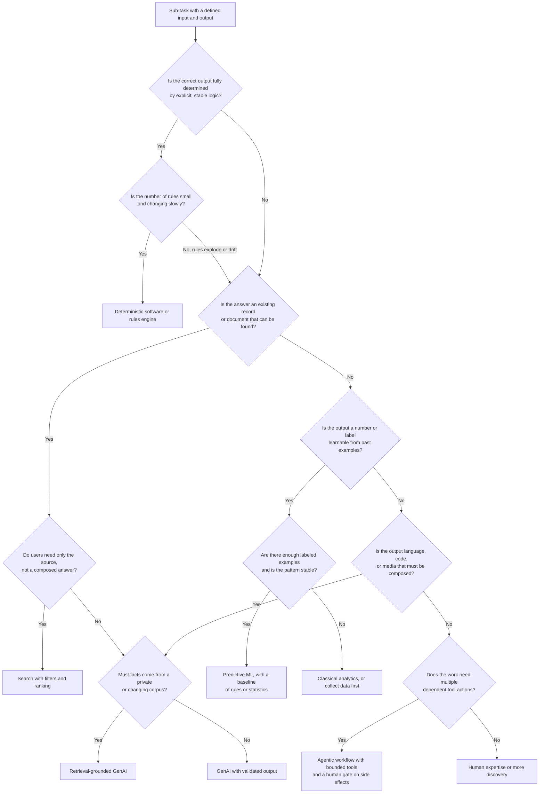

Read the tree from the top. The first question asks whether the correct answer is already specified. Tax rate by jurisdiction, eligibility by published criteria, and unit conversion are specified. A learned model adds nothing here except error. The second branch (search) catches the common case where the user needs to find something, not to have something composed. The predictive branch requires labeled history and a stable pattern, and falls back to analytics or data collection when either is missing. The generative branch requires that the output genuinely be composed language or media, and adds retrieval when facts must come from a private or changing corpus. The agentic branch is reached last, by elimination: only when work needs dependent actions that cannot be fixed in advance.

The tree also embeds a preference order. When two branches both apply, choose the earlier one unless the later one wins on a measured outcome. This is the cheapest-adequate-capability rule. It is a default, not a law; section 4 shows when the preference reverses.

### 3.3 Walking each class

**Deterministic software.** Use it when the input and the correct output can be specified completely, such as computing a total, enforcing a permission, validating a format, or routing by an account tier. Its decisive advantage is exactness and testability: you can write a test for every branch. The common mistake is to describe a deterministic task in natural language and then hand it to a language model because the natural-language description was easy. If you can write the specification, write the code.

**Rules engine.** A rules engine separates policy from code so that business analysts can change rules without a deployment. It suits decisions with tens to a few hundred rules where each rule is understandable alone. It strains when rules interact, because interactions grow faster than rules. Section 4.2 quantifies that.

**Search.** Search fits "find the thing" tasks. A well-tuned keyword and filter search answers a large share of lookup traffic at a small fraction of the cost of a generative answer, and it returns the real source. Search also forms the retrieval half of a RAG system, so improvements to search help any later generative layer. Teams routinely skip a search baseline and discover later that a good search page solved 60 percent of the problem.

**Classical analytics.** Aggregation, seasonal forecasting with established statistical methods, control charts, and threshold alerts need no learned model and are easy to explain. Use them when the pattern is simple, the data is small, or interpretability is mandatory. They also serve as the baseline a predictive model must beat. Tooling for these methods is covered in the analytics and data chapters; this chapter only insists that they be tried.

**Predictive ML.** Choose predictive ML when a decision depends on a pattern in many examples that no one can write down as rules, when labeled history exists, and when the pattern is stable enough that a model trained on the past applies to the future. Typical forms are classification, scoring, ranking, and forecasting. Predictive ML has the best-understood failure modes of the learned classes: calibration, drift, and fairness can all be measured. See [Part 16 CH03](../16_AI_and_GenAI/CH03_Regression_and_Classification.md) and [CH04](../16_AI_and_GenAI/CH04_Decision_Trees_and_Ensemble_Learning.md) for the mechanics, which this chapter does not repeat.

**GenAI.** Choose GenAI when the output is composed language, code, or media, when many acceptable outputs exist, and when a human or a validator checks the result before it matters. Drafting, summarizing, extracting structure from messy text, translating, and explaining are the strongest fits. Weak fits are anything with a single exact answer, anything needing arithmetic precision without a tool, and anything where a fluent wrong answer is dangerous and unreviewed. [Part 16 CH24](../16_AI_and_GenAI/CH24_Generative_AI_Evaluation_Guardrails_and_Hallucinations.md) explains why fluent wrong answers occur.

**Retrieval.** Add retrieval when the answer depends on facts that are private, changing, or too large for a prompt, and when you need to cite sources. Retrieval also changes the security model: the system now reads documents on behalf of a user and must enforce that user's permissions at query time. Qualification should therefore treat "needs retrieval" as a data, rights, and authorization question before it is a model question. [Part 17 CH05](CH05_Retrieval_Augmented_Generation_System_Architecture.md) designs the system.

**Agentic systems.** Choose an agent only when the sequence of actions cannot be fixed in advance, each step depends on the previous result, and the actions are bounded by tools with narrow permissions. Most workflows described as "agentic" are fixed pipelines with one or two model steps and are better built as such: they are cheaper, faster, and testable. A rule of thumb that works well: if you can draw the flowchart before the run starts, build the flowchart. Reserve agents for the cases where the flowchart itself depends on what is found along the way. [Part 17 CH06](CH06_Agentic_System_Architecture_and_Tool_Boundaries.md) covers the architecture.

### 3.4 Cost of choosing too high or too low

Choosing a capability class too low (rules for a problem that needs learning) produces a brittle system that fails on inputs nobody anticipated, and a growing rule backlog. Choosing too high (an agent for a lookup) produces a system that costs more, is slower, is harder to test, and fails in ways that are hard to reproduce.

A useful asymmetry: a class can be upgraded later using the data the cheaper class has collected. A rules-based triage system logs every case, its features, and the human's final routing, and that log becomes the labeled training set for a later classifier. A search system logs queries and clicks, which become relevance labels. Starting low is usually the right move when the cheaper class is adequate for a first release, because it also produces the evidence needed to justify the upgrade.

### 3.5 Combining classes in one workflow

Real workflows mix classes. Consider an insurance claim intake:

- Deterministic software validates the policy number and checks coverage dates.
- A rules engine applies published exclusions.
- Search finds the matching policy clause.
- A predictive model scores the likelihood of a complex claim.
- A language model drafts the acknowledgement letter from validated facts.
- A human approves any payout above a threshold.

Six components, five capability classes, one workflow. The architect's contribution is the assignment: each sub-task has the cheapest adequate capability, and the deterministic parts hold the control flow so that learned parts cannot violate a hard constraint. Section 5 develops the method.

## 4. The Boundary Between Deterministic and Learned Behavior

### 4.1 Where the boundary sits

The central design decision in most AI workloads is where explicit behavior ends and learned behavior begins. The boundary is not fixed by the technology. It is set by four properties of the task: how completely the logic can be specified, how many cases the specification would need to cover, how often the specification changes, and how bad a wrong output is.

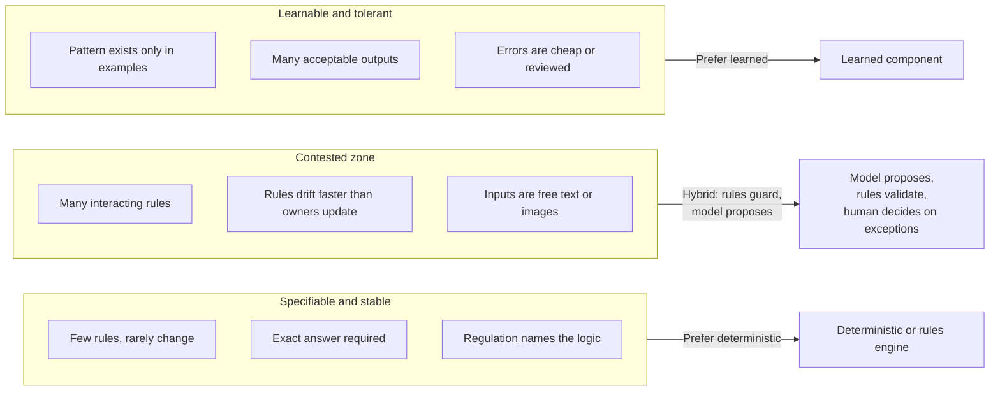

The diagram groups task properties into three zones. The left zone favors deterministic behavior; the right zone favors learned behavior; the middle is where most real work lives and where a hybrid is the answer. The hybrid pattern is worth memorizing: the model proposes, deterministic rules validate the proposal against hard constraints, and a human decides the exceptions. This keeps the benefit of learned flexibility while preventing the model from violating a constraint the business cannot accept violating.

### 4.2 When rules suffice

Rules suffice when four conditions hold together.

1. The decision logic can be written down by a domain expert in a form another person can check.
2. The input space is covered by that logic with few interactions.
3. The logic changes slowly relative to the time it takes to update the rules.
4. Wrong outputs are detectable by tests.

Eligibility for a published discount, a tax computation, a shipping rate table, and role-based access are examples. For them, rules are not a stepping stone to AI; they are the correct final answer. Adding a model lowers predictability and raises cost for no gain, and in a regulated setting it can create a compliance problem where none existed.

### 4.3 When rules explode combinatorially

Rules fail when the logic is a function of many interacting attributes. A worked count shows how quickly.

Suppose a credit pre-screen depends on 12 binary attributes (employment flag, prior default flag, and so on). The number of distinct attribute combinations is

$$2^{12} = 4096$$

A rule set that gives every combination a defined outcome needs up to 4,096 conditions, although experts can compress this with shared rules. Now allow each of 8 attributes to take 5 levels (income band, tenure band, utilization band, and so on):

$$5^{8} = 390{,}625$$

No team writes or maintains 390,625 cases by hand. In practice they write a few hundred rules covering the common combinations, and the system silently mishandles the rest. The behavior of the uncovered region is then an accident of rule ordering. A learned model replaces enumeration with a smooth function fitted to examples, so adjacent combinations get similar outcomes without a rule for each.

For free text the situation is worse because the input space is not even a finite grid. A keyword rule set for routing support tickets might start with 40 rules for 12 categories. Each new product, each new phrasing, and each new language adds rules, and rules begin to conflict: a ticket containing both "refund" and "cancel" matches two categories. A team might reach 600 rules, spend three engineer-days per week maintaining them, and still route only 71 percent of tickets correctly (illustrative). At that point the maintenance cost of the rule base is itself a cost to compare with a classifier's build and operating cost.

The practical test is a rule-growth curve. Plot the number of rules against the share of cases correctly handled over the last several releases. If each additional point of accuracy costs more rules than the last, the curve is flattening, and rules have reached the region of diminishing returns. A flattening curve with a still-large error share is evidence for a learned component. A flat curve at 99 percent is evidence to stay with rules.

### 4.4 When learned behavior is unacceptable

Some tasks must not use learned behavior, or must use it only behind a deterministic gate. Four conditions are sufficient to rule out a learned component making the final decision.

1. **A specified exact answer exists and a mistake is a defect.** Computing an invoice total or applying a statutory tax rate. A model that is right 99.9 percent of the time is still wrong on 1 in 1,000 invoices, which a deterministic function would get right every time.
2. **The decision must be explained by citing the rule that applies.** Some regulations and contracts require that a person be told which criterion led to the outcome. A post hoc explanation of a model's behavior is not the same as the rule itself. See the explainability discussion in section 12.
3. **Errors are irreversible and large, and no human check is possible in the time available.** Releasing a physical actuator, wiring a large sum, or deleting data without a recovery path.
4. **The population is non-stationary in ways the training data cannot cover.** A model trained on last year's behavior will encounter a regime change, such as a new regulation or a pandemic-style shock, and has no way to know it has left its competence.

A softer set of conditions argues for a guard rather than a prohibition. If an invalid output could cause harm but a validator can catch it (a schema, a range check, a policy engine), the model may propose and the validator may dispose. The next section turns that idea into a pattern.

### 4.5 Hybrid patterns

Four hybrid patterns recur. Each places the deterministic part in control.

| Pattern | Learned part | Deterministic part | Example |
|---|---|---|---|
| Propose and validate | Generates a candidate | Checks schema, range, policy, and permissions before use | A model drafts a refund amount, a rule engine rejects anything above the caller's authority |
| Route by confidence | Scores each case | Sends low-confidence or high-stakes cases to people | A classifier auto-routes 70 percent of tickets, the rest go to a triage queue |
| Retrieve then compose | Writes text from passages | Search and authorization choose which passages are visible | A support assistant answers only from documents the requester may read |
| Rules first, model for the remainder | Handles the residue | Handles every case that rules cover exactly | Rules approve obvious cases, a model scores the ambiguous middle |

The fourth pattern deserves emphasis because it reduces cost and risk together. If rules handle 55 percent of volume exactly, the model sees only 45 percent, which cuts inference spend and shrinks the surface for model error. It also protects the baseline: the rules continue to work if the model is unavailable.

### 4.6 A worked example of the boundary decision

A logistics firm wants to classify inbound shipment exceptions (damaged, delayed, customs hold, address problem, other) from carrier messages. Findings after a two-week review (illustrative):

- 58 percent of messages contain a structured carrier status code that maps one to one to a category. A lookup table handles these exactly.
- 31 percent are free text from a carrier portal with inconsistent wording.
- 11 percent are scanned notes with handwriting.

The decision is not "AI or not." It is three decisions: use the lookup table for 58 percent, evaluate a text classifier for the 31 percent, and keep human handling for the 11 percent until a document-understanding spike shows it is feasible. The expected share handled by the learned component is 31 percent, not 100 percent, so the unit economics, the data requirement, and the risk surface are all smaller than the original "use AI for exceptions" proposal suggested. This is the central payoff of the deterministic-versus-learned analysis: it shrinks the AI portion to the part that needs it.

## 5. Task Decomposition: The Cheapest Adequate Capability for Each Sub-Task

### 5.1 Why decompose

Qualification applied to a whole project returns a muddy answer, because a project contains parts with different needs. "Automate claims intake" includes arithmetic, lookups, language understanding, and approvals. Judging the project as one unit forces a single capability choice, and the choice is usually the most expensive one that covers the hardest part. Decomposition lets each part receive the cheapest capability that meets its own requirement. It has three further benefits: it localizes evaluation (each sub-task has its own test set and metric), it localizes failure (a defect in one step does not contaminate others), and it makes ownership clear (each step has an owner).

### 5.2 The method

1. **List the steps of the current workflow** as people perform it today, including the informal ones such as "check last week's email."
2. **Write each step as input, output, and success test.** If you cannot write a success test, the step is not yet well defined, and it will not be testable once automated.
3. **Classify each step** using the decision tree in section 3.2.
4. **Assign the cheapest adequate capability** meeting the step's accuracy, latency, and risk requirement.
5. **Mark control points**: where a deterministic gate or a human check sits between steps.
6. **Estimate cost and error per step**, then roll up.

Step 4 contains the key rule. "Adequate" is defined by the step's own requirement, not by the best available model. A step that needs 97 percent accuracy and is reached by a lookup table at 99 percent does not need a classifier, even if a classifier could reach 99.5 percent.

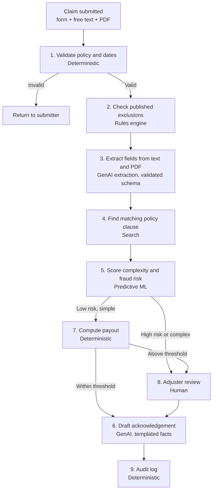

The diagram assigns a capability class to each of nine steps. Notice what the learned components do not control: validation, exclusions, payout arithmetic, and the audit log are deterministic, and the threshold that sends payouts to a human is a hard-coded policy, not a model output. The generative step drafts text from facts that earlier steps validated, so it cannot invent a payout amount. The predictive score influences routing but cannot approve anything. Each learned component therefore has a narrow blast radius, and a failure in one produces a bounded consequence.

### 5.3 Worked cost comparison: decomposed versus monolithic

Compare two designs for the claims workflow, using illustrative prices of 3 US dollars per million input tokens and 15 dollars per million output tokens.

**Design M (monolithic agent).** One agent handles everything with six model calls per claim, each with 6,000 input tokens (the policy, the claim, and tool results accumulate) and 600 output tokens.

$$\text{cost per call} = \frac{6000 \times 3 + 600 \times 15}{10^{6}} = \frac{18000 + 9000}{10^{6}} = 0.027$$

$$\text{cost per claim} = 6 \times 0.027 = 0.162$$

**Design D (decomposed).** Per-claim costs by step, illustrative:

| Step | Capability | Cost per claim (USD) |
|---|---|---|
| 1 Validate policy and dates | Deterministic | 0.0001 |
| 2 Check exclusions | Rules engine | 0.0002 |
| 3 Extract fields | GenAI extraction, one call | 0.0120 |
| 4 Find policy clause | Search | 0.0008 |
| 5 Score risk | Predictive ML | 0.0004 |
| 6 Draft acknowledgement | GenAI, small model | 0.0090 |
| 7 Compute payout | Deterministic | 0.0001 |
| Total automated cost | | 0.0226 |

The sum is $0.0001 + 0.0002 + 0.0120 + 0.0008 + 0.0004 + 0.0090 + 0.0001 = 0.0226$. The monolithic design costs $0.162 / 0.0226 \approx 7.2$ times as much. At 250,000 claims per year the annual model spend is $0.162 \times 250{,}000 = 40{,}500$ dollars for Design M versus $0.0226 \times 250{,}000 = 5{,}650$ dollars for Design D, a difference of 34,850 dollars.

That difference is real but small beside the labor cost. If 12 percent of claims go to an adjuster at a loaded cost of 14 dollars per review, human review costs $0.12 \times 14 = 1.68$ dollars per claim, which is about 74 times the automated cost of Design D. The honest reading of the arithmetic is that decomposition is not mainly a cost saving on inference. Its main benefits are reliability, testability, and containment: Design D has seven small, separately testable steps, two of which are learned, while Design M has one large behavior that cannot be tested step by step and can take an action on any tool. Present both numbers to the sponsor. Overselling a 7x model cost reduction when labor dominates the budget invites distrust when the savings do not show up in the total.

### 5.4 Interfaces between steps

Every boundary between steps is a contract. For a learned step, the contract should state the input schema, the output schema, a confidence or validity signal, and the behavior on failure (timeout, refusal, malformed output). Treat the output of any generative step as untrusted input to the next step: validate its structure and range before use. This is the same trust-boundary discipline taught in Part 15, applied to model output. Without it, one hallucinated field can flow into payment arithmetic.

Two interface decisions deserve explicit attention at qualification time.

1. **Where does ambiguity get resolved?** If step 3 returns "unclear," does the workflow ask the submitter, escalate, or guess? A workflow that cannot represent "unclear" will treat model guesses as facts.
2. **Who is accountable for the composite?** Each step may have a separate owner, but someone must own the end-to-end outcome and the cross-step failures. Section 19 returns to ownership.

### 5.5 When not to decompose

Decomposition has a cost: more interfaces, more tests, more owners. For a small use case with one learned step and a human reviewer, such as drafting a reply for an agent to edit, decomposition into nine parts is overhead. Decompose to the depth where the capability choices differ or where risk differs. Stop when every remaining step has an obvious capability.

## 6. The Value Hypothesis and Baselines

### 6.1 Value types

A use case should state which kind of value it expects, because each kind is measured differently and tolerates different errors.

| Value type | Example metric | Typical measurement difficulty |
|---|---|---|
| Cost reduction | Minutes of labor per case, cost per resolved case | Low if time is logged |
| Revenue increase | Conversion rate, average order value | Medium, needs a controlled comparison |
| Risk reduction | Loss avoided, incidents prevented | High, because the counterfactual is not observed |
| Quality improvement | Error rate, customer satisfaction, rework | Medium, needs a labeled sample |
| Capacity or speed | Cases per person-day, time to first response | Low to medium |
| Access or inclusion | Languages served, users reached | Medium |

Risk reduction is the hardest to show, because a prevented loss does not appear in any ledger. Treat a risk-reduction hypothesis as requiring a holdout or a historical replay, not only a dashboard of flagged items.

### 6.2 The value hypothesis statement

Write the hypothesis in a fixed form so it can be tested and falsified:

> If we change **decision D** for **population P** by using **capability C**, then **metric M** will move from **baseline B** to **target T** within **horizon H**, without worsening **guardrail metrics G**, at a total cost of no more than **K** per decision.

A filled example: "If we give billing agents a drafted reply for eligible cases, then median handling time will move from 9.0 to 6.6 minutes within 90 days of launch, without raising the reopen rate above 6 percent or the escalation rate above 11 percent, at a total cost no greater than 0.03 dollars of model and retrieval spend per case."

Three properties make this statement useful. The target is falsifiable: after 90 days either the median moved or it did not. The guardrails prevent buying speed with quality. The cost cap ties the hypothesis to unit economics, so a successful quality result that breaks the cost cap does not count as success.

### 6.3 Three baselines

The comparison that matters is never "AI versus nothing." Three baselines should be measured, and the candidate should beat the best of them by a margin that justifies its extra cost.

1. **The current process.** What happens today, including its errors and its delays. This is the baseline the business will compare against. It may be a human team, a legacy system, or both.
2. **A simple heuristic.** The cheapest non-learned approach an engineer could build in a few days: a keyword rule, a lookup table, a threshold on one variable, a "same as last period" forecast. A surprising fraction of proposals fail to beat this. The result is not embarrassing; it is the cheapest possible useful finding.
3. **The human.** For tasks people do well, measure human performance on the same sample, including human-to-human disagreement. If two experienced people agree only 82 percent of the time, a model cannot be shown to be "wrong" at 85 percent; the label itself is the limit. Human agreement sets the ceiling for any measurable accuracy.

Where the task is new and no process exists, the baseline is "do nothing," and value must be argued from avoided cost or new revenue instead. State that explicitly; do not borrow a process baseline that does not apply.

### 6.4 Baseline traps

Four mistakes recur.

- **A straw-man baseline.** Comparing the model with a poorly tuned rule set or a stale process inflates uplift. Give the baseline the same engineering attention within reason: a week of tuning, not a year.
- **A moving baseline.** The current process improves for reasons unrelated to AI (a policy change, a new tool, a seasonal swing). Compare concurrent periods, not before and after, whenever feasible.
- **A baseline that ignores correction cost.** A draft that saves 3 minutes of typing but adds 2 minutes of verification saves 1 minute, not 3.
- **A baseline taken from the model team's own data.** Use data from the operating team, covering the real distribution of cases, including hard ones.

### 6.5 Guardrail metrics and Goodhart's law

Charles Goodhart's observation, usually paraphrased as "when a measure becomes a target, it ceases to be a good measure," applies to every AI metric. If handling time is the target, a system or agent can reduce handling time by closing cases early. Pair each target metric with at least one metric that would move in the wrong direction if the target were gamed, such as reopen rate or customer satisfaction. Choose guardrails before launch, not after the target moves.

## 7. Measuring Uplift

### 7.1 Why uplift needs a statistical design

An uplift of 4 points on 100 test cases is a coin flip. Before investing, an architect needs to know how many cases are needed to detect the uplift that makes the project worthwhile, and how the design should avoid bias. Two design families cover most needs: offline evaluation on a labeled set, and online comparison in production.

### 7.2 Offline paired evaluation

In a paired design every system (current process, heuristic, candidate) is scored on the same cases. Pairing removes case-difficulty variation from the comparison, which narrows the interval around the uplift. A bootstrap resample of cases gives a confidence interval without distributional assumptions.

The script [04_baseline_uplift.py](../code/python/ai-workload-qualification-chapter/04_baseline_uplift.py) generates a synthetic paired set in which 35 percent of cases are hard. At two sample sizes it reports:

```text
n = 150
  current process    accuracy 0.700
  simple heuristic   accuracy 0.687
  candidate model    accuracy 0.840
  uplift over current process: +0.140, 95% bootstrap CI [+0.060, +0.220]
n = 600
  current process    accuracy 0.675
  simple heuristic   accuracy 0.703
  candidate model    accuracy 0.817
  uplift over simple heuristic: +0.113, 95% bootstrap CI [+0.065, +0.162]
```

Three lessons are visible. First, the point estimate of uplift moved from 14.0 to 11.3 points when the sample grew from 150 to 600, and the interval narrowed from a width of 16 points to a width of 9.7 points ($0.162 - 0.065 = 0.097$). Small samples overstate and blur. Second, the best baseline changed: at $n = 150$ the current process (0.700) looked better than the heuristic (0.687); at $n = 600$ the heuristic (0.703) looked better than the current process (0.675). The difference between those two baselines is within noise, which is why a project must compare against the best of the baselines on a large enough sample and not pick one convenient reference. Third, the uplift remains clearly positive in both runs because the lower bound of the interval stays above zero, but the lower bound is the number to plan with. The planning figure at $n = 600$ is 6.5 points, not 11.3.

### 7.3 Sample size for a target uplift

To detect a difference between two proportions $p_1$ and $p_2$ with two-sided significance level $\alpha = 0.05$ and power $0.80$, a standard formula for the number of cases per arm is

$$n = \frac{\left(z_{1-\alpha/2}\sqrt{2\bar p(1-\bar p)} + z_{1-\beta}\sqrt{p_1(1-p_1) + p_2(1-p_2)}\right)^2}{(p_1 - p_2)^2}, \quad \bar p = \frac{p_1 + p_2}{2}$$

Here $z_{1-\alpha/2} = 1.96$ and $z_{1-\beta} = 0.8416$. The script prints the result for three targets starting at a baseline accuracy of 0.72:

| Baseline | Candidate | Uplift | Cases per arm |
|---|---|---|---|
| 0.72 | 0.80 | 8 points | 447 |
| 0.72 | 0.76 | 4 points | 1,887 |
| 0.72 | 0.74 | 2 points | 7,734 |

Halving the uplift roughly quadruples the sample, because the denominator is squared. This matters at qualification time. If the only plausible gain is 2 points, a labeled evaluation set of 7,734 cases per arm is needed to confirm it, and labeling that many cases has a cost that belongs in the feasibility budget. If a team cannot afford the labeling, either the expected uplift is too small to matter, or the team will launch on belief instead of evidence. A paired design needs fewer cases than the unpaired formula above, so treat these figures as an upper bound for the paired setup.

### 7.4 Online comparison

Offline accuracy on a labeled set does not reveal behavior change. People who receive a draft may edit less carefully, or trust a suggestion too much. Online designs measure the effect on actual work.

| Design | How it works | Strength | Weakness |
|---|---|---|---|
| Shadow mode | The model runs on live traffic but its output is hidden or logged only | Safe, uses real distribution | Does not capture human reaction |
| Staged rollout | Release to a small share of users or cases, expand if guardrails hold | Limits damage | Early users differ from later users |
| Randomized A/B | Randomly assign cases or users to old and new | Strongest causal evidence | Needs volume and traffic splitting |
| Holdout | Keep a permanent small group on the old process | Detects drift and decay over time | Costs the holdout group the benefit |
| Interleaving or crossover | Same user alternates conditions | Controls user variation | Learning effects carry over |

Randomize at a level that avoids contamination. If agents share knowledge in a team channel, randomizing individual cases within a team lets the benefit leak into the control group. Randomize by team or by day instead.

### 7.5 Effects that inflate early results

- **Novelty effect.** Users are more careful and more positive in the first weeks. Measure after the effect fades, typically after 4 to 8 weeks of use.
- **Selection of eligible cases.** If the pilot covers only easy cases, extrapolating to all volume overstates uplift. Report uplift by difficulty stratum.
- **Survivorship in feedback.** Thumbs-up data is collected only from users who engage. Do not use it as the primary evidence.
- **Label leakage into evaluation.** If evaluation cases come from the same period or authors as tuning cases, the result is optimistic. [Part 16 CH06](../16_AI_and_GenAI/CH06_Model_Evaluation_Validation_and_Selection.md) covers validation design.

### 7.6 Converting uplift to value

An uplift in accuracy is not yet value. Convert it by multiplying the change in the count of correct decisions by the value of a correct decision (or the cost of a wrong one). With a 6.5 point lower-bound uplift on 40,000 decisions a month, the lower bound gives $0.065 \times 40{,}000 = 2{,}600$ additional correct decisions per month. If each avoided error saves 12 dollars of rework, the planning value is $2{,}600 \times 12 = 31{,}200$ dollars per month. The point estimate of 11.3 points would give $0.113 \times 40{,}000 \times 12 = 54{,}240$ dollars. Plan with the lower number, and treat the difference as upside that has to be earned.

## 8. Unit Economics

### 8.1 Three quantities

A unit economics sketch needs three quantities per decision (a decision is the unit that the business pays for: a case, an invoice, a document, a prediction).

- **Cost per decision** $c$: variable cost of running the AI path once, including model calls, retrieval, and any human review that the AI path adds.
- **Value per decision** $v$: the gross benefit of the AI-assisted decision over the baseline, net of error cost.
- **Net value per decision** $n = v - c$.

Then fixed monthly cost $F$ (amortized build, evaluation, monitoring, on-call, governance) gives:

$$\text{monthly net} = n \times V - F, \qquad V_{\text{break-even}} = \frac{F}{n}$$

where $V$ is monthly volume. Payback time on a one-time build cost $B$ is $B / (nV - F_{\text{run}})$, with $F_{\text{run}}$ the recurring fixed cost excluding the amortized build.

### 8.2 Token cost per call

For a hosted generative model priced per million tokens, the cost of one call is

$$c_{\text{call}} = \frac{T_{\text{in}} \, p_{\text{in}} + T_{\text{out}} \, p_{\text{out}}}{10^{6}}$$

where $T_{\text{in}}$ and $T_{\text{out}}$ are input and output tokens and $p_{\text{in}}$ and $p_{\text{out}}$ are the per-million prices. Prices and discount structures, such as caching and batch discounts, change often. At the time of writing, verify them on the provider's pricing page, and treat the prices below as placeholders. Per case, multiply by the average number of calls per case (including retries and tool loops) and add retrieval and embedding cost.

### 8.3 The reference worked example

The script [01_unit_economics.py](../code/python/ai-workload-qualification-chapter/01_unit_economics.py) models the support drafting use case. Inputs (all illustrative): 40,000 eligible cases per month; loaded labor 0.60 dollars per minute; baseline handling 9.0 minutes (5.40 dollars per case); handling with a draft 6.6 minutes including review; draft used on 70 percent of cases; 1.3 model calls per case; 3,500 input and 400 output tokens per call at 3 and 15 dollars per million; retrieval 0.004 dollars per case; a bad draft reaching a customer on 4 percent of used drafts, costing 18 dollars each to remediate; build cost 180,000 dollars amortized over 24 months; recurring evaluation, monitoring, and on-call share 6,500 dollars per month.

The output:

```text
Baseline cost per case:      $5.400
Variable AI cost per case:   $0.0255
Gross value per case:        $0.5040
Net value per case:          $0.4786
Fixed cost per month:        $14000
Net value per month:         $5142
Break-even volume per month: 29255 cases
Payback on build cost:       14.2 months
```

Recompute each line by hand.

- Per call: $(3500 \times 3 + 400 \times 15) / 10^6 = (10500 + 6000) / 10^6 = 0.0165$. Per case: $0.0165 \times 1.3 + 0.004 = 0.02145 + 0.004 = 0.02545$.
- Time saved: $(9.0 - 6.6) \times 0.60 = 1.44$ dollars per used draft, times 0.70 adoption gives $1.008$ per case.
- Error cost: $0.04 \times 0.70 \times 18 = 0.504$ per case.
- Gross value: $1.008 - 0.504 = 0.504$. Net: $0.504 - 0.02545 = 0.47855$.
- Fixed: $180{,}000 / 24 + 6{,}500 = 7{,}500 + 6{,}500 = 14{,}000$.
- Monthly net: $0.47855 \times 40{,}000 - 14{,}000 = 19{,}142 - 14{,}000 = 5{,}142$.
- Break-even: $14{,}000 / 0.47855 = 29{,}255$ cases.
- Payback: $180{,}000 / (19{,}142 - 6{,}500) = 180{,}000 / 12{,}642 = 14.2$ months.

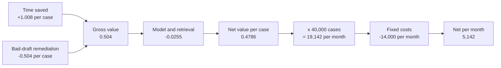

The flow shows where the value goes. Half of the time savings is consumed by error remediation, and the model cost is only about 5 percent of gross value ($0.02545 / 0.504 \approx 5.0$ percent). A team that optimizes token spend while ignoring the 4 percent bad-draft rate is optimizing the small term.

### 8.4 Sensitivity

The script re-runs the calculation with one input changed at a time:

```text
change                                net/month     break-even
adoption 0.70 -> 0.40                     -3498          53323
ai_minutes 6.6 -> 8.0                    -18378            inf
bad_draft_rate 0.04 -> 0.10              -25098            inf
token price x2                             4284          30628
calls_per_case 1.3 -> 4.0                  3360          32258
volume 40000 -> 12000                     -8257          29255
```

Reading the table: doubling token prices moves the monthly net from 5,142 to 4,284, a loss of 858 dollars. Tripling the calls per case costs about 1,800 dollars per month. Either leaves the project profitable. But a drop in adoption from 70 to 40 percent turns the project negative (net minus 3,498), because less of the volume receives the benefit while fixed costs stay. A modest slip in time saved (6.6 to 8.0 minutes) makes the net value per case negative: saved time $1.0 \times 0.60 \times 0.70 = 0.42$ is below the error cost of 0.504, so there is no break-even volume at any scale. A rise in bad-draft rate from 4 to 10 percent has the same effect. Volume matters differently: at 12,000 cases the break-even volume is unchanged at 29,255 (it depends only on fixed cost and net per case), but the project cannot reach it.

The architectural reading is that the economics are most sensitive to adoption, review time, and the quality of drafts, not to the model price. These are product and workflow variables. They are decided in the design of the workflow and the user interface, and they are measured in a pilot, which is why a pilot with real users is the best investment before committing the build.

### 8.5 Costs that sketches omit

Add each of the following to $F$ or $c$ if it applies.

- **Evaluation and labeling.** Maintaining a labeled test set, refreshing it as data drifts, and running regression tests on every model or prompt change.
- **Monitoring and incident response.** On-call share, dashboards, and quality sampling by reviewers.
- **Retraining or prompt maintenance.** For predictive models, the retraining pipeline; for generative systems, prompt and retrieval-index upkeep. See [Part 16 CH29](../16_AI_and_GenAI/CH29_MLOps_and_LLMOps.md).
- **Governance.** Impact assessment, periodic review, audit evidence. [Part 16 CH31](../16_AI_and_GenAI/CH31_Responsible_AI_and_Safety_Governance.md) notes that a full assessment for a high-risk system can take several person-weeks.
- **Security and privacy controls.** Access-controlled retrieval, redaction, logging, retention.
- **Provider and egress costs.** Network, data transfer, reserved capacity, and licensing.
- **Opportunity cost of the team.** The engineers on this project are not on another.
- **Decommissioning.** Eventually the system retires, and data and integrations need to be removed.

A sketch that omits these will look better than the real project. The omission is acceptable at the idea stage only if the sketch says so.

### 8.6 What to do with the result

Three outcomes follow from the sketch. If the net value per case is negative under reasonable assumptions, stop or redesign the workflow (for example, route only complex cases to the draft). If the break-even volume exceeds expected volume with margin, narrow the scope or defer. If the net is positive but depends strongly on one uncertain variable (here, adoption), make that variable the subject of the pilot, and write a kill criterion for it (section 16). Never present a single-point estimate without the sensitivity table; the table is the part a finance partner will trust.

## 9. Data Availability and Readiness

### 9.1 Why data is a qualification question

A learned component is a function of its data. For predictive ML the data is the training and evaluation set. For retrieval-grounded GenAI the data is the corpus the system reads. For a prompt-only GenAI feature the data is the set of examples and the evaluation cases the team uses to decide whether the output is good. In every case, a use case whose data is missing, unrightful, unrepresentative, or stale does not qualify, and the fix is a data project, not a model. [Part 17 CH04](CH04_AI_Data_Architecture_and_Preparation_Boundaries.md) designs data architecture. This section only asks whether the data exists in a form that justifies starting.

### 9.2 Five axes

| Axis | Question | Evidence to collect | Common failure |
|---|---|---|---|
| Volume | Are there enough examples of each outcome the system must handle, including rare ones? | Counts per class and per segment; learning curve from a subsample | 100,000 rows but only 40 examples of the costly class |
| Label quality | Do the labels reflect the true outcome, and do people agree on them? | Inter-annotator agreement, audit of a random label sample, label source and delay | Labels are the old system's decisions, so the model learns to copy its mistakes |
| Coverage | Does the data resemble production inputs, across segments, languages, devices, seasons? | Production versus data distribution by segment | Data from one region, deployed in five |
| Freshness | How old is the data, and how fast does the world change? | Age distribution, update frequency, change rate of source facts | Policy corpus indexed a year ago |
| Rights | May this data be used for this purpose, and by this system? | Provenance, license, consent, purpose limitation, residency, retention | Support transcripts contain personal data collected for another purpose |

Each axis has a pass condition that depends on the use case. The aim is to find the failing axis early, not to produce a numeric score.

### 9.3 Volume: how many examples are enough

There is no universal number. Two practical tests help.

**The rare-class test.** The number of examples of the rarest costly outcome limits both training and evaluation. If a fraud class has 2 percent prevalence and you need at least 100 positive examples to evaluate recall, you need about $100 / 0.02 = 5{,}000$ labeled cases. Even then precision of the estimate is modest. For an observed recall of 0.80 on 100 positives, the Wilson 95 percent interval is about 0.711 to 0.867, a width of roughly 16 points. To narrow the width to 8 points you need around four times as many positives, 400, which at 2 percent prevalence is 20,000 labeled cases. Compute these numbers at the start. If the labeled count is out of reach, either the project needs a synthetic or stratified sampling plan, or the first release has to run in shadow mode while labels accrue.

**The learning-curve test.** Train on 10, 25, 50, and 100 percent of the available data and plot the evaluation metric. If the curve is still rising steeply at 100 percent, more data will help and the current volume is insufficient. If it has flattened, more data will not help and the limit is features or labels. This test costs a few training runs and protects against a long data acquisition effort that would not help. See [Part 16 CH06](../16_AI_and_GenAI/CH06_Model_Evaluation_Validation_and_Selection.md) for learning curves.

For GenAI, volume has a different meaning: the number of representative evaluation cases, and for fine-tuning the number of demonstrations. Many GenAI use cases need only a few hundred well-chosen evaluation cases, not millions of examples, but those cases must cover the failure taxonomy, including adversarial and out-of-scope inputs.

### 9.4 Label quality

Labels are the ground truth that defines "good." Four problems are common.

**Labels that are decisions, not outcomes.** If the label is "the agent approved the refund," the model learns agent behavior, including bias and inconsistency, not whether the refund was correct. When possible, use an outcome label observed later (was the refund disputed, was the customer retained).

**Label noise.** If labels are wrong with probability $e$ independent of the model's mistakes, then a model with true accuracy $a$ on a binary task has measured accuracy

$$a_{\text{measured}} = a(1 - e) + (1 - a)\,e$$

With $a = 0.90$ and $e = 0.08$ this gives $0.90 \times 0.92 + 0.10 \times 0.08 = 0.828 + 0.008 = 0.836$. A model that is truly 90 percent accurate looks 83.6 percent accurate. Label noise therefore hides improvement and compresses differences between candidates. When the noise is not independent of the model's errors (for example labels came from a similar model), the effect differs and can inflate results.

**Disagreement.** If two trained reviewers agree on 82 percent of cases with balanced classes, chance agreement is 0.50, so Cohen's kappa is $(0.82 - 0.50) / (1 - 0.50) = 0.64$. That is moderate agreement. The task definition is ambiguous, or reviewers need training, and the 82 percent ceiling applies to any model measured against single-reviewer labels.

**Label delay.** Loan default or churn labels arrive months later. Training on recent data means training on cases with unobserved outcomes. Plan for the delay in the data design and in the monitoring design.

### 9.5 Coverage

Coverage asks whether the cases the system will see in production appear in the data in similar proportions. Compare segment shares directly.

| Segment | Share of production traffic | Share of data | Gap |
|---|---|---|---|
| English | 62 percent | 85 percent | Over-represented |
| Spanish | 26 percent | 9 percent | Under-represented by 17 points |
| Portuguese | 12 percent | 6 percent | Under-represented by 6 points |
| New product line | 14 percent of recent tickets | 0 percent | Not covered |

(Segments overlap with the product line row, so the shares in the last row do not add to 100.) A model evaluated on the data's own distribution will report a number that does not apply to Spanish speakers or to the new product. The fix is to evaluate per segment, set a minimum acceptable quality in each segment, and treat the weakest segment as the governing one. Coverage failures are also the main route to unfairness; [Part 16 CH31](../16_AI_and_GenAI/CH31_Responsible_AI_and_Safety_Governance.md) covers slice-based testing.

### 9.6 Freshness

Freshness is a rate comparison. If the facts in a source change at rate $r$ per month and the system refreshes every $T$ days, the share of documents that are stale at a random instant is approximately $r \times (T/2) / 30.4$ when changes arrive uniformly over time (half the refresh interval is the average lag). For a policy corpus where 8 percent of articles change per month:

- Weekly refresh, $T = 7$: $0.08 \times 3.5 / 30.4 \approx 0.0092$, about 0.9 percent stale.
- Monthly refresh, $T = 30$: $0.08 \times 15 / 30.4 \approx 0.039$, about 3.9 percent stale.

Whether 0.9 or 3.9 percent is acceptable depends on error cost. For a billing policy answer, a stale refund window quoted to a customer may be expensive; for an internal style guide it is trivial. The approximation also hides that staleness is not uniform: the articles that change most often are often the ones people ask about most (prices, deadlines). Weight staleness by query frequency when you assess it.

### 9.7 Rights

Ask five questions of every dataset before a design is accepted:

1. **Provenance.** Where did it come from, and can that be shown?
2. **License and contract.** May it be used to train, to fine-tune, to retrieve from, or to send to a third-party model provider?
3. **Consent and purpose.** For personal data, was it collected for a purpose compatible with this use? Does the privacy notice cover it?
4. **Residency and transfer.** May it leave its region or the organization's boundary, for example to a hosted model endpoint?
5. **Retention and deletion.** Can data be deleted on request, including from training sets, indices, caches, and logs?

[Part 16 CH30](../16_AI_and_GenAI/CH30_AI_Data_Governance_Privacy_and_Provenance.md) develops these controls. At qualification time, a "no" or "unknown" on any of the five is a gating issue, because it can invalidate the entire build. A data rights review that happens after the model is trained can force the team to discard the model.

### 9.8 Readiness gates

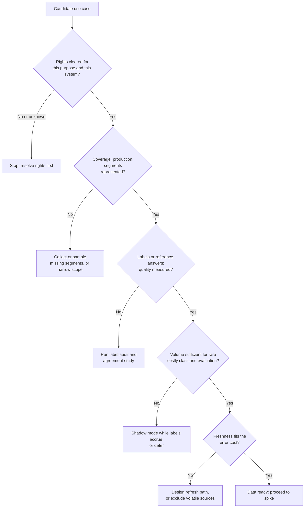

The gates run in order of how expensive a failure is to fix. Rights come first because a rights failure cannot be repaired by effort; it forces a different design or a stop. Coverage and labels come next, because they determine whether evaluation can be trusted. Volume and freshness are last because they can usually be addressed with time and engineering.

### 9.9 A note on synthetic data and public data

Teams sometimes substitute synthetic or public data for data they lack. Both are useful for building a prototype and for testing a pipeline. Neither substitutes for a sample of real production cases when the decision is whether to launch. Synthetic data inherits the biases of the generator, and public data rarely matches the vocabulary, formats, and difficulty of a specific organization's cases. Always ask for a measured result on real or realistically sampled data before a go decision.

## 10. Error Cost Asymmetry and the Acceptable Error Rate

### 10.1 Errors differ in cost

Accuracy treats all errors alike. Real decisions do not. A fraud system that clears a fraudulent payment loses the payment; one that blocks a legitimate payment loses a customer's patience. A medical triage tool that misses a serious case may harm a person; one that over-refers adds a clinic visit. The architect needs the cost of each kind of error, even approximate, because the acceptable error rate and the right threshold follow from them.

Define, for a binary decision with an automatic action:

- $C_{FN}$: cost of a false negative (a bad case the system lets through).
- $C_{FP}$: cost of a false positive (a good case the system blocks).
- $R$: cost of a human review.
- $e_h$: probability that a human reviewer gets a case wrong.
- $p$: the model's probability that the case is bad, assumed calibrated.

### 10.2 Deriving the single-threshold decision point

With no review, the system either clears or blocks. The expected cost of clearing a case with bad-probability $p$ is $p \, C_{FN}$. The expected cost of blocking it is $(1-p) \, C_{FP}$. Clear when clearing costs less:

$$p\,C_{FN} < (1-p)\,C_{FP} \iff p < \frac{C_{FP}}{C_{FP} + C_{FN}}$$

For the worked example $C_{FN} = 400$ and $C_{FP} = 25$:

$$p^{*} = \frac{25}{25 + 400} = \frac{25}{425} = 0.0588$$

The system should block a case when its bad-probability exceeds about 5.9 percent, far below the 50 percent of a default classifier threshold. A false negative costs 16 times a false positive, so the system should be 16 times more willing to raise a flag. Deploying at the default threshold of 0.5 would let through every case between 5.9 and 50 percent bad-probability, which under the stated costs is the expensive region.

### 10.3 Adding a review band

When humans can review, three actions exist: clear, review, block. Reviewing a case costs $R$ plus the expected cost of the reviewer's own error, $e_h\,(p\,C_{FN} + (1-p)\,C_{FP})$ if a mistaken reviewer ends on the wrong side. The thresholds are where adjacent actions cost the same.

Clearing equals reviewing when

$$p\,C_{FN} = R + e_h\,\big(p\,C_{FN} + (1-p)\,C_{FP}\big) \;\Rightarrow\; p_{lo} = \frac{R + e_h C_{FP}}{C_{FN}(1-e_h) + e_h C_{FP}}$$

Blocking equals reviewing when

$$(1-p)\,C_{FP} = R + e_h\,\big(p\,C_{FN} + (1-p)\,C_{FP}\big) \;\Rightarrow\; p_{hi} = \frac{C_{FP}(1-e_h) - R}{e_h C_{FN} + C_{FP}(1-e_h)}$$

With $R = 12$, $e_h = 0.03$, $C_{FN} = 400$, $C_{FP} = 25$:

$$p_{lo} = \frac{12 + 0.03 \times 25}{400 \times 0.97 + 0.03 \times 25} = \frac{12.75}{388.75} = 0.0328$$

$$p_{hi} = \frac{25 \times 0.97 - 12}{0.03 \times 400 + 25 \times 0.97} = \frac{12.25}{36.25} = 0.338$$

So cases below about 3.3 percent are cleared, above about 33.8 percent are blocked, and the band between goes to a person. The script [03_error_cost_bands.py](../code/python/ai-workload-qualification-chapter/03_error_cost_bands.py) searches a grid of thresholds on a synthetic calibrated score distribution (prevalence 7.7 percent) and finds values near the closed form:

```text
Single-threshold cost-optimal point p* = C_FP/(C_FP+C_FN) = 0.0588
Break-even: auto-clear only if P(bad) < 0.0588; mistakes cost 16x more on the miss side
Synthetic prevalence of bad cases: 0.077

policy                             expected cost per case
auto-clear everything              $30.862
human reviews everything           $13.618
single threshold at p*             $12.732
bands lo=0.035 hi=0.350            $9.491

Band shares: clear 47.8%, review 49.5%, block 2.7%
Review workload at 40,000 cases/month: 19814 reviews
```

The grid values 0.035 and 0.35 sit next to the closed-form 0.0328 and 0.338 because the grid has a coarse step. The result is the useful part: the banded policy costs 9.49 dollars per case versus 13.62 for reviewing everything, a saving of $13.618 - 9.491 = 4.127$ per case, or about 165,000 dollars per month at 40,000 cases. It also beats the best single threshold (12.73), because the middle band is where a human is cheaper than a guess. The price is a review workload of about 19,800 cases a month, which, since 12 dollars at a loaded 0.60 dollars per minute is 20 minutes of investigation each, is $19{,}814 \times 20 / 60 \approx 6{,}605$ hours, about 41 full-time equivalents (FTE) at 160 hours per month. Reviewing every case would take $40{,}000 \times 20 / 60 \approx 13{,}333$ hours, about 83 FTE. The staffing requirement is an output of the threshold decision, and should be in the business case.

### 10.4 Acceptable error rate from cost alone, and why it is not enough

A direct derivation asks how high the automation's error rate can be before automation costs more than the human process. Let $c_h$ be the human cost per case, $c_a$ the automated cost per case, $e_h$ and $e_a$ the error rates, and $C_{err}$ the average cost of an error. Automation is cheaper when

$$c_a + e_a C_{err} \le c_h + e_h C_{err} \;\iff\; e_a \le e_h + \frac{c_h - c_a}{C_{err}}$$

For invoice coding with $c_h = 1.20$, $c_a = 0.02$, $e_h = 0.02$, and $C_{err} = 9$:

$$e_a \le 0.02 + \frac{1.20 - 0.02}{9} = 0.02 + 0.1311 = 0.1511$$

Cost alone would license a 15 percent error rate. No finance team would accept that, and the reason is that the average error cost hides a tail. A few errors may be very large (a mispaid six-figure invoice), errors may cluster in one vendor or one customer group, and some errors carry regulatory or reputational cost beyond the direct amount. The cost-only bound is therefore a floor for discussion, never a target. Set the acceptable error rate as the minimum of three limits:

1. The cost-derived limit above.
2. A severity-weighted limit: separate errors into classes (cosmetic, financial under 100, financial over 100, harm to a person), set a rate per class, and require the rate for the most severe class to be at or below the human rate or an agreed absolute cap.
3. A regulatory or contractual limit, if any.

### 10.5 Severity classes

Rank errors on a small scale so that the requirement is specific:

| Severity | Description | Example | Acceptable rate |
|---|---|---|---|
| S1 | Cosmetic or easily corrected | Awkward phrasing in a draft | Up to 10 percent of outputs |
| S2 | Wrong but caught in normal review | Wrong clause cited, reviewer corrects | Up to 3 percent |
| S3 | Reaches a customer, correctable | Incorrect refund window quoted | Up to 0.5 percent, with correction path |
| S4 | Material financial or legal consequence | Wrong payout, wrongful denial | At or below the human error rate, with a human gate |
| S5 | Harm to a person, or breach of rights | Disclosure of another customer's data | Zero tolerated by design, prevented by deterministic control |

The numbers are illustrative. The pattern is what matters: S5 errors must be prevented by structure (access control, deterministic validators), because no evaluation set is large enough to prove a rate of zero. If you need to show fewer than 1 failure in 1,000 at 95 percent confidence, a quick rule of thumb (the "rule of three") says you need roughly $3/0.001 = 3{,}000$ failure-free trials. For one in 100,000 you need about 300,000. Test volume of that size is rarely available, which is why structural prevention beats statistical assurance for the worst classes.

### 10.6 Error asymmetry by task type

Error asymmetry looks different across capability classes.

- **Classification and scoring.** False positive versus false negative, as above. Threshold choice is the main lever.
- **Extraction.** A missed field and a wrong field differ: a missing value is visible and triggers a prompt, while a wrong value is silent. Prefer systems that return "not found" over guessing.
- **Generation.** Omission, fabrication, and tone errors differ. Fabrication of a fact is the severe class; stylistic issues are mild. Require citations to sources so that fabrication is detectable.
- **Retrieval.** Missing the right document (low recall) produces silence or wrong answers from other material; returning an unauthorized document is a security failure, which is S5.
- **Agents.** Errors compound across steps. If each step is 95 percent reliable and a task takes 6 sequential steps, the whole is $0.95^{6} \approx 0.735$, so about one run in four contains at least one error. The effective error rate of a chain is much higher than that of any link.

The last point is worth remembering: it is the quantitative reason to keep chains short and to place validation gates between steps.

## 11. Uncertainty and How the Product Handles It

### 11.1 Where uncertainty comes from

Uncertainty has two broad sources. Some is inherent in the problem: two experts will disagree about an ambiguous case, and no model can resolve that. Some comes from the model's limited knowledge: it has not seen cases like this one, or the input lies outside the training distribution. The product does not need to distinguish them in detail, but it does need a policy for what happens when confidence is low or when the input looks unlike anything evaluated. A system with no uncertainty path forces every output to look equally authoritative, and users cannot calibrate their trust.

### 11.2 Four product responses

1. **Abstain.** The system declines to answer and says so. Abstention is right when a wrong answer is worse than none, as in S4 and S5 classes, and when the user has another route.
2. **Escalate.** The case goes to a person or to a more capable (and costlier) component. Escalation turns uncertainty into cost; the business case must include the volume it generates.
3. **Show confidence and evidence.** The system answers and indicates how sure it is and why, for example by citing the sources that support the answer. Use coarse bands (high, medium, low) rather than false-precision decimals, and verify that the bands correspond to real accuracy differences.
4. **Ask.** The system requests missing information from the user. This is often the cheapest response to ambiguity and avoids both guessing and escalation.

### 11.3 Selective prediction: the coverage and accuracy trade

A system that may abstain trades coverage (the share of cases it answers) against accuracy on those answered. Suppose a classifier has 84 percent accuracy at full coverage. If, by abstaining on the 30 percent of cases it is least sure about, accuracy on the remaining 70 percent rises to 93 percent, then the number of errors falls from $0.16 N$ to $0.07 \times 0.70 N = 0.049 N$. That removes $(0.16 - 0.049) / 0.16 \approx 69$ percent of errors by routing 30 percent of the volume elsewhere. Whether that is a good trade depends on the cost of handling the abstained 30 percent (here $0.30 \times 40{,}000 = 12{,}000$ cases a month at $R$ each) against the avoided error cost. The same arithmetic as the band policy in section 10 applies.

This only works if confidence is informative: the cases the model is less sure about must really be the harder ones. Check by plotting accuracy against confidence bucket on held-out data. For predictive models, calibration measures how closely stated probabilities match observed frequencies; see [Part 16 CH06](../16_AI_and_GenAI/CH06_Model_Evaluation_Validation_and_Selection.md). A model that says 90 percent about cases it gets right 70 percent of the time breaks every threshold that was derived assuming calibration.

### 11.4 Uncertainty signals for generative systems

Generative models do not return a calibrated probability for a whole answer. Practical proxies, each imperfect, include:

- **Grounding support.** Does the answer cite retrieved passages, and does a check confirm the claims appear in them?
- **Retrieval confidence.** Were relevant passages found at all? An empty or low-scoring retrieval is a strong signal to abstain.
- **Validator results.** Does the output pass schema, range, and policy checks?
- **Agreement across samples or models.** Disagreement between independent runs suggests low reliability, at the price of extra cost.
- **Out-of-scope detection.** A classifier or rule that recognizes requests outside the supported domain.

Treat these as inputs to a routing rule, and validate the rule against labeled outcomes. A proxy that has not been checked against outcomes is a guess presented as a signal. [Part 16 CH24](../16_AI_and_GenAI/CH24_Generative_AI_Evaluation_Guardrails_and_Hallucinations.md) covers the techniques.

### 11.5 The uncertainty state machine

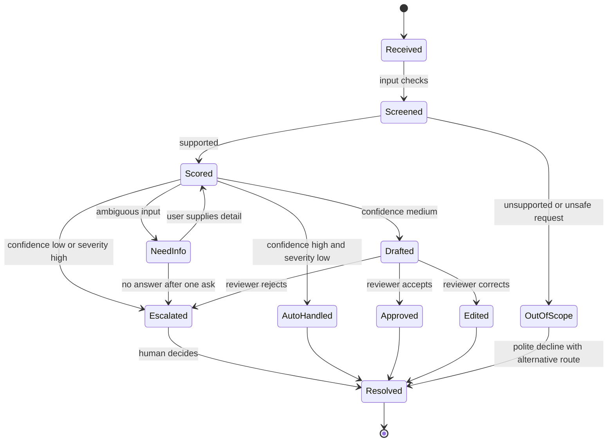

The state machine makes the uncertainty policy explicit and testable. Every path ends in Resolved, so no input can fall into a state with no exit. Low confidence and high severity both lead to Escalated, which reflects that the route depends on two variables, not one. A case that needs information gets one question and then goes to a person; without that limit a dialogue could cycle. The Edited state is important operationally: each edit is a labeled example and a signal about draft quality that [Part 17 CH11](CH11_Evaluation_and_Observability_Architecture_for_AI_Systems.md) turns into monitoring.

### 11.6 What the interface must show

Design the interface so that uncertainty is visible to the person who needs it.

- Show sources next to generated claims, so verification takes seconds.
- Show when the system did not find supporting material, instead of filling the gap.
- Do not display a confidence number the product cannot justify.
- Make "this is wrong" and "escalate" one action each, not a form.
- Record the user's response (accept, edit, reject) as structured data.

Unsupported confidence displays do harm: users who see 97 percent on every answer learn to ignore the number or, worse, to believe it.

## 12. Latency, Throughput, Availability, and Explainability

These four requirements often decide the capability class and the hosting model before quality is considered. State them as measurable scenarios.

### 12.1 Latency

Latency is a budget spent across components. For an interactive assistant the user cares about time to first useful content and time to completion. Take a scenario: the 95th percentile (p95) time to first token must be at most 1.5 seconds and p95 time to full response at most 6 seconds for answers of about 350 tokens. A budget could be:

| Stage | p95 budget (ms) |
|---|---|
| Gateway and authentication | 60 |
| Retrieval | 220 |
| Reranking | 120 |
| Prompt assembly and guardrail input check | 20 |
| Model queueing and prefill | 700 |
| Time to first token (sum) | 1,120 |
| Generation of 350 tokens at 90 tokens per second | 3,889 |
| Time to full response (sum) | 5,009 |

Check: $60 + 220 + 120 + 20 + 700 = 1{,}120$ ms leaves 380 ms of margin under 1,500. Generation is $350 / 90 = 3.89$ seconds, so the total is $1.12 + 3.89 = 5.01$ seconds, under 6. Percentiles do not add exactly (the sum of per-stage p95 values overstates the p95 of the sum), so a sum of p95 budgets is conservative; measure the end-to-end percentile directly.

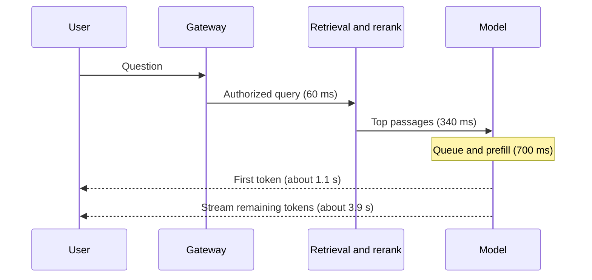

Latency requirements affect the capability class. A decision inside a 200 millisecond checkout call cannot wait for a multi-step agent or a large generative model; it needs a small model or rules computed in advance. A batch decision overnight can use a larger model and cheaper batch pricing. If the requirement is tight, ask whether the learned part can run asynchronously: precompute scores, enrich in the background, and let the synchronous path read a cached value.

### 12.2 Throughput and concurrency

Little's law relates concurrency, arrival rate, and time in the system: $L = \lambda W$. If peak load is 12 requests per second and each streaming response occupies a model slot for about 5.0 seconds, the system must sustain $12 \times 5.0 = 60$ concurrent streams at peak. Capacity planning then asks whether the chosen provider or cluster supports 60 concurrent streams for this prompt size, what the rate limits are, and what happens at 1.5 times peak. If the answer is "requests are rejected," the product needs queueing, degradation, or a fallback. Part 17 CH07 and CH13 develop serving and resilience; at qualification time, record the peak and the burstiness, because they drive the cost of a self-hosted design far more than average load does.

### 12.3 Availability

Availability of a serial chain is the product of component availabilities. With a gateway at 99.95 percent, retrieval at 99.9 percent, and a model provider at 99.5 percent:

$$A = 0.9995 \times 0.999 \times 0.995 = 0.9935$$

That is 99.35 percent, or about $43{,}200 \times (1 - 0.9935) \approx 280$ minutes of unavailability in a 30-day month. If the provider is down but a search-only fallback is available, the feature still answers in a degraded form whenever the gateway and retrieval are up: $0.9995 \times 0.999 = 0.9985$, about 65 minutes of full outage per month. The fallback improves the user-visible availability from roughly 280 to 65 minutes of full outage, at the cost of building and testing the degraded mode. Provider service-level agreements (SLAs) vary and change; at the time of writing, read the current terms for the specific model, region, and tier, and note exclusions. Every architecture should name its deterministic or human fallback, as the Part 17 topic map requires.

### 12.4 Explainability

Explainability is a requirement on the audience, not a property of the model. Ask who needs an explanation, for what, and at what time.

| Audience | Need | Mechanism |
|---|---|---|
| End user | Why this answer or outcome, and what to do next | Source citations, plain-language reasons, route to appeal |
| Operator or reviewer | Whether to trust this output now | Evidence, confidence band, validator results |
| Auditor or regulator | Whether the process was sound | Versioned logs, evaluation evidence, decision records |
| Developer | Why the system failed | Traces, inputs, retrieved context, model version |

The levels of explanation are ordered by strength: none, a global description of how the system works, citation of sources, feature attribution for a prediction, and citation of the explicit rule applied. When a contract or regulation requires the last level (the rule that applied), a learned model cannot be the decision maker, but it can still prepare the case for a rule-based decision. Post hoc attribution is an approximation of a model's behavior, not the reason in the sense a person would give; present it that way.

## 13. The Human Authority Spectrum

### 13.1 Five levels

Authority describes how much the system may do without a person. The five levels below form a spectrum, and a single product can use different levels for different actions.

| Level | Name | System does | Human does | Typical fit |
|---|---|---|---|---|
| 1 | Suggest | Shows information or options when asked | Decides and acts | Search, analytics, early-stage assistants |
| 2 | Draft | Produces a work product | Edits, accepts, and sends | Reply drafting, code suggestions, report drafts |
| 3 | Act with approval | Prepares an action and waits | Approves or rejects each action | Refunds above a threshold, record changes |
| 4 | Act and report | Executes within limits and reports afterwards | Monitors, can undo, audits a sample | Routine routing, low-value approvals |
| 5 | Autonomous | Executes and adapts with no routine human involvement | Sets policy, handles exceptions | Narrow, reversible, high-volume actions with strong controls |

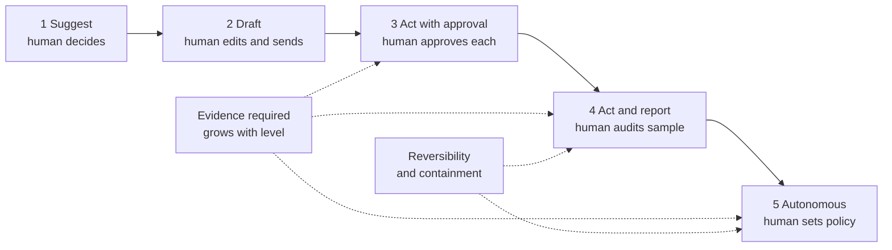

The diagram shows two things that rise together as you move right: the evidence needed to justify the level, and the need for reversibility and containment. A system should never be at a level that its evidence and its undo mechanism do not support. The spectrum is also not a one-way ratchet; evidence of degradation should move a system left again.

### 13.2 Choosing a level

Five questions place a decision on the spectrum.

1. **Error cost and severity class.** S4 and S5 outcomes cap the level at 3 unless structural controls remove the risk.
2. **Reversibility.** Can the action be undone cheaply and quickly? Irreversible actions stay at level 3 or below.
3. **Verification cost.** How long does a person need to check the output? If checking costs nearly as much as doing, drafting saves little, and approval-per-action adds no safety because reviewers rubber-stamp.
4. **Volume and review capacity.** If level 3 yields 19,814 reviews a month and the team can do 8,000, approval becomes a bottleneck or a formality.
5. **Track record.** Has the system produced evidence at its current level that justifies the next?

A decision rule: choose the highest level for which all five answers permit, then begin one level below it until evidence accumulates.

### 13.3 Earning authority with evidence

Promotion criteria should be written in advance and measurable. An example for moving a triage action from level 3 (approval) to level 4 (act and report): at least 5,000 approved decisions at level 3, an override rate with upper 95 percent bound at or below 2 percent, zero S4 or S5 incidents, and an undo path tested in the last 30 days. With 60 overrides in 5,000 decisions the observed rate is 1.2 percent. The standard error is $\sqrt{0.012 \times 0.988 / 5000} = 0.00154$, so the approximate upper bound is $0.012 + 1.96 \times 0.00154 = 0.0150$, or 1.5 percent, which meets the 2 percent criterion. With 500 decisions and 6 overrides (the same 1.2 percent) the bound would be $0.012 + 1.96\sqrt{0.012\times0.988/500} = 0.012 + 0.0095 = 0.0215$, which does not. The same observed rate supports promotion at one sample size and not at another. That is the argument for writing the sample size into the criterion.

### 13.4 Automation bias and the rubber-stamp problem

Level 3 only protects if the reviewer really reviews. People presented with plausible machine output tend to accept it, particularly when volume is high and the system is usually right. Three countermeasures are cheap: measure review time per item and treat approvals faster than a plausible reading time as a warning sign; seed a small share of known-bad items (canaries) into the queue and measure how many are caught; and rotate reviewers or sample second reviews. If canaries are caught less than, say, 80 percent of the time, level 3 provides less protection than the design assumes, and the real level is closer to 4. [Part 17 CH09](CH09_Human_Oversight_and_AI_Assisted_Workflow_Integration.md) designs the workflow, and [Part 16 CH31](../16_AI_and_GenAI/CH31_Responsible_AI_and_Safety_Governance.md) discusses meaningful oversight.

### 13.5 Authority per action, not per product

A single assistant may have different authority for different actions. A support assistant might suggest articles (level 1), draft replies (level 2), propose a refund below 50 dollars with approval (level 3), and never touch account closure. Define a table with each action, its level, its limits, and its undo mechanism. Granting authority per action also gives security a clear permission model for tool credentials: the system holds only the permissions for the actions it is authorized to take.

## 14. Risk Screening at Qualification

### 14.1 What screening is for

Risk screening at qualification is a cheap first pass that answers three questions: is there anything that ends the idea outright, what governance burden will this use case carry, and which risks must the architecture handle by design. It is not the full impact assessment, which comes later and needs a more detailed design. The aim is to avoid discovering in month five that the use case sits in a regulated category, that its data cannot lawfully be used, or that a single failure mode cannot be contained.

[Part 16 CH31](../16_AI_and_GenAI/CH31_Responsible_AI_and_Safety_Governance.md) section 3 owns the tiering method: a harm score from severity, likelihood, and reversibility, taken as the maximum across credible harms, mapped to tiers T1 (low) through T4 (critical), with category overrides and red-line checks that do not depend on the score. This chapter uses that result as an input. It does not repeat the method.

### 14.2 Five screens

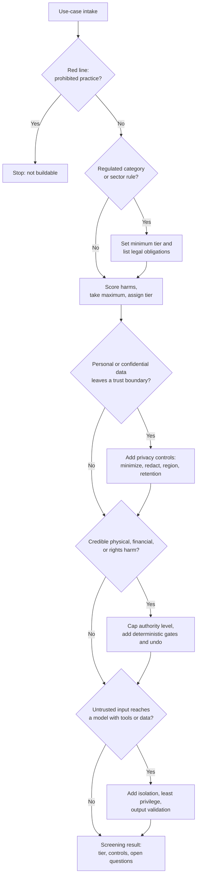

The five screens are red lines, regulated categories, privacy, safety, and security. The order is deliberate. A red line stops the work at no cost. A regulated category sets a floor on governance before any score is computed. The remaining three screens add architectural controls instead of stopping the work, and each control becomes a requirement in the problem statement.

**Screen 1: red lines.** Check whether the use is prohibited by law or by organizational policy. In the European Union (EU), the AI Act lists prohibited practices, such as certain manipulative techniques and social scoring by public authorities, and these have applied since early 2025. A prohibited use cannot be rescued by controls.

**Screen 2: regulated categories and sector rules.** Check whether the use falls into a category that triggers obligations. The EU AI Act classifies certain uses (for example employment, education, essential services, credit, and law enforcement) as high-risk. At the time of writing, the schedule has moved: the Council and Parliament reached a provisional agreement in May 2026 to defer the application of the high-risk rules to 2 December 2027 for stand-alone systems and 2 August 2028 for systems embedded in regulated products ([Council of the EU press release, 7 May 2026](https://www.consilium.europa.eu/en/press/press-releases/2026/05/07/artificial-intelligence-council-and-parliament-agree-to-simplify-and-streamline-rules/)). Verify the final legal text and the current dates with counsel before relying on any date. Sector rules (financial services, health, insurance, public sector) and general law (data protection, consumer protection, anti-discrimination, product liability) apply regardless of AI-specific legislation. Voluntary frameworks such as the National Institute of Standards and Technology AI Risk Management Framework and the ISO/IEC 42001 management system standard give structure for programs, but they are not substitutes for legal advice.

**Screen 3: privacy.** Identify personal data in inputs, in retrieved documents, in prompts and logs, and in any training or evaluation data. Ask whether any of it leaves the organization's boundary to a hosted model, whether the provider may retain or train on it under the contract, and whether data subjects can exercise rights over copies in indices and logs. Controls include minimization, redaction before the model call, regional processing, retention limits, and a contract that excludes provider training on the data. See [Part 16 CH30](../16_AI_and_GenAI/CH30_AI_Data_Governance_Privacy_and_Provenance.md).

**Screen 4: safety.** Identify harm to people, finance, or rights if the system is wrong, manipulated, or unavailable. The controls are architectural: cap the authority level (section 13), place deterministic gates on consequential actions, require an undo path, and define a safe state for failure.

**Screen 5: security.** If untrusted text reaches a model that can read private data or call tools, an attacker may be able to steer the model through that text. A retrieved web page, an email, or a document uploaded by a customer can all carry instructions. Controls include separating privileged and untrusted context, minimizing tool permissions, validating outputs, and requiring approval for side effects. [Part 17 CH12](CH12_AI_Safety_Security_Privacy_and_Governance_Architecture.md) designs these controls. At qualification time, record whether the use case has this exposure so that the later design budgets for it.

### 14.3 The screening output

The output is a short record, not a report: the tier, the category overrides that applied, the legal obligations named, the controls that must exist before launch, the authority level cap, and the open questions with owners. This record travels with the use case to the one-page brief (section 22) and to the scorecard, where the risk score and the risk gate draw on it. A use case that passes screening with a high tier is not disqualified; it is more expensive, and its unit economics (section 8) must include the governance cost.

### 14.4 Residual risk is not zero

Controls reduce risk, they do not remove it. The qualification decision should state the residual risk in plain terms and name who accepts it. A statement such as "a customer could receive an incorrect refund window about once per 200 conversations, correctable by the agent within a day, accepted by the head of support" is a risk decision. A statement such as "risks are mitigated" is not.

## 15. Build, Buy, or Partner

### 15.1 Four options

| Option | What it means | When it tends to fit |
|---|---|---|
| Buy a finished product | A software-as-a-service (SaaS) feature or product that already delivers the capability | The workflow is generic, differentiation is low, and speed matters |
| Buy a model, build the workflow | Call a hosted model through an application programming interface (API) and build retrieval, orchestration, evaluation, and interface in-house | The workflow is specific to the organization and data stays in policy with a suitable provider |
| Build with self-managed models | Run open-weight or licensed models on organization-controlled infrastructure | Data cannot leave the boundary, volume is high and steady, or latency or customization needs demand it |
| Partner | Co-develop with a vendor or integrator who contributes domain assets, data, or engineering | The capability is outside the organization's skills and strategic, and the partner shares risk |

These are not exclusive. Many organizations buy a product for generic needs (meeting summaries), build a workflow on hosted models for differentiated needs (claims drafting), and self-host a small model for a high-volume, sensitive classification task.

### 15.2 Decision criteria

Seven criteria usually decide the choice.

1. **Strategic differentiation.** Is the capability part of what makes the organization different? Differentiating capabilities favor building, because the organization wants to own the improvement loop and the data advantage.
2. **Time to value.** A purchased product can deliver in weeks; a built workflow in months.
3. **Data sensitivity and residency.** Constraints on where data may go can rule out a purchase or a hosted model.
4. **Fit to workflow.** Products fit generic flows. If the workflow needs organization-specific policy, integration, or evaluation, a product may need so much customization that the saving disappears.
5. **Total cost over a horizon.** Include license, usage, integration, operation, and exit.
6. **Control and observability.** Can you evaluate quality on your own cases, see traces, pin model versions, and be told about model changes?
7. **Exit cost and lock-in.** How hard is it to switch provider or model? Open interfaces, portable prompts and evaluation sets, and abstraction at a gateway reduce lock-in. [Part 17 CH08](CH08_Model_Gateway_Routing_and_Fallback_Architecture.md) covers the gateway pattern.

### 15.3 A three-year cost comparison

Compare a purchased support-assistant product with a built workflow on a hosted model, using the support drafting numbers from section 8. Illustrative figures:

- **Option A, buy.** 55 dollars per agent per month, 150 agents, 36 months: $55 \times 150 \times 36 = 297{,}000$.
- **Option B, build on hosted model.** Build 180,000; recurring fixed 6,500 per month for 36 months, $6{,}500 \times 36 = 234{,}000$; model and retrieval at 0.02545 per case on 40,000 cases per month for 36 months, $0.02545 \times 40{,}000 \times 36 = 36{,}648$. Total $180{,}000 + 234{,}000 + 36{,}648 = 450{,}648$.
- **Option C, self-managed model.** Build 320,000; infrastructure 9,000 per month, $9{,}000 \times 36 = 324{,}000$; recurring fixed 10,000 per month, $10{,}000 \times 36 = 360{,}000$. Total $320{,}000 + 324{,}000 + 360{,}000 = 1{,}004{,}000$.

Option A is cheapest at 150 agents. The cost of A scales with seats, while B scales mostly with fixed cost and volume. The break-even seat count between A and B (ignoring the small difference) is $450{,}648 / (55 \times 36) = 450{,}648 / 1{,}980 \approx 227.6$, so above about 228 agents building is cheaper on cost alone. Option C is more than twice B's cost, and it would be chosen only if data residency, latency, or volume economics change the picture. A typical break-even for self-hosting appears at high, steady token volume where a dedicated cluster is well utilized; compute it with your own token counts rather than a rule of thumb. [Part 17 CH14](CH14_AI_Cost_Performance_and_Sustainability_Decisions.md) develops hosted versus self-managed economics.

The comparison above leaves out value differences. If the purchased product drafts replies that agents accept less often because it cannot use the organization's policy corpus, adoption (the most sensitive input in section 8.4) drops, and A's real value is lower. Compare options on net value, not on cost alone.

### 15.4 Questions to put to a vendor

- Can we evaluate on our own labeled cases before signing, and will you accept the result as acceptance criteria?
- Which models and sub-processors handle our data, in which regions, and for how long is data retained?
- Is our data used to train or improve models, and can that be excluded contractually?
- How are we told of model or behavior changes, and can we pin a version?
- What logs and traces can we export, and in what format?
- What is the uptime commitment, what is excluded, and what remedies apply?
- What are the price-change terms, and what does exit cost?
- What certifications and audit rights exist?

A vendor that cannot answer these in writing is signalling its operating maturity. The answers belong in the decision record.

### 15.5 Partnering

A partner is useful when the capability is strategic but outside current skills, or when the partner owns data or domain assets. Agree who owns the evaluation set, the fine-tuned artifacts, the derived data, and the improvement loop. Without an explicit agreement, the partner may end up holding the learning that the organization paid for. Define success measures in the contract, not in a slide deck.

## 16. Feasibility Spikes and Kill Criteria

### 16.1 What a spike is

A feasibility spike is a time-boxed experiment designed to reduce the largest remaining uncertainty at the lowest cost. It is not a prototype that grows into the product, and it is not a demonstration. Its output is a decision with evidence: proceed, change scope, or stop. The most valuable property of a spike is a pre-written kill criterion, a measurable result that, if observed, ends the work.

### 16.2 Pick the right uncertainty

List the assumptions behind the value hypothesis and rank them by how much they would change the decision and how cheaply they can be tested. For the support drafting case the assumptions are:

1. Drafts reach acceptable quality on real cases (feasibility).
2. Agents adopt drafts in at least 70 percent of eligible cases (adoption).
3. Bad drafts stay under 4 percent (quality and risk).
4. Unit cost stays under 0.03 dollars (cost).
5. The policy corpus is clean enough to retrieve from (data).

Section 8.4 showed that adoption and review time dominate the economics, so the first spike should test adoption and quality on real cases, not model price. Teams often spike the technically interesting item (can we chunk PDFs well) when the decisive uncertainty is behavioral (will agents use drafts).

### 16.3 The ladder of evidence

Move up the ladder only when the lower rung supports it. Each rung costs more and tells more.

| Rung | Typical duration | What it tests | Typical cost | Output |
|---|---|---|---|---|
| Desk review | 2 to 5 days | Baseline, data inventory, rights, similar cases elsewhere | Very low | Go or stop on obvious blockers |
| Data probe | 1 week | Label quality, coverage, volume, rare-class counts | Low | Data readiness verdict |
| Offline prototype | 2 to 3 weeks | Quality on a labeled real sample versus baselines | Low to medium | Uplift estimate with interval |
| Shadow pilot | 4 to 8 weeks | Behavior on live traffic, latency, cost, drift | Medium | Production-like evidence without user impact |
| Limited release | 6 to 12 weeks | Adoption, workflow effect, guardrails with real users | Medium to high | Value evidence for scale-up |

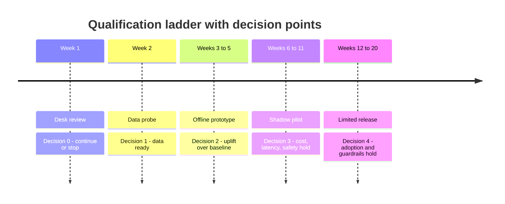

The diagram shows five decision points over about twenty weeks. Each decision can end the work. The ladder front-loads cheap steps so that a project that should be stopped is stopped at week 1 or 2 at a cost of a few person-days, not at week 12 at a cost of a quarter.

### 16.4 Kill criteria

A kill criterion is a threshold on a metric, an owner, and a date, written before the experiment starts. It converts a hope into a test. Examples for the support drafting spike:

| Dimension | Metric | Continue if | Kill if |
|---|---|---|---|
| Quality | Share of drafts rated acceptable by two reviewers on 300 real cases | At least 80 percent, lower 95 percent bound at least 75 percent | Point estimate under 70 percent |
| Adoption | Share of eligible cases where agents use the draft in the pilot | At least 55 percent after 4 weeks | Under 40 percent after 6 weeks |
| Safety | Drafts disclosing another customer's data in 500 adversarial and normal test cases | Zero | Any occurrence not removed by a structural fix within the box |
| Cost | Model and retrieval cost per case | At most 0.03 dollars | Above 0.06 dollars with no credible reduction path |
| Data | Cohen's kappa between two reviewers on the quality rating | At least 0.6 | Under 0.4 after rubric revision |

Three disciplines make kill criteria work. Write them before seeing results. Assign someone with authority who is not the project's sponsor to hold the line. And define the middle: results between continue and kill trigger a named action (extend by one week with a specific change, or narrow scope), not an open-ended extension. Without these, a spike with ambiguous results becomes a project by inertia.

### 16.5 The value of a spike in numbers

Suppose building costs 180,000 dollars, the probability that the use case works is 0.4 (an honest estimate when evidence is thin), and the present value of success is 400,000 dollars. Building without a spike has an expected value of $0.4 \times 400{,}000 - 180{,}000 = -20{,}000$. A spike costing 25,000 dollars that reveals success or failure reliably changes the plan: build only if the spike succeeds. The expected value becomes $0.4 \times (400{,}000 - 180{,}000) - 25{,}000 = 88{,}000 - 25{,}000 = 63{,}000$. The spike is worth $63{,}000 - (-20{,}000) = 83{,}000$ dollars in expectation, even though it adds cost. Real spikes are not perfectly informative, so the true value is lower, but the direction holds whenever the probability of success is moderate, the build cost is much larger than the spike cost, and the spike result is informative. When the probability of success is already high (say 0.9) or the build cost is small, skip the spike and build.

### 16.6 What to write at the end

A spike ends with a one-page decision memo: the hypothesis, what was done, the results against the kill criteria, the decision, and what was learned about scope, data, and risk. Keep failed spikes. They are the organization's memory of why something was not done, and they prevent the same idea from being rediscovered every year.

## 17. The Qualification Scorecard

### 17.1 Five dimensions

The scorecard rates a candidate on five dimensions, each from 1 (poor) to 5 (strong). It supports comparing several candidates for a limited budget. It does not replace judgment; it makes judgment visible and criticizable.

| Dimension | What it asks | Score 1 | Score 3 | Score 5 |
|---|---|---|---|---|
| Value | Size and certainty of the gain over the best baseline | No measurable outcome, or AI adds nothing over rules | Plausible gain, unmeasured baseline | Large, measured gain with a clear owner and metric |
| Feasibility | Can the capability reach the needed quality in this time and budget? | Requires an unproven capability | Similar systems exist, needs tuning | Proven capability, spike already shows target quality |
| Risk (scored so that 5 is low risk) | Residual harm after controls | Credible severe harm with no containment | Moderate harm with partial controls | Low harm, reversible, strong controls |
| Data | Readiness on the five axes | Rights unclear or data absent | Data exists but gaps in labels or coverage | Rights cleared, representative, measured quality |
| Operability | Can the organization run it after launch? | No owner, no monitoring, no fallback | Owner exists, monitoring partial | Named owner, on-call, evaluation pipeline, tested fallback |

Risk is scored in the opposite direction from intuition so that a higher number is always better. Mixing directions is a common cause of scorecard errors.

### 17.2 Weights and gates

The weights below sum to 1.0 and reflect an organization that values business gain first and treats risk and feasibility as equally important:

| Dimension | Weight |
|---|---|
| Value | 0.30 |
| Feasibility | 0.20 |
| Risk | 0.20 |
| Data | 0.15 |
| Operability | 0.15 |

The weighted total is $T = \sum_i w_i s_i$, where $s_i$ is the score and $w_i$ the weight. A weighted sum has a known flaw: it allows a strong score on one dimension to hide a failing score on another. A use case with value 5, feasibility 5, data 5, operability 5, and risk 1 totals $1.5 + 1.0 + 0.2 + 0.75 + 0.75 = 4.2$, which looks excellent yet carries unacceptable risk. Hence hard gates: a score of 1 on value, risk, or data stops the use case regardless of its total. Value is gated because a use case where AI adds nothing is not an AI use case. Risk and data are gated because they cannot be offset. Decision bands for the total: at least 3.8 proceed, 3.2 to under 3.8 run a spike, below 3.2 defer.

### 17.3 A worked scoring of six candidates

The script [02_qualification_scorer.py](../code/python/ai-workload-qualification-chapter/02_qualification_scorer.py) scores six candidate use cases (scores are illustrative).

| Use case | Value | Feasibility | Risk | Data | Operability |
|---|---|---|---|---|---|
| Support reply drafting (GenAI with retrieval) | 4 | 4 | 4 | 4 | 3 |
| Invoice dispute triage (predictive) | 4 | 4 | 4 | 4 | 4 |
| Tax-rate lookup by region | 1 | 5 | 5 | 5 | 5 |
| Autonomous refund approval (agent) | 5 | 2 | 1 | 3 | 2 |
| Contract clause extraction | 3 | 3 | 3 | 2 | 3 |
| Executive chat over all documents | 2 | 3 | 2 | 2 | 2 |

Hand computation of the weighted totals:

- Support drafting: $0.30 \times 4 + 0.20 \times 4 + 0.20 \times 4 + 0.15 \times 4 + 0.15 \times 3 = 1.20 + 0.80 + 0.80 + 0.60 + 0.45 = 3.85$.
- Invoice triage: $1.20 + 0.80 + 0.80 + 0.60 + 0.60 = 4.00$.
- Tax-rate lookup: $0.30 + 1.00 + 1.00 + 0.75 + 0.75 = 3.80$, but the value score of 1 triggers the gate.
- Autonomous refund agent: $1.50 + 0.40 + 0.20 + 0.45 + 0.30 = 2.85$, and the risk score of 1 triggers the gate.
- Contract extraction: $0.90 + 0.60 + 0.60 + 0.30 + 0.45 = 2.85$.
- Executive chat: $0.60 + 0.60 + 0.40 + 0.30 + 0.30 = 2.20$.

The script's output:

```text
use case                                score  verdict
Invoice dispute triage (predictive)      4.00  PROCEED
Support reply drafting (GenAI+RAG)       3.85  PROCEED
Tax-rate lookup by region                3.80  STOP (gate)
Autonomous refund approval (agent)       2.85  STOP (gate)
Contract clause extraction               2.85  DEFER
Executive chat over all documents        2.20  DEFER

Rank stability over 2000 random weight vectors
use case                                  first    top-3
Invoice dispute triage (predictive)      100.0%   100.0%
Support reply drafting (GenAI+RAG)         0.0%   100.0%
Tax-rate lookup by region                  0.0%     0.0%
Autonomous refund approval (agent)         0.0%     0.0%
Contract clause extraction                 0.0%   100.0%
Executive chat over all documents          0.0%     0.0%
```

Interpretation. The tax-rate lookup has a high total only because it is easy, safe, and data-rich, and the gate reports the right message: it is a deterministic problem, and AI adds no value. Build it as ordinary software and do not spend AI budget on it. The autonomous refund agent has the highest value potential and the worst risk and feasibility profile, so it is stopped as specified; the sensible follow-up is to redefine it at a lower authority level (propose a refund with approval, section 13) and re-score. Contract extraction and executive chat defer for data and operability reasons that are fixable but not yet fixed.

The stability test draws 2,000 random weight vectors (every weight at least a small positive amount, summing to 1) and counts how often each non-gated candidate ranks first. Invoice triage ranks first in every draw because it scores at least as high as support drafting on every dimension and higher on one. This is a dominance relation, and it explains the 100 percent figure: no choice of weights can reorder a dominated pair. Only four candidates are live after the gates, so the top-3 column shows only that the executive chat ranks last in every draw. Do not read the "top-3" column as strength; with few candidates it carries little information. The informative signal is the rank stability of the first place.

Two cautions. First, support drafting at 3.85 sits barely above the proceed threshold of 3.8; treat any total within 0.2 of a boundary as uncertain, and let the spike resolve it. Second, scores are judgments. Have two or three people score independently, compare, and discuss differences of two or more points; that discussion is often where hidden assumptions surface.

### 17.4 The value and risk matrix

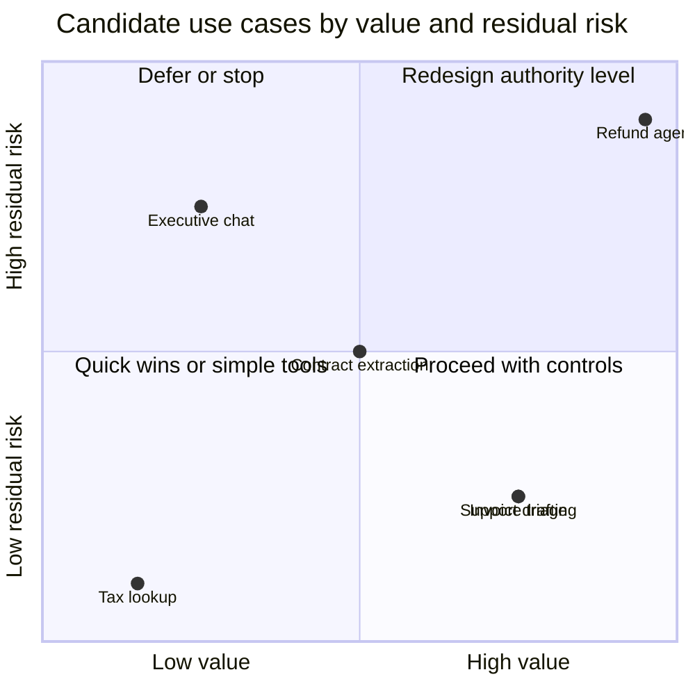

(Invoice triage and support drafting have the same coordinates because they receive the same value and risk scores of 4 and 4.) The matrix reduces the scorecard to two dimensions to support a quick conversation. The lower right quadrant holds candidates to proceed with. The upper right quadrant, where the refund agent sits, holds high-value ideas that need their authority level or scope redesigned before they qualify. The lower left holds ideas that are safe but unrewarding; the tax lookup falls here, and the right action is ordinary software. The upper left holds low-value, high-risk ideas that should be stopped. The remaining three dimensions (feasibility, data, operability) decide whether a candidate in the right half can actually be delivered, so a candidate in the proceed quadrant still needs the other scores to be acceptable.

### 17.5 Using the scorecard honestly

Use the scorecard to compare and to find disagreement, not to produce a number to defend. Re-score after each rung of the evidence ladder; scores should move as uncertainty is retired. Keep the scored record, since it documents why a candidate was chosen over others. If scoring takes more than an hour per candidate at the idea stage, the process is too heavy.

## 18. The Evidence Chain: From Objective to Production Signal

### 18.1 The chain

An AI workload makes a claim about the business: that this component, at this level of quality, will improve this outcome. Evidence for the claim has to exist at each step, from the business objective down to the signals in production. A break in the chain is a hidden assumption.

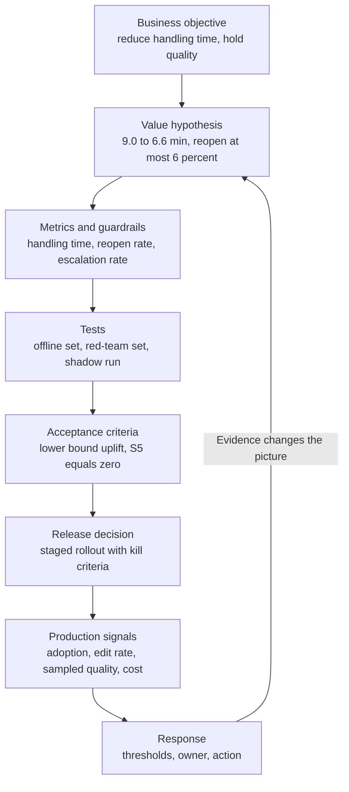

The chain is a loop. Production signals feed back into the hypothesis: if adoption is 45 percent instead of 70, the economics and perhaps the design change. The terminal node, response, is the one most often missing.

### 18.2 A traced example

| Link | Content | Evidence artifact | Owner |
|---|---|---|---|
| Objective | Reduce cost per billing contact without lowering satisfaction | Business plan, baseline cost per contact 5.40 dollars | Head of support |
| Hypothesis | Drafts cut handling from 9.0 to 6.6 minutes with reopen rate at most 6 percent | Value hypothesis statement (section 6.2) | Product owner |
| Metric | Median handling time, reopen rate, escalation rate, draft acceptance, cost per case | Metric definitions with query logic | Analytics lead |
| Test | 600-case labeled set, 300 red-team cases, 4-week shadow run | Evaluation report with intervals | AI engineering lead |
| Acceptance | Lower bound of acceptable-draft share at least 75 percent, zero cross-customer disclosures | Signed acceptance record | Product owner and risk partner |
| Production signal | Weekly adoption, edit distance, sampled quality score, spend per case | Dashboard and alert thresholds | Service owner |
| Response | Adoption under 50 percent for 2 weeks triggers a workflow review; sampled quality under 90 percent triggers rollback to previous version | Runbook | Service owner |

Each row names an artifact and an owner. A row with neither is a gap. The traceability matters in two places: during release approval, where a reviewer can verify that every claim has evidence, and during an incident, where the response column tells responders what to do.

### 18.3 Metric without a decision

A metric is useful when someone will do something different depending on its value. For each production signal, write the threshold and the action. "Track hallucination rate" is a metric without a decision; "if sampled unsupported-claim rate exceeds 2 percent in a week, the service owner pauses auto-send and opens an incident" is a metric with a decision. Dashboards of metrics with no thresholds are a common form of observability theater. [Part 17 CH11](CH11_Evaluation_and_Observability_Architecture_for_AI_Systems.md) builds the evaluation and observability architecture; this chapter requires that every signal has an owner and an action.

### 18.4 Leading and lagging indicators

Business outcomes lag. Retention, loss, and satisfaction move over months. Production needs earlier indicators that predict them. Examples: draft acceptance and edit distance (leading indicators of handling time), sampled quality scores (leading indicators of complaints), and retrieval success rate (leading indicator of grounded answers). State the assumed relationship between a leading indicator and the outcome, and test it when the lagging data arrives. If edit distance rises but handling time does not, the leading indicator was not predictive and needs replacing.

## 19. Stakeholders and Ownership

### 19.1 Who is involved

An AI workload touches more functions than a conventional feature, and each has a stake and a veto.

| Stakeholder | Interest | Typical concern at qualification |
|---|---|---|
| Business owner | Outcome and budget | Will it pay back, and who answers for the result? |
| Product owner | User value and adoption | Will people use it, and does it fit the workflow? |
| End users and reviewers | Their work and accountability | Will it make my work harder or my errors visible? |
| Data owner or steward | Data quality, access, and use | Is this a permitted use, and who fixes defects? |
| AI and ML engineers | Feasibility and quality | Is the data adequate, are the targets realistic? |
| Platform and operations | Run, scale, and support | Who is on call, what is the fallback? |
| Security | Threats and access | What can an attacker reach through this? |
| Legal, privacy, and compliance | Lawful basis and obligations | Which law applies, what must be disclosed? |
| Risk and model governance | Tiering and approval | What is the residual risk and who accepts it? |
| Finance | Cost and benefit realization | Are savings counted once and verified? |
| Customers or affected people | Fair and safe treatment | Can I get a human, contest a result? |

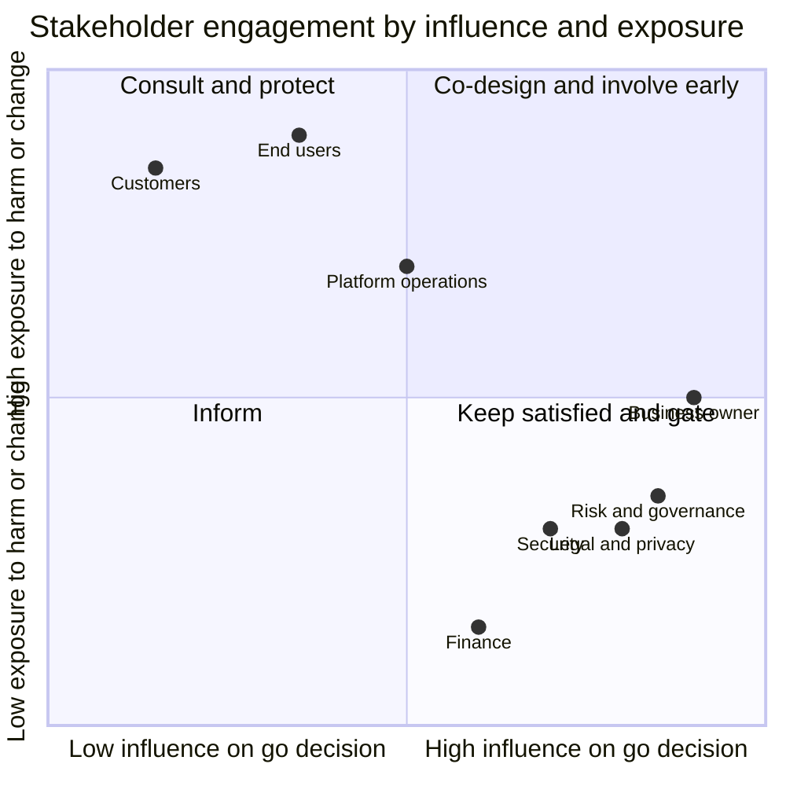

The matrix guides how to engage each group. Stakeholders with high influence and high exposure, such as the product owner and the platform team, should co-design. High-influence, lower-exposure groups, such as risk, legal, and security, hold gates; they need to be consulted before the design is settled, not after. Low-influence, high-exposure groups, such as end users and customers, are easy to neglect and are the people who live with the result. Bring representative users into the spike and into evaluation. Their influence on the go decision may be low on paper, but their adoption decides whether the value materializes.

### 19.2 Responsibility assignment

Use a responsibility assignment matrix (RACI) in which R is responsible, A is accountable (exactly one per row), C is consulted, and I is informed.

| Activity | Business owner | Product owner | AI engineering | Data owner | Platform | Security | Risk and legal |
|---|---|---|---|---|---|---|---|
| Value hypothesis and baseline | A | R | C | C | I | I | I |
| Data rights and quality | I | C | C | A/R | I | C | C |
| Model and system design | I | C | A/R | C | C | C | I |
| Risk tiering and sign-off | C | R | C | C | I | C | A |
| Evaluation and acceptance | C | A | R | C | I | C | C |
| Operation and incidents | I | C | R | C | A | R | I |
| Authority-level changes | C | R | C | I | C | C | A |

The key rule is one accountable party per activity. Shared accountability, in practice, becomes no accountability. The most common gap is the last two rows: the project team builds the system, then disbands, and nobody owns operation or authority changes. Name the post-launch owner at qualification and record their commitment.

### 19.3 The single-threaded owner

Beyond the matrix, name one person who owns the outcome of the use case end to end, including the decision to scale up or shut down. This person must have budget authority and access to the operating team. When an AI use case is "owned" by a committee or by the platform team that merely hosts it, no one is positioned to say the metric missed its target and the system should stop.

### 19.4 Ownership of the learned artifacts

Learned systems have artifacts conventional systems lack, and each needs an owner: the training or evaluation dataset, the labeling guidelines, the prompt and configuration set, the retrieval index and its source contracts, the model and version choice, and the evaluation harness. Decide at qualification who owns each and what happens when the owner leaves. The most fragile artifact is usually the evaluation set: if it drifts out of date or nobody maintains it, the team loses the ability to know whether a change helped.

## 20. Organizational Readiness and Adoption Risk

### 20.1 Why readiness belongs in qualification

A technically sound system can fail because the organization cannot absorb it. The section 8.4 sensitivity showed that adoption, the share of eligible cases where people actually use the output, moved the economics more than any model-price assumption. Adoption is a property of the organization and the workflow, so qualification must test readiness with the same seriousness as data and model feasibility.

### 20.2 Four readiness areas

**Skills.** An AI workload needs a mix of capabilities that many teams have only in part: product management for decision-centered requirements, data engineering for pipelines and access, ML or GenAI engineering for the model components, evaluation skills for building test sets and interpreting uncertainty, domain experts who can label and judge, site reliability and platform engineering for operation, and security and privacy expertise. The qualification question is not whether each exists in the company, but whether each is available to this team in this quarter. A single engineer who is also the only person who understands the evaluation set is a risk, not a capability.

**Process.** Existing processes assume human-only work. Consider review procedures, approval limits, quality sampling, escalation paths, complaint handling, and incident response. Which must change when part of the work is done by a model? Who handles a complaint that "the assistant told me X"? Which procedure covers a model update? If the answers are blank, the process is not ready, and launch will create ad hoc improvisation.

**People and incentives.** Workers adopt tools that make their work easier and abandon tools that add risk or work to them. An agent measured on handling time may skip careful review of drafts; an agent measured on quality may ignore the drafts altogether. Align incentives with the intended use before launch. Where workforce effects are significant, involve employee representatives or works councils early; in some jurisdictions consultation is a legal requirement for introducing monitoring or automated decision-making in the workplace.

**Operating model.** Someone runs the system day to day: monitors quality, triages feedback, updates the knowledge base, manages vendor relationships, and responds to incidents. The operating model includes budget, on-call, and the authority to roll back. Section 19 covered ownership; readiness checks that the owner has capacity.

### 20.3 A readiness assessment

| Area | Ready | Partly ready | Not ready |
|---|---|---|---|
| Skills | Named people cover product, data, AI, evaluation, platform, security | Gaps filled by contractors with a handover plan | Key skill held by one person or missing |
| Process | Review, escalation, complaint, and rollback procedures updated | Drafted but untested | Existing procedures assume no AI |
| Incentives | Metrics reward intended use | Neutral | Metrics punish the intended use |
| Operating model | Owner, on-call, budget, runbook | Owner named, runbook pending | No owner after launch |
| Sponsorship | Business owner with budget and time | Sponsor with limited time | Sponsor interest is "innovation" without an outcome |

A "not ready" in any row is a precondition to fix, not a reason to stop forever. Use the assessment to build the readiness plan with dates and owners.

### 20.4 Adoption is a funnel

Adoption is the product of several stages, and each can fail independently. In the support drafting example the target adoption of 0.70 can decompose as follows (illustrative):

| Stage | Rate | Cumulative |
|---|---|---|
| A draft is generated successfully (no timeout, refusal, or empty retrieval) | 0.97 | 0.970 |
| The agent opens or views the draft | 0.90 | 0.873 |
| The agent uses the draft after viewing | 0.80 | 0.698 |

The cumulative rate is $0.97 \times 0.90 \times 0.80 = 0.6984$, about 0.70. The funnel tells you where to work. Improving the "uses after viewing" stage from 0.80 to 0.90 lifts adoption to $0.97 \times 0.90 \times 0.90 = 0.786$. Improving generation success from 0.97 to 0.99 lifts it only to $0.99 \times 0.90 \times 0.80 = 0.713$. Reliability work on the draft path is worth less than quality and trust work, in this example. Measure each stage in the pilot so that the first rebuild goes to the weakest stage.

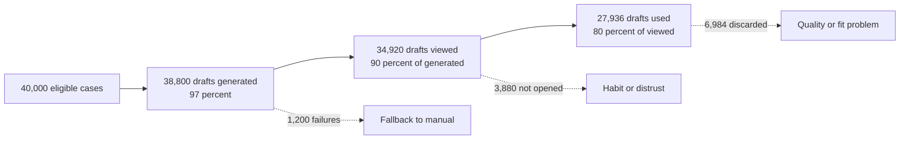

The funnel shows absolute counts so that each loss has a business meaning. Of 40,000 eligible cases, 27,936 receive the benefit, which is 69.8 percent. The 6,984 viewed-but-discarded drafts are the richest source of improvement signals, since each discarded draft can be sampled to learn why. Section 11 recommended recording accept, edit, and reject as structured data; this is where that data is used.

### 20.5 Change management

Four practices consistently help.

1. **Involve users from the spike.** The people who will use the system see early versions, give feedback on real cases, and become advocates. A system that arrives fully formed meets suspicion.
2. **Train on the limits, not only on the features.** Show users where the system fails and how to recognize a bad output. Teaching only the successes encourages overtrust.
3. **Provide a fast feedback route.** One click to mark a bad output, a visible response from the team, and a regular summary of what changed because of feedback.
4. **Stage the rollout.** Begin with willing teams, learn, then expand. A mandated launch to everyone at once combines the novelty effect, the support burden, and the resistance of skeptical users in a single quarter.

### 20.6 Adoption risk signals

Early warning signs include falling usage after the first weeks, rising edit distance, reviewers approving faster than they could read, workarounds (copying text out of the tool), and unfavorable comments in team channels. Review them weekly during the first quarter. Adoption that decays is an operational finding, and the response may be to change the workflow, not to improve the model.

## 21. Common Anti-Patterns

Each anti-pattern below has a symptom, a cause, a consequence, and a remedy. They repeat across organizations, which is why naming them helps in reviews.

| Anti-pattern | Symptom | Cause | Consequence | Remedy |
|---|---|---|---|---|
| AI for its own sake | The request names a technology, not a decision | Executive pressure, fear of missing out, vendor marketing | Solutions search for problems; the budget goes to demos | Rewrite as a decision statement (section 2); delete "AI" and check what remains |
| Demo-driven scope | Scope is whatever the demo showed | A convincing prototype on hand-picked inputs | Production quality is far below the demo; scope grows to match the demo's range | Evaluate on a sample of real cases, including hard and adversarial ones |
| Ignoring the baseline | No measurement of the current process or a simple heuristic | Baseline measurement seems like extra work | Uplift cannot be shown; a heuristic might have sufficed | Measure three baselines (section 6.3) before building |
| No owner | The project team disbands at launch | Funding is for build, not run | Silent quality decay and no one to roll back | Name the post-launch owner at qualification (section 19) |
| Metric without a decision | Dashboards with no thresholds or actions | Metrics chosen for ease, not use | Observability theater; incidents found by customers | Pair each signal with a threshold, an owner, and an action (section 18.3) |
| Accuracy as the only metric | One quality number drives launch | Familiar metric | Asymmetric errors, segments, and cost are hidden | Use severity classes and per-segment targets (sections 9.5 and 10.5) |
| Autonomy by default | The first design lets the system act | A wish to maximize automation | Severe errors with no human check | Start one level below the target authority and earn the next (section 13.3) |
| Pilot purgatory | Pilots run for a year with no decision | No kill or scale criteria | Cost accumulates, trust erodes | Write kill and scale criteria before the pilot (section 16.4) |
| Data hope | "We have a lot of data" | Volume mistaken for fitness | Labels, rights, or coverage fail late | Run the five-axis assessment and the readiness gates (section 9) |
| Review cost blindness | Savings counted at generation time only | Model cost is visible, review cost is not | Net value is lower or negative | Include review and correction time in the baseline comparison |
| Vendor-led qualification | The vendor defines success | Lack of in-house evaluation capacity | Metrics that flatter the product | Build your own labeled set before the proof of concept |
| Single-model thinking | "Use the best model for everything" | Simplicity, brand loyalty | Higher cost, lower fit, lock-in | Assign the cheapest adequate capability per sub-task (section 5) |
| No fallback | The system has no non-AI path | Optimism about availability | Outage or quality incident stops the business process | Name a deterministic or human fallback and test it (section 12.3) |
| Authority creep | A "draft" tool gains a "send" button | Incremental feature requests | Tier and risk change without review | Re-run intake on every change to tools, scope, or authority |
| Savings counted twice | Finance books both labor reduction and capacity gain | Unclear benefit accounting | A benefits shortfall at the year-end review | Define benefit realization with finance before launch |

### 21.1 Demo-driven scope in more detail

The demo is the most common root cause because it is persuasive and cheap. A demonstration shows a hand-picked input producing an impressive output, and the audience mentally multiplies by all inputs. The architect's response is to ask for the distribution: how often does it fail on a random sample, what do the failures look like, and what happens on the worst case? Request a run on 100 random real cases chosen by the evaluator, not the presenter. A system that is 60 percent acceptable on random cases has a very different business case from one shown at 100 percent on five.

### 21.2 Ignoring the baseline in more detail

A team spent a quarter building a churn model. It then discovered that a rule ("accounts with no login for 30 days and a support ticket open") captured 80 percent of the model's lift. The rule could have been built in two days. The model still had some value on the remaining 20 percent, but the business case for it was far smaller than assumed. The remedy is cheap: before any model work, build the best simple heuristic you can in a few days, and measure it. If the model's incremental value over the heuristic is small, ship the heuristic.

### 21.3 Authority creep in more detail

Authority creep arises from requests that each seem small. A drafting assistant that has read-only access to the customer record is asked to add an "apply credit" button for convenience. The button needs write permission. The permission is granted to the same service identity. Now the assistant's tier, its threat model, and its failure consequences have changed, but nobody reran the intake. Treat a change in tools, permissions, or authority level as a change in the use case: re-screen, re-score, and re-approve. The model registry or deployment pipeline can enforce this by refusing a release whose tool list differs from the approved record, as Part 16 CH31 recommends.

## 22. Templates: Problem Statement and Use-Case Brief

### 22.1 The architecture problem statement

The problem statement is the document that turns qualification into architecture requirements. It should fit on one page and be specific enough that two architects reading it would design systems with comparable constraints. Use this template.

```text
ARCHITECTURE PROBLEM STATEMENT

1. Decision and actor
   Decision to be changed:
   Actor who acts on the output:
   Trigger and timing (batch, interactive, real time):
   Evidence available at decision time:
   Action taken and its reversibility:

2. Objective and baseline
   Outcome metric, baseline, target, horizon:
   Guardrail metrics and limits:
   Baselines measured (current process, heuristic, human):
   Value type (cost, revenue, risk, quality, capacity, access):

3. Capability selection
   Sub-tasks and assigned capability class (with the reason):
   Alternatives considered and rejected:
   Deterministic or human fallback:

4. Data
   Sources, owners, rights, residency:
   Volume, label quality, coverage, freshness (measured values):
   Gaps and plan:

5. Error and uncertainty
   Cost of each error type, severity classes, acceptable rates:
   Uncertainty policy (abstain, escalate, ask, show confidence):
   Human authority level and promotion criteria:

6. Quality-attribute scenarios
   Latency, throughput, availability, explainability, cost:
   (each as stimulus, response, measure)

7. Risk and governance
   Tier and basis, regulations, privacy and security exposures:
   Required controls before launch, residual risk and acceptor:

8. Economics
   Cost per decision, value per decision, break-even volume:
   Fixed costs, payback, key sensitivities:

9. Delivery
   Build, buy, or partner and reason:
   Spike plan, kill criteria, decision dates:

10. Ownership and operation
   Accountable owner, owners of data, model, workflow, incidents:
   Production signals, thresholds, and actions:
```

Ten headings are enough. If a section cannot be filled, that is information: it is an open question with an owner and a date.

### 22.2 Why each section earns its place

Section 1 prevents solution-first thinking. Section 2 forces a baseline. Section 3 records why this capability class was chosen over others, which protects the decision from being re-litigated by someone who did not hear the discussion. Sections 4 to 7 are the places where qualifying evidence lives. Section 8 prevents building something that cannot pay back. Sections 9 and 10 make delivery and operation concrete.

### 22.3 The one-page use-case brief

The problem statement is for architects and reviewers. The one-page brief is for sponsors and governance boards who decide whether to fund and approve. It restates the essentials in plain language. The following filled example uses the support drafting case (illustrative figures).

| Field | Content |
|---|---|
| Name | Billing support reply drafting |
| Sponsor and owner | Head of customer support (accountable), product owner for support tools |
| Problem | Agents spend a median 9.0 minutes per eligible billing case, much of it reading policy and composing replies |
| Proposed solution | A draft reply for the agent to edit and send, built from policy articles retrieved for the customer's case |
| Why not something simpler | Canned replies cover about 30 percent of cases and were measured to save 2.0 minutes on those; search alone leaves composition to the agent |
| Capability | Retrieval-grounded GenAI, authority level 2 (draft); deterministic checks on amounts and identifiers |
| Value hypothesis | Median handling time from 9.0 to 6.6 minutes within 90 days, reopen rate at most 6 percent |
| Economics | About 0.0255 dollars of model and retrieval cost per case, net value of 0.48 dollars per case in the planning case, break-even about 29,000 cases per month, payback about 14 months |
| Key risks | Cross-customer data exposure (tier T3 by governance scoring), incorrect policy statements, adoption below 55 percent |
| Controls | Retrieval filtered by customer identity, citations on every claim, output validators, reviewer-in-the-loop, red-team set of 300 cases |
| Evidence plan | 600-case labeled set, 4-week shadow run, then limited release with kill criteria (adoption under 40 percent, any unresolved cross-customer disclosure) |
| Delivery | Build on a hosted model through a gateway; buy was cheaper at 150 agents but could not use the policy corpus |
| Decision requested | Fund a 5-week spike (cost 25,000 dollars) with decision gates at weeks 2 and 5 |

The brief tells a funder what is being asked, why, at what cost, with what exit. It is deliberately one page: a sponsor reading three pages of technical detail is not informed, only fatigued.

## 23. Quality-Attribute Scenarios

### 23.1 Format

A quality-attribute scenario states a requirement as a testable story. It has six parts: the **source** of the stimulus, the **stimulus**, the **artifact** being stressed, the **environment** in which it occurs, the **response** the system must produce, and the **response measure** that quantifies success. A requirement without a measure cannot be tested, and a scenario without a stimulus is a wish. The scenarios below use the support drafting case. They link directly to the Part 17 topic map's recurring scenarios: provider unavailable, stale or unauthorized retrieval, unsafe tool action, model update that degrades a task, and context growth that breaks a budget.

### 23.2 Eight scenarios

| ID | Attribute | Source | Stimulus | Artifact | Environment | Response | Response measure |
|---|---|---|---|---|---|---|---|
| QA1 | Latency | Agent | Opens an eligible billing case | Drafting service | Weekly peak, 12 requests per second | Streams a draft | p95 time to first token at most 1.5 s, p95 full draft at most 6 s |
| QA2 | Availability and fallback | Model provider | Endpoint returns errors for 20 minutes | Gateway and workflow | Business hours | Switches to search-only suggestions and shows a banner | Agent never sees a blank screen, degraded-mode switch within 30 s, no lost cases |
| QA3 | Unauthorized retrieval | Agent | Requests a draft for customer A while customer B's record is in the index | Retrieval layer | Normal operation | Returns only passages authorized for customer A's case | Zero cross-customer passages in 500 adversarial tests, enforced at query time by identity filter |
| QA4 | Stale source | Policy owner | Refund window policy changes at 09:00 | Index refresh path | Any weekday | Updated policy used in drafts | 95 percent of drafts reflect the change within 4 hours, stale-source warnings if older than 24 hours |
| QA5 | Unsafe action | Draft content | Draft proposes a credit above the agent's authority | Output validators | Normal operation | Draft blocked or amount removed, agent warned | 100 percent of over-limit amounts caught in test set of 200, enforced by deterministic check not by the model |
| QA6 | Model update | Provider | Releases a new model version | Evaluation gate | Version change window | Candidate version is evaluated before use | No version enters production unless acceptable-draft rate has lower bound at least 75 percent on the regression set and no S5 failures |
| QA7 | Cost under context growth | Policy corpus | Average retrieved context grows from 3,500 to 9,000 input tokens | Prompt assembly | Quarterly corpus growth | Budget alert, context cap enforced | Cost per case stays at most 0.03 dollars, or alert fires within 24 hours |
| QA8 | Explainability | Reviewer | Questions a statement in a draft | Citation layer | Normal operation | Shows the supporting passage | 98 percent of factual claims in sampled drafts link to a supporting passage |

### 23.3 Working one scenario through: QA7

Context growth is a common silent failure. At the start, 3,500 input tokens per call cost $3{,}500 \times 3 / 10^{6} = 0.0105$ dollars. If retrieval is tuned to return more passages as the corpus grows and the average input rises to 9,000 tokens:

$$\frac{9000 \times 3 + 400 \times 15}{10^{6}} = \frac{27000 + 6000}{10^{6}} = 0.033 \text{ dollars per call}$$

Per case, with 1.3 calls and 0.004 retrieval, the cost is $0.033 \times 1.3 + 0.004 = 0.0469$ dollars, against 0.02545 originally. That is 1.84 times the original, and exceeds the 0.03 cap. Monthly model spend on 40,000 cases moves from about 1,018 to about 1,876 dollars. The money is small relative to the business case, but the latency cost is real: more input tokens lengthen prefill, so QA1 may also fail. The scenario requires two controls: a cap on retrieved context with a reranker that selects the most relevant passages, and a cost alert on average input tokens per call. Neither depends on the model; both are architecture decisions that the problem statement should record.

### 23.4 Scenario discipline

Write each scenario with a number someone can measure. Use scenarios to derive tests, not only requirements: QA3, QA5, and QA6 become automated checks in the release pipeline. Revisit them at every rung of the evidence ladder. Add a scenario each time an incident reveals an untested stimulus. [Part 17 CH13](CH13_Reliability_and_Resilience_Patterns_for_AI_Workloads.md) develops the reliability patterns that satisfy QA2.

## 24. Case Study 1: Support Reply Drafting (Proceeds as Retrieval-Grounded GenAI)

### 24.1 Situation

A mid-sized subscription company handles 40,000 eligible billing contacts per month with 150 agents. Median handling time is 9.0 minutes at a loaded labor cost of 0.60 dollars per minute, so the baseline is 5.40 dollars per case. Quality is acceptable: reopen rate is 6 percent and satisfaction is stable. The business owner wants to reduce cost per contact without raising reopen rate. The request that arrived was "put a chatbot on the website." Qualification began by rewriting the request as a decision: agents decide how to answer a billing question, within a few minutes, from a policy corpus of about 1,400 articles, and the output is a message sent to a customer.

### 24.2 Decomposition and capability choice

The agent's work on a billing case has five steps: identify the customer and the issue; find the relevant policy; determine the entitlement or amount; write the reply; send and record. The company assigned capabilities as follows.

| Step | Capability | Reason |
|---|---|---|
| Identify customer and issue | Deterministic (account lookup) plus a small classifier for issue type | Exact lookup for identity; a classifier for free-text issue categories |
| Find relevant policy | Search with retrieval reranking | The answer is in existing articles; sources are needed for citation |
| Determine amount or entitlement | Deterministic rules (billing engine) | Exact arithmetic with legal consequences |
| Write the reply | GenAI, grounded on retrieved passages and validated facts | Composed language; many acceptable outputs |
| Send and record | Human sends, deterministic logging | Customer-facing; authority level 2 |

The company rejected a customer-facing chatbot at this stage: the customer-facing version would remove the human check on a customer-visible output, and the S3 and S4 severity classes (wrong refund window, wrongful denial) have material consequences. The decision to start with agent-facing drafts keeps authority at level 2.

### 24.3 Baselines

Three baselines were measured over four weeks.

- **Current process:** 9.0 minutes median handling, 6 percent reopen rate.
- **Simple heuristic:** keyword-triggered canned replies, built in a week. They apply to about 30 percent of cases, save 2.0 minutes when applicable, and agents use them on 80 percent of applicable cases. The value per case is $0.30 \times 2.0 \times 0.60 \times 0.80 = 0.288$ dollars. With a build cost of 30,000 dollars amortized over 24 months (1,250 per month) and 800 dollars a month to maintain, monthly net is $0.288 \times 40{,}000 - 2{,}050 = 11{,}520 - 2{,}050 = 9{,}470$ dollars.
- **Human reference:** two senior agents wrote replies for 100 sampled cases. Raters judged 92 percent acceptable, with moderate agreement (kappa 0.62).

The heuristic's 9,470 dollars of monthly net value is the number the GenAI design has to beat, not the zero of doing nothing.

### 24.4 Planning economics

With the planning inputs from section 8.3 (6.6 minutes with draft, 70 percent adoption, 4 percent bad drafts), the net is 5,142 dollars per month. That is below the heuristic's 9,470, so the planning case, taken at face value, does not justify GenAI. This is a useful finding: the idea is not yet qualified. It qualifies for a spike only if there is a credible path to better inputs. The team listed what the design changes would do: citations and a deterministic validator on amounts and dates should cut the bad-draft rate; a retrieval filter and structured facts should reduce the time spent verifying. The spike was designed to measure exactly those inputs.

### 24.5 Risk screening

Governance scoring (Part 16 CH31 method) placed the assistant at tier T3, driven by the worst credible harm, exposure of another customer's data (severity 5, likelihood 2, reversibility 3 gives 30), not by the more frequent harm of a wrong policy statement (2 × 4 × 1 = 8). That shapes the controls. Retrieval is filtered by the case's customer identity at query time; the model never receives passages the agent could not open; logs are redacted and retained for 30 days; the contract with the model provider excludes training on company data and fixes processing to the company's region.

### 24.6 Scorecard

| Dimension | Score | Basis |
|---|---|---|
| Value | 4 | Large cost base; uplift unmeasured |
| Feasibility | 4 | Similar assistants are well established; corpus is clean in English |
| Risk | 4 | After controls, residual risk moderate and reversible at level 2 |
| Data | 4 | Rights cleared, 1,400 articles, labeled set of 600 planned; Spanish coverage thin |
| Operability | 3 | Owner named; on-call and evaluation pipeline not yet in place |

The weighted total is 3.85, in the proceed band but within 0.2 of the boundary, so the decision was to run a spike with hard kill criteria, not to build.

### 24.7 The spike and its results

The five-week spike (cost 25,000 dollars) tested drafting quality, adoption, safety, and cost on real cases. The kill criteria were those of section 16.4. Illustrative results:

| Measure | Result | Criterion | Outcome |
|---|---|---|---|
| Acceptable drafts on 300 real cases | 258 of 300 = 86 percent, approximate 95 percent interval 82 to 90 percent | At least 80 percent, lower bound at least 75 percent | Pass |
| Reviewer agreement | kappa 0.66 | At least 0.6 | Pass |
| Cross-customer disclosures in 500 test cases | 0 | Zero | Pass, upper bound by the rule of three is 3/500 = 0.6 percent, so structural enforcement remains the real guarantee |
| Over-limit amounts caught by validator | 200 of 200 | 100 percent | Pass |
| Model and retrieval cost per case | 0.0255 dollars | At most 0.03 | Pass |
| Adoption in 4-week pilot with 24 agents | 72 percent | At least 55 percent | Pass |
| Handling time with draft | 5.8 minutes | Not a kill metric, feeds economics | Better than plan |
| Bad-draft rate (customer-visible error) | 1.5 percent | At most 4 percent | Better than plan |

The pilot on 24 agents is small and the novelty effect applies, so adoption was re-measured at week 8 of the limited release, as planned. Updating the unit economics with the spike results (5.8 minutes, adoption 0.72, bad-draft rate 0.015):

- Time saved value: $(9.0 - 5.8) \times 0.60 \times 0.72 = 1.3824$ dollars per case.
- Error cost: $0.015 \times 0.72 \times 18 = 0.1944$ dollars per case.
- Gross value: $1.3824 - 0.1944 = 1.188$. Net after 0.02545: $1.16255$.
- Monthly net: $1.16255 \times 40{,}000 - 14{,}000 = 46{,}502 - 14{,}000 = 32{,}502$ dollars.
- Break-even volume: $14{,}000 / 1.16255 \approx 12{,}042$ cases a month.
- Payback: $180{,}000 / (46{,}502 - 6{,}500) = 180{,}000 / 40{,}002 \approx 4.5$ months.

Against the heuristic, the incremental monthly gain of the GenAI design is $32{,}502 - 9{,}470 = 23{,}032$ dollars. The incremental justification is positive and does not depend on assumptions about model price. The sensitivity table was recomputed; the project remained profitable if adoption fell to 40 percent ($0.40 \times 3.2 \times 0.6 = 0.768$ time value, error cost $0.015 \times 0.40 \times 18 = 0.108$, net per case $0.768 - 0.108 - 0.02545 = 0.63455$, monthly $25{,}382 - 14{,}000 = 11{,}382$), still above zero though not above the heuristic's 9,470 by much. Adoption was therefore designated the metric to watch.

### 24.8 Architecture decision record

The decision is recorded in an architecture decision record (ADR), a short document stating the context, the decision, the alternatives rejected, and the consequences.

| Field | Content |
|---|---|
| Title | ADR-001: Agent-facing, retrieval-grounded draft replies for billing contacts |
| Status | Accepted, conditional on week-8 adoption of at least 55 percent |
| Context | 40,000 cases a month, 9.0 minute baseline, agents already use a policy knowledge base, replies are customer-visible |
| Decision | Build a drafting service at authority level 2: retrieve authorized policy passages, generate a draft with citations from validated facts, validate amounts and identifiers deterministically, present to the agent for editing and sending |
| Rejected: canned replies and search only | Net 9,470 per month in the heuristic case; limited to 30 percent of cases; retained as the fallback when the model is unavailable and as an immediate quick win |
| Rejected: customer-facing chatbot | Removes the human check on S3 and S4 errors; tier and regulatory exposure rise; revisit after at least two quarters of level 2 evidence |
| Rejected: purchased support-assistant product | Cheaper at 150 agents (297,000 versus 450,648 over three years), but could not retrieve from the company policy corpus with customer-level authorization and gave no access to traces; revisit if headcount falls or product adds both |
| Rejected: fine-tuned classifier plus templates | Cannot compose answers for the long tail of cases; kept as a possible router for issue type |
| Rejected: agent with write tools (apply credits) | Authority creep; S4 risk; tier would rise; propose-and-approve is a later step with its own spike |
| Consequences | Requires an index refresh path, an identity-aware retrieval filter, an evaluation pipeline with a 600-case regression set, a gateway for model fallback, and an on-call owner in support operations |
| Revisit triggers | Adoption under 55 percent, bad-draft rate above 4 percent, any S5 incident, model provider change, or cost per case above 0.03 dollars |

### 24.9 What made this a GenAI case

Three properties together made generative AI the right capability: the output is composed language that varies by case, no fixed template covers the long tail, and a human checks the output before it matters. If any one had been absent the design would change. If replies had to be exact, a template engine would win. If no human reviewed the reply, the error cost would force a lower capability or a lower tier of automation. If the corpus could not be retrieved with proper authorization, the project would stall at the data gate.

## 25. Case Study 2: Return Eligibility (Better as Deterministic Software)

### 25.1 Situation

An online retailer receives 30,000 return requests a month. Agents decide whether each request is eligible and what refund to issue, spending a median of 6.5 minutes per request at a loaded 0.60 dollars per minute, so 3.90 dollars per request. A quarterly audit of 400 decisions found that 7 percent applied the policy incorrectly, either granting a refund that policy did not allow or denying one that it did. The average cost of a wrong decision, counting the refund difference, follow-up contacts, and goodwill credits, is 22 dollars. A vendor proposed an "AI agent" that reads the request, consults the policy document, and decides, with a claimed accuracy of 95 percent. The vendor demonstration was impressive and showed several correct decisions with fluent explanations.

### 25.2 Is the correct answer specified?

The first question in the decision tree (section 3.2) is whether the correct output is fully determined by explicit, stable logic. The return policy is a published document of 14 rules: a base 30-day window from delivery; 60 days for the top loyalty tier; no returns on final-sale and hygiene categories; restocking fees on certain categories when opened; free return shipping only for defective items; partial refunds for bundles; different handling by original payment method, and similar. The rules change about once a quarter, and each change is approved by a named policy owner. This is a specified function of a small set of attributes.

Count the input space. Suppose the decision depends on:

| Attribute | Values |
|---|---|
| Product category | 8 |
| Loyalty tier | 4 |
| Days since delivery band (within 30, 31 to 60, over 60) | 3 |
| Item condition (unopened, opened, damaged) | 3 |
| Return reason (defective, wrong item, changed mind, late delivery, other) | 5 |
| Original payment method | 3 |
| Part of a bundle | 2 |
| Bought with a promotion | 2 |

The number of combinations is $8 \times 4 \times 3 \times 3 \times 5 \times 3 \times 2 \times 2 = 17{,}280$. That is smaller than the 390,625 combinations of section 4.3 and, importantly, small enough to test exhaustively. A decision table implementing the policy can be evaluated against all 17,280 combinations in seconds, and a policy expert can review the expected outcome for each rule group. The rules do not explode combinatorially in the sense of being unmaintainable, because the policy is structured: most attributes matter in only a few rules.

### 25.3 What the vendor's number means

The claimed 95 percent accuracy was tested by the retailer on the same 400 audited cases, labeled by the policy owner. The agent decided 376 correctly, which is 94.0 percent, with an approximate 95 percent interval from 91.7 to 96.3 percent (standard error $\sqrt{0.94 \times 0.06 / 400} = 0.0119$, interval $0.94 \pm 1.96 \times 0.0119$). The error rate is therefore about 6 percent, within a range of 3.7 to 8.3 percent. That is roughly the same as the 7 percent error rate of the current human process. The agent would automate the labor but not improve quality. The errors also differ in kind. Humans misapply policy through fatigue or ignorance of a recent change. The model errors were of two kinds: misreading an unusual phrase in the request, and applying a plausible but wrong rule to a combination that appears rarely. The second kind is exactly the one a decision table never makes, since it evaluates every combination the same way.

### 25.4 The comparison in numbers

Define three designs and compute the monthly cost including error cost (30,000 requests).

**Design 0, current process.** Labor $30{,}000 \times 3.90 = 117{,}000$. Errors $0.07 \times 30{,}000 \times 22 = 46{,}200$. Total $163{,}200$ dollars per month.

**Design R, decision table plus rules engine, agents handle exceptions.** The retailer analyzed one month of requests. In 85 percent, the inputs (category, dates, tier, payment method) are structured and unambiguous, and the rules decide fully. The remaining 15 percent involve free-text reasons or disputed item condition, and go to agents.

- Build 150,000 amortized over 24 months: 6,250 per month. Run and maintenance: 4,000 per month.
- Agent labor: $0.15 \times 30{,}000 \times 3.90 = 17{,}550$.
- Residual errors, estimated 1.2 percent overall (all from the agent-handled exceptions and ambiguous inputs): $0.012 \times 30{,}000 \times 22 = 7{,}920$.
- Total: $6{,}250 + 4{,}000 + 17{,}550 + 7{,}920 = 35{,}720$ dollars per month.

**Design L, LLM agent decides every request.** Four model calls per request, each with 5,000 input and 500 output tokens at 3 and 15 dollars per million tokens:

$$c_{\text{call}} = \frac{5000 \times 3 + 500 \times 15}{10^{6}} = 0.0225, \qquad c_{\text{request}} = 4 \times 0.0225 = 0.09$$

- Model cost: $0.09 \times 30{,}000 = 2{,}700$.
- Build 100,000 amortized over 24 months: 4,167 per month. Run, evaluation, and monitoring: 8,000 per month.
- Errors at the measured 6 percent: $0.06 \times 30{,}000 \times 22 = 39{,}600$.
- Total: $2{,}700 + 4{,}167 + 8{,}000 + 39{,}600 = 54{,}467$ dollars per month.

Savings of R over the current process: $163{,}200 - 35{,}720 = 127{,}480$ dollars per month. Payback on the 150,000 build: $150{,}000 / (163{,}200 - 35{,}720 + 6{,}250) = 150{,}000 / 133{,}730 \approx 1.1$ months of full-rate savings (recurring savings net of run cost, before amortization). R also beats L by $54{,}467 - 35{,}720 = 18{,}747$ dollars per month.

The LLM design would match R only if its error rate fell to the point where the totals tie. The non-error costs of L are $2{,}700 + 4{,}167 + 8{,}000 = 14{,}867$. For L to equal 35{,}720, error cost must be $35{,}720 - 14{,}867 = 20{,}853$, so the error rate must be $20{,}853 / (30{,}000 \times 22) = 3.16$ percent. The agent was measured at 6 percent, with an interval of 3.7 to 8.3 percent, so it does not reach that, even at the optimistic end. A tie on cost would still leave the other differences.

### 25.5 Non-cost factors

| Factor | Decision table | LLM agent |
|---|---|---|
| Exact policy application | Yes, by construction | Statistical |
| Explanation to customer | Cites the rule number, as required by the retailer's terms | A post hoc rationale that may not match the rule applied |
| Time to apply a policy change | Edit the table, run 17,280 regression cases, release the same day | Update prompt or retrieval, re-run an evaluation set, risk of side effects |
| Exhaustive testing | Feasible | Not feasible |
| Audit trail | Deterministic input to output | Needs logging of the whole prompt and model version |
| Cost per request | Negligible | 0.09 dollars |
| Availability dependence | Internal | Model provider |

Five of the seven rows favor the decision table for reasons that are structural, not a matter of tuning. This is the pattern of a task where the specification exists.

### 25.6 Where learning does fit

The 15 percent of requests that fall to agents include a free-text reason and sometimes a photo of the item. A small component might help there: classify the free-text reason into one of the five enumerated reasons, or extract "item arrived damaged" from a customer message. That is a classification or extraction task with a closed set of outputs, a human checks low-confidence cases, and a wrong value is bounded because the rules engine then decides. The retailer deferred that work. At 15 percent of 30,000 requests, 4,500 requests a month are in scope. If a classifier handled 60 percent of them, saving 3 minutes each, the value is $4{,}500 \times 0.60 \times 3 \times 0.60 = 4{,}860$ dollars per month, which does not justify a new data and evaluation pipeline now. It is recorded as a candidate to re-score after the first quarter of production data accumulates.

### 25.7 Decision and rejected alternatives

| Item | Content |
|---|---|
| Decision | Implement the policy as a versioned decision table in a rules engine, with an agent queue for exceptions and a monthly audit of 400 decisions |
| Rejected: LLM agent decides all | Measured error of 6 percent, cost 54,467 per month, no rule citation, not exhaustively testable |
| Rejected: LLM agent drafts the decision and a human approves | Adds review time to a task that rules already complete; verification cost close to doing the work |
| Rejected: classifier trained on past agent decisions | Labels are the decisions of a process with a 7 percent policy-misapplication rate, so the model would learn those errors |
| Rejected: leave as is | Costs 163,200 dollars per month with 7 percent errors |
| Deferred | Reason and condition classifier for the exception queue; re-score after one quarter |
| Revisit triggers | Policy becomes too complex for tabular rules (rule count above 150 or conflict rate rising), exception share above 30 percent, or a reasoning component with a measured error rate under 3 percent and a rule-citation capability |

The lesson of the case is that "the vendor said 95 percent" was never the right frame. The right frame was whether the answer is specified, what the alternative costs, and what the errors consist of. A deterministic design was better on cost, accuracy, explainability, and agility, and it left learned components available for the part of the task that is actually fuzzy.

## 26. Case Study 3: Payment Risk Screening (Predictive ML with a Human in the Loop)

### 26.1 Situation

A marketplace routes about 40,000 orders a month from newly registered accounts through a manual review queue. Reviewers investigate each order (about 20 minutes, a cost of 12 dollars) and decide whether to release it or block it. Confirmed fraud and abuse affects roughly 7.7 percent of these orders. A missed bad order costs 400 dollars on average (goods, fees, and chargeback). Blocking a good order costs 25 dollars in lost margin, support contact, and a damaged relationship. Reviewers themselves are wrong about 3 percent of the time. The current process reviews every order, which at 12 dollars each plus reviewer error costs 13.618 dollars per order, about 544,720 dollars per month. The team wants to reduce review load without raising losses.

### 26.2 Why a predictive model and not GenAI or more rules

The decision is a probability estimate over structured signals: account age, device and network attributes, address and payment mismatches, basket composition, velocity of recent orders. The label (fraud or not) is a binary outcome, and history exists. No language generation is needed. Rules exist today (an old rule set flags about a third of orders) but they capture part of the pattern and interact in ways the team cannot enumerate. A learned scoring model combines many weak signals and returns a probability, which is what a threshold policy needs. An LLM would add cost and variability, produce no calibrated probability, and offer no advantage on tabular features. The capability class is predictive ML (see [Part 16 CH04](../16_AI_and_GenAI/CH04_Decision_Trees_and_Ensemble_Learning.md) for the family typically used), with the existing rules retained as features and as a fallback.

### 26.3 Data readiness

| Axis | Assessment |
|---|---|
| Volume | 18 months of history, about 720,000 orders. At 7.7 percent that is about 55,000 bad outcomes, ample for training and for stratified evaluation by segment |
| Label quality | Labels come from confirmed outcomes (chargeback, verified fraud), not from reviewer decisions. Chargebacks mature over 60 to 90 days, so the most recent three months are partially labeled |
| Coverage | Two regions are under-represented (new market launched five months ago); evaluation must be per region |
| Freshness | Fraud tactics change; the pattern is non-stationary. Retraining monthly and monitoring drift are required |
| Rights | Device and network data fall under privacy law; purpose is fraud prevention, which the privacy notice covers; retention limits apply |

One data problem needs specific attention: selection bias. Orders that reviewers blocked never reveal whether they would have turned out bad, so their labels are the reviewers' judgment, not an outcome. A model trained only on orders that were released learns from a filtered sample. Mitigations are to treat blocked-order labels as reviewer labels with an explicit flag, to randomly release a small, approved sample of orders that would otherwise be blocked to observe outcomes (with governance approval, since it accepts a small deliberate loss), and to use cleared-order outcomes for calibration checks.

### 26.4 Error costs and the band policy

The costs map to section 10: $C_{FN} = 400$, $C_{FP} = 25$, $R = 12$, $e_h = 0.03$. The closed-form thresholds are $p_{lo} = 0.0328$ and $p_{hi} = 0.338$. The simulation of section 10.3 (a calibrated score on a synthetic distribution with 7.7 percent prevalence) gave:

| Policy | Expected cost per order |
|---|---|
| Auto-clear everything | 30.862 |
| Human reviews everything (current) | 13.618 |
| Single threshold at 0.0588 | 12.732 |
| Three bands (clear below 0.035, review, block at or above 0.35) | 9.491 |

The banded policy sends 47.8 percent of orders to automatic release, 49.5 percent to review, and 2.7 percent to automatic hold. Compared to the current process, the saving per order is $13.618 - 9.491 = 4.127$ dollars, or $4.127 \times 40{,}000 = 165{,}080$ dollars per month. Reviews drop from 40,000 to about 19,800 a month.

Costs of the program (illustrative): build 220,000 dollars (features, training pipeline, serving, evaluation, integration into the reviewer tool); run 9,000 dollars per month (retraining, monitoring, on-call share). Amortized over 24 months the build adds 9,167 per month. Net monthly value $165{,}080 - 9{,}000 - 9{,}167 = 146{,}913$ dollars. Payback on the build, using recurring savings net of run cost: $220{,}000 / (165{,}080 - 9{,}000) = 220{,}000 / 156{,}080 \approx 1.4$ months.

These figures rest on the assumption that the score is calibrated and that the synthetic distribution represents the real one. Those are the assumptions the spike has to test. The script adds a stress test: it holds the thresholds fixed but makes the true probability of a bad order $k$ times the score (capped at one), as happens when the model drifts or is miscalibrated.

```text
Miscalibration stress: true P(bad) = min(1, k x score), thresholds unchanged
k      banded policy          human reviews all     
1.0    $9.491                 $13.618               
1.5    $10.748                $14.052               
2.0    $12.020                $14.478               
```

If the real bad-order probability is 1.5 times the score, the banded policy costs 10.748 dollars per order, a saving of $14.052 - 10.748 = 3.304$ against reviewing everything. At twice the score the saving falls to $14.478 - 12.020 = 2.458$ dollars, or about 98,000 dollars a month, which is still positive but 40 percent below the planned figure ($2.458 / 4.127 = 0.60$). The result is a margin of safety, not a license to skip calibration: the policy degrades smoothly, but the thresholds were derived for a calibrated score, and the monitoring plan must watch calibration on matured outcomes and re-derive the thresholds when it drifts. The review-all column also rises with $k$ because more bad orders exist in the population and reviewers miss 3 percent of them.

### 26.5 Authority and the human role

Authority differs by band, which is the point of the three-band design.

| Band | Share | Authority level | Human role | Undo |
|---|---|---|---|---|
| Clear | 47.8 percent | 4, act and report | Sample audit of cleared orders; monitor matured fraud rate in the band | Order can be cancelled before shipment if flagged later |
| Review | 49.5 percent | 3, act with approval | Reviewer decides with score, top reasons, and history in view | Reviewer decision is recorded and can be appealed |
| Block | 2.7 percent | 4 with appeal | Customer can contest; a reviewer handles the appeal within a day | Appeal path, order released if the appeal succeeds |

The review band is where the model gives the reviewer a head start without removing judgment. The design shows reasons (the top contributing features) to speed up the review. This is also where automation bias matters: reviewers who see a score of 30 percent may anchor on it. The team plans canary cases and measures review time and override rate.

### 26.6 Scorecard and risk

| Dimension | Score | Basis |
|---|---|---|
| Value | 5 | Large, measurable, under direct control |
| Feasibility | 4 | Mature technique, ample history; calibration across regions is the open risk |
| Risk | 3 | Wrongful blocks affect customers (fairness across regions and groups must be tested), but are reversible with appeal; tier T3 |
| Data | 4 | Rights cleared, labels outcome-based, selection bias addressed |
| Operability | 4 | Fraud team owns the system; monitoring is familiar |

Weighted total: $0.30 \times 5 + 0.20 \times 4 + 0.20 \times 3 + 0.15 \times 4 + 0.15 \times 4 = 1.50 + 0.80 + 0.60 + 0.60 + 0.60 = 4.10$. No gate triggers. The risk of unequal error rates across regions or demographic proxies is handled with slice-based evaluation as in [Part 16 CH31](../16_AI_and_GenAI/CH31_Responsible_AI_and_Safety_Governance.md); the min score across slices governs the release, not the average.

### 26.7 Evidence plan and kill criteria

| Stage | What is measured | Continue if | Kill or change if |
|---|---|---|---|
| Offline | Recall at the clear-band threshold, calibration by decile, per-region results on a time-based holdout | Bad-order rate in the clear band at most 1.0 percent, calibration error within 20 percent relative per decile | Clear-band bad rate above 2 percent or any region more than 2x worse than the average |
| Shadow (6 weeks) | Scores on live orders, with reviewers unaware | Matured outcomes match the offline estimates within the intervals | Drift in score distribution above the agreed threshold, with no explanation |
| Limited release (10 percent of volume, 8 weeks) | Loss rate, review load, wrongful-block appeals, reviewer override rate | Loss per order not above the current process by more than 0.50 dollars | Loss per order above the current by more than 2 dollars, or appeal reversal rate above 25 percent |

The clear-band target of 1.0 percent is consistent with the economics: at 1.0 percent bad rate, the expected cost of clearing is $0.01 \times 400 = 4.00$ dollars per order, below the review cost of about 12.75. Past roughly 3.3 percent, clearing costs more than reviewing, so the 1.0 percent target leaves a margin of more than three times.

### 26.8 Architecture decision record

| Field | Content |
|---|---|
| Title | ADR-003: Calibrated risk score with three-band routing for new-account orders |
| Status | Accepted for spike and shadow; limited release conditional on offline and shadow criteria |
| Decision | Train a gradient-boosted tree classifier on tabular features, calibrate on matured outcomes, route orders into clear, review, and block bands using cost-derived thresholds, retrain monthly, monitor calibration and band shares |
| Rejected: review everything | 13.618 dollars per order; scales linearly with volume |
| Rejected: rule-only flagging | Captures part of the pattern; the rules remain as features and as fallback if the model is unavailable |
| Rejected: LLM scoring of orders | No calibrated probability, higher cost and latency per order, no advantage on tabular features |
| Rejected: single threshold with full automation | 12.732 dollars per order, above the banded policy, and no human in the uncertain middle |
| Rejected: autonomous blocking above a low threshold | Raises wrongful-block cost and complaint rates; the block band is confined to high-confidence cases with an appeal path |
| Consequences | Needs a feature store or equivalent point-in-time correct feature pipeline, label maturation logic, a calibration and drift monitor, a reviewer tool that shows reasons, and a governance-approved exploration sample |
| Revisit triggers | Clear-band matured bad rate above 2 percent, calibration drift beyond tolerance, change in fraud mix, new market launch |

### 26.9 What made this a predictive ML with a human in the loop case

The case combines features that fit predictive ML: structured data, an outcome label, a calibrated probability that a cost-derived threshold policy can use, and an asymmetric error cost that makes the middle band valuable. The human is not a decoration. The review band exists because the cost of an uncertain case is lower with a person than with either automatic action, and the economic benefit comes from the shape of the policy, not from replacing the reviewers altogether.

## 27. Design-Review Checklist

Use this list when reviewing a qualification. A "no" or "unknown" is a finding.

### 27.1 Decision and value

- Is the decision, its actor, timing, evidence, action, and outcome written down?
- Is the request stated without technology names, and does a problem remain if "AI" is removed?
- Are three baselines measured: current process, simple heuristic, human?
- Is the value hypothesis falsifiable, with a target, a horizon, guardrails, and a cost cap?
- Is uplift measured on a sufficiently large, representative, paired set, with an interval?
- Is the plan based on the lower bound of the uplift, not the point estimate?

### 27.2 Capability and decomposition

- Is the workflow decomposed into sub-tasks, each with an assigned capability class?
- Does each sub-task use the cheapest adequate capability?
- Are deterministic components in control of permissions, arithmetic, and hard constraints?
- Is the boundary between deterministic and learned behavior justified (rules explode, drift, or free text)?
- Is every agentic element justified by a flowchart that cannot be drawn in advance?

### 27.3 Economics

- Are cost per decision, value per decision, and break-even volume computed?
- Does the sensitivity table show adoption, review time, error rate, price, and volume?
- Are fixed costs complete (evaluation, monitoring, governance, security)?
- Is the comparison with build, buy, and partner on net value, not cost alone?

### 27.4 Data and rights

- Are volume, label quality, coverage, freshness, and rights assessed with measured values?
- Are rare-class counts sufficient to evaluate the costly error?
- Is label delay or selection bias identified and handled?
- Is the data's purpose compatible, and is residency and retention settled?

### 27.5 Errors, uncertainty, and authority

- Are error costs estimated for each error type, with severity classes?
- Is the acceptable error rate the minimum of cost, severity, and regulatory limits?
- Is there an abstain, escalate, ask, or show-confidence path, and is its volume costed?
- Are S5 failures prevented structurally and not statistically?
- Is the authority level chosen per action, with written promotion and demotion criteria?
- Is there a plan to detect rubber-stamp review?

### 27.6 Non-functional requirements and risk

- Are latency, throughput, availability, and explainability stated as scenarios with measures?
- Is there a deterministic or human fallback, and has it been tested?
- Is the risk tier assigned by the Part 16 CH31 method, with category overrides and red lines checked?
- Are privacy, safety, and security screens completed, with controls listed?
- Is residual risk written in plain terms with a named acceptor?

### 27.7 Delivery, evidence, and ownership

- Is there a time-boxed spike with kill criteria written in advance?
- Does the scorecard show scores, weights, gates, and independent scoring?
- Does every link in the evidence chain have an artifact and an owner?
- Does every production signal have a threshold and an action?
- Is there a named accountable owner after launch, with capacity and budget?
- Are the owners of data, prompts or models, retrieval index, and evaluation set named?
- Is the organization ready on skills, process, incentives, and operation?
- Are re-qualification triggers defined for changes in tools, authority, data, model, or population?

## 28. Exercises

Answer outlines follow the list. Attempt each before reading.

1. **Rewrite a request.** A product manager asks for "a generative AI assistant for HR." Rewrite it as a decision statement with actor, timing, evidence, action, outcome, and one guardrail. List the three questions you would ask first.
2. **Boundary decision.** A tax-advice team wants a model to compute the withholding for each employee. The rules are published by the tax authority and change annually. Where does the boundary between deterministic and learned behavior sit? Which sub-tasks, if any, could use a learned component?
3. **Unit economics.** Using the inputs of section 8.3, change adoption to 0.55 and the bad-draft rate to 0.03, keeping everything else. Compute the net value per case, the monthly net, and the break-even volume. Does the project still pay back within 24 months?
4. **Break-even for build versus buy.** An off-the-shelf product costs 70 dollars per user per month. A built workflow has a one-time cost of 300,000 dollars, fixed running cost of 8,000 dollars per month, and negligible variable cost. For a 36-month horizon, how many users make building cheaper?
5. **Thresholds.** A loan pre-screen has $C_{FN} = 3{,}000$ (a bad loan approved), $C_{FP} = 200$ (a good applicant declined), review cost $R = 40$, and reviewer error $e_h = 0.05$. Compute the single threshold $p^{*}$ and the band thresholds $p_{lo}$ and $p_{hi}$.
6. **Sample size.** You need to confirm that a classifier improves accuracy from 0.80 to 0.84. Using the formula in section 7.3, estimate the cases per arm. What does this imply about the feasibility budget?
7. **Authority.** A procurement assistant can draft purchase orders. After 2,000 approved drafts there were 30 overrides. The promotion criterion is "upper 95 percent bound on override rate at most 2 percent." Does it qualify to move from level 3 to level 4? What else would you require before granting the promotion?
8. **Agent chain reliability.** A workflow has seven sequential steps, each 96 percent reliable independently. What fraction of runs contain no error? What design change reduces the exposure without improving any single step?
9. **Qualification scoring.** Score a candidate "summarize call transcripts for sales managers" on the five dimensions with reasons. Which dimension is most uncertain, and what spike resolves it?
10. **Anti-pattern review.** A team presents a demo of an assistant that books travel autonomously. List three anti-patterns that are likely present and one question for each.

### 28.1 Answer outlines

1. A plausible rewrite: "HR advisors decide how to answer employee policy questions, within a working day, from the current policy library; the output is an email reply sent by the advisor. Reduce median response time from 2 days to 1 day without raising the rate of policy-incorrect replies above the current audited rate, and without exposing one employee's records to another." First questions: what is the volume and the current response time; what share of questions are repeats of a small set; what does a wrong answer cost, and does any answer carry legal consequence (leave, pay, termination)?
2. The withholding computation is a specified function of published tables, so it belongs in deterministic software. A learned component could extract fields from submitted forms or answer employee questions with citations, but must not decide the withholding. The boundary is at the computation: the model may populate inputs that a person or a validator confirms.
3. Time saved: $(9.0 - 6.6) \times 0.60 \times 0.55 = 0.792$. Errors: $0.03 \times 0.55 \times 18 = 0.297$. Gross: $0.495$. Net: $0.495 - 0.02545 = 0.46955$. Monthly: $0.46955 \times 40{,}000 - 14{,}000 = 18{,}782 - 14{,}000 = 4{,}782$. Break-even volume: $14{,}000 / 0.46955 \approx 29{,}816$. Payback: $180{,}000 / (18{,}782 - 6{,}500) = 180{,}000 / 12{,}282 \approx 14.7$ months. Within 24 months, yes. Lower adoption is offset by the lower error rate. Note that this differs from the sensitivity row in section 8.4 because the bad-draft rate also changed.
4. Built cost over 36 months: $300{,}000 + 8{,}000 \times 36 = 588{,}000$. Bought: $70 \times 36 = 2{,}520$ per user. Break-even: $588{,}000 / 2{,}520 \approx 233.3$, so about 234 users or more.
5. $p^{*} = 200 / 3{,}200 = 0.0625$. $p_{lo} = (40 + 0.05 \times 200) / (3000 \times 0.95 + 0.05 \times 200) = 50 / 2{,}860 = 0.0175$. $p_{hi} = (200 \times 0.95 - 40) / (0.05 \times 3000 + 200 \times 0.95) = 150 / 340 = 0.441$. The wide miss cost makes the clear band narrow (below 1.75 percent).
6. $\bar p = 0.82$. Numerator term: $1.96\sqrt{2 \times 0.82 \times 0.18} = 1.96 \times 0.5433 = 1.0648$; second term $0.8416\sqrt{0.80 \times 0.20 + 0.84 \times 0.16} = 0.8416 \times \sqrt{0.16 + 0.1344} = 0.8416 \times 0.5426 = 0.4566$. Sum $1.5214$, squared $2.3147$; divide by $0.04^2 = 0.0016$ gives about 1,447 per arm. Labeling 1,447 cases per arm (a paired design can use fewer) belongs in the feasibility budget, and at 20 minutes per case it is a large labeling effort.
7. Observed rate $30/2000 = 1.5$ percent. Standard error $\sqrt{0.015 \times 0.985 / 2000} = 0.00272$. Upper bound $0.015 + 1.96 \times 0.00272 = 0.0203$, about 2.03 percent, just above the 2 percent criterion. It does not qualify yet; collect more data or reduce the overrides. Also require zero S4 and S5 incidents, a tested undo path, canary detection results, and a stable override rate across the most recent weeks.
8. $0.96^{7} = 0.7514$, about 75 percent of runs error-free. Shortening the chain, merging steps, replacing model steps with deterministic ones, or adding validation gates that catch errors between steps reduces exposure without improving any single step.
9. Sample reasoning: Value 3 (time saved is plausible but unmeasured), Feasibility 4, Risk 4 (internal use, low harm, privacy of customer conversations needs control), Data 3 (transcripts exist, consent for recording and use is the unknown), Operability 3. The most uncertain are value (will managers read summaries?) and data rights. A two-week spike with 10 managers reading summaries of 100 real calls, plus a rights review of recording consent, resolves both.
10. Likely anti-patterns: demo-driven scope (ask for a random sample of 100 real itineraries run unassisted), autonomy by default (ask what the maximum spend is without approval and how a wrong booking is undone), no baseline (ask for the cost and error rate of the current travel desk). Possible others: no fallback (what happens at an airline API outage) and no owner.

## 29. Code Examples

Four runnable scripts, using Python 3 with the standard library only, reproduce the numbers in this chapter. Each prints its result so you can replace the inputs with your own.

- [01_unit_economics.py](../code/python/ai-workload-qualification-chapter/01_unit_economics.py) computes cost per decision, value per decision, monthly net, break-even volume, payback, the one-at-a-time sensitivity table of section 8.4, and the spike-measured scenario of section 24.7.
- [02_qualification_scorer.py](../code/python/ai-workload-qualification-chapter/02_qualification_scorer.py) scores candidates on the five dimensions with weights and hard gates and tests the stability of the ranking under random weights (section 17.3).
- [03_error_cost_bands.py](../code/python/ai-workload-qualification-chapter/03_error_cost_bands.py) derives the single threshold, searches the clear, review, and block bands on a synthetic calibrated score, and stresses the result with miscalibration (sections 10.3 and 26.4).
- [04_baseline_uplift.py](../code/python/ai-workload-qualification-chapter/04_baseline_uplift.py) compares the current process, a heuristic, and a candidate on a paired set with a bootstrap interval, and prints the sample size needed for a target uplift (sections 7.2 and 7.3).

## 30. Summary

Qualification is the work of deciding whether, where, and how a learned component belongs in a system, before choosing a model. The method of this chapter reduces to a short sequence.

1. **Start with the decision**, its actor, timing, evidence, action, and outcome. Delete the technology name and check that a problem remains.
2. **Decompose the workflow** and give each sub-task the cheapest adequate capability: deterministic software, rules, search, analytics, predictive ML, GenAI, retrieval, or an agent. Let deterministic components hold control flow, permissions, and arithmetic. Use learned components where rules explode, drift, or meet free text.
3. **Measure three baselines** and the uplift over the best, with an interval. Plan with the lower bound.
4. **Put numbers on economics**: cost per decision, value per decision, break-even volume, and sensitivity. Adoption, review time, and error rate usually dominate model price.
5. **Check data on five axes**: volume, label quality, coverage, freshness, and rights. A failure here is fixed by data work, not by a better model.
6. **Derive the error budget** from asymmetric costs, severity classes, and regulation. Use bands to route the uncertain middle to people when that is cheaper than guessing. Prevent S5 failures structurally.
7. **Design for uncertainty**: abstain, escalate, ask, or show evidence, and cost the volume each generates.
8. **State non-functional requirements as scenarios** with measures: latency, throughput, availability with a fallback, and explainability for named audiences.
9. **Choose the authority level per action** and earn promotion with evidence and sample sizes written in advance.
10. **Screen risk** with the Part 16 CH31 method, check regulatory dates against current sources, and write residual risk in plain terms.
11. **Compare build, buy, and partner on net value**, and ask vendors the operating questions in writing.
12. **Run time-boxed spikes with kill criteria**; use the scorecard with hard gates to compare candidates; keep the failed ones.
13. **Trace the evidence chain** from objective to production signal to response, with an owner and an action at every link.
14. **Name the owner** who will run, measure, and if necessary stop the system, and check that the organization can adopt it.

Three case studies show the method returning different answers. Support reply drafting proceeds as retrieval-grounded GenAI at the draft authority level, after a spike moved the economics from marginal to clearly positive. Return eligibility is better as a decision table because the answer is specified, exhaustively testable, and must cite a rule. Payment risk screening proceeds as a calibrated predictive model with a human reviewing the uncertain middle band, because an asymmetric error cost makes the middle band the economic core of the design. The same questions produced three decisions, and in two of the three the answer was not "use the biggest model everywhere." Hand the qualified problem statement to [Part 17 CH02](CH02_AI_Capability_and_Model_Selection.md) for capability and model selection, and to [CH03](CH03_Reference_Architectures_for_Predictive_Generative_and_Agentic_Systems.md) for the reference architecture of the chosen style.
