# AI Capability and Model Selection

Part: [17 — AI Architecture](PART_OVERVIEW.md) · Status: Revised (in-depth rewrite)

## 1. Introduction

A team that starts a design review by asking "which model should we use?" has skipped three earlier questions. What behavior does the system need? Which parts of that behavior need a learned model at all? What constraints (data, latency, cost, control, lifecycle) will rule out whole categories of candidates before any quality comparison begins? This chapter works through those questions in order. It ends with a repeatable selection process that produces a defensible, reviewable, and reversible decision, recorded as an architecture decision record (ADR).

The chapter is written for a solution architect who must commit an organization to a model dependency. A model choice is unlike most component choices because the component changes underneath you. Hosted models are updated or retired on the provider's schedule. Open-weight models are frozen but need an operator. Prices, rate limits, and regional availability change. The best candidate today is rarely the best candidate in eighteen months, and the architecture has to absorb that without a rewrite. For that reason the chapter spends as much time on evaluation harnesses, exit options, and re-evaluation triggers as on the initial pick.

### 1.1 Reader outcomes

After this chapter you should be able to:

- Decompose a workload into capabilities and decide, per capability, whether the right component is rules, search, classical machine learning (ML), a specialized model, a small language model (SLM), a general large language model (LLM), or a person.
- Describe the model landscape by category and state what each category is usually good and bad at, without depending on a specific version or vendor ranking.
- Turn quality, latency, cost, privacy, and control requirements into hard gates and weighted preferences, and show the weighting to reviewers.
- Build a domain evaluation set for selection, run a paired comparison with a confidence interval, and say when the data cannot separate two candidates.
- Design a cascade or router and compute its cost and quality before building it.
- Compare hosted application programming interface (API), managed cloud platform, and self-managed deployments by trust boundary, data terms, and operating burden.
- Plan for deprecation, price change, outage, and regression with an anti-corruption layer, portable prompts and evals, and a migration budget.
- Run a vendor due-diligence review and know which clauses to ask procurement for.
- Write the ADR and the quality-attribute scenarios that justify it.

### 1.2 Ownership and links

Part 16 owns how models work and how to adapt them. Part 17 owns the system decision. This chapter recaps Part 16 material in a few sentences where it feeds a selection decision and links to the owner.

| Topic | Owner | What this chapter does |
| --- | --- | --- |
| Whether the problem warrants AI, value and risk qualification | [Part 17 CH01](CH01_AI_Workload_Qualification_and_Architecture_Foundations.md) | Starts from its output: a qualified workload with an objective and baseline |
| Transformer internals, decoding, context windows, serving mechanics | [Part 16 CH15](../16_AI_and_GenAI/CH15_Large_Language_Model_Fundamentals_and_Inference.md) | Uses the vocabulary (tokens, context, time to first token); does not re-derive it |
| Fine-tuning, parameter-efficient methods, LoRA | [Part 16 CH20](../16_AI_and_GenAI/CH20_Fine_Tuning_PEFT_and_LoRA.md) | Gives a decision rule for when adaptation beats prompting or retrieval |
| Retrieval-augmented generation (RAG) mechanics | [Part 16 CH18](../16_AI_and_GenAI/CH18_RAG_Architecture.md) and [Part 17 CH05](CH05_Retrieval_Augmented_Generation_System_Architecture.md) | Treats retrieval as one option in the adaptation decision |
| Evaluation methodology, validation, metrics | [Part 16 CH06](../16_AI_and_GenAI/CH06_Model_Evaluation_Validation_and_Selection.md) and [Part 16 CH24](../16_AI_and_GenAI/CH24_Generative_AI_Evaluation_Guardrails_and_Hallucinations.md) | Applies them to a selection-specific evaluation set and paired comparison |
| Inference optimization, quantization, serving engines | [Part 16 CH28](../16_AI_and_GenAI/CH28_Inference_Optimization_and_Model_Serving.md) | Treats quantized and distilled variants as candidates to be evaluated |
| Placement, regions, warm and cold start | [Part 17 CH07](CH07_Inference_Serving_and_Model_Placement.md) | Decides the deployment shape; CH07 designs the serving topology |
| Gateway, routing policy, adapters, fallback runtime | [Part 17 CH08](CH08_Model_Gateway_Routing_and_Fallback_Architecture.md) | Decides which models belong behind the gateway; CH08 builds it |
| Model lifecycle and registry | [Part 17 CH10](CH10_AI_Platform_and_Model_Lifecycle_Architecture.md) | Supplies the selection record and re-evaluation triggers |
| Evaluation and observability architecture | [Part 17 CH11](CH11_Evaluation_and_Observability_Architecture_for_AI_Systems.md) | Hands off the evaluation set to be run continuously |
| Safety, security, privacy, governance | [Part 17 CH12](CH12_AI_Safety_Security_Privacy_and_Governance_Architecture.md) | Uses data classification and threat model as hard gates |
| Resilience patterns | [Part 17 CH13](CH13_Reliability_and_Resilience_Patterns_for_AI_Workloads.md) | Defines the fallback capability map; CH13 gives the patterns |
| Cost and performance decisions at scale | [Part 17 CH14](CH14_AI_Cost_Performance_and_Sustainability_Decisions.md) | Does selection-time arithmetic; CH14 covers ongoing optimization |
| Cloud provider services and cost | [Part 09](../09_Cloud_Computing/CH14_Cost_Optimization.md) | Stays provider-neutral |

### 1.3 A note on facts that drift

Model families, prices, context limits, and provider policies change within months. This chapter does not rank products or quote prices. Where it cites a policy, it says "at the time of writing" (October 2026) and tells you what to verify. Numbers in worked examples are illustrative assumptions with the arithmetic shown, so you can replace them with your own. The runnable scripts that produce the figures are listed in the final section.

## 2. Select a Capability Before a Model

### 2.1 Why the order matters

Model-first design fails in a predictable way. A team picks a model because of a demonstration, wraps it in a prototype, and discovers later that the real task needs exact lookup, a regulated explanation, or a latency the model cannot meet. By then, prompts, tests, and stakeholder expectations are anchored to the model. Changing it costs weeks, and the team defends the choice because reversing it is expensive.

Capability-first design reverses the order. The architect writes down what the system must do in terms of inputs, outputs, and acceptance tests. The architect then identifies the kind of computation each part needs. Only then does the team consider which implementations can supply that computation under the workload's constraints. A model is one possible supplier of a capability. It is not the capability.

A capability statement has four parts:

1. **Input contract.** The shape, size, language, modality, and sensitivity of what arrives.
2. **Output contract.** The shape, fields, tolerance for error, and what a downstream consumer does with it.
3. **Acceptance test.** A measurable check that can be run on representative cases, for example "extracts invoice total within one cent in 98 percent of invoices, and flags the rest".
4. **Error consequence.** What a wrong answer costs, by error type. A false refusal and a fabricated citation do not cost the same.

Without the fourth part, a team optimizes average quality and gets surprised by the tail.

### 2.2 Task capability decomposition

Most workloads described as one AI feature are several tasks in sequence. "Document automation" typically involves reading text from images, locating fields, normalizing values, classifying the document type, applying business rules, summarizing for a person, and deciding whether to route to review. Each task has different best-fit components. Decomposition has two benefits. It prevents a general-purpose model from being used where a cheaper and more reliable component exists. It also produces separate acceptance tests, so a regression can be localized.

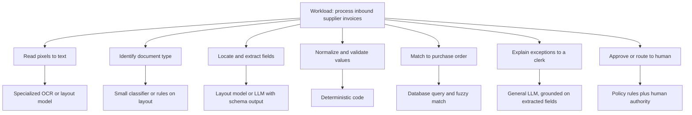

The diagram assigns each task to the least capable component that meets its acceptance test. Only one of the seven tasks, explanation, clearly needs a general language model, and a second, field extraction, may. Reading pixels is a specialized perception task. Normalization and matching are deterministic. Approval is policy, with a person holding authority for exceptions. If the team had selected one hosted multimodal LLM to do everything, it would pay a premium for tasks code does exactly, accept nondeterminism where determinism is available, and send every page image to an external boundary when only the explanation step needs language ability.

The decomposition also exposes where errors compound. If OCR reads a digit wrong, every later stage is wrong with high confidence. If the extraction stage is 97 percent accurate and the matching stage is 99 percent, the pipeline is roughly 96 percent accurate when the errors are independent, because $0.97 \times 0.99 \approx 0.960$. A single "document automation accuracy" number from a vendor says nothing about which stage limits it.

### 2.3 Classifying the computation each task needs

For each task, name the kind of computation. A short vocabulary helps reviewers.

| Computation | Typical sign | Candidate components |
| --- | --- | --- |
| Exact lookup, arithmetic, validation, authorization | A correct answer exists and can be checked by code | Database, rules, functions, policy engine |
| Ranking and retrieval over a known corpus | Query to relevant items, no free-text generation required | Full-text search, vector search, rerankers (see [Part 16 CH16](../16_AI_and_GenAI/CH16_Embeddings_and_Semantic_Representations.md)) |
| Prediction from structured features | Tabular inputs, numeric or categorical target, labeled history | Classical ML such as gradient-boosted trees (see [Part 16 CH04](../16_AI_and_GenAI/CH04_Decision_Trees_and_Ensemble_Learning.md)) |
| Perception | Pixels or audio in, text or labels out | Specialized OCR, speech, or vision models |
| Classification of text with fixed labels | Closed label set, labeled examples available | Fine-tuned small encoder, embedding plus linear classifier, or an LLM with a constrained output |
| Extraction into a schema | Open text in, structured fields out | Layout-aware models, LLM with structured output (see [Part 16 CH17](../16_AI_and_GenAI/CH17_Prompt_Engineering_and_Structured_Outputs.md)) |
| Transformation and generation | Rewrite, summarize, translate, draft | LLM or SLM |
| Open-ended reasoning, planning, multi-step tool use | Steps are not known in advance | Strong LLM inside a bounded agent loop ([Part 17 CH06](CH06_Agentic_System_Architecture_and_Tool_Boundaries.md)) |
| Judgment with legal or ethical authority | A person must own the decision | Human, with model assistance |

The test for choosing a learned component is the one from [CH01](CH01_AI_Workload_Qualification_and_Architecture_Foundations.md): learned behavior must beat the simpler baseline on the acceptance test by enough to justify its cost and risk. The table above is a prompt for the question "what is the simplest thing that passes?". The simplest thing might be a regular expression, a lookup table, or a person working from a checklist.

### 2.4 The deterministic-versus-learned boundary

A useful rule: use deterministic code wherever the correct answer is defined by a specification and can be computed. Use a learned component where the specification is incomplete, where the input is perceptual or linguistic and varies too widely for rules, or where the value lies in graceful handling of unforeseen inputs. A learned component placed in front of a deterministic check (for example, a model proposes an account code and a validator confirms it exists and the user may post to it) often yields the best combination. The model supplies flexibility and the check supplies guarantees. [Part 17 CH09](CH09_Human_Oversight_and_AI_Assisted_Workflow_Integration.md) covers how people fit in.

Two anti-patterns recur. The first is using an LLM for work that code performs exactly, such as sorting, date arithmetic, currency conversion, or checking membership. This produces occasional silent errors and charges per token for something free. The second is writing a thousand brittle rules to approximate a perception task. This produces a rule base nobody can maintain and no clear measure of coverage. Both come from skipping the decomposition.

### 2.5 From capability to requirements

Once tasks are named, attach requirements to each, because different tasks in one workload can have different constraints. In the invoice example, OCR can run in a private network while the explanation step uses only extracted fields and no page images. A single global "privacy requirement" would have forced the stricter handling on everything or let the looser handling apply to everything. Record, per task: data classification of inputs, latency budget, volume, error cost by type, whether an explanation is required, and whether the task must work offline or at the edge. These per-task requirements feed the filters in Section 4.

## 3. The Model Landscape by Category

The categories below are stable even as products change. For each, the entries describe typical strengths, typical weaknesses, and the conditions under which the category is the right first candidate. They avoid version claims on purpose. When you evaluate, look up current documentation for the specific candidates and record the date you checked.

### 3.1 Frontier hosted models

These are the largest general models offered through a provider's API or through a cloud platform. Typical strengths: broad knowledge, strong instruction following, long and mixed-modality inputs, good tool calling, and good handling of ambiguous or novel requests. Typical weaknesses: highest cost per token and highest latency among general models, change on the provider's schedule, and data leaves your boundary unless a private deployment option exists.

They are the right first candidate when the task is open-ended or high stakes, when you lack labeled data for adaptation, or when you need a quality ceiling to measure other candidates against. A frequent and sound use is as a **reference model**: run it once over the evaluation set to establish how well the task can be done, then look for cheaper candidates that approach that level. They are the wrong default for high-volume, narrow, latency-sensitive tasks, where their cost and speed hurt and their breadth goes unused.

### 3.2 Mid-tier hosted models

Providers usually offer smaller, faster, cheaper siblings of their frontier models. They tend to handle common tasks (summarization, extraction, classification, routine question answering, code completion of ordinary difficulty) at a fraction of the cost and latency. They tend to fall behind on hard reasoning, long multi-step plans, and subtle instruction conflicts. For many production workloads a mid-tier model meets the acceptance test, which is why a cascade (Section 6) uses one as its first stage. Because they come from the same provider and API family as frontier models, they are also the easiest to swap in during an experiment.

### 3.3 Open-weight general models

Open-weight models publish their trained parameters, so you can run them yourself or on a third-party host. "Open-weight" is not the same as "open source": the weights may come with a license that limits commercial use, restricts certain applications, or requires attribution, and the training data and code may not be published. Section 7.5 treats licensing in detail.

Typical strengths: control over placement, version, and data path; no per-token provider charge when self-hosted; the ability to fine-tune; stable behavior because the weights do not change under you. Typical weaknesses: you operate the serving stack ([Part 17 CH07](CH07_Inference_Serving_and_Model_Placement.md)), the largest open models need multi-accelerator servers, and the best open models have at times trailed the best hosted models on hard tasks, though the gap varies by task and moves over time. Check the current gap on your own data rather than from leaderboards.

Open-weight models fit when data cannot leave your boundary, when volume is high and steady enough to amortize hardware, when you need to adapt weights, or when you need version immutability for audit.

### 3.4 Small language models

Small language models are models with far fewer parameters than general LLMs, small enough to run on a single modest accelerator, a CPU, or a device. There is no agreed size threshold. Treat "small" as "fits the deployment target you have". They can be general-purpose or trained or tuned for a narrow domain.

Typical strengths: low latency, low cost, easy placement near data or on a device, and strong results after fine-tuning on a narrow task. Typical weaknesses: weaker world knowledge, less reliable multi-step reasoning, weaker following of long or conflicting instructions, and narrower language coverage. The architectural pattern is to use an SLM where the task is narrow and well-specified, such as routing, classification, extraction with a fixed schema, entity tagging, or rewriting in a fixed style, and to escalate to a bigger model when a confidence signal says the SLM is unsure. [Part 16 CH20](../16_AI_and_GenAI/CH20_Fine_Tuning_PEFT_and_LoRA.md) covers adaptation.

### 3.5 Specialized models

Not every AI component is a language model. Specialized models are trained for one modality or one function and are usually smaller, cheaper, more predictable, and easier to evaluate than a general model doing the same job.

| Specialized category | Task | Why prefer it to a general LLM | Watch for |
| --- | --- | --- | --- |
| Optical character recognition (OCR) and layout | Pixels to text and structure | Cheaper, faster, gives coordinates and per-character confidence | Handwriting, low-quality scans, unusual scripts, tables |
| Speech recognition | Audio to text | Streaming, diarization, timestamps, domain vocabulary | Accents, noise, code-switching, telephony audio |
| Speech synthesis | Text to audio | Voice control, latency, licensing of voices | Consent and likeness rules for voices |
| Vision | Detection, segmentation, classification | Real-time throughput, edge deployment | Domain shift, lighting, camera differences |
| Embedding models | Text or image to vectors | Cheap, deterministic, batchable | Language and domain coverage, dimension and index cost, re-embedding on change |
| Rerankers | Re-score candidate passages for a query | Large relevance gain for small cost | Added latency per candidate, context truncation |
| Classification encoders | Fixed-label text classification | Millisecond latency, calibrated scores, tiny footprint | Needs labeled data, brittle to label drift |
| Safety classifiers | Detect policy-violating content | Fast, auditable, separate from the generator | False positive and negative rates by category |

Two points. First, specialized models are often the better answer to "which model?" because the task is narrower than the demonstration suggested. Second, they add contracts and lifecycles, one per component. Each needs evaluation, versioning, and an owner. A pipeline of six specialized models is cheap per request and expensive in governance, so count the lifecycle cost.

### 3.6 Classical machine learning

Gradient-boosted trees, linear and logistic models, and similar methods remain the right tool for prediction from tabular features such as churn, demand, fraud scores, credit risk, and sensor anomalies. They train in minutes, run in microseconds on a CPU, give feature importance and often stable explanations, and are easy to monitor for drift. A language model asked to predict from a table of numbers is almost always slower, costlier, and less accurate than a tree ensemble trained on your history. See [Part 16 CH04](../16_AI_and_GenAI/CH04_Decision_Trees_and_Ensemble_Learning.md) and [Part 16 CH03](../16_AI_and_GenAI/CH03_Regression_and_Classification.md). Where explainability is a hard requirement (credit decisions, clinical triage support), classical models with documented features are often the only option that passes review.

A hybrid is common: an LLM or encoder turns unstructured text into features, and a classical model makes the final call. This keeps the decision inspectable while using language understanding where it helps.

### 3.7 Non-AI components

The landscape includes components that are not models: relational queries, full-text search engines, rules engines, workflow engines, regular expressions, templates, state machines, and human review queues. Treat them as candidates in every selection. A selection that never considers one has not done the baseline step from CH01. A keyword search over a well-tagged corpus can beat vector search on exact-term queries, and a rules engine can implement a policy exactly with an audit trail. They are also the usual fallback when a model path fails (Section 11).

### 3.8 Summary of categories

| Category | Typical cost per task | Typical latency | Control over data path | Operating burden | Best fit |
| --- | --- | --- | --- | --- | --- |
| Frontier hosted | Highest | Highest among LLMs | Lowest unless private option | Lowest | Open-ended, high stakes, reference model |
| Mid-tier hosted | Medium | Medium | Low | Low | Common language tasks, first cascade stage |
| Open-weight general | Hardware or host dependent | Depends on hardware | High | High | Data-bound, high steady volume, adaptation |
| Small language model | Low | Low | High | Medium | Narrow, well-specified, edge |
| Specialized model | Low | Low | Varies | Medium per component | Perception, retrieval, classification |
| Classical ML | Very low | Very low | High | Low to medium | Tabular prediction, explainability |
| Non-AI component | Lowest | Lowest | High | Low | Exact, rule-defined behavior |

The cost and latency columns are ordinal, not measured. They are a starting point for building the long list in Section 13, not a substitute for measurement.

## 4. Selection Criteria and Weighting

### 4.1 Hard gates and weighted preferences

Selection criteria fall into two kinds, and mixing them is the most common error in model comparison tables. A **hard gate** is a pass-or-fail requirement. A candidate that fails it is removed, and no score elsewhere can compensate. A **weighted preference** is a dimension on which candidates can be better or worse, where trade-offs are acceptable. Residency rules, contractual no-training terms, a maximum p95 latency the user experience cannot exceed, and a regulatory need for explanation are usually gates. Cost per task, operating effort, and breadth of ecosystem are usually preferences, until a budget turns cost into a gate.

Apply gates first, because they are cheap to check and they reduce the number of candidates you must evaluate on quality. Then weigh the remaining candidates. A weighted score that includes a failed gate lets a very good quality score hide a disqualifying fault, which is how a team ends up with a high-scoring model that legal later blocks.

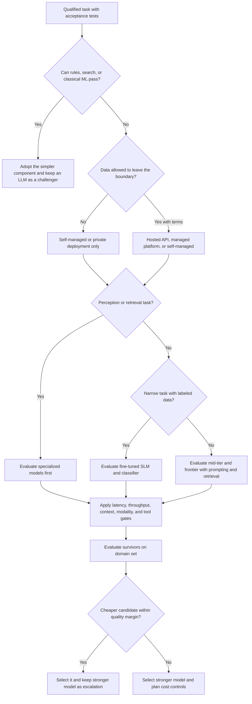

The tree orders the questions by how cheaply they eliminate options. Boundary and baseline questions come first because they remove entire categories. Modality and label availability come next because they steer toward specialized or adapted models. Only then does the tree reach the expensive step, quality evaluation. The final branch deliberately favors the cheaper candidate when it is within an agreed quality margin, because the margin is a business decision (for example "within 2 points of the reference on the primary metric and no worse on the critical error class") that the team should write down before seeing results.

### 4.2 Task quality on your data

This is the dominant criterion and the hardest to measure. Quality has to be defined per error class. For an extraction task you may track exact-match accuracy per field, the rate of confident wrong values, and the rate of correct abstentions. For a support assistant you may track resolution correctness, groundedness against sources, and unsafe or policy-violating replies. A single average hides the trade-offs that matter, so state the primary metric, the critical error class with its own ceiling, and the subgroups (language, document type, customer tier) that must not regress. Section 5 builds the evaluation set that measures this.

### 4.3 Explainability and auditability

Ask what explanation the workload requires and from whom. Three levels cover most cases:

1. **No explanation required.** The output is a draft or a convenience, and a person judges it.
2. **Evidence required.** The output must point to the sources or fields it used so a reviewer can check it. Retrieval with citations or extraction with source spans satisfies this. It does not explain why the model chose the words, but it makes the claim checkable.
3. **Decision rationale required.** A regulator, court, or affected person may require the factors that drove a decision. Models whose features are documented and whose contribution can be computed (linear models, trees with feature attribution) satisfy this far more directly than a generative model. Text a model writes to "explain" itself is a generated narrative and is not evidence of its computation.

State the level as a hard gate when it applies. If level 3 applies, a generative model can still sit beside the decision, for example to draft the notice, but it should not be the decision-maker of record. See [Part 17 CH12](CH12_AI_Safety_Security_Privacy_and_Governance_Architecture.md) for governance consequences.

### 4.4 Latency: time to first token and total time

Two latencies matter for generative models. **Time to first token (TTFT)** is the delay until the first output token arrives and determines how responsive a streaming interface feels. **Total latency** is the time until the full output arrives, which determines when a non-streaming caller or a downstream step can proceed. To a first approximation:

$$T_{\text{total}} \approx T_{\text{queue}} + T_{\text{prefill}} + (N_{\text{out}} - 1)\,\tau$$

where $T_{\text{queue}}$ is time waiting for capacity, $T_{\text{prefill}}$ is time to process the input and emit the first token (so TTFT is $T_{\text{queue}} + T_{\text{prefill}}$), $N_{\text{out}}$ is the number of output tokens, and $\tau$ is the time per generated token after the first. Prefill grows with input length. Decode time grows with output length. [Part 16 CH15](../16_AI_and_GenAI/CH15_Large_Language_Model_Fundamentals_and_Inference.md) explains why.

Worked example with illustrative numbers. A task produces 300 output tokens. Candidate L (a large model) has a TTFT of 0.8 s and generates 40 tokens per second, so $\tau = 0.025$ s. Candidate S (a small model) has a TTFT of 0.2 s and generates 120 tokens per second, so $\tau \approx 0.00833$ s.

- Candidate L: $0.8 + 299 \times 0.025 = 0.8 + 7.475 = 8.275$ s, about 8.3 s.
- Candidate S: $0.2 + 299 \times 0.00833 = 0.2 + 2.49 = 2.69$ s, about 2.7 s.

If the interface streams and the user starts reading at the first token, both feel acceptable and TTFT is the driver. If a downstream rule engine waits for the complete JSON, total latency is the driver and candidate L takes three times as long. Always specify which latency the requirement constrains, and state it as a percentile (p50, p95, p99) under a stated load, not as an average. Tail latency matters more than the median because the slowest requests are the ones users notice and the ones that breach timeouts. A multi-step workflow adds the latencies of each step plus retrieval, validation, and network, so allocate a per-step budget from the end-to-end target. [Part 17 CH07](CH07_Inference_Serving_and_Model_Placement.md) covers request paths in depth.

### 4.5 Throughput and capacity

Throughput is requests or tokens per second the deployment can sustain. Little's law gives the concurrency needed: the average number of requests in flight equals the arrival rate times the average time in system, $L = \lambda W$. At 20 requests per second and 8.3 s per request, about $20 \times 8.3 = 166$ requests are in flight at once. A hosted provider enforces rate limits, typically on requests per minute and tokens per minute, per account or per deployment. Check that the limit at your volume, with a margin for bursts, is available and what the process is for raising it, since a limit increase can take days. For a self-managed deployment, concurrency maps to accelerator memory (the key-value cache grows with concurrent sequences and their length) and to the batching strategy of the serving engine. A candidate that meets latency at one request per second can miss it badly at the real load, so test at the expected peak.

### 4.6 Context length and effective context

Advertised context length is a maximum, not a promise of quality. Models can attend poorly to information in the middle of long inputs, or lose precision as the context fills, and the effect varies by model and task. Test with your actual document lengths. Context also costs money and time: cost scales with input tokens, and prefill latency grows with input length. Different models use different tokenizers, so the same text is a different number of tokens in each, and a price per token is not comparable across models until you count tokens on your own data. For many knowledge tasks, retrieval of a few relevant passages beats pushing a whole corpus into the context, in both cost and accuracy ([Part 17 CH05](CH05_Retrieval_Augmented_Generation_System_Architecture.md)). Treat a very long context as a capability to use when the task needs whole-document reasoning, not as a way to avoid designing retrieval.

### 4.7 Modality

List the input and output modalities required: text, images, documents with layout, audio, video, structured data. A model that accepts images may handle photographs well and dense tables poorly. A document pipeline may do better with a layout model feeding text to a language model than with a multimodal model reading page images. Check support for each modality in the API you will actually call, not only in the model's description, because features sometimes differ between a vendor's own API and a cloud platform that hosts the same model. [Part 16 CH23](../16_AI_and_GenAI/CH23_Multimodal_Generative_AI.md) covers the models.

### 4.8 Tool use and structured output

If the system calls tools or needs machine-readable output, test the feature you will use. Relevant questions: does the API enforce a JSON schema during generation (constrained decoding) or only request it in the prompt? How does the model behave when a tool returns an error? Can it call several tools in one turn? How are tool schemas versioned? Constrained decoding can guarantee syntactic validity but not semantic correctness. A field can be a valid string and still be wrong. Features also differ across providers in naming and semantics, which is a portability cost handled in Section 8.4. See [Part 16 CH17](../16_AI_and_GenAI/CH17_Prompt_Engineering_and_Structured_Outputs.md) and [Part 16 CH21](../16_AI_and_GenAI/CH21_Agents_Tool_Calling_Memory_Planning.md).

### 4.9 Privacy and data residency

Treat these as gates derived from data classification. Questions to answer per candidate and per deployment shape: what data classes can this path carry; where is data processed and stored at rest, including logs and abuse-monitoring copies; who can access it, including provider staff; is it used to train or improve models; how long is it retained; can retention be set to zero; and how does deletion work? Section 7 covers these in detail. The gate is that the combination of data class and path is permitted by policy and contract, not merely that the vendor says it is secure.

### 4.10 Security posture

Beyond privacy, evaluate how the candidate behaves under attack and how its operator is secured. Model-level: resistance to prompt injection when it reads untrusted content, tendency to follow instructions embedded in documents, and behavior of tool-calling under adversarial input. Operator-level: security attestations, penetration-test practice, vulnerability disclosure, and incident history (Section 12). For self-managed models, add supply-chain checks on weights and serving software, because a downloaded model file is executable-adjacent content: prefer formats that do not run arbitrary code on load, verify hashes, and pull from controlled registries. [Part 17 CH12](CH12_AI_Safety_Security_Privacy_and_Governance_Architecture.md) owns the threat model.

### 4.11 Cost

Compare cost per **completed task**, not per token. Per-token price tells you little because tasks differ in input and output length, tokenizers differ, and some tasks need retries or human correction. A usable formula for a hosted model is:

$$C_{\text{task}} = \frac{(N_{\text{in}} p_{\text{in}} + N_{\text{out}} p_{\text{out}})(1 + r) + C_{\text{other}}}{s}$$

where $N_{\text{in}}, N_{\text{out}}$ are input and output tokens per attempt, $p_{\text{in}}, p_{\text{out}}$ are prices per token, $r$ is the retry or repair rate (extra attempts per task), $C_{\text{other}}$ covers retrieval, embedding, validation, and human correction expected per task, and $s$ is the success rate that yields a usable result.

Worked example with illustrative prices of 1.00 per million input tokens and 4.00 per million output tokens: $N_{\text{in}} = 3000$ and $N_{\text{out}} = 300$.

- Raw model cost per attempt: $3000 \times 1.00 \times 10^{-6} + 300 \times 4.00 \times 10^{-6} = 0.0030 + 0.0012 = 0.0042$.
- With a 5 percent repair rate: $0.0042 \times 1.05 = 0.00441$.
- Taking $C_{\text{other}} = 0$ and a success rate of 0.90: $0.00441 / 0.90 = 0.0049$.

So the effective cost is 0.0049 per successful task, 17 percent above the nominal 0.0042, before counting human correction of the 10 percent failures. If a person needs two minutes at a loaded cost of 30 per hour to fix a failure, that is 1.00 per failure, or 0.10 per task averaged across tasks (0.10 failures per task times 1.00). That is more than twenty times the model cost. Human correction dominates once models are cheap, which is why quality improvements can pay for a pricier model. Section 10.3 and the script [04_pareto_and_switching_cost.py](../code/python/ai-model-selection-chapter/04_pareto_and_switching_cost.py) show the effect. For self-managed models, replace the token terms with accelerator-hours per task: hourly cost divided by sustained tasks per hour at the target latency, plus the fixed cost of idle capacity, staff, and on-call.

### 4.12 Deployment constraints

Some constraints are physical. An on-premises plant with no internet cannot call a hosted API. A mobile app must work in airplane mode. A hospital integration engine may only reach approved internal endpoints. A regional government workload may only run in-country. State these as gates, and note that they also constrain the evaluation: you need to test candidates in the environment they will run in, or at least with comparable hardware.

### 4.13 Ecosystem and operability

Ecosystem covers the things around the model that make a team productive and a system maintainable: client libraries and their stability, observability integrations, evaluation tooling, fine-tuning support, availability on the cloud platforms you already use, community knowledge, and the availability of staff who know it. Ecosystem rarely wins a selection alone, but a model with excellent quality and no tooling can cost more in engineering time than a slightly weaker model with good tooling. Include operability: how does the candidate report errors, what request identifiers does it return for support, how fast does the vendor answer incidents?

### 4.14 Turning criteria into weights

After gates, assign weights to the preferences. A defensible procedure:

1. List the preference criteria for this workload, typically five to eight.
2. Have stakeholders rank them, then assign weights that sum to 1. Pairwise comparison helps: for each pair, ask which matters more and by roughly how much.
3. Rate each surviving candidate 1 to 5 on each criterion using measured data where it exists (quality from the evaluation, latency from load tests, cost from the formula above) and documented judgment otherwise. Record the source of each rating.
4. Compute the weighted sum $S_j = \sum_i w_i r_{ij}$ for candidate $j$.
5. Run a sensitivity analysis: perturb each weight by a reasonable range (for example plus or minus 40 percent) and see how often the ranking changes.

Step 5 is what turns a decision matrix from decoration into evidence. If the winner changes with small weight changes, the data does not separate the candidates, and the decision should rest on a tiebreaker such as exit cost or operating burden, which you state openly. [Section 13.3](#133-decision-matrix) shows a worked matrix and the script [03_decision_matrix.py](../code/python/ai-model-selection-chapter/03_decision_matrix.py) runs the sensitivity test.

Two cautions about weights. Weights set after seeing the scores tend to justify a preferred answer, so fix them before evaluation. And a weight of 0.35 on quality does not mean quality can be traded freely: if there is a minimum quality needed, make it a gate and let the weighted score decide among candidates that clear it.

## 5. Evidence: Why Public Benchmarks Are Weak and How to Build Your Own

### 5.1 What public benchmarks do and do not tell you

Public benchmarks and leaderboards are useful for a first-pass long list. They show broad capability trends and can reveal that a category of model is not competitive at all. They are weak evidence for a specific selection for several reasons:

- **Task mismatch.** A benchmark measures its own task: multiple-choice knowledge, short coding problems, math word problems. Your task is a specific document type, a specific policy corpus, a specific tone, in your languages. Correlation between benchmark rank and your task rank exists but is imperfect, and it can be weakest for the narrow tasks where you are choosing between near neighbors.
- **Contamination.** Benchmark questions and answers circulate on the web and can end up in training data. A model that has seen the test items scores higher without being more capable. Providers differ in how they check for this, and you often cannot verify it.
- **Saturation.** Once top models score near the ceiling, differences are within noise and no longer discriminate.
- **Prompt and harness sensitivity.** Scores depend on the prompt format, the number of examples, the decoding settings, and the answer extraction method. Two published numbers for the same model on the same benchmark can differ for these reasons alone.
- **Self-reported results.** Vendor-reported scores use the vendor's chosen setup. Independent reproductions help, but they use their own setup.
- **Aggregation.** A single average hides per-category weakness. A model strong at math and weak at your language can top a leaderboard.
- **Missing operational axes.** Leaderboards rarely report latency under load, cost per task, rate limits, structured-output reliability, or behavior after a silent update.
- **Preference leaderboards.** Rankings built from human votes on open-ended chat reward style and length. They measure what voters prefer in short exchanges, not whether outputs are correct for a domain.

Use public results to narrow the long list, then treat the domain evaluation as the deciding evidence. A rule of thumb: if two candidates are within a few points on a public benchmark, ignore the difference. If one is far behind in a category you need, believe it.

### 5.2 Building a domain evaluation set for selection

A selection evaluation set is a collection of representative inputs with reference outputs or grading criteria, assembled for the purpose of comparing candidates. [Part 17 CH11](CH11_Evaluation_and_Observability_Architecture_for_AI_Systems.md) later runs a descendant of it continuously, so build it as a durable asset.

**Sources.** Use real inputs from the production process or its closest equivalent: historical tickets, scanned documents, call transcripts, code changes. Sanitize or obtain permission as data policy requires, and keep the set in a controlled location, because it can contain personal or confidential data. If no history exists, have domain experts write cases, and label them as synthetic so nobody mistakes them for production traffic.

**Sampling.** Random sampling from production gives an unbiased estimate of average performance but may contain too few of the rare, high-consequence cases. Use stratified sampling: define strata that matter (document type, language, length, customer tier, intent category, difficulty) and draw from each. Then add deliberate hard cases: ambiguous inputs, adversarial inputs, edge formats, and the failures from your last incident. Keep the strata proportions documented so you can reweight to estimate production-level performance. Keep a separate small **challenge set** of hard and adversarial cases that you report apart from the main set.

**Size.** The size follows from the precision you need. To estimate a pass rate $p$ within a margin $e$ at 95 percent confidence, the number of independent items is about

$$n \approx \frac{z^2\,p(1-p)}{e^2}$$

with $z = 1.96$. For $p = 0.90$ and $e = 0.03$, $n \approx 3.8416 \times 0.09 / 0.0009 \approx 384$. For comparing two candidates on the same items, what limits you is how often they disagree, not the overall error rate. If they disagree on a fraction $\pi_d$ of items and you want to detect a true difference $\delta$ in pass rate with 95 percent confidence and 80 percent power, the paired sample size is roughly

$$n \approx \frac{(z_{\alpha/2} + z_{\beta})^2\,\pi_d}{\delta^2}$$

with $z_{\alpha/2} = 1.96$ and $z_{\beta} = 0.84$. For $\pi_d = 0.10$ and $\delta = 0.04$, $n \approx 7.84 \times 0.10 / 0.0016 = 490$. So a set of 300 cannot reliably separate candidates that differ by 4 points, but can separate 8 points, as the worked run below shows. If you need to detect smaller differences, you need more items or a lower-variance grading method. This is an approximation that assumes independent items. Items drawn from the same document or customer are correlated, so count the number of independent clusters, not rows.

**Reference answers and rubric.** For closed tasks (classification, extraction) define the reference as the correct label or field value and grade by exact or normalized match. For open tasks (summaries, answers) write a rubric of criteria, each gradable as pass or fail or on a short scale: factual accuracy against sources, completeness of required points, absence of unsupported claims, tone and format compliance, and refusal behavior where required. Fewer, sharper criteria are better than many vague ones. Pilot the rubric on a handful of cases with two graders and fix ambiguities before the real run.

**Grader agreement.** Measure how often independent graders agree. Cohen's kappa corrects raw agreement for chance: $\kappa = (p_o - p_e)/(1 - p_e)$, where $p_o$ is observed agreement and $p_e$ is the agreement expected by chance. If two graders pass and fail items 90 percent of the time alike, and chance agreement given their pass rates is 0.68, then $\kappa = (0.90 - 0.68)/(1 - 0.68) = 0.22/0.32 \approx 0.69$. Values below about 0.6 mean the rubric is ambiguous, and any difference between candidates smaller than the grading noise should not be trusted.

**Blind comparison.** Remove model names and provider formatting cues before graders see outputs, and randomize the order in which candidates' outputs are shown. Graders favor longer, more confident, and more formatted answers, and they favor the vendor they expect to be better. Blinding removes expectation bias and order bias. For extraction and classification with automatic grading, blinding is automatic. For open tasks, human grading of a blinded sample is the reference. Using an LLM as a grader scales better but has its own biases (preference for its own family's style, for length, for position), and must be calibrated against human labels on a subset: report the agreement between the LLM grader and humans, and re-check it when you change the grader. [Part 16 CH24](../16_AI_and_GenAI/CH24_Generative_AI_Evaluation_Guardrails_and_Hallucinations.md) covers judge-based evaluation.

**Fair treatment of candidates.** Give each candidate a prompt tuned for it with the same effort budget. A prompt written for one model and pasted to others measures prompt fit, not capability. Fix decoding settings, record versions and dates, run each candidate through the same preprocessing, and run enough repeats on nondeterministic models to estimate run-to-run variance. Hold out part of the set that nobody uses while tuning prompts, so tuning does not overfit to the test items. Never place evaluation items in few-shot examples or fine-tuning data, and tag every item with an identifier so leakage can be audited.

**Operational measurements in the same run.** While the candidates run, record latency percentiles, token counts, error and timeout rates, refusals, structured-output validity, and cost, under a load that resembles production. These populate the latency and cost criteria with data.

### 5.3 Paired comparison with a bootstrap confidence interval

Because both candidates answer the same items, compare them on the paired differences. Items that both pass or both fail carry no information about which is better, and pairing removes the item-difficulty variance from the comparison. This usually gives a tighter interval than treating the two score sets as independent.

The paired bootstrap works like this. Let $a_i$ and $b_i$ be the scores of candidates A and B on item $i$ (1 for pass, 0 for fail, or a rubric score). Repeat many times: draw $n$ item indices with replacement, compute the mean of $b - a$ on that resample, and store it. The spread of the stored means estimates the sampling uncertainty of the observed difference. The 2.5th and 97.5th percentiles give a 95 percent interval. If the interval excludes zero, the data supports a difference. If it contains zero, the data does not separate the candidates at this sample size, and the decision should rest on other criteria. The fraction of resamples with difference at or below zero estimates how often B fails to beat A under resampling and works as a rough one-sided probability, but it is not a formal p-value.

The core of the script is short:

```python
def paired_bootstrap(a, b, resamples=10000, seed=11):
    rng = random.Random(seed)
    n = len(a)
    diffs = []
    for _ in range(resamples):
        idx = [rng.randrange(n) for _ in range(n)]
        diffs.append(mean([b[i] for i in idx]) - mean([a[i] for i in idx]))
    diffs.sort()
    lo = diffs[int(0.025 * resamples)]
    hi = diffs[int(0.975 * resamples) - 1]
    return lo, hi, sum(1 for d in diffs if d <= 0) / resamples
```

Running [01_paired_bootstrap_compare.py](../code/python/ai-model-selection-chapter/01_paired_bootstrap_compare.py) on 300 synthetic items printed:

```text
items                : 300
candidate A accuracy : 0.717
candidate B accuracy : 0.797
discordant items     : A-only 3, B-only 27
paired diff (B - A)  : +0.080
paired 95% interval  : [+0.047, +0.117]
P(B not better than A): 0.0000
unpaired 95% interval: [+0.010, +0.147]
verdict              : B better
```

Read it as follows. B passes 8 points more items. Of the 30 items on which the candidates disagree, B alone was right on 27 and A alone on 3. The paired interval is [+0.047, +0.117], about 7 points wide. Treating the scores as independent gives [+0.010, +0.147], about 14 points wide, which nearly includes zero. The pairing halves the width because most items are easy for both. The data here are synthetic (generated from a shared difficulty variable), so the numbers show the method rather than any real model.

Three cautions apply when you use this on real results. First, the bootstrap resamples items, so it captures sampling uncertainty over the items, not run-to-run randomness of the model, graders, or prompts. Add repeated runs to measure that. Second, comparing many candidates and many metrics produces false positives by chance. Pre-register the primary metric and the comparison that decides, and treat the others as exploratory. Third, statistical significance is not practical significance. A real but small difference may be smaller than the margin the business cares about. Compare the interval to your pre-agreed margin, not only to zero.

### 5.4 Interpreting an inconclusive result

An inconclusive result is a legitimate finding. It says the evaluation cannot separate the candidates at this size, and it tells you where to go. Options: collect more items in the strata where they disagree, improve grader agreement, tighten the rubric, or accept the equivalence and choose by cost, latency, and exit risk. In many selections the right outcome is "candidates are equivalent on quality within our margin, so choose the cheaper, faster, or more portable one." Because that is a cost and risk decision, state it as such in the ADR.

### 5.5 Evidence hygiene

Keep the evaluation reproducible. Record candidate identifiers with exact version strings or snapshot dates, prompts, decoding parameters, the evaluation set version, and the code that scored it. Store raw outputs so the grading can be repeated. Keep the evaluation set separate from training and tuning data, and review who has access, since it may contain sensitive data. When the set is reused across releases it can slowly leak into prompts, so rotate in fresh items on a schedule and keep a sealed holdout.

## 6. Model Cascades and Routing by Difficulty

### 6.1 The idea

Task difficulty is uneven. In most workloads a large share of requests is easy: a clear question, a clean document, a routine intent. A small share is hard. Paying a frontier-model price for the easy majority wastes money, and paying a small-model quality for the hard minority loses accuracy exactly where it matters. A **cascade** tries a cheap model first and escalates to a stronger model only when a signal says the cheap result is unreliable. A **router** decides up front which model should handle a request, based on features of the request. Both aim to move along the cost/quality frontier (Section 10) by spending only where the extra capability pays.

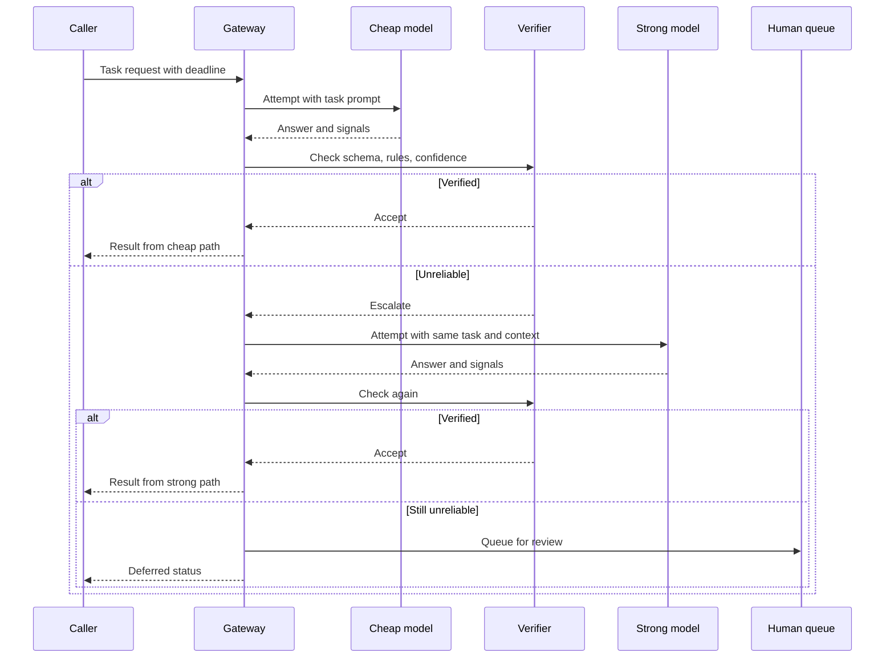

The sequence shows three properties worth designing deliberately. The verifier is a distinct step with a defined acceptance test, not the cheap model grading itself. The escalation preserves the original task, context, and deadline, so the strong model starts from the same inputs. The last resort is a human queue with an explicit deferred status, not a silent third retry. The runtime mechanics (timeouts, circuit breakers, credentials) belong to [Part 17 CH08](CH08_Model_Gateway_Routing_and_Fallback_Architecture.md). This chapter decides whether the cascade is worth building and where to set its threshold.

### 6.2 Escalation signals

A cascade is only as good as its signal. Candidates, from most to least trustworthy:

| Signal | How it works | Strength | Weakness |
| --- | --- | --- | --- |
| Deterministic validation | Output must parse, match the schema, pass business rules, and reference only IDs that exist | Cheap, exact for what it checks | Catches format and consistency errors, not wrong-but-valid answers |
| Retrieval evidence score | Top retrieval similarity, or whether any source supports the answer | Cheap, available with RAG | Weak correlation for subtle errors |
| Token probability | Mean or minimum log-probability of the output or of key tokens | Available with some APIs | Not available everywhere, calibration varies by model and task |
| Self-consistency | Sample several answers and measure agreement | Often well correlated with correctness on closed tasks | Multiplies cheap-model cost by the number of samples |
| Trained verifier | A small classifier trained on labeled correct and incorrect outputs | Can be well calibrated on your data | Needs labeled data and retraining as inputs drift |
| Model self-rating | Ask the model how confident it is | Always available | Often poorly calibrated, overconfident on wrong answers |
| Request features | Length, language, document type, presence of numbers or tables | Known before any call, so it enables routing | Only a proxy for difficulty |

Prefer deterministic checks and a verifier trained on your own labeled outputs. Use self-rating as a weak feature, not as the gate. Whichever signal you use, measure it: the useful property is how well the signal separates correct from incorrect cheap-model outputs on your evaluation set. A signal with no separation produces a cascade that escalates at random, which costs money without raising quality.

### 6.3 Worked arithmetic

Let $c$ be the cost per attempt of the cheap model, $s$ the cost of the strong model, and $e$ the fraction of requests that escalate. With a negligible verifier cost, the expected cost per task of the cascade is

$$E[C] = c + e\,s$$

because every request pays the cheap attempt and the escalated fraction also pays the strong attempt. Quality is the mixture: requests accepted at the cheap stage have the cheap model's accuracy on those items (which is higher than its overall accuracy, since the signal filters out the doubtful ones), and escalated requests get the strong model's accuracy on those items (which is lower than its overall accuracy, since they are the hard ones).

The cascade is cheaper than calling the strong model for everything when $c + e\,s < s$, that is when $e < (s - c)/s$. With a router or verifier that costs $r$ per request, the break-even is $e < (s - c - r)/s$. With illustrative costs $c = 0.0004$ and $s = 0.0060$, the break-even escalation rate is $(0.0060 - 0.0004)/0.0060 = 0.933$. In other words the cascade saves money until it escalates more than 93 percent of requests. The binding constraint is quality, not cost.

The script [02_cascade_cost_quality.py](../code/python/ai-model-selection-chapter/02_cascade_cost_quality.py) simulates a cheap model that is 82 percent accurate with an informative confidence score, and a strong model that is 97 percent accurate on items the cheap model gets right and 80 percent on items it gets wrong (about 94 percent overall). All figures are illustrative. A sweep over the confidence threshold printed:

```text
threshold  quality  cost/task  escalation
     0.00    0.816    0.00040       0.000
     0.40    0.855    0.00069       0.049
     0.50    0.890    0.00107       0.112
     0.60    0.926    0.00168       0.213
     0.70    0.942    0.00262       0.369
     0.80    0.946    0.00395       0.592
     1.01    0.936    0.00640       1.000
```

The first row is the cheap model alone and the last row escalates everything (it pays for the cheap attempt first, so 0.0064 rather than 0.0060). Reading the table:

- At threshold 0.70, 36.9 percent of requests escalate and cost is $0.0004 + 0.369 \times 0.0060 = 0.00262$. That is 56 percent below the always-strong cost of 0.0060 ($1 - 0.00262/0.0060 = 0.563$), and quality is 0.942, slightly above the always-strong figure of about 0.94 in this simulation. The cascade can match or exceed the strong model on quality here because the cheap model is more accurate on the easy items it keeps than the strong model's average, in a model where the strong model is not uniformly accurate. Do not assume this on real data. Measure it.
- At threshold 0.60, cost falls to 0.00168 (72 percent below the always-strong cost) and quality is 0.926, about 1.4 points under the strong model. Whether that is acceptable is a business margin.
- Past threshold 0.80 the extra escalation buys almost nothing (quality 0.946 against 0.942) and cost rises by half. The curve flattens because the remaining errors are ones the signal cannot detect.

The choice of threshold is therefore a point on a curve, chosen with the agreed quality margin: the cheapest threshold whose quality stays within the margin of the strong model, with a reserve for drift.

### 6.4 Latency and tail effects

Cascades save money but change latency. A request that escalates pays both attempts in sequence. With illustrative p50 latencies of 1.2 s for the cheap model and 6.0 s for the strong model and an escalation rate of 0.37, mean latency is about $1.2 + 0.37 \times 6.0 = 3.42$ s, lower than always-strong (6.0 s). The slowest requests, however, are the escalated ones, which take roughly $1.2 + 6.0 = 7.2$ s, so p95 latency is worse than calling the strong model directly. If the latency gate is on p95, the cascade can fail it while improving the mean. Options: run the strong model speculatively in parallel for requests whose features predict escalation (a **hedged** call, which costs extra), use a router that predicts difficulty before the first call, or move the latency gate to the interface (stream cheap-path results immediately and refine).

### 6.5 Routers

A router predicts, from request features alone, which model should handle the request. A small classifier or rule set can use input length, language, detected intent, presence of attachments, customer tier, or the output of an embedding-based similarity to previously hard cases. Routers avoid the double-latency penalty of cascades but make errors in two directions: sending a hard request to the cheap model (quality loss) and sending an easy request to the strong model (cost loss). Treat the router as a model with its own evaluation: measure its confusion matrix against labels derived from which model succeeded on each evaluation item.

Cascades and routers combine. A common design routes by hard rules first (data classification chooses the allowed models, a deterministic intent goes to a deterministic handler), then by a learned router, then by cascade escalation on verification failure.

### 6.6 Failure modes of cascades

- **Miscalibrated signal after change.** The cheap model gets updated or the input mix shifts, and the signal's relationship to correctness changes. Monitor escalation rate and the quality of accepted cheap-path outputs, and re-calibrate on a schedule.
- **Hidden correlation.** If both models share an error mode (the same ambiguous instruction or the same missing evidence), escalating does not help. Check on the evaluation set which errors survive escalation.
- **Privacy mismatch.** Every model in the cascade must be permitted for the request's data class. A cascade that quietly escalates a restricted request to a model on a public endpoint is a data incident. Resolve eligibility before routing ([CH08](CH08_Model_Gateway_Routing_and_Fallback_Architecture.md)).
- **Cost blow-up.** A shift toward harder inputs raises the escalation rate, and cost climbs without any code change. Alert on escalation rate and set a budget guard.
- **Evaluation gap.** Evaluating each model alone does not evaluate the composite. Run the full cascade on the evaluation set and report its quality, cost, and latency distribution.
- **Complexity.** Two models mean two prompts, two upgrade schedules, and two sets of regressions. Build the cascade only if the saving is material. A rule of thumb: if the saving at expected volume does not pay for the added engineering and operating effort within a year, a single mid-tier model is simpler.

## 7. Hosted API, Managed Cloud Platform, or Self-Managed

### 7.1 Three deployment shapes

The same model, or the same family of models, can often be reached in more than one way, and the way matters as much as the model.

- **Hosted API from the model provider.** You call the provider's endpoint over the public internet or a private link. The provider runs the model and the surrounding service. This has the fastest start and the least operating work. It also puts the provider's terms, regions, and update schedule in the center of your design.
- **Managed cloud platform.** A cloud provider offers models, from its own and from third parties, inside your cloud account's identity, network, key management, and billing. You usually gain private networking, identity integration, regional control, and consolidated audit logging. The platform may have a different model catalog, release timing, and feature set from the model provider's own API, and the contractual relationship may differ. Provider services themselves are covered in Part 09 and not repeated here.
- **Self-managed.** You run open-weight (or licensed) models on infrastructure you control, in your cloud account, a colocation facility, or your own data center, or on devices. You own capacity, patching, scaling, observability, and support. [Part 17 CH07](CH07_Inference_Serving_and_Model_Placement.md) designs the serving topology.

A fourth shape, a **dedicated or provisioned deployment** of a hosted model, sits between hosted and self-managed: reserved capacity for you, with the provider operating it. It improves latency predictability and isolation and changes the cost model from per-token to per-capacity.

### 7.2 Trust boundaries

The word "private" hides the actual question, which is who can see what, where, and for how long. Draw the boundary for each shape and list every party and store the data touches.

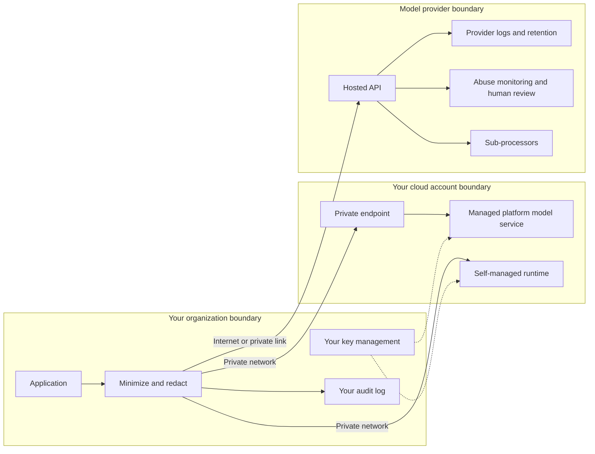

The diagram makes three points. First, the hosted API path crosses the farthest boundary and brings in the most parties: provider logs, abuse monitoring, and sub-processors. Second, the managed platform keeps traffic inside your cloud account's network and identity plane, but the model service is still operated by someone else, and some platforms route to third-party model operators, so you must read which entity processes the data. Third, the self-managed runtime keeps everything inside your boundary only if you also control its logs, backups, telemetry, and support access. A self-managed model that ships prompts to a hosted observability service has moved data across the boundary anyway.

The minimization step belongs on your side of the boundary in all three shapes. It removes or tokenizes identifiers the model does not need, trims context to the minimum, and records what was sent. This applies a principle from [Part 17 CH12](CH12_AI_Safety_Security_Privacy_and_Governance_Architecture.md) at the selection stage, because a design that sends less is eligible for more candidates.

### 7.3 Data handling terms to compare

For each candidate path, get answers in writing, from the contract or the service terms and not only from a marketing page. Items to compare:

| Term | What to ask | Why it matters |
| --- | --- | --- |
| Training on your data | Are prompts, outputs, files, or feedback used to train or improve any model, by default or by opt-in? | Drives confidentiality and intellectual property exposure |
| Retention | How long are prompts and outputs stored, where, and for what purpose? Can you set retention? | Determines breach exposure and deletion obligations |
| Zero data retention (ZDR) | Is there a mode in which prompts and outputs are not stored after the response? What features are disabled in it? | Some capabilities (stored conversations, file search, certain tools) may depend on storage |
| Abuse monitoring | Are requests retained or reviewed by humans for abuse detection? Can an eligible customer opt out? | Often the reason retention exists even when training is off |
| Regional processing | Where is inference performed, and where are logs stored? Is regional processing guaranteed or best-effort? Does a fallback route cross regions? | Residency gate |
| Sub-processors | Who else touches the data, in which countries, with what notice of change? | Needed for privacy impact assessments |
| Tenancy and isolation | Is capacity shared? How are tenants separated? Is a dedicated option available? | Side-channel and noisy-neighbor risk, latency predictability |
| Key management | Can you hold the encryption keys (customer-managed keys) for stored data? Can you revoke? | Limits provider access and supports crypto-shredding |
| Support access | Under what conditions can provider staff see your data, and is access logged and approved? | Insider-risk control |
| Audit | What logs can you obtain of calls, data access, and administrative actions? | Supports investigations and compliance evidence |
| Deletion and portability | How are data and fine-tuned artifacts deleted or exported at exit? | Exit plan |
| Indemnity | Does the provider indemnify against intellectual property claims over outputs, and under what conditions? | Legal risk for generated content |

Terms differ by provider, by plan, by endpoint, and by feature, and they change. A zero-retention commitment may apply to one endpoint and not to another, and may exclude some tools. At the time of writing, major providers publish data-usage and retention documentation and offer enterprise terms that differ from consumer terms. Treat the consumer product and the API as different services with different defaults. Verify the current text for the exact service and plan you will contract for, and file a dated copy with the ADR.

### 7.4 Tenancy, keys, and audit in practice

**Tenancy.** Multi-tenant hosted inference shares accelerators across customers. Mature providers isolate request data logically, and the residual risks are mostly operational (noisy-neighbor latency, shared rate limits) and legal rather than cryptographic. If your threat model includes a provider-side insider, or a regulator requires dedicated infrastructure, a dedicated or self-managed shape is the route. Within your own self-managed platform, tenancy is your design problem: multiple internal tenants sharing a model server need request isolation, per-tenant quotas, and prompt-cache isolation, so that one tenant's cached prefix cannot leak to another.

**Keys.** Customer-managed keys protect data at rest in services that store your data: fine-tuned model artifacts, stored files, vector stores, logs. They do not protect prompts in flight against the model operator, who must decrypt them to run inference. Some platforms offer confidential computing for inference, which uses hardware-protected memory to limit operator visibility. This is a newer area, so check what is attested and by whom. Keep secrets for provider API access in a secret manager, give each application its own credentials with minimal scope, rotate them, and never place them in prompts, client code, or logs.

**Audit.** Decide what you need to reconstruct after an incident: which model and version answered, with what prompt template version, what data was retrieved, which tools were called, and who initiated the request. Log identifiers and metadata by default, and log content only where policy allows, with access controls and retention equal to the data's own class. Provider-side logs should supplement yours but not replace them. Note that logging prompts yourself creates a new store of sensitive content, which has to be governed like any other ([Part 17 CH11](CH11_Evaluation_and_Observability_Architecture_for_AI_Systems.md)).

### 7.5 Open-weight licensing and acceptable-use terms

Open-weight does not mean unrestricted. Licenses for model weights vary widely, and they are a selection gate. Categories that appear in practice:

- **Permissive software licenses** (for example Apache 2.0 or MIT) applied to the weights, allowing commercial use, modification, and redistribution with few conditions such as attribution or notice.
- **Custom community or "open model" licenses** that allow broad use but add conditions: a cap on monthly active users above which you must ask the owner for a separate license, a prohibition on using outputs to improve competing models, attribution or naming requirements for derived models, or an acceptable-use policy that lists prohibited applications.
- **Research-only or non-commercial licenses** that forbid production use.
- **Licenses with responsible-AI use restrictions** that bind downstream users to a list of prohibited uses and may require passing those restrictions on to your own customers.

Practical steps: read the license text for the exact model version, since a family may mix licenses across sizes and releases; check clauses on redistribution of fine-tuned derivatives, use of outputs, user-count thresholds, and the acceptable-use policy; confirm that the license of any fine-tuning data and base-model combination is compatible with your intended use; and record the license and its URL in the model registry ([Part 17 CH10](CH10_AI_Platform_and_Model_Lifecycle_Architecture.md)). Have legal review any custom license. The training data's provenance and copyright status are separate questions: some models disclose training data, many do not, and a disclosure gap is a risk to record. Weights are also distributed in file formats; prefer formats that cannot execute code when loaded, and scan and hash artifacts you download.

Hosted providers impose their own usage policies. They can restrict categories of use (certain medical, legal, or political applications, or automated decisions about individuals) and change those policies. Read the policy as a requirement document: a prohibited use in your workload is a gate failure.

### 7.6 Comparison and choice

| Dimension | Hosted API | Managed cloud platform | Self-managed |
| --- | --- | --- | --- |
| Time to first working system | Hours to days | Days | Weeks |
| Model catalog | Provider's own models, newest features first | Selection of own and partner models, features may lag | Open-weight and licensed models you can run |
| Data path | Provider boundary | Your cloud account with a platform operator | Your boundary |
| Residency control | By region options, varies | Usually strong, by region | Complete, if you control logs |
| Cost model | Per token, optional reserved capacity | Per token or provisioned throughput | Hardware, hosting, and staff; per-token cost falls with utilization |
| Operating burden | Lowest | Low | Highest |
| Control of version and behavior | Low to medium (provider retires versions) | Medium | High (weights are frozen) |
| Rate limit and capacity risk | Shared quota, can throttle | Quotas per account and region | Your own capacity plan |
| Fine-tuning | Limited to what the provider offers | Provider-dependent | Any method your team can run |
| Exit effort | Prompt and eval migration | Prompt, eval, and platform migration | Mostly your own infrastructure |

Choosing among them is a gate-then-preference exercise. If data class forbids external processing, only self-managed or a platform with contractual and technical isolation passes. If time-to-value dominates and data is not sensitive, a hosted API usually wins. If the workload is steady, high-volume, and narrow, the self-managed option often wins on unit cost once utilization is high enough. A rough break-even for self-managed compared with per-token pricing: monthly fixed cost (accelerators, hosting, staff share) divided by the per-token price gives the token volume at which the two cost the same. With an illustrative fixed cost of 24,000 per month and an effective hosted price of 0.0030 per task, the break-even volume is $24{,}000 / 0.0030 = 8{,}000{,}000$ tasks per month, provided one self-managed deployment can serve that volume at the latency gate and the quality matches. Below that volume, hosted is cheaper. Above it, self-managed is cheaper if you can keep utilization high, but you also take on the operations. Utilization is the usual reason the arithmetic fails: a cluster sized for peak sits idle most of the day. [Part 17 CH14](CH14_AI_Cost_Performance_and_Sustainability_Decisions.md) refines this with measured utilization.

## 8. Provider Dependence, Lifecycle, and Portability

### 8.1 Kinds of dependence

Every model choice creates dependencies. List them explicitly so each has an owner and a mitigation.

- **Concentration.** One provider or one platform serves all workloads. An outage, a policy change, an account suspension, or a commercial dispute affects everything at once. Concentration also reduces bargaining power on price and terms.
- **Hidden shared dependency.** Two "different" providers may rely on the same cloud region, the same underlying model host, or the same identity service. A model available through three platforms is one model with three front doors. If the model is withdrawn, all three go with it. Independence has to be checked at the level of the failure you care about: model weights, serving infrastructure, region, network path, and account.
- **Price.** Providers change prices, introduce new tiers, move features behind higher plans, and change how caching and batch discounts work. Per-token prices have generally trended downward for a given capability level, but a specific model's price, or the price of a capability you depend on, can rise, and a retired model forces a move to a successor at a different price.
- **Quota and rate limits.** Limits on requests and tokens per minute, per day, or per account cap your growth. Limits vary by account tier and region, and capacity shortages can lead to throttling or longer queues for popular models. Know the process and lead time to raise limits.
- **Behavior change.** An alias that points to "the latest" model may change behavior without any code change on your side. Even a pinned version can be altered by changes to safety layers, tokenizer handling, or serving infrastructure that the provider treats as non-breaking. Prompt-dependent systems are sensitive to such changes.
- **Retirement.** Models are retired on the provider's schedule. The notice you get varies.
- **Feature dependence.** Using provider-specific features (a proprietary tool protocol, a built-in memory or file store, a proprietary fine-tuning format) deepens lock-in because they have no equivalent elsewhere.
- **Legal and geopolitical.** Export controls, sanctions, and data-localization laws can change the set of providers and regions you may use. Contractual rights to terminate, to receive notice of changes, and to retrieve data matter.

### 8.2 Lifecycle and deprecation policies

Retirement is certain over a system's lifetime, so plan for it as a normal event. Providers publish deprecation policies, and they differ in notice period, in how they treat preview versus generally available models, and in how they treat models hosted for third parties. At the time of writing, OpenAI's [deprecations page](https://developers.openai.com/api/docs/deprecations) distinguishes generally available models, which receive a longer notice commitment, from preview models, which can have much shorter notice. Microsoft's [Foundry model lifecycle documentation](https://learn.microsoft.com/en-us/azure/foundry/openai/concepts/model-retirements) describes lifecycle windows that differ by model source, with some third-party models on shorter lifecycles than others. An [empirical study of LLM migration in open-source applications](https://arxiv.org/html/2609.31288) reports notice periods that range from about a year down to about two weeks across providers. Verify the current text of the policy for each service you depend on, and record the policy and the date you read it. Three lessons hold across providers:

1. Notice is a floor for a class of models, not a promise for every model. Preview, experimental, fine-tuned, and third-party hosted models often get less notice.
2. Platforms that host other providers' models may retire them on a different schedule from the originating provider.
3. Fine-tuned models usually depend on a base model. Retiring the base retires, or strands, the fine-tune, and retraining is your cost.

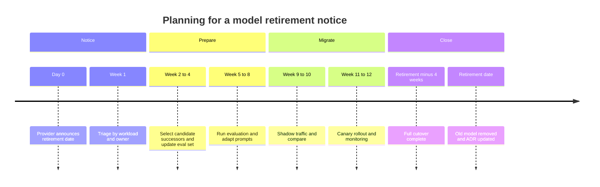

The timeline shows a twelve-week migration inside a notice window that must be longer than that. If a provider's shortest notice for your model class is shorter than your migration time, you have a standing risk, and you have two ways to reduce it: shorten your migration through automation (a ready evaluation harness and an adapter layer) or move to a class of model with a longer notice commitment. Maintaining a registry of every model dependency, with the retirement policy, expected end date, owner, and last evaluation date, turns a surprise into a calendar item. [Part 17 CH10](CH10_AI_Platform_and_Model_Lifecycle_Architecture.md) places that registry in the platform.

### 8.3 What a switch costs

The cost of changing models is the sum of several parts, and the model API call is the smallest.

| Part | What it involves | Typical share of effort |
| --- | --- | --- |
| Evaluation | Run the domain set, grade, analyze, report | Small if the harness exists, large if not |
| Prompt adaptation | Rewrite and retune prompts, examples, output instructions for the new model's behavior | Often the largest part |
| Structured output and tool schemas | Re-validate schemas, handle differences in tool-call semantics | Medium |
| Guardrails and safety filters | Re-test refusals, injection resistance, content filters | Medium |
| Parameters and limits | Context limits, token counts, rate limits, timeouts, retries | Small to medium |
| Adaptation artifacts | Re-run fine-tuning, re-embed corpora if an embedding model changes, rebuild indexes | Large for embeddings and fine-tunes |
| Downstream effects | Output style changes break parsers, templates, tests, and user expectations | Medium |
| Contract and security review | New data terms, new sub-processors, new risk assessment | Calendar time more than effort |
| Rollout | Shadow, canary, monitoring, rollback plan | Medium |

Changing an **embedding model** deserves special note, because vectors from different models are not comparable. A switch forces re-embedding the entire corpus and rebuilding the index, with a period in which two indexes coexist, and re-tuning any similarity thresholds ([Part 17 CH05](CH05_Retrieval_Augmented_Generation_System_Architecture.md)). It is usually a bigger migration than swapping a generation model. Treat the embedding model as a long-lived choice and evaluate its exit cost up front.

A rough planning model: switching cost $= C_{\text{eval}} + C_{\text{prompt}} + C_{\text{artifacts}} + C_{\text{rollout}} + C_{\text{review}}$. Compare it with the expected saving or risk reduction. The script [04_pareto_and_switching_cost.py](../code/python/ai-model-selection-chapter/04_pareto_and_switching_cost.py) works an example: moving 2,000,000 tasks per month from a frontier-class candidate to a mid-tier candidate saves, with the illustrative numbers in the script, 15,000 per month in effective cost (0.0155 against 0.0080 per task including a 0.05 human correction cost per failed task). A one-time migration cost of 90,000 therefore pays back in 6.0 months. The same script shows the sensitivity: if a failed task costs 0.50 to correct instead of 0.05, the frontier candidate becomes the cheapest, and the switch would lose money. Switching cost and failure cost belong in the same calculation.

### 8.4 Portability by design

You cannot make a system portable to everything, and generalizing too far strips useful features. The goal is bounded portability: the ability to move among a short list of candidate models at a predictable cost. Four assets carry that portability.

**Evaluation portability.** The domain evaluation set and its harness are model-independent and are the most valuable asset in any migration. Keep them in version control, parameterized by a candidate configuration, so that evaluating a new model is a command and not a project.

**Prompt portability.** Prompts are not portable by default, because models differ in how they respond to instruction style, ordering, formatting, and examples. Make them manageable: keep prompts in versioned files and not in code strings, separate the task description from model-specific formatting, store the evaluation results beside each prompt version, and maintain a per-model prompt variant where needed. Plan to retune, and budget for it. Tools that optimize prompts against an evaluation set can reduce the manual effort, but they need the evaluation set to exist first.

**Contract portability.** Define the task contract in your own terms: the input fields, the output schema, error and refusal semantics, and deadline. Callers depend on this contract, not on a provider SDK.

**Anti-corruption layer.** The anti-corruption layer (ACL) is a design pattern from domain-driven design. It isolates your domain model from an external model's concepts by translating at the boundary. For model providers, the ACL is an adapter per provider that maps your task contract to the provider's request format and maps the response, errors, usage data, and finish reasons back. [Part 17 CH08](CH08_Model_Gateway_Routing_and_Fallback_Architecture.md) designs the gateway that hosts these adapters. Here is the selection-time consequence: choose candidates partly by how cleanly they fit your contract, and write down which provider-specific features you are using outside it, because each is a lock-in item.

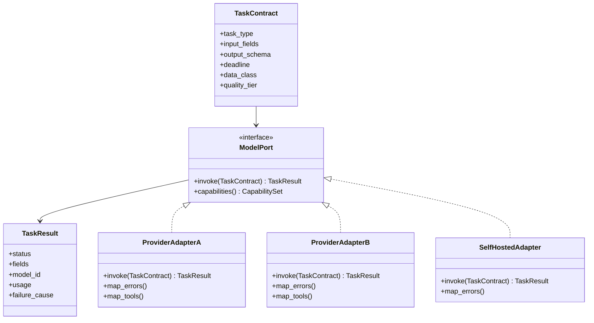

The class diagram shows the contract on the application side, a port interface that the application depends on, and one adapter per provider. The `capabilities()` method matters: it lets the application ask whether a candidate supports a feature (for example schema-constrained output) and choose a degraded path when it does not, instead of pretending all models are interchangeable. Adding a provider means writing one adapter and running the evaluation harness against it. Keep the contract narrow. A contract that exposes every provider's parameters is a thin wrapper that still leaks every provider's concepts.

An ACL does not remove behavioral differences. Models still respond differently to the same prompt, so the harness is the real portability guarantee. The ACL controls syntactic coupling, and the harness controls semantic coupling.

### 8.5 Pinned versions, aliases, and drift

Calling a floating alias gives you improvements without effort and also unannounced behavior change. Calling a pinned snapshot gives you stability until its retirement date. For production, pin to a specific version where the provider offers it, and run your evaluation against the pinned identifier. Add a scheduled canary: a small set of fixed requests run daily against the pinned model and compared to a stored baseline, to detect silent changes in output distribution, latency, refusal rate, or structured-output validity. If you use an alias for convenience in development, do not use it in production. Pin self-managed models by content hash.

### 8.6 A retirement runbook as a state machine

A retirement is a process with defined states. Writing it as a state machine helps ownership and audit.

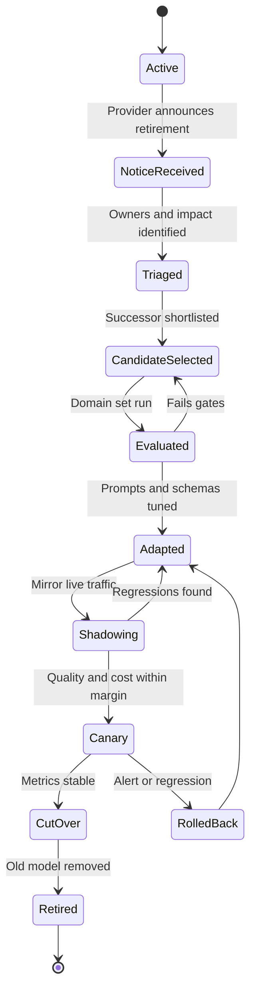

Each transition has an owner and an evidence requirement: evaluation results for Evaluated, comparison metrics for Shadowing and Canary, a rollback decision for RolledBack. The loops back to earlier states are normal. A team that models only the happy path will be surprised the first time a successor fails the gate with two weeks of notice left. When that happens, the options are an extension request to the provider, a temporary self-managed copy of the retiring model if the license allows it, or a degraded mode using the fallback capability map in Section 11.

## 9. Adapt or Upgrade: Prompt, Retrieval, Fine-Tune, or Bigger Model

When a candidate falls short of the acceptance test, four levers can close the gap, and each costs a different amount in money, time, risk, and reversibility. Part 16 owns the mechanics. This section gives the decision rule.

- **Prompting** changes instructions, examples, and output format. [Part 16 CH17](../16_AI_and_GenAI/CH17_Prompt_Engineering_and_Structured_Outputs.md) covers it. It is the cheapest and most reversible. It cannot add knowledge the model lacks, and long prompts add cost and latency on every call.
- **Retrieval** supplies relevant, current, access-controlled information at request time. [Part 16 CH18](../16_AI_and_GenAI/CH18_RAG_Architecture.md) covers the mechanism and [Part 17 CH05](CH05_Retrieval_Augmented_Generation_System_Architecture.md) the system. It addresses missing or changing knowledge. It does not by itself change style, format discipline, or reasoning ability, and it adds a retrieval system to operate.
- **Fine-tuning** adjusts model weights using examples. [Part 16 CH20](../16_AI_and_GenAI/CH20_Fine_Tuning_PEFT_and_LoRA.md) covers full, parameter-efficient, and low-rank adaptation. It is the lever for consistent style or format, for narrow-task accuracy on a small model, for shortening prompts, and for lower latency and cost at scale. It needs labeled data, an evaluation set that is separate from the training data, and a retraining plan whenever the base model changes. Fine-tuning is poor at adding facts that change.
- **A bigger or different model** adds general capability. It is the least engineering effort and the most recurring cost, and it increases dependence on the provider.

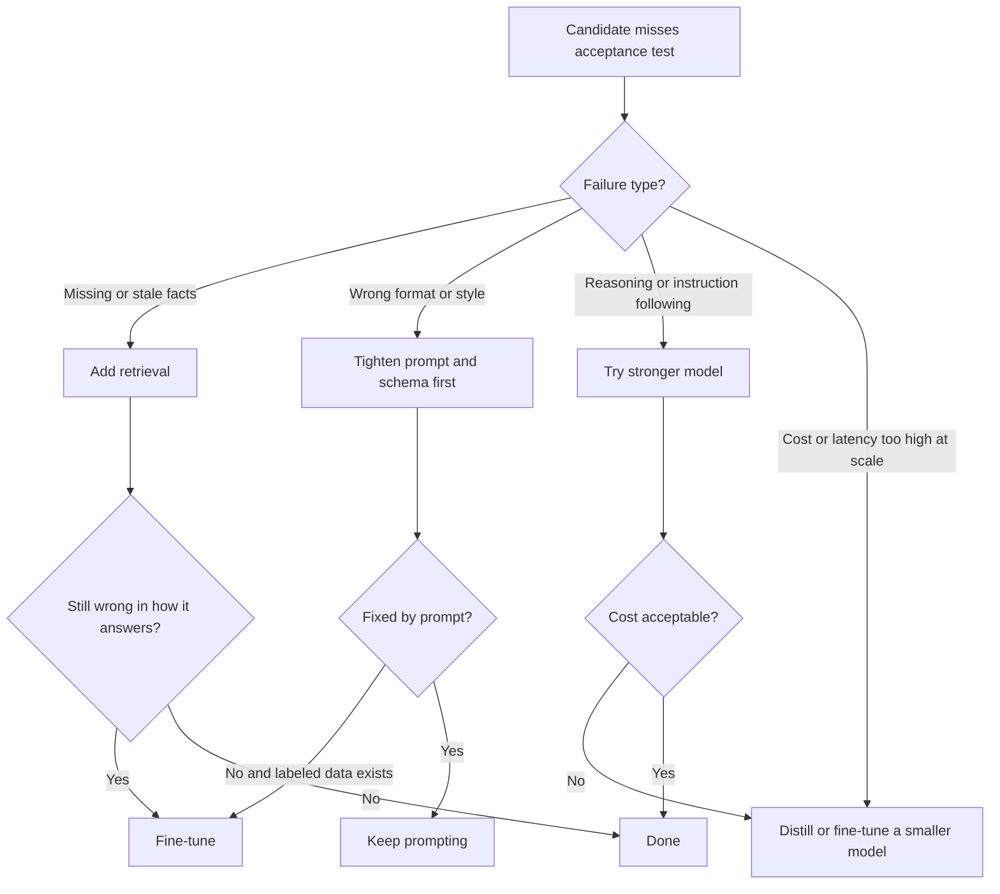

The tree starts from diagnosing the failure type from the evaluation output, which is why error analysis on the evaluation set precedes any adaptation work. Sorting failed items into categories (missing fact, wrong format, wrong reasoning, unsafe) usually shows one dominant cause, and the dominant cause picks the lever. Teams that skip the sorting often fine-tune to fix a retrieval problem or buy a bigger model to fix a prompt problem.

A decision order that works in most cases: prompt first, then retrieval if the failures are factual, then a stronger model if the failures are about reasoning, then fine-tuning if the cost or latency of the working configuration is too high at your volume, or if consistent behavior cannot be reached by prompting. The levers combine: a fine-tuned small model with retrieval is a common production configuration.

Worked break-even for fine-tuning, with illustrative numbers. A mid-tier model with a long prompt meets the acceptance test at an effective 0.0049 per task. A fine-tuned small model with a short prompt reaches the same quality at an effective 0.0010 per task. The saving is 0.0039 per task. At 1,500,000 tasks per month the saving is $0.0039 \times 1{,}500{,}000 = 5{,}850$ per month. A one-time cost of 12,000 for labeling, training, and evaluation pays back in $12{,}000 / 5{,}850 \approx 2.05$ months. At 100,000 tasks per month the saving is 390 per month, and payback takes about 31 months, longer than the likely life of the base model. Volume decides. The calculation must also include the recurring cost of retraining when the base model is retired or when the data drifts.

Check the data policy before fine-tuning on hosted platforms: some providers store fine-tuning data and the resulting weights under terms that differ from inference terms. The fine-tuned artifact is usually not portable to another provider, so it adds lock-in unless you fine-tune an open-weight model that you can host elsewhere.

## 10. The Quality, Latency, and Cost Frontier

### 10.1 Reading the frontier

When candidates are compared on quality, latency, and cost, some are strictly worse than another on every axis. Those are dominated and can be dropped without any weighting. The rest form the **Pareto frontier**: the set where improving one axis costs another. Choosing a point on the frontier is the business decision of how much quality is worth how much money and time.

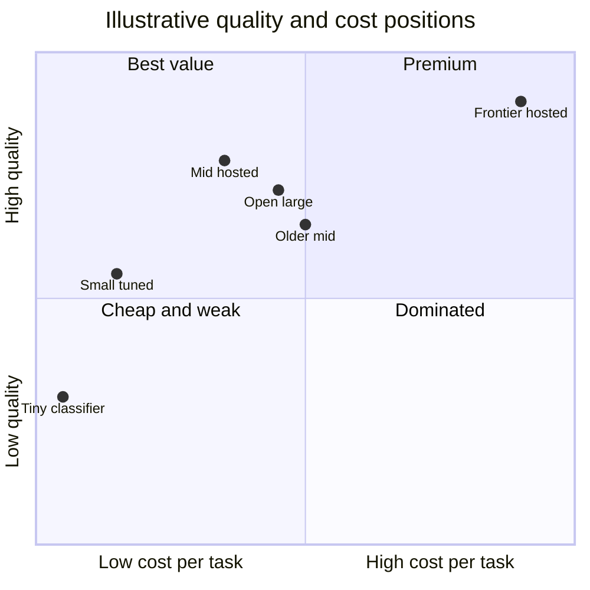

The chart is illustrative and shows positions, not measurements. The "older mid" and "open large" points sit in the dominated region relative to the mid hosted point on these two axes, though a third axis such as data control could rescue the open model. That is why the frontier is computed on all the axes you care about and not just two. The script [04_pareto_and_switching_cost.py](../code/python/ai-model-selection-chapter/04_pareto_and_switching_cost.py) computes a three-axis frontier. Over six illustrative candidates it marked four as frontier (frontier-class, mid, small, tiny) and two as dominated (open-large and older mid), because each was beaten on quality, p95 latency, and cost together by the mid candidate.

### 10.2 Picking a point

A process for picking a point:

1. Set the **quality floor** from the acceptance test and the error consequences. Candidates below the floor are out.
2. Set the **latency ceiling** from the user experience or the downstream deadline. Candidates above it are out.
3. Among those left, compute the **effective cost per successful task**, including retries and human correction.
4. Choose the cheapest effective-cost candidate, unless a lower-cost candidate sits within the quality margin of a higher-quality one, in which case record the trade-off and choose per policy.
5. Check **headroom**: how much extra quality would be needed in the future (harder inputs, new languages), and whether the chosen point leaves a path to the stronger model (an escalation route).
6. Check **robustness of the choice** to the assumptions that drive it: volume, correction cost, price changes. A choice that flips with a small change in an assumption needs a tiebreaker.

### 10.3 Effective cost with human correction

Cost per task from the provider is only part of the total. When wrong outputs reach a person who fixes them, the correction cost can exceed the model cost by an order of magnitude, and the cheapest model per token is then the most expensive per resolved task. With a correction cost $k$ per failed task, effective cost is $C + (1-q)\,k$, where $q$ is the pass rate. In the script's sample, with $k = 0.05$ the lowest effective cost belongs to the mid candidate at 0.0080 (0.0030 + 0.10 × 0.05), the small candidate costs 0.0086 (0.0006 + 0.16 × 0.05), and the frontier candidate costs 0.0155 (0.0120 + 0.07 × 0.05). At $k = 0.20$ the mid candidate still wins. At $k = 0.50$ the frontier candidate wins: 0.0120 + 0.07 × 0.50 = 0.0470, against 0.0030 + 0.10 × 0.50 = 0.0530 for the mid candidate. The correct model depends on what an error costs, which is why the error consequence is part of the capability statement (Section 2.1).

### 10.4 Quantized variants

Quantization stores weights, and sometimes activations or the key-value cache, at lower numeric precision, such as 8-bit or 4-bit integers instead of 16-bit floating point. It reduces memory and often raises throughput. [Part 16 CH28](../16_AI_and_GenAI/CH28_Inference_Optimization_and_Model_Serving.md) explains the methods. For selection, the memory arithmetic decides whether a model fits a target at all. Weight memory is the parameter count times bytes per parameter:

| Parameters | 16-bit (2 bytes) | 8-bit (1 byte) | 4-bit (0.5 byte) |
| --- | --- | --- | --- |
| 7 billion | 14 GB | 7 GB | 3.5 GB |
| 70 billion | 140 GB | 70 GB | 35 GB |

These are weight sizes only. Add memory for the key-value cache, which grows with context length and the number of concurrent sequences, and for runtime overhead, plus a small amount for quantization scales. A 4-bit 70-billion-parameter model's 35 GB of weights fits on one 48 GB accelerator with limited context, and a 16-bit one needs multiple accelerators. Quantization changes outputs, so a quantized variant is a different candidate and must be evaluated on your data. Typically, quality loss at 8-bit is small, and at 4-bit it is small to moderate depending on the model, method, and task, with sensitive tasks (precise numeric extraction, long reasoning chains, low-resource languages) hit harder. Do not accept a claim that "quantization does not hurt" without running your evaluation on the quantized weights, in the serving engine you will use, because implementations differ.

### 10.5 Distilled and small models

Distillation trains a smaller student model to imitate a larger teacher's outputs on a task distribution. It can transfer much of a large model's task behavior into a model that is faster and cheaper to run. Its limits: the student is only as good as the teacher on the distribution it saw, it generalizes less broadly, and it needs a supply of representative inputs. Terms of service for some hosted models restrict using their outputs to train other models, and some open-weight licenses do too, so check the license before generating training data from a model (Section 7.5). A common, legitimate pattern uses the strong model offline to label data, then fine-tunes a small model you own, and measures the result on the held-out evaluation set. That converts a recurring per-call cost into a one-time labeling cost, as in the Section 9 break-even.

### 10.6 On-device and edge

Running models on a phone, laptop, vehicle, camera, or factory gateway changes the constraints. Reasons to go to the edge: latency without a network round trip, offline operation, data that must not leave the device, and per-call cost that falls to zero for the provider. Constraints: memory and storage limits, thermal and battery limits, a heterogeneous fleet of devices with different accelerators, and an update problem, since a model shipped to a million devices must be versioned, signed, delivered, and rolled back like any other software artifact.

Selection criteria shift. Quantized small models and specialized models dominate. Evaluate on the lowest-capability target device, not on a developer workstation, and measure latency, memory, and battery together. Build the cloud fallback deliberately: when the device model is unsure or the task exceeds its capability, escalate to a cloud model, but only for data the user and policy allow to leave the device. Protect the model file if it is proprietary, but assume a determined attacker with the device can extract it. Plan for the privacy benefit and the integrity risk: on-device inference keeps inputs local, and it also puts the model, its prompts, and its safety checks in the hands of the device owner, so safety-critical filtering may still need a server-side check. [Part 17 CH07](CH07_Inference_Serving_and_Model_Placement.md) covers placement in more depth.

## 11. Multi-Model Systems and the Fallback Capability Map

A real system uses several models and non-AI components, and each can fail. The **fallback capability map** lists, for each capability the system provides, the primary implementation, the alternatives in order, and what each alternative still delivers. It extends the decomposition from Section 2.2 by adding a column for failure.

```mermaid
flowchart TD
    subgraph Cap1["Capability: answer policy questions"]
        P1["Primary: strong hosted model with retrieval"]
        P2["Alt 1: cheaper hosted model, same provider region"]
        P3["Alt 2: self-managed open-weight model with retrieval"]
        P4["Alt 3: search results with snippets, no generation"]
        P5["Alt 4: human help-desk queue"]
        P1 -->|Outage or quota| P2
        P2 -->|Same-provider failure| P3
        P3 -->|Runtime failure| P4
        P4 -->|Index failure| P5
    end
    subgraph Cap2["Capability: classify intent"]
        Q1["Primary: fine-tuned small classifier"]
        Q2["Alt 1: keyword rules"]
        Q3["Alt 2: ask user to choose from menu"]
        Q1 -->|Model failure| Q2
        Q2 -->|Low confidence| Q3
    end
    subgraph Cap3["Capability: read invoice image"]
        R1["Primary: specialized OCR service"]
        R2["Alt 1: second OCR engine"]
        R3["Alt 2: queue for manual entry"]
        R1 -->|Failure| R2
        R2 -->|Failure| R3
    end
```

The map has several uses. It makes degradation explicit: each step down states which part of the contract is reduced (no synthesis, higher latency, slower turnaround). It exposes shared failure domains: Alt 1 and the primary above are in the same provider and region, so they do not cover a provider-wide outage, which is why Alt 2 is on a different failure domain. It identifies where a hard gate applies to the fallback: the self-managed option exists partly because restricted data cannot go to another public endpoint. It also gives testing a target: each arrow is a failure injection test, and each should be exercised before launch and on a schedule ([Part 17 CH13](CH13_Reliability_and_Resilience_Patterns_for_AI_Workloads.md)).

Questions to ask of each fallback:

1. **Is it independent?** Does it share the provider, region, credentials, quota, network path, or upstream model with the primary?
2. **Is it eligible?** Does it satisfy the data class, residency, and contract constraints that the primary satisfied?
3. **Is it evaluated?** Has it passed an acceptance test, perhaps a lower bar labeled as degraded mode, on the domain set?
4. **Is it honest?** Does the user or downstream system learn that the response came from a reduced path?
5. **Is it bounded?** Does it cap cost, queue growth, and retries during a long outage?
6. **Is it maintained?** Who updates the fallback when the primary changes? Dormant fallbacks rot, so run a small share of traffic through them or exercise them in scheduled drills.

A cost point: keeping a warm second path costs money. For a self-managed fallback, you pay for idle or minimally scaled capacity. Size the fallback to the minimum service level the business accepts during an outage, not to full load, and record that service level in the ADR.

## 12. Vendor Due Diligence, Procurement, and Contracting

### 12.1 Why architects are involved

Procurement teams buy software on features, price, and standard risk terms. AI services carry risks that standard questionnaires do not cover well: a model that changes behavior without a version bump, data used for training, retirement on short notice, and a dependency that is difficult to replace. The architect contributes the technical facts that turn a generic review into one that protects the system. The goal is not a perfect contract. It is that the contract does not contradict the architecture's assumptions, such as "we pin a version for 12 months" or "no prompt data is retained".

### 12.2 Due diligence checklist

Collect evidence for each item and record the date and source. Treat marketing pages as claims and reports, certificates, and contract text as evidence.

| Area | What to check | Evidence |
| --- | --- | --- |
| Security attestations | Independent audit reports for the specific service and region, such as SOC 2 Type II or ISO/IEC 27001 certification. Confirm the scope names the service you will use, the reporting period is recent, and exceptions are acceptable | Report or certificate, scope statement, bridge letter for gaps |
| AI management | Whether the provider holds an AI management system certification such as ISO/IEC 42001, and what its scope covers | Certificate and scope |
| Sector requirements | Healthcare, financial, public-sector, or other frameworks that apply (for example a business associate agreement for protected health data) | Signed addenda |
| Data handling | Retention, training use, zero-retention availability, abuse monitoring, deletion, regional processing (Section 7.3) | Contract and service terms, dated copy |
| Sub-processors | List, locations, notice period for changes, right to object | Sub-processor list and change policy |
| Access controls | Provider staff access to customer data, approval and logging, background checks | Security whitepaper, audit report |
| Vulnerability management | Disclosure program, patch timelines, penetration testing cadence, summary of findings | Policy, test summary |
| Incident history | Public status history, post-incident reports, breach notification commitment and timeline | Status page archive, notification clause |
| Availability and SLA | Contractual uptime for your endpoint type, measurement method, exclusions, credits, support response times | SLA document |
| Capacity | Quotas for your volume, burst limits, provisioned options, how limit increases are handled | Quota documents, written confirmation |
| Change management | Version pinning, notice of model changes and retirement, behavior change policy | Deprecation policy (Section 8.2) |
| Roadmap and viability | Financial health, dependence on a single investor or cloud partner, history of discontinuing products, pace of change | Public filings or references, account team statements |
| Legal | Indemnity for output intellectual property claims, liability caps, governing law, export compliance | Contract |
| Exit | Data export and deletion at termination, export of fine-tuned artifacts, transition support | Termination clause |
| Support | Technical support tier, escalation path, named contacts, support language and time zones | Support plan |
| Responsible AI | Published safety evaluations, model documentation, content filters you can configure, red-team practice | Model cards, documentation |

An attestation is evidence that controls existed, in scope, for a period. It is not evidence that the model is safe, accurate, or free of bias. Do not use a security certificate as a stand-in for task quality.

### 12.3 Reading SLAs with arithmetic

A monthly availability commitment translates to allowed downtime. For a 30-day month there are 43,200 minutes. A 99.9 percent commitment allows $43{,}200 \times 0.001 = 43.2$ minutes of downtime, and 99.5 percent allows 216 minutes. Check what the SLA counts as downtime: some count only complete unavailability, not elevated error rates or high latency, and some exclude rate limiting and capacity shortages. Remedies are normally service credits, a fraction of the monthly fee, which are small compared with the business loss of an outage. The SLA therefore tells you how seriously the provider treats availability and what you can claim, and it does not replace your own resilience design.

Availability composes. Serial dependencies multiply: a gateway at 99.95 percent in front of a model service at 99.9 percent gives $0.9995 \times 0.999 = 0.9985$, which allows about $0.0015 \times 43{,}200 = 64.8$ minutes of downtime per month. A parallel fallback that fails independently improves this: with a second path at 99 percent, the model capability is unavailable only when both fail, $1 - (1 - 0.999)(1 - 0.99) = 1 - 0.00001 = 0.99999$, so about 0.4 minutes per month. The calculation assumes independent failures and a failover that works instantly and correctly. A shared region, shared credentials, or an untested failover breaks both assumptions, which is why the fallback must be tested (Section 11) and independence verified.

### 12.4 Procurement and contracting concerns

Points to bring to the commercial negotiation, from the architecture side:

- **Price protection.** Seek a fixed price or a cap on increases for the term for the models you rely on, and notice before price changes. Committed-spend discounts reduce unit price but reduce flexibility: a commitment sized for today's model mix can be a liability if you switch to a cheaper model or to self-managed. Size commitments to a conservative forecast and negotiate the ability to apply the commitment across model families.
- **Provisioned capacity.** Reserved throughput gives predictable latency and capacity at a fixed cost whether or not you use it. Check minimum terms, the model-version binding of the reservation, and what happens to the reservation when the model is retired.
- **Version and retirement terms.** Ask for a minimum notice period for retirement of any model you use in production and a right to extended access, even at a premium, during a migration.
- **Data terms in the contract.** Put the retention, training, residency, and sub-processor commitments in the signed agreement or data processing addendum, not only in a documentation page that the provider can edit.
- **Evaluation rights.** Confirm that you may benchmark the service and use outputs for evaluation and for internal tooling. Some terms restrict comparison publication or use of outputs to develop competing models.
- **Audit rights.** Obtain the right to receive audit reports and, where the data is sensitive, to conduct or commission an audit or have a regulator do so.
- **Liability and indemnity.** Understand the cap, the exclusions, and the conditions of the output-infringement indemnity. Conditions can require that you use the provider's safety features or not modify the output.
- **Exit assistance.** Include data return and deletion with certification, and export of your fine-tuned artifacts where the license permits.
- **Cost governance.** Ensure usage can be tagged per workload and team, budgets and alerts exist, and billing data is available at the granularity you need ([Part 09 cost optimization](../09_Cloud_Computing/CH14_Cost_Optimization.md)).
- **Multiple sources.** Qualify at least one alternative provider or self-managed option before you need it, so negotiation has an alternative and a migration is possible.

Contract language is the domain of legal and procurement staff. The architect's role is to supply the technical requirements, to flag where a clause contradicts a design assumption, and to make sure the ADR records which contractual commitments the design depends on, so a later renewal does not quietly drop them.

## 13. The Selection Process

### 13.1 Five steps

A repeatable process has five steps. Each produces an artifact, so the decision can be reviewed.

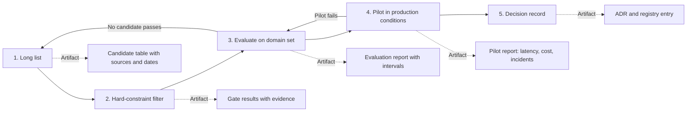

**Step 1: Long list.** Assemble candidates from every category in Section 3 that could supply the capability, including the non-AI baseline and a specialized model if one applies. Sources: your cloud platform catalog, provider documentation, public leaderboards (to narrow, not to decide), community reports, and the current incumbent. Aim for six to ten. Record the date, because the list goes stale.

**Step 2: Hard-constraint filter.** Apply the gates from Section 4: data class and residency, license, modality, context, tool support, deployment target, contractual terms, and SLA. Remove candidates that fail and write the reason. This is cheap and avoids spending evaluation effort on candidates that cannot be used. A common outcome is a short list of three to five.

**Step 3: Evaluate on the domain set.** Run the survivors through the evaluation from Section 5 with tuned prompts for each, measure operational metrics under load, and compute paired intervals against a reference. Always include the incumbent or the simplest baseline, so the question "is the new thing better than what we have" is answered with data.

**Step 4: Pilot.** A pilot exposes the finalist to production conditions on real traffic or shadowed traffic: real input distribution, real concurrency, real failure modes, and real users or reviewers. Define what the pilot must show before it starts: quality within margin on live data, p95 latency under the gate, cost per task within budget, no policy incidents, and acceptable operator effort. Shadow mode (run the candidate on live requests without returning its output) is safest, followed by a limited canary. The pilot often reveals issues the offline set missed, such as input formats that were not in the sample, so feed those back into the evaluation set.

**Step 5: Decision record.** Write the ADR (Section 13.5) and register the model in the model registry with version, license, owner, evaluation evidence, and review date.

### 13.2 Choosing the gates

Gates differ per workload, so derive them from the capability statement and per-task requirements (Section 2.5). Write each as a testable sentence: "Restricted-class data is processed only in region X by a processor under contract Y", "p95 total latency below 4 seconds at 25 requests per second", "critical-error rate below 1 percent on the challenge set", "license permits commercial use at our scale and distribution". A gate with no test is a preference. If a gate cannot be tested before the pilot, mark it as a condition of the pilot and say who verifies it.

### 13.3 Decision Matrix

After gates, the matrix compares survivors on weighted preferences (Section 4.14). The example below is for an internal IT service-desk assistant that triages tickets and drafts replies. Illustrative inputs: the quality gate requires a pass rate of at least 0.85 and a critical-error rate under 1 percent on the domain set. A fifth candidate, a hosted frontier option available only in a region outside the required residency boundary, failed the residency gate and was removed before scoring (`hosted-eu-gap` in the script). Ratings are 1 to 5, with quality mapped from measured pass rate (0.85 to 0.88 is 3, 0.89 to 0.91 is 4, 0.92 and above is 5).

| Criterion | Weight | Hosted frontier | Hosted mid | Open-weight self-managed | Small self-managed |
| --- | --- | --- | --- | --- | --- |
| Quality (measured pass rate) | 0.35 | 5 (0.93) | 4 (0.90) | 4 (0.90) | 3 (0.86) |
| Latency (p95) | 0.15 | 3 | 4 | 4 | 5 |
| Cost per task | 0.20 | 2 | 4 | 3 | 5 |
| Control (data path, version) | 0.15 | 2 | 2 | 5 | 5 |
| Operating burden (higher is lighter) | 0.15 | 5 | 5 | 2 | 3 |
| **Weighted score** | 1.00 | **3.65** | **3.85** | **3.65** | **4.00** |

The arithmetic for the small self-managed candidate is $0.35 \times 3 + 0.15 \times 5 + 0.20 \times 5 + 0.15 \times 5 + 0.15 \times 3 = 1.05 + 0.75 + 1.00 + 0.75 + 0.45 = 4.00$. For hosted mid it is $1.40 + 0.60 + 0.80 + 0.30 + 0.75 = 3.85$. Running [03_decision_matrix.py](../code/python/ai-model-selection-chapter/03_decision_matrix.py) prints these scores and then perturbs each weight by a random factor between 0.6 and 1.4 for 2,000 trials:

```text
removed by hard constraints: hosted-eu-gap

base weighted scores:
  small-self        4.00
  hosted-mid        3.85
  hosted-frontier   3.65
  open-weight-self  3.65

win share under +/-40% weight perturbation (2000 trials):
  small-self        0.810
  hosted-mid        0.147
  hosted-frontier   0.042
  open-weight-self  0.000
```

Interpretation. The small self-managed candidate wins in 81 percent of perturbed weightings and the hosted mid candidate in 15 percent, so the ranking is fairly stable but not certain. The matrix also shows the risk of reading a weighted sum alone: the winner has the lowest quality rating. It clears the quality gate (0.86 against a floor of 0.85) with only one point of margin, and the pass-rate interval from Section 5 should be checked: if the lower bound of its interval falls below 0.85, the gate is not shown to be met. The open-weight candidate never wins because it pays operating burden without a quality or cost advantage over the small one. Here the team adopts a cascade from Section 6, with the small self-managed model first and the hosted mid-tier model as the escalation stage for items the verifier rejects. That keeps most traffic and data inside the boundary and lifts quality toward 0.90 at a moderate cost, provided the data class allows the escalation stage. The decision matrix selected the starting point and the analysis of the quality margin shaped the final design, which is how the matrix should be used.

### 13.4 Worked selection summary

For the IT service-desk assistant, the steps produced the following record.

| Step | Output |
| --- | --- |
| Long list (9) | Rules and search baseline, two hosted frontier, two hosted mid, one open-weight large, one open-weight small, a fine-tuned encoder classifier for triage, the incumbent response templates |
| Gate filter (4 drafting candidates left) | One hosted frontier removed for residency, one hosted mid removed for a missing zero-retention option, the rules baseline and incumbent templates removed for drafting because they fail the quality floor (they stay in use for triage routing), the encoder kept as a triage component only |
| Evaluation (400 items, stratified) | Pass rates 0.93 (hosted frontier, residency-compliant variant), 0.90 (hosted mid), 0.90 (open-weight large), 0.86 (open-weight small), each with a paired interval against the hosted mid reference |
| Pilot (4 weeks, shadow then 10 percent canary) | p95 latency 2.1 s for small, 3.4 s for mid; 7 percent of tickets had new formats that were added to the evaluation set |
| Decision | Cascade with the small self-managed first stage and hosted mid escalation, rules for triage routing, human queue as last resort |

The numbers here are illustrative and exist to show the artifacts, not to benchmark anything.

### 13.5 The decision record

Record the decision as an architecture decision record. An ADR is a short document capturing a significant decision, its context, the alternatives considered, and its consequences. It is stored with the code so it stays discoverable and is superseded, not edited, when the decision changes.

```markdown
# ADR-0042: Model deployment for the IT service-desk assistant

Status: Accepted (2026-10-12). Review by: 2027-04-12 or on any trigger below.

## Context
Triage and draft replies for internal tickets. Restricted data may appear
(employee identifiers). Forecast 1.5M tasks/month. Gates: restricted data
stays in region X, p95 total latency under 4 s, pass rate >= 0.85, critical
error rate < 1 percent on the challenge set.

## Options considered
1. Hosted frontier: best quality (0.93) but fails residency in region X.
2. Hosted mid only: quality 0.90, within gates, but sends all content out.
3. Open-weight large self-managed: quality 0.90, highest operating burden.
4. Small self-managed with hosted-mid escalation (chosen).
5. Rules and search only: fails drafting quality.

## Decision
Option 4. Small self-managed model handles first pass. A verifier escalates
rejected items to the hosted mid model under the data terms in contract C-17
(no training, 30-day retention, region X). Triage routing uses a classifier.

## Evidence
Domain set v3 (400 items, stratified). Paired bootstrap, 10,000 resamples.
Pilot report P-9. Weighted matrix sensitivity: chosen candidate wins in 81
percent of weight perturbations.

## Consequences
We operate a model server (on-call, patching). Two prompts to maintain.
Escalation rate must stay below 40 percent for the cost target.

## Fallback and exit
Fallback map FM-3. Prompts and domain set are in repo. ACL adapters for
both models. Switching estimate: 6 engineer-weeks.

## Review triggers
Provider retirement notice; escalation rate above 40 percent for 7 days;
hosted-mid price change above 20 percent; new data class; domain-set pass
rate drop above 3 points on the weekly canary; license change.
```

The record includes the rejected options, because their absence invites later teams to repeat the evaluation or to wonder whether an obvious option was considered. It states the contractual commitments the decision relies on, the fallback, and the triggers, so the next review has a starting point. Keep ADRs short and link out to the evaluation report and the contract summary.

## 14. Re-Evaluation Cadence and Triggers

A selection is a hypothesis about a changing market. Re-evaluate on a schedule and on events.

**Scheduled.** A lightweight re-run of the evaluation harness against the pinned model, the incumbent alternatives, and one or two new candidates, quarterly, costs little if the harness exists. A full re-selection, from long list to ADR, annually or at the end of the contract term. Run the daily canary (Section 8.5) continuously.

**Event-driven triggers.** Reopen the decision when any of these happens:

- The provider announces a retirement, a price change, a new usage policy, or a change in data terms.
- The canary or production quality metrics drift beyond the agreed margin.
- A significant incident occurs at the provider, or a security finding affects the service.
- A new model class appears that plausibly changes the frontier: a cheaper model reported to reach your quality floor, or a model with a capability that removes a component.
- Volume changes by a large factor (for example three times), shifting the hosted-versus-self-managed break-even.
- The input distribution changes: a new language, document type, or product line.
- The data class changes, a new regulation applies, or the residency requirement changes.
- A license on an open-weight model changes or the owner of a provider changes.
- Escalation rate, correction rate, or cost per task moves outside its budget band.

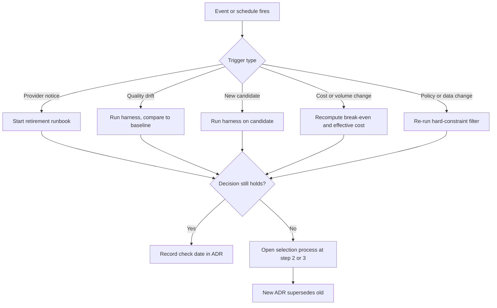

Each path ends in a recorded outcome, including "decision still holds", because recording a check is what lets the next reviewer see the decision was tested. Avoid two failure modes: never re-evaluating, which leaves the system on an outdated and costly model, and re-evaluating so often, or switching on every leaderboard change, that the team never stabilizes. The switching cost from Section 8.3 sets a threshold: do not switch for an improvement smaller than what the migration costs over a reasonable horizon, and do not defer a switch that pays back within a couple of quarters. [Part 17 CH11](CH11_Evaluation_and_Observability_Architecture_for_AI_Systems.md) covers the continuous evaluation machinery.

## 15. Quality-Attribute Scenarios

Quality-attribute scenarios convert vague worries into testable requirements. Each has a source of stimulus, the stimulus, the environment, the artifact, the response, and a measure. The four below are the ones that a model selection must answer. They link to the resilience patterns in [Part 17 CH13](CH13_Reliability_and_Resilience_Patterns_for_AI_Workloads.md).

### 15.1 Provider outage

| Element | Content |
| --- | --- |
| Source | Primary hosted model provider |
| Stimulus | Error rate above 50 percent for 30 minutes in the serving region |
| Environment | Business hours, normal load of 20 requests per second |
| Artifact | Model gateway and fallback map FM-3 |
| Response | Circuit opens within 60 seconds. Eligible requests route to the self-managed model. Restricted requests are not sent to any public endpoint. Requests that cannot be served are queued for humans with a visible deferred status. |
| Response measure | At least 95 percent of eligible requests complete within the latency gate. Zero restricted requests reach a non-approved endpoint. Queue wait stays under 4 hours. Cost during fallback stays within 120 percent of baseline. |

Selection implication: the fallback must exist before the outage, be evaluated, and be sized for the minimum accepted service. If the chosen primary has no independent fallback that satisfies the data gate, the design has a single point of failure, and the ADR must say so and name the accepted degradation.

### 15.2 Model update regression

| Element | Content |
| --- | --- |
| Source | Provider changes model behavior behind a pinned name, or ships a minor update |
| Stimulus | Pass rate on the daily canary drops 4 points and structured-output validity falls from 99.5 to 96 percent |
| Environment | Production, normal load |
| Artifact | Daily canary, prompts, parsers, evaluation harness |
| Response | Alert fires within 24 hours. The team diffs outputs against the stored baseline, rolls the prompt or routes to an older snapshot or alternate model if available, and opens a provider ticket. |
| Response measure | Detection within 24 hours. Mitigation within 1 working day. Customer-visible error rate stays under the agreed budget. |

Selection implication: prefer providers that offer version pinning with a documented change policy, run the canary from the start, and keep prompts versioned so you can roll back your side of the change.

### 15.3 Price increase

| Element | Content |
| --- | --- |
| Source | Provider commercial change |
| Stimulus | Per-token price of the chosen model rises 40 percent with 60 days notice |
| Environment | Steady state, 1.5 million tasks per month |
| Artifact | Cost model, cascade thresholds, ADR triggers |
| Response | Recompute effective cost and break-even. Evaluate a cheaper candidate and the self-managed option. Adjust the cascade threshold or routing if needed. Decide within 30 days. |
| Response measure | Cost per task returns to budget within 90 days, or the increase is explicitly accepted by the owner. Quality stays within the agreed margin. |

Worked check. If the hosted-mid cost is 0.0049 per task and the model portion is 0.0042 of that, a 40 percent price rise adds $0.0042 \times 0.40 = 0.00168$ per attempt, bringing the effective cost to about $0.0049 + 0.00168 \times 1.05 / 0.90 \approx 0.0069$ using the same repair and success rates. At 1.5 million tasks per month that is about 3,000 per month more. If a migration costs 90,000, a 30-month payback means the price increase alone does not justify a switch, but it does justify the evaluation. Write the arithmetic into the response, so the team does not act on feelings.

### 15.4 Data residency change

| Element | Content |
| --- | --- |
| Source | Regulator, customer contract, or internal policy |
| Stimulus | Data of class Restricted must be processed in a single named country starting in 90 days |
| Environment | Production use across three regions |
| Artifact | Gateway routing policy, vendor contract, deployment shapes |
| Response | Gateway region policy is updated and enforced for the data class. Candidates are re-filtered. A provider region or a self-managed deployment in the country is added if none qualifies. Logs and backups are checked for cross-border copies. |
| Response measure | 100 percent of Restricted requests processed in region by the deadline, verified by gateway logs and a provider attestation. No cross-region fallback for the class. |

Selection implication: favor designs where residency is a routing policy and not an application property. If the primary provider lacks the region, the exit path or the self-managed option becomes the plan, so it should exist as a qualified alternative beforehand.

### 15.5 Retirement with short notice

| Element | Content |
| --- | --- |
| Source | Provider |
| Stimulus | Retirement notice of 8 weeks for a pinned model |
| Environment | Production, fine-tuned adapter depends on the base model |
| Artifact | Model registry, retirement runbook, evaluation harness |
| Response | Triage within 1 week. Successor evaluated and prompts adapted within 4 weeks. Retraining of the adapter on the successor base. Shadow and canary in the remaining weeks. |
| Response measure | Cutover completed at least 2 weeks before retirement. Quality within margin. No unplanned outage. |

Selection implication: the migration time (twelve weeks in Section 8.2) exceeded this notice, so the plan needs either an automated harness that shortens it or a model class with a longer commitment. Compute your actual migration time, compare it with the shortest notice you have seen, and treat a gap as an open risk in the ADR.

## 16. Case Studies

Each case lists the capability decomposition, the options rejected and why, and the validation evidence. All numbers are illustrative assumptions with the arithmetic shown, chosen so you can swap in your own.

### 16.1 Customer support assistant

**Context.** A software-as-a-service company handles 600,000 support conversations per month in five languages. The assistant drafts answers for agents, who review and send them, and a later phase adds customer self-service for the easiest intents. Answers must cite the current help-center article or policy. Customer messages can contain personal data (names, emails, account numbers). Some enterprise customers have contracts that restrict processing to a named region.

**Decomposition.** Detect language and intent (small classifier). Retrieve relevant articles and the customer's plan details with the caller's permissions (retrieval, per [Part 17 CH05](CH05_Retrieval_Augmented_Generation_System_Architecture.md)). Draft the answer with citations (language model). Validate that citations exist, that no account data from another customer appears, and that prohibited promises (refunds, legal claims) are absent (deterministic checks plus a small safety classifier). Route to a human for anything outside confident coverage.

**Gates.** Regional processing for enterprise-restricted customers. Zero training on customer content. p95 time to first token under 2 seconds in the agent console. Citation validity above 99 percent. Critical-error rate (a promise the company does not make, or exposure of another customer's data) below 0.5 percent.

**Evidence.** The team built a 500-item evaluation set stratified by language (five), intent family (eight), and customer tier, with a 60-item challenge set containing ambiguous requests, injection attempts embedded in customer messages, and conflicting articles. Two agents graded blind outputs on a four-criterion rubric, with kappa of 0.72 on the first pass and 0.81 after revision. With illustrative prices, assume a 4,000-token input and 250-token output per task.

| Candidate | Pass rate | Model cost per task | Effective cost per task |
| --- | --- | --- | --- |
| Hosted frontier | 0.91 | 0.0250 | 0.1150 |
| Hosted mid-tier | 0.88 | 0.0040 | 0.1240 |
| Cascade: mid first, 30 percent escalate to frontier | 0.92 | 0.0115 | 0.0915 |

The mid-tier cost is $4000 \times 0.80 \times 10^{-6} + 250 \times 3.20 \times 10^{-6} = 0.0032 + 0.0008 = 0.0040$, at illustrative prices of 0.80 and 3.20 per million input and output tokens. The frontier cost uses illustrative prices of 5.00 and 20.00: $0.0200 + 0.0050 = 0.0250$. Effective cost adds the expected agent correction, a failed draft costing 1.00 of agent time (90 seconds at 40 per hour): frontier $0.0250 + 0.09 \times 1.00 = 0.1150$, mid $0.0040 + 0.12 \times 1.00 = 0.1240$, cascade $0.0040 + 0.30 \times 0.0250 = 0.0115$, plus $0.08 \times 1.00$ gives 0.0915. At 600,000 tasks per month the cascade saves $(0.1150 - 0.0915) \times 600{,}000 = 14{,}100$ per month against the frontier-only option. The mid-tier-only option looks cheapest on model cost and is the most expensive overall because correction cost dominates, which is the main lesson of the case.

Rejected alternatives:

- *Frontier-only.* Highest cost, 3 points higher pass rate than mid-tier but not enough to beat the cascade, and the p95 time to first token missed the 2-second gate at peak load.
- *Mid-tier-only.* Fails the critical-error ceiling on the challenge set, with the paired interval on critical errors excluding the target.
- *Fine-tuned small model.* Help articles change weekly, so facts belong in retrieval. The team had too few labeled examples in four of five languages. Reconsidered if volume grows tenfold.
- *Self-managed open-weight model.* At 600,000 tasks per month volume sits well below the break-even of Section 7.6 for the team's cost structure, and no operating team was available.

**Decision.** A managed cloud platform deployment of a mid-tier model in the customer's required region, with a verifier that escalates to the frontier model on the same platform and region. Personal identifiers are masked before the call and restored after. Restricted-region customers never route to out-of-region endpoints. If both models are unavailable, the console shows retrieved articles with no draft.

**Validation.** Paired bootstrap on the 500-item set for cascade versus frontier-only showed the quality difference interval containing zero within the 3-point margin. A four-week shadow period measured actual escalation rate (28 percent, close to the assumed 30), p95 time to first token (1.4 seconds), and agent edit rate. Weekly canary and an alert on escalation rate above 40 percent are the review triggers in the ADR.

### 16.2 Document extraction

**Context.** An accounts-payable team processes 2,000,000 pages per month of supplier invoices from several hundred suppliers, in varied layouts, with scans of mixed quality. The system extracts 12 fields (supplier, invoice number, dates, currency, line items, tax, total) and posts to the ledger. A wrong total that reaches the ledger is costly; a flagged page costs a clerk a minute.

**Decomposition.** Read pixels to text and layout (perception). Identify document type (classification). Locate fields (layout-aware extraction). Normalize and validate (deterministic: dates, currency codes, supplier existence, line items summing to the subtotal, subtotal plus tax equal to the total). Match to purchase order (database and fuzzy match). Exceptions to a human with the page, extracted values, and the failed check shown.

**Gates.** Invoices contain supplier bank details, so page images stay within a contracted boundary with zero retention. Every extracted value must carry its source location on the page for review. Throughput of 2M pages per month with a daily batch window of 6 hours.

Options and illustrative numbers:

| Option | Field accuracy (cluster-adjusted) | Confident-wrong rate | Cost per page |
| --- | --- | --- | --- |
| Template rules per supplier | 0.99 on covered suppliers, 0.40 on others | Low | Low, but rule upkeep for hundreds of suppliers |
| Multimodal frontier model reads page images | 0.97 | 1.8 percent of pages | 0.0200 |
| Specialized OCR and layout service, deterministic validators, mid-tier language model only for low-confidence fields | 0.985 | 0.4 percent of pages | 0.00195 |

The third option's cost is the OCR and layout charge of 0.0015 per page plus the language model used on the 15 percent of pages with a low layout confidence at 0.0030: $0.0015 + 0.15 \times 0.0030 = 0.00195$. At 2,000,000 pages, that is 3,900 per month. The multimodal option costs $0.0200 \times 2{,}000{,}000 = 40{,}000$ per month, about ten times more. Confident-wrong rate is the metric that matters because it measures errors that pass without a flag, and the arithmetic validators lowered it: a page whose line items do not sum to the stated subtotal gets flagged regardless of how confident the extractor was.

An important evaluation detail: the 600-page evaluation set came from 150 supplier layouts, four pages each. Pages from one layout are correlated, so the effective sample size for generalization to a new supplier is nearer 150 than 600. The team computed bootstrap intervals by resampling suppliers, not pages, and set aside 20 suppliers entirely unseen in tuning to measure generalization to new layouts.

Rejected alternatives:

- *Templates.* Maintenance grows linearly with suppliers, new suppliers fail until a template is built, and there is no coverage measure for unseen layouts.
- *Multimodal-only.* Ten times the cost, no coordinates for source highlighting, higher confident-wrong rate, and every page image goes to a general model endpoint.
- *Fine-tuned layout model.* Needs about 40,000 in labeling, which is justified if the language model's 15 percent share rises or accuracy on the challenge set must increase. Written into the ADR as a phase-two trigger: language model share above 25 percent for a month.

**Decision.** Specialized OCR and layout in a private deployment, deterministic validators, mid-tier language model on text only for low-confidence fields, human exceptions queue. The language model receives extracted text, not page images, which limits the data crossing the boundary.

**Validation.** Field-level accuracy by field and supplier cluster, confident-wrong rate on the challenge set (handwriting, skewed scans, multi-currency invoices), throughput in a load test showing completion in 4.2 hours for a one-day peak of 150,000 pages, and a ledger reconciliation after a 30-day pilot with zero unflagged total errors above the materiality threshold.

### 16.3 Code assistant

**Context.** An engineering organization with 800 developers wants an assistant in the integrated development environment (IDE) that offers inline completions while typing and a chat panel for explanation, tests, and refactoring. Source code is confidential. Some repositories contain regulated algorithms. The legal team asks about license risk in generated code and about telemetry leaving the company.

**Decomposition.** Two capabilities with conflicting profiles. Inline completion needs a very low time to first token and a short response, because the suggestion must appear before the developer types past it. Chat tolerates seconds and benefits from a strong reasoning model and broad context. Context assembly (which files and symbols to include) is deterministic code that also enforces exclusions: secrets, files marked sensitive, repositories outside the user's access.

**Gates.** Completion p95 time to first token under 300 ms. No source code used for training outside the company. Repository exclusion list enforced. Generated-code license risk reviewed (duplicate-detection or filter if offered). Developer-side telemetry under company control.

**Evaluation.** Completion was evaluated offline on held-out functions from the company's repositories, masked and regenerated, scored by whether the project's unit tests pass on the completed code (pass at 1, meaning the first sampled solution passes), and online by acceptance rate in a pilot. Chat was evaluated on 120 tasks written by developers with test-based and rubric grading. Public coding benchmarks narrowed the long list, but the company's code style, languages, and internal libraries differ from benchmark problems, and two models close on a public benchmark differed by 9 points on the internal set.

**Numbers (illustrative).** Usage: 800 developers, about 300 completion requests per developer per day, 22 days a month, giving $800 \times 300 \times 22 = 5{,}280{,}000$ completions per month. A hosted completion service at an illustrative 0.0030 per completion costs $5{,}280{,}000 \times 0.0030 = 15{,}840$ per month. A self-managed open-weight code model on four accelerators at an illustrative 2.50 per accelerator-hour for 730 hours costs $4 \times 2.50 \times 730 = 7{,}300$ per month, plus an operating share of 4,000, totaling 11,300. That is about 29 percent cheaper than hosted but not decisively, and utilization will be uneven across the working day. The deciding factors were latency (an in-region self-managed model measured p95 time to first token of 180 ms against 410 ms for the hosted endpoint over the public internet) and the confidentiality gate.

Rejected alternatives:

- *One strong hosted model for both completion and chat.* Time to first token and cost per request fail the completion gate, and a strong model on every keystroke wastes money.
- *Fully hosted vendor IDE product.* Fastest start, but telemetry, retention, and repository exclusion controls were not sufficient, and the model could not be swapped, which fails the exit requirement.
- *Fine-tuning the completion model on the whole code base.* Deferred. Retrieval of repository context already helped, and fine-tuning would have required license review of every internal and vendored code source and a retraining plan.

**Decision.** A small self-managed open-weight code model, with a license that permits commercial use at the company's scale, for completion, deployed in the developers' region. A strong model on a managed cloud platform under a no-training and zero-retention agreement for chat, reached through the model gateway with the secret scanner and exclusion list applied during context assembly. Completion falls back to the previous suggestion cache, then to no suggestion. Chat falls back to a second model on the same platform and then to an "unavailable" state, since a blocked developer is annoying, not harmed.

**Validation.** Pass-at-1 on the internal held-out set for three completion candidates with paired intervals, p95 time to first token from a load test at the peak hour, acceptance rate of 27 percent in the four-week pilot against a target of 20 percent, a measured secret-leak rate of zero in 5,000 adversarial context assemblies, and a review of license-filter behavior. The ADR triggers re-evaluation if acceptance falls below 18 percent for two weeks or when the open-weight model's license changes.

## 17. Common Mistakes

| Mistake | Cause | Consequence | Correction |
| --- | --- | --- | --- |
| Choosing the model first | A demonstration impressed stakeholders | Gates discovered late, anchored prompts, costly reversal | Write the capability statement and gates first (Section 2) |
| Using a leaderboard as the decision | Easy to cite | Task mismatch, contamination, ignores latency and cost | Use public results to shortlist and a domain set to decide (Section 5) |
| Comparing prompts, not models | A prompt tuned for one candidate was pasted to others | The result measures prompt fit | Tune each candidate with equal effort and a held-out set |
| Comparing on a tiny sample | Only a few examples were checked by eye | Noise decides the outcome | Size the set from the disagreement rate, report intervals |
| Ignoring correlation in the sample | Many items per customer or document | Overconfident intervals | Resample clusters |
| Averaging away the critical error | A single aggregate metric | Release-blocking failure hidden | Report the critical class and subgroups separately |
| Mixing gates and preferences | One weighted table includes a failed requirement | A disqualified candidate wins | Filter on gates first, weight only the survivors |
| Weights chosen after seeing scores | Wish to justify a preferred option | Biased decision | Fix weights beforehand and run sensitivity analysis |
| Comparing per-token prices | Looks simple | Tokenizers, retries, and correction costs differ | Compare cost per successful task |
| Treating private as safe | Hosting location read as a control | Logs, backups, and support access cross the boundary | Map the actual data path and terms (Section 7) |
| Treating open-weight as unrestricted | Download was free | License or acceptable-use violation | Read the license for the exact version (Section 7.5) |
| Calling a floating alias in production | Convenience | Silent behavior change | Pin versions and run a canary (Section 8.5) |
| No exit plan | Speed of delivery | Retirement with short notice forces a rush | Registry, adapter layer, and runbook (Section 8) |
| Redundant providers that share a failure domain | Multiple front doors to one model or region | Fallback fails with the primary | Verify independence at the level of the failure |
| One model for every task | Simplicity | High cost, latency mismatch, wasted capacity | Decompose and use cascades and specialized models |
| Fine-tuning to fix missing facts | Misdiagnosed failures | Stale knowledge, retraining burden | Diagnose by error category, use retrieval for facts |
| Cascade evaluated in parts | Each model tested alone | Composite quality, cost, and tail latency unknown | Evaluate the end-to-end cascade |
| Never re-evaluating | Decision seen as final | Outdated, costly system | Scheduled and event-driven reviews (Section 14) |
| Switching on every announcement | Fear of missing out | Churn and regressions | Switch when the gain exceeds the switching cost over a horizon |
| No dated record | Decision made in a meeting | Next team repeats the evaluation | Write the ADR with evidence and triggers |

## 18. Design Review Checklist

Use this checklist in a design review. Each item should have an answer, an owner, and a piece of evidence.

Capability:

- [ ] The workload is decomposed into tasks, each with input, output, acceptance test, and error consequence.
- [ ] Each task has a named component type, and the non-AI baseline was considered.
- [ ] Per-task data class, latency budget, volume, and explanation level are written down.

Constraints and candidates:

- [ ] Hard gates are listed as testable statements, separate from preferences.
- [ ] The long list covers hosted, open-weight, small, specialized, classical, and non-AI options, with the date checked.
- [ ] Every candidate was filtered against residency, license, modality, context, tool, and deployment gates.

Evidence:

- [ ] A domain evaluation set exists, stratified, with a challenge set and a held-out portion.
- [ ] Rubric and grader agreement were measured, and grading was blind.
- [ ] Each candidate had a tuned prompt with comparable effort.
- [ ] Comparison used paired differences with intervals, and clusters were respected.
- [ ] Latency percentiles, throughput, cost per successful task, and refusal and error rates were measured under load.
- [ ] The cascade or router, if any, was evaluated end to end.

Deployment and data:

- [ ] The trust boundary diagram shows every party and store the data touches, including logs and sub-processors.
- [ ] Retention, training use, zero-retention availability, residency, and key management are confirmed in contract text.
- [ ] Licenses and usage policies are reviewed for the exact versions.
- [ ] Credentials, audit logging, and content logging policy are defined.

Lifecycle and resilience:

- [ ] Versions are pinned, a daily canary runs, and a model registry lists owners and retirement policies.
- [ ] Switching cost and migration time are estimated and compared with the shortest known notice.
- [ ] An adapter layer isolates provider specifics, and prompts and evaluations are versioned.
- [ ] A fallback capability map exists, with independence, eligibility, honesty, and test status per fallback.
- [ ] Quality-attribute scenarios for outage, regression, price change, and residency change have owners and measures.

Commercial and governance:

- [ ] Due diligence evidence is collected with dates, and attestation scope matches the service in use.
- [ ] Contract terms for price protection, notice, data handling, exit, and audit are reviewed.
- [ ] The ADR records options, rejected alternatives, evidence, consequences, and review triggers.
- [ ] Re-evaluation cadence and triggers are scheduled.

## 19. Exercises

1. **Decompose.** A hospital wants a system that reads referral letters (PDF scans), extracts the patient's condition and urgency, suggests a clinic, and drafts a reply. List the tasks, name the component type for each, mark which need a person, and identify two tasks where an LLM is the wrong choice.
2. **Latency.** Candidate X has a time to first token of 0.5 s and generates 60 tokens per second. Candidate Y has 1.2 s and 150 tokens per second. For a 500-token output, compute the total latency of each. At what output length do they take the same time? State which latency matters for a streaming chat and for a batch pipeline.
3. **Sample size.** Two candidates are expected to disagree on 12 percent of items. You want to detect a true difference of 5 points with 95 percent confidence and 80 percent power. Compute the approximate number of items. What changes if items come in groups of 5 from the same customer?
4. **Cascade.** A cheap model costs 0.001 per attempt and a strong model 0.010. The verifier costs 0.0002. What escalation rate makes the cascade cost equal to always-strong? If the cascade escalates 40 percent, what is its cost per task, and how much does it save?
5. **Gates versus weights.** You have four candidates and a decision matrix where the winner has the lowest score on data control, which is a stated requirement for in-country processing. What went wrong in the process, and how do you repair it?
6. **Fine-tune or not.** A fine-tuned small model costs 20,000 once and saves 0.003 per task. At what monthly volume is payback under six months? What recurring costs does this ignore?
7. **Retirement.** Your provider gives 8 weeks of notice, and your migration runbook needs 12 weeks. List three changes that would close the gap, with their costs and risks.
8. **Write an ADR.** Take an assistant in your organization and write a one-page ADR, including the rejected options and three review triggers.
9. **Independence.** A design uses model M on platform P1 in region R1, with fallback to the same model M on platform P2 in region R1. List the shared failure domains and propose a better fallback.

Answer outlines:

1. Tasks: OCR of scans (specialized perception), condition and urgency extraction (LLM or fine-tuned classifier with schema), urgency rules where policy defines thresholds (deterministic), clinic suggestion (rules and directory query, possibly retrieval), draft reply (LLM), clinical sign-off (person). The LLM is the wrong choice for applying a published urgency threshold and for looking up clinic capacity. Clinical judgment belongs to a clinician with the model as an assistant.
2. X: $0.5 + 499/60 = 0.5 + 8.317 = 8.82$ s. Y: $1.2 + 499/150 = 1.2 + 3.327 = 4.53$ s. Equal when $0.5 + (n-1)/60 = 1.2 + (n-1)/150$, so $(n-1)(1/60 - 1/150) = 0.7$, $(n-1)(0.01667 - 0.00667) = 0.7$, $n - 1 = 70$, $n = 71$. Below about 71 tokens X finishes first. A streaming chat feels the time to first token, so X feels faster at the start; a batch pipeline cares about total time, where Y wins for long outputs.
3. $n \approx 7.84 \times 0.12 / 0.05^2 = 0.9408 / 0.0025 \approx 376$ items. With groups of five from one customer, items within a group are correlated, so the effective sample size is smaller than the item count. Plan on more items (perhaps 1.5 to 2 times, depending on the within-group correlation) and resample customers in the bootstrap.
4. Break-even: $0.001 + 0.0002 + e \times 0.010 = 0.010$, so $e = 0.0088 / 0.010 = 0.88$. At $e = 0.40$: $0.0012 + 0.004 = 0.0052$ per task, a saving of $0.010 - 0.0052 = 0.0048$, which is 48 percent.
5. Control was a hard gate and should have removed any candidate that fails it before scoring, or the candidate was scored as passing without evidence. Repair: restate the gate as a testable sentence, re-run the filter with evidence, then rescore and run the sensitivity analysis on the survivors.
6. Payback in six months means saving at least $20{,}000 / 6 = 3{,}333$ per month, so volume $\ge 3{,}333 / 0.003 \approx 1{,}111{,}000$ tasks per month. It ignores retraining on base-model changes, labeling upkeep, serving cost differences, and evaluation effort.
7. Options: automate the evaluation harness and prompt tests (cost: engineering weeks, reduces time per migration), request an extension or a longer-lived model class from the provider (cost: premium or contract negotiation, depends on provider), keep a second qualified model warm (cost: ongoing spend and maintenance, reduces risk most), or self-host an open-weight model as a standing alternative (cost: operating burden).
8. A good answer has context and gates, at least three options with the rejected ones explained, evidence cited, consequences, fallback, and review triggers that are measurable.
9. Shared: model M (a withdrawn or regressed model affects both), region R1 (a regional failure), likely the same identity, billing account, and quota pool. Better: a different model that passed the same evaluation, on a different platform or self-managed in another region, with the data gate satisfied, plus a non-model degraded path.

## 20. Summary

Select the capability first. Decompose the workload into tasks, decide for each whether rules, search, classical ML, a specialized model, a small model, a general model, or a person is the right component, and write acceptance tests and error costs before looking at products.

Separate hard gates from weighted preferences. Residency, contract terms, license, modality, and a quality floor remove candidates. Cost, operating burden, and ecosystem rank the survivors. Fix the weights before the evidence arrives and check how sensitive the ranking is.

Use public benchmarks to shortlist, and decide on a domain evaluation set that is stratified, blind-graded, sized for the disagreement rate, and analyzed with paired intervals. When the data cannot separate candidates, say so and choose by cost, latency, and exit risk.

Compare cost per successful task, not per token. Human correction usually dominates once model costs are small, so a better model can be cheaper overall, and a cascade can sit near the strong model's quality at a fraction of its cost. Evaluate the cascade as one system, including tail latency.

Treat the deployment shape as part of the model choice. Draw the trust boundary, read the data terms in the contract, check licenses for the exact version, and decide among hosted, managed platform, and self-managed by gates, volume, and operating capacity.

Plan for change. Models retire, prices move, and behavior drifts. Pin versions, canary daily, keep an adapter layer and a portable evaluation harness, estimate the switching cost, maintain a fallback capability map with truly independent paths, and re-evaluate on a schedule and on triggers. Record the decision, the rejected options, the evidence, and the triggers in an ADR.

## 21. Code Examples

All scripts use only the Python standard library, print deterministic output from fixed seeds, and use synthetic or illustrative inputs. Replace the inputs with your own data.

- [01_paired_bootstrap_compare.py](../code/python/ai-model-selection-chapter/01_paired_bootstrap_compare.py) runs a paired bootstrap comparison of two candidates and contrasts it with an unpaired interval.
- [02_cascade_cost_quality.py](../code/python/ai-model-selection-chapter/02_cascade_cost_quality.py) sweeps a confidence threshold for a two-stage cascade and prints quality, cost, and escalation rate with the break-even escalation rate.
- [03_decision_matrix.py](../code/python/ai-model-selection-chapter/03_decision_matrix.py) filters candidates by hard constraints, computes weighted scores, and tests the ranking under random weight perturbation.
- [04_pareto_and_switching_cost.py](../code/python/ai-model-selection-chapter/04_pareto_and_switching_cost.py) finds the Pareto frontier, computes effective cost with human correction, and computes migration payback.
