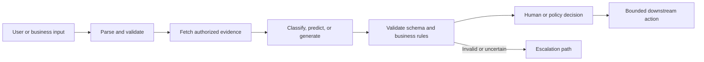
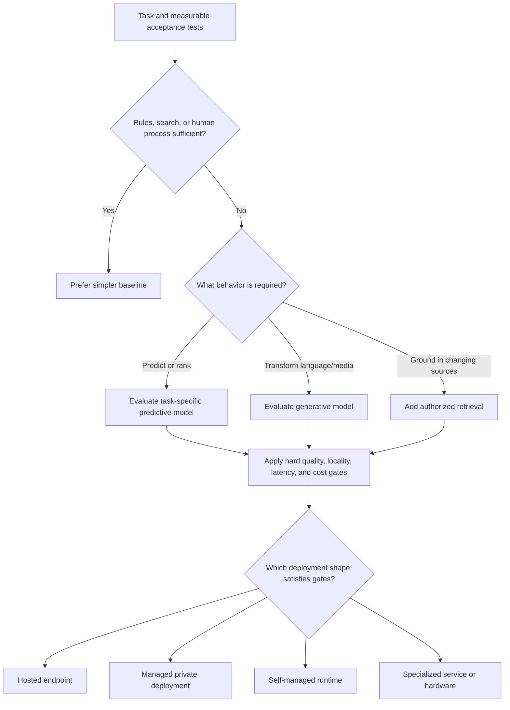
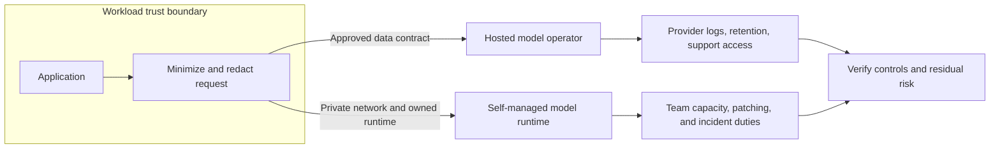
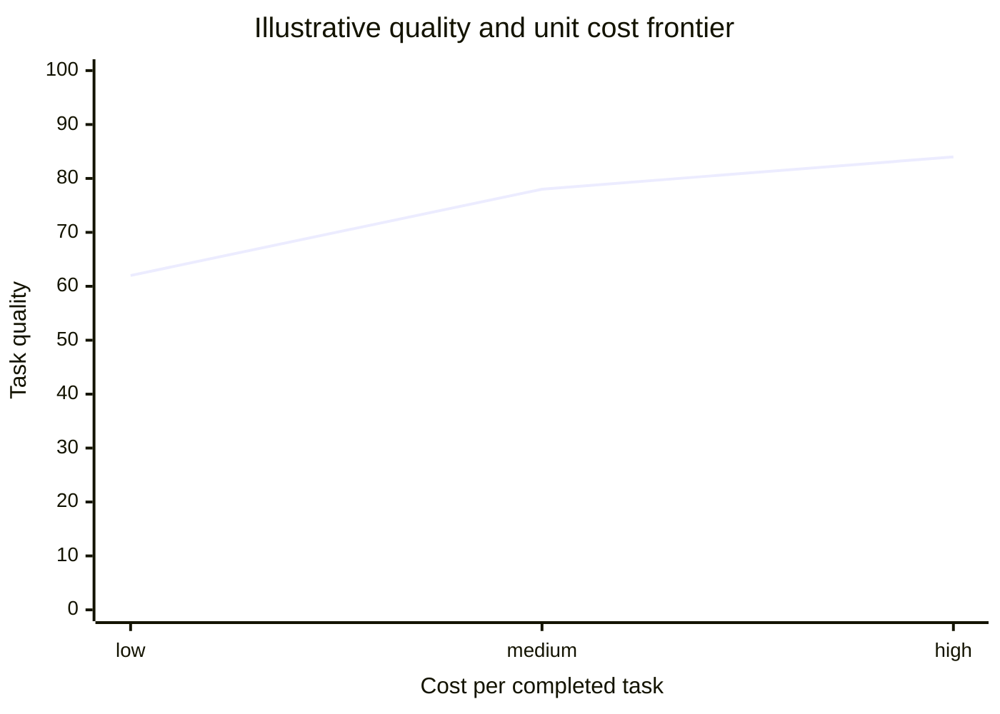
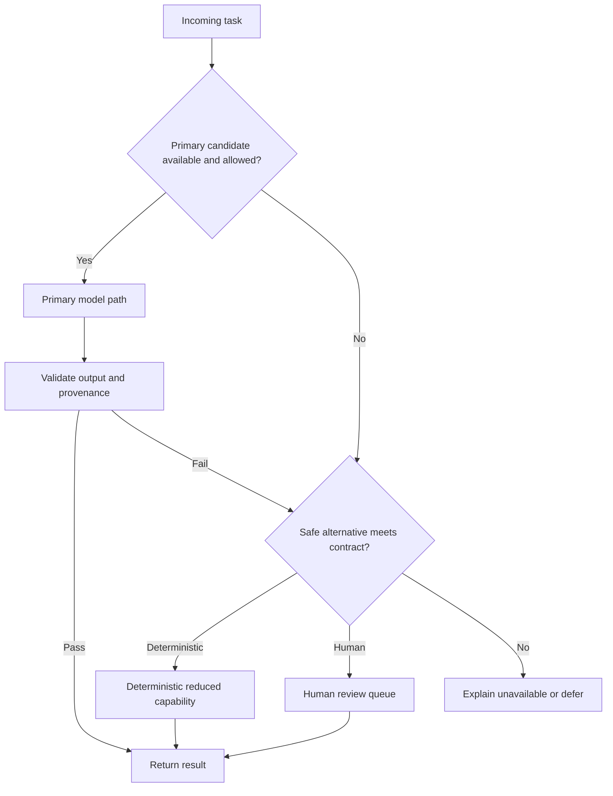

# AI Capability and Model Selection

Part: [17 — AI Architecture](PART_OVERVIEW.md)

Model selection is a system decision. A benchmark score cannot answer whether a capability fits the task, data boundary, latency budget, operating model, or failure consequence. The architecture team first decomposes the work, compares AI with non-AI alternatives, and then selects a model deployment that meets the workload contract with acceptable evidence and exit options.

Part 16 owns model families, training behavior, and evaluation mechanics. This chapter applies those details to selection and placement; it does not repeat model internals. Provider service designs remain in Parts 09 and 10, while this chapter compares provider-neutral deployment shapes.

## Decompose the Capability

Separate input understanding, retrieval, prediction or generation, validation, and action. A workload advertised as “document automation” can contain deterministic parsing, classification, extraction, summarization, and approval. Each component can use a different implementation. This decomposition prevents a general-purpose model from becoming the default for exact lookup, arithmetic, authorization, or other tasks with stronger deterministic solutions.

For each stage, record the expected input and output, data sensitivity, error cost, and acceptance test. A model is a candidate for the infer stage only when its behavior can be evaluated against representative cases. Retrieval belongs in the architecture when answers depend on changing or private evidence; it does not make generation intrinsically correct.

## Select by Constraint, Not Reputation

Start with workload constraints: acceptable quality by error class, response-time distribution, peak throughput, data locality, privacy obligations, explainability, availability, cost per completed task, and operational ownership. Rank hard constraints separately from preferences. A candidate that violates a hard residency or latency requirement is not rescued by a higher average benchmark score.

Do not treat “hosted” and “private” as synonyms or opposites. A hosted service may support strong tenant isolation and contractual controls; a self-managed model may still expose data through logs, support access, backups, or weak network policy. Verify the actual boundary: who operates weights, infrastructure, logs, and keys; where data and telemetry travel; which subprocessors participate; and how deletion and incident response work.

## Compare Deployment Shapes

Hosted inference reduces responsibility for serving infrastructure and can accelerate experimentation, but it introduces provider availability, pricing, version, and egress dependencies. Self-managed inference offers greater control over placement and runtime configuration but transfers capacity planning, patching, scaling, model loading, and operational support to the owning team. Specialized services can be efficient for a bounded task. They still introduce another contract and lifecycle to govern. The right choice depends on total responsibility, not only who owns the virtual machines.

This boundary view should be completed with actual contracts, data flows, and operational ownership. If a workload cannot send raw content to a provider, consider local transformation, retrieval on the trusted side, a self-managed deployment, or a non-AI approach. Do not claim that a deployment is compliant from its hosting location alone.

## Evaluate the Pareto Trade-Off

Quality, latency, cost, and control often move in opposing directions. Model size and context length can raise quality on some tasks while increasing latency and cost. A smaller specialized model can be preferable when it meets the acceptance threshold, is easier to place near data, or provides more predictable throughput. Measure the end-to-end workflow, including retrieval, validation, retries, and human correction.

The curve is illustrative, not a benchmark. Build the real frontier from candidates evaluated on the same representative set and under comparable operating conditions. Keep separate results for critical subgroups and error types; an aggregate can hide a candidate that fails a hard safety or fairness requirement.

## Design Fallback as Capability

A fallback is not merely “call another model.” It must preserve the user-facing contract while reducing capability safely. Depending on the task, the fallback may be a cached result with age shown, a deterministic workflow, a human queue, an asynchronous response, or an explicit unavailable state. A second provider is useful only if it does not share the same failure dependency and can satisfy the same data and policy constraints.

Test fallback behavior under provider timeout, rate limiting, invalid output, and policy rejection. Measure completion rate, user-visible degradation, queue growth, and cost during fallback; otherwise an outage can silently turn into unbounded retries or a different privacy exposure.

## Worked Selection: Internal Policy Answers

An organization wants staff to ask questions across frequently updated internal policies. Exact identifiers and access control remain deterministic. Retrieval is required because answers must cite current policy versions; generation may produce a readable synthesis, but the application must return source links and decline when authorized evidence is insufficient. Candidate deployment shapes are evaluated against policy residency, peak demand, citation quality, tail latency, and cost per resolved question.

The team tests a hosted option and a self-managed option with the same access-controlled corpus, evaluation questions, and workload profile. It includes stale documents, conflicting policies, users with different permissions, and provider unavailability. The choice is the lowest-operational-burden candidate that satisfies hard controls and measurable answer-quality gates, not the candidate with the most fluent sample response. A human support route remains available when retrieval is empty or evidence conflicts.

## Selection Record

Record the task and baseline; hard constraints; candidate set; evaluation method and limitations; deployment and data boundaries; ownership and cost assumptions; fallback behavior; versioning and exit approach; and the evidence that would trigger reconsideration. Revisit the choice when task mix, data classification, provider terms, model behavior, or unit economics materially change.

1. Which workload constraints are hard gates, and which are preferences?
2. What responsibility shifts from the provider to the team when inference is self-managed?
3. What is the least capable fallback that still provides a safe, useful outcome?
4. How could aggregate benchmark results hide a release-blocking failure?

Select capabilities by workload evidence and system constraints. Keep model selection reversible where possible, make deployment responsibilities explicit, and treat fallback as a designed capability rather than a last-minute provider switch.
