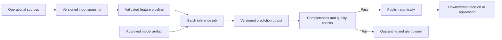
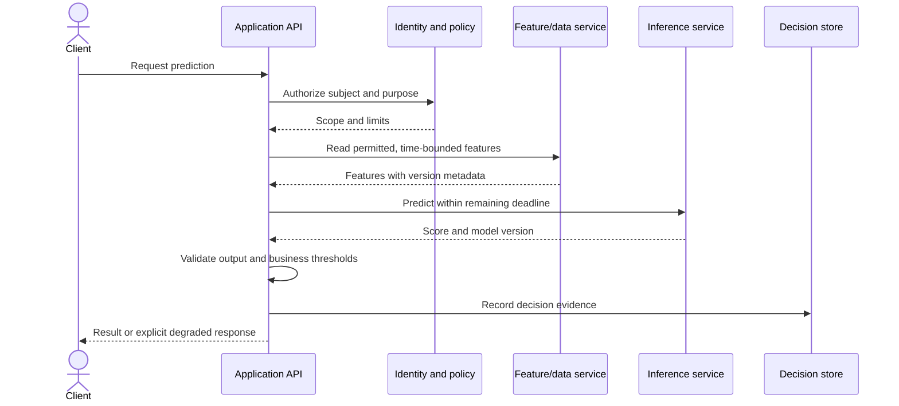
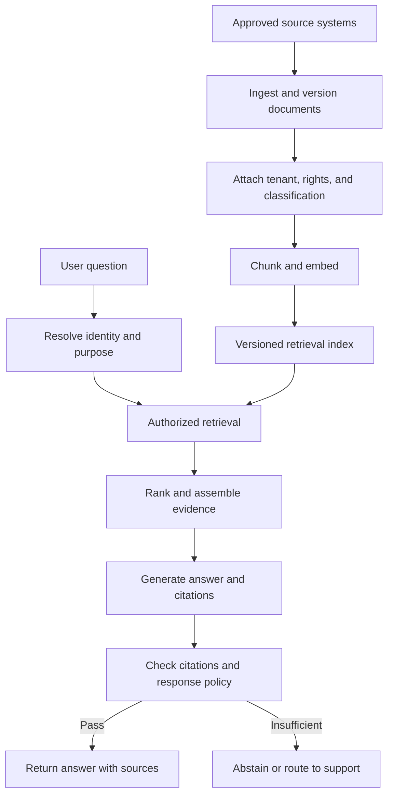
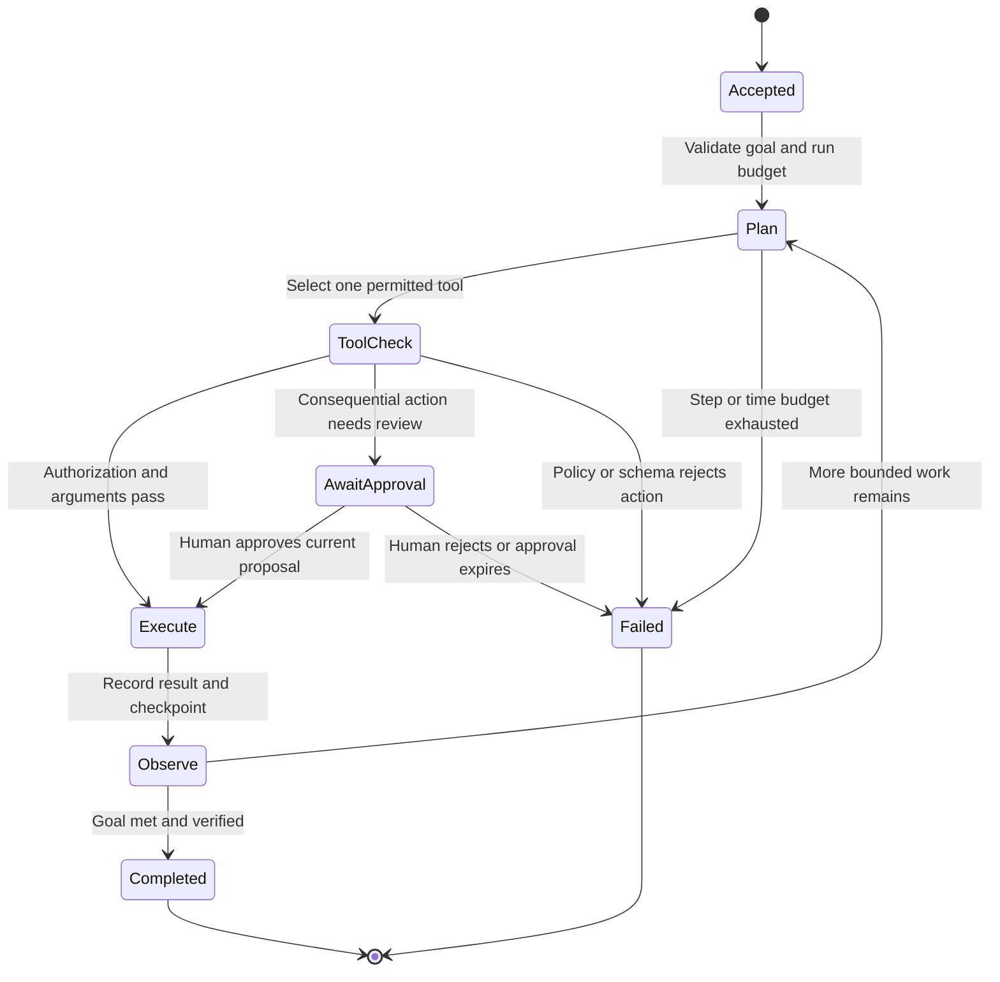
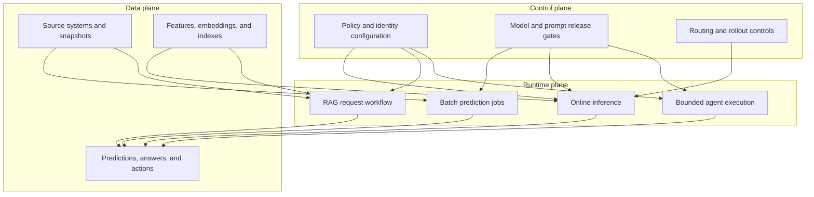

# Reference Architectures for Predictive, Generative, and Agentic Systems

Part: [17 — AI Architecture](PART_OVERVIEW.md)

Predictive, generative, and agentic systems share identity, data governance, model access, release controls, and operational evidence, but their runtime paths and failure semantics differ. A reference architecture is useful when it exposes those differences and makes ownership boundaries explicit. It is not a product list or a deployment template to copy without workload constraints.

Part 16 owns the algorithms and model techniques. Part 06 owns database mechanics, Part 12 owns Kubernetes, and Part 14 owns observability platforms. This chapter focuses on composing those capabilities and on the contracts between their components.

## Batch Prediction

Batch prediction computes outputs for a large, bounded set of records on a schedule or after an event. It is appropriate when decisions tolerate delay and shared compute is more efficient than per-request inference. The architecture must define a source snapshot, feature availability, model version, output key, retry policy, and publication boundary. A partial rerun must not silently mix predictions from incompatible model or data versions.

The publication gate separates computation from visibility. If a job fails halfway, consumers continue using the prior complete output or receive a declared stale-data state. Store lineage linking each output partition to its input snapshot, feature code, model artifact, and run configuration so that a bad result can be traced and regenerated.

## Online Prediction

Online inference serves a request under a latency budget. The service path may read precomputed features, call a model endpoint, validate the result, and return a decision or recommendation. Synchronous inference is appropriate only when the complete path, queue wait, and downstream processing fit the caller's deadline. Longer tasks should use asynchronous completion or a streaming contract rather than an unbounded synchronous request.

Avoid turning feature retrieval, model inference, and decision persistence into an implicit transaction unless the design can actually provide those semantics. Define what happens if inference succeeds but persistence fails, or if the client retries after a timeout. Part 07 owns distributed reliability semantics; the AI-specific requirement is to attribute the response to a model and feature version and prevent duplicate downstream action.

## Retrieval-Augmented Generation

Retrieval-Augmented Generation (RAG) combines authorized evidence with a generation step. The offline indexing path and online question path have different scaling, freshness, and security requirements. Index creation should preserve source identity and access metadata; query-time retrieval must apply the caller's authorization before evidence reaches the generator. Part 16 CH18 owns RAG mechanics, while Part 06 CH21 owns vector-index mechanics.

The index is a derived copy, not the source of truth. Define refresh and deletion behavior, stale-source handling, and what users see when retrieval cannot establish a reliable answer. The answer path should preserve enough provenance to explain which source versions informed a response without exposing unauthorized content in traces or caches.

## Bounded Agent Workflow

An agent workflow uses model output to choose among permitted next steps. This adds a control loop and state, not a grant of authority. A planner can propose an action, but a separate executor validates the tool name, arguments, principal, scope, budget, and current business state. Durable workflows should persist checkpoints so an interrupted run can resume or terminate without repeating an irreversible action.

The workflow needs a maximum step count, elapsed-time and token budgets, tool-level rate limits, and a terminal outcome for uncertainty. Retries require idempotency or duplicate-action protection. A human approval must bind to the exact proposed action and expire when the underlying state changes. Part 16 CH21 owns agent mechanics; Part 17 makes their authority and recovery boundaries part of the system architecture.

## Shared Services and Style-Specific Planes

The common platform should provide identity, policy, artifact provenance, deployment, telemetry, and incident ownership. Data planes carry workload-specific inputs and outputs; control planes govern configuration, releases, policy, and routing; runtime planes execute jobs, requests, or bounded workflows. Shared does not mean identical: batch workloads need snapshot and atomic-publication controls, while online and agent workloads need request deadlines and action-level authorization.

Avoid a shared control service becoming a single failure domain. Define its availability requirements, cache or last-known-good policy behavior, and emergency restriction mechanism. Likewise, sharing a model endpoint does not imply that workloads can share prompts, data permissions, quotas, or release cadence.

## Choose a Style With Failure Behavior in View

| Style | Strong fit | Architectural pressure | Required fallback |
|---|---|---|---|
| Batch prediction | Large workloads with delayed decisions | Snapshot integrity, reruns, output publication | Prior complete output or explicit stale state |
| Online inference | Interactive decisions within a bounded deadline | Tail latency, dependency availability, duplicate requests | Deterministic result, cached result, or declared unavailability |
| RAG | Answers depend on changing or access-controlled sources | Authorization, freshness, provenance, context limits | Abstention or human support |
| Agent workflow | Multi-step tasks need conditional tool use | State, authorization, loop budgets, side effects | Stop safely, checkpoint, and request human action |

The table summarizes pressure points, not a maturity ranking. Select the style from the workflow's timing, evidence, action, and recovery requirements. A system can combine styles, for example batch-generating candidate features that an online model consumes, but each boundary then needs its own ownership, versioning, and failure contract.

## Worked Case: Product Return Eligibility

A retailer wants to reduce the time needed to resolve return questions. Deterministic rules remain authoritative for return windows, item state, and refund limits. A RAG path retrieves the current policy and order details permitted for the caller, then drafts a cited explanation. If a customer requests an exception, an agent may prepare a case but cannot issue a refund; a human or existing payment workflow performs approval. Batch prediction may separately prioritize likely high-volume support topics, but its scores do not change an individual customer's eligibility.

This decomposition avoids a single model owning policy interpretation, identity, and payment. It allows each path to be evaluated independently: RAG citation and abstention quality, agent tool-boundary enforcement, batch prioritization impact, and deterministic policy correctness. Outage behavior also differs: batch prioritization can pause; customer answers can fall back to a policy page or support queue; payment authorization remains available through its established control path.

## Review Questions

1. Which data and control boundaries differ between batch prediction and online inference?
2. Why must retrieval authorization happen before evidence reaches the generator?
3. What state and duplicate-action risks appear in an agent workflow?
4. Which control-plane services are critical dependencies, and how does each style degrade if one is unavailable?

Reference architectures help compare system shapes, not prescribe one universal AI stack. Keep data, control, and runtime responsibilities visible; preserve each workload style's distinct failure contract; and share platform services only where their ownership and isolation remain clear.
