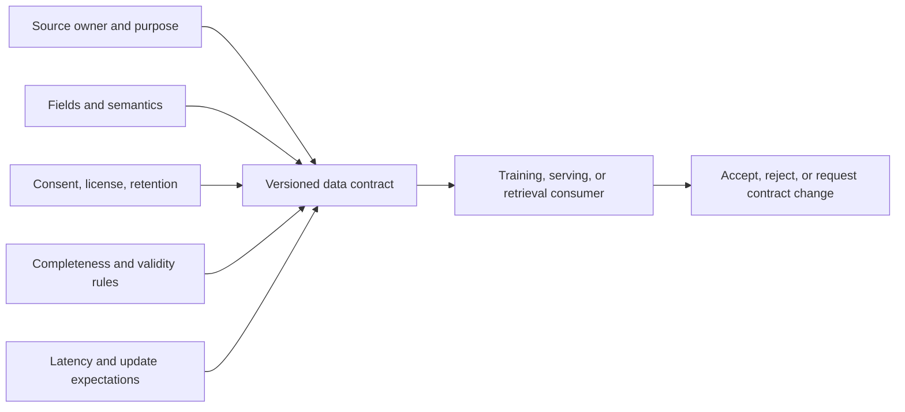
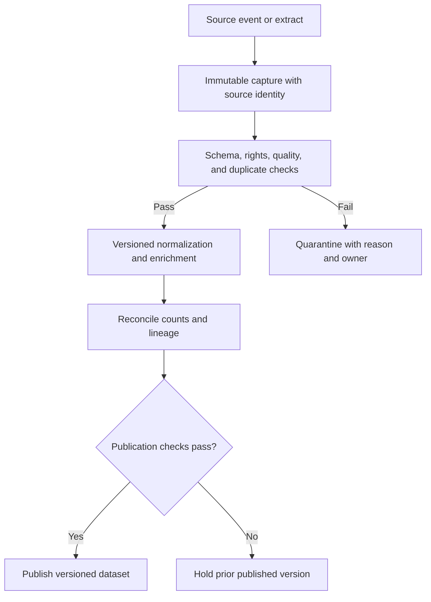
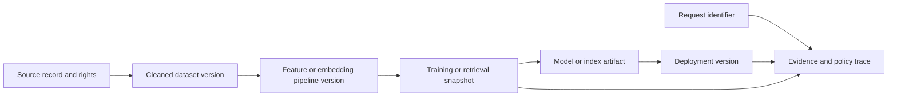
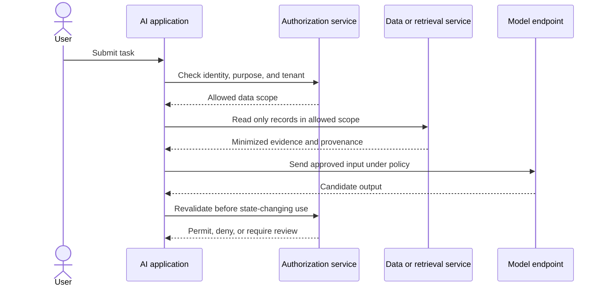

# AI Data Architecture and Preparation Boundaries

Part: [17 — AI Architecture](PART_OVERVIEW.md)

AI data architecture connects source systems to training, prediction, retrieval, and audit without treating every derived artifact as equally trusted or current. Its core decisions are where data is copied, transformed, authorized, versioned, refreshed, and deleted. Part 16 owns feature-engineering and embedding techniques; Part 06 owns database mechanics; this chapter designs their system boundaries and contracts.

## Define the Data Contract

Begin with the source owner, purpose, subject, sensitivity, permitted use, retention, freshness, and quality expectations. A schema alone is insufficient: record semantic meaning, time basis, null behavior, identity keys, and what a consumer must do when data is late or invalid. Training labels, online features, and retrieval documents have different update and rights implications even when they originate in the same system.

Assign an owner to each contract and publish compatibility expectations. A breaking semantic change can alter model behavior without changing the field type; for example, a status value can change meaning while remaining a string. Detect those changes through versioning, validation, and consumer review rather than relying only on structural schema checks.

## Separate Ingestion From Publication

Ingestion should preserve the source record and its provenance before transformation. Validate encoding, required fields, duplicate identity, temporal consistency, rights, and payload size. Route invalid or suspicious records to a quarantine path with a reason and owner. Do not let a partially validated batch become visible to training or retrieval simply because a pipeline stage completed.

Quarantine is an operational queue, not a deletion bin. Set retention, access, retry, and remediation rules. A failed record should be traceable to a source and reason, while sensitive content remains protected. Reprocessing must be idempotent or deduplicated so that retries do not create duplicate examples or documents.

## Preserve Lineage Across Derived Artifacts

Data provenance should remain connected through transformations. A training snapshot may produce a model; a source document may produce chunks, embeddings, and an index entry; an online request may combine several versions. Store stable identifiers and transformation versions so operators can answer which sources contributed to an artifact or response and what needs rebuilding after a correction or deletion.

Lineage is a graph because one source can feed many derived artifacts, and one artifact can depend on many sources. The graph supports impact analysis, reproducibility, deletion propagation, and incident investigation. It does not by itself prove that a transformation was correct; pair lineage with quality evidence and access controls.

## Enforce Access at Each Boundary

Access decisions should combine identity, purpose, tenant, data classification, and operation. Ingestion permission does not imply training permission; model-serving access does not imply retrieval access; and a derived embedding can still reveal sensitive information. Apply least privilege to pipelines and runtime services, and bind retrieval filters to trusted identity context rather than user-supplied metadata.

Minimize data before it crosses a provider or trust boundary. Redaction should be tested for both privacy leakage and utility loss; deleting a name does not anonymize a record if other fields re-identify the subject. Define whether prompts, outputs, embeddings, traces, and backups inherit the source classification and deletion policy.

## Make Freshness and Invalidation Explicit

Freshness is a product contract. Define maximum age, update delay, acceptable staleness, and behavior when a refresh fails. Retrieval indexes and cached features are derived copies that can become inconsistent with their sources. A refresh should publish a complete version or a controlled delta, record its watermark, and preserve a rollback point. Deletion and rights changes need propagation across every consumer and cache.

```mermaid
stateDiagram-v2
    [*] --> Current
    Current --> Refreshing: New source version or scheduled refresh
    Refreshing --> Validating: Build candidate derived data
    Validating --> Current: Checks pass and publish atomically
    Validating --> Stale: Checks fail; prior version retained
    Refreshing --> Stale: Refresh timeout or dependency failure
    Stale --> Refreshing: Retry within policy
    Current --> Invalidating: Deletion, rights change, or correction
    Stale --> Invalidating: Deletion, rights change, or correction
    Invalidating --> Restricted: Remove access and derived copies
    Restricted --> Current: Rebuild verified version
```

The state machine distinguishes stale-but-usable data from data that must be blocked. A stale policy document may be unsafe even if its age is small; a delayed aggregate feature may remain acceptable. Define this per data use, and surface freshness to downstream decisions rather than treating a successful pipeline run as proof of currentness.

## Worked Case: Product Catalog and Support Knowledge

A retailer uses catalog data for recommendations and support policies for answer retrieval. The catalog owner permits recommendation features but prohibits using customer purchase history for unrelated model training. Policy documents may be retrieved only for the employee's region and role. The architecture captures versioned source records, validates rights and quality, and publishes separately governed feature and document views.

When a product attribute is corrected, lineage identifies the recommendation feature snapshots and model-training datasets that need review; online serving can immediately suppress the incorrect attribute through a policy overlay. When a policy document is withdrawn, access is removed from the index and caches before a replacement is published. If the new index fails quality checks, support answers abstain or use the approved static policy page instead of silently serving withdrawn content.

## Review Questions

1. What must a data contract specify beyond field types?
2. Why should ingestion preserve an immutable source reference before transformation?
3. How do training permission and retrieval permission differ?
4. Which derived copies are affected by a source deletion or rights change?
5. What does the consumer do when freshness exceeds its contract?

An AI data architecture is trustworthy only when source meaning, permitted use, provenance, freshness, and access survive every transformation. Publish derived data behind validation gates, keep lineage actionable, and make stale or unauthorized data produce an explicit safe outcome.
