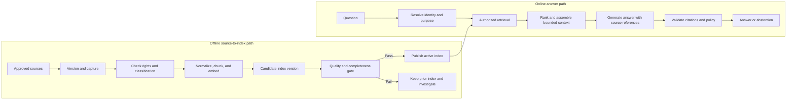
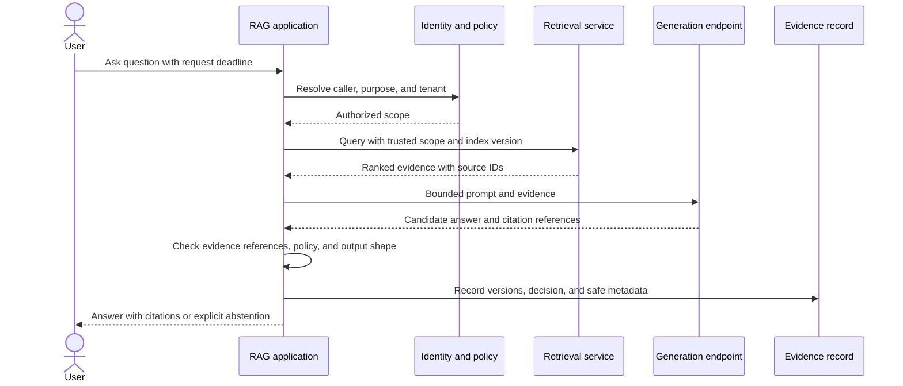
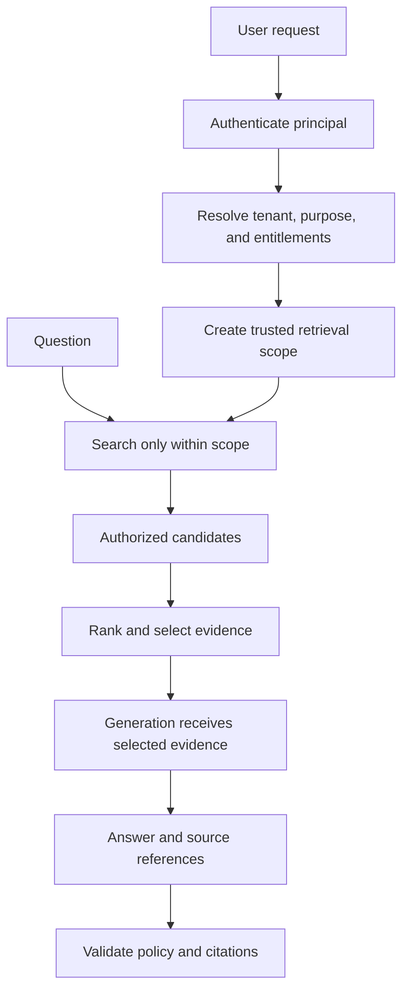

# Retrieval-Augmented Generation System Architecture

Part: [17 — AI Architecture](PART_OVERVIEW.md)

Retrieval-Augmented Generation (RAG) is a system path that supplies selected evidence to a generation model. Production quality depends on more than retrieval relevance: identity, source rights, index freshness, request budgets, citation provenance, and safe behavior when evidence is missing must hold end to end. Part 16 CH18 owns the RAG technique and Part 06 CH21 owns vector-index mechanics; this chapter owns their composition into an operable system.

## Separate the Offline and Online Paths

The offline path turns governed sources into a versioned retrieval artifact. The online path identifies the caller, retrieves only permitted material, assembles bounded context, generates an answer, validates its evidence, and returns a result or an explicit abstention. Separate these paths so document ingestion can be retried and audited without coupling it to user request latency.



Promote an index as a versioned artifact only after source counts, access metadata, retrieval tests, and freshness checks pass. Retain the prior index for rollback, but ensure a rollback cannot restore documents whose access rights have been revoked. Index rollback and rights rollback are different operations.

## Bound the Online Request

The online request has a finite deadline. Authentication, policy evaluation, retrieval, reranking, generation, and output checks consume that budget. Reserve time for validation and response delivery rather than letting model generation use the entire deadline. Set limits on retrieved documents, context size, model output, and retries; define which steps can be skipped safely and which failures require abstention.



The evidence record should capture the query and response identifiers, model and prompt versions, retrieval/index version, policy outcome, and source identifiers. Store raw content only when justified by purpose, consent, and retention rules. For streaming output, make clear whether citations are provisional until final validation; do not present unvalidated claims as approved answers.

## Make Authorization a Retrieval Property

Authorization must constrain candidate selection before text is sent to the model. Filtering after retrieval can leak content through prompts, traces, caches, or model-provider logs even when the final response omits it. Bind filters to server-validated identity and policy context; never trust a tenant, role, or document scope supplied only in the question.



The architecture should test cross-tenant queries, revoked permissions, missing metadata, and cache-key collisions. If the retrieval backend cannot enforce the required scope, place an authorization-aware service in front of it or choose a different isolation design; a prompt instruction is not an access-control mechanism.

## Preserve Citation and Grounding Provenance

The system should be able to map each returned citation to a source record, source version, location, and retrieval event. A citation that points to a document without showing the relevant passage may not help a reviewer verify the claim. Keep the distinction between “source retrieved,” “claim supported,” and “claim correct”: retrieval provenance enables inspection but does not itself establish truth.

```mermaid
flowchart LR
    Source[Source record and version] --> Chunk[Passage ID and offsets]
    Chunk --> Retrieval[Request-specific retrieved evidence]
    Retrieval --> Context[Context position and transformations]
    Context --> Claim[Generated claim]
    Claim --> Citation[Returned citation reference]
    Citation --> Reviewer[Human or automated verification]
    Reviewer --> Outcome[Supported, unsupported, or unresolved]
```



Use stable source identifiers and offsets that survive formatting changes where possible. When a document is replaced, do not let an old citation silently resolve to new content. Retain a version reference or indicate that the cited source is no longer current. If evidence conflicts, show the conflict or abstain instead of blending incompatible versions into a confident answer.

## Design Freshness, Revocation, and Rollback

Freshness is end-to-end: source change detection, ingestion, index publication, cache invalidation, and user-visible staleness. Define maximum age per source class and an explicit mode when the active index exceeds it. A legal or safety policy may require blocking on stale data; low-impact informational content may permit a labeled stale response.

```mermaid
stateDiagram-v2
    [*] --> Active
    Active --> Building: Source update received
    Building --> Candidate: Validate rights, counts, and retrieval tests
    Candidate --> Active: Atomic promotion
    Building --> Active: Build fails; keep known-good version
    Active --> Restricted: Rights revoked or source withdrawn
    Restricted --> Rebuilding: Remove affected passages and caches
    Rebuilding --> Active: Verify replacement index and policy
    Active --> Stale: Freshness threshold exceeded
    Stale --> Building: Retry refresh
```

On revocation, restrict access immediately where feasible, then remove derived passages, embeddings, caches, and backups according to the applicable policy. If deletion misses the required window, create an owned incident; keep affected answers blocked until remediation. A successful index build does not prove that excluded or revoked content is absent; verify with source-to-index reconciliation and targeted queries.

## Failure Behavior and Human Fallback

| Failure | Unsafe shortcut | Safer behavior |
|---|---|---|
| Identity or policy service unavailable | Search without filters | Deny or use a narrowly bounded, previously authorized scope only if policy permits |
| No relevant evidence | Generate from model memory as if grounded | Abstain, ask a clarifying question, or route to support |
| Index older than source policy allows | Return stale policy without warning | Block, label staleness, or use approved fallback source |
| Generation timeout | Retry without an end-to-end budget | Return partial status or defer asynchronously under a bounded retry policy |
| Citation validation fails | Strip citations and return the answer | Reject the answer or require review |

Retries must respect the caller's deadline and provider limits. Avoid fallback to a model or data source with weaker authorization or different retention terms. The degraded mode should be explicit to callers and measurable to operators.

## Worked Case: Employee Policy Assistant

An employee asks whether a travel expense is reimbursable. The application authenticates the employee, derives country and role from trusted identity data, and retrieves only current policies available to that scope. The generation step drafts an answer with source references. The application checks that every citation resolves to the retrieved version and that the response contains no unsupported approval promise.

The assistant routes conflicting policies to finance and explains the conflict. If the policy index exceeds its freshness threshold, the system links to the authoritative policy portal or abstains. If access metadata is missing, the document is excluded and the ingestion owner is notified. Evaluation tracks source recall, citation validity, answer support, unauthorized retrieval attempts, abstention quality, and end-to-end latency.

## Review Questions

1. Which controls belong on the ingestion path and which on each online request?
2. Why is post-generation authorization too late to prevent data exposure?
3. What evidence lets an auditor reproduce the sources behind an answer?
4. How do rollback and rights revocation differ?
5. What does the user see when evidence is missing, stale, or conflicting?

An operable RAG system is a governed data and request architecture with generation inside it. Separate indexing from serving, enforce identity before retrieval, preserve source-version provenance, and make stale, unauthorized, or insufficient evidence lead to an explicit safe outcome.
