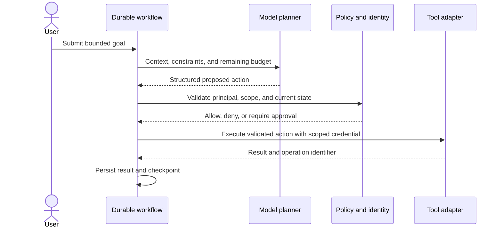
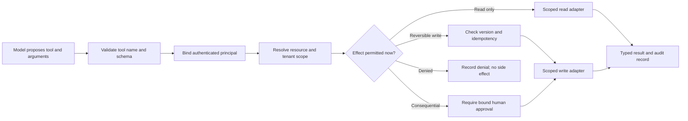
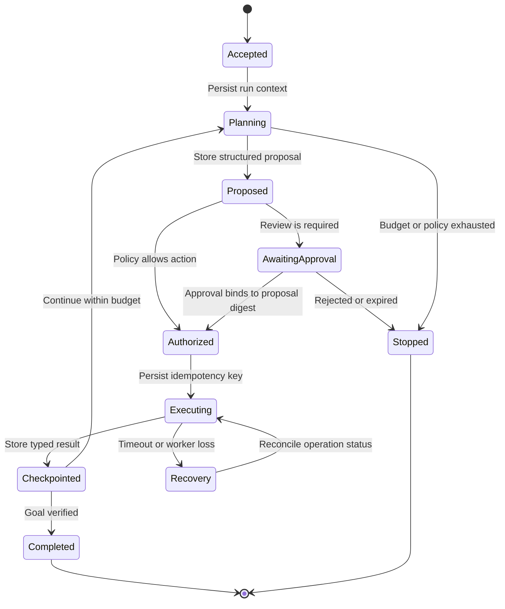
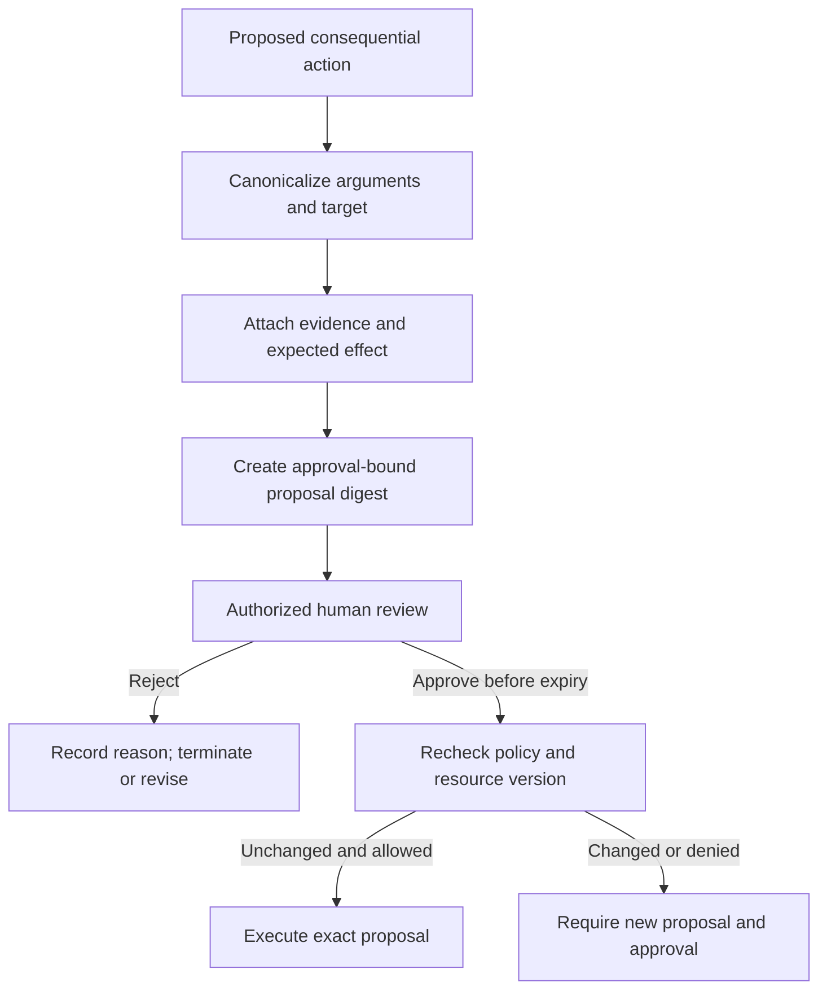
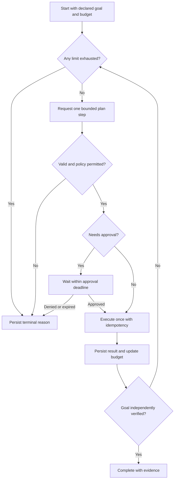

# Agentic System Architecture and Tool Boundaries

Part: [17 — AI Architecture](PART_OVERVIEW.md)

An agentic workflow lets a model select among possible next steps, often including tool calls. Production architecture must prevent that flexibility from becoming uncontrolled authority. The system owns identity, policy, durable state, action limits, approval, idempotency, and termination; the model proposes actions within that envelope.

Part 16 CH21 owns agent mechanics such as planning, memory, and tool calling. Part 15 owns security foundations, and Part 07 owns distributed workflow reliability. This chapter composes those foundations into bounded system boundaries.

## Separate Planner From Executor

The planner interprets task context and proposes a structured next action. The executor is ordinary application code: it validates the proposal, resolves the caller's identity, checks policy and current state, invokes only an allowlisted adapter, and records the result. This separation prevents free-form model text from becoming a command and gives the architecture a stable place to enforce permissions and budgets.

Do not give the planner broad credentials or direct network access. Tool adapters should expose narrow operations with explicit input schemas, timeouts, rate limits, and typed outcomes. Validate every argument and output; the model's apparent confidence does not alter authorization.

## Put a Trust Boundary Around Tools

Every tool call is a potential data disclosure or state change. Classify tools by effect, scope, reversibility, and sensitivity. Read-only lookup is not automatically harmless: it can reveal another tenant's data. Write operations need stronger controls, such as resource-scoped authorization, precondition checks, approval, idempotency, and compensating actions.

The tool catalog is part of the security boundary. Remove unused tools, avoid generic “execute query” or “run shell” capabilities, and keep secrets outside model context. If a tool returns untrusted content, label it as data and prevent it from changing system instructions or authorization decisions.

## Persist State and Checkpoints

An agent run spans multiple model and tool calls, so process memory is not enough for recovery or audit. Persist a run identifier, initiating principal, goal, policy version, step number, input references, proposed action, approval state, tool idempotency key, result, and checkpoint. Minimize retained content and apply purpose-specific expiry; long-lived memory should not become an unreviewed secondary data store.

The checkpoint boundary must follow an action result, not merely precede the tool call. On recovery, query the external system using the idempotency key or operation identifier before retrying. If the tool cannot determine whether a side effect occurred, stop for reconciliation instead of assuming failure and repeating it.

## Bind Human Approval to the Action

Approval should present the exact operation, target resource, material parameters, evidence, expected effect, and expiry. Bind the approval to a digest of that proposal and to the current resource version. If the planner changes the amount, destination, or scope, the prior approval no longer applies. The reviewer must be able to reject or edit through a controlled workflow and see the consequences of approval.

Human approval is not a substitute for technical controls. Reviewers can miss details under time pressure, so the executor still enforces limits and validates state. For urgent actions, define an emergency path with named authority and post-action review rather than silently bypassing the ordinary approval contract.

## Bound Loops and Termination

Every run needs limits on steps, wall-clock time, model tokens, tool calls, spend, retries, and concurrency. Set independent limits: a low token budget does not prevent repeated low-cost tool actions, and a step limit does not prevent one expensive call. Define terminal states for completed, declined, approval-required, timed out, budget-exhausted, policy-denied, and uncertain outcomes.

Measure loops that stop without progress, repeated equivalent calls, approval abandonment, side-effect retries, and cost per completed task. A termination reason should be visible to users and operators. Never report success merely because the model emitted a completion phrase; verify the intended state through the authoritative system.

## Worked Case: Employee Access Request

An employee asks an assistant to add a colleague to a project group. The workflow resolves the employee and target group using identity services, checks whether the requester can initiate the change, and asks the planner to create a structured membership proposal. A tool adapter verifies the target group and current membership. Because the action changes access, an authorized owner reviews the exact user, group, duration, and justification.

After approval, the executor rechecks group version and policy, then issues an idempotent membership operation. It persists the operation identifier before reporting success. If a worker crashes after the request times out, recovery queries membership state before retrying. If the group changed while awaiting approval, the proposal expires and must be reviewed again. The model never sees credentials and cannot choose an arbitrary identity endpoint.

## Review Questions

1. Which controls belong in the executor rather than the planner?
2. What information binds approval to one exact action?
3. How does a workflow recover when the side effect may have succeeded?
4. Which independent budgets prevent runaway cost and repeated side effects?
5. What authoritative signal proves that the requested goal completed?

Safe agent architecture makes the model's authority narrower than its ability to produce text. Keep execution deterministic, bind actions to identity and current state, persist recovery checkpoints, and make approval and termination explicit.
