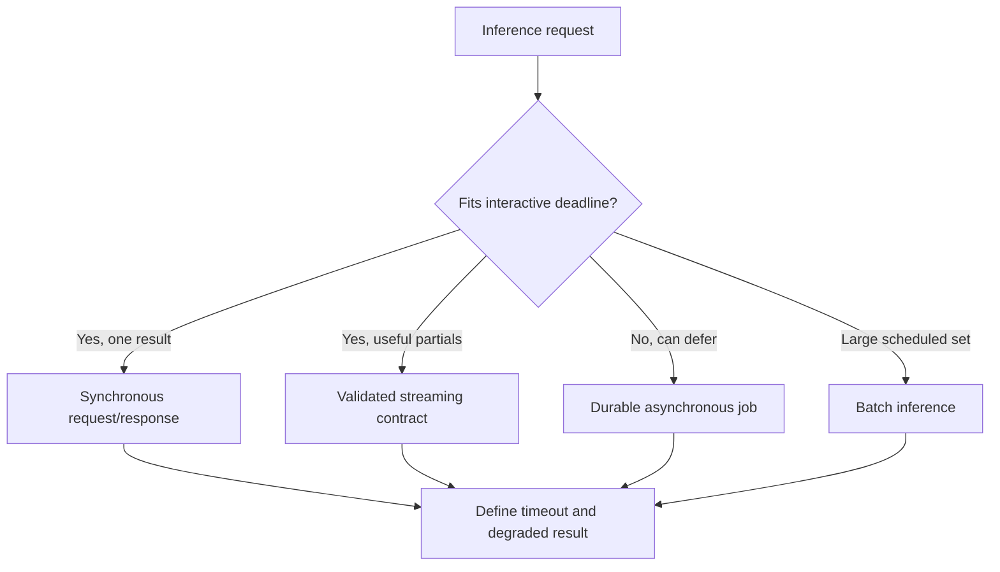
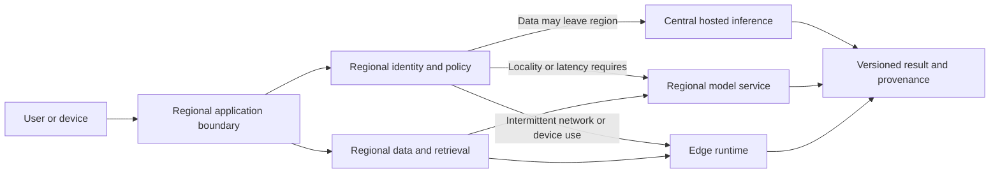
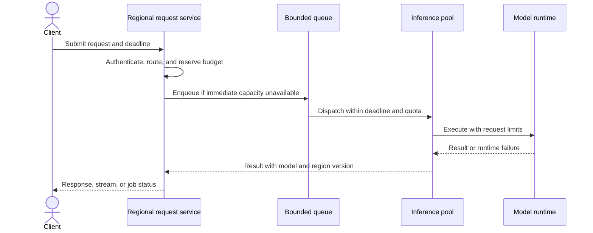
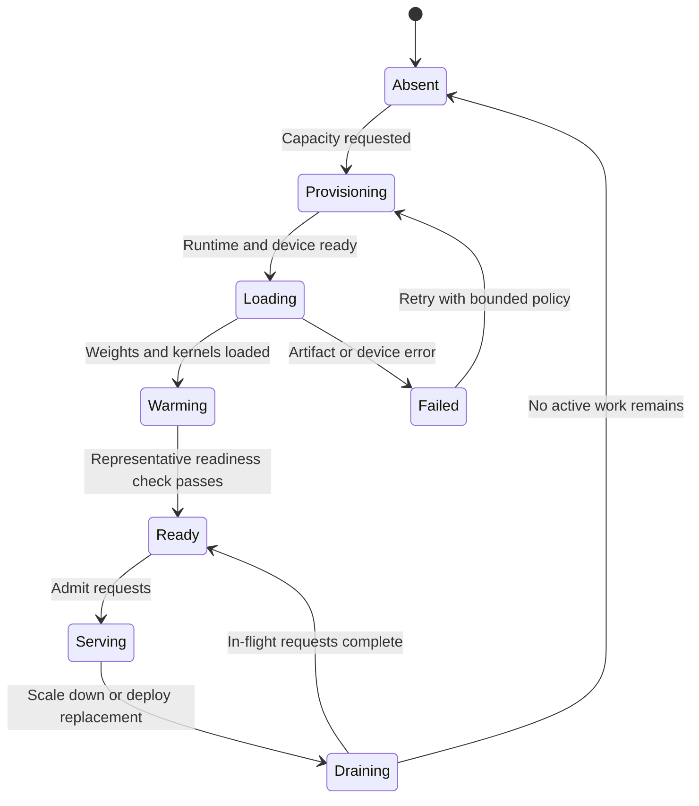
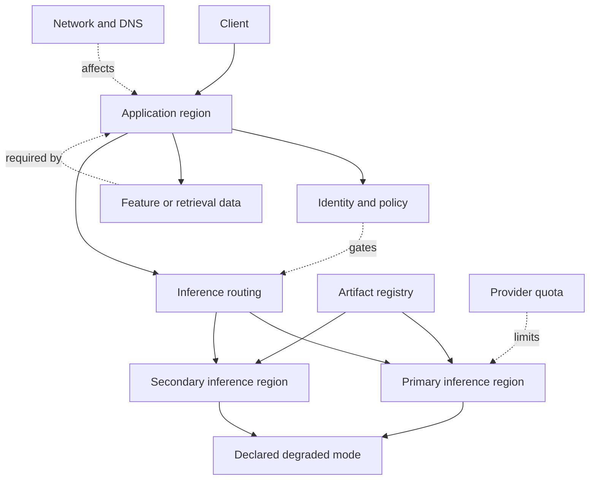

# Inference Serving and Model Placement

Part: [17 — AI Architecture](PART_OVERVIEW.md)

Inference placement determines where requests meet model compute, data, and policy controls. Hosted, self-managed, regional, and edge deployment choices change latency, locality, capacity, availability, and operating responsibility. Part 16 owns serving implementations and optimization mechanics; this chapter selects a system topology from workload requirements.

## Choose the Request Contract First

The user-visible contract determines whether inference should be synchronous, asynchronous, streamed, or batch. A synchronous call is appropriate when the complete path fits a firm deadline and the caller can tolerate a single response. Asynchronous jobs suit longer work when the caller can poll or receive a callback. Streaming improves perceived responsiveness for incremental output, but requires cancellation, partial-result, and final-validation semantics. Batch inference is appropriate when work can be grouped and delayed.

Streaming should not bypass output validation. If tokens are shown before the final check, identify which content is provisional and prevent it from triggering state changes. Asynchronous jobs need durable status, cancellation, idempotency, and a retention policy for inputs and outputs. Batch jobs need snapshot and publication controls as described in CH03.

## Place Compute Near Constraints

Placement is a multi-constraint decision. Centralized hosted inference simplifies capacity operations and model updates, but adds network distance and a provider dependency. Regional deployments can reduce round trips and keep processing near governed data, while increasing fleet and release complexity. Edge inference can operate with intermittent connectivity or strict locality, but device capacity, update cadence, and physical trust become material constraints.

Data gravity matters: moving a large corpus to inference can cost more, expose more information, and increase staleness compared with moving a bounded request to the data. Define which fields may cross each network boundary, whether embeddings or outputs inherit source restrictions, and how model artifacts reach a region or device. A local model does not remove the need for access control or secure updates.

## Compare Serving Modes and Capacity

Serving can use a managed endpoint, a shared model service, an isolated deployment, or an edge runtime. Shared serving improves utilization but creates noisy-neighbor and quota risks; isolated capacity can provide stronger performance predictability at higher cost. Capacity planning must use peak concurrency and request shape, not average requests per second alone. Long prompts, generated output, and model load time change resource demand.

Queues absorb short bursts only when queue delay stays inside the request contract. Set admission limits and explicit overload responses; otherwise the queue converts overload into stale work and timeouts. Isolate workloads by tenant, sensitivity, and service objective where one caller can consume shared capacity or influence another tenant's latency.

## Manage Cold and Warm Model States

Loading weights, compiling kernels, initializing accelerators, and warming caches can make a new instance unavailable long after the process starts. Readiness should mean the model is loaded and can serve a representative request, not merely that the container is alive. Warm pools reduce cold-start latency but consume idle capacity. Scale-to-zero lowers idle cost but may violate tight first-request objectives.

Track startup duration by model version and hardware class. Use a readiness gate, bounded warm pool, rollout surge capacity, and draining behavior for active streams. If the platform cannot provide a warm instance within the service objective, the contract should route to a different region, a smaller compatible model, or an explicit deferred response.

## Map Failure Domains and Dependencies

Inference availability depends on more than the model endpoint: identity, network path, DNS, provider quota, artifact registry, feature or retrieval store, runtime fleet, and policy service can all prevent a request from completing. Make these dependencies visible and decide which are on the critical path. A multi-region design helps only when failover data, capacity, policy, and credentials are independently available and compliant.

Test provider timeout, region loss, quota exhaustion, stale artifacts, and identity-service failure. Avoid retry storms that multiply requests during a dependency outage. Fallback selection must preserve data policy and output expectations; routing to a region with different residency or model behavior is a governed decision, not a transparent implementation detail.

## Worked Case: Field Inspection Assistant

A field technician needs an answer while connectivity is intermittent. The application stores a small, approved set of manuals and a compatible compact model on the device for lookup and basic summarization. When connected, a regional service can retrieve current manuals and use a more capable model. Device output is labeled with its model and content version; uncertain or safety-critical questions route to the authoritative procedure or a human specialist.

The team tests offline behavior, model update rollback, device loss, stale content, and reconnection synchronization. It does not send restricted inspection notes to the central endpoint unless policy permits. Regional inference is selected for normal connected use, while edge placement covers the explicit outage and latency scenario rather than serving as an assumed performance upgrade.

## Review Questions

1. Which request contract matches the user's latency and completion expectations?
2. What data or policy constraints determine regional or edge placement?
3. How is model readiness distinguished from process liveness?
4. Which dependencies must be independent for regional failover to work?
5. What does a client observe when capacity is unavailable or a model is warming?

Place inference by the request contract, data boundary, capacity shape, and recovery requirement. Make cold starts and failure dependencies visible, and ensure each placement has a policy-compatible degraded mode.
