# Inference Serving and Model Placement

Part: [17 — AI Architecture](PART_OVERVIEW.md) · Status: Revised (in-depth rewrite)

## 1. Introduction

Every AI feature reaches a point where a request meets a model. The architect decides how the request travels there, how the answer comes back, and which machine, building, country, or device does the computing. These decisions are made early, they are expensive to reverse, and they shape latency, cost, legal exposure, and the failure behavior that users see. A team that picks a hosted provider API because it was the quickest way to a demo may find a year later that its largest customer requires processing inside the European Union, that its voice feature needs a connection model the gateway cannot hold open, and that its monthly invoice has passed the cost of a small GPU cluster. A team that starts with its own GPUs may find that it has built a capacity-planning and on-call burden larger than the product it serves.

This chapter teaches the placement and interaction architecture for inference. It starts from the request contract, because the way a caller expects to receive an answer (a single response, a stream of tokens, a job id to poll, a file of results tomorrow, or a bidirectional audio channel) constrains everything downstream. It then covers the places where inference can run (a provider's hosted API, provider-managed dedicated capacity, a cloud machine-learning platform endpoint, GPUs you operate in your cloud account, on-premises hardware, edge servers, and end-user devices), and the criteria for choosing among them. It teaches capacity as a queueing problem with worked numbers, shows how to host several models in one fleet, how cold starts affect the architecture, how tenants are isolated on shared capacity, which dependencies sit on the serving path, how to deploy new models into serving safely, how to secure and observe the endpoints, and how to compare the cost of hosted tokens, self-hosted GPUs, and reserved capacity. It ends with three worked placement decisions written as Architecture Decision Records (ADRs), a checklist, and exercises.

### 1.1 Reader outcomes

After this chapter you should be able to:

1. Choose among synchronous, streaming, asynchronous, batch, scheduled bulk, and real-time bidirectional interaction modes from a stated latency and completion requirement, and draw the request path for each.
2. Identify the protocol and gateway settings (idle timeouts, buffering, keepalives, retry rules) that decide whether a long-lived stream survives in production.
3. Compare placement options on latency, data locality, data gravity, sovereignty, throughput, burstiness, cost, availability, operational maturity, isolation, and model licensing, and record the result as an ADR with rejected alternatives.
4. Compute a latency budget by geography from round-trip-time (RTT) arithmetic, and design residency-pinned routing and failover.
5. Size a serving fleet from a product forecast using Little's Law and utilization targets, and explain why tail latency rises sharply as utilization approaches one.
6. Reason about multi-model hosting, model loading, warm pools, and scale-from-zero with arithmetic.
7. Map the dependencies of the serving path into failure domains and estimate blast radius.
8. Write stimulus, response, and measure scenarios for region outage, GPU shortage, cold-start storm, long-context spike, and provider rate limit.

### 1.2 Scope and ownership

This chapter owns the placement decision and the interaction architecture. The mechanics of serving engines, batching, caches, and quantization belong to Part 16, and the gateway belongs to a neighboring chapter. The table below shows where each neighboring topic is taught, so this chapter recaps and links instead of repeating.

| Topic | Owner | What this chapter does with it |
| --- | --- | --- |
| Serving engines, continuous batching, paged KV cache, speculative decoding, quantization, capacity math per GPU | [Part 16 CH28: Inference Optimization and Model Serving](../16_AI_and_GenAI/CH28_Inference_Optimization_and_Model_Serving.md) | Recap in two or three sentences, then use the measured throughput as an input to fleet sizing |
| AI infrastructure and platform products (GPUs, cloud AI platforms, model catalogs) | [Part 16 CH27: AI Infrastructure and Platform Components](../16_AI_and_GenAI/CH27_AI_Infrastructure_and_Platform_Components.md) | Use as the catalog of options; this chapter supplies the decision method |
| Model gateway, routing policy, provider adapters, circuit breakers | [CH08 Model Gateway, Routing, and Fallback Architecture](CH08_Model_Gateway_Routing_and_Fallback_Architecture.md) | Describe the serving-side effect of gateway choices and defer the gateway design |
| Resilience patterns for AI workloads (retries, bulkheads, degradation ladders) | [CH13 Reliability and Resilience Patterns for AI Workloads](CH13_Reliability_and_Resilience_Patterns_for_AI_Workloads.md) | Apply to placement-level failover; defer the pattern catalog |
| Platform and model lifecycle (registry, promotion, rollback) | [CH10 AI Platform and Model Lifecycle Architecture](CH10_AI_Platform_and_Model_Lifecycle_Architecture.md) | Cover only how a model version enters a serving fleet |
| Cost, performance, sustainability decisions | [CH14 AI Cost, Performance, and Sustainability Decisions](CH14_AI_Cost_Performance_and_Sustainability_Decisions.md) | Provide the placement-specific break-even; defer portfolio cost governance |
| Security, privacy, governance | [CH12 AI Safety, Security, Privacy, and Governance Architecture](CH12_AI_Safety_Security_Privacy_and_Governance_Architecture.md) | Cover serving endpoint security and tenant isolation; defer policy and threat modeling |
| Evaluation and observability of AI quality | [CH11 Evaluation and Observability Architecture for AI Systems](CH11_Evaluation_and_Observability_Architecture_for_AI_Systems.md) | Cover serving SLOs (latency, goodput, errors); defer quality evaluation |
| Reference architectures and workload qualification | [CH03 Reference Architectures](CH03_Reference_Architectures_for_Predictive_Generative_and_Agentic_Systems.md), [CH01 Workload Qualification](CH01_AI_Workload_Qualification_and_Architecture_Foundations.md) | Take the workload class as input |
| Retrieval-augmented generation and agent runtime | [CH05 RAG System Architecture](CH05_Retrieval_Augmented_Generation_System_Architecture.md), [CH06 Agentic System Architecture](CH06_Agentic_System_Architecture_and_Tool_Boundaries.md) | Treat retrieval and tool calls as dependencies on the serving path |

A short recap of Part 16 is enough to start. A large language model (LLM) generates text one token at a time. The first phase, called prefill, processes the whole prompt in parallel and fills a key-value (KV) cache that holds the attention state of the prompt. The second phase, decode, produces one token per step, reading the weights and the KV cache each step. Prefill is limited mostly by compute, and decode is limited mostly by memory bandwidth. Serving engines such as vLLM, TensorRT-LLM, and SGLang batch many requests together at the granularity of a decode step (continuous batching) so the weights are read once for many sequences. Quantization (storing weights in 8-bit or 4-bit formats) shrinks memory and raises throughput at some quality cost. Part 16 CH28 teaches all of this, with the capacity formulas. This chapter uses three numbers from that work as inputs: the time to first token (TTFT), the per-token decode latency, and the sustained tokens per second per accelerator at a latency target.

### 1.3 Terms used in this chapter

The vocabulary below is used consistently. Other terms are expanded at first use.

| Term | Meaning in this chapter |
| --- | --- |
| Request contract | The promise to the caller about response shape, deadline, partial results, retries, and failure signals |
| TTFT | Time to first token: from request arrival at the edge of your system to the first generated token reaching the client |
| TPOT | Time per output token after the first (also called inter-token latency) |
| Goodput | Requests completed within their latency objective per second, as opposed to raw throughput |
| Replica | One serving process that holds a model copy on one or more accelerators |
| Pool | A set of replicas serving the same model version and hardware class |
| Region | A cloud region or equivalent geographic facility with independent failure behavior |
| Residency | A rule that data, or processing of data, stays within a legal or contractual boundary |
| Data gravity | The tendency of computing to move toward large or hard-to-move datasets |
| Admission control | The decision to accept, queue, degrade, or reject a request on arrival |

## 2. The Serving Path and Where Time Goes

Before choosing a placement, an architect needs a model of the path a request takes and the cost of each hop. The model below is deliberately plain. It applies to a hosted API and to a fleet you run, because the same segments exist in both. In a hosted API, you do not operate the segments inside the provider, but you still pay for them in latency and you still depend on them for availability.

### 2.1 Anatomy of a request

A streaming chat request through a typical enterprise system passes through these segments in order:

1. **Client to edge.** The client opens or reuses a connection to a public endpoint. A new connection costs a TCP handshake (one RTT) and a Transport Layer Security (TLS) 1.3 handshake (one more RTT), so two RTTs before the first request byte is sent. A reused connection costs none of that. HTTP/3 over QUIC combines transport and cryptographic handshakes and can resume with zero round trips in some cases.
2. **Edge to application.** A content delivery network, web application firewall, or load balancer forwards the request. This adds a few milliseconds and, importantly, introduces timeout and buffering behavior that matters for streams (Section 4).
3. **Application logic.** Authentication, authorization, request validation, rate limiting, prompt assembly, and policy checks. Typically tens of milliseconds, but a retrieval step (CH05) can add 50 to 300 ms.
4. **Gateway and routing.** The model gateway (CH08) selects a model and backend, applies quotas, and may add a cache lookup.
5. **Queue.** If no replica has capacity, the request waits. This is the segment that grows without bound under overload.
6. **Prefill.** The model processes the prompt. Time grows roughly linearly with prompt length for moderate lengths, and with a quadratic attention term at very long lengths.
7. **Decode.** Tokens stream back at TPOT intervals. Total decode time is roughly the number of output tokens times TPOT.
8. **Return path.** Tokens flow back through the gateway, application, edge, and client, each of which can buffer.
9. **Post-processing.** Output validation, citation checks, logging, and any state changes. For streams, some of this happens after the user has already seen text.

The segments sum to the latency the user sees. The architect's levers differ by segment: placement changes segments 1, 2, and 8 (distance) and sometimes 3 (data locality); capacity changes segment 5; engine and hardware choices change segments 6 and 7; the interaction mode changes what the user perceives as latency.

### 2.2 Two latencies: time to first token and time to last token

Interactive users judge a streamed answer mostly by the TTFT and by whether the text then arrives at least as fast as they read. A reader consumes roughly four to eight words per second, which is about five to ten tokens per second, so a TPOT of 50 ms (20 tokens per second) already outpaces reading. This is why streaming is the default for chat: the full answer of 300 tokens at 25 ms per token takes 7.5 seconds to complete, which feels slow as a blocking call but feels fast when the first words appear after 600 ms.

The total latency of a non-streamed call is the sum of everything including the full decode. For a call that returns a structured result consumed by code (a classification, a JSON extraction), streaming gives no benefit, because the program cannot act on a partial result. For such calls, only the total matters, and the output length is a direct cost lever: asking for a one-word label instead of a paragraph of reasoning cuts decode time to a few steps.

Table 2.1 shows an illustrative budget for one streamed request with a retrieval step. The numbers are examples, not measurements.

| Segment | Time (ms) | Notes |
| --- | ---: | --- |
| Client to edge, new connection (3 RTT at 25 ms with TLS 1.3 and request) | 75 | Zero extra on a reused connection except the request RTT of 25 |
| Application logic and authorization | 40 | Includes policy decision |
| Retrieval (same region as model) | 60 | Cross-region retrieval would add one inter-region RTT |
| Queue at 60 percent utilization, p95 | 80 | Grows steeply above 80 percent (Section 9) |
| Prefill, 3,000-token prompt | 350 | Depends on hardware and model |
| **TTFT, p95 (approximate)** | **605** | Matches the first row of the script output in Section 7.3 |
| Decode, 299 further tokens at 25 ms | 7,475 | Streamed, so the user reads while it arrives |

The arithmetic for the TTFT row: 75 + 40 + 60 + 80 + 350 = 605 ms. The 75 ms is three RTTs of 25 ms: two for the TCP and TLS handshakes and one for the request and first byte back. The script [01_latency_budget.py](../code/python/inference-placement-chapter/01_latency_budget.py) computes this budget for nine user-region combinations.

### 2.3 Why placement matters more than model speed for some budgets

A 1,200 ms TTFT objective with 350 ms of prefill and 80 ms of queueing leaves 770 ms for everything else. A European user connecting to a region in Asia pays 180 ms RTT, and on a new connection pays three of them, 540 ms, before any compute starts. In that case the network consumes most of the remaining budget, and no engine optimization can recover it. The reverse also holds: for a batch summarization job running overnight, network distance is irrelevant, and the correct placement criterion is price per token and capacity availability. The point of the chapter is to make this reasoning explicit and repeatable rather than a matter of habit.

## 3. Interaction Modes

The interaction mode is the contract between caller and system about how a result is delivered. It is chosen from the user's needs and the caller type, and it should be chosen before placement, because some modes rule out some placements. Real-time voice, for example, cannot tolerate a placement whose RTT alone exceeds the conversation's turn-taking budget.

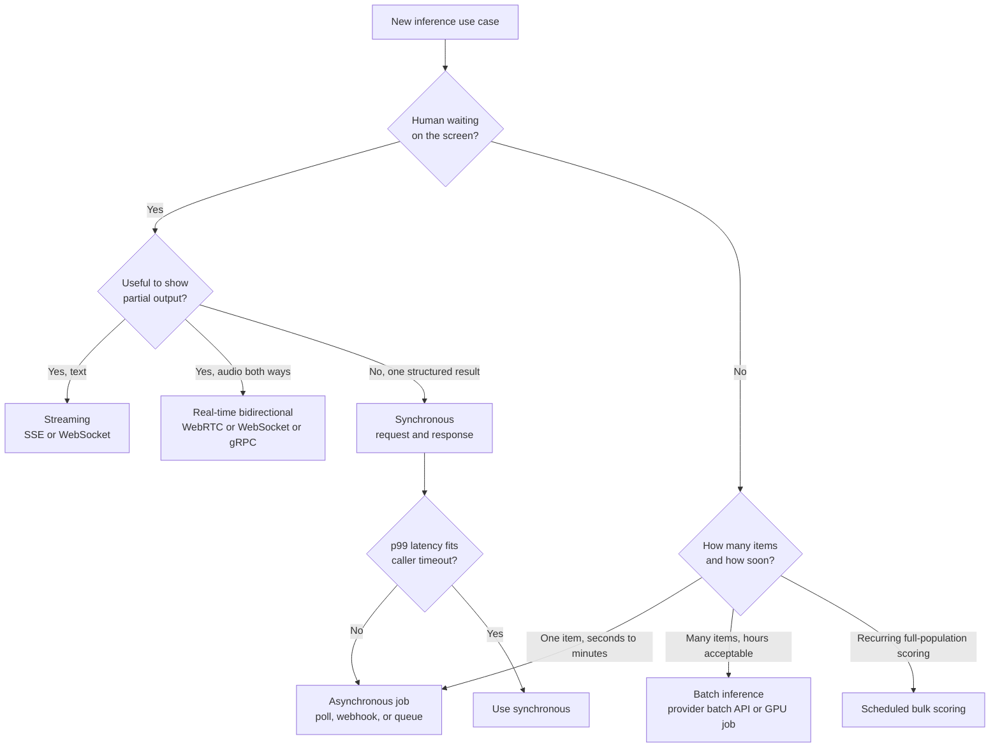

The flowchart gives the first split: whether a human is waiting. When a human waits, the decision is between a single result, an incremental text stream, and a continuous audio exchange. When no human waits, the decision depends on volume and deadline. A synchronous call whose p99 latency exceeds the caller's timeout falls back to an asynchronous design, which is a common migration path as a prototype grows.

### 3.1 Synchronous request and response

A synchronous call holds the caller's connection open until the complete answer is ready. It is the simplest contract: one request, one response, one status code, and standard retry and timeout semantics. It fits when the whole path fits a firm deadline, usually under a few seconds, and when the consumer is code or a user interface that needs the complete result before it can proceed. Examples are intent classification before routing, structured field extraction, moderation checks, embedding generation for a query, and short rewrites.

The costs are tied to the slowest requests. The caller must set a timeout, and every layer in between (client library, proxy, load balancer, gateway) has its own timeout. The effective timeout is the smallest of them, and the lowest-numbered layer to fire determines what the client sees. A generation that takes 40 seconds will be cut off by a 30-second gateway limit even though the model finished. The architectural rules for synchronous inference are:

- Bound the output length (`max_tokens` or equivalent) so the worst-case latency is known. Worst-case latency is roughly the TTFT plus the maximum output tokens times TPOT. With 25 ms TPOT and a 500-token cap, the cap implies 12.5 seconds of decode, which is the value to compare to the timeout.
- Set the client timeout slightly above the server's own deadline so the server can return a clean degraded response instead of the client abandoning the call.
- Pass a deadline, not just a timeout, through each hop (for example, a request header with the absolute deadline time). Each hop subtracts its own work and stops work when the deadline has passed. Without deadline propagation, the model keeps generating for a client that left long ago, wasting capacity that other requests are queued for.
- Make the endpoint idempotent where possible, or accept an idempotency key (Section 4.5).

A synchronous call fails the contract when the response time distribution has a long tail. A generation task whose p50 is 3 seconds and whose p99 is 45 seconds is a poor fit, because the caller's timeout must cover the tail or the tail fails. That is the signal to move to streaming or to an asynchronous design.

### 3.2 Streaming

Streaming sends output in increments while generation continues. It improves perceived latency, lets users stop a wrong answer early, and keeps connections active, which also defeats some idle timeouts. It adds state to the contract: what the client has seen, what happens if the stream breaks, and whether the final answer differs from the partial one.

Three transports dominate.

**Server-sent events (SSE).** SSE is a one-way stream from server to client over a normal HTTP response with the `text/event-stream` content type. The server writes lines of the form `data: ...` separated by blank lines and keeps the response open. The browser `EventSource` API handles parsing and automatic reconnection, and sends the last seen event id in a `Last-Event-ID` header on reconnect so a server can resume. SSE works through most HTTP proxies, uses standard authentication, and is simple to operate. Its limits: it is one-directional (the client sends a new HTTP request to cancel or to send follow-up input), `EventSource` in browsers cannot set custom headers or use the POST method (so many LLM clients use `fetch` with a readable stream and parse the format themselves), and over HTTP/1.1 browsers limit concurrent connections per origin to about six, which matters for pages with several streams. HTTP/2 multiplexes streams over one connection and removes that limit. Most hosted LLM APIs use SSE for streaming responses, which is a good reason to choose it as the default for text.

**WebSocket.** A WebSocket upgrades an HTTP connection to a persistent, full-duplex, message-based channel. It fits when the client sends messages during generation, for example interrupting, sending tool results, or streaming audio. It also supports binary frames. The costs are operational: the connection is stateful, so load balancers need to handle upgrades and long idle periods, authentication happens once at the handshake (so token expiry mid-session needs a plan), and scaling means holding many open sockets per node. There is no built-in resume; the application defines message ids and replay.

**gRPC streaming.** gRPC runs over HTTP/2 and supports server streaming, client streaming, and bidirectional streaming with typed messages from Protocol Buffers. It suits service-to-service paths, such as a gateway talking to an inference server, and it has first-class deadline and cancellation propagation. Browsers cannot use native gRPC directly (they need gRPC-Web or a proxy), so it is rare at the public edge, but it is common behind the gateway. Many inference servers expose gRPC for this reason.

The decision among them follows the direction of data and the client type: server-to-browser text goes over SSE; bidirectional or audio goes over WebSocket or WebRTC; gateway-to-server goes over gRPC or streamed HTTP.

#### 3.2.1 Backpressure

A stream has a producer (the model) and a consumer (the client), and they run at different speeds. The model generates 40 tokens per second; a client on a poor mobile network may read at a fraction of that. If the server ignores this, tokens accumulate in buffers: kernel send buffers, proxy buffers, and application memory. Backpressure is the mechanism by which a slow consumer slows or stops the producer.

TCP provides the lowest layer: when the receiver's window fills, the sender's `write` blocks or reports that it would block. The architecture question is whether each layer above respects that signal. Three behaviors are common:

- **Proxies that buffer the whole response.** A reverse proxy configured to buffer upstream responses (for example, Nginx's default `proxy_buffering on`) holds the stream until a buffer fills or the response ends, defeating streaming and showing the user nothing for seconds. The fix is to disable buffering for streaming routes (Nginx honors an `X-Accel-Buffering: no` response header and the `proxy_buffering off` directive) and to flush after each event.
- **Servers that generate regardless of consumption.** A model server that decodes at full speed into an unbounded in-memory queue will exhaust memory when thousands of slow clients connect, and keep consuming GPU for output nobody reads. Use a bounded per-connection buffer. When it fills, either pause reads from the engine for that sequence, or cancel the generation and return an error. Pausing a single sequence in a batched engine is typically not possible mid-step, so in practice the gateway buffers a small number of events and cancels the request when the buffer stays full for longer than a threshold (for example, five seconds).
- **Aggregators that merge streams.** A gateway that fans out to two models for comparison must not let the slower stream hold the faster stream's buffer indefinitely. Bound each.

A practical rule: the gateway holds at most a few hundred milliseconds of tokens per connection, and the cost of a slow client is limited to its own connection, not to the shared GPU pool. Slow-client cancellation is the one with real money attached, because an abandoned generation of 2,000 tokens occupies a batch slot for 50 seconds at 25 ms per token.

#### 3.2.2 Cancellation

Cancellation is the signal that the consumer no longer wants the result. It comes from a user pressing stop, closing the tab, a timeout, or a downstream failure. It must propagate to the engine, because generation costs money and capacity until it stops. The chain is: client closes the connection or sends a cancel message; the edge notices the closed connection; the gateway cancels the upstream request; the inference server aborts the sequence and frees its KV cache blocks and batch slot.

Failures happen at each link. A proxy may not notice a closed client until it next tries to write, which for a quiet stream could be seconds away, so send periodic keepalive comments (SSE lines starting with a colon) so closed connections are detected. An HTTP/1.1 upstream connection to the engine must actually be closed or reset to signal cancellation; a gateway that reads and discards the rest of the stream consumes full GPU time. A hosted provider API usually bills for tokens generated before the abort, so late cancellation is both a capacity and a cost problem. When designing the contract, define what the client may assume: after a cancel, billing and side effects stop within a bounded time, and the partial output either is discarded or is returned and marked partial.

Cancellation also matters for the retry design. If a client times out and retries while the original is still running, the system briefly does double work. Tie the retry to a request id so the gateway can cancel the earlier attempt before starting the next.

#### 3.2.3 Partial results and validation

Streaming exposes tokens before the final output is validated. The contract must say which parts are provisional. A moderation or citation check that runs on the complete answer cannot hold back text that was already displayed. Three designs are common. The first is to validate incrementally on sentence boundaries and stop the stream on a violation, accepting that earlier sentences were shown. The second is to stream only low-risk content and send high-risk content (such as a generated action or a structured record) as a final validated message. The third is to buffer a short window, such as the first 100 tokens, run a fast check, and then release the stream; this adds latency equal to the window time and is used where the first words carry the most risk. In every design, no state change (sending an email, writing a record) may depend on streamed text alone. State changes follow the validated final message. CH09 covers human approval flows for consequential actions.

### 3.3 Asynchronous job submission

When the work takes too long to hold a connection (tens of seconds to minutes), or when the caller does not need to wait, submit a job and return immediately with a job identifier. The caller then retrieves the result in one of three ways.

**Polling.** The caller periodically requests `GET /jobs/{id}` and receives a status: queued, running, succeeded, failed, or canceled, with a result reference when complete. Polling is the simplest option, works through every firewall, and needs no inbound endpoint on the caller. Its costs are wasted requests and latency up to the polling interval. Use exponential backoff on the interval (for example, 1, 2, 4, then 8 seconds), and return a `Retry-After` header or an estimated completion time to reduce load.

**Webhooks.** The system calls the caller's registered URL when the job finishes. This delivers the result with low delay and no polling traffic. It requires the caller to expose an endpoint, and it creates its own reliability problem: the callback can fail. Deliver at least once with retries and exponential backoff, include a stable event id so receivers can deduplicate, sign the payload (for example with an HMAC over the body and a timestamp) so receivers can verify the sender, and keep the polling endpoint as the source of truth so a missed webhook never loses a result. Do not put sensitive result content in the webhook body. Send the job id and let the receiver fetch the result over an authenticated call.

**Message queue or event bus.** For internal consumers, the job's completion event is published to a topic, and consumers subscribe. This fits workflows where several downstream systems react to the result, and it integrates with the platform's existing messaging (Part 08 covers messaging).

The server side of an asynchronous job is a durable queue between the API and the workers. The state machine below shows the lifecycle that both the client and operators must agree on.

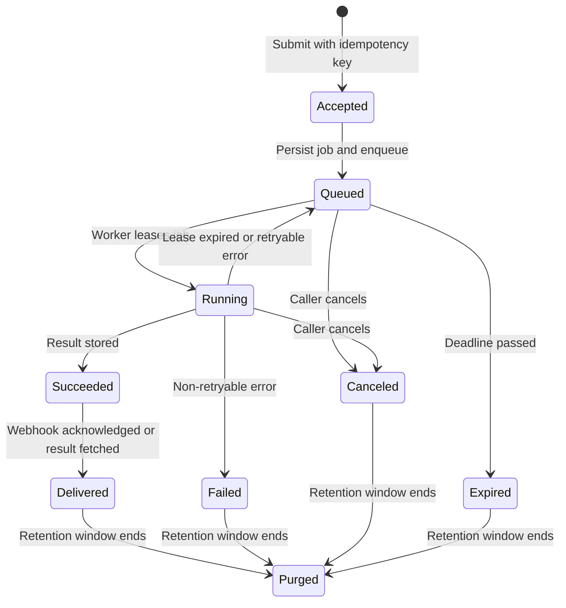

The diagram shows why the asynchronous contract needs more than a queue. The lease on a running job returns it to the queue if a worker dies, which produces at-least-once execution. For LLM generation, a second execution produces a different result because decoding is stochastic, so the system must store the first successful result and ignore later ones (Section 4.5). The expiry state protects capacity: a job whose deadline passed while queued should be dropped, not run. Retention is a privacy decision as much as a storage one, because job inputs and outputs may contain personal data; CH12 covers retention policy.

Worked example. A document-analysis feature takes 45 seconds at p50 and 3 minutes at p99. A synchronous design would need a 3-minute timeout across every layer, which most gateways will not allow, and would hold 3-minute connections on the application tier. The asynchronous design accepts the upload in 200 ms, returns a job id, and shows a progress indicator. At 20 jobs per second arrival and 60 seconds average duration, Little's Law gives 1,200 jobs in flight, which is a queue and worker pool size, not an open-connection count.

### 3.4 Batch and offline inference

Batch inference processes a large set of independent items with no interactive caller, and the result is delivered as a dataset: a file, a table, or an updated index. Typical uses are summarizing a document archive, generating descriptions for a product catalog, labeling a corpus for training, and computing embeddings for a backfill.

Batch changes the economics. Without a latency target per item, the system can run at the highest utilization the hardware sustains, group requests by length to reduce padding waste, use cheaper capacity (spot or preemptible instances, off-peak hours), and tolerate retries. Several providers offer batch APIs that accept a file of requests and return results within a stated window, typically up to 24 hours, at a discount relative to synchronous pricing. At the time of writing, discounts of about half the on-demand price are common for such APIs; verify the current terms and supported models with the provider, because they change.

The architecture of a self-run batch job is a pipeline: snapshot the input (so the job is reproducible), partition it into shards, process shards in parallel with checkpointing, write outputs to a staging area, validate, and then publish atomically. CH03 describes snapshot and publication controls. Two points specific to LLM batch work matter. First, outputs vary between runs, so store the model version, prompt version, and parameters with each result to make the dataset auditable. Second, partial failures are normal in a run of millions of items, so track per-item status and re-run only failures, with a cap on retries to avoid looping on a poison input (an item that always crashes or times out).

### 3.5 Scheduled bulk scoring

Scheduled bulk scoring is batch inference on a recurring cadence over an entire population or a changed subset, for example nightly propensity scores for all customers or a weekly summary of every open support case. It differs from one-off batch in three ways. It has a service-level objective (SLO) for completion time (results available by 06:00), so the pipeline needs a capacity plan that finishes with margin, not best-effort running. It must handle growth, since the population and the per-item cost both increase over time. And downstream systems read the output, so there is a freshness contract: how old a score may be when read.

A plan for the capacity of a scheduled job is simple arithmetic. If 4 million customers each need a 1,800-token prompt and a 150-token output, the job processes 7.2 billion input tokens and 600 million output tokens. A GPU pool that sustains 20,000 prefill tokens per second and 1,800 decode tokens per second per GPU needs 7.2e9 / 20,000 = 360,000 GPU-seconds for prefill and 6e8 / 1,800 = 333,333 GPU-seconds for decode, which together is 693,333 GPU-seconds, or 192.6 GPU-hours. To finish in a 6-hour window at 70 percent utilization it needs 192.6 / (6 × 0.7) = 45.9, so 46 GPUs for 6 hours, which is far cheaper as spot or on-demand burst capacity than as an always-on fleet. Incremental scoring (only changed customers, perhaps 8 percent per day) cuts that to about 4 GPUs, and the choice between full and incremental scoring is a larger cost lever than any placement choice. The values are illustrative inputs; the method is to measure your own throughput first.

Scheduled scoring also requires a deadline fallback: if the run is late, publish yesterday's scores flagged as stale, rather than a partial mixture of old and new that consumers cannot distinguish.

### 3.6 Real-time voice and bidirectional streaming

Voice assistants and live translation need continuous audio in both directions with low latency and the ability for the user to interrupt. The architecture differs from text streaming in three ways.

**The latency budget is conversational.** Human turn-taking gaps are on the order of a few hundred milliseconds, and a voice agent that pauses over a second feels unresponsive. Two designs exist. The cascaded design chains speech-to-text (ASR), an LLM, and text-to-speech (TTS); each stage adds latency, and the total budget (for example, ASR final result 200 ms after the user stops speaking, LLM first token 400 ms, TTS first audio 150 ms, network 100 ms, for roughly 850 ms) must be allocated explicitly. The speech-to-speech design uses a single model that consumes and produces audio, reducing stage hops and preserving tone, at the cost of less control over intermediate text. Several providers offer realtime APIs for this at the time of writing; verify the current transport (WebSocket, WebRTC) and session limits before designing.

**The transport must tolerate packet loss and jitter.** Audio over TCP-based WebSocket suffers head-of-line blocking, where one lost packet delays all that follow. WebRTC uses UDP-based media transport with jitter buffers and congestion control, and is the standard for browser real-time audio. Server-to-server legs can use WebSocket or gRPC streaming.

**Interruption (barge-in) is a first-class event.** When the user speaks while the assistant is talking, the system must detect speech, stop audio playback, cancel the in-flight generation, and discard unplayed audio. The cancellation path from Section 3.2.2 must work in tens of milliseconds, and the server must track how much of the response the user actually heard, so the conversation history reflects what was said and not what was generated.

Placement for voice is therefore latency-dominated. The model and ASR/TTS components should be in the same region as each other and close to the user (often on a media server in a nearby region), because each cross-region hop costs 70 to 180 ms of a budget with perhaps 800 ms total. Sessions last minutes, are stateful, and cannot be moved between replicas mid-turn, so scale-down must drain sessions and not terminate them.

### 3.7 Summary of the interaction modes

| Mode | Caller waits? | Typical deadline | Result delivery | Main cost lever | Main failure mode |
| --- | --- | --- | --- | --- | --- |
| Synchronous | Yes | Under 5 s | Single response | Output length cap | Tail latency exceeds timeouts |
| Streaming (SSE) | Yes | TTFT under 1.5 s | Incremental events | Cancellation of abandoned streams | Proxy buffering, idle timeout, slow clients |
| Streaming (WebSocket, gRPC) | Yes | TTFT under 1.5 s | Duplex messages | Connection density per node | Stateful connections, no native resume |
| Asynchronous job | No | Seconds to minutes | Poll, webhook, or event | Worker pool sizing | Lost callbacks, duplicate execution |
| Batch | No | Hours | File or table | Utilization, discounted capacity | Poison items, partial failure |
| Scheduled bulk | No | By a fixed time | Table with freshness | Incremental vs full scoring | Late completion, mixed-version output |
| Real-time voice | Yes | Under 1 s per turn | Audio stream | Session density | Jitter, barge-in, session loss on scale-down |

## 4. Request Paths and Gateway Concerns for Long-Lived Streams

The interaction modes become concrete as request paths. The sequence diagrams below show the three most common paths and are followed by the protocol rules that make them work in production.

### 4.1 Request paths

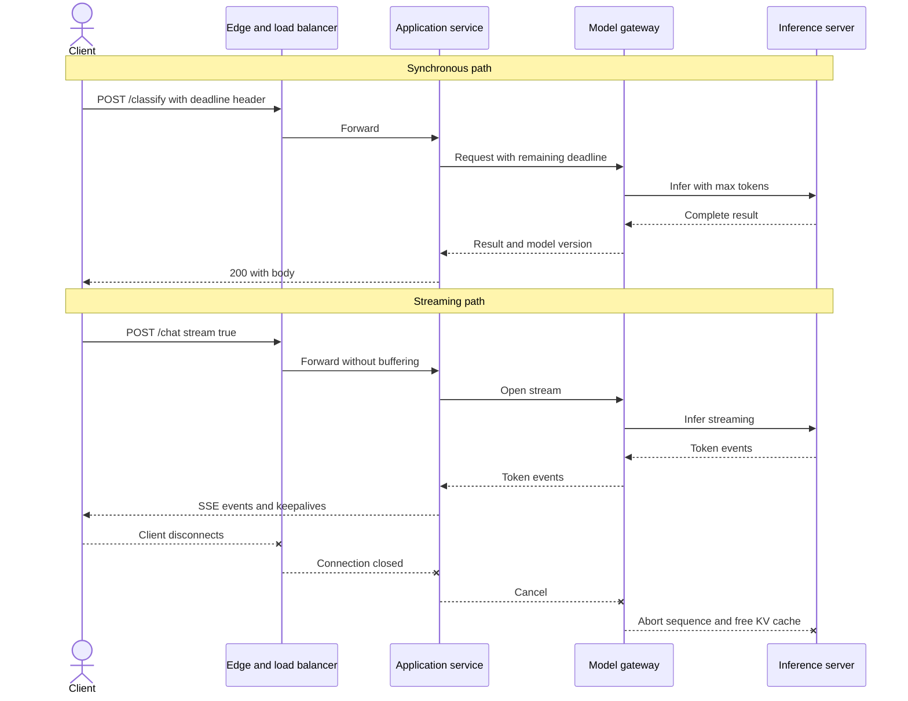

The diagram shows the cancellation chain explicitly. The synchronous path is a single round trip through each hop and has one failure signal. The streaming path has a long-lived connection through every hop, so each hop needs a streaming-aware configuration, and cancellation has to travel in the reverse direction.

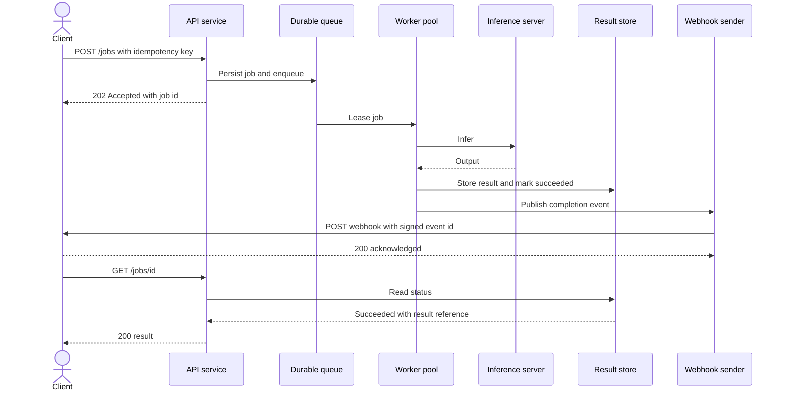

This diagram separates acceptance from execution. The 202 response is returned after the job is durably stored, so an application crash after that point loses nothing. The webhook is a notification and the `GET` is the authoritative read, which means a lost callback costs delay but not data.

### 4.2 Timeouts at every layer

Streams fail in production most often at an intermediary configured for short request-response exchanges. A map of the usual intermediaries and their typical default behaviors is worth keeping, though the values vary by product and version, so verify each in your own environment.

| Layer | Setting | Typical default (verify) | Effect on a stream |
| --- | --- | --- | --- |
| Cloud load balancer (for example, AWS Application Load Balancer) | Idle timeout | 60 seconds | Connection closed if no bytes flow for the period; keepalive events prevent it |
| Reverse proxy (Nginx) | `proxy_read_timeout` | 60 seconds | Closes if upstream sends nothing for the period |
| Content delivery network or proxy service | Origin response timeout | Around 100 seconds for some services | A long first-byte wait is cut with a gateway timeout |
| API gateway products | Integration timeout | Historically as low as 29 seconds for some REST gateways | Long-running calls fail regardless of server progress; some products now allow increases, so check |
| Browser and mobile clients | Fetch or socket timeout | Varies | A stream with silent gaps can be dropped by the client |
| Mobile network and corporate proxies | NAT and middlebox idle timers | Often 30 to 120 seconds | Silent connections are dropped without notice |

The first step is to measure the longest silent gap in a stream, which is the TTFT for the first event and then the largest inter-token gap. Prefill of a very long prompt can be many seconds of silence before the first token. A reasoning model that thinks before answering may emit nothing for tens of seconds. The mitigation is to send a heartbeat (an SSE comment line such as `: keepalive` every 15 seconds) from the application tier, which resets idle timers at every layer without confusing the parser. Set every layer's idle timeout above the heartbeat interval times two, and set the maximum stream duration deliberately, since a stream that never ends consumes a connection forever.

### 4.3 Protocol rules for streams

1. **Disable response buffering** on routes that stream, at the proxy and at the framework (some application servers buffer small writes until a threshold unless flushed).
2. **Use HTTP/2 or HTTP/3 at the edge** for multiplexing, so one browser tab with several streams does not exhaust connections.
3. **Compress carefully.** Compression middleware buffers output to find patterns. Disable it for event streams or flush after each event, since the per-event payload is a few bytes and compression gains little.
4. **Send a heartbeat** during any silence longer than a few seconds.
5. **Carry an event id** on each event so a reconnecting client can ask to resume. Resume works only if the server retains recent events keyed by request id for a short window (for example, 60 seconds in a small cache), or if the client is told that the stream cannot resume and must restart.
6. **Authenticate at connect time and re-authorize on a schedule.** A WebSocket authenticated once can outlive a revoked token by hours. Close and require reconnection at token expiry, or accept refresh messages on the channel.
7. **Limit connection lifetime.** Cap sessions (for example, 30 minutes for chat, longer for voice) and rotate them, so rolling deploys can drain nodes.
8. **Handle deploys.** On shutdown a node stops accepting new connections, signals existing ones to finish, waits up to a grace period, and then closes. The grace period must exceed the longest expected stream, or deploys will cut live answers. Kubernetes `terminationGracePeriodSeconds` and a pre-stop hook implement this.

### 4.4 Load balancing long-lived streams

Load balancers distribute connections, not work. For short requests, connection count approximates load. For streams, a connection may carry one token every 25 ms for ten seconds or sit idle, so connection count is a poor proxy for GPU load. The effect is imbalance: round-robin distribution can place several long generations on one replica while others idle, and queue length rather than connection count should drive routing at the inference tier. The common design uses a gateway that knows each replica's queue depth or in-flight count (reported through the engine's metrics or a load report header) and routes by least outstanding work, with a cap per replica. Prefix-aware routing, which sends requests that share a long system prompt to the same replica to hit its prefix cache, trades balance for cache hits; Part 16 CH28 explains prefix caching, and Section 12 of this chapter covers the isolation implications.

A second effect is long-lived connections defeating autoscaling and rebalancing. When a new replica joins, existing connections stay on old replicas until they end. With streams that last seconds this resolves quickly. With sessions that last 30 minutes (voice, agent sessions), new capacity helps only new sessions, so the scale-up trigger must lead demand by a full session length.

### 4.5 Retries, idempotency, and non-idempotent generations

A retry is safe when repeating the operation has the same effect as doing it once. Reading a document is idempotent. Generating text is not: the same prompt at nonzero temperature yields different text, costs money each time, and, if the generation triggers a tool call, may repeat a side effect. Naive retry rules (retry any failure up to three times) therefore have specific hazards.

- **Timeout after the server finished.** The client times out and retries while the first request completed. Cost doubles and the user may see two different answers. Use an idempotency key: the client sends a unique key with the request, the server stores the first result under the key for a window, and a retry with the same key returns the stored result or attaches to the in-flight request. This is the pattern used by payment APIs and it applies directly to generation jobs.
- **Retry of a partially streamed response.** If a stream breaks after 120 tokens, a full retry restarts from zero and the user sees different text. Either resume from retained events (Section 4.3) or restart and clearly replace the partial text. Do not append the retry's output to the partial output.
- **Retries during overload.** When the inference tier returns 429 (too many requests) or 503, aggressive client retries multiply the load and deepen the outage. Use exponential backoff with jitter, respect `Retry-After`, cap total retry attempts, and enforce a retry budget at the gateway (for example, retries may be at most 10 percent of the original request volume). A retry budget prevents the amplification that turns a brief slowdown into an outage. CH13 covers the retry budget and circuit-breaker patterns.
- **Retries across layers multiply.** If the client retries 3 times, the application retries 3 times, and the gateway retries 3 times, one user action generates up to 27 upstream attempts. Retry at one layer, usually the one closest to the failing dependency, and make the others pass errors through.
- **Side-effecting tool calls.** For agent loops (CH06), tool calls with side effects require their own idempotency keys, derived deterministically from the run id and step id, so a replayed step does not repeat the effect.

A failed attempt that did not produce output is retryable under these rules. An attempt that returned an error after partial output needs the resume-or-replace decision. A status code of 400 (the request was invalid) must never be retried, and a content-filter refusal should not be retried against the same model without a changed request.

## 5. Placement Options

Placement answers where the model weights sit and where the computation runs. The options form a spectrum from "someone else operates everything" to "you operate everything on hardware you hold". Moving along the spectrum trades operating effort for control over data, latency, cost at scale, and availability behavior. The topology diagram shows the options and the boundaries a request may cross.

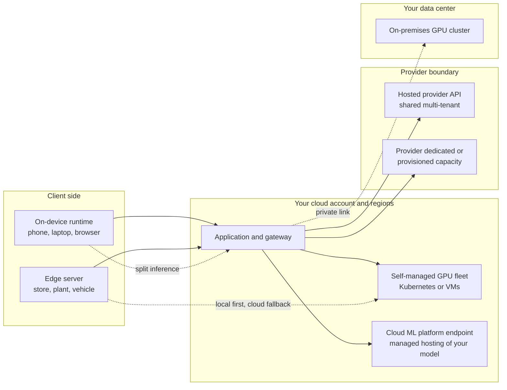

The diagram shows that placement is a set of choices behind one application boundary, not a single selection. A mature system often uses several at once: a hosted API for a frontier model on general tasks, self-managed capacity for a high-volume small model, and an on-device model for offline use. The gateway (CH08) is what lets the application treat these as one contract.

### 5.1 Hosted provider API (shared, multi-tenant)

The application sends requests to a model provider's public or private-link endpoint and pays per input and output token. The provider operates the GPUs, the engine, the scaling, and the model updates. This is the lowest-effort path to capability and often the only path to the most capable proprietary models.

**Strengths.** No capacity planning, no GPU procurement, access to the provider's latest models, and pay-for-use cost that is near zero at low volume. Time to first production traffic is days.

**Limits.** The provider sets rate limits (requests and tokens per minute) that can throttle you at peak, and the limits are shared between your use cases unless you separate projects or keys. Latency varies with the provider's load, and you cannot tune the engine. Data leaves your boundary: you depend on the provider's contractual retention and training-use terms, region options, and subprocessors. The model can change or be retired on the provider's schedule, which breaks prompt tuning and evaluation baselines, so pin model versions where offered and plan migrations (CH10). There is no isolation guarantee beyond the provider's multi-tenancy controls.

**Fit.** Prototypes, low-to-moderate volume, workloads needing frontier capability, spiky traffic that would leave owned GPUs idle, and teams without GPU operations skills.

### 5.2 Provider-managed regional or dedicated capacity

Most large providers and cloud platforms sell ways to pin or reserve capacity. The names differ, but three patterns recur. Regional or data-zone processing options process and sometimes store data inside a named geography (for example, an EU data boundary option). Provisioned throughput reserves a quantity of model processing capacity, measured in provider-specific units, for a fixed hourly or monthly price and gives predictable latency and a guaranteed rate. Dedicated deployments allocate model instances to your account only. At the time of writing, major cloud providers offer such options for hosted models (for example, Azure OpenAI provisioned throughput, Amazon Bedrock provisioned throughput, Google Vertex AI provisioned throughput, and the provider-direct priority or scale tiers). Names, units, minimum commitments, and supported models change often, so read the current documentation for the model you plan to use.

**Strengths.** Predictable latency and throughput without operating a fleet, residency guarantees stated in contract, and, for provisioned capacity, protection from noisy neighbors and rate limits.

**Limits.** You pay for reserved capacity whether or not you use it, so utilization determines cost efficiency (Section 18). Commitments can be long (one month to one year), and the capacity is tied to a specific model, which complicates upgrades. Quota and regional availability for popular models can be limited, and obtaining capacity may require a request and a wait.

**Fit.** Steady, predictable, latency-sensitive workloads on a hosted model, regulated customers needing a regional boundary, and workloads where throttling by shared limits would be a production incident.

### 5.3 Cloud machine-learning platform endpoints

Cloud ML platforms (for example, Amazon SageMaker AI, Google Vertex AI endpoints, Azure Machine Learning online endpoints) host models you bring, including open-weight models, on managed instances with autoscaling, deployment management, and monitoring. You choose the model, container, and instance type, and the platform operates the machines and the endpoint.

**Strengths.** You control the model version and can use fine-tuned or open-weight models, with less operational work than raw Kubernetes. Platform integration with identity, logging, private networking, and model registries is built in. Platform-provided serving containers include popular engines.

**Limits.** Limited control over scheduling, networking, and engine configuration compared with self-managed fleets, and a price premium over equivalent raw instances. Scale-up depends on instance availability in the region; GPU instance types can be unavailable when you need them. Scale-to-zero options exist but cold starts for large models are minutes (Section 11). Portability across platforms is low, because deployment APIs differ.

**Fit.** Teams that need a custom or open-weight model with a small operations staff, and moderate scale where the managed premium is smaller than the cost of building platform capability.

### 5.4 Self-managed in your cloud

You rent GPU instances (on demand, reserved, or spot) and run an engine such as vLLM, TensorRT-LLM, or SGLang on Kubernetes or virtual machines, with your own autoscaler, gateway, and observability. Part 16 CH27 describes the components, and Part 09 CH08 covers Kubernetes.

**Strengths.** Full control over the model, engine configuration, batching, quantization, routing, and network. The lowest marginal cost per token at high, steady utilization. Ability to co-locate with your data. Mixed fleets (several models, adapters) are possible.

**Limits.** You carry capacity planning, GPU procurement or quota negotiation, driver and engine upgrades, security patching, and on-call. GPU supply is lumpy: obtaining a large number of a given accelerator in a region can take weeks or fail. Utilization is your problem: an idle GPU costs the same as a busy one. Staffing for 24/7 operation is a real cost line.

**Fit.** High, steady volume where the break-even in Section 18 favors owned capacity, workloads requiring custom engines or models, data that must stay in an account you control, and teams with platform engineering depth.

### 5.5 On-premises

You operate GPUs in your own data center or a colocation facility. All of Section 5.4 applies, plus hardware procurement (lead times of months), power and cooling, networking, and physical security.

**Strengths.** Complete control of the data path and physical custody, which some regulators and defense or health customers require. Fixed cost with high utilization can be the cheapest per token over a multi-year life. No dependence on public cloud for the serving path, which also gives an air-gapped option.

**Limits.** Long lead times, capital expenditure, depreciation risk as GPU generations turn over, and no elasticity: peak capacity is bought and idle off-peak. Remote attestation, firmware, and supply chain become your responsibility. A common pattern is on-premises for steady base load and cloud burst for peaks, which requires the model artifact and serving stack to be portable and the data policy to allow burst.

**Fit.** Strict sovereignty or air-gap requirements, existing GPU estate, stable large volume, and organizations with data center operations.

### 5.6 Edge servers

Edge placement runs inference near the point of use but not on the user's own device: in a retail store, factory floor, hospital site, cell tower, or vehicle. Compute is limited (one to a few GPUs or accelerators, or CPU-only small models), connectivity may be intermittent, and the fleet may number in the thousands of sites.

**Strengths.** Low and predictable latency to local sensors and users, operation through network outages, local processing of raw data (video, audio, telemetry) that is too large or too sensitive to ship, and reduced bandwidth cost.

**Limits.** Small models only, fleet management at scale (updates, monitoring, rollback across thousands of sites), physical security of devices in uncontrolled places, and heterogeneous hardware. Section 19 treats this in depth.

**Fit.** Vision and sensor classification at the source, offline-capable operations, and local data-processing mandates.

### 5.7 On-device and embedded

The model runs on the end user's phone, laptop, browser, or an embedded controller. Mobile system-on-chip neural processors, laptop accelerators, and browser runtimes (WebGPU and WebAssembly) can run small models.

**Strengths.** No network round trip for the compute, zero marginal inference cost to the operator (the user's device pays the energy), offline operation, and strong privacy because data never leaves the device.

**Limits.** Model size and capability are bounded by device memory (a 3-billion-parameter model quantized to 4 bits needs about 1.5 to 2 GB of memory for weights, which many phones can allocate, but with battery and thermal consequences), by wide device diversity, and by the update channel (models ship as app or resource updates). Quality is lower than with large hosted models, and you cannot see or control what runs once distributed.

**Fit.** Keyboards and dictation, on-device classification and redaction, offline assistants, privacy-first features, and a first pass before escalation.

### 5.8 Hybrid and split inference

Hybrid placement combines two or more of the above under a policy. Four patterns recur.

**Local-first with cloud escalation.** A small on-device or edge model handles easy or sensitive requests. When confidence is low or the task needs more capability, the request goes to a larger model, with only permitted data included. This is a cascade (CH02 covers model cascades), with the first stage placed at the edge.

**Sensitive-data split.** A policy engine classifies the request. Requests containing regulated data go to a controlled placement (private endpoint or on-premises), and others go to a hosted API. Classification must run before any external call, and misclassification is a data leak, so its failure mode needs testing (CH12).

**Base plus burst.** Reserved or owned capacity serves the steady base load, and a hosted API or on-demand GPUs absorb peaks. This minimizes cost, because reserved capacity runs near full utilization, while avoiding overprovisioning for peaks. It requires two serving paths to be quality-compatible.

**Split inference.** A model's layers are divided between devices, for example the first layers run on the device and the rest in the cloud, with intermediate activations sent over the network. Split inference for LLMs is mostly a research and niche pattern at the time of writing: intermediate activations can be larger than the original input, they can leak information about the input (inversion attacks reconstruct inputs from activations in some settings), and both sides must hold matching model versions. A more common practical split is functional: embedding or encoding on the device, generation in the cloud, or speech recognition on the device and the language model in the cloud. Each moves less data than the raw input and keeps raw audio on the device.

### 5.9 Comparison of placements

| Placement | Operating effort | Latency control | Data control | Marginal cost at scale | Elasticity | Model choice |
| --- | --- | --- | --- | --- | --- | --- |
| Hosted shared API | Lowest | Low | Contractual | Highest per token | Provider limits | Provider catalog |
| Provider dedicated or provisioned | Low | Medium to high | Contractual, regional | Medium, fixed commitment | Limited by reservation | Provider catalog |
| Cloud ML platform endpoint | Medium | Medium | Your account | Medium | Autoscale, minutes | Any you can package |
| Self-managed in cloud | High | High | Your account | Lowest at high utilization | Instance availability | Any open-weight or licensed |
| On-premises | Highest | High | Full custody | Lowest long term at high utilization | None | Any licensed |
| Edge server | High per site | Highest locally | Local | Hardware per site | None | Small models |
| On-device | Lowest to operate, hard to update | Highest | On device | Zero to operator | Per device | Very small models |

The table has no winner, which is the point. The criteria in the next section turn the table into a decision.

## 6. Decision Criteria

A placement decision is a multi-constraint problem. Some criteria are hard constraints that eliminate options outright (a residency rule, a licensing term, an air-gap requirement). Others are soft trade-offs that rank the remaining options (cost, operating effort). Treating them in that order keeps the analysis honest: apply the hard constraints first, then optimize.

### 6.1 Latency and network round-trip arithmetic

Latency requirements translate to a maximum distance only after subtracting compute. The method is:

1. State the objective at a percentile: for example, TTFT p95 at or below 1,200 ms.
2. Subtract the compute segments that do not depend on placement: application logic, retrieval, queue, and prefill. In the budget of Table 2.1 these sum to 530 ms (40 + 60 + 80 + 350).
3. The remainder, 670 ms, is the allowance for the network. On a new connection the network cost is three RTTs, so the maximum RTT is 223 ms; on a reused connection it is one RTT, so the maximum is 670 ms.
4. Compare the maximum RTT with the measured RTT to each candidate region.

Physics sets the floor. Light in optical fiber travels at about 200,000 km per second (roughly two thirds of the speed of light in a vacuum), so each 1,000 km of fiber path adds about 5 ms one way and 10 ms round trip, before routing detours and equipment delays. Real paths are longer than the great-circle distance by 20 to 100 percent. Rules of thumb that are useful for an initial estimate (measure before relying on them): same metropolitan area, 1 to 5 ms; same continent and region pair, 10 to 40 ms; transatlantic, 70 to 100 ms; Europe to Asia-Pacific, 150 to 250 ms. The numbers in this chapter are illustrative; measure with your own probes from your actual user locations, and monitor, since routes change.

A longer connection lifetime changes the arithmetic. A client that reuses a connection pays the handshake cost once. Browsers and mobile SDKs generally reuse connections, but the first request in a session pays full price, and so does every request after an idle timeout closes the connection. A design that depends on warm connections should keep them warm or accept the first-request penalty.

### 6.2 Data locality, residency, sovereignty, and data gravity

These four terms are related and are often confused.

- **Data locality** is a technical preference to compute near the data. It reduces transfer time and cost.
- **Data residency** is a requirement that data, or its processing, stays in a defined geography. It comes from law, contract, or policy. It can apply to storage only, to processing, to support access, or to all three, and the distinction matters: a provider that stores data in the EU but processes it elsewhere does not meet a processing-residency requirement.
- **Data sovereignty** goes further and concerns which legal jurisdiction can compel access to data. A cloud provider headquartered in another country may be subject to that country's laws regardless of where the data sits. Sovereignty requirements may therefore limit not just the region but the operator, which can rule out a hyperscaler region and favor a sovereign cloud offering or an on-premises placement. Read the requirement's exact text before inferring this.
- **Data gravity** describes the pull of large datasets. Moving a 50 TB corpus to a new region takes days and costs egress fees, while moving a 3 KB request to the corpus takes milliseconds. Gravity tends to pull compute to where the data is, and it pulls related services as well.

For inference, the data that crosses the placement boundary is the prompt (which includes retrieved context), the output, and any logs and traces. A common error is to settle where the model runs while forgetting that retrieval results, conversation history, caches, logs, and monitoring traces also hold the data. Each store needs the same residency treatment as the compute (Section 7). The regulatory background (for example, the General Data Protection Regulation's rules on transfers outside the European Economic Area, sector rules, and national localization laws) is a legal question; the architect's job is to build placement that can honor the answer, and to get the answer from counsel. CH12 covers governance.

### 6.3 Throughput, burstiness, and utilization

Placement options differ in how they handle load shape. Two numbers describe a workload: the average rate and the peak-to-average ratio. A workload with an average of 10 requests per second and a peak of 80 has a ratio of 8. Self-managed capacity must be sized near the peak (or autoscale to it within the time the burst allows), so the average utilization is roughly the inverse of the ratio times a headroom factor: with a ratio of 8, even perfect sizing gives about 12 percent average utilization before headroom, and each GPU costs the same at any utilization. A hosted per-token API charges only for use and absorbs the burst, which makes it favorable for bursty profiles. Provisioned capacity sized for peak has the same low-utilization problem as owned GPUs.

The decision rule: the more bursty the workload, the more the variable-priced options (hosted per token, serverless endpoints, batch with queueing) win, and the steadier the workload, the more the fixed-priced options (reserved GPUs, provisioned throughput, owned hardware) win. A hybrid (Section 5.8, base plus burst) is the answer to a workload that is steady underneath and spiky on top. Burstiness also interacts with provider rate limits: a limit of 2 million tokens per minute caps a burst regardless of how much money you are willing to pay, so the peak token rate (not the average) is the number to compare with the quota.

### 6.4 Cost

Cost has three components that placement changes differently: the unit cost of compute, the utilization of what you pay for, and the labor and risk cost of operation. Section 18 builds a break-even model. For the decision criteria, remember that the cheapest per-token price is usually for the placement you operate, and the cheapest total cost at low volume is the one you do not operate. The crossover moves with utilization, model size, and the price of engineering time, and it moves down over time as hosted prices fall, so a decision made on cost should record the assumptions and a trigger for re-evaluation.

### 6.5 Availability

Availability depends on the number of independent failure domains the serving path crosses and on the redundancy at each. A hosted API publishes an availability target and has had incidents, so a single provider is a single point of failure unless the gateway can fail over (CH08). A self-managed fleet in one region has the region's availability as a ceiling, and sub-region failures (a zone, a GPU node, a driver bug) as common events. An edge or on-device model keeps working when the network fails, which can make it the most available option for a narrow function. For each candidate, ask what happens when it fails and what the user then sees, and then compare with the availability objective (Section 13).

### 6.6 Operational maturity

The best placement on paper is the wrong one if the team cannot operate it. Operating a GPU fleet requires skills in capacity planning, driver and engine upgrades, observability for GPU metrics, incident response, and security hardening of model-serving containers. A short maturity check: does the team already run production Kubernetes with on-call? Has it handled a GPU failure? Does it have monitoring of queue depth and cache usage per replica? Is there a process for evaluating new model versions? If most answers are no, prefer managed options, and treat self-management as a later migration with a measured trigger (for example, monthly hosted spend above the break-even for two consecutive quarters).

### 6.7 Security isolation

Security isolation needs differ: a public chatbot over public data has weak requirements, while a system processing patient records or trade secrets has strong ones. The isolation spectrum runs from shared multi-tenant hosted APIs (isolation by the provider's logical controls), through provider-dedicated or private-link endpoints, to a single-tenant deployment in your own account, to physically separate hardware, to air-gapped systems. Section 12 covers tenant isolation inside shared inference, and Section 16 covers endpoint security. A confidential-computing option (running inference inside a hardware-protected trusted execution environment so that the cloud operator cannot read data in use) exists for some GPU platforms at the time of writing; verify the supported models, performance overhead, and attestation process before relying on it.

### 6.8 Model licensing and terms

The model's license can constrain placement more than any technical factor. Proprietary models are available only through the vendor's API or approved cloud channels, so self-hosting is not an option. Open-weight models carry licenses with different terms: permissive licenses (for example, Apache 2.0 or MIT) allow broad use, while community licenses may restrict commercial use above a user-count threshold, require attribution or naming conventions, restrict use in certain fields, or limit use of outputs to train other models. Some licenses restrict certain geographies or require acceptance of an acceptable-use policy that you must flow down to your customers. Read the license text of the exact model version, record it in the model registry (CH10), and have counsel review before choosing to self-host. A model with a restrictive license can also forbid redistribution, which matters for on-device placement because shipping weights inside an app is distribution.

### 6.9 A decision tree

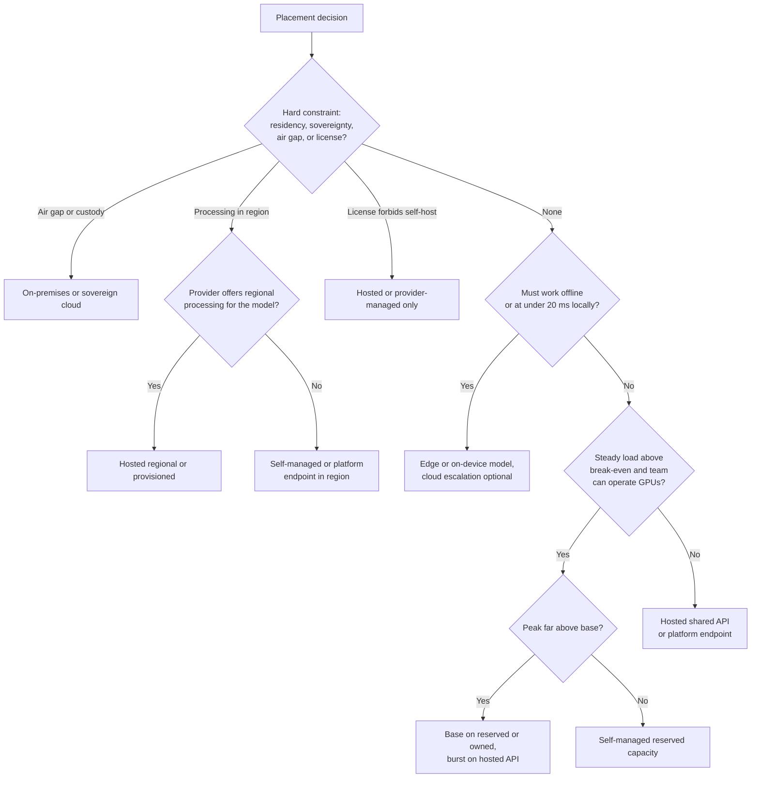

The tree encodes the ordering: hard constraints first, then offline and latency, then cost and capability to operate. It is a starting point for the ADR, not a substitute for it, because real decisions mix several branches (the EU case in Section 22.1 passes through two).

### 6.10 Scoring the soft criteria

After hard constraints remove options, rank the rest with a weighted score. Weighting forces a conversation about priorities, but the numbers hide uncertainty, so use scores to organize discussion and keep the written rationale as the decision record. A small example with three remaining candidates and weights that sum to 100:

| Criterion | Weight | Hosted regional | Platform endpoint | Self-managed |
| --- | ---: | ---: | ---: | ---: |
| Time to production | 20 | 5 | 3 | 2 |
| Cost at forecast volume | 25 | 2 | 3 | 5 |
| Latency control | 15 | 3 | 3 | 5 |
| Operating effort | 20 | 5 | 3 | 1 |
| Model choice and fine-tuning | 10 | 2 | 4 | 5 |
| Isolation | 10 | 3 | 4 | 5 |
| **Weighted total (out of 500)** | 100 | 345 | 320 | 360 |

The weighted total is the sum of weight times score. For hosted regional: 20×5 + 25×2 + 15×3 + 20×5 + 10×2 + 10×3 = 100 + 50 + 45 + 100 + 20 + 30 = 345. For the platform endpoint: 60 + 75 + 45 + 60 + 40 + 40 = 320. For self-managed: 40 + 125 + 75 + 20 + 50 + 50 = 360. The totals are close, so the scoring does not decide. It shows that cost and operating effort pull in opposite directions, which is the real discussion. When scores are this close, prefer the reversible option and set a review trigger.

## 7. Regional Placement and Routing

Once the placement class is chosen, the next question is which regions. Regional design has three goals that sometimes conflict: put compute near users (latency), keep data inside required boundaries (residency), and survive a region failure (availability). The architecture that satisfies all three is residency-pinned routing with failover inside the boundary.

### 7.1 Routing policies

Four routing policies are used, and a system may apply them in layers.

**Nearest region.** Route each request to the region with the lowest latency from the client, using DNS-based geolocation, anycast, or a global load balancer with latency probes. It suits workloads without residency limits and gives the best latency, but it leads to uneven load across regions and no control over where data is processed.

**Residency-pinned.** The user's tenant or account carries a data region attribute (set at onboarding from contract or country), and all processing for that tenant occurs in that region regardless of where the user physically is. A European company's employee traveling in the United States is still routed to the European region. Pinning requires a tenant-to-region map available at the edge, and a routing decision that reads the tenant identity from the authenticated token, not from the IP address.

**Capacity-aware.** Within a residency boundary, route to the region with available capacity when the nearest is saturated, accepting a latency penalty.

**Cost-aware.** Route non-urgent work (batch, async) to the region with the lowest price or spare capacity, within the residency rules. Batch jobs have no latency target, which makes them the natural users of cost-aware routing and of off-peak capacity.

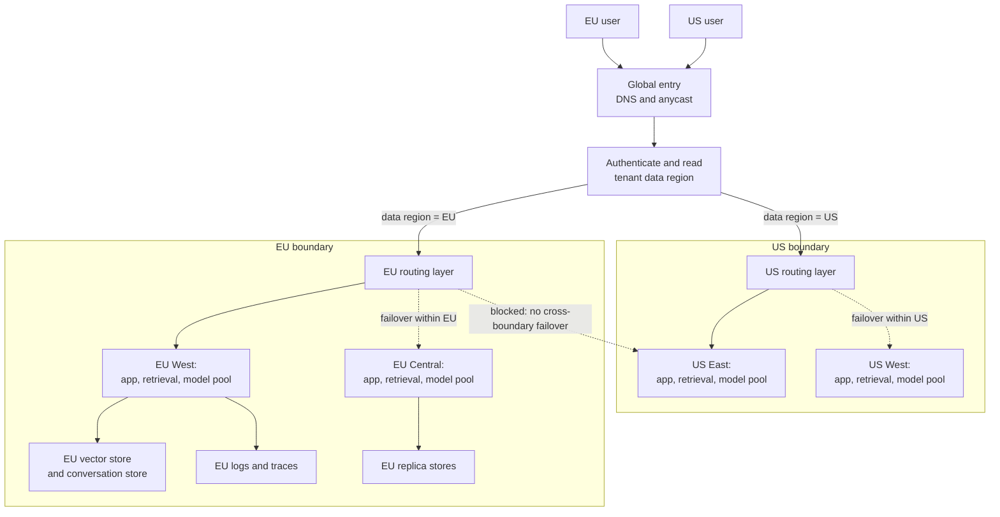

The diagram shows the key property: the global entry point is the only component that is not region-bound, and it handles only authentication and the tenant-to-region lookup, carrying no prompt content. The failover edges stay inside each boundary, and the cross-boundary edge is labeled as blocked. Everything that holds tenant data (retrieval stores, conversation stores, logs, traces, caches) is inside the boundary, because a model call in the EU that logs prompts to a US observability service breaks the residency promise.

### 7.2 What must be regional

A residency-pinned design enumerates the components and decides each as regional or global:

| Component | Regional or global | Reason |
| --- | --- | --- |
| Model inference pool | Regional | Receives full prompts |
| Retrieval index and vector store | Regional | Holds embeddings of tenant content, which can be inverted to approximate the source text in some cases |
| Conversation and session store | Regional | Holds prompts and outputs |
| Prompt and response logs, traces | Regional | Contain content; exporting to a global observability tool needs redaction |
| Caches (semantic cache, prefix cache, response cache) | Regional | Hold content or derived content |
| Embedding service | Regional | Receives raw text |
| Tenant routing table | Global, replicated | No content, just tenant id to region |
| Identity provider | Global or regional per policy | Authentication data, which may be personal data; check policy |
| Model artifact registry | Global replicated or per-region mirror | Weights are not tenant data |
| Metrics (aggregates, no content) | Global allowed | No tenant content, but check labels for identifiers |
| Evaluation datasets with tenant data | Regional | Contain content |
| Support and operations access | Regional access controls | Staff access can itself be a transfer; use regional break-glass roles |

The last row is easy to forget: a residency commitment often includes who can see the data. Operational access from outside the boundary (a follow-the-sun support team) may count as a transfer, so access paths need regional roles, just-in-time elevation, and audit logs.

### 7.3 Worked latency budgets by geography

The script [01_latency_budget.py](../code/python/inference-placement-chapter/01_latency_budget.py) applies the budget model to three user populations and three candidate regions. The RTT values are illustrative round numbers. The fixed components are 40 ms of application logic, 60 ms of retrieval in the model's region, 80 ms of queue at the p95, and 350 ms of prefill for a 3,000-token prompt, which together are 530 ms. The TTFT objective is 1,200 ms. Output from the script:

| User | Region | RTT (ms) | TTFT, new connection (ms) | TTFT, reused connection (ms) | Total for 300 tokens, reused (ms) | Meets 1,200 ms on new connection |
| --- | --- | ---: | ---: | ---: | ---: | --- |
| EU | EU region | 25 | 605 | 555 | 8,030 | Yes |
| EU | US region | 95 | 815 | 625 | 8,100 | Yes |
| EU | AP region | 180 | 1,070 | 710 | 8,185 | Yes (thin margin) |
| US | EU region | 95 | 815 | 625 | 8,100 | Yes |
| US | US region | 30 | 620 | 560 | 8,035 | Yes |
| US | AP region | 150 | 980 | 680 | 8,155 | Yes |
| AP | EU region | 180 | 1,070 | 710 | 8,185 | Yes (thin margin) |
| AP | US region | 150 | 980 | 680 | 8,155 | Yes |
| AP | AP region | 35 | 635 | 565 | 8,040 | Yes |

Reading the table: serving a European user from the US instead of Europe costs 210 ms of extra TTFT on a new connection (95 − 25 = 70 ms per RTT, times three RTTs) and 70 ms on a reused connection (one RTT). All nine combinations meet a 1,200 ms TTFT with these compute figures, so for this chat workload, residency, not latency, would be the reason to choose regional placement. The picture changes with a tighter objective or a heavier compute path. If the objective is 800 ms, the network allowance is 800 − 530 = 270 ms. On a new connection that allows an RTT of at most 90 ms, so every pairing at 95 ms or more misses (815 ms for the 95 ms pairs, 1,070 ms for the 180 ms pairs). On a reused connection the allowance is 270 ms of RTT, so all nine pairings pass (the worst is 710 ms). The objective is then met only if connections stay warm, which makes the first request of every session the design problem. For voice, with a conversational turn budget near 850 ms for all stages, a cross-ocean hop on a single leg consumes a fifth to a quarter of the budget, so regional placement is a latency requirement.

The total column makes a different point: the decode time (299 tokens at 25 ms, which is 7,475 ms) dominates the total at about 93 percent, and region choice changes it by less than 2 percent. For a long generation, geography affects when the first word appears but barely changes when the last word arrives. This is another reason that streaming is the better treatment of long generations than moving the model closer.

### 7.4 Failover that respects residency

A failover path is a data path, and it has to be authorized like any other. Four rules keep failover compliant.

1. **Define the failover set per residency class.** For an EU-pinned tenant, the set is the EU regions the contract allows (for example, two EU regions). A US region is never in the set, even if it is the only one with capacity. If the set has a single region, then a regional outage is an availability incident for those tenants, and that has to be accepted explicitly or fixed by adding a second in-boundary region.
2. **Pre-provision data in the failover region.** Failover that needs the retrieval index copied first is not a failover. Replicate vector stores and conversation stores within the boundary continuously, accept the replication lag as the recovery point (for example, a few seconds), and test restoring from it.
3. **Pre-provision capacity or a degradation plan.** A failover region needs either enough warm capacity to take the traffic, or a plan that sheds load. If region A carries 60 percent of EU traffic and region B carries 40 percent, B receiving 100 percent needs 2.5 times its normal capacity. Holding that headroom is expensive; common compromises are to size each region for 70 to 80 percent of the combined load and shed the lowest-priority traffic (batch, free tier) during an incident.
4. **Fail closed on policy.** If the policy service cannot determine a tenant's data region, the system rejects the request rather than guessing. A guess that routes to the wrong boundary is a reportable incident, while a rejection is an availability event.

### 7.5 Routing state and consistency

The tenant-to-region map must be consistent. A tenant migrating from one region to another passes through a window where data exists in both. During migration, writes go to the old region, reads follow the map, and the cutover is atomic per tenant. After cutover, delete or archive the old copy per policy, and prove the deletion. Cache the map at the edge with a short time to live (TTL) so changes propagate in minutes, and fail closed on a missing entry. The map is small (one row per tenant), so replicate it widely and keep it out of the hot path of the inference fleet.

## 8. Capacity Models: Provisioned, On-Demand, and Reserved

Capacity is the quantity of inference work a placement can serve at the latency objective. How you buy it determines both your cost and your exposure to shortage. Three purchase models exist, with variants.

### 8.1 On-demand (pay per use)

On-demand capacity is acquired when needed and paid for by use: per-token billing on a hosted API, per-second billing for serverless endpoints, or per-hour billing for cloud GPU instances launched on demand. It has no commitment and no idle cost for per-token billing. It carries availability risk: hosted APIs enforce rate limits and may throttle during provider-wide demand, and on-demand GPU instances of popular types may be unavailable in a region at the moment you ask. Prices are the highest per unit of compute for instances and are quoted per token for APIs.

### 8.2 Provisioned throughput

Provisioned throughput reserves a quantity of model capacity on a hosted platform for a period. The units are provider-specific (for example, model units or throughput units that map to tokens per minute for a model, subject to input-to-output ratios and per-model definitions). You pay a fixed rate per unit-hour regardless of use. In return you receive predictable latency, because no other tenant competes for your units, and a guaranteed rate, with excess traffic typically either rejected with 429 or spilled to a standard deployment, depending on the product. The usual operational pattern is to provision for the base load and route spillover to on-demand capacity through the gateway.

Sizing provisioned capacity needs the token profile, not just request counts. A provider unit is typically defined against an assumed ratio of input to output tokens and a throughput level, so a workload with long prompts and short outputs consumes units differently from one with short prompts and long outputs. Procure by running a load test against a small allocation with your real token mix and measuring the achieved requests per second at your latency objective. Do not extrapolate from the published unit definition alone.

### 8.3 Reserved GPUs

Reserved GPU capacity is a commitment to rent specific instance types for one to three years in exchange for a discount against on-demand rates (the illustrative price in the calculator uses 2.40 USD per GPU-hour reserved versus 4.00 on demand, a 40 percent discount; actual pricing varies widely by cloud, GPU type, and term, so obtain quotes). Savings plans and committed use discounts offer similar economics with more flexibility across instance types. Reserved capacity makes sense for the part of the load that exists for the whole term at high utilization. The risks are that the GPU generation advances during the term (a newer GPU may offer much better throughput per dollar, leaving you with the older one), that traffic may not grow as forecast, and that the commitment limits how fast you can move placement (for example, shifting to a provider's dedicated deployment).

Spot or preemptible instances are an additional variant, priced far below on-demand but reclaimable on short notice (typically seconds to a couple of minutes of warning). They suit batch inference with checkpointing and stateless workers. They do not suit a production interactive pool without a fallback, because a reclaim removes replicas, drops in-flight streams, and forces cold starts. A common interactive design keeps a reserved or on-demand baseline and adds spot capacity for bursts only where requests can be retried or where the load is batch.

### 8.4 Comparison of the purchase models

| Model | Price per unit of compute | Commitment | Idle cost | Shortage risk | Best use |
| --- | --- | --- | --- | --- | --- |
| Hosted per token | Highest | None | None | Rate limits and provider incidents | Low volume, spiky |
| Serverless endpoint | High | None | None, but cold starts | Instance availability, cold start | Intermittent |
| Provisioned throughput | Medium | Hours to months | Full | Low once granted, grant may be delayed | Steady base on a hosted model |
| On-demand GPU instances | High | None | Full while running | Instance availability | Short-term, burst |
| Reserved GPU instances | Low to medium | 1 to 3 years | Full | Low once reserved | Steady base on self-managed |
| Spot GPU instances | Lowest | None | Full while running | Reclaimed anytime | Batch, fault-tolerant |
| Owned hardware | Lowest at high use | Multi-year capital | Full | Lead time to procure | Large stable load, sovereignty |

A portfolio approach combines them: reserved or provisioned capacity for the base, on-demand for the predictable daily peak, spot for batch, and a hosted API as the overflow valve. The gateway distributes by priority, and the capacity plan (Section 20) states the intended mix and the trigger for revising it.

## 9. Queueing Theory for LLM Serving

Capacity planning that uses averages fails at the moment it matters. A pool that can serve 100 requests per second on average cannot serve 100 requests per second at a 2-second latency objective, because requests arrive randomly and wait when a burst finds all replicas busy. Queueing theory gives the relationship between load, capacity, and waiting time, and a few results are enough for architecture work.

### 9.1 Little's Law

Little's Law states that in a stable system the long-run average number of items in the system, $L$, equals the average arrival rate, $\lambda$, times the average time an item spends in the system, $W$:

$$L = \lambda W$$

The law holds for any arrival pattern and any service distribution, provided the system is stable (the long-run departure rate equals the arrival rate), and it applies to any boundary you draw: the whole system, only the queue, or only the servers. Its value is that it converts between quantities that are easy to measure and quantities that determine sizing.

Worked example 1 (concurrency). A chat feature receives 75.6 requests per second at the peak minute, and each request takes 0.9 seconds to reach its first token and then 300 tokens at 25 ms per token, so $W = 0.9 + 300 \times 0.025 = 8.4$ seconds when the full decode is counted. The number of requests in flight is $L = 75.6 \times 8.4 \approx 635$. The capacity plan script ([04_cold_start_and_capacity_plan.py](../code/python/inference-placement-chapter/04_cold_start_and_capacity_plan.py)) uses 350 output tokens, giving $W = 9.65$ seconds and $L = 729.5$. In either case the system must hold hundreds of simultaneous streams. If each replica sustains 64 concurrent sequences at the latency objective, then 729.5 / 64 = 11.4, so at least 12 replicas are needed for concurrency alone, before any headroom, and the connection layer must support thousands of open sockets once the gateway, proxy, and client sides are counted.

Worked example 2 (KV cache memory). Concurrency also determines KV cache memory. At 729.5 requests in flight and an average of 3,000 tokens of context per sequence, the cache holds 2.19 million tokens. At 128 KiB per token (the figure for an 8-billion-parameter model with grouped-query attention in 16-bit precision, derived in Part 16 CH28), that is 2.19e6 × 128 KiB ≈ 267 GiB, which does not fit in one 80 GiB accelerator and drives the replica count. Memory, not compute, often sets the minimum number of replicas for chat workloads with long contexts.

Worked example 3 (queue depth from latency). If the target waiting time is 0.5 seconds and the arrival rate is 40 requests per second, then the queue should hold at most $L_q = 40 \times 0.5 = 20$ requests on average. A queue-depth alert of 20 per pool therefore corresponds to a half-second wait. Alerting on queue depth is easier and faster than alerting on wait time, and Little's Law is how to set the threshold.

### 9.2 Utilization and waiting time

Define utilization as $\rho = \lambda / (c\mu)$ for $c$ identical servers, each completing work at rate $\mu$ (the reciprocal of the mean service time $S = 1/\mu$). Utilization is the fraction of time servers are busy. Stability needs $\rho < 1$, and the waiting time grows without bound as $\rho \to 1$.

For the simplest case, a single server with random (Poisson) arrivals and exponentially distributed service times (the M/M/1 queue), the mean time in system is

$$W = \frac{1}{\mu - \lambda} = \frac{S}{1 - \rho}$$

and the mean time waiting in the queue is $W_q = \rho S / (1 - \rho)$. The factor $1/(1-\rho)$ is the key: at $\rho = 0.5$ the time in system is 2 service times, at 0.8 it is 5, at 0.9 it is 10, at 0.95 it is 20, and at 0.99 it is 100. The curve is flat and then vertical. Going from 80 to 90 percent utilization, which looks like a 12.5 percent efficiency gain, doubles the mean time in system. Tail percentiles sit well above the mean: in M/M/1 the time in system is exponentially distributed with mean $W$, so its 95th percentile is $W \ln 20 \approx 3W$.

LLM serving departs from M/M/1 in several ways that change the numbers but not the shape. Service times are not exponential: output length varies by orders of magnitude, so the distribution is heavy-tailed, and a few long generations hold slots for a long time. Higher variance increases waiting; the Pollaczek–Khinchine result for the M/G/1 queue gives $W_q = \rho S (1 + C_s^2) / (2(1 - \rho))$ where $C_s$ is the coefficient of variation of service time. With exponential service $C_s = 1$ and the formula reduces to the M/M/1 case. If $C_s = 2$ (heavy-tailed outputs), the factor $(1 + C_s^2)/2$ becomes 2.5, so the waiting time is two and a half times larger at the same utilization. The second departure is batching. A continuous-batching engine serves many sequences concurrently, and each sequence's service time depends on how many others share the batch, so the effective service time grows with load. The queue is therefore more punishing than the model suggests near saturation: as the batch fills, each token takes longer, which extends service time, which raises utilization. A third departure is that arrivals are burstier than Poisson, because users act in correlated ways (a meeting ends, a campaign email lands), which raises waiting at a given average rate.

For capacity planning, the practical consequence is to treat the utilization target as a latency-driven choice: the target is the highest utilization at which the tail latency objective still holds in a load test, and it is usually between 50 and 75 percent for interactive LLM serving. Throughput benchmarks at 100 percent utilization are not capacity.

### 9.3 Pooling: why one large pool beats many small ones

The Erlang C model (M/M/c) gives waiting time for $c$ servers sharing one queue. The result: sharing capacity reduces waiting at the same utilization. At $\rho = 0.8$ with a service time of 10 seconds, a single server has a mean queue wait of $0.8 \times 10 / 0.2 = 40$ seconds, while eight servers sharing one queue have a mean queue wait of 2.86 seconds (Erlang C, confirmed in the script output below). This is the quantitative reason that dedicating a separate small pool to each tenant or each model increases waiting at a given total capacity, and that the isolation requirements in Section 12 have a price in extra capacity: partitioning a pool of 8 into 8 pools of 1 raises the mean wait at 80 percent utilization from 2.86 to 40 seconds, roughly fourteen times. The practical rule is to pool by default, partition only for a stated isolation reason, and compensate with lower target utilization in partitioned pools.

### 9.4 The simulator

The script [02_queue_simulator.py](../code/python/inference-placement-chapter/02_queue_simulator.py) simulates a pool of 8 replicas, each serving one request at a time, with Poisson arrivals and lognormal service times of mean 10 seconds (sigma 0.8). One request at a time per replica is a simplification: read each "replica" as one slot of concurrency, and read the service time as the whole generation time. It prints the mean and tail waits and verifies Little's Law by comparing the time-average number in the system, $L$, with $\lambda W$ computed from the same run. Output:

| Target utilization | Arrival rate (req/s) | Analytic mean wait, exponential service (s) | Simulated mean wait (s) | p95 wait (s) | p99 wait (s) | $L$ | $\lambda W$ |
| ---: | ---: | ---: | ---: | ---: | ---: | ---: | ---: |
| 0.50 | 0.400 | 0.15 | 0.13 | 0.35 | 3.84 | 4.04 | 4.04 |
| 0.70 | 0.560 | 1.13 | 0.99 | 6.01 | 12.32 | 6.14 | 6.14 |
| 0.80 | 0.640 | 2.86 | 2.53 | 12.22 | 21.96 | 7.99 | 8.00 |
| 0.90 | 0.720 | 8.77 | 8.22 | 32.35 | 54.21 | 13.08 | 13.08 |
| 0.95 | 0.760 | 21.10 | 18.41 | 63.39 | 91.03 | 21.53 | 21.54 |

Several lessons come out of one table.

1. **Little's Law holds.** The last two columns agree to within rounding at every load, confirming that $L$ and $\lambda W$ are two views of the same quantity.
2. **Waiting explodes with utilization.** The mean wait grows from 0.13 seconds at 50 percent to 18.41 seconds at 95 percent, a factor of 140, for a load increase of 1.9 times. The p99 wait at 95 percent is 91 seconds for a service time that averages 10.
3. **Tails dominate.** At 70 percent utilization the mean wait is under a second but the p95 is 6 seconds and the p99 is 12 seconds. An SLO on the p95 or p99 must be tested against the tail of the distribution, because the mean hides it.
4. **Analytic and simulated means are close but not equal.** The analytic column assumes exponential service and the simulation uses lognormal service with sigma 0.8, whose coefficient of variation is $\sqrt{e^{0.64} - 1} \approx 0.95$, slightly below one. The simulated mean is therefore slightly lower than the exponential prediction, while the tails are heavy. Take the analytic number as a first estimate and the simulator or a load test as the decision input.
5. **The target depends on the objective.** If the objective is a p95 queue wait of no more than one service time (10 seconds), then 80 percent utilization (12.22 seconds) fails and 70 percent (6.01 seconds) passes with margin. Real objectives are in seconds of TTFT, not service times, so run the same exercise with your measured numbers.

### 9.5 Admission control and load shedding

Queueing theory says what happens when load exceeds capacity: an unbounded queue grows, every request waits longer, and eventually most requests exceed their deadlines before they start. The system then spends its capacity on requests whose callers have already left, so goodput falls toward zero while the GPUs stay busy. This is congestion collapse, and the remedy is admission control.

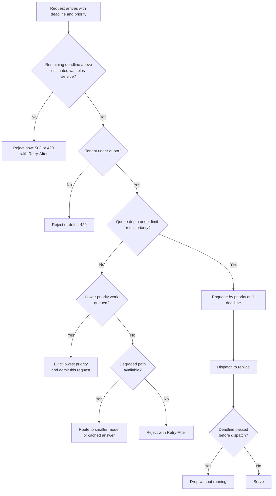

The flowchart combines the controls the architecture needs. A request is rejected on arrival if the estimated wait would exceed its deadline (estimated from queue depth and the average service time, via Little's Law); rejecting quickly returns a clear signal and frees the client to try elsewhere. Per-tenant quotas stop one caller from consuming the pool. A bounded queue keeps worst-case wait finite, with priorities so that interactive requests displace batch ones. A degraded path (smaller model, cached answer) turns some rejections into reduced-quality answers. A final deadline check before dispatch drops requests that expired while queued. Without that last check the system performs the doomed work that causes collapse.

The queue limit has a derivation: if the p95 wait objective is $T$ seconds and the pool completes $c\mu$ requests per second, the longest acceptable queue is about $L_q \approx c\mu T$. For the pool of eight with $\mu = 0.1$ per second per replica, $c\mu = 0.8$ requests per second, and for $T = 5$ seconds, $L_q = 4$. A limit of 4 queued requests is tight, which shows why long-service-time workloads cannot hold a deep queue and why they move to asynchronous contracts with longer deadlines.

### 9.6 Burst absorption and autoscaling

A queue absorbs a burst of size $B$ requests when the extra work $B$ can be drained within the allowed wait at the spare capacity $c\mu(1 - \rho)$, so $B \le c\mu(1-\rho)T$. With the same pool at $\rho = 0.7$ and $T = 5$ seconds: $0.8 \times 0.3 \times 5 = 1.2$ requests. The queue absorbs a burst of one request. This is the arithmetic of why buffering cannot replace capacity for services with slow requests: a burst of 50 requests needs either 50 spare slots right away or a wait of 50 / 0.24 = 208 seconds to drain. For bursts the choices are over-provisioning, an elastic overflow path (hosted API, other region), or shedding.

Autoscaling reacts only after a delay: metric collection (15–60 seconds), the scaling decision (30–60 seconds with stabilization windows), instance provisioning (1–5 minutes for GPU nodes, longer when instances are scarce), and model load (Section 11). The sum is commonly 3 to 10 minutes. A workload whose bursts rise faster than that cannot be served by autoscaling alone. Use signals closer to the demand than CPU or GPU utilization: queue depth, in-flight requests per replica, and KV cache usage predict saturation sooner, since GPU utilization metrics can read high at low concurrency because a single sequence keeps the compute units busy.

## 10. Multi-Model Hosting and Routing Within a Fleet

Most real systems serve several models: a large model for hard cases, a small model for routine ones, an embedding model, a reranker, a guard model for safety checks, and fine-tuned variants per customer or task. Placing them on GPUs is a packing problem with isolation and latency constraints. The routing between them belongs to the gateway (CH08), and this section covers the fleet underneath.

### 10.1 Dedicated versus shared GPUs

**One model per GPU group (dedicated).** Each model has its own pool. This gives clean performance isolation, simple capacity accounting, independent scaling and rollouts, and simple failure analysis. It wastes capacity when a model is lightly loaded, because a GPU with a small model at 5 percent utilization still costs the full price.

**Multiple models per GPU (shared).** Several models share one GPU's memory and compute. Options, from weakest to strongest isolation, are:

- **Process-level sharing without partitioning.** Two engine processes on one GPU compete for memory and compute through the driver's time slicing. Memory is a hard limit, and one process can cause out-of-memory errors in the other. Latency interference is high.
- **Multi-process service (MPS).** NVIDIA's MPS lets processes share the GPU's compute concurrently with limits on resource share. It improves utilization but gives limited fault isolation: an error in one client process can affect others.
- **Multi-Instance GPU (MIG).** On supported NVIDIA data-center GPUs (A100, H100 and later), MIG partitions a GPU into up to seven hardware-isolated instances, each with dedicated memory, cache, and compute slices. This gives strong isolation, but the partitions are fixed in size, reducing flexibility, and large models do not fit in small slices.
- **A single engine hosting several models or adapters.** One engine process manages weights for several models or serves one base model with many adapters (Section 10.2). This gives high density with the engine's own scheduling as the isolation.

The decision depends on the model size relative to the GPU. Small models (embedding models of 100 million to 1 billion parameters, small classifiers, guard models) waste a whole GPU if dedicated, so they share through MIG or MPS or run on CPU. Large models use whole GPUs or multi-GPU groups and are dedicated.

Worked example (memory packing). Take an 80 GiB GPU with an engine configured to use 90 percent, or 72 GiB. An 8-billion-parameter model in 16-bit precision needs about 15 GiB for weights, leaving 57 GiB for KV cache. At 128 KiB per token that is 57 × 1,048,576 / 128 = 466,944 tokens, about 155 concurrent sequences at 3,000 tokens. If two such models share the GPU, the weights take 30 GiB, leaving 42 GiB, which holds 344,064 tokens, so each model gets about 172,000 tokens of cache (57 sequences of 3,000 tokens each) if split evenly. Hosting two models on one GPU therefore cuts each model's concurrency by 63 percent (from 155 to 57), and it halves each model's compute share, so two models at moderate load can share a GPU, while two at high load will interfere.

### 10.2 Adapter multiplexing

Low-rank adaptation (LoRA, Hu et al., 2021) fine-tunes a model by training small low-rank matrices added to some weight matrices, leaving the base weights frozen. An adapter is therefore small: its size is $r \times (d_{in} + d_{out})$ per adapted matrix. Worked example for an 8-billion-parameter model with 32 layers, hidden size 4,096, MLP intermediate size 14,336, and key/value projection width 1,024, with rank $r = 16$ on all seven linear projections of each layer:

- Attention: $q$ and $o$ each $16 \times (4096 + 4096) = 131{,}072$; $k$ and $v$ each $16 \times (4096 + 1024) = 81{,}920$. Subtotal $2 \times 131{,}072 + 2 \times 81{,}920 = 425{,}984$.
- MLP: gate and up each $16 \times (4096 + 14336) = 294{,}912$, and down $16 \times (14336 + 4096) = 294{,}912$. Subtotal $3 \times 294{,}912 = 884{,}736$.
- Per layer $1{,}310{,}720$; for 32 layers $41{,}943{,}040$ parameters, about 42 million, which is 84 MB in 16-bit precision.

An adapter of 84 MB compares with 15 GiB for the base model, so 1,000 per-customer adapters take 84 GB of host memory or disk, not 15 TB. Engines that support multi-adapter serving (vLLM's multi-LoRA support, the S-LoRA system by Sheng et al. in 2023, and LoRAX) keep one copy of the base model on the GPU, hold a working set of hot adapters in GPU memory, load others from host memory or disk on demand, and apply per-request adapters inside a batch. This lets one pool serve many tenants' fine-tuned variants at close to the cost of the base model. The trade-offs:

- **Cache behavior.** Requests for different adapters cannot share prefix caches even with the same prompt prefix, because the attention state depends on the adapter. Prefix cache hit rates fall as the number of adapters grows.
- **Adapter load latency.** A request for a cold adapter waits for a load of 84 MB from host memory (milliseconds to tens of milliseconds) or from disk or object store (up to a second or more). Keep an eviction policy (least recently used) and a preload list for latency-sensitive tenants.
- **Quality ceiling.** An adapter modifies a limited number of parameters. Full fine-tunes diverge more from the base and cannot be multiplexed; they require a dedicated pool.
- **Isolation.** Adapters of different tenants share the base weights, the scheduler, and the memory, which is weaker isolation than separate processes (Section 12).
- **Version coupling.** Adapters are tied to a specific base model version. Upgrading the base requires retraining or revalidating every adapter, which is the largest operational cost of this pattern, and the model registry (CH10) needs to track base-adapter compatibility.

### 10.3 Model swapping

When many models each receive sparse traffic, keeping each loaded wastes GPUs. A swapping design keeps weights in host memory or on local NVMe storage and loads a model into GPU memory when a request arrives, evicting an idle one. The swap time follows the arithmetic in Section 11: from host memory over a PCIe 4.0 x16 link (a practical rate of about 25 GB/s) a 15 GiB model takes roughly 15 × 1.07 / 25 ≈ 0.64 seconds for transfer, plus engine reinitialization; from local NVMe at 3 GB/s about 5 seconds; from object storage at 1 GB/s about 16 seconds. Add runtime initialization and kernel warmup (tens of seconds in many engines). Swapping makes sense for internal tools with long gaps between uses, research and evaluation environments, and long-tail models, but it makes the first request after a gap slow. It does not suit interactive production paths unless the swap time is inside the latency objective, which is true only for small models with fast loading paths.

### 10.4 Fleet-level routing

Routing inside a fleet decides which replica serves a request, and it differs from gateway-level model selection.

- **Least outstanding work.** Send each request to the replica with the fewest in-flight sequences or lowest queue, as reported by the engine. This beats round-robin when request durations vary.
- **Prefix-aware (cache-aware) routing.** Send requests that share a long prefix (a system prompt, a document in a chat session) to the replica that already holds its KV cache, avoiding recomputation of the prefill. For a 3,000-token shared prefix, a hit saves most of the 350 ms prefill in the earlier budget. The price is load imbalance when a popular prefix attracts many requests, so use a bounded-load variant that spills to other replicas past a threshold.
- **Session affinity.** For multi-turn chat, route a conversation to the same replica to reuse its cache, with fallback when that replica is down or saturated. Affinity must be a preference, not a requirement, because replicas die.
- **Disaggregated prefill and decode.** Some designs run prefill and decode on separate pools with separate hardware, transferring the KV cache between them, because the two phases have different resource profiles. Part 16 CH28 describes the idea. For placement, it adds a network link (the KV transfer) on the critical path and a coupling between the two pools' capacity.
- **Heterogeneous hardware pools.** Route by request shape: short prompts to smaller, cheaper GPUs, long contexts to GPUs with more memory, and batch work to the cheapest available. The router needs the token count, which it gets from the tokenizer service (Section 13).

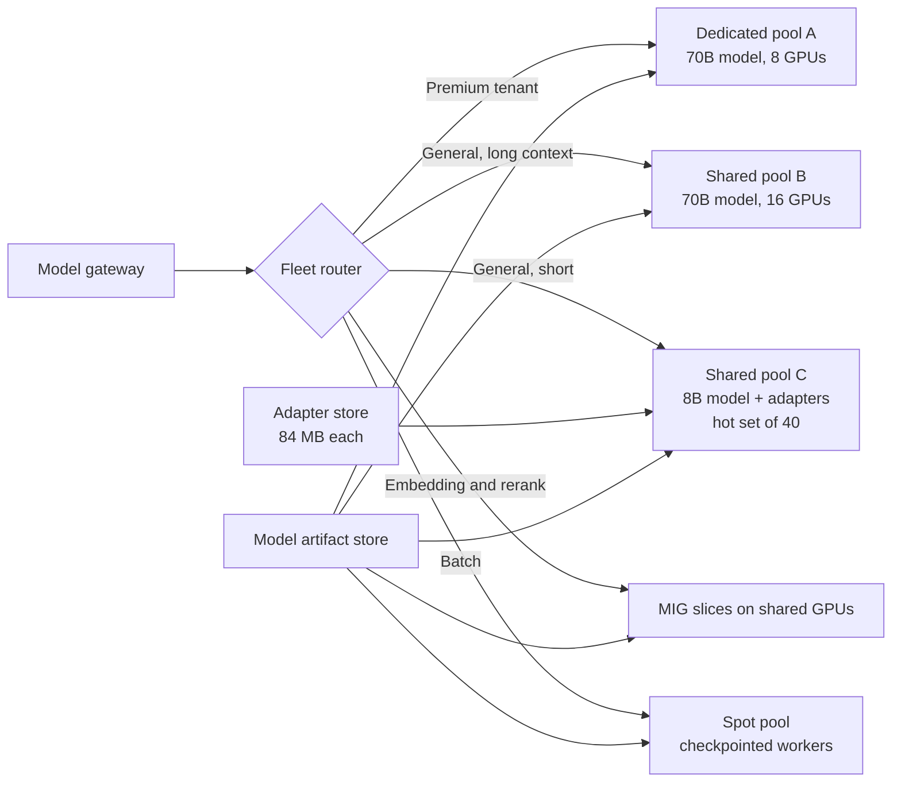

The figure shows one fleet with five pool types. A premium tenant gets a dedicated pool for isolation and predictability; the general population shares pools split by context length so that long prompts do not block short ones; adapters serve per-customer variants on the small model; small models share GPUs through partitioning; and batch work runs on the cheapest capacity. The artifact store feeds all pools, which makes it a shared dependency whose failure affects cold starts everywhere (Section 13).

## 11. Model Loading, Warm Pools, and Cold Starts

A new replica is not useful until its model is loaded, its runtime is initialized, and its kernels are warm. For small models this takes seconds. For large models it takes minutes, and that duration constrains autoscaling, deployments, failure recovery, and scale-to-zero.

### 11.1 What a cold start consists of

A cold start has these phases:

1. **Capacity acquisition.** The scheduler finds a GPU node. If none is free, the cluster autoscaler requests a new instance from the cloud, which takes 1 to 5 minutes when instances are available and unbounded when they are not.
2. **Container image pull.** Serving images are large (often 5 to 20 GB with CUDA libraries and engines). A node that has not cached the image pulls it from a registry.
3. **Weight transfer.** The model weights move from the artifact store to the GPU. The time is the weight size divided by the slowest link in the chain (object store, network, disk, PCIe).
4. **Runtime initialization.** The engine allocates the KV cache, builds kernels or compiles graphs (for example, capturing CUDA graphs for common batch sizes), and in some engines compiles model-specific code, which can take tens of seconds to minutes.
5. **Warmup.** The first requests exercise code paths and fill caches. Without warmup, the first real requests may take several times longer.
6. **Readiness.** The orchestrator marks the replica ready and the load balancer begins routing.

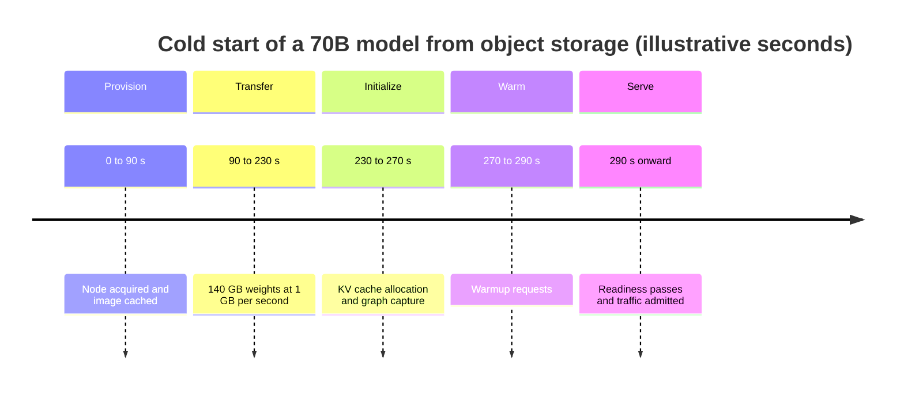

The timeline shows that the transfer dominates when the weights are large and the storage path is slow. For a 70-billion-parameter model in 16-bit precision the weights are about 140 GB, so at 1 GB/s the transfer alone is 140 seconds. The remaining phases add roughly 60 seconds in this illustration, and acquisition adds more if a node is not ready.

### 11.2 Arithmetic of load time

The script [04_cold_start_and_capacity_plan.py](../code/python/inference-placement-chapter/04_cold_start_and_capacity_plan.py) computes load time as weight size divided by effective bandwidth, plus a fixed time for container start, runtime initialization, graph capture, and warmup (40 seconds for the 8B model and 60 seconds for the 70B model in the illustration). Output:

| Model | Weight size (GB) | Source | Effective bandwidth (GB/s) | Total (s) |
| --- | ---: | --- | ---: | ---: |
| 8B, 16-bit | 16 | Object store | 1.0 | 56 |
| 8B, 16-bit | 16 | Node-local NVMe | 3.0 | 45 |
| 70B, 16-bit | 140 | Object store | 1.0 | 200 |
| 70B, 16-bit | 140 | Node-local NVMe | 3.0 | 107 |
| 70B, 8-bit | 70 | Node-local NVMe | 3.0 | 83 |

Three effects stand out. Moving weights from object storage to a node-local copy cuts the 70B load from 200 to 107 seconds, so how artifacts are cached is the most direct lever. Quantizing to 8 bits cuts the weight size in half and the load to 83 seconds, with the throughput gains of Part 16 CH28 as a bonus. And the fixed overhead sets a floor that storage improvements cannot remove: even with infinite bandwidth, the 70B model needs 60 seconds before it can serve.

Faster paths exist. Bake weights into the node image or keep them on a persistent local disk that survives pod restarts, so a restart on the same node skips the transfer. Use a shared read-only cache (a distributed file system or peer-to-peer distribution between nodes) to avoid every node pulling from object storage. Use streaming loaders that overlap reading from storage with copying to the GPU, and weight formats that support direct memory mapping (such as safetensors). Some platforms offer snapshot and restore of initialized GPU processes, reducing initialization further; at the time of writing this is an emerging capability, so verify support and failure behavior.

### 11.3 The cold-start storm

A cold-start storm is a failure mode in which many replicas start at once and compete for the same shared resource. It occurs after a region recovery, a full-fleet rollout, an autoscaler decision to add many replicas, or the loss of a node pool. Worked example: an autoscaler adds 10 replicas of the 70B model. If each node has 1 GB/s of its own network path but the object store throttles the aggregate to 5 GB/s, the ten transfers share 5 GB/s, so each runs at 0.5 GB/s and the 140 GB transfer takes 280 seconds instead of 140. The total data is 1,400 GB; at 5 GB/s it needs 280 seconds no matter how the nodes are arranged. The replicas arrive together at roughly 280 + 60 seconds after the decision, and in the meantime the existing replicas are still saturated. A rollout that restarts all replicas at once triggers the same effect in reverse: the fleet drops capacity precisely when the shared artifact path is most contended.

Defenses:

- **Surge and rolling limits.** Roll deployments with a maximum unavailable count that keeps capacity above the demand, and a maximum surge that matches the artifact path bandwidth.
- **Local caching.** A persistent node-local weight cache means restarts and scale-ups on cached nodes skip the transfer.
- **Fan-out distribution.** Seed one node per zone from object storage and let others pull from it, so aggregate bandwidth grows with node count.
- **Staggered starts.** Limit concurrent model loads (a start rate limit) so each completes sooner, and capacity arrives in a steady stream instead of all at the end.
- **Protect the base.** Never scale down below the capacity that could not be rebuilt within the demand ramp time.

### 11.4 Warm pools and the readiness gate

A warm pool is a set of replicas that are already initialized and either idle or serving a low-priority workload, ready to take traffic immediately. It converts cold-start time into idle cost. The size of the warm pool follows from the demand growth rate and the cold start time $T_c$. If demand can grow by a fraction $g$ per minute and cold start takes $T_c$ minutes, then at the moment a scale-up decision is made, demand will rise by a factor of about $(1 + g)^{T_c}$ before new capacity is ready, and the headroom (warm spare or over-provision) must cover it. With $g = 0.20$ per minute and the 70B cold start of 107 seconds (1.78 minutes) from local NVMe, the factor is $1.2^{1.78} \approx 1.38$, so the pool needs about 38 percent headroom to ride through the ramp. With the 200-second object-store start (3.33 minutes), the factor is $1.2^{3.33} \approx 1.84$, so 84 percent headroom would be needed, which makes the storage path an economic decision as well as a technical one.

A warm pool can also serve useful work while idle: batch jobs that can be preempted when interactive demand arrives. This turns idle cost into batch throughput, with the complication that preemption must be fast and checkpointed.

The readiness gate must test what the user needs. A process that has bound its port is alive but may not have loaded the model. A model that is loaded but has not run a request may take much longer for the first requests. The gate should send a representative request (a typical prompt length, a short generation) and require it to complete within the latency objective before reporting ready. Separate the probes: liveness restarts a hung process, readiness removes a replica from rotation, and a startup probe with a generous timeout prevents the orchestrator from killing a replica that is still loading its weights, a frequent cause of restart loops with large models.

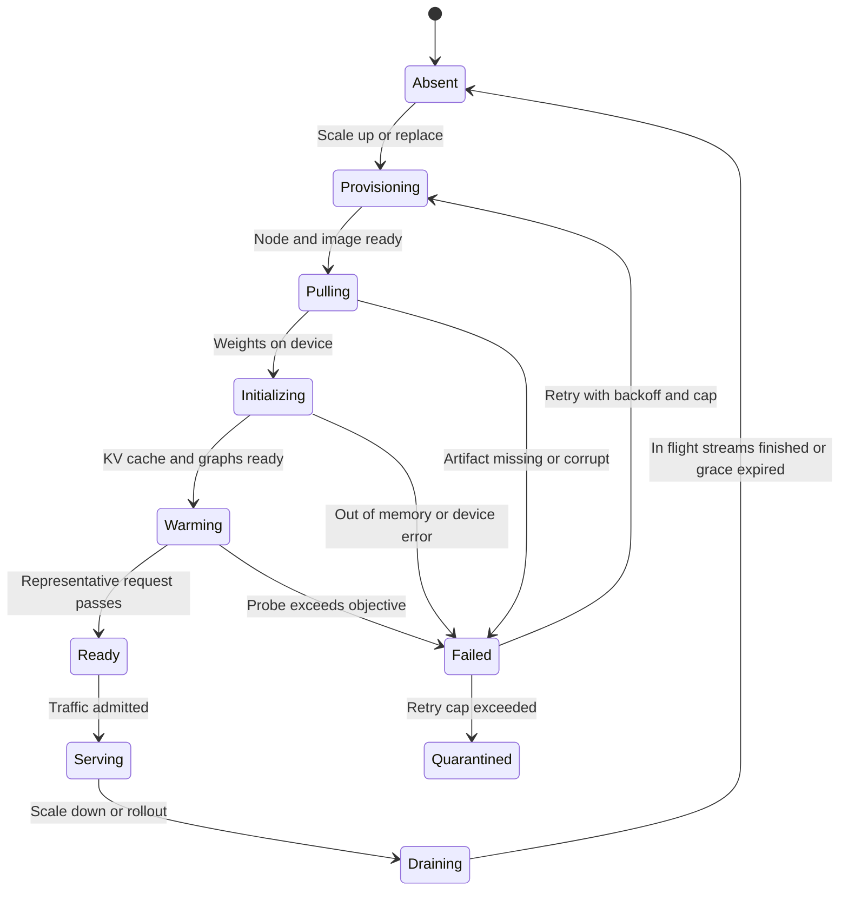

The state machine adds two states beyond the minimal path. The failed state loops back through provisioning with a cap, and the quarantined state records a replica or artifact that repeatedly fails so that a bad model version does not consume the fleet in an endless restart loop. Draining has a grace period tied to the longest stream (Section 4.3).

### 11.5 Scale-to-zero and its consequences

Scale-to-zero removes all replicas when idle and starts one on the first request. It reduces cost for sparse workloads, but the first request experiences the full cold start. For the 8B model, the best case from the table is 45 seconds, and for the 70B model it is 107 seconds or more. Neither fits a synchronous or streaming interactive contract: no user waits 45 seconds for a first token, and most gateways would time out. Therefore scale-to-zero is acceptable only when:

- the contract is asynchronous or batch, and the job simply waits for capacity;
- the model is small enough, and the loading path fast enough, to fit the objective (a small classifier that loads in 2 seconds, or a CPU-served model);
- a fallback path serves the first requests while the replica starts, for example routing to a hosted API or a smaller always-on model during the warm-up window, then shifting traffic back; or
- the first requests are predictable (a business-hours schedule), so a scheduled scale-up precedes demand, which is cheaper than a continuous warm pool and avoids the surprise.

Scale-to-zero also interacts with cost accounting. The cost of idle hours saved must be compared against the lost requests and the engineering to build the fallback. For a team with a model used 2 hours per day, scaling to zero for the other 22 hours saves 92 percent of the GPU cost: with one GPU at 2.40 USD per hour that is 22 × 2.40 = 52.80 USD per day or about 1,584 USD per 30-day month. Whether that justifies a 107-second first-request penalty depends on who waits.

## 12. Tenant Isolation on Shared Inference

Shared inference is cheaper because requests from many tenants fill one batch and one cache. The same sharing creates three kinds of interference: performance (one tenant slows another), information (one tenant learns something about another), and fault (one tenant's input crashes a replica that others use). Isolation is a spectrum, and each step toward stronger isolation costs capacity (Section 9.3), so the decision is to match isolation to the sensitivity of the tenant and the data.

### 12.1 Noisy neighbors and fairness

A noisy neighbor is a tenant whose load degrades others' latency. In LLM serving the common causes are:

- **Request-rate bursts.** A tenant that sends 500 requests per second fills the queue, and every other tenant waits behind it.
- **Long prompts.** A prompt of 100,000 tokens takes seconds of prefill. In engines without chunked prefill the prefill of one long prompt stalls the decode steps of all the other sequences in the batch, raising everyone's per-token latency for that period. Chunked prefill, described in Part 16 CH28, bounds the stall, and a per-request input limit bounds the worst case.
- **Long generations.** A tenant requesting 8,000 output tokens holds a batch slot and KV cache blocks for minutes.
- **Cache pressure.** One tenant with many distinct long prefixes evicts other tenants' cached prefixes, lowering their hit rates and raising their TTFT.
- **Retry storms.** A tenant whose client retries aggressively against 429 responses multiplies its own load.

The controls, in order of importance:

1. **Per-tenant rate limits in requests and tokens.** Limit both, because a request-count limit permits one huge request and a token limit alone permits many tiny ones. Use token buckets: a bucket has a refill rate (the sustained limit) and a capacity (the burst). With a sustained limit of 100,000 tokens per minute and a burst of 40,000, the tenant can spike briefly but cannot hold more than the sustained rate.
2. **Cost-based accounting.** Charge each request its estimated cost: input tokens plus a weighted output allowance (output tokens cost more compute per token than input tokens), and reconcile after completion. This stops one tenant from consuming a disproportionate share.
3. **Weighted fair queuing.** Dequeue by tenant weight so each tenant gets its share when contended, and unused share goes to others. A strict first-in-first-out queue lets the heaviest sender dominate.
4. **Input and output caps per tier.** Maximum prompt length, maximum generation, and maximum concurrent requests per tenant.
5. **Reserved concurrency.** Guarantee a minimum number of concurrent slots to important tenants, so their latency does not depend on others' load.
6. **Separate pools for classes of service.** Interactive and batch work use different pools or strict priority, so that a batch job cannot delay a user.

Worked example (quota arithmetic). A pool sustains 600,000 tokens per minute at the latency objective (blended input and output). Six tenants each hold a sustained quota of 100,000 tokens per minute. The quotas sum to the capacity, which is full allocation with no headroom. Practical practice is to oversubscribe because not every tenant uses its quota simultaneously, but oversubscription needs the arithmetic to be explicit. If the probability that a tenant is active at its limit at a given minute is 0.4 and tenants are independent, the expected load is $6 \times 0.4 \times 100{,}000 = 240{,}000$ tokens per minute, which is 40 percent of the capacity, and the chance that all six peak together is $0.4^6 = 0.4$ percent. Now sell the same pool to nine tenants with 100,000-token quotas, a total of 900,000 (150 percent of capacity). Expected load is $9 \times 0.4 \times 100{,}000 = 360{,}000$ tokens per minute, 60 percent of capacity. The pool is overloaded when seven or more of the nine are active at their limit at once. With a binomial model ($n = 9$, $p = 0.4$) that probability is $P(7) + P(8) + P(9) = 0.0212 + 0.0035 + 0.0003 \approx 2.5$ percent of minutes. Those minutes are handled by fair queuing and shedding the lowest tier, and whether 2.5 percent is acceptable is a product decision. The independence assumption is the fragile part: tenants in one time zone, or with a shared business calendar, peak together, so measure correlation before oversubscribing.

### 12.2 Information leakage through shared state

Information isolation concerns what one tenant can learn about another through the shared system. The risks vary with how much state is shared.

**KV cache and prefix cache timing.** A prefix cache reuses KV blocks for requests that share a prompt prefix. A request whose prefix is cached returns its first token faster. If the cache is shared across tenants, an attacker can send crafted prompts and measure TTFT: a fast response indicates that some other user recently sent that prefix. By testing guesses (for example, a template prompt with a guessed name or a candidate document), the attacker can confirm or reconstruct content in another user's prompt. Researchers have measured such timing differences in commercial APIs (see Gu et al., 2025, on auditing prompt caching in language model APIs) and described attacks on serving systems that exploit shared caches. The mitigation is cache scoping: the cache key includes a tenant or organization identifier, so only the same tenant can hit. Several providers state that their prompt caches are scoped to the organization; verify the scoping of any provider you use and the terms. In your own fleet, include the tenant id (or a security domain id) in the hash of the prefix block. The cost is a lower hit rate, because tenants with an identical system prompt no longer share. Where all tenants are internal and equally trusted, a shared cache is an acceptable trade-off.

**Batching side channels.** Request latency in a shared batch depends on the other requests in the batch, so latency leaks information about co-tenants' load. The leaked information is low-bandwidth in most settings, but a high-sensitivity tenant should not share a batch with untrusted tenants.

**Adapter and weight sharing.** Per-tenant adapters on a shared base model (Section 10.2) are logically separated, but the scheduling and memory are shared. A bug in adapter routing could apply one tenant's adapter to another's request, which leaks the fine-tuned behavior and potentially training data memorized by the adapter. Test adapter routing with canary prompts and log the adapter id per request.

**Residual state.** After a request finishes, its KV blocks are freed. If the engine does not zero them, a later request could read residual data through a bug in memory management. This is an engine implementation risk; keep engines patched and prefer well-reviewed ones. Logs and traces are the more common leak: debug logs with prompt text, crash dumps, and profiling output captured on a shared node can expose content to anyone with node access.

**Output and error channels.** Error messages that echo input, and responses that include another tenant's context because of a cache key or session-id bug, are application-level leaks. A tenant id that is part of every cache key, every log record, and every vector store query is the structural defense (CH05 describes tenant-aware retrieval).

### 12.3 Fault isolation

A single malformed or adversarial input can crash a replica (an out-of-memory error from a pathological request, a bug triggered by unusual tokens). On a shared replica, other tenants' in-flight streams die with it. Limit the damage with per-request resource caps, input validation, process restarts that are fast, and routing that quarantines a request that crashed a replica so that retries do not take down replica after replica (the poison request problem). For high-sensitivity tenants, dedicated replicas confine the blast radius to that tenant.

### 12.4 The isolation spectrum and dedicated pools

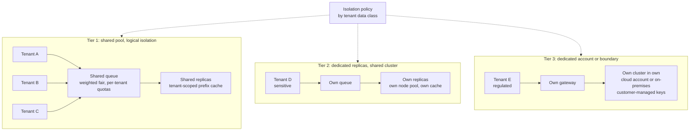

The diagram presents isolation as tiers chosen by data class, not by customer size. Tier 1 uses logical controls (quotas, scoped caches, tenant-tagged logs) and suits most tenants with ordinary data. Tier 2 dedicates replicas and node pools, which removes batching and cache interference and confines faults, at the price of the pooling penalty. Tier 3 separates the cloud account or the facility, adds customer-managed encryption keys, and supports tenants whose contracts or regulators require physical or administrative separation.

The cost of a dedicated pool follows from the queueing result in Section 9.3. A tenant with a peak of 6 requests per second and a mean service of 10 seconds needs 60 slots in flight at peak for no waiting, and a dedicated pool sized for the peak at 70 percent target utilization needs about 86 slots. If the tenant averages one third of the peak, the pool is on average 23 percent utilized. The same tenant in a shared pool consumes close to its average and relies on statistical multiplexing. The shared pool would carry the tenant's average of 20 slots at the same 70 percent target, or about 29 slots, so the dedicated pool costs about three times as much, and and that multiple belongs in the pricing of the premium tier. A common packaging is a dedicated pool with a floor (a minimum monthly commitment) and the tenant's own overflow to the shared pool at lower priority.

## 13. Dependencies and Failure Domains of the Serving Path

A request that reaches a healthy GPU can still fail, because inference sits behind and beside other components. The way to reason about reliability is to list every dependency on the serving path, group them into failure domains, and calculate how many users each failure affects.

### 13.1 The dependency map

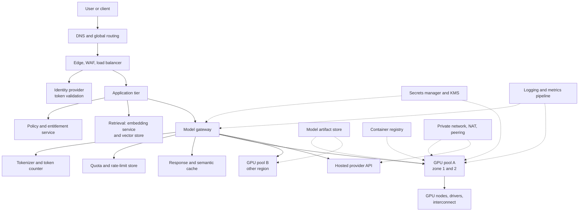

Solid arrows are request-time dependencies: if any fails, the request fails or degrades. Dashed arrows are dependencies at startup, scale-up, or background times: their failure does not break serving replicas immediately, but it blocks recovery and growth. This difference is easy to miss. The artifact store is not on the request path, so its outage is invisible until an autoscale event or a replica restart needs a model load, at which point it turns a small incident into a large one.

### 13.2 Dependency inventory and blast radius

For each dependency, record whether it is required for a request, what the failure looks like, which users are affected, and what the degraded behavior is.

| Dependency | On request path? | Failure effect | Blast radius | Degraded behavior | Mitigation |
| --- | --- | --- | --- | --- | --- |
| Identity provider | Yes (token validation) | Cannot authenticate new requests | All users in the region | Accept cached validated tokens until expiry | Local JWT validation with cached keys, short outage tolerance |
| Policy and entitlement service | Yes | Cannot authorize | All users, or fail closed | Cached decisions for a short TTL, fail closed for new sensitive actions | Replicated, local cache |
| Tokenizer and counter | Yes (routing, quotas) | Cannot compute token counts | All requests using token-based routing | Estimate tokens by characters divided by four | In-process library, not a remote service |
| Embedding service | Yes for RAG | Retrieval fails | RAG features | Skip retrieval and answer without context, flagged | Replicas, fallback embedding model with matching index (see note) |
| Vector store | Yes for RAG | No context | RAG features | Keyword search fallback | Replication, read replicas |
| Quota store | Yes | Cannot enforce limits | All tenants | Fail open with local conservative limits | Local token buckets with periodic sync |
| GPU pool in one zone | Yes | Lost capacity | Share of pool | Remaining zones absorb with queueing | Zone spread, N+1 |
| Whole region | Yes | Lost capacity | All users pinned to that region | Failover region within boundary | Pre-provisioned secondary |
| Model artifact store | No (startup only) | Cannot start replicas | Nobody until scale or restart | None while running | Per-region mirror, node-local cache |
| Container registry | No (startup only) | Cannot pull images | Same | None while running | Mirror, pre-pulled images |
| Secrets and KMS | Partly | Cannot fetch keys at startup, may fail decrypt | Starting replicas, encrypted stores | Cached secrets in memory | Regional KMS, caching with TTL |
| Logging and metrics | No | Blind operation | Operators | Buffer locally and drop under pressure | Non-blocking, bounded buffers |
| Hosted provider API | Yes if on path | Provider errors or throttles | Traffic routed to it | Failover to another model | Gateway fallback (CH08) |
| Network and DNS | Yes | Unreachable | Varies | Multi-resolver, health checks | Redundant paths |

A note on embedding fallback: a query embedding must come from the same model as the index embeddings. A fallback embedding model with a different vector space cannot search the index (CH05 and CH04 cover embedding versioning), so a fallback embedding service must be a second deployment of the same model, not a substitute.

### 13.3 Failure domains and the arithmetic of redundancy

A failure domain is a set of components that fail together: a process, a node, a rack, a zone, a region, a provider, or a shared software version. Redundancy helps only across independent domains. Four common traps:

- **Correlated software.** Ten replicas running the same engine build share any bug that the next request triggers. Staggered rollouts and canaries limit the exposure, but a latent bug in a build is a failure domain of its own.
- **Shared control planes.** Two regions that depend on one identity provider, one artifact store, or one global configuration service share the fate of that service.
- **Shared quota.** Two deployments that draw on one provider quota or one GPU reservation are not independent in the face of a shortage.
- **Shared capacity during failover.** Regions that each run at 80 percent utilization cannot absorb a failed neighbor.

Availability arithmetic for serial dependencies multiplies. A request path that needs the identity provider (99.95 percent), policy service (99.95 percent), application tier (99.95 percent), gateway (99.95 percent), and inference pool (99.9 percent) has an availability of $0.9995^4 \times 0.999 = 0.99700$, or 99.70 percent, which is about 130 minutes of downtime per 30-day month (0.003 × 43,200 minutes = 129.6). Each added serial hop erodes the total. Parallel redundancy compensates: two independent pools each at 99.9 percent give $1 - (0.001)^2 = 99.9999$ percent for that stage in theory, but real correlated failures put the practical figure far lower. Verify with fault injection instead of trusting the formula.

Capacity arithmetic for N+1: with $n$ zones of equal capacity and a target of surviving the loss of one, each zone should run at no more than $(n-1)/n$ of its capacity at peak. For three zones that is 66.7 percent, and for two zones 50 percent. The cost of zone redundancy is therefore a 1.5 times capacity multiplier with three zones and 2 times with two. This is why many designs accept degraded service on a zone loss: they size for N+1 at normal load, and shed batch and free-tier traffic at peak.

### 13.4 Blast-radius worked example

Consider a single-region serving fleet of 24 GPUs in three zones (8 per zone), serving 9,000 users at peak. A failure analysis:

- **One GPU node fails.** Assume four GPUs per node, so each zone has two nodes and the fleet has six. Losing one node removes 4 of 24 GPUs, 16.7 percent of capacity. At 60 percent average utilization the remaining nodes run at $0.6/0.833 = 72$ percent, just above the 70 percent target. Tail latency rises but stays inside the objective if the target was chosen with margin. Users see no outage.
- **One zone is lost (8 GPUs).** 33 percent of capacity gone. Remaining utilization $0.6/0.667 = 90$ percent. By Section 9.2 the tail waits become severe (the p95 wait for the example pool at 90 percent is about 32 seconds). Admission control sheds the lowest-priority 25 percent of traffic and holds interactive latency. Users of the free tier see rejections.
- **Bad model rollout to all replicas.** 100 percent blast radius for quality or error rate, which a zone-redundant design does not help with. Only canaries and staged rollouts bound it (Section 15).
- **Artifact store outage during a zone loss.** Replacement replicas cannot start. The effective blast radius expands because recovery fails. A node-local cache restores the replica on the same node.
- **Region loss.** 100 percent for that region's pinned users until failover completes.

The analysis shows which controls the largest risks require: zone spread for hardware faults, canaries for software faults, local caching for control-plane faults, and cross-region failover for region faults. Each has a different design, and having one of them does not cover the others.

## 14. Fallback Within Placement

Fallback is the planned behavior when the primary placement cannot serve a request. The gateway (CH08) implements routing and circuit breaking, and CH13 catalogs the resilience patterns. This section covers the placement decisions that make fallback possible and safe.

### 14.1 A ladder of fallbacks

Define an ordered ladder, where each rung trades something for availability:

1. **Retry on another replica in the same pool.** Cheapest, for transient errors only, within the retry budget.
2. **Secondary zone or region within the residency boundary.** Same model, higher latency; data policy unchanged.
3. **Smaller model in the same placement.** Lower quality, lower cost, usually lower latency and more capacity available. Output must be acceptable for the use case, which needs evaluation beforehand (CH11).
4. **Different provider or a hosted API for the same model class.** Introduces a data boundary: allowed only if the data class permits it and the contract covers it. Behavior differs, so the prompts and output parsers must be tested against it.
5. **Cached or precomputed answer.** For repeated questions, serve a previous validated answer with a freshness label.
6. **Degraded product behavior.** Show search results without a generated summary, ask the user to retry, or queue the request for asynchronous completion.
7. **Explicit failure.** A clear error with a retry hint.

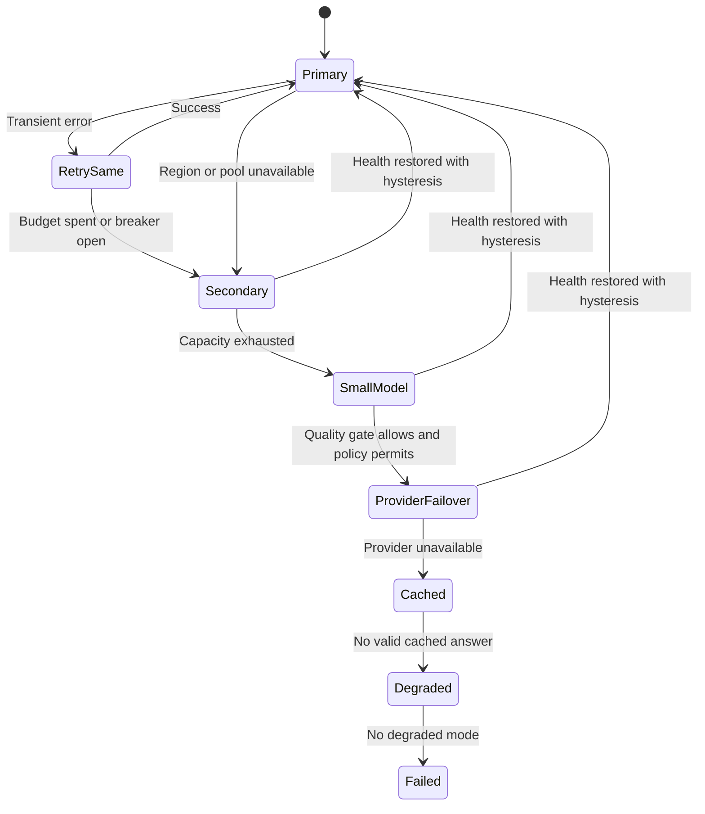

The state diagram shows two properties that matter beyond the order of rungs. Moving down is triggered by health signals and budgets, and moving up requires hysteresis (a sustained recovery window and a gradual traffic ramp), because returning all traffic to a freshly recovered primary can overload it and trigger another failure (flapping). Each downward transition carries a policy check. The provider rung is available only to requests whose data class allows leaving the placement, and the check is made per request.

### 14.2 Fallback must preserve contracts

A fallback that changes behavior silently is a defect. Four contracts need attention.

- **Data policy.** A request that was pinned to the EU region must not fall back to a US region or a provider with processing outside the boundary. The routing policy attaches a set of permitted targets to the request and the fallback logic selects only from that set (Section 7.4). If the set is empty, the request is rejected.
- **Output shape.** A fallback model must produce the same structure (a JSON schema, a citation format). Test with the same parser and validators. Structured-output features differ between providers and models.
- **Quality floor.** Define the minimum acceptable quality per use case and evaluate the fallback against it before it is enabled. A smaller model may be fine for summarization of short text and unacceptable for legal analysis, so the permission is per use case.
- **Disclosure and provenance.** Record which model and placement served each response, and expose it to the user when the difference matters (for example, a "reduced capability" notice). Evaluation and incident review need the same record.

### 14.3 Capacity for fallbacks

A fallback target needs capacity. A secondary region that is idle until a failure must hold enough warm replicas to absorb the failover, or it must cold start under pressure, which takes minutes (Section 11) while the primary's traffic is failing now. Three options trade cost for readiness:

- **Active-active.** Both regions serve traffic and each is sized to take the other's load at degraded quality. Highest cost, fastest failover, the only option for strict availability.
- **Active-standby warm.** The secondary holds a small warm pool (for example, 25 to 40 percent of the primary's capacity) and scales out during failover. The warm pool covers the first minutes and the rest of the capacity arrives after the cold start. Admission control sheds the excess in between.
- **Active-standby cold.** The secondary has no replicas. Suited to batch and internal workloads where minutes to hours of recovery are acceptable.

A hosted API as the fallback target is a form of cold standby with provider-managed capacity: its warm capacity is shared with other customers, so quotas must be set high enough in advance (request the quota increase before the incident) and the account must be tested with real traffic periodically. A fallback path that is never exercised tends not to work during the incident: credentials expire, quotas are too low, the prompt format has drifted. Schedule game days that send a small percentage of real traffic through each rung.

## 15. Deploying Models into Serving

A model change is a release: new weights, a new quantization, a new base for adapters, a new prompt template tied to a model, a new engine version, or a new hardware class. CH10 covers the lifecycle (registry, promotion gates, evaluation), and this section covers how a version enters a serving fleet and how it is removed.

### 15.1 Release strategies

**Blue/green.** Two complete fleets exist: the current (blue) and the new (green). Traffic switches at the router in one step, and rollback is a switch back. It gives instant rollback and a clean comparison, but it needs double capacity during the cutover, which for GPU fleets is expensive. Worked example: a fleet of 40 GPUs at 2.40 USD per GPU-hour reserved. Running blue and green for a 4-hour validation window costs an extra 40 × 2.40 × 4 = 384 USD at the reserved rate, or 40 × 4.00 × 4 = 640 USD at the on-demand rate. That is small relative to the monthly cost, as long as 40 GPUs are available at that moment, which is the practical constraint: GPU headroom may not exist, and rolling in-place may be the only option.

**Canary.** A small fraction of traffic (1 to 5 percent) goes to the new version while metrics are compared with the baseline, and the fraction increases in stages if healthy. It needs only a small extra capacity, and bounds the damage of a bad version. The weakness is statistical power: detecting a change takes enough requests. A rule of thumb for comparing two proportions at 5 percent significance and 80 percent power is $n \approx 16\,\bar p(1-\bar p)/\delta^2$ per arm, where $\bar p$ is the mean rate and $\delta$ is the difference to detect. To detect an error rate rising from 1 percent to 2 percent ($\bar p = 0.015$, $\delta = 0.01$), $n \approx 16 \times 0.015 \times 0.985 / 0.0001 = 2{,}364$ requests per arm. At 5 percent of 42 requests per second (2.1 per second) a canary collects that in about 19 minutes. Quality metrics (rated helpfulness, groundedness) are noisier than error rates and need thousands to tens of thousands of judged samples, so canary stages for quality last hours, and offline evaluation (CH11) is the earlier gate.

**Shadow (mirroring).** The new version receives a copy of real requests, and its output is recorded and compared but not returned to users. It tests the model on real traffic with no user risk. Costs: it doubles the compute for the mirrored fraction, it cannot test side effects (tools must be stubbed), it cannot measure user-facing outcomes (acceptance, satisfaction), and it duplicates sensitive data into another pipeline, which needs the same residency and retention controls. Shadow is best for latency, error rates, output format conformance, and offline scoring against a judge or a reference.

**Rolling (in-place).** Replicas are replaced a few at a time. It needs no extra capacity beyond a small surge but exposes users to a mixed fleet during the rollout, and rollback is another rolling update, which takes as long as the original rollout and requires the old artifacts to be available.

**Progressive delivery with feature flags.** The version is selected per tenant, per cohort, or per feature, using the flag system. This allows internal users first, then low-risk tenants, then everyone, and lets sensitive tenants stay on a pinned version until they approve.

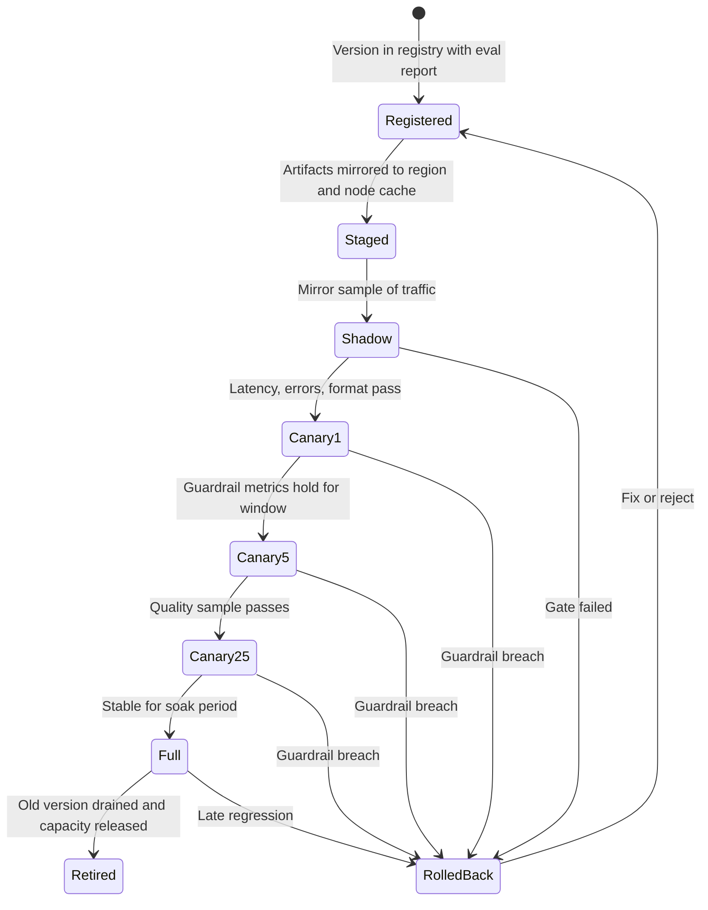

The diagram makes two operational points. Staging happens before any traffic: the artifacts are mirrored to the target regions and node caches first, so the rollout never competes with the cold-start path (Section 11.3). And rollback is reachable from every stage, including after full rollout, because some regressions only show up after days (long-tail inputs, rare languages, seasonal content).

### 15.2 Rollback readiness

Rollback is only as fast as the old version is warm. If the old pool is scaled down when the new one takes traffic, rolling back requires a cold start of the old model (107 to 200 seconds for the 70B model in Section 11.2), during which the failing version still serves or capacity is short. Keep the old version warm at reduced capacity for a defined window (hours to days), release it at retirement, and record that window as a cost of the release. The rollback decision is tied to measurable triggers set in advance: for example, error rate above 1.5 times baseline for 10 minutes, p95 TTFT above the objective for 15 minutes, or a guardrail metric (refusal rate, unsafe-output rate) outside its band.

### 15.3 What changes together

A model version is rarely changed alone. The prompt template, the tokenizer, the output parser, the sampling parameters, the engine version, and the quantization format all interact with it. Release them as a versioned bundle with a single identifier, and log the bundle id with each request. A mismatch (new model with old prompt template, or a new tokenizer with an old cache) is a common source of regressions that no component test catches. For prefix caches, remember that a new model version invalidates the cached KV state, so a release causes a transient rise in TTFT as caches refill, and the canary will show it. Do not mistake that for a model regression.

Engine upgrades deserve the same care as model upgrades, because a new engine version can change numerical results, memory use, and throughput. Pin engine versions, canary them, and compare output on a fixed evaluation set for equivalence within tolerance.

## 16. Securing Serving Endpoints

An inference endpoint is a network service that accepts untrusted input, runs expensive computation, and often holds sensitive data in memory. It needs the controls of any such service plus several specific to models. CH12 owns the policy and threat modeling for AI, and this section lists what the serving layer must enforce.

### 16.1 Authentication and authorization

- **Authenticate every caller, including internal ones.** Many open-source inference servers ship without authentication enabled by default or with a single shared API key option. An unauthenticated engine port reachable from the network is a free GPU for anyone, and a path to read prompts if debug endpoints are enabled. Put the engine behind the gateway, bind it to a private interface, and require mutual TLS or workload identity between the gateway and the engine.
- **Use workload identity, not shared static keys.** Service-to-service calls use short-lived credentials issued per workload (cloud workload identity, SPIFFE-style identities, mTLS with automatically rotated certificates). Per-tenant API keys at the public edge are hashed at rest, scoped to specific models and operations, revocable, and rate limited.
- **Authorize by model and operation.** A caller permitted to use the small model is not automatically permitted to use the large model, a fine-tuned model trained on sensitive data, or administrative endpoints (load model, unload model, update adapter). Administrative endpoints should be on a separate listener and network, not reachable from the tenant-facing path.
- **Bind the end user.** For delegated access, pass the end user identity through so retrieval and tool access are checked against the user's permissions, not the service's (CH05 and CH06).

### 16.2 Network policy

- Place inference pools in private subnets without public addresses. Egress from inference pods should be denied by default: a serving process rarely needs the internet at runtime, and blocking egress prevents exfiltration if the process is compromised and prevents a model loaded from an untrusted source from calling out.
- Allow ingress only from the gateway, and egress only to the artifact store (through a private endpoint), the metrics collector, and the secrets service.
- For hosted providers, use private connectivity (private link or equivalent) where offered and restrict which workloads may reach the provider endpoints, so that a compromised service cannot freely use the organization's provider account.
- Separate the management plane (deployments, node access) from the data plane (inference requests), with distinct identities and audit trails.

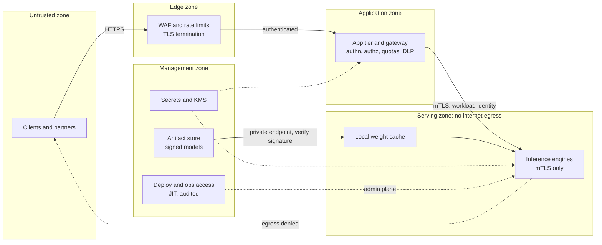

The trust-boundary diagram shows that traffic flows inward through increasingly trusted zones, each boundary authenticates, and the serving zone has no route outward. Weights enter the serving zone through one path from the artifact store with signature verification, and operator access is a separate path with just-in-time elevation and audit.

### 16.3 Secrets

Provider API keys, database credentials, and signing keys belong in a secrets manager and are delivered to workloads at runtime, never baked into images, prompts, or configuration files in repositories. Rotate on a schedule, and have a revocation procedure that can be run in minutes. A provider key leaked from a log or a client application is used to run up costs (denial of wallet) and can read the account's stored data, so scope keys to a project with spend limits and alerts. Scan logs and traces for key patterns. Never send secrets in prompts. If a prompt must include a credential for a tool call, route that call through a tool layer that holds the credential outside the model's view (CH06).

### 16.4 Model artifact integrity

Weights are executable-adjacent. Some serialization formats (Python pickle, and formats built on it) can execute arbitrary code when loaded, so loading a model file from an untrusted source can compromise the host. The controls:

- **Use safe formats.** Prefer formats that store only tensors (such as safetensors) and avoid loading pickle-based checkpoints from external sources. If pickle formats are unavoidable, load them in a sandbox.
- **Verify provenance and integrity.** Record the cryptographic hash of every artifact in the registry (CH10), sign artifacts with a key controlled by the release process (for example using Sigstore-style signing), and verify the signature and the hash at load time, not just at upload. Download from sources by pinned revision, not by a floating tag, because a tag such as a branch name can be repointed.
- **Scan.** Scan containers and dependencies for vulnerabilities, and scan model files for unsafe serialization.
- **Check licensing.** The registry record includes the license and acceptable-use terms (Section 6.8).
- **Protect weights as an asset.** For proprietary fine-tuned weights, restrict read access, encrypt at rest with customer-managed keys, and avoid copying them to developer laptops. On devices, weights shipped to users can be extracted, so assume that an on-device model is public to a determined adversary and treat its secrecy as best effort (Section 19).
- **Software supply chain.** Engines and their dependencies are large and fast-moving. Pin versions, use a private mirror, and apply security updates through the same canary process as model updates.

### 16.5 Abuse and denial of wallet

Inference is expensive per request, so abuse is both a security and a cost problem. Limit input size, output size, and concurrency per caller. Require authentication for all but strictly limited public endpoints. Put hard spend caps and anomaly alerts on every provider account and on GPU autoscaling maximums (an attacker who can trigger unbounded autoscaling can run up a bill, so set a maximum replica count). Detect and block extraction patterns (systematic probing of the model with high volume) and prompt-injection-driven abuse of tools (CH12).

### 16.6 Logging, privacy, and retention at the serving layer

Serving logs capture prompts and outputs for debugging and evaluation. They concentrate sensitive data. Decide per data class whether content is logged at all, mask or hash identifiers, set retention (days, not years, unless required), restrict access, and keep logs in the same region as the processing (Section 7.2). Separate metadata logs (token counts, latencies, model version, status) which are broadly useful and low risk, from content logs, which are narrowly accessible and short-lived. A secondary issue is provider-side retention: hosted APIs may retain inputs for abuse monitoring for a period unless a zero-retention arrangement applies. The terms differ by provider and by product, so record the actual terms in the ADR.

## 17. Observability and Service-Level Objectives for Serving

Serving observability answers three questions: is the service meeting its objectives, why not, and how much headroom remains? CH11 covers evaluation and quality observability, and this section covers latency, capacity, and error signals specific to inference.

### 17.1 The metrics that matter

| Metric | Definition | Why it matters | Typical alert basis |
| --- | --- | --- | --- |
| TTFT | Time from request arrival to first token | What the user perceives as responsiveness | p95 above objective for 5 minutes |
| TPOT (inter-token latency) | Time between successive output tokens | Whether streaming keeps pace with reading | p95 above 50 to 100 ms for chat |
| End-to-end latency | Arrival to final token | Matters for non-streaming and batch | By request class |
| Queue depth and queue wait | Requests waiting for a slot, and how long | Leading indicator of saturation (Little's Law) | Depth above $c\mu T$ (Section 9.5) |
| In-flight requests per replica | Concurrent sequences | Load for scaling and routing | Above the tested limit |
| KV cache utilization | Share of cache blocks in use | Memory saturation; precedes preemption and rejection | Above 85 to 90 percent |
| Preemptions and evictions | Sequences swapped or recomputed because of cache pressure | Hidden latency spike | Rate above baseline |
| Goodput | Requests completed within the latency objective per second | Throughput that counts | Fraction of requests inside SLO |
| Throughput | Tokens per second, input and output separately | Capacity and cost per token | Drop at constant load |
| Error rate by class | Failures by cause (Section 17.3) | Separates client, capacity, and platform problems | Per class |
| Cache hit rates | Prefix cache and response cache hits | Explains latency and cost shifts | Drop after release |
| GPU health | Utilization, memory, temperature, ECC errors, interconnect errors | Hardware faults | Error counters above zero |
| Cold start duration | Time from scale decision to ready | Autoscaling feasibility | Above budget |
| Tokens per request | Input and output distributions | Cost and capacity drivers; detects shape drift | Shift in percentiles |

Raw throughput can mislead. A pool can report high tokens per second while most requests exceed their latency objective because the batch is too large; goodput reflects what users receive. The relevant measure is the fraction of requests meeting both TTFT and TPOT objectives, not either alone.

Distribution matters more than mean. Record histograms, not averages, and split by model, version, region, tenant tier, and request class (prompt length bucket). A change in the mix of prompt lengths can shift p95 TTFT with no change in the system, so a dashboard needs the prompt-length distribution next to latency.

### 17.2 Service-level objectives

An SLO states a target for a service-level indicator (SLI) over a window. For a streamed chat endpoint an example set is:

- 99.0 percent of requests receive a first token within 1,200 ms (TTFT SLO).
- 99.0 percent of streams have p95 inter-token latency below 80 ms.
- 99.5 percent of requests complete without a server-side error.

The error budget is the allowed failure share: 0.5 percent for the error SLO. At 1.08 million requests per day, the monthly volume is 32.4 million requests, and the budget is 162,000 failed requests per 30 days. Consumption in units of burn rate (the rate of budget use relative to the allowed rate) drives paging: a burn rate of 14.4 (the multiwindow approach popularized in the Google Site Reliability Engineering workbook) consumes 2 percent of a 30-day budget in an hour and justifies an immediate page, while a slow burn of 1 over several days opens a ticket. State SLOs per request class: interactive streaming, synchronous structured calls, and asynchronous jobs have different indicators (job completion within 15 minutes for 99 percent of jobs).

Define what counts as a good event precisely. A request rejected by admission control is an error against the SLO unless the contract defines it as an expected shed (for example, free-tier traffic above its quota). Without this definition, a shedding system looks healthy while refusing users. Equally, a request canceled by the client should be excluded from latency statistics, because its time to complete is meaningless.

### 17.3 Error classes

Separate errors by cause, because the response differs.

| Class | Example | Action |
| --- | --- | --- |
| Client error | Invalid request, input too long, unauthorized | Do not retry; fix the caller; not counted against the SLO |
| Rate limited or quota | 429 from tenant quota | Expected under policy; client backs off |
| Overload or shed | 503 from admission control, queue full | Capacity signal; counts against the SLO unless defined as shed |
| Timeout | Deadline exceeded in queue or generation | Capacity or tail-latency issue |
| Engine error | Out of memory, kernel fault, crashed process | Platform issue; investigate; may need quarantine of a poison request |
| Dependency error | Retrieval, tokenizer, identity failures | Attribute to the dependency owner |
| Provider error | 5xx, throttling from hosted API | Trigger fallback; open a provider incident |
| Safety or policy refusal | Blocked by guard, content filter | Quality and policy signal, not availability |
| Truncation | Output cut at max tokens or context limit | Quality signal; often silent without monitoring |

Silent failures deserve attention. A response truncated at the token cap, an empty generation, a malformed structured output, or a fallback to a smaller model all return HTTP 200. Add explicit counters for finish reasons (stop, length, content filter, error) and for fallback usage, so those do not hide inside a 99.9 percent success rate.

### 17.4 Tracing and capacity signals

Use distributed tracing with a request id propagated through every hop, with spans for queue wait, prefill, and decode, and attributes for model version, region, replica, tenant tier, and token counts (not content). A trace answers "why was this request slow" by showing whether the time went to the queue, the network, retrieval, or generation. Alert on leading indicators of saturation (queue depth, KV cache utilization, rate of preemptions), not just on user-visible latency, which degrades only after saturation. Track the cost per request and per tenant as a metric next to latency, because a rise in cost with constant volume usually reflects a prompt or output length drift that capacity plans did not assume.

Synthetic probes from each region exercise the full path at a low rate with a fixed prompt and record TTFT and total time. They detect problems when real traffic is quiet (such as overnight) and provide a stable baseline unaffected by changes in traffic mix. Run probes against each fallback rung too, to prove it works (Section 14.3).

## 18. Cost Model: Hosted Tokens, Self-Hosted GPUs, and Reserved Capacity

Cost drives the choice between hosted and self-managed placement more often than any other factor, and the common errors are comparing a hosted price per token with a GPU price per hour without converting units, assuming a utilization that production will not reach, and leaving out the operating cost. This section builds a model and runs it. CH14 covers the cost governance around it.

### 18.1 The model

Let $T$ be monthly token demand in millions of tokens (Mtok), with input and output blended for simplicity. In practice price input and output separately, since output tokens usually cost several times more than input tokens on hosted APIs, and the blended price depends on the input-to-output ratio of the workload.

Hosted cost: $C_h = T \cdot p$, where $p$ is the blended price in USD per Mtok.

Self-hosted cost: $C_s = G \cdot r \cdot H + F$, where $G$ is the number of GPUs, $r$ is the hourly price per GPU, $H$ is hours per month (730), and $F$ is fixed monthly operating cost (the share of on-call, monitoring, security work, tooling, and the idle capacity reserved for failure). The number of GPUs is a step function of demand:

$$G = \max\left(G_{min},\ \left\lceil \frac{T}{q \cdot u} \right\rceil\right)$$

where $q$ is the GPU's monthly capacity in Mtok at full utilization (its sustained tokens per second times 3,600 times 730, divided by one million), $u$ is the target utilization, and $G_{min}$ is the availability floor (two GPUs, so that one failure does not cause an outage). The floor and the fixed cost are why self-hosting loses at low volume.

The script [03_breakeven_calculator.py](../code/python/inference-placement-chapter/03_breakeven_calculator.py) implements this. Its illustrative inputs: hosted blended price 1.50 USD per Mtok; on-demand GPU 4.00 USD per hour; reserved GPU 2.40 USD per hour; sustained throughput 2,500 tokens per second per GPU at the latency objective; target utilization 55 percent; fixed operating cost 9,000 USD per month; minimum 2 GPUs. These numbers are placeholders chosen to show the method. Replace them with a current quote, measured throughput for your model and prompt mix, and your own staffing cost.

Per-GPU capacity: $2{,}500 \times 3{,}600 \times 730 / 10^6 = 6{,}570$ Mtok per month at full utilization, and $6{,}570 \times 0.55 = 3{,}614$ Mtok at the target utilization. Marginal reserved cost per Mtok: $2.40 \times 730 / 3{,}614 = 0.485$ USD, about a third of the hosted price. The fixed floor is $2 \times 2.40 \times 730 + 9{,}000 = 12{,}504$ USD per month.

### 18.2 Results

| Demand (Mtok/month) | Hosted (USD) | GPUs | Self-hosted on-demand (USD) | Reserved (USD) | Cheapest |
| ---: | ---: | ---: | ---: | ---: | --- |
| 500 | 750 | 2 | 14,840 | 12,504 | Hosted |
| 1,000 | 1,500 | 2 | 14,840 | 12,504 | Hosted |
| 2,000 | 3,000 | 2 | 14,840 | 12,504 | Hosted |
| 5,000 | 7,500 | 2 | 14,840 | 12,504 | Hosted |
| 10,000 | 15,000 | 3 | 17,760 | 14,256 | Reserved |
| 20,000 | 30,000 | 6 | 26,520 | 19,512 | Reserved |
| 50,000 | 75,000 | 14 | 49,880 | 33,528 | Reserved |
| 100,000 | 150,000 | 28 | 90,760 | 58,056 | Reserved |

The script reports a linear break-even of 12,317 Mtok per month (about 4,687 tokens per second averaged over the month) and an exact stepped break-even of 9,600 Mtok per month with 3 GPUs: at that volume hosted costs $9{,}600 \times 1.50 = 14{,}400$ USD and reserved costs $3 \times 2.40 \times 730 + 9{,}000 = 14{,}256$ USD. The linear estimate overstates the crossover, because it charges the whole two-GPU floor even where three GPUs are enough, so the exact figure from the step function is the one to use.

Reading the table:

1. Below roughly 9,600 Mtok per month the fixed floor dominates and hosted tokens win. In the example this is about 3,700 tokens per second of average demand.
2. On-demand GPUs lose to reserved ones at every volume in this model and cross the hosted line at much higher demand. Paying on-demand rates for steady load is rarely correct, so on-demand GPUs belong to bursts and experiments.
3. At 100,000 Mtok per month, reserved GPUs cost 58,056 against 150,000 hosted. At that scale the savings (92,000 USD per month) pay for a platform team.
4. The step function matters near the crossover: the cost jumps by 1,752 USD per month each time another GPU is needed.

### 18.3 Sensitivity: utilization is the hidden variable

The marginal cost depends inversely on utilization. At the 55 percent target, reserved capacity costs 0.485 USD per Mtok. At 25 percent utilization, the per-GPU capacity is $6{,}570 \times 0.25 = 1{,}642$ Mtok and the marginal cost is $2.40 \times 730 / 1{,}642 = 1.067$ USD per Mtok, which is close to the hosted price of 1.50 once the fixed cost is added. A bursty workload that sizes for the peak sits at low average utilization, and the self-hosted advantage disappears. This is why Section 6.3 treats burstiness as a placement criterion: the peak-to-average ratio sets the utilization, which sets the cost.

Throughput is the second hidden variable. A measured 2,500 tokens per second per GPU depends on the model, the quantization, the prompt-to-output ratio, and the latency objective. A change from 16-bit to 8-bit weights, or from an unoptimized to an optimized engine configuration, can raise throughput by 1.5 to 2 times, which moves the break-even point down by the same factor. Part 16 CH28 describes those techniques. The break-even is therefore an engineering outcome and not a market constant, which is also why teams that invest in serving optimization find self-hosting attractive earlier than those that do not.

The third is price drift. Hosted prices for a given capability level have fallen repeatedly, so a break-even computed this year may reverse next year. Record the assumptions and a review date in the ADR.

### 18.4 What the model omits

- **Redundancy.** The two-GPU floor covers one failure. Multi-region designs multiply the floor by the number of regions.
- **Peak sizing.** The calculator sizes on monthly average demand. A real fleet is sized on the peak (Section 20), so utilization is lower and the self-hosted cost higher than shown.
- **Non-GPU infrastructure.** CPUs, memory, networking, storage for weights, load balancers, and observability add 10 to 30 percent in many deployments.
- **Engineering time.** The fixed cost covers an estimate. A fleet that needs one full-time platform engineer per 30 GPUs behaves differently from one that needs a team.
- **Evaluation and migration cost.** Self-hosting an open-weight model that is less capable than a hosted frontier model may raise error cost, which the break-even model does not see. Compare cost at equal quality (CH02 and CH14).
- **Egress and data transfer.** Cross-region or cross-cloud transfer, and payload sizes for audio or images, add costs.
- **Commitment risk.** A reserved commitment is a liability if demand falls or a better GPU appears.
- **Caching.** Prefix caching and response caching reduce effective token demand on both hosted (discounted cached-input pricing, which several providers offer) and self-hosted options.

### 18.5 Provisioned throughput versus tokens

Provisioned throughput on a hosted model has the same shape as reserved GPUs: a fixed price for capacity, favorable above a utilization threshold. Let $P$ be the monthly price of one provisioned unit and $q_u$ the Mtok per month it delivers at your latency objective at full use. The break-even utilization against per-token pricing is $u^* = P / (p \cdot q_u)$. Using illustrative values, a unit costing 15,000 USD per month and delivering 20,000 Mtok per month at full use against a 1.50 USD per Mtok on-demand price gives $u^* = 15{,}000 / (1.50 \times 20{,}000) = 0.5$. Above 50 percent average utilization the provisioned unit is cheaper, and below it the on-demand tokens are cheaper. Because bursty traffic cannot sustain 50 percent utilization of capacity that is sized for its peak, the usual configuration provisions for the base load and sends the overflow to on-demand. The unit price and throughput numbers for the model you want come from the provider's current documentation and a load test with your traffic. The values here only show the calculation.

### 18.6 Batch and off-peak pricing

For work with a loose deadline, price drops again. Hosted batch APIs typically discount by about half at the time of writing in return for a completion window of up to a day. Self-managed batch on spot instances can run at a small fraction of the on-demand price when the job tolerates interruptions. The saving is realized only if the work is genuinely deferrable. A workload that pulls "overnight" work into daytime because someone wants it now should be priced as interactive.

## 19. Edge and On-Device Inference

Edge and on-device placements exist for three reasons: the network is absent or unreliable, the data cannot or should not leave the site or device, or the latency requirement is below what any network path allows. They bring a different set of engineering problems from the data center: small memory, many devices, slow and partial updates, no operator hands near the hardware, and an adversary who may hold the device.

### 19.1 Model size, memory, and speed

The memory for weights is the parameter count times the bytes per parameter: $M = N \cdot b / 8$ with $b$ bits per parameter. A 3-billion-parameter model needs 6 GB at 16 bits, 3 GB at 8 bits, and 1.5 GB at 4 bits. A 7-billion-parameter model at 4 bits needs 3.5 GB. Runtime needs more than the weights: the KV cache (which grows with context length), activation buffers, and the application, so reserve 20 to 50 percent above the weight size and test on the smallest target device. Operating systems limit how much memory a single application may use on a phone, often a fraction of total RAM, and background apps are killed under memory pressure.

Decode speed on a memory-bandwidth-limited device follows a simple upper bound: each generated token reads the full weights once, so tokens per second is at most memory bandwidth divided by model size in bytes. A phone with an effective 50 GB/s of usable memory bandwidth (an illustrative figure; check the device) running a 1.5 GB model has a bound of about $50/1.5 \approx 33$ tokens per second, and real throughput is lower because of compute limits, thermal throttling, and overhead. A laptop with 100 GB/s of bandwidth running the same model has a bound near 67 tokens per second. These numbers explain why on-device models are small and quantized, and why a 7-billion-parameter model at 4 bits (3.5 GB) on the same phone has a bound near 14 tokens per second, which is readable but slow.

Sustained use triggers thermal throttling and battery drain. A feature that runs the model continuously (live transcription) needs measured energy per inference and a policy that backs off when the device is hot or the battery is low.

### 19.2 Runtimes and formats

Runtimes differ by platform, and the list changes quickly, so check the current state before choosing. At the time of writing, common options include llama.cpp and its GGUF format for CPU and mixed hardware, ONNX Runtime across platforms, Core ML on Apple devices, ExecuTorch for PyTorch models on mobile and embedded targets, LiteRT (the successor name of TensorFlow Lite) and MediaPipe tasks on Android, the vendor-provided on-device model services of the major phone platforms, and browser runtimes built on WebGPU and WebAssembly (such as WebLLM and Transformers.js). They differ in supported operators, quantization schemes, and hardware acceleration (neural processing units are reachable only through vendor-specific delegates). Plan a conversion and validation step: converting and quantizing a model can change its outputs, so evaluate the converted artifact on the target runtime, not the original (CH11).

### 19.3 Mobile and browser notes

**Mobile.** Weights are large relative to app size limits and mobile data plans, so download them after install, over Wi-Fi, with resume and integrity checks, instead of bundling them in the app binary. App store policies may restrict downloading executable code, but model weights are data; verify current policies. Test across the device range: a model that runs at 20 tokens per second on a flagship may run at 3 on a four-year-old device. Provide a capability check at first run that selects a model size or falls back to the cloud.

**Browser.** WebGPU enables GPU inference inside the browser sandbox without installation. Constraints: browser support varies by platform, the per-tab memory limit is a few gigabytes at most, the model download is large (1 to 4 GB for a small language model) so cache it with the browser's storage APIs and show progress, and the first load is slow. Benefits: no install, and the data stays in the tab. Browser inference suits small models for tasks such as text classification, redaction, embedding for local search, and light summarization, and is a poor fit for large generative models.

**Embedded and industrial.** Microcontroller-class devices run models of kilobytes to a few megabytes (keyword spotting, anomaly detection). Linux-class edge boxes with accelerators run vision models and small language models. Real-time operating system constraints, deterministic latency requirements, and long hardware lifetimes (10 years or more) mean the update and security story is the main design problem.

### 19.4 Update distribution

A model update to a device fleet is a software distribution problem with a large payload. Arithmetic: a 1.5 GB model sent to 100,000 devices is 150 TB of transfer. At an illustrative content delivery network price of 0.02 USD per GB the cost is 3,000 USD per full update, and the rollout takes days on mobile networks. Reduce the cost with:

- **Delta updates.** Send only changed tensors or binary patches. A fine-tune that changes all weights gives little saving; an adapter update (84 MB in the Section 10.2 example) instead of a full model reduces the transfer by a factor of 18 (1.5 GB / 84 MB ≈ 18). Designing the on-device model as a frozen base plus replaceable adapters is the architectural choice that makes updates affordable.
- **Staged rollout.** Release to 1 percent of devices, observe crash rates and quality signals, then expand. A device-side health report (model version, load success, latency, memory failures) feeds the gates.
- **Update windows.** Download on Wi-Fi while charging, and apply at a safe point (not during use).
- **Atomic swap and rollback.** Keep the previous model until the new one passes a self-test, so a failed update reverts locally with no network. Include a remote kill switch to disable a model version.
- **Compatibility matrix.** The model version, runtime version, and application version must be compatible. A new model that needs a newer runtime cannot ship to devices that have not updated the app, so the matrix drives which devices receive which model. Devices that never update remain on old versions for years, so the cloud side must support several model versions or degrade gracefully.
- **Signing.** Sign model artifacts, and have the device verify the signature before loading (Section 16.4). Without it, a compromised distribution channel can replace the model.

### 19.5 Offline operation and synchronization

An offline-capable feature defines what works without a network, what is queued, and how conflicts are resolved at reconnection. Local state (conversation history, results, local retrieval index) is stored encrypted on the device with the keys protected by the platform keystore. Actions with external effects are queued with idempotency keys and replayed on reconnect. Outputs made offline carry a marker of the model and content version, because the cloud may later contradict them. A local retrieval index needs its own freshness policy: manuals updated centrally reach devices at the next sync, and the device displays the content date. The field inspection example later in this chapter (Section 22.4) shows the pattern.

### 19.6 Privacy and security of edge models

On-device inference keeps raw data on the device, which can simplify consent and reduce regulatory exposure, since data that never leaves the device is not transferred. It is not automatic: telemetry, crash reports, and cloud escalation paths can send content out, and each needs the same review as any other data flow. Threats specific to edge models:

- **Model extraction.** Anyone with the device can copy the weights. Obfuscation raises the cost but does not stop a determined attacker. Do not put a model on a device if its weights are a trade secret you cannot afford to lose, and do not embed secrets (API keys, private prompts) in the artifact.
- **Tampering.** An attacker can swap the model or alter inputs (adversarial examples against a vision model). Verify signatures and design downstream decisions to tolerate a compromised edge result when the stakes are high, for example by sampling edge decisions for server-side re-verification.
- **Physical access.** Devices in stores or vehicles can be stolen. Encrypt at rest, use hardware-backed keys, and have remote wipe and revocation.
- **Prompt and output data on devices.** Local conversation logs persist. Define retention and let users clear them.

### 19.7 Fleet management

For edge servers at hundreds or thousands of sites, the fleet needs the same functions as a cloud fleet at smaller scale and with a less reliable network: an inventory of devices with hardware class and installed versions; remote deployment with staged rollout and rollback; health and metrics collection that tolerates intermittent connectivity (store and forward, local aggregation); remote diagnostic access that is audited; and a way to sample inputs and outputs for monitoring and retraining under a data policy. Pull-based update agents are preferred, since devices behind customer firewalls cannot accept inbound connections. A device registry records which model version runs where, which is needed to answer questions after an incident ("which sites ran version 14 between these dates").

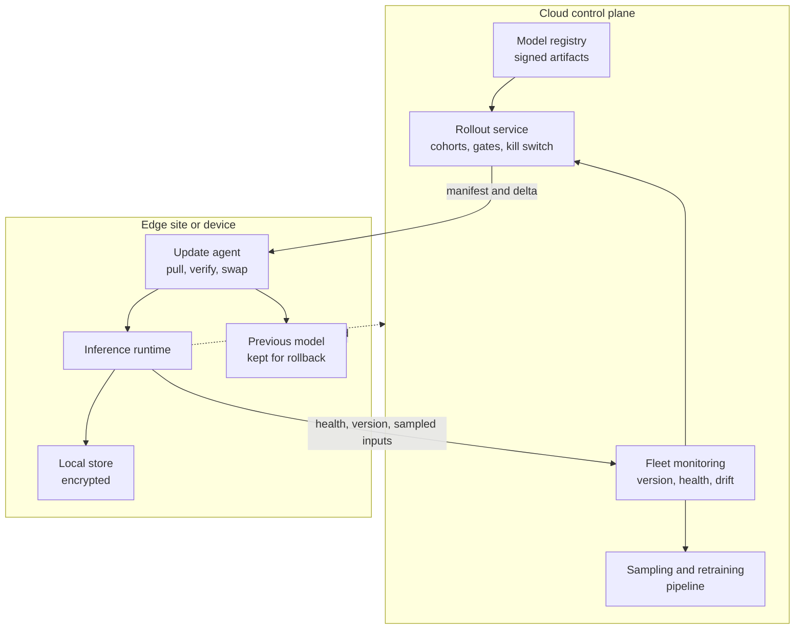

The diagram shows the loop that keeps an edge fleet manageable. The cloud publishes signed artifacts and rollout manifests, the agent on the device pulls, verifies, swaps, and keeps the previous version, the runtime reports health back, and the rollout service uses that signal to advance or stop. Escalation to the cloud is an optional path controlled by data policy.

## 20. Capacity Planning: From Product Forecast to Fleet Size

Capacity planning turns a product forecast into a number of GPUs (or provider units) and a purchase plan. The method has seven steps. The script [04_cold_start_and_capacity_plan.py](../code/python/inference-placement-chapter/04_cold_start_and_capacity_plan.py) carries out the arithmetic below.

### 20.1 The method

1. **Forecast users and sessions.** Take daily active users, sessions per user, and requests per session from the product plan. Keep a low, expected, and high case.
2. **Characterize the request shape.** Measure input and output token distributions from a pilot or comparable feature: mean, p50, p95, and the share of long-context requests. Capacity depends on the shape, not the count.
3. **Convert to peak rate.** Apply the peak-hour share of daily traffic and the peak-minute factor within the hour, using data from similar traffic or the product's usage pattern. Peak, not average, sets capacity.
4. **Measure per-GPU throughput at the SLO.** Load-test the actual model, engine, hardware, and request shape, and find the highest request rate at which TTFT and TPOT objectives still hold. Part 16 CH28 gives the method. Do not use a vendor's peak tokens-per-second figure, which is measured at saturation with ideal batches.
5. **Compute GPU demand.** GPU-seconds per request divided into peak rate, divided by target utilization.
6. **Add redundancy and headroom.** N+1 or a percentage for failures, rollout surge, and forecast error.
7. **Choose the purchase mix** (Section 8.4) and the review cadence.

### 20.2 Worked example

The inputs (illustrative): 120,000 daily active users, 1.5 sessions per user per day, 6 requests per session, a peak hour holding 14 percent of daily traffic, and a peak-minute rate 1.8 times the average of the peak hour. Each request has 2,500 input tokens and 350 output tokens. Measured per-GPU throughput at the SLO: 1,800 output tokens per second in decode and 20,000 input tokens per second in prefill, with a target utilization of 60 percent.

- Daily requests: $120{,}000 \times 1.5 \times 6 = 1{,}080{,}000$.
- Peak-hour requests: $1{,}080{,}000 \times 0.14 = 151{,}200$, which is $151{,}200 / 3{,}600 = 42.0$ requests per second on average during the hour.
- Peak-minute rate: $42.0 \times 1.8 = 75.6$ requests per second.
- GPU-seconds per request: $350/1{,}800 + 2{,}500/20{,}000 = 0.1944 + 0.125 = 0.319$.
- GPUs at peak: $75.6 \times 0.319 / 0.60 = 40.25$, rounded up to 41.
- Redundancy: adding 25 percent (11 GPUs, at least one) gives 52 GPUs.
- Concurrency check by Little's Law: with $W = 0.9 + 350 \times 0.025 = 9.65$ seconds, in-flight requests are $75.6 \times 9.65 \approx 730$, so each of 52 GPUs holds about 14 sequences at the peak, comfortably inside typical engine limits, so compute and not memory sets the size here. A check of KV memory at that concurrency, as in Section 9.1, confirms the same on the target hardware.

The monthly cost of 52 reserved GPUs at 2.40 USD per hour is $52 \times 2.40 \times 730 = 91{,}104$ USD, or $91{,}104 / 32.4\text{M} = 0.0028$ USD per request. That is the cost of a static fleet sized for the peak. The average daily rate is $1{,}080{,}000 / 86{,}400 = 12.5$ requests per second, so the average load needs $12.5 \times 0.319 = 4.0$ busy GPUs, and the static fleet is busy about 8 percent of the time on average. That gap is the cost of the peak. The options for narrowing it are: autoscale the fleet along the daily curve (limited by the cold start in Section 11), serve the lowest tier of the load from a hosted API during peaks, shift deferrable work to off-peak, and reduce the peak by queueing non-interactive requests. Hosted tokens for the same traffic, at 2,850 tokens per request, are $32.4\text{M} \times 2{,}850 = 92.34$ billion tokens per month, which is 92,340 Mtok. At 1.50 USD per Mtok that is about 138,510 USD per month. The static reserved fleet therefore still costs less than hosted tokens at the stated prices, although the margin (34 percent less) is small enough that a smarter hybrid is probably better than either extreme.

### 20.3 Sensitivity and forecast error

Run the same calculation at low, expected, and high demand, and vary the largest uncertainties: the long-context share, the output length, throughput per GPU (the engine may be 30 percent slower in production than in the benchmark), and the peak factor. A tornado-style table of the effect of each on GPU count identifies which input to measure first. In the example, a 30 percent drop in per-GPU throughput raises 40.25 GPUs to 57.5. A 50 percent rise in output length from 350 to 525 tokens raises GPU-seconds per request from 0.319 to 0.417 and the GPU count to 52.6. Both are larger than the redundancy margin, which is why headroom must be sized from the uncertainty and not set by habit.

Plan to re-run the calculation as real data replaces the forecast: after the first month of production, compare the realized request shape and peak factor to the plan, and update. Capacity lead times matter as much as the number: if reserved GPUs in the region take eight weeks to obtain, the plan needs the order date, not just the quantity.

### 20.4 Capacity for providers

For hosted APIs, the same method produces a required rate in tokens per minute and requests per minute. Compare with the quota, and request increases before launch with a justification and forecast, because approvals can take days to weeks. Know which limit binds first: requests per minute, input tokens per minute, or output tokens per minute. Many providers apply limits per model and per region, so a fallback model needs its own quota.

## 21. Failure Scenarios

Each scenario is written as a stimulus, a response, and a measure, so it can be tested in a game day. The scenario list below uses the reference fleet of Section 13.4 where numbers help.

| Scenario | Stimulus | Expected system response | Measure |
| --- | --- | --- | --- |
| Region outage | The primary EU region becomes unreachable at peak | Health checks mark the region down within 30 seconds. The tenant router sends pinned EU tenants to the second EU region. Admission control sheds batch and free-tier traffic. Streams in flight on the failed region end with a retryable error and clients resume or restart | Recovery of interactive TTFT SLO within 5 minutes. Zero requests served outside the EU boundary. Shed fraction below 25 percent of traffic and only from the lowest tiers |
| GPU shortage | The autoscaler cannot obtain more GPU instances of the required type in the region during a demand surge | The fleet holds at its current size. Admission control keeps interactive latency by shedding or deferring low-priority work. The gateway routes eligible overflow to the hosted API within quota. Capacity request escalates to the cloud provider | Interactive p95 TTFT within the objective. Overflow share routed to hosted API below the tested quota. Time to detect the shortage under 5 minutes |
| Cold-start storm | A full-fleet restart after a driver update restarts 40 replicas of the 70B model at once | Rolling limits keep at most 10 percent unavailable. Node-local weight caches serve restarts without object-store transfer. Surge replicas start in batches. Readiness gates prevent traffic to unwarmed replicas | Capacity stays above 80 percent of demand throughout. No replica receives traffic before the readiness check passes. Object store throughput below its throttle limit |
| Long-context spike | A customer begins sending 100,000-token prompts at 20 requests per second | Per-request input caps reject prompts above the tier limit. Chunked prefill bounds decode stalls. Long requests route to the long-context pool. The tenant's token quota bounds the load. Prefix cache pressure is contained by tenant scoping | Other tenants' p95 TTFT rises by less than 20 percent. The offending tenant sees 429 beyond its quota with a clear reason. KV cache utilization stays below 90 percent |
| Provider rate limit | The hosted provider returns 429 on 30 percent of calls after a promotional traffic increase | Gateway honors `Retry-After`, applies jittered backoff within the retry budget, opens the circuit breaker for the throttled model, and diverts eligible traffic to the secondary model or provider | Retries below 10 percent of base request volume. User-visible error rate below 1 percent. Fallback quality evaluation within floor. Provider quota increase requested within the day |
| Artifact store outage | The model artifact store is unavailable while a node pool is replaced | Running replicas keep serving. New nodes start from a node-local or regional mirror cache. If no cache exists, the rollout pauses and the alert fires | No loss of serving capacity from the outage alone. Time to detect cache miss on startup under 2 minutes |
| Slow-client attack | 5,000 connections read streams at 1 byte per second | Per-connection buffer limits and write timeouts cancel abandoned streams. Per-client connection caps apply. Cancellation frees batch slots | GPU slots held by slow clients below 2 percent. Memory growth bounded at the gateway |
| Poison request | One prompt crashes the engine each time it runs | The gateway quarantines the request signature after two crashes, returns an error to the caller, and does not retry across replicas | At most two replicas restarted. No cascade across the pool |
| Bad model release | A new version raises the refusal rate from 2 to 9 percent only for one language | Canary guardrail breaches in the canary stage, rollback to the warm previous version, and a post-incident test is added to the evaluation set | Blast radius at most the canary fraction. Time to rollback under 10 minutes. Regression test added |

Two things make these scenarios useful. First, each has a measure phrased as a fact that a test or a dashboard can confirm, such as the share of traffic served outside the boundary. Second, each ties back to an earlier section, so a missing response points to the design element that is absent: the failover set (7.4), admission control (9.5), staged rollout limits (11.3), tier quotas (12.1), the fallback ladder (14.1), and canary guardrails (15.1). Run the scenarios at small scale in a staging environment and then in production at low traffic with controlled blast radius; a response that has never been exercised should be assumed broken.

## 22. Worked Placement Decisions

Three decisions follow, written as Architecture Decision Records. Each uses the same sequence: context and constraints, options considered, decision, consequences, rejected alternatives, and the trigger for review. The inputs are illustrative but internally consistent, and the arithmetic uses the tools in this chapter.

### 22.1 Regulated EU customer assistant

**Context.** A retail bank in the European Union deploys a customer assistant in its mobile app and web portal. It answers questions about products and account activity using retrieval over product documents and the customer's own account data. Customers are located in several EU member states. The bank's compliance office requires that personal data is processed within the European Union, that prompts and outputs are not used to train provider models, that content logs are kept in the EU for at most 30 days, and that the service continues if a single EU region fails. The assistant must stream answers with a TTFT of 1,500 ms at p95. Expected volume: 3 million requests per month, 2,800 tokens each, so 8,400 Mtok per month, with a peak of about 25 requests per second. Interaction mode: streaming (SSE) from the app, with a synchronous moderation check before generation.

**Constraints that eliminate options.** The processing-residency rule is a hard constraint (Section 6.2). The quality requirement is a capable general model; a small open-weight model did not meet the answer-quality bar in the pilot evaluation (CH02). The bank has Kubernetes experience but no GPU operations experience.

**Options.**

| Option | Residency | Cost at 8,400 Mtok per month | Operating effort | Verdict |
| --- | --- | --- | --- | --- |
| A. Hosted shared API with global processing | Processing location not guaranteed | About 12,600 USD (8,400 × 1.50) | Low | Fails the residency constraint |
| B. Hosted model through the cloud provider's EU data-boundary deployment, two EU regions | Contractual EU processing | About 12,600 USD, plus provisioned units later if throttled | Low | Meets constraints |
| C. Self-managed open-weight model in two EU regions | Full control | About 16,000 USD: two regions with the 2-GPU floor each is $4 \times 1{,}752 = 7{,}008$ plus 9,000 fixed | High | Meets residency, fails quality bar and operating capacity |
| D. On-premises GPUs | Full custody | High capital cost, lead time of months | Highest | Not justified by the requirement |

**Decision.** Choose option B. The assistant calls a hosted model through the cloud provider's EU data-boundary deployment, with the primary in one EU region and a second EU region as failover. The application, retrieval, vector store, conversation store, caches, and logs run in the same two EU regions. A residency-pinned routing layer is configured with an EU-only failover set (Section 7.4). Content logs have a 30-day retention in the EU. A small guard model for input and output safety checks is self-managed on two GPUs in each region, because the moderation call is on the critical path and benefits from low latency and a fixed cost. The streaming path uses SSE with a 15-second heartbeat, buffering disabled, a deadline header, and cancellation propagation (Sections 3.2 and 4).

**Latency check.** The compute budget is application 40 ms, retrieval 60 ms, moderation 40 ms, queue 80 ms at p95, and prefill 350 ms, a total of 570 ms. The network allowance is 1,500 − 570 = 930 ms. A user in Madrid reaching a region in Frankfurt has an RTT of about 40 ms (illustrative), and three RTTs on a cold connection give 120 ms. The TTFT is about 690 ms, comfortably inside the objective. Cross-region failover to a region 20 ms farther adds 60 ms on a cold connection, which is also inside the budget.

**Consequences.** Cost is about 12,600 USD per month plus the guard-model fleet (4 GPUs at the reserved rate, $4 \times 1{,}752 = 7{,}008$ USD per month, small relative to the compliance value, and sized for failover). Dependency on the provider's EU deployment: the gateway (CH08) holds a second EU-resident model option as a fallback with a lower quality floor. The provider's retention terms (abuse monitoring) must be confirmed as a zero-retention or EU-only arrangement, and this is recorded as an open item for the legal review. Failover testing is a quarterly game day.

**Rejected alternatives.** A fails a hard constraint, and its lower operating effort is irrelevant. C passes residency but the self-hosted model fails the quality bar, and C would cost more than B at this volume, because the two-region floor (16,008 USD per month) exceeds the 12,600 USD hosted spend. D is disproportionate. A hybrid with an on-device model was considered for sensitive account queries and rejected for the first release because the quality is inadequate and it adds fleet management.

**Review trigger.** Re-evaluate if monthly volume exceeds 15,000 Mtok per month (at which the reserved self-hosted floor is likely cheaper), if the provider changes its EU terms, or if an open-weight model passes the quality bar in the evaluation set.

### 22.2 High-volume classification at the edge

**Context.** A grocery chain with 1,500 stores wants to detect empty shelf spaces from fixed cameras. Each store has 5 cameras producing 2 frames per second for analysis, 10 frames per second per store and 15,000 frames per second across the chain. A frame is about 200 KB after compression. Store connectivity is a shared link of 20 to 100 Mbit per second that also carries point-of-sale traffic, and outages of minutes to hours occur. The model is a quantized vision classifier of about 25 million parameters. The business needs a result within a few seconds and a daily report per store.

**Options and arithmetic.** Sending all frames to a cloud region would need $15{,}000 \times 200$ KB = 3 GB per second sustained, 24 Gbit per second, which is 24 Gbit per second in aggregate. Per store, 10 frames per second × 200 KB = 2 MB per second = 16 Mbit per second. That is 16 to 80 percent of a 100 or 20 Mbit per second store link, which is not acceptable alongside point-of-sale traffic. Over a month, $3 \text{ GB/s} \times 2.628 \times 10^6 \text{ s} = 7.9$ PB of upload. Cloud GPU cost would be additional. Processing at the store sends only structured results (about 1 KB per detection, a few per minute) plus a small sample of frames for quality monitoring.

| Option | Network need per store | Works during outage | Per-store hardware | Fleet management | Verdict |
| --- | --- | --- | --- | --- | --- |
| A. All frames to cloud inference | 16 Mbit/s sustained | No | None | None | Rejected: bandwidth and outage behavior |
| B. Edge server per store with an accelerator, cloud control plane | Under 0.1 Mbit/s plus sampling | Yes | One small accelerated server | Required | Chosen |
| C. Smart cameras with on-camera inference | Under 0.1 Mbit/s | Yes | Per camera | 7,500 devices, heterogeneous | Rejected for first release: more devices to manage, vendor lock-in |
| D. Regional micro data centers | 16 Mbit/s to the regional site | No (link-dependent) | None in store | Moderate | Rejected: still moves frames over store links |

**Decision.** Choose option B. Each store gets one edge server with a small inference accelerator (the 25-million-parameter model at 8-bit precision needs about 25 MB of weights and can process far more than 10 frames per second on a modest accelerator; the throughput is measured, not assumed). The server runs the classifier, stores results and a rolling window of frames locally, and uploads results in batches when the link allows. A cloud control plane holds the model registry, rollout service, and monitoring (Section 19.7). Sampling sends 0.5 percent of frames, which is 75 frames per second fleet-wide, 15 MB per second at 200 KB per frame, or about 1.3 TB per day, to a labeling pipeline for drift monitoring and retraining.

**Update plan.** The model is 25 MB, so full updates are affordable: 1,500 × 25 MB = 37.5 GB per rollout. Releases go to 15 pilot stores (1 percent), then 150 (10 percent), then all, with automatic rollback if the on-device health report shows a rise in inference errors or a shift in the score distribution. The previous model remains on disk. Artifacts are signed, and the update agent verifies the signature. The agent pulls over an outbound connection, so no inbound firewall changes are needed.

**Failure behavior.** During a link outage the store keeps classifying and buffers results for up to 72 hours. If the edge server fails, the store reports "no data" for the period rather than a stale value, and the monitoring flags the store. Spare units are held regionally for swap.

**Consequences.** Hardware cost is capital expense of 1,500 servers plus replacement cycles; the bandwidth saving is the main benefit. Labeling sample volume and drift monitoring become permanent operating work. The decision depends on the sustained cost of uploading, and a future reduction in video upload cost would not change the outage behavior argument.

**Review trigger.** Review if the model grows beyond the capacity of the store accelerator, if stores gain reliable gigabit links, or if the fleet exceeds the capacity of the update service.

### 22.3 Internal batch summarization

**Context.** An internal knowledge team wants a summary of each of 400,000 documents in an archive, to improve internal search. The documents are classified internal, not restricted. Each averages 6,000 input tokens and the summary is 400 tokens. After the initial backfill, about 5 percent of documents change per week. There is no latency requirement beyond completion within a few days. Interaction mode: batch, followed by weekly scheduled incremental runs.

**Arithmetic.** Backfill input: $400{,}000 \times 6{,}000 = 2.4$ billion tokens, and output $400{,}000 \times 400 = 160$ million tokens, 2,560 Mtok in total. At a hosted synchronous blended price of 1.50 USD per Mtok that would be 3,840 USD. With a batch API at half price (0.75) it is $2{,}560 \times 0.75 = 1{,}920$ USD. Self-managed on spot GPUs using the throughput from Section 3.5 (20,000 prefill tokens per second and 1,800 decode tokens per second per GPU): $2.4 \times 10^9 / 20{,}000 = 120{,}000$ GPU-seconds for prefill and $1.6 \times 10^8 / 1{,}800 = 88{,}889$ GPU-seconds for decode, a total of 208,889 GPU-seconds, which is 58.0 GPU-hours. At 70 percent utilization that is 83 GPU-hours, and at an illustrative spot price of 1.60 USD per GPU-hour about 130 USD. The weekly incremental run is 5 percent of the backfill: 128 Mtok, 96 USD at batch pricing.

| Option | Backfill cost | Weekly cost | Engineering effort | Data boundary | Verdict |
| --- | --- | --- | --- | --- | --- |
| A. Hosted synchronous API | 3,840 USD | 192 USD | Low | Provider (internal data class allowed by contract) | Rejected: pays full price for work without a deadline |
| B. Hosted batch API | 1,920 USD | 96 USD | Low | Same | Chosen |
| C. Self-managed spot GPUs | About 130 USD | About 7 USD | High: engine, checkpointing, preemption handling, evaluation of an open-weight model | Own account | Rejected for now |
| D. Cloud ML platform batch transform | About 300 to 600 USD (platform premium) | Similar proportion | Medium | Own account | Rejected: little gain over B |

**Decision.** Choose option B. The job snapshots the document set, splits it into shards under the batch API's per-file request limit, submits the shards, polls for completion, validates every summary (length, language, no empty output, a groundedness spot check on a sample of 1,000), publishes atomically into the search index with the model version, prompt version, and snapshot id stored per summary, and re-queues failed items with a cap of three attempts. The weekly run processes changed documents only, using the content hash from the snapshot to skip unchanged ones. A deadline fallback keeps last week's summaries if a run is late (Section 3.5).

**Consequences.** The one-time cost of 1,920 USD and weekly cost of 96 USD is small enough that the engineering effort for option C does not pay back: the saving is about 1,790 USD for the backfill and 89 USD per week, so if an engineer-week costs about 2,000 USD (illustrative), the weekly saving of 89 USD takes about 22 weeks to repay one engineer-week, and the build would carry an ongoing maintenance cost. Several engineer-weeks are needed for a safe spot pipeline, so the payback is well over a year. The decision also gives the team a quality upgrade path, since a better hosted model can replace the current one by re-running the batch.

**Rejected alternatives.** A would triple the price for no benefit, because no user waits for the result. C is the cheapest in raw compute and is revisited if volume grows 20 times, if the data class tightens, or if summaries become a continuous product feature with high volume. D adds a premium over self-managed without the batch discount.

**Review trigger.** Re-evaluate if the archive grows beyond 8 million documents or the weekly spend exceeds 2,000 USD, which is the range where a self-managed pipeline's fixed cost is covered.

### 22.4 Field inspection assistant (hybrid edge and region)

A smaller example shows the hybrid pattern. A technician inspects equipment where connectivity is intermittent. The tablet holds a compact quantized model (about 2 GB at 4 bits, within the tablet's memory), an approved set of manuals as a local retrieval index, and a record of the content version. Offline, the tablet answers lookup and summarization questions from the local index and labels each answer with its model and content version. Uncertain and safety-critical questions are not answered by the local model: the application shows the authoritative procedure or marks the question for a human specialist. When connected, requests go to the regional service, which retrieves current manuals and uses a more capable model; restricted inspection notes leave the device only when policy permits. Models and manuals reach tablets through the staged, signed update path of Section 19.4, with local rollback. The team tests offline behavior, update rollback, device loss, stale content, and reconnection synchronization. The edge placement here covers the stated outage and latency scenario, and is not assumed to be a performance upgrade.

## 23. Trade-Off Analysis and Common Mistakes

### 23.1 Interaction mode against placement

Some combinations work and others fail on arithmetic. The matrix below shows which interaction modes fit which placements, and why.

| Interaction mode | Hosted shared API | Provisioned or dedicated | Platform endpoint | Self-managed | Edge or on-device |
| --- | --- | --- | --- | --- | --- |
| Synchronous | Good for short outputs | Good, predictable | Good | Good | Good for small models |
| Streaming text | Good, SSE is native | Good | Depends on endpoint streaming support and gateway timeouts | Good, you control proxies | Local streaming, no network |
| Async job | Good | Good | Good (asynchronous endpoints exist) | Good | Rare |
| Batch | Best price on batch APIs | Poor use of reserved capacity unless off-peak | Fair | Best on spot | Not applicable |
| Scheduled bulk | Good via batch API | Fair | Fair | Good with off-peak capacity | Not applicable |
| Real-time voice | Possible through a realtime API, region matters | Good | Hard | Possible with media servers co-located | Good for wake word and local ASR |

The matrix confirms three heuristics. Batch work should not occupy capacity paid for by the hour unless it fills idle off-peak time. Streaming needs control over the proxy chain, which is easier when you own the chain and requires verification when a platform endpoint sits in the middle. Voice is bound by round trips, so its placement follows the user.

### 23.2 Common mistakes

| Mistake | Cause | Consequence | Correction |
| --- | --- | --- | --- |
| Choosing placement before the request contract | The team starts with a provider or a GPU purchase | A streaming or voice requirement later conflicts with gateway timeouts or region distance | Write the interaction mode, deadline, and failure behavior first (Section 3) |
| Sizing on average rate | Averages are easy to get | Peak latency far above the objective, and queue collapse | Size on peak with a utilization target from a load test (Sections 9 and 20) |
| Running at 90 percent utilization to save cost | Benchmarks are measured at saturation | Mean wait ten times a service time and a very long tail | Set utilization from the tail objective, usually 50 to 75 percent |
| Reading vendor throughput as capacity | Peak benchmark figures are quoted | Fleet is undersized by a factor of two or more | Measure goodput on your own request shape at the SLO |
| Ignoring proxy and load balancer timeouts | Tested with short requests | Streams cut at 60 seconds in production | Inventory every hop's idle timeout and send heartbeats (Section 4.2) |
| Retrying at every layer | Each library has a default retry | Retry amplification multiplies load during an outage | Retry at one layer with a budget and idempotency keys (Section 4.5) |
| Treating residency as a compute-only rule | The model region is the visible part | Logs, caches, traces, and support access leave the boundary | Enumerate every data-bearing component (Section 7.2) |
| Failover to a region that violates policy | Failover chosen by capacity alone | Reportable compliance breach | Define the permitted failover set per residency class |
| Assuming scale-from-zero is fast | Containers start in seconds, so models are assumed to | First request waits minutes, timeouts follow | Use cold-start arithmetic and fallback, or keep a warm floor (Section 11.5) |
| Dependency map stops at the model endpoint | The endpoint is the obvious component | Recovery blocked by the artifact store or registry in an incident | Map startup-time dependencies as well (Section 13.1) |
| Shared prefix cache across tenants | Higher hit rate seems free | Timing side channel reveals other tenants' prompts | Scope caches by tenant for untrusted tenants (Section 12.2) |
| One pool per tenant for isolation | Isolation without a cost view | Capacity multiplies by three to fourteen times in the examples | Isolate by data class and pool the rest (Sections 9.3 and 12.4) |
| Unauthenticated engine port | Engines default to open access in dev | Free compute for attackers and prompt exposure | Gateway-only access, mTLS, no public address (Section 16) |
| Loading unverified weights | Convenience of downloading by name | Code execution or a tampered model | Safe formats, pinned revisions, signature verification (Section 16.4) |
| Break-even without utilization | The GPU hourly price is compared with a token price | Self-hosting chosen for bursty load and costs more | Compute cost per token at expected utilization (Section 18.3) |
| No rollback capacity | Old pool scaled down at cutover | Rollback takes the cold-start time | Keep the previous version warm for a defined window (Section 15.2) |
| Fallback never exercised | Fallback is built once | Quota, credentials, or prompt format fail when needed | Scheduled game days through each rung (Section 14.3) |
| Counting shed requests as success | Dashboards count only 5xx | Overload hidden while users are refused | Define shed as a failure class in the SLO (Section 17.2) |
| Edge model with no update path | Shipping works the first time | Fleet stuck on old versions with no rollback | Signed artifacts, staged rollouts, local rollback (Section 19.4) |

### 23.3 Placement trade-offs in one view

The decision usually reduces to three tensions, and naming which one is binding clarifies the discussion.

- **Control versus effort.** Moving from hosted to self-managed buys control of the model, the data path, and the unit cost, and costs operating effort. The binding question is whether the team can operate what it chooses.
- **Locality versus simplicity.** Regional and edge placements buy latency and residency, and cost fleet and release complexity multiplied by the number of locations. The binding question is whether a requirement (not a preference) demands locality.
- **Cost versus availability.** Idle redundancy, warm pools, and over-provisioning buy availability and cost money that sits unused. The binding question is the availability objective of the specific function, which is often lower for batch and internal tools than for the customer path.

## 24. Design-Review Checklist

Use the list below in an architecture review of an inference placement. A "no" is a finding to resolve or accept explicitly.

### 24.1 Request contract

1. Is the interaction mode (synchronous, streaming, asynchronous, batch, scheduled, voice) chosen from the user's deadline and completion need, with a documented timeout and degraded result?
2. For streams: are buffering, idle timeouts, heartbeats, cancellation propagation, and slow-client limits specified for every hop?
3. For asynchronous jobs: are the job states, idempotency key, expiry, retention, and webhook signature defined, with polling as the source of truth?
4. Is no state change driven by unvalidated streamed text?
5. Are retries limited to one layer, with a budget, jittered backoff, and idempotency for generations and tool calls?

### 24.2 Placement

6. Are hard constraints (residency, sovereignty, air gap, license) listed and applied before soft criteria?
7. Is the latency budget computed from measured RTTs for each user geography, for new and reused connections?
8. Are all data-bearing components (retrieval, conversation store, caches, logs, traces, support access) placed inside the required boundary?
9. Is the failover set defined per residency class, with data and capacity pre-provisioned inside the boundary and a fail-closed rule?
10. Are the model license and provider terms (retention, training use, subprocessors) recorded for the chosen placement?
11. Does the ADR list rejected alternatives with reasons and a review trigger?

### 24.3 Capacity and cost

12. Is capacity sized from peak rate and measured goodput at the SLO, with a utilization target from a load test?
13. Is there admission control with deadlines, quotas, priorities, a bounded queue, and a final deadline check before dispatch?
14. Is the break-even between hosted and owned capacity computed at expected utilization, including the availability floor and fixed operating cost?
15. Are quotas, reservations, and lead times for GPUs or provider capacity confirmed before launch?
16. Is the sensitivity of GPU count to throughput, output length, and peak factor documented?

### 24.4 Startup and fleet

17. Are cold-start times measured for each model and hardware class, and does the readiness gate test a representative request?
18. Do deployments limit surge and unavailability so that a storm cannot overload the artifact path?
19. If scale-to-zero is used, does a fallback or an asynchronous contract cover the first request?
20. For multi-model hosting, is the isolation level (dedicated, partitioned, shared, adapters) justified and the memory arithmetic shown?

### 24.5 Isolation, security, and operations

21. Are per-tenant quotas in requests and tokens in place, with caches scoped by tenant where tenants are mutually untrusted?
22. Is the engine reachable only through the gateway, with mutual TLS or workload identity, administrative endpoints on a separate network, and no outbound internet from the serving zone?
23. Are model artifacts in safe formats, hash-pinned, signed, and verified at load time?
24. Are spend caps and autoscaling maxima set, and are logs and traces free of secrets and held in the correct region with set retention?
25. Are TTFT, TPOT, goodput, queue depth, KV cache utilization, and error classes (including shed and fallback) measured, with SLOs and burn-rate alerts?

### 24.6 Resilience and release

26. Is every dependency on the serving path, including startup-time dependencies, mapped to a failure domain with a blast radius estimate?
27. Is there a fallback ladder with policy checks at each rung, and are the rungs exercised on a schedule?
28. Does the release process use shadow, canary, or blue/green with rollback triggers set in advance and the previous version kept warm?
29. For edge or on-device models: are update distribution, staged rollout, local rollback, offline behavior, and extraction risk addressed?
30. Have the failure scenarios in Section 21 been tested with measured results?

## 25. Exercises

Answers are outlines. Recompute the numbers to confirm them.

1. **Little's Law.** A summarization endpoint receives 30 requests per second at peak, and each takes 12 seconds from arrival to the last token. How many requests are in flight, and how many replicas are needed if each replica holds 48 concurrent sequences at the SLO?
2. **Utilization and waiting.** A single-server queue has a mean service time of 2 seconds. Using $W = S/(1-\rho)$, what is the mean time in system at utilization 0.5, 0.8, and 0.9? What does the result imply about a target of 90 percent?
3. **Latency budget.** The TTFT objective is 900 ms. Application logic, retrieval, queue, and prefill total 480 ms. What is the largest RTT that meets the objective on a new connection (three RTTs) and on a reused connection (one RTT)?
4. **Cold start and headroom.** A 34-billion-parameter model in 16-bit precision loads from local NVMe at 2 GB/s, with 50 seconds of fixed initialization. What is the cold start time? If demand can grow 15 percent per minute, what headroom covers the ramp?
5. **Canary sample size.** You want to detect a rise in a refusal rate from 5 percent to 7 percent with 80 percent power at the 5 percent level. Using $n \approx 16\,\bar p(1-\bar p)/\delta^2$, how many requests are needed per arm? At 3 requests per second to a 10 percent canary, how long does it take?
6. **Token bucket.** A tenant has a sustained limit of 100,000 tokens per minute and a burst capacity of 40,000 tokens. It sends at 300,000 tokens per minute. How long until requests are throttled?
7. **Break-even.** Use the model of Section 18 with a hosted price of 2.00 USD per Mtok and every other input as in the calculator (reserved 2.40 USD per GPU-hour, 2,500 tokens per second, 55 percent utilization, 9,000 USD fixed, 2-GPU floor). What is the break-even volume? Compare the linear estimate with the exact one.
8. **Residency-safe failover.** Two EU regions carry 60 and 40 percent of EU traffic. Region A fails. Region B has been sized at 80 percent of the combined peak. What fraction of combined peak load must be shed, and which traffic should it be?
9. **Edge update cost.** A fleet of 50,000 phones runs a 1.5 GB base model with an 84 MB adapter. Compare the transfer volume and cost at 0.02 USD per GB for updating the whole model against updating the adapter only. What design condition makes the adapter-only update possible?
10. **Design.** A voice agent for a call center must answer within 800 ms per turn for callers in three continents, with recordings that must stay in the caller's region. Propose the placement, the transport, the failure behavior, and the main risks. Write the ADR header (context, decision, rejected alternatives, review trigger).

**Answer outlines.**

1. $L = 30 \times 12 = 360$ requests in flight. $360/48 = 7.5$, so at least 8 replicas before headroom. With a 70 percent target the pool is $\lceil 360 / (48 \times 0.7) \rceil = \lceil 10.7 \rceil = 11$ replicas.
2. $W = 4$ s at 0.5, $10$ s at 0.8, $20$ s at 0.9. At 90 percent the mean time in system is ten service times and the tails are far larger; the target needs a load test and probably a lower setting.
3. The network allowance is $900 - 480 = 420$ ms. New connection: $420 / 3 = 140$ ms maximum RTT. Reused connection: 420 ms maximum RTT. Anything over 140 ms RTT meets the objective only with warm connections.
4. Weights are $34 \times 2 = 68$ GB, so transfer takes $68/2 = 34$ s, and the cold start is $34 + 50 = 84$ s, which is 1.4 minutes. The ramp factor is $1.15^{1.4} \approx 1.22$, so about 22 percent headroom.
5. $\bar p = 0.06$, $\delta = 0.02$: $n \approx 16 \times 0.06 \times 0.94 / 0.0004 = 2{,}256$ per arm. The canary receives 0.3 requests per second, so collecting 2,256 takes $2{,}256 / 0.3 = 7{,}520$ s, about 2.1 hours. The control arm collects faster.
6. The bucket empties at the excess rate of 200,000 tokens per minute, so $40{,}000 / 200{,}000 = 0.2$ min = 12 seconds.
7. Marginal reserved cost is 0.485 USD per Mtok and the floor is 12,504 USD. Linear estimate: $12{,}504 / (2.00 - 0.485) \approx 8{,}253$ Mtok per month. Exact: two GPUs serve up to $2 \times 3{,}614 = 7{,}227$ Mtok, and hosted cost equals the floor at $12{,}504 / 2.00 = 6{,}252$ Mtok, which is below 7,227, so the exact break-even is about 6,252 Mtok per month. The linear estimate is too high by a third because it charges the floor again as demand grows.
8. Combined peak is 100 units, and B has capacity 80. B's normal load is 40, and after A fails it receives 100, so 20 units (20 percent of the combined peak) must be shed. Shed batch, free-tier, and background work first; keep interactive paying traffic. Never spill to a non-EU region to avoid shedding.
9. Whole model: $50{,}000 \times 1.5$ GB = 75 TB, 1,500 USD. Adapter only: $50{,}000 \times 84$ MB = 4.2 TB, 84 USD, a factor of about 18. It needs a frozen base model that stays unchanged across releases, with adapters versioned against it, signed, and compatible with the runtime.
10. A sound answer places the media servers, ASR, LLM, and TTS in each caller's region (three regional stacks), uses WebRTC to the client and WebSocket or gRPC streaming between services, pins recordings to regional storage with regional keys, and fails over within the continent only if residency allows, otherwise degrades to a recorded message or a human agent. Latency budget: ASR 200, LLM first token 400, TTS first audio 150, network 100 gives 850 ms, which already exceeds 800, so the ADR must name which stage is optimized or whether a speech-to-speech model replaces the cascade. Risks: barge-in cancellation, jitter, session loss on scale-down, and per-region capacity for three stacks. Rejected: a single global region (fails latency and residency), and a hosted API without regional processing for recordings.

## 26. Summary

Inference placement starts with the request contract. Choose synchronous, streaming, asynchronous, batch, scheduled, or real-time voice from the user's deadline and need for partial results, and then check that the gateway chain, protocols, and retry rules can carry it. Long-lived streams fail at proxies and idle timers unless heartbeats, buffering settings, and cancellation are designed, and generations are not idempotent, so retries need keys and budgets.

Placement spans hosted shared APIs, provider-managed capacity, platform endpoints, self-managed fleets, on-premises, edge, and devices. Hard constraints (residency, sovereignty, license, air gap) are applied first, then latency, burstiness, cost, availability, operating maturity, and isolation. Latency budgets come from RTT arithmetic. Residency means every data-bearing component stays in the boundary, and failover stays inside it.

Capacity is a queueing problem. Little's Law links concurrency to rate and latency, and waiting time grows steeply as utilization nears one, so fleets are sized on peak with a utilization target set by the tail objective. Pools should be shared unless isolation requires otherwise, since partitioning has a large capacity price. Admission control prevents congestion collapse. Cold starts are arithmetic on weight size and bandwidth, they constrain autoscaling, rollouts, and scale-to-zero, and they decide how much warm headroom is needed.

Shared inference needs per-tenant quotas, tenant-scoped caches, and dedicated pools for sensitive tenants. The serving path depends on more than GPUs, and startup-time dependencies widen the blast radius of an incident. Fallback ladders must preserve data policy and output contracts, and must be exercised. Models enter serving through shadow, canary, or blue/green releases with warm rollback. Endpoints need authentication, network isolation, safe artifact handling, and cost controls. Serving SLOs use TTFT, per-token latency, goodput, queue depth, and error classes, including shed and fallback.

Cost comparisons between hosted tokens, reserved GPUs, and provisioned throughput depend on utilization as much as on price, so compute the stepped break-even at expected utilization and record the assumptions. Edge and on-device placement trade capability for locality and offline operation and add update distribution, fleet management, and extraction risk. The three worked decisions show the method: the regulated EU assistant uses regional hosted capacity with residency-pinned failover, the high-volume classifier runs at the edge, and the internal summarization runs through a batch API.

## 27. Code Examples

All scripts use only the Python standard library, are illustrative, and were run to produce the outputs quoted above.

- [01_latency_budget.py](../code/python/inference-placement-chapter/01_latency_budget.py) computes TTFT and total time for nine user-region pairs from RTT arithmetic and the penalty of serving across a boundary (Section 7.3).
- [02_queue_simulator.py](../code/python/inference-placement-chapter/02_queue_simulator.py) simulates an eight-slot pool at several utilizations, reports mean and tail waits, and checks Little's Law (Section 9.4).
- [03_breakeven_calculator.py](../code/python/inference-placement-chapter/03_breakeven_calculator.py) compares hosted, on-demand GPU, and reserved GPU cost with a stepped GPU count and computes the break-even volume (Section 18).
- [04_cold_start_and_capacity_plan.py](../code/python/inference-placement-chapter/04_cold_start_and_capacity_plan.py) computes model load time for several sizes and storage paths and carries a product forecast through to a GPU count (Sections 11.2 and 20).

## 28. Further Reading

- Kwon et al., "Efficient Memory Management for Large Language Model Serving with PagedAttention," 2023 (the paper behind vLLM).
- Sheng et al., "S-LoRA: Serving Thousands of Concurrent LoRA Adapters," 2023.
- Hu et al., "LoRA: Low-Rank Adaptation of Large Language Models," 2021.
- Gu et al., "Auditing Prompt Caching in Language Model APIs," 2025, for timing side channels in shared prompt caches.
- Beyer, Jones, Petoff, and Murphy (eds.), *Site Reliability Engineering* and *The Site Reliability Workbook*, for SLOs, error budgets, and burn-rate alerting.
- Harchol-Balter, *Performance Modeling and Design of Computer Systems*, for the queueing results used in Section 9.
- Provider documentation for provisioned throughput, regional processing, batch APIs, and rate limits. These change often, so read the current pages for the models you plan to use.
