# Model Gateway, Routing, and Fallback Architecture

Part: [17 — AI Architecture](PART_OVERVIEW.md) · Status: Revised (in-depth rewrite)

## 1. Introduction

A model gateway is the component that sits between applications and the model endpoints they call. Applications send a request that names a logical model and a task. The gateway decides which provider, region, and pinned model version serves it, applies policy and limits, translates between request formats, recovers from failures, and records what happened. This chapter explains how to design that component, what belongs in it, what must stay out of it, and how to operate it as a production system that every AI feature in the company will depend on.

After this chapter you should be able to do the following:

- Decide whether a team needs a gateway, and whether it should be a library, a sidecar, or a central service.
- Define a stable request and response contract, negotiate capabilities, and normalize errors without erasing differences that matter.
- Write a routing policy that separates hard constraints (data class, residency, quality floor) from soft preferences (cost, latency), and compute what the policy costs and saves.
- Design fallback chains that preserve the caller's contract, and check that a fallback model behaves acceptably before it carries traffic.
- Size retries, timeouts, circuit breakers, and rate limits using arithmetic rather than defaults.
- Protect provider credentials, tenant context, and the prompts that flow through the gateway.
- Attribute tokens and cost to tenants, features, and model versions, and detect anomalies.
- Test, roll out, and operate the gateway, and reason about its own failure modes.

### 1.1 Why this matters to a solution architect

Model providers change faster than applications do. A model version is deprecated, a price changes, a region has an incident, a rate limit tightens, a new model becomes better for one task, and a customer contract adds a residency requirement. If every application talks to providers directly, each of those events becomes a change in many code bases, each with its own credentials, retry code, logging, and cost tracking. The gateway concentrates that volatility in one place that a platform team owns. It also concentrates risk. The gateway holds provider keys and sees every prompt, so it becomes a high-value target and a single point of failure unless it is designed with that in mind.

The architect's job is to decide where the gateway helps and where it harms. A gateway that enforces residency, budgets, and credential isolation is worth its operating cost. A gateway that tries to hide every provider difference, or that accumulates product logic such as prompt templates for one feature, becomes a bottleneck that every team blames and works around.

### 1.2 Scope and ownership

This chapter owns AI-specific gateway design. Several neighbouring topics are owned elsewhere, and this chapter recaps them briefly and links to them.

| Topic | Owner | What this chapter does |
| --- | --- | --- |
| General API gateway architecture, north-south ingress, authentication of end users, request shaping for ordinary APIs | [API Gateway](../08_API_Architecture/CH08_API_Gateway.md) | Recaps the boundary in section 3.4 and keeps to model-specific concerns |
| Generic rate-limiting algorithms (token bucket, sliding window) | [Rate Limiting](../08_API_Architecture/CH11_Rate_Limiting.md) | Applies token bucket to token-denominated limits and provider limit mirroring |
| Secrets storage, rotation, and vault design | [Secrets Management](../15_Security/CH09_Secrets_Management.md) | Applies it to provider keys, per-tenant keys, and short-lived credentials |
| Caching theory and invalidation | [Caching](../06_Databases_and_Storage/CH09_Caching.md) | Covers exact, semantic, and prefix caching for model calls and their correctness and privacy risks |
| Idempotency and exactly-once effects | [Idempotency](../07_System_Design_and_Distributed_Systems/CH16_Idempotency.md) | Applies it to retries of model calls that trigger tool actions |
| Where models run, batching, warm and cold starts, GPU capacity | [Inference Serving and Model Placement](CH07_Inference_Serving_and_Model_Placement.md) | Treats serving endpoints as targets the gateway routes to |
| Reliability contract for AI workloads and graceful degradation levels | [Reliability and Resilience Patterns](CH13_Reliability_and_Resilience_Patterns_for_AI_Workloads.md) | Implements the gateway-side mechanisms of that contract |
| Evaluation design, tracing standards, and audit trails | [Evaluation and Observability Architecture](CH11_Evaluation_and_Observability_Architecture_for_AI_Systems.md) | Defines the gateway's emitted metadata and links for the rest |
| Safety, security, privacy, and governance policy | [Safety, Security, Privacy, and Governance](CH12_AI_Safety_Security_Privacy_and_Governance_Architecture.md) | Provides the enforcement points; policy content stays there |
| Cost and sustainability decisions across the whole system | [Cost, Performance, and Sustainability](CH14_AI_Cost_Performance_and_Sustainability_Decisions.md) | Provides routing and caching levers and their arithmetic |
| Agent tool boundaries and tool authorization | [Agentic System Architecture](CH06_Agentic_System_Architecture_and_Tool_Boundaries.md) | Distinguishes a model gateway from an agent tool gateway |
| Model selection for a capability | [AI Capability and Model Selection](CH02_AI_Capability_and_Model_Selection.md) | Takes its candidate list as input to routing |

Provider names, model names, prices, and product features change quickly. Where this chapter names a product or provider capability, it says "at the time of writing" and tells you what to verify. Numbers in worked examples are illustrative unless a source is linked.

## 2. Why a Model Gateway Exists

### 2.1 A stable contract over volatile providers

Consider what an application needs from a model: send messages, get text or a structured result, know how many tokens were used, and learn when something failed. Providers offer that, but with different request shapes, different names for the same concept, different streaming formats, different limits, different error codes, and different behavior at the edges. The application code that constructs a request for one provider's tool-calling format does not run against another's. The gateway defines one contract the application codes against and keeps the provider-specific shapes behind adapters.

The contract gives the platform team freedom to change what is behind it. A route that points at one provider today can point at another next quarter, or at a self-hosted model, without an application release. The application sees the same request schema, the same response schema, and the same error taxonomy. This is the same argument as an anti-corruption layer in domain-driven design: keep a foreign model's vocabulary out of your core.

### 2.2 Centralized policy

Some rules should apply to every model call regardless of which team writes the feature. Examples are: restricted data never goes to an endpoint without an approved data-handling agreement; calls from the European tenant stay in European regions; a feature cannot spend more than its monthly budget; prompts are scanned for secrets before they leave the network. If these rules live in each application, they will be implemented inconsistently, forgotten in one service, and impossible to audit. In a gateway they are code in one place, reviewed by a security team, tested once, and visible in one set of logs.

### 2.3 Cost control

Model spend is variable and can grow fast. A single bug that loops an agent can burn a month of budget in an afternoon. The gateway is the one place that sees every call with its token counts, so it is the natural place for budgets, per-tenant quotas, anomaly alerts, and cost-aware routing (send easy requests to a small model). Section 6.7 works through the arithmetic. Without a central point, cost attribution depends on each team tagging its own calls, which fails in practice.

### 2.4 Observability

Every model call needs the same metadata: who called, for which feature, which logical model, which pinned version actually served it, how many tokens went in and out, how long it took, whether a fallback happened, and what the outcome class was. Collecting this in the gateway gives a uniform dataset for cost reports, latency analysis, incident response, and evaluation sampling. Collecting it in each application gives dozens of partial datasets.

### 2.5 When a gateway is not worth it

A gateway adds a component to build, secure, and operate. It adds latency and a dependency. Skip it, or use a thin library, when:

- There is one application, one provider, no residency or budget requirement, and a small team. A well-structured adapter module inside the application gives most of the benefit.
- The workload is a single batch job that calls a provider's batch API on a schedule. Rate limits, retries, and credentials are handled in the job.
- The team has no one to operate a shared service. An unowned gateway is worse than none, because it still holds the keys and still sits in the request path.

A reasonable trigger for a shared gateway is the second consumer team, or the first requirement that must be enforced across teams (residency, budget, audit). Before that, keep a clean internal interface so the move is cheap.

## 3. Responsibilities, Non-Responsibilities, and Position

### 3.1 What the gateway is responsible for

The gateway owns the following, and teams should be able to rely on them without reimplementing them:

- **Authentication of the calling workload** and resolution of tenant, purpose, and data class from trusted identity, not from caller-supplied strings.
- **Authorization** of the caller to use a logical model and a data class.
- **Routing** among eligible model endpoints by policy.
- **Adaptation** between the gateway contract and each provider's API, including error and streaming normalization.
- **Resilience mechanisms**: timeouts, bounded retries, circuit breakers, fallback chains, and load shedding.
- **Limits and budgets**: per-tenant and per-feature rate and spend limits, plus mirroring of provider limits.
- **Credential custody**: holding provider credentials so applications never see them.
- **Policy hooks**: pluggable pre-processing and post-processing stages such as redaction and moderation.
- **Telemetry**: per-request metadata, token and cost attribution, trace propagation, and audit events.
- **Caching** where it is safe and economical.

### 3.2 What the gateway must not own

Non-responsibilities matter as much, because a shared component attracts work that does not belong in it.

- **Product prompts and business logic.** The prompt for the "refund email" feature belongs to that feature's team. A gateway that stores feature prompts becomes a release bottleneck and a place where product changes need platform approval. The gateway may host shared safety system prompts that are policy, but the feature's task instructions stay with the feature. See [Prompt Engineering and Structured Outputs](../16_AI_and_GenAI/CH17_Prompt_Engineering_and_Structured_Outputs.md).
- **Agent orchestration.** Multi-step tool loops, planning, and memory belong to the agent runtime. The gateway serves each model call; it does not decide what the agent does next. See [Agentic System Architecture](CH06_Agentic_System_Architecture_and_Tool_Boundaries.md).
- **Evaluation ownership.** The gateway supplies traffic samples and route labels. The evaluation program, golden sets, and release gates belong to the evaluation architecture in [CH11](CH11_Evaluation_and_Observability_Architecture_for_AI_Systems.md).
- **Retrieval.** The gateway does not fetch documents. Retrieval is part of the application's pipeline ([RAG architecture](CH05_Retrieval_Augmented_Generation_System_Architecture.md)).
- **Model hosting.** Running GPUs and serving engines belongs to inference serving ([CH07](CH07_Inference_Serving_and_Model_Placement.md)). The gateway is a client of those endpoints.
- **Final safety and governance decisions.** The gateway enforces policies and provides hooks. The policy content, risk acceptance, and approved-use decisions belong to governance ([CH12](CH12_AI_Safety_Security_Privacy_and_Governance_Architecture.md)).

A test for whether something belongs: would the change be needed if the application switched to a different provider tomorrow? If the answer is yes (for example, "retry rate-limited calls with jitter"), it can live in the gateway. If the answer is no (for example, "summaries should have three bullet points"), it belongs to the feature.

### 3.3 Reference topology

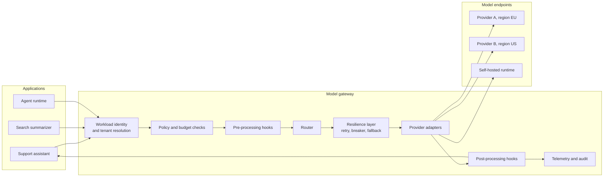

The diagram shows the request path as an ordered pipeline. Identity and tenant resolution come first, because every later decision depends on trusted context. Policy and budget checks come before any content leaves the gateway, so a denied request costs nothing. Pre-processing hooks (redaction, injection filtering) run before routing, because redaction may change the data class that routing sees. The router picks a candidate, the resilience layer wraps the call with timeouts and fallback, and the adapter speaks the provider's protocol. Post-processing and telemetry see the normalized response. In practice each box is a stage with its own latency budget, discussed in section 12.

### 3.4 Relationship to API gateways, service meshes, and agent tool gateways

Three neighbouring components are easy to confuse with a model gateway.

**API gateway.** An API gateway terminates end-user traffic at the edge of the system, authenticates users, applies per-consumer quotas, and routes to backend services. [Part 08 CH08](../08_API_Architecture/CH08_API_Gateway.md) owns that design. A model gateway is an internal, east-west component that serves workloads rather than people. It can reuse the same technology (many model gateways are built on Envoy or on API gateway products with AI plugins), but its policies are different: token-denominated limits, provider health, model versions, content policy, and cost attribution. A common layout puts an API gateway in front of the product, and a model gateway behind the product services. Do not point end-user clients straight at the model gateway; the product service holds the end-user context and decides what to ask.

**Service mesh.** A service mesh provides mutual TLS, retries, timeouts, and traffic splitting between internal services using sidecar proxies. It knows nothing about tokens, models, or content. A mesh can carry traffic to the model gateway and enforce mTLS to it, and its generic retry policy can interact badly with the gateway's own retries (retry amplification, section 8.3). Treat the mesh as transport and keep model-aware logic in the gateway. Disable mesh retries on model calls or coordinate them with the gateway's retry budget.

**Agent tool gateway.** In agentic systems, agents call tools (databases, ticketing systems, code execution) through a tool gateway that authorizes each tool call and enforces argument schemas. That gateway protects the tools. A model gateway protects the model calls. An agent runtime typically uses both: each reasoning step goes through the model gateway, and each tool invocation goes through the tool gateway. Keeping them separate matters because their trust questions differ. The model gateway asks "may this workload send this data class to this model?" The tool gateway asks "may this agent perform this action with these arguments on behalf of this user?" See [CH06](CH06_Agentic_System_Architecture_and_Tool_Boundaries.md).

| Property | API gateway | Service mesh | Model gateway | Agent tool gateway |
| --- | --- | --- | --- | --- |
| Primary traffic | End-user, north-south | Service to service, east-west | Workload to model endpoint | Agent to tool |
| Unit of limit | Requests per consumer | Connections, requests | Tokens, spend, concurrency per tenant and model | Actions per agent and tool |
| Knows model semantics | No | No | Yes | No |
| Typical failure policy | Reject or queue | Retry, timeout, eject | Fallback across models and providers | Deny, require approval |
| Owns credentials for | Backend services | Service identity certificates | Model providers | Tools and downstream systems |

### 3.5 Where to run it: library, sidecar, or central service

There are three placements, and the choice affects latency, failure isolation, upgrade speed, and who can bypass the controls.

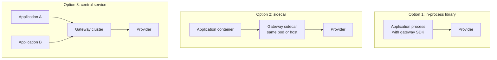

**In-process library.** The gateway logic is a software development kit linked into each application. There is no extra network hop and no shared failure domain, so latency overhead is microseconds and a gateway outage cannot take down other applications. The costs are heavy: every language needs an implementation, upgrades require redeploying every application, provider credentials must reach every application (so the credential blast radius is the number of applications), and a team can skip the library. Circuit-breaker state, rate-limit counters, and caches are per-process, so a fleet of 200 instances each sees 1/200 of the traffic and detects outages late, and a tenant quota cannot be enforced exactly. A library suits a single team or a small number of services in one language.

**Sidecar.** A local proxy runs next to each application instance. The application talks to localhost. This gives language independence, a single place to upgrade (the sidecar image), and a small network hop. Credentials can be held by the sidecar rather than the application process, but each node still has credentials, so the blast radius is every node. State is still per-instance unless the sidecars share a store. Sidecars fit organizations that already run a mesh and have the operational practice for it, and where a few teams want local resilience without a shared dependency.

**Central service.** A horizontally scaled gateway cluster serves all applications. Credentials live in one tightly controlled environment. Quotas, budgets, circuit-breaker state, and caches are shared, so they are accurate and effective. Upgrades and routing changes roll out once. The costs are one more network hop (typically a few milliseconds inside a region), a shared failure domain, and the need to operate a tier-one service. A central service is the usual choice for an organization with several teams, a compliance requirement, or a shared budget.

| Criterion | Library | Sidecar | Central service |
| --- | --- | --- | --- |
| Added latency | Negligible | Sub-millisecond to low milliseconds | Low milliseconds plus queueing |
| Shared failure domain | None | Per node | All consumers |
| Credential blast radius | Every application | Every node | One hardened tier |
| Accurate global quotas | No | Only with shared store | Yes |
| Policy enforcement cannot be bypassed | No | Weak | Strong, if egress is blocked |
| Upgrade speed | Slow, per application | Moderate | Fast |
| Operational burden | Low | Medium | High |
| Fit | One team, one language | Mesh-based platform | Multi-team organization |

Two refinements are common. First, a hybrid: a central gateway for policy, credentials, and quotas, plus a thin client library for connection reuse, timeouts, and a local fallback when the gateway is unreachable. Second, enforcement by network: a central gateway only enforces policy if applications cannot reach providers directly, so block provider egress from application networks and allow it only from the gateway. Without that, the gateway is advisory.

The decision for this chapter's two worked designs (section 22) is a central service with a thin client, because both have multi-team consumers and compliance requirements that need non-bypassable enforcement.

## 4. The Request and Response Contract

### 4.1 A unified request schema

The gateway contract is the interface applications code against. Design it as a small, explicit schema rather than a copy of one provider's API. A useful request has these parts:

- **Identity and purpose.** Not supplied by the caller in the body. The gateway derives workload, tenant, and purpose from the authenticated identity (a service account, a workload identity token, or a signed header from the product service). The body may carry a feature name for attribution, but the gateway validates it against what that identity may use.
- **Logical model.** A name such as `summarize-v1` or `chat-standard`, not a provider model identifier. Section 7 explains aliasing.
- **Messages.** An ordered list of role-tagged content parts (system, user, assistant, tool result). Content parts can be text, image references, or document references.
- **Generation controls.** Maximum output tokens, temperature, stop sequences. Keep the set small, and document which are best effort.
- **Capabilities requested.** Tool definitions, a response schema for structured output, whether streaming is wanted, and whether image input is present.
- **Deadline and priority.** An absolute deadline or a timeout, and a priority class (interactive, batch). These drive retry budgets and load shedding.
- **Data class hint.** Optional, and only ever used to make policy stricter. The authoritative data class comes from the caller's registered purpose and from pre-processing hooks, never from a free-form field alone.
- **Idempotency key.** Supplied when the call may trigger side effects through tool use, so the gateway and downstream tools can deduplicate retries ([Idempotency](../07_System_Design_and_Distributed_Systems/CH16_Idempotency.md)).

The response mirrors this. It carries the output content parts, tool calls if any, a normalized finish reason, token usage (input, output, and where available cached and reasoning tokens), and a metadata block: gateway request id, provider request id, logical model, pinned model version served, route id, region, fallback depth, cache status, and latency breakdown. The metadata is not decoration. It is the evidence that makes debugging and cost attribution possible, and it lets the caller see that it received a degraded answer.

### 4.2 Capability negotiation

Models differ in what they support. Instead of assuming that every route supports everything, the gateway keeps a capability record per pinned model version and checks each request against it before routing. The record includes:

| Capability | Typical values | Why it matters to routing |
| --- | --- | --- |
| Context window | Maximum input plus output tokens | A long request cannot go to a short-context model |
| Maximum output tokens | A per-model ceiling | A large requested output may be truncated or rejected |
| Tool calling | None, single call, parallel calls | Agent steps need it; a route without it is ineligible |
| Structured output | None, JSON mode, schema-constrained | Determines whether the gateway must validate and repair |
| Vision and other modalities | Image, audio, document input | A request with an image excludes text-only routes |
| Streaming | Supported, not supported, granularity | Interactive requests need it |
| Parallel requests, batch API | Supported, not supported | Affects batch routing |
| System message handling | Native, merged into user turn | Affects prompt rendering |
| Prompt caching | Prefix cache support and minimum size | Affects cost and cache-aware routing |

Negotiation has two directions. In the first, the gateway filters: a request that needs vision and tools is only matched with routes that have both. In the second, the caller can ask what a logical model supports, so that a client library can fail fast in development rather than discovering in production that a fallback lacks a feature. When no route satisfies the request, the gateway returns a clear, non-retryable `capability_unavailable` error that names the missing capability. It should not silently drop a tool definition or a response schema to find a route, because the application then gets an answer that is wrong in a way it cannot detect.

Capability records are data, versioned, and tested. A record that says a model supports parallel tool calls when it does not turns every fallback to that model into an incident. Contract tests per adapter (section 19) verify the claims against the live endpoint on a schedule.

### 4.3 Normalization across provider APIs

Normalization is the work of the adapter. For each provider it does the following on the way out and on the way in.

**Request translation.** Map messages to the provider's format. Examples of differences, described generically: one provider has a separate top-level system field and another uses a system-role message; roles named differently; content as a string in one API and as an array of typed parts in another; tool definitions wrapped in different envelopes; maximum token parameters named differently and sometimes with different semantics (limit on output only, or on output plus reasoning); structured output requested through a response-format object, a tool-forcing trick, or a prompt instruction. The adapter hides the spelling differences.

**Response translation.** Map the provider's output into the gateway shape: concatenate or split content parts, parse tool-call arguments (some providers return arguments as a JSON string, some as an object), map finish reasons (stop, length, tool call, content filter), and read token usage from wherever the provider puts it.

**Token accounting.** Tokenizers differ between providers and between model families. The same text can be 1,000 tokens for one model and 1,150 for another. The gateway should use the provider-reported usage as the authoritative bill and use a local estimate only for pre-flight checks such as context-length fit and rate-limit admission. A common mistake is to charge a tenant using one tokenizer and then discover that the invoice from the other provider is 15 percent higher.

**Defaults.** Providers apply different defaults for temperature, maximum output, and safety settings. Pin every control that affects behavior explicitly in the adapter, so that behavior does not change when a provider changes a default.

The runnable example [`01_adapter_normalizer.py`](../code/python/model-gateway-chapter/01_adapter_normalizer.py) shows the pattern with two invented provider payload shapes. Its output is:

```text
negotiate provider_a: ok
negotiate provider_b: ['structured_output_unsupported']
a request keys: ['max_tokens', 'messages', 'model', 'response_format']
b request keys: ['max_output', 'model', 'system', 'turns']
provider_a tool_call [{'name': 'lookup', 'arguments': {'id': 7}}] 120 18 ''
provider_b content_filter [] 110 6 'I cannot help with that.'
429 - -> rate_limited retryable
503 - -> provider_unavailable retryable
400 context_length_exceeded -> context_too_long no-retry
400 bad_json -> invalid_request no-retry
401 - -> credential_error no-retry
504 - -> timeout retryable
```

Reading the output: the same gateway request needs a schema-constrained response, and negotiation rejects provider B for that reason before any bytes are sent. The two request builders produce different provider shapes from one contract. The response normalizer turns a tool-call finish and a refusal into the same finish-reason vocabulary. The last six lines show the error taxonomy that section 4.4 explains.

### 4.4 Error taxonomy normalization

Provider errors arrive as HTTP statuses, error codes in bodies, exceptions from client libraries, and stream-terminating events. If applications see these directly, each one writes its own handling, and fallback logic cannot work consistently. The gateway maps them into a small taxonomy where each class has a defined retry and fallback behavior.

| Gateway class | Typical provider signals | Retry same route? | Fall back? | Notes |
| --- | --- | --- | --- | --- |
| `rate_limited` | HTTP 429, quota-exceeded codes | After backoff, honoring any retry-after hint | Yes, to another route with spare quota | Also feeds the router's capacity view |
| `provider_unavailable` | HTTP 500, 502, 503, connection reset | Yes, bounded | Yes | Feeds circuit breaker |
| `timeout` | Client deadline exceeded, HTTP 504 | Only if deadline allows and the call is safe to repeat | Yes | Distinguish time to first token from total time |
| `overloaded` | Provider-specific overload codes | Backoff | Yes | Treat like a rate limit with no hint |
| `context_too_long` | HTTP 400 with length codes | No | Only to a longer-context route | Detect in pre-flight where possible |
| `content_filtered` | Finish reason or error for safety policy | No | Policy decision; see section 8.4 | Never auto-retry elsewhere without policy |
| `invalid_request` | HTTP 400 other | No | No | Bug in the adapter or caller; page the owner |
| `credential_error` | HTTP 401, 403 | No | Yes, to another provider | Page the platform team; may indicate rotation failure |
| `invalid_output` | Gateway-side validation failed (bad JSON, schema violation) | Once, possibly with repair prompt | Yes | The provider call succeeded; the output failed the contract |
| `capability_unavailable` | Gateway-side, no route supports the request | No | No | Configuration or caller problem |
| `budget_exceeded` | Gateway-side quota or spend limit | No | No, or queue | Not a provider failure; do not count it in breakers |
| `unknown` | Anything else | At most once | Yes, with caution | Alert on rate; unknown should be near zero |

Two design points matter here. First, **separate provider failures from gateway verdicts**. A `budget_exceeded` or `capability_unavailable` result says nothing about provider health and must not feed circuit breakers or availability metrics. Second, **keep the original error**. The normalized class goes to the caller and drives behavior, and the raw provider status, code, and request id go to telemetry so that engineers can debug with the provider's support team.

A concern specific to model providers is the overlap between HTTP 400 for a malformed request and HTTP 400 for a policy refusal. Some providers return refusals as successful responses with a refusal finish reason, others as errors. The adapter's job is to normalize both to `content_filtered` so that callers have one thing to handle.

### 4.5 Streaming translation

Streaming responses deliver tokens incrementally, which makes the interface feel fast. Providers stream in different formats: Server-Sent Events with differing event names and payload shapes, newline-delimited JSON, or framed binary protocols. Some stream tool-call arguments as fragments that must be assembled, and some report token usage only in a final event, or only if requested. The adapter converts each into the gateway's event vocabulary, for example: `start` (metadata), `delta` (content part with index), `tool_call_delta`, `usage`, `finish` (with normalized reason), and `error`. Section 15 covers failure handling mid-stream, which is the hard part. For now, note two translation rules:

- **Do not buffer the whole stream** unless a post-processing hook requires it. Buffering removes the latency benefit. If a hook must see the full output (for example, a moderation check), either run it on incremental windows or make it a policy that such routes do not stream, and tell the caller.
- **Preserve ordering and indices.** Parallel tool calls and multiple content parts need stable indexes so that the client can assemble them regardless of provider quirks.

### 4.6 What must not be abstracted away

A lowest-common-denominator contract strips capabilities that matter. Some provider-specific features have real value, and flattening them loses it. The design rule is: abstract what is equivalent, expose what is different, and make the difference explicit.

Examples of features that often should not be hidden:

- **Prompt caching controls.** Providers offer prefix caching with different rules for markers, minimum prefix sizes, lifetime, and pricing. Hiding them makes cost optimization impossible. Expose a gateway-level `cache_hint` or let the adapter place markers automatically, and report cached token counts in the usage block.
- **Reasoning or thinking controls.** Some models take a reasoning-effort setting or a thinking-token budget that changes quality, latency, and cost by large factors. A gateway contract needs either a normalized effort level that each adapter maps, or a provider-specific extension field. Silent mapping risks surprising cost.
- **Safety settings.** Provider safety thresholds are not equivalent. A gateway should not pretend that `strict` on one provider equals `strict` on another.
- **Multimodal specifics.** Image resolution handling, supported formats, and the token cost of an image differ.
- **Fine-tuned and custom models.** A tenant's own fine-tuned model exists only at one provider.
- **Log probabilities, citations, grounding tools, and built-in tools** (such as provider-hosted web search or code execution). These alter data flow, because a hosted tool sends data to extra parties.

Two mechanisms preserve differences without breaking the contract:

1. **Typed extension fields.** The request has an `extensions` object keyed by provider, such as `extensions.provider_a.cache_control`. The gateway passes it to the matching adapter and ignores it for others. A request that depends on an extension declares `requires_extension: provider_a`, which restricts routing to that provider and makes the dependency visible in code review. A fallback to a different provider then fails the capability check instead of silently dropping the feature.
2. **Separate task contracts.** When two models differ so much that no honest common interface exists (an embeddings call versus a chat call versus a speech call), define separate contracts rather than overloading one.

The `provider_extras` field in the example's response type is the response-side counterpart. The adapter passes through things like log probabilities, but the core fields stay uniform.

### 4.7 Anti-corruption layer design

The adapter layer is an anti-corruption layer in the domain-driven design sense. Its design rules:

- **One adapter per provider API family, versioned independently** from the gateway contract. When a provider changes its API, only that adapter's version changes.
- **No provider types cross the adapter boundary.** The core router and resilience layer know the gateway types only. This lets you test the core with a fake adapter.
- **Pure translation plus a thin transport.** Keep translation as pure functions (request in, payload out; payload in, response out) so they can be unit-tested with recorded fixtures. Keep network calls in a separate transport object that handles connection reuse, timeouts, and TLS.
- **Explicit unsupported paths.** If a gateway field cannot be honored, the adapter raises a typed error naming the field. It does not drop it.
- **Fixtures from real traffic.** Record sanitized provider responses (including odd ones: empty content, refusals, truncated tool arguments, extra fields) as test fixtures. Providers add fields without notice; adapters should ignore unknown fields but log their appearance.
- **No business logic.** An adapter must not alter prompts for product reasons.

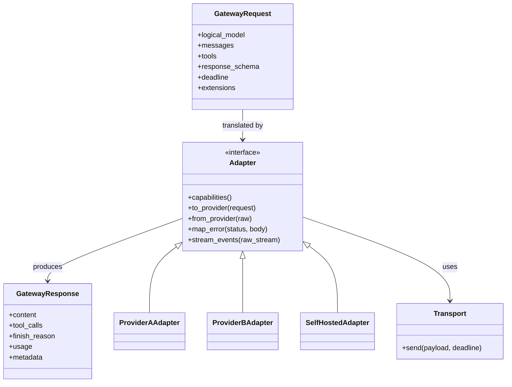

The class diagram shows the stable contract on the left and the interchangeable adapters on the right. The router and the resilience layer depend only on the interface and the gateway types. Adding a provider is adding a class that implements the interface plus a capability record, and it requires no change to routing code. The implication for review is that any change that makes core code import a provider module is a boundary violation.

## 5. Routing Policy

Routing answers a question for each request: among all configured model endpoints, which one serves this request? The answer must satisfy constraints that cannot be violated, then optimize preferences. Mixing the two is the most common design error, so this chapter separates them.

### 5.1 Hard constraints and soft preferences

**Hard constraints** are conditions where violation is unacceptable. They eliminate candidates. Examples: the data class is not allowed at the route; the region is outside the tenant's residency; the model lacks a required capability; the provider is not on the approved catalog; the tenant has exhausted its hard spend cap; the route has failed its release gate for this task.

**Soft preferences** rank the remaining candidates. Examples: lower cost, lower latency, higher measured quality, closer region, provider diversity, and a preference for a model with warm prompt cache.

If hard constraints eliminate every candidate, the gateway does not relax them. It returns a declared fallback (cached answer, deterministic response, queue for later, or an explicit failure). A router that relaxes a residency rule when the EU endpoint is down turns an outage into a compliance incident.

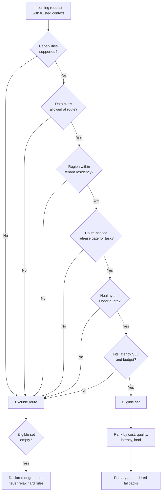

The diagram shows constraints as a sequence of filters. The order is chosen for cost of evaluation and for failure explanation: cheap static checks (capabilities, data class, region) run first, and dynamic checks (health, quota, latency fit) run last. The gateway should record the first reason each excluded route failed, because "why did this request not go to the cheap model?" is a question operators ask daily. The `rejected` map printed by the router example in section 6.6 is that record.

### 5.2 Routing dimensions

**Task type.** Different tasks have different needs. Classification and extraction can often run on small models. Long-form synthesis and complex reasoning need larger ones. Code generation and tool-using agent steps have their own best candidates. Task type should be declared by the caller as part of the logical model (`classify-ticket`, `draft-reply`) rather than inferred, because declared intent is auditable and testable. Section 6.4 discusses inference of difficulty by learned routers.

**Quality tier.** A tier (economy, standard, premium) expresses the minimum measured quality for the task. Each route has a measured score on the task's golden set ([CH11](CH11_Evaluation_and_Observability_Architecture_for_AI_Systems.md)), and a tier maps to a floor. The router then excludes routes below the floor. Quality should be measured per task, not taken from public leaderboards.

**Tenant and plan.** Plans can entitle tenants to different tiers, higher limits, dedicated capacity, or specific providers. Entitlements are authorization data, resolved from the tenant record in the gateway's identity store.

**Data classification and residency.** Each route carries data-handling attributes: the regions where processing happens, whether the provider retains prompts, whether prompts may be used for training, whether a human may review samples, which certifications apply, and the maximum data class allowed. The request carries a data class and a residency requirement from the tenant. The route is eligible only if its attributes satisfy both. Section 16 covers how these attributes are governed.

Residency has subtleties. A provider's "EU endpoint" may route inference within the EU but store logs elsewhere; a cross-region inference feature may move requests across regions within a geography. For example, [Amazon Bedrock's cross-Region inference](https://docs.aws.amazon.com/bedrock/latest/userguide/cross-region-inference.html) selects a destination region within a geography for geography-scoped profiles and across commercial regions for global profiles at the time of writing. Whether that satisfies a residency requirement depends on the commitment: processing in any EU region may be acceptable while a requirement to stay in one country is not. Record the actual processing region from the response metadata, not only the region you configured.

**Cost budget.** Budgets can limit per request (maximum estimated cost), per tenant per period, or per feature. A request estimated to cost more than its per-request cap is rejected or downgraded. A tenant near its monthly cap may be routed to cheaper models first, then throttled, then denied, according to policy.

**Latency service level objective (SLO).** An interactive request with a two-second budget cannot go to a route whose 95th-percentile latency is 3.5 seconds. The router uses measured recent latency per route (time to first token for streaming, total time otherwise) and excludes or deprioritizes routes that cannot fit. Remember that latency depends on output length; a route's published latency is for a typical length.

**Availability and current health.** The router consults health signals: circuit-breaker state, recent error rate, recent latency, and provider status information. Section 9 covers this.

**Experiments.** A and B routing for evaluation, canary rollout of a new model, and shadow traffic (copying a request to a second route and discarding or comparing its output) are routing features. Section 6.5 covers them.

### 5.3 Where routing inputs come from

A router is only as trustworthy as its inputs. Classify each input by its source:

| Input | Trusted source | Untrusted source to avoid |
| --- | --- | --- |
| Tenant, plan, entitlements | Identity provider claims, tenant store | Request body field |
| Data class | Registered purpose of the calling workload, redaction hooks | Caller-supplied hint used alone |
| Residency requirement | Tenant configuration | Header set by an intermediary the caller controls |
| Task type and quality tier | Logical model name registered with the workload | Model guessing from the prompt text |
| Route health | Gateway's own measurements | Provider status page alone |
| Route quality | Evaluation pipeline results with version | Provider marketing claims |
| Route price | Pricing table with effective dates | Cached constants in code |

Where a hint can only make policy stricter (for example, the caller marks a request as confidential), accept it. Where a hint could relax policy, ignore it. This asymmetry prevents a compromised or buggy client from steering traffic to a cheaper or less protected route.

## 6. Routing Implementation

### 6.1 Static rules

The simplest router is an ordered list of rules keyed by logical model and tenant attributes. Each rule names a primary route and an ordered fallback list. Static rules are easy to read, review, test, and roll back. For many organizations they are enough for the first year. A rule file might say that `classify-ticket` goes to the small model in the tenant's region, falls back to the medium model, and that restricted data uses only routes tagged `restricted-ok`.

The weakness of static rules is that they do not react to changing conditions (health, cost, load) unless a person edits them, and the file grows into a tangle as exceptions accumulate. Static rules also encode quality decisions made at one moment in time. Use them for the stable part of policy and add dynamic inputs for the rest.

### 6.2 A policy engine

When rules need to combine many attributes (tenant, plan, data class, region, purpose, time), a policy engine separates policy from code. The gateway evaluates a declarative policy (written in a policy language such as Rego for Open Policy Agent, or Cedar, or a purpose-built rule format) against a structured input and receives a decision: allowed routes, required hooks, limits. Benefits are an audit trail of policy versions, tests of policy independent of the gateway binary, and ownership by a security or governance team. Costs are an extra evaluation step (usually microseconds to a millisecond for compiled or cached policies, which must be measured), the need to keep policy inputs available, and a risk that policies become unreadable.

Use the engine for hard constraints, where correctness and reviewability matter most. Use plain code for the scoring of soft preferences, where performance and numeric handling matter. This keeps the contested rules (who may use what) in a form that auditors can read.

### 6.3 Scoring

After filtering, a scoring function ranks candidates. A simple, explainable form is expected cost per successful answer, with latency as a tiebreaker or additional term:

$$\text{score}(r) = \frac{c(r)}{q(r)} + \lambda \cdot \ell(r)$$

where $c(r)$ is the expected cost in dollars of one request on route $r$ (input tokens times input price plus output tokens times output price), $q(r)$ is the probability that the answer passes the task's acceptance check (measured on the golden set), $\ell(r)$ is the recent 95th-percentile latency in seconds, and $\lambda$ converts seconds to dollars. The route with the lowest score wins.

The division by $q(r)$ reflects that a cheap model that fails 30 percent of the time costs more per good answer than its price suggests, because failures are retried, escalated, or reworked. Choose $\lambda$ from the business value of latency. If an interactive feature loses roughly one cent of value per extra second, then $\lambda = 0.01$ dollars per second. For batch work, $\lambda = 0$.

Scoring has pitfalls. Quality measured on one golden set may not transfer to the production distribution, so keep sampling live traffic. Latency is noisy, so smooth it with a window but not so long that the router reacts slowly. Ties and near-ties should be broken in a stable way, otherwise requests flap between routes and cache locality is lost. Finally, a scoring router that always picks the cheapest eligible route will concentrate all traffic on one provider, which can trigger that provider's rate limits. Add load-awareness: reduce a route's score preference as its utilization approaches its quota.

### 6.4 Learned routers and their risks

A learned router predicts, from the request, which model is the cheapest one that will answer acceptably. Approaches in the research literature include classifiers trained on pairs of (prompt, which model succeeded), preference-data-based routers, and cascades where a cheap model answers first and a verifier decides whether to escalate. Published work such as RouteLLM (Ong and others, 2024) reports cost reductions on benchmark mixes by routing between a strong and a weak model; those results depend on the benchmark distribution, and you should measure on your own traffic.

The risks in production are specific:

- **Distribution shift.** The router was trained on last quarter's traffic. When the mix changes (a new customer, a new feature), its predictions degrade silently. Monitor the fraction routed to each tier and the downstream quality per tier.
- **Hard-to-detect quality loss.** A router that sends a hard request to a weak model produces an answer that looks fine and is wrong. Without a ground truth label in production, you detect this only through sampled evaluation, user feedback, and escalation rates.
- **Adversarial and tenant-visible effects.** A user can craft prompts that look easy (or hard) to steer routing, for example to force expensive routes and inflate cost, or to downgrade to a weaker model with weaker safety behavior. Hard constraints must not depend on the learned component.
- **Opacity.** A learned decision is harder to explain to a customer or auditor than a rule. Log the features, the predicted score, and the chosen route.
- **Feedback loops.** If the router only sees outcomes for the route it chose, it learns nothing about routes it did not choose. Reserve a small exploration fraction, and log shadow results for training.
- **Added latency and a new component.** The router model itself costs time and operation. A small classifier adds a few milliseconds. Using a large model to route defeats the purpose.

A practical guideline: use a learned router only inside the set that hard rules already declare eligible, keep a static default that works when the learned component is down, and require that the learned policy beat a simple heuristic (such as route by prompt length and declared task) on held-out production samples before enabling it.

Cascades deserve separate treatment. In a cascade, the gateway sends the request to the cheapest model, applies a verification step (a schema check, a self-consistency check, a small judge model, or a confidence threshold), and escalates to a stronger model if verification fails. The verification step has its own cost and error rate, and escalation adds latency, since the request pays for the cheap attempt, the verification, and then the strong attempt. Cascades suit non-interactive or latency-tolerant work.

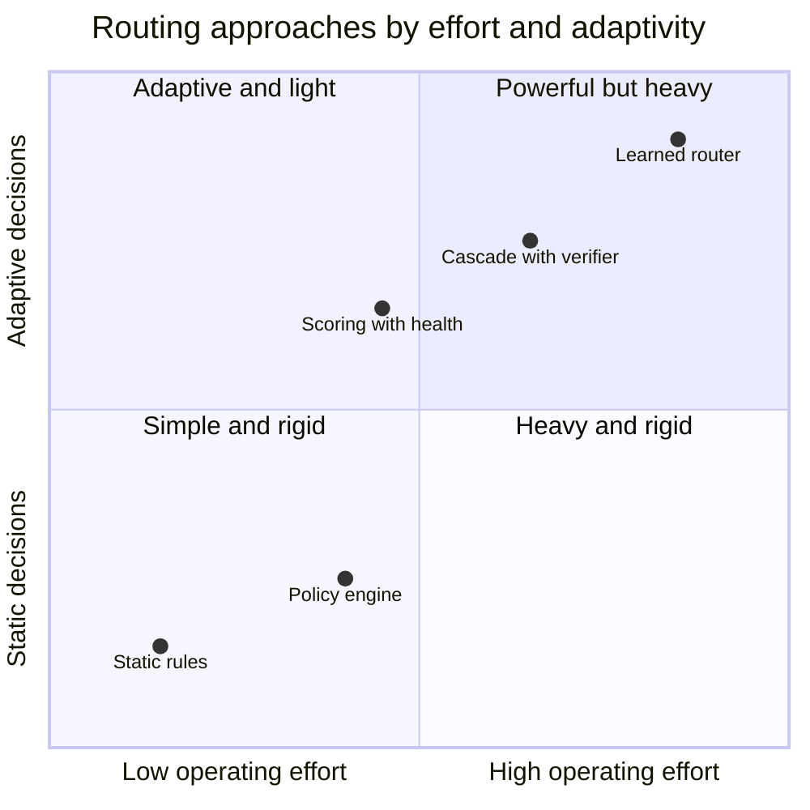

The quadrant places the approaches by how much work they take to run and how much they adapt to conditions. It suggests an order of adoption: start with static rules and a policy engine for constraints, add scoring with health when you have measurements, and consider cascades or learned routing only once routing cost is a large line item and you have the evaluation pipeline to prove that quality holds.

### 6.5 A/B, canary, and shadow routing

Three routing features exist for change management rather than steady-state optimization.

**A/B routing** splits traffic between two routes to compare quality, cost, and latency. The split should be sticky per unit that the experiment cares about (per user or per conversation), otherwise a conversation hops between models and the comparison is contaminated. Assignment should be deterministic from a hash of the unit identifier and an experiment salt, so that it is reproducible and auditable.

**Canary routing** sends a small fraction of traffic to a new route (a new model version or provider), with automatic halt on regression. Typical stages are 1 percent, 5 percent, 25 percent, and 100 percent, with a hold at each stage long enough to collect the samples that the comparison needs.

How much traffic is needed? To detect a drop in task pass rate from 0.91 to 0.89 with 95 percent confidence and 80 percent power, a two-proportion comparison needs about

$$n \approx \frac{2\,p(1-p)\,(z_{\alpha/2}+z_{\beta})^2}{\delta^2} = \frac{2 \times 0.91 \times 0.09 \times (1.96 + 0.84)^2}{0.02^2} \approx 3{,}200$$

graded samples per arm, where $p$ is the baseline pass rate, $\delta$ the difference to detect, and the $z$ values are standard normal quantiles. If only 2 percent of canary traffic is graded and the canary receives 5 percent of 100,000 daily requests, that is 5,000 canary requests a day and 100 graded ones, so the canary needs a month to reach the sample size. The lesson is that quality gates at low traffic share require either offline evaluation first (golden sets and replay), or automated graders with known agreement with human judgment, or longer holds. The canary is a safety net for gross regressions (error rates, latency, format failures), which show up in tens of requests, rather than a precise instrument for small quality differences.

**Shadow routing** copies a request to a second route and discards its response, or stores it for comparison. It tests a candidate on real traffic without user impact. Its costs and risks: it doubles spend on the shadowed fraction; it sends the real prompt to the candidate provider, so the candidate must be approved for that data class (a shadow route is a real route for policy purposes); tool calls must be stubbed so the shadow does not trigger side effects; and shadow load can consume the candidate's rate limits. Shadow traffic should have lower priority than live traffic and be shed first.

### 6.6 A runnable router

[`02_policy_router.py`](../code/python/model-gateway-chapter/02_policy_router.py) implements hard-constraint filtering followed by the scoring rule from section 6.3 (with the latency term kept small). It defines five illustrative routes and reports the reason each was rejected. Its output includes:

```text
per-request cost (3000 in / 400 out):
  small-eu  $0.00092  per-success $0.00112
  mid-eu    $0.00460  per-success $0.00505
  large-eu  $0.02300  per-success $0.02421
  mid-us    $0.00414  per-success $0.00455
  large-us  $0.02070  per-success $0.02179

restricted, EU only, 4s, q>=0.90
  rejected: {'small-eu': 'data_class', 'mid-us': 'data_class', 'large-us': 'data_class'}
  chosen: mid-eu

restricted, EU only, 1s, q>=0.90
  rejected: {'small-eu': 'data_class', 'mid-eu': 'latency', 'large-eu': 'latency', 'mid-us': 'data_class', 'large-us': 'data_class'}
  chosen: NONE -> declared fallback
```

The third request shows the rule from section 5.1. With a 1-second budget and restricted EU-only data, no route is eligible, and the router returns no choice so that the resilience layer applies a declared fallback. It does not pick `small-eu` (which is fast but not approved for restricted data) to make the request succeed.

### 6.7 Worked cost and quality arithmetic

Use the per-request costs above for a request of 3,000 input tokens and 400 output tokens. The prices are illustrative per million tokens: small at 0.20 input and 0.80 output, medium at 1.00 and 4.00, large at 5.00 and 20.00.

Cost of the large route: $3000 \times 5.00/10^6 + 400 \times 20.00/10^6 = 0.015 + 0.008 = \$0.023$. Cost of the small route: $0.0006 + 0.00032 = \$0.00092$. Medium: $0.003 + 0.0016 = \$0.0046$.

Suppose the task has pass rates (illustrative) of 0.82 for small, 0.91 for medium, and 0.95 for large. Compare three policies at 5 million requests per month.

**Policy A: everything on the large model.** Cost per request is $0.023. Monthly model cost is $5{,}000{,}000 \times 0.023 = \$115{,}000$. Quality is 0.95.

**Policy B: a static mix of 70 percent small, 25 percent medium, 5 percent large**, chosen by declared task. Blended cost per request is $0.7 \times 0.00092 + 0.25 \times 0.0046 + 0.05 \times 0.023 = 0.000644 + 0.00115 + 0.00115 = \$0.002944$. Monthly cost is $14{,}720, which is 87.2 percent below policy A. Blended quality is $0.7 \times 0.82 + 0.25 \times 0.91 + 0.05 \times 0.95 = 0.849$.

**Policy C: a cascade.** Every request goes to the small model, a verifier (illustrative cost $0.0002 per request) checks the answer, 35 percent escalate to medium, and 7 percent of requests reach large. Cost per request is $0.00092 + 0.0002 + 0.35 \times 0.0046 + 0.07 \times 0.023 = 0.00112 + 0.00161 + 0.00161 = \$0.00434$. Monthly cost is $21,700, 81.1 percent below policy A. Assume (illustratively) that the verifier plus escalation lifts end-to-end quality to 0.93.

Raw cost favors B. Add the cost of wrong answers. If a failed answer costs $0.40 of downstream rework or review (an assumption each team must replace with its own number), the expected error cost per request is $(1-q) \times 0.40$:

| Policy | Model cost per request | Failure rate | Error cost per request | Total per request | Monthly total at 5M |
| --- | --- | --- | --- | --- | --- |
| A: all large | $0.0230 | 5.0% | $0.0200 | $0.0430 | $215,000 |
| B: static mix | $0.0029 | 15.1% | $0.0604 | $0.0633 | $316,700 |
| C: cascade | $0.0043 | 7.0% | $0.0280 | $0.0323 | $161,700 |

The table shows that the cheapest model bill (B) is the most expensive policy once errors are priced, and that the cascade wins in this scenario. The conclusion depends entirely on the error cost and the verifier quality. If failed answers cost only $0.02 (a low-stakes suggestion that users can ignore), B would be cheapest overall. The method to apply is: measure pass rate per route on the task, price a failure for the business process, and compare total cost per accepted answer. A routing proposal that quotes only token savings is incomplete.

Latency also enters. The cascade's escalated requests pay the small model's time, the verifier's time, and the larger model's time. If small takes 0.9 s, verification 0.4 s, and medium 1.8 s at the 95th percentile, an escalated request takes roughly 3.1 s against 1.8 s for going straight to medium. For an interactive feature with a 2-second SLO, the cascade is only usable for requests that the first attempt satisfies, which is why interactive paths often use a cheap pre-classifier rather than a try-and-escalate cascade.

## 7. Model Aliasing and Version Pinning

### 7.1 Logical names and pinned versions

Applications request a logical model such as `summarize-v1`. The gateway resolves it to a route set, and each route names a pinned provider model version (for example a dated snapshot identifier, where the provider offers one). Three levels of naming give the platform room to maneuver:

1. **Logical model** (application-facing): `summarize-v1`. It carries the contract, quality tier, and entitlements. It changes rarely and is versioned when the contract changes.
2. **Route** (gateway-internal): `summarize-v1/primary-eu`. It binds a logical model to a provider, region, credential, and limits.
3. **Pinned version** (provider-facing): the exact model identifier at the provider. It is recorded in every response.

Why pin? Providers offer two kinds of names. A floating alias (such as "latest" or an unversioned family name) is repointed by the provider to newer snapshots over time. A dated or versioned identifier stays fixed until retired. A floating alias is convenient, and it means that the behavior behind your route can change without your involvement, which breaks tests, prompts, and parsers. Pin to versioned identifiers in production, record them, and change them as a deliberate migration. Where a provider offers only floating names, treat that provider as higher risk, run frequent contract and golden-prompt checks (section 19), and watch the response metadata for model-version changes where it reports them.

The platform may still offer an application-facing alias with a floating policy ("latest approved"), but the gateway resolves it to a pinned version through a catalog entry that people approve.

### 7.2 Controlled migration

Migration to a new version or a new provider follows the same stages as any behavior-changing release:

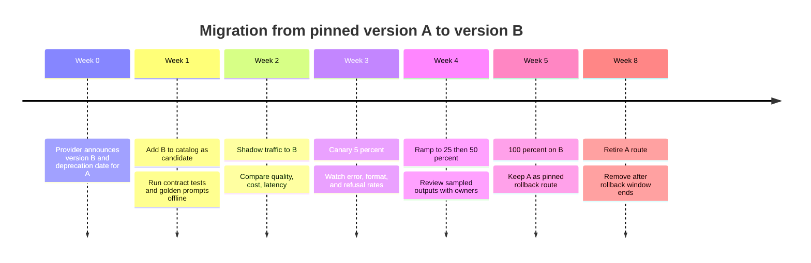

The timeline is illustrative, and the important property is the order: offline evidence first, then shadow, then canary, then ramp, with the previous version kept as an instant rollback until the observation window ends. Each logical model needs a named owner who accepts the migration, because a gateway team cannot judge whether a summary is acceptable to the support team.

Prompt variants complicate migration. A prompt tuned for one model often needs edits for another (different instruction style, different handling of system messages, different formatting habits). The route may therefore carry a **prompt variant** identifier, so that route B sends the feature's B-variant prompt. The feature team supplies prompt variants, the gateway selects the variant by route, and the variant is recorded in telemetry. This keeps the gateway free of prompt content while letting model-specific prompts coexist, and it is the mechanism section 8.4 uses for fallbacks.

### 7.3 Deprecation handling

Providers retire model versions on announced schedules, usually with weeks to months of notice at the time of writing; check each provider's deprecation policy and subscribe to its announcements. The gateway should treat deprecation as a managed process:

- **Catalog metadata.** Each pinned version has a retirement date. A scheduled job lists versions retiring within 90 days and opens tickets against the owning logical models.
- **Usage visibility.** The gateway can say exactly which tenants and features still use a version, because it records the pinned version per request. This is the major advantage over direct integration, where nobody knows which services still call a retiring model.
- **Hard stop protection.** Block the creation of new routes to versions inside a retirement window, and alert at 60, 30, and 14 days.
- **Forced migration.** At the retirement date, if a logical model still points at a retired version, the provider will return errors. A pre-approved emergency route (a vetted, evaluated alternative) turns this from an outage into a quality change. Keeping such a route warm means a monthly check that it still passes the golden set.

### 7.4 Silent model updates

Some providers update a model behind a stable name, or adjust safety systems and serving infrastructure, without changing the identifier. Pinning does not protect you from this entirely. Defenses:

- Scheduled golden-prompt runs against every production route (daily, or hourly for critical routes), with alerts on metric drift (pass rate, output length distribution, refusal rate, format failures).
- Tracking of provider-reported version or fingerprint fields where they exist, with alerts when they change.
- Online sampling of production outputs graded by an automated checker, trended per route.
- Contractual terms where possible: ask for notice of changes to pinned versions in enterprise agreements.

Section 21 gives the silent-update scenario as stimulus, response, and measure.

## 8. Fallback, Retries, Hedging, and Deadlines

### 8.1 When to fall back

Fallback is a decision to serve a request by a path other than the one routing picked first. Not every error justifies it. The error taxonomy of section 4.4 drives the decision.

| Condition | Retry same route | Fall back | Reason |
| --- | --- | --- | --- |
| Rate limit (429) with short retry hint | Yes, once after the hint, if the deadline allows | If the hint exceeds the remaining budget | Waiting is cheaper than switching when the wait is short |
| Rate limit with no hint, repeated | No | Yes | The route has no capacity now |
| Server error (5xx) | Once with jittered backoff | Yes, after the retry fails or the breaker opens | Transient errors often clear |
| Timeout before first token | Rarely | Yes, if the call is safe to repeat and the budget allows | The route may be stuck |
| Timeout mid-stream | No | Depends on the contract; see section 15 | Partial output already reached the caller |
| Credential error | No | Yes | Paging the platform team is also needed |
| Context too long | No | Only to a longer-context route | Retrying is futile |
| Content-filter refusal | No | Only if policy permits | A different model may comply with a request that policy says to refuse |
| Invalid output (schema violation) | Once, with repair instruction | Yes | Model-level variance |
| Invalid request | No | No | Fix the caller |

The content-filter row needs attention. A refusal from a provider's safety system may be a false positive (a medical question that looks like self-harm) or a true positive (an attempt to extract harmful content). Automatically sending a refused request to another provider is a way of shopping for a model that will comply, and it defeats the safety control. A reasonable policy is to fall back after a refusal only when the request class is on an allow-list that the safety owner has approved as prone to false positives, and when the alternate route has equal or stricter safety behavior for that class. Everything else returns the refusal to the caller with a normalized finish reason.

### 8.2 What to fall back to

A fallback chain is an ordered list of progressively more degraded options. Define the chain per logical model, in the route configuration, and require each rung to be declared with its quality impact.

1. **Same model, other region or capacity pool.** Often the best first fallback. Behavior is identical, so quality risk is nil. It only helps when the failure is local (a regional incident, a regional quota), and the other region satisfies the same residency policy. Check the failure domain: if both regions depend on the same provider control plane, they fail together.
2. **Same model through another channel.** The same model family may be available through the provider's own API and through a cloud marketplace. Credentials, quotas, and network paths are different, so independent failure is more likely. Behavior can still differ slightly, because the serving stack differs, and pricing and data terms differ.
3. **Other provider, comparable model.** Provides independence from provider-level incidents. Behavior differs, so prompt variants and eval gating apply (section 8.4). Data-handling terms differ, so the data class check applies again.
4. **Smaller or cheaper model.** Keeps the feature up with lower quality and lower latency. Appropriate when the task tolerates it, with a declared quality tier in the response so the application can decide whether to show a caveat.
5. **Cached answer.** Return a previous answer for the same or a semantically similar request, with its age and a flag. Appropriate only for requests where staleness is harmless and where cache authorization is correct (section 13).
6. **Deterministic response.** A template, a rule-based result, or a static message. For example, for a ticket classifier, fall back to a keyword rule. For a chat assistant, fall back to a message that the assistant is unavailable and a link to search.
7. **Queue for later.** Accept the request, return an acknowledgment, and process when capacity returns. Suitable for non-interactive work such as nightly summarization. It must respect data policy as the queued payload sits at rest, and the caller must be told that the result is deferred.
8. **Explicit failure.** A clear, structured error. Better than a confidently wrong answer.

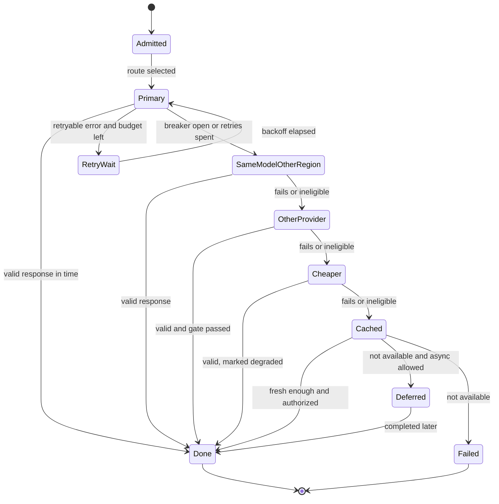

The state diagram shows the chain as ordered states with one rule: moving down the chain is allowed only when the previous rung fails or is ineligible, and each transition checks policy again. The implication is that every rung has to be configured and tested before it is needed. A chain that exists on paper but has never carried traffic is a hope, not a design. Run the chain regularly in game days and with a small steady fraction on lower rungs where cost allows, so that credentials, quotas, and prompts for those rungs are known to work.

### 8.3 Retry amplification arithmetic

Retries multiply load on a struggling dependency. Consider a request that passes through two layers, each of which retries up to twice (three attempts in total): say the application's HTTP client and the gateway. If the provider fails every call, one user request produces $3 \times 3 = 9$ provider calls. Under partial failure, with per-call failure probability $p$ and $k$ attempts per layer, the expected number of provider calls per request at one layer is $\sum_{i=0}^{k-1} p^i$, and for two layers it is the square of that:

| Failure probability $p$ | Calls per request, one layer | Calls per request, two layers |
| --- | --- | --- |
| 0.05 | 1.052 | 1.108 |
| 0.50 | 1.750 | 3.062 |
| 1.00 | 3.000 | 9.000 |

[`03_breaker_retry_ratelimit.py`](../code/python/model-gateway-chapter/03_breaker_retry_ratelimit.py) computes these values. The table shows the property that matters: amplification is small when the provider is healthy and large when it is not, which is when extra load hurts most. A provider at 50 percent failure receives about three times the load per user request when two layers retry. Model providers that are rate limiting you respond to extra load by limiting more.

Defenses, in order of importance:

- **Retry at one layer only.** Make the gateway the retry owner for model calls. Disable retries in the mesh, the HTTP client, and the SDK for traffic to the gateway, or give them zero retries. Document it, because defaults on SDKs often retry silently.
- **Retry budgets.** Allow retries only up to a fraction of first attempts over a window, for instance 10 percent. With 1,000 first attempts in a window, at most 100 retries are allowed, whatever the failure rate. When the budget is spent, failures go straight to fallback. This caps amplification at 1.1 times in steady state.
- **Exponential backoff with jitter.** Wait a random time between 0 and an exponentially growing cap before the next attempt, so that many clients do not retry in lockstep.
- **Honor retry-after hints.** If the provider says to wait 20 seconds, retrying after two seconds only wastes an attempt.
- **Retry only when safe.** A pure completion call can be repeated; a call that triggers side-effecting tool use must carry an idempotency key, or must not be retried automatically.
- **Count tokens.** A retry of a 50,000-token prompt costs real money if the provider bills a failed call that consumed input. Many providers do not bill failed requests, but some partial failures (timeouts after processing) can be billed. Check the terms, and include retried calls in cost attribution so retry waste is visible.

### 8.4 Behavior compatibility of fallbacks

A fallback model may satisfy the interface and still produce an answer that breaks the feature. Differences include output length and style, adherence to formats, tool-call habits, handling of ambiguous instructions, refusal behavior, language coverage, and knowledge of domain terms. A fallback chain therefore needs a compatibility gate before a route is allowed to appear in it.

**Eval-gated fallbacks.** Each (logical model, fallback route) pair has an evaluation record: pass rate on the logical model's golden set, format-failure rate, refusal rate, latency, and cost, each with a date and the pinned version. A route enters a fallback chain only when its pass rate is above the floor that the feature owner set for degraded mode, which can be lower than the floor for the primary. The degraded floor is a product decision recorded as an explicit number.

**Prompt variants per model.** If the fallback needs a different prompt to meet the floor, the route carries its variant, as section 7.2 described. A route with a failing evaluation stays out of the chain.

**Output validation after fallback.** The gateway re-validates the response against the response schema regardless of which route produced it. A fallback response that fails validation is not delivered. This turns many behavioral differences into a detectable `invalid_output`.

**Marking degraded results.** The response metadata states `fallback_depth`, the serving route, and a `degraded` flag with the quality tier. The application can show a notice, skip an automated action, or require human review. For consequential decisions, a degraded result should route to human review rather than automation ([CH09](CH09_Human_Oversight_and_AI_Assisted_Workflow_Integration.md)).

**Tool-call state across a switch.** In an agentic conversation, switching models between steps changes how tool results are interpreted. If the conversation history contains provider-specific tool-call identifiers or reasoning blocks, the adapter must translate or drop them. Some providers return opaque reasoning content that is only valid when sent back to the same model. The safe default for agent loops is to keep a conversation on one route and fall back at conversation boundaries, unless the fallback was tested mid-conversation.

### 8.5 Hedged requests

A hedged request sends a duplicate to a second route if the first has not responded within a threshold, and uses whichever returns first. It cuts tail latency at the price of extra load. Dean and Barroso described the technique for latency-tolerant systems in "The Tail at Scale" (2013).

For model calls, the economics differ from typical RPCs because each duplicate costs tokens. Suppose the 95th-percentile time to first token is 2 s, and the hedge fires at 2 s. Then about 5 percent of requests produce a duplicate, raising token cost by about 5 percent (less if the loser is cancelled early and the provider stops billing output). If the time to first token exceeds 6 s for 1 percent of requests and a hedge fired at 2 s exceeds 4 s with probability 2 percent (illustrative figures, independent of the primary), the chance that a request is slower than 6 s falls to $0.01 \times 0.02 = 0.0002$, or 0.02 percent. That is a large tail reduction for 5 percent extra spend.

Rules for hedging model calls:

- Hedge on **time to first token**, not total time, since total time depends on output length.
- Hedge to a **different route** with independent capacity, not the same overloaded one.
- **Cancel the loser** as soon as a winner is chosen, and verify that cancellation stops billing and does not leave a leaked connection.
- Use only for **safe-to-repeat** calls; never when a tool call could run twice.
- Cap the hedged fraction with a budget, and disable hedging when the system is under load or a breaker is open, since hedging adds load exactly when capacity is scarce.
- Check **data policy** on the hedge route, as it receives the same prompt.

### 8.6 Deadlines and budgets

Every request has a deadline, and every stage consumes part of it. Propagate an absolute deadline from the application through the gateway to the provider call, rather than passing fixed per-hop timeouts that add up beyond what the user will wait.

Worked example. An interactive request has a 10-second deadline at the gateway. The gateway reserves 0.3 s for pre- and post-processing hooks and 0.2 s for its own overhead, leaving 9.5 s for provider attempts. The primary route's 95th-percentile total latency is 4 s. A policy of "first attempt timeout 5 s, then fall back" leaves 4.5 s for the fallback, which fits a fallback with a 95th-percentile latency of 3 s. A policy of "first attempt timeout 8 s" leaves 1.5 s and the fallback cannot finish, so the fallback rung is effectively disabled. The rule is to choose attempt timeouts so that every rung of the chain that the request may reach still has its p95 latency available, or to declare that rung unreachable for that request class.

For streaming, set two timeouts: a time-to-first-token timeout (short, like 3 to 5 s) and an inter-token idle timeout (like 10 to 15 s), plus the overall deadline. A model that begins streaming and then stalls is detected by the idle timeout.

Budgets extend deadlines to money and tokens. A request carries a maximum cost, and the gateway deducts retries, hedges, and fallbacks from it. An agent loop with a per-task token budget gets a hard stop when exhausted, rather than an open-ended spend.

## 9. Circuit Breakers and Outlier Detection

### 9.1 Why breakers

When a route is failing, continuing to send traffic wastes the caller's time (each request waits for a timeout), adds load to a dependency that is struggling, and consumes retry budget. A circuit breaker watches outcomes per route and, when failures pass a threshold, stops sending traffic for a cooldown, failing fast to the fallback. Nygard's "Release It!" popularized the pattern. A breaker turns a slow failure (30 s timeouts) into a fast one (microseconds to the next rung).

### 9.2 The state machine

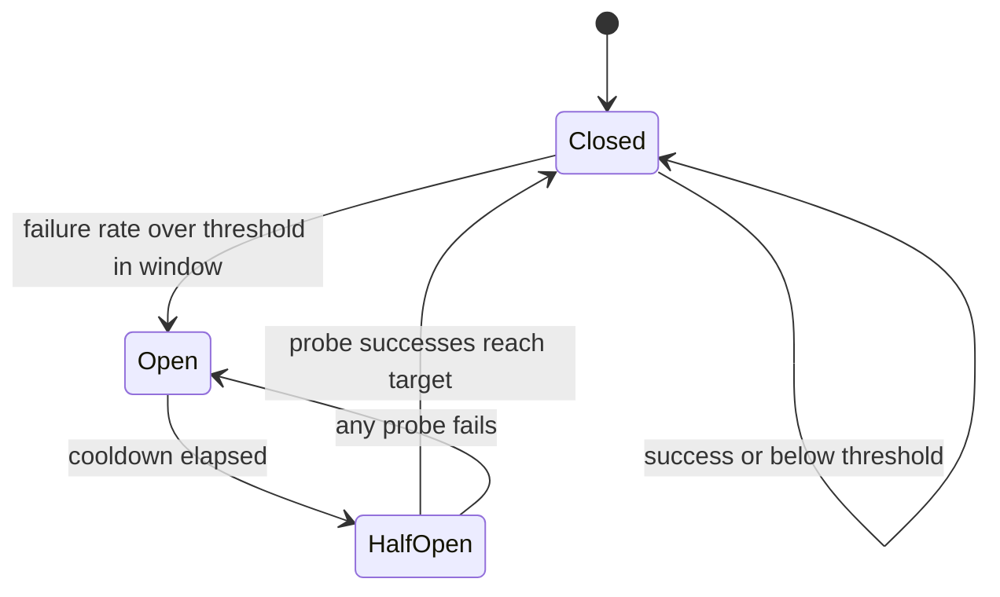

In **closed**, requests flow and outcomes are recorded in a sliding window. When the window has at least a minimum number of calls and the failure rate meets the threshold, the breaker moves to **open**. In open, requests skip the route immediately. After the cooldown, the breaker enters **half-open** and lets a few probe requests through. If enough succeed, it closes; if any fails, it reopens for another cooldown. The diagram shows that the only way back to closed is through successful probing, which prevents full traffic from slamming a route that has barely recovered.

### 9.3 Parameters and what they mean for model calls

- **Window and minimum calls.** A window of 20 calls with a minimum of 10 avoids opening on two unlucky failures in a quiet period. For a low-traffic route, use a time-based window instead (the last 60 seconds).
- **Failure threshold.** 50 percent is a common starting point; a route with strict latency SLOs may also treat slow calls as failures.
- **What counts as a failure.** Count timeouts, 5xx, connection errors, and (usually) rate limits. Do not count `invalid_request`, `budget_exceeded`, or `capability_unavailable`, which are not about provider health. Count content filter refusals only if they spike far above their baseline, which can signal a provider-side safety system change.
- **Cooldown.** 15 to 60 seconds. Too short, and a down provider receives a probe barrage; too long, and recovery goes unused.
- **Probes.** Use synthetic, cheap requests where possible, so that probing does not put real user traffic at risk. A small canned prompt costs a fraction of a cent.
- **Scope.** One breaker per (provider, region, model, credential) route, since failures are often scoped to one of those. A rate-limit failure of one credential should not open the breaker for another.
- **Shared state.** In a gateway cluster, breaker state should be shared or at least gossiped, or each instance learns about the outage separately. With 20 instances each needing 10 failures to open, the provider receives 200 failing requests before all instances stop. Shared state through a fast store has its own failure mode: if the store is down, fall back to local state.

### 9.4 A runnable simulation

[`03_breaker_retry_ratelimit.py`](../code/python/model-gateway-chapter/03_breaker_retry_ratelimit.py) simulates one request per second over 90 seconds. The provider fails every request from second 20 to second 49. The breaker uses a window of 20, a minimum of 10 calls, a 50 percent threshold, a 15-second cooldown, and three probes. The output is:

```text
breaker transitions (t, state): [(29, 'open'), (59, 'half_open'), (61, 'closed')]
calls reaching provider: with breaker 62, without 90
```

Tracing it: failures begin at second 20. The window holds earlier successes, so the failure rate reaches 50 percent after ten failures, at second 29, and the breaker opens. The cooldown ends at second 44, the breaker goes half-open, and the first probe fails (the outage continues until second 49), so it reopens. The next half-open period starts at second 59. Probes at seconds 59, 60, and 61 succeed, and the breaker closes at second 61. The breaker prevented 28 of 90 calls from reaching the failing provider and, more usefully, it let requests move to the fallback immediately instead of waiting for timeouts. It also shows the cost of the thresholds: ten requests failed before the breaker opened, and recovery was detected about 11 seconds after the outage ended.

### 9.5 Outlier detection and passive health

Breakers act on error outcomes. Outlier detection acts on relative behavior, identifying one instance or route that performs worse than its peers, as in Envoy's outlier detection that ejects hosts based on consecutive errors or success-rate deviation. For model routes, relevant signals are:

- **Latency outliers.** A route whose p95 time to first token rises well above its own baseline (for instance, above 2 times the 7-day median) is degraded even if it returns 200.
- **Output anomalies.** A sudden rise in empty responses, truncated outputs, format failures, or very short answers indicates a quality incident that HTTP status will not reveal. Track these per route as health signals.
- **Cross-region comparison.** If the same model is slower in one region only, shift traffic away rather than waiting for errors.
- **Provider status feeds.** Status pages and incident feeds help but lag. Use them as a hint that tightens thresholds, not as the trigger.

An ejection should be partial and reversible: reduce a route's weight rather than flipping it off, which keeps some probing traffic and avoids oscillation. Add hysteresis, so that a route is reinstated only after sustained good behavior.

### 9.6 Interaction with fallback

A breaker opening must reroute traffic to capacity that can take it. If the primary carries 100 percent of traffic and the fallback has a quota for 20 percent, an opened breaker moves the problem from "provider down" to "fallback rate-limited". Capacity planning for fallback routes means reserving quota for the failover scenario, and checking it at the cost of idle commitment. Section 10.5 discusses how to make such reservations without wasting them.

## 10. Rate Limiting and Quota Management

[Part 08 CH11](../08_API_Architecture/CH11_Rate_Limiting.md) teaches the general algorithms. This section covers what is specific to model traffic: limits denominated in tokens, mirrored provider limits, fairness across tenants, and priority.

### 10.1 Two sets of limits

A gateway lives between two limit regimes.

**Provider limits.** Providers cap requests per minute and tokens per minute (sometimes separately for input and output), concurrent requests, and daily or monthly spend, often per account, per model, and per region, and often rising with usage tiers. Exceeding them returns rate-limit errors. These are external facts the gateway must respect and track.

**Tenant and feature limits.** The platform sets limits for its own consumers: per tenant, per feature, per API key, per user. They exist to keep one consumer from exhausting the shared provider quota, to enforce plans, and to cap spend.

The gateway sits at the join: it must ensure that the sum of admitted tenant traffic does not exceed the provider limit, while giving each tenant its entitlement. This is quota allocation.

### 10.2 Token-based limits and the output-token problem

Request counts are a poor proxy for load on a model, because a request can carry 100 tokens or 100,000. Limit on tokens. The difficulty is that the output length is unknown at admission. Two techniques cope:

1. **Reserve then reconcile.** At admission, charge input tokens (estimated locally) plus the requested maximum output tokens. After the response, refund the difference between the reservation and actual usage. Example: a request has 3,000 input tokens and `max_output_tokens` of 1,000, so 4,000 tokens are reserved. The response uses 3,400 in total. The gateway refunds 600 tokens to the tenant's bucket. If callers set `max_output_tokens` far above typical use, they over-reserve and throttle themselves. The gateway should apply a default and a per-logical-model cap, and report over-reservation to the callers.
2. **Estimate by history.** Use a moving average of actual output length for the feature rather than the maximum. This risks under-reserving on a long output, so keep a safety multiple.

The provider's tokenizer may count differently from the gateway's estimator. Keep a safety margin, such as admitting up to 90 percent of the provider limit, and reconcile with provider-reported usage.

### 10.3 Token bucket arithmetic

A token bucket has a capacity (burst) and a refill rate. A request that costs $n$ tokens is admitted if the bucket holds at least $n$, which is then deducted. The bucket holds $\min(B, b_0 + r\,\Delta t)$ after $\Delta t$ seconds, where $B$ is capacity, $r$ the refill rate, and $b_0$ the previous level.

Take a tenant with a limit of 600,000 tokens per minute. The refill rate is $r = 600{,}000 / 60 = 10{,}000$ tokens per second. Choose a burst capacity of 60,000 tokens, which is six seconds of sustained rate. The script produces the following sequence for 20,000-token requests:

```text
token bucket: refill 10,000 tok/s, burst 60,000 tok
  t= 0.0s request of  20000 tokens -> admit (tokens left 40,000)
  t= 0.1s request of  20000 tokens -> admit (tokens left 21,000)
  t= 0.2s request of  20000 tokens -> admit (tokens left 2,000)
  t= 0.3s request of  20000 tokens -> reject (tokens left 3,000)
  t= 2.3s request of  20000 tokens -> admit (tokens left 3,000)
  t= 4.3s request of  20000 tokens -> admit (tokens left 3,000)
```

At 0.1 s the bucket held $40{,}000 + 0.1 \times 10{,}000 = 41{,}000$, and after the second request 21,000. At 0.3 s it holds only 3,000, so the fourth request is rejected. After 2 s of refill, at 2.3 s, it holds $3{,}000 + 20{,}000 = 23{,}000$, enough for another request. Notice the long-run rate: one 20,000-token request every two seconds, which is exactly 10,000 tokens per second. The burst lets three large requests through at once. Capacity should be sized to the largest legitimate single request times a small multiple: if capacity is smaller than one request's cost, that request can never be admitted, regardless of the refill rate. Rejected requests should receive a `rate_limited` error with a retry-after computed from the deficit: $(n - \text{tokens}) / r$. For the rejected request, that is $(20{,}000 - 3{,}000)/10{,}000 = 1.7$ s.

### 10.4 Fairness across tenants

If tenants share a provider quota, a single heavy tenant can starve others. Techniques:

- **Per-tenant buckets with weights.** Tenants with plans get proportional shares. With a provider quota of 1,200,000 tokens per minute and tenants A, B, and C with weights 3, 2, and 1, guaranteed shares are 600,000, 400,000, and 200,000 per minute.
- **Work conserving borrowing.** If C is idle, A and B may use C's share, bounded by caps, and C's guarantee is restored when it returns. Implement borrowing with a shared pool bucket that only holds unclaimed capacity.
- **Weighted fair queuing.** For requests that wait rather than reject, dequeue by tenant virtual time so that a tenant with a long queue does not block others.
- **Concurrency limits.** Besides tokens per minute, cap simultaneous in-flight requests per tenant. Long generation calls tie up connections, and a tenant with 500 in-flight calls can exhaust a connection pool even if its token rate is within limits.
- **Noisy neighbor isolation.** For premium tenants, dedicated credentials and quota (a separate provider project or account) provide hard isolation at the cost of idle capacity.

### 10.5 Provider limit mirroring

The gateway should know each provider limit and track consumption against it, not wait for 429s. It keeps a rolling counter per (provider, model, region, credential) of tokens and requests in the current window, and admits only while consumption stays under a safety fraction of the limit. When the provider returns rate-limit headers that report remaining quota, use them to correct the local estimate. Use multiple credentials or projects to scale, subject to the provider's terms: some providers prohibit splitting traffic across accounts to evade limits, so read the terms and prefer requesting a quota increase or a committed throughput.

Reserved capacity for failover is a cost decision. Holding 100 percent of normal quota idle at a second provider is expensive. Options include a small reserved share that carries a sliver of live traffic continually (keeping it warm), burstable pay-as-you-go quota at the second provider with a pre-negotiated ceiling, and accepting a degraded tier during failover (smaller model, shed low-priority traffic) so that the fallback needs only 30 percent of the primary's capacity.

### 10.6 Priority classes and load shedding

When demand exceeds capacity, something has to give. Priority classes make the choice explicit.

| Class | Examples | Behavior under pressure |
| --- | --- | --- |
| Critical interactive | Customer-facing assistant, fraud review support | Reserved share, last to shed |
| Standard interactive | Internal copilots | Normal share, shed after batch |
| Batch | Nightly summarization, re-indexing, evaluations | Preemptible, queued, runs in spare capacity |
| Shadow and experiments | Canary comparisons | First to shed |

Reserve capacity by class: for example, 60 percent of the provider quota reserved for critical, 25 percent shared by standard, and 15 percent for batch, with unused capacity flowing down to lower classes but taken back immediately for higher ones. Under overload, shed in this order: shadow, batch, standard, with a clear `overloaded` error and retry-after for shed requests. Shedding at the gateway door is far cheaper than accepting the work and timing out; a shed request costs microseconds, while a timed-out request wastes a connection and a provider slot.

Queue length limits keep waiting honest. A queue of interactive requests that waits longer than the deadline serves no one, so drop requests whose deadlines will expire before they reach the front. Little's law ties these together: the mean number in the system equals arrival rate times mean time in the system, so a gateway handling 200 requests per second with a 4-second mean latency holds about 800 in flight, and capacity planning for connections and memory follows from that number, not from the request rate alone.

## 11. Credentials, Tenant Keys, and Network Egress

### 11.1 Why the gateway holds the keys

Provider credentials are bearer secrets: anyone who holds one can spend the account's money and call the model as the account. If applications hold them, the number of places a key can leak equals the number of applications, repositories, build systems, and developer laptops. The gateway reduces the number to one hardened environment. Applications authenticate to the gateway with workload identity (short-lived tokens issued by the platform's identity system, or mutual TLS certificates), and the gateway authenticates to providers. A leaked application credential can then be revoked without rotating provider keys, and its use is limited to what the gateway allows that workload to do.

[Secrets Management](../15_Security/CH09_Secrets_Management.md) teaches vault design and rotation in general. The model-gateway-specific rules follow.

### 11.2 The credential boundary

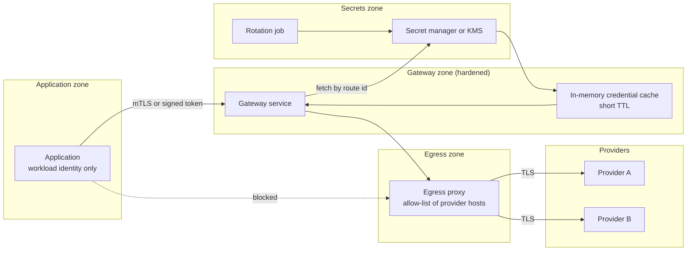

The diagram draws the trust boundaries. The application zone holds no provider secrets and cannot reach the egress proxy directly. The gateway fetches a credential by route identifier from the secrets zone, caches it in memory for a short time, and sends traffic only through an egress proxy that allows named provider hosts. The dotted line marks the control that makes the gateway non-bypassable: network policy denies application networks any path to provider hosts. If you cannot enforce that, say plainly in the design that the gateway is advisory.

### 11.3 Practices

- **Scope keys narrowly.** Use one credential per (provider, environment, route class) rather than one global key, so that leakage or rate-limit incidents are contained. Where providers support projects, workspaces, or scoped keys with model and spend limits, use them. Where a cloud provider offers identity-based access to hosted models (for example, role-based access in a cloud account), prefer short-lived role credentials over static keys, because there is nothing long-lived to steal.
- **Rotate on a schedule and on suspicion.** Support two active keys per route during rotation: add the new key, shift traffic, retire the old one. Automate it, and test that rotation does not cause an outage. A rotation that requires a deployment gets postponed.
- **Never log or return credentials.** Redact authorization headers in logs and error messages, including echoed provider errors.
- **Cache credentials briefly in memory only**, and never write them to disk or container images.
- **Separate fetch permissions from use.** The gateway's identity can read provider secrets; no human or application identity can, outside a break-glass procedure that is audited.
- **Deny caller-supplied destinations.** The request must not contain a URL, host, region override, or key. A gateway that accepts an endpoint URL from the caller is a server-side request forgery vector and a way to exfiltrate data to an attacker's server.
- **Monitor key use.** Alert on a key used from an unexpected network, on a sudden rise in spend per key, and on provider-side usage that the gateway did not record (a sign of a leaked key).

### 11.4 Bring-your-own-key and per-tenant credentials

Some enterprise customers require that model calls on their behalf use their own provider account, for billing, data-handling contract, or audit reasons. The gateway supports this with a tenant credential store: the tenant supplies a key (or grants a cross-account role), which the gateway stores encrypted under a tenant-specific key. Design points:

- **Resolve the credential only after tenant identity is established**, and from the authenticated tenant, never from a request field. A bug that lets tenant A's request pick tenant B's credential is a cross-tenant incident.
- **Isolate failure domains.** A tenant's key hitting its own rate limit must not affect other tenants. Breakers and quotas are per credential.
- **Validate on registration.** Test the key with a harmless call, record which models it can reach, and check that the provider region matches the tenant's residency requirement.
- **Handle revocation.** When a tenant revokes a key, calls fail with `credential_error` for that tenant only. The fallback policy must decide whether to fall back to the platform's shared credential (which changes billing and data terms) or to fail. Default to failing, because silently switching accounts violates the reason the tenant asked for its own key.
- **Cost attribution.** Calls on tenant credentials are billed to the tenant by the provider. The gateway still records usage for visibility, and marks it as not platform spend.

### 11.5 Private connectivity and egress control

Prompts often contain sensitive data, so the path to the provider matters. Options, from weakest to strongest control: public internet over TLS; public internet via a fixed egress IP that the provider allow-lists; a private connection to the provider's service within a cloud network (private endpoints, private links, or peering, where the provider or cloud offers them); and self-hosted models inside the network. Private connectivity avoids public exposure of traffic and allows network policies that deny everything but the model endpoint, though it does not change what the provider does with the data after it arrives. Data-handling terms (retention, training use, human review) remain a contract question ([CH12](CH12_AI_Safety_Security_Privacy_and_Governance_Architecture.md)).

Egress controls also stop a compromised gateway component, or a malicious hook plugin, from sending prompts to an arbitrary host. Combine a host allow-list at the egress proxy with DNS controls and with alerts on denied egress attempts.

## 12. Guardrail and Policy Hooks

### 12.1 Hooks as pluggable stages

The gateway is a natural place to run checks that apply to all model traffic. Model them as ordered, pluggable stages with a common interface: a stage receives the request or response plus context, and returns allow, modify (with a modified payload), block (with a reason), or flag (continue and record). Stages declare whether they are required (failure blocks the request) or advisory (failure is logged and ignored), and each has a latency budget and a timeout.

Typical pre-processing stages:

- **Secret and credential scanning.** Detect API keys, private keys, and tokens in prompts. Cheap pattern matching, effective at preventing accidental leaks to providers.
- **PII detection and redaction.** Detect personal data (names, email addresses, identifiers, account numbers) and replace with placeholders, optionally restoring them in the response through a reversible mapping held only for the request. Tradeoffs: false negatives leak; false positives corrupt prompts (redacting a product name that looks like a person's name degrades output).
- **Prompt-injection filtering.** Classifiers or heuristics that flag instructions embedded in untrusted content (retrieved documents, emails, web pages). No filter is complete. Treat it as one layer; the stronger defenses are structural (least privilege for tools, separation of instructions and data, human approval for consequential actions) and belong to [CH12](CH12_AI_Safety_Security_Privacy_and_Governance_Architecture.md).
- **Input moderation.** Classify the request against a content policy, using a provider moderation endpoint or a local classifier.
- **Policy-based data class assignment.** Raise the request's data class when content matches restricted patterns. This must run before routing, because it changes the eligible set.
- **Prompt shaping.** Inject a shared policy system prompt required by governance.

Typical post-processing stages:

- **Output moderation.** Check generated content against policy.
- **Output PII and secret scanning.** Prevent leakage of data the model memorized or retrieved.
- **Schema and contract validation.** Enforce the structured output contract (section 15.4).
- **Grounding or citation checks.** For retrieval-based features, verify that cited sources exist in the supplied context.
- **Watermark or provenance tagging**, where required.

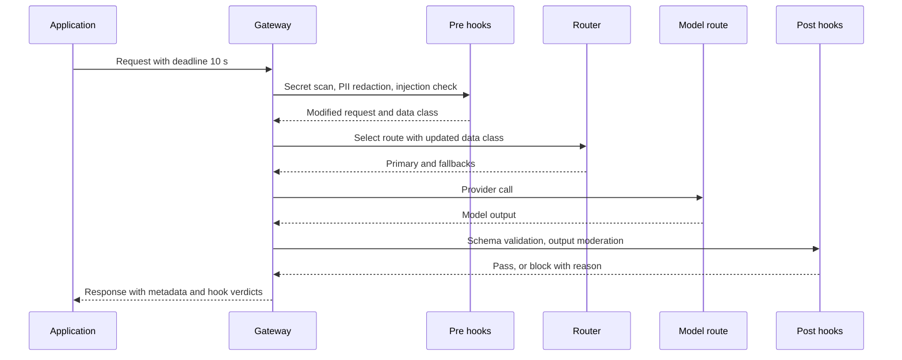

The sequence shows why redaction and classification run before routing: the data class they produce is a routing input. It also shows that post-processing sits after the model call, so a blocked output has already consumed tokens and time, which matters for cost accounting and deadline budgets.

### 12.2 Latency cost of hooks

Each stage adds time to every request, and the costs add up. Illustrative figures that vary widely by implementation (measure your own):

| Stage | Typical added latency | Notes |
| --- | --- | --- |
| Secret scan (patterns) | 1 to 3 ms | Linear in prompt length |
| PII redaction, pattern based | 2 to 10 ms | Limited recall for names and free text |
| PII detection, model based | 15 to 60 ms | Better recall; may need a GPU or a dedicated service |
| Injection classifier | 20 to 80 ms | Batchable |
| Input moderation, external call | 100 to 400 ms | Adds a dependency and its failure modes |
| Output moderation, external call | 100 to 400 ms | On the critical path unless run on stream windows |
| Schema validation | Under 5 ms | Cheap |

If an interactive request has a 2-second budget and a model time-to-first-token of 800 ms, a pre-processing chain of 450 ms is a quarter of the budget. Ways to control hook cost: run independent stages in parallel; run the cheap stages first and skip expensive ones when the cheap ones already decided; scope stages to routes and data classes that need them (public FAQ traffic need not run the heavy PII model); run moderation on a sample for low-risk traffic if governance allows; and for streaming, moderate in chunks so that the first token is not delayed by the full output check.

### 12.3 Failure policy for hooks

Decide for each stage what happens when it fails or times out. A **fail-closed** stage blocks the request when the check cannot run. A **fail-open** stage lets the request through and records the gap. Choose fail-closed for controls whose absence causes harm (PII redaction on restricted data going to an external provider, secret scanning) and fail-open for controls with a low cost of absence (an advisory classifier on public data), and monitor the rate of fail-open events. A moderation service outage that silently disables moderation is a common incident.

Keep the hook interface narrow and the hooks isolated. A third-party hook plugin that runs in-process can read every prompt and every key in memory. Run risky or third-party stages out of process with a bounded interface, and treat them as part of the sensitive data path in your threat model.

## 13. Caching

### 13.1 Three kinds of caching

**Exact-match caching** stores the response keyed by a hash of the normalized request (model, messages, parameters). It hits only for identical requests. Hit rates are usually low for conversational traffic and high for deterministic, repeated calls such as classification of repeated inputs, or system-generated prompts. It is simple and safe if the key covers everything that affects the output.

**Semantic caching** embeds the request and returns the stored response for a sufficiently similar earlier request. Hit rates are higher, and correctness risks are higher too, since "similar" is not "same". A request for "refund policy for annual plans" and one for "refund policy for monthly plans" embed close together and have different correct answers.

**Prefix (prompt) caching** is provider-side: the provider reuses the computed state for a repeated prompt prefix, charging a reduced price for cached input tokens and reducing latency. It affects the bill and latency, not the content of the answer. Features, minimum prefix lengths, time to live, and prices differ by provider; verify them in each provider's documentation.

### 13.2 Hit-rate economics

Run [`04_cache_and_fallback_economics.py`](../code/python/model-gateway-chapter/04_cache_and_fallback_economics.py) for the numbers. With 200,000 requests per day and an average model cost of $0.012 per call:

```text
cache economics (200,000 requests/day, $0.012 per model call)
  exact    hit 8%: saved $192.00/day, lookup $0.00/day, net $192.00/day
  semantic hit 30%: saved $720.00/day, lookup $4.00/day, net $716.00/day
  semantic wrong-answer exposure: 1,200 wrong cached answers/day at 2% of hits
  break-even hit rate for semantic lookup: 0.1667%
```

The savings are $200{,}000 \times 0.08 \times 0.012 = \$192$ for exact matching and $200{,}000 \times 0.30 \times 0.012 = \$720$ for semantic, against an embedding and vector lookup cost of $0.00002 per request ($4 per day). The break-even hit rate is lookup cost divided by call cost, $0.00002 / 0.012 = 0.167$ percent, so lookups pay off at very low hit rates for expensive calls. Cost is not the constraint. The constraint is correctness: with a 2 percent wrong-hit rate on semantic hits, 1,200 wrong answers a day reach users. Whether that is acceptable depends on the feature. For a public FAQ, a 2 percent mismatch may be tolerable and can be reduced with a high similarity threshold and tight scoping. For a financial answer or a medical one, it is not.

Prefix caching arithmetic, using illustrative prices: a prompt has a 20,000-token shared prefix (instructions plus a reference document) and 500 unique tokens, and the input price is $3 per million tokens with cached tokens at 10 percent of that price. Without caching, input costs $20{,}500 \times 3/10^6 = \$0.0615$. With a warm prefix cache, it costs $20{,}000 \times 0.30/10^6 + 500 \times 3/10^6 = 0.006 + 0.0015 = \$0.0075$, an 87.8 percent reduction in input cost. The consequence for gateway design: keep prompt prefixes stable (put variable content at the end), avoid reordering fields, and consider routing requests with the same prefix to the same route and region to keep the cache warm. Some providers charge extra to write a cache entry, and entries expire, so a low-traffic prefix may never pay back.

### 13.3 Correctness risks

- **Incomplete keys.** A cache key that omits the system prompt, tool definitions, temperature, model version, or prompt variant returns an answer produced under different conditions. Include everything that influences output, including the pinned model version, so that a migration naturally invalidates entries.
- **Non-determinism.** Sampling makes outputs vary. Caching a high-temperature creative response freezes one sample. Cache only where one acceptable answer is enough.
- **Staleness.** Answers that depend on changing facts (stock levels, policies) expire. Attach a time to live per logical model, and invalidate on source changes where possible ([Caching](../06_Databases_and_Storage/CH09_Caching.md)).
- **Semantic mismatches.** Use a high similarity threshold, evaluate wrong-hit rates on a labeled sample, exclude requests containing numbers, names, or negations from semantic matching if those flip the answer, or verify hits with a cheap check.
- **Caching bad outputs.** Do not cache errors, refusals, truncated outputs, or outputs that failed validation.

### 13.4 Authorization and privacy risks

Caching in a shared gateway is a data leakage risk. A response generated from tenant A's documents must never be served to tenant B.

- **Scope the key by tenant and by authorization context.** Include tenant identifier, and any permission scope that affected the content (the user's access group, the retrieval filter). A response built from documents the user may see cannot be served to a user who may not see them. The safest default is per-tenant (or per-user) cache namespaces, with sharing only for explicitly public prompts.
- **Cache poisoning.** An attacker who can get a bad response cached under a key that other users hit can serve harmful content to them. Partitioning by tenant limits the blast radius; validating outputs before caching reduces the risk.
- **Timing side channels.** A cache hit is much faster than a miss. In shared namespaces, an attacker can probe whether someone else asked a given question. Per-tenant namespaces avoid this.
- **Retention.** A cache is a store of prompts and responses. It falls under the same retention, deletion, and encryption obligations as any other store holding that data, including erasure requests. Encrypt at rest, set time to live to match policy, and make sure the data class of the cache matches the strictest data that flows into it.
- **Prefix cache and provider terms.** Provider-side prefix caches are managed by the provider. Understand the isolation guarantees in the provider's documentation (scope by account or workspace) and whether cached content counts as retained data in your data-handling terms.

## 14. Observability, Attribution, and Audit

### 14.1 Per-request metadata

Every request produces one structured event, emitted at completion (and a partial one on failure). The schema belongs to [CH11](CH11_Evaluation_and_Observability_Architecture_for_AI_Systems.md); the gateway's required fields are:

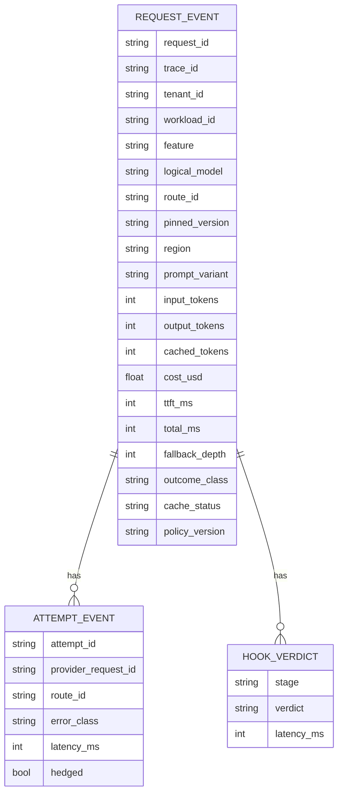

The model separates the logical request from provider attempts, because one request can produce several attempts (retry, hedge, fallback), and cost and error analysis need both views. Hook verdicts are recorded so that blocked and modified requests can be explained. The `policy_version` and `pinned_version` fields make a decision reproducible: given the request event, an engineer can say which policy and which model produced the result.

### 14.2 Token and cost attribution

Cost per request is input tokens times input price plus output tokens times output price, adjusted for cached-token pricing and any per-request fees, using the price table in effect at the request time. Keep prices in a versioned table with effective dates, since a price change must not rewrite past cost. Attribute along the dimensions that people ask about: tenant, feature, workload, logical model, route, and environment. Record retried and hedged attempts as cost with a `waste` tag so that retry overhead is visible. Reconcile against provider invoices monthly; a gap larger than a few percent indicates tokenizer differences, unrecorded traffic (a bypass), or a leaked key.

Chargeback and showback depend on this data being trusted, so treat the cost pipeline as a financial system: immutable events, idempotent aggregation, and reconciliation reports.

### 14.3 Trace propagation

Propagate the caller's trace context (for example the W3C Trace Context headers) into the gateway, create a span for the gateway, child spans per attempt and per hook, and pass trace identifiers to the provider where the provider supports a request metadata field. This lets an engineer follow a user complaint from the product through the retrieval steps and gateway to the exact provider attempt. Record the provider's own request identifier on each attempt; providers' support teams ask for it.

### 14.4 Cost anomaly detection

Spend can spike from a loop in an agent, a prompt that grew, a retry storm, a leaked key, or a legitimate launch. Alert on rates, not only totals. A simple detector compares the current day (or hour) with a trailing baseline and flags large deviations. In the example, nine days of spend average $404.20 with a standard deviation of $9.00, and a tenth day of $940 yields $z = (940 - 404.2)/9.0 \approx 59$, far past any threshold (the script prints `z = 59.4`). A real series has weekly seasonality and growth, so use a baseline for the same weekday and a robust statistic such as the median and median absolute deviation. Combine the statistical alert with hard guards: per-tenant and per-feature spend caps that the gateway enforces in real time, and an automatic circuit that blocks a feature whose hourly spend exceeds a multiple of its norm until an owner acknowledges.

### 14.5 Audit logs with redaction

Audit logs answer "who sent what to which model, under which policy, and what came back" for security investigations and regulators. They conflict with privacy: a log of full prompts is a shadow data store of everything users and the company asked. Resolve the tension with tiers:

- **Metadata always** (the event schema above), retained per policy. It contains no content.
- **Content only by exception.** Store prompts and responses only for sampled evaluation, for routes flagged for investigation, or on tenant opt-in, in a separate, access-controlled store with short retention, encryption, and redaction applied before write.
- **Hashes and references.** Store a hash of the prompt and a pointer to the application's own record (if the application stores it under its own controls) rather than the content.
- **Access logging.** Log every read of the content store.
- **Tenant-aware deletion.** Support deletion by tenant and by data subject.

See [CH11](CH11_Evaluation_and_Observability_Architecture_for_AI_Systems.md) for audit trail design, and [CH12](CH12_AI_Safety_Security_Privacy_and_Governance_Architecture.md) for retention and privacy policy.

## 15. Streaming, Structured Output, and Tool-Call Compatibility

### 15.1 Streaming and mid-stream failure

Streaming returns tokens as they are generated, so users see output sooner, and a failure can occur after part of the answer has been delivered. This breaks the assumption of normal retries, in which a failed call can be repeated invisibly.

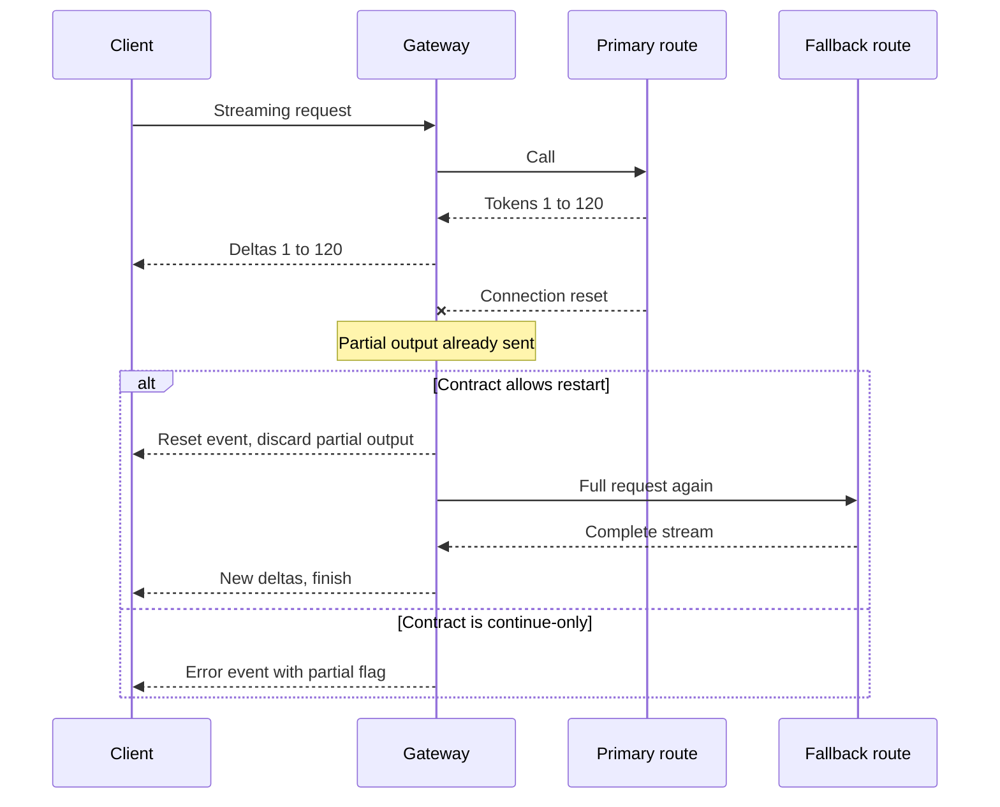

The sequence shows the two policies. Which one applies is part of the stream contract and should be explicit:

1. **Fail with a partial flag.** The gateway sends an error event stating that output is incomplete. The client decides: show the partial text with a notice, or retry. Simple and honest. Right default for chat.
2. **Restart on a fallback.** The gateway sends a `reset` event, the client discards what it showed, and the stream restarts on another route. The user sees text vanish and begin again. Suitable when the client buffers output, or for non-visual consumers such as pipelines.
3. **Resume (continuation).** The gateway sends the partial output as a prefilled assistant turn to another model and asks it to continue. This works poorly across models, because style, formatting, and facts can diverge at the seam, and tool-call fragments cannot be resumed. Avoid it except with the same model where the provider supports prefill, and test thoroughly.
4. **Buffer before streaming.** For routes where a complete, validated answer is needed (structured output, moderation), do not stream to the client. The gateway collects the output, validates it, and then delivers it, trading latency for retryability.

Other streaming concerns:

- **Partial output semantics.** Define what a client may rely on if the stream ends early. A partially streamed JSON document is not valid JSON; a partially streamed tool call must not be executed. The gateway should never emit a tool call as complete until its arguments parse.
- **Time to first token and idle timeouts.** Section 8.6 covers the two timers. Breakers should count a stream that dies mid-way as a failure, with its own metric.
- **Cancellation.** When the client disconnects, the gateway must cancel the upstream request so the provider stops generating and billing. Test that cancellation propagates. Without it, abandoned requests cost money and hold capacity. Also release rate-limit reservations on cancellation.
- **Usage reporting.** Many providers report token usage only at stream end, and a broken stream may yield no usage. Estimate usage for billing from observed tokens, and reconcile later.
- **Backpressure.** A slow client must not make the gateway buffer unlimited output. Set per-stream buffer limits and cancel upstream on overflow.
- **Proxy buffering.** Reverse proxies and load balancers that buffer responses defeat streaming. Verify end to end with a streaming test through every hop. See [Server-Sent Events](../08_API_Architecture/CH05_Server_Sent_Events.md) for the API contract of an event stream.
- **Hooks on streams.** Output moderation on partial text can run on windows of tokens, with a policy for stopping a stream mid-way when a violation appears.

### 15.2 Structured output compatibility

Applications often need JSON that conforms to a schema. Providers offer this in different ways: a JSON mode that guarantees syntactically valid JSON but not schema conformance; schema-constrained decoding, where the decoder only produces tokens consistent with a given schema, with limits on which schema features are supported; tool-forcing, where the schema is presented as a tool whose call is mandatory; and prompting alone. The semantics and supported schema subsets differ. A schema that works on one provider (nested unions, recursive references, numeric ranges) can be rejected or partially ignored on another.

The gateway handles this with layered guarantees:

1. **Negotiate**: record in the capability record which structured-output mode each route supports and which schema features it accepts ([section 4.2](#42-capability-negotiation)).
2. **Translate**: choose the strongest available mode per route and adapt the schema to the supported subset where a lossless transformation exists; refuse otherwise.
3. **Validate always**: validate every response against the original schema in the gateway, whatever the provider promised. Constrained decoding guarantees structure but not semantic validity (a date in the right format can still be wrong).
4. **Repair once**: on validation failure, make one bounded repair attempt (re-ask with the validation error) or fall back to a route with stronger structured-output support. Record repair attempts, because a rising repair rate signals drift.
5. **Version the schema** with the logical model, so that consumers know which shape to expect. See [Prompt Engineering and Structured Outputs](../16_AI_and_GenAI/CH17_Prompt_Engineering_and_Structured_Outputs.md).

### 15.3 Tool-call compatibility

Tool calling exposes more incompatibilities than any other feature, and agent workloads rely on it.

- **Declaration formats.** Name, description, and parameter schema are universal, but wrappers and schema dialect support differ.
- **Call formats.** Arguments may arrive as a JSON string or an object, in fragments when streaming, and with provider-assigned call identifiers that must be echoed in the tool result message.
- **Parallel calls.** Some models emit several tool calls in one turn; others emit one. The adapter normalizes to a list, and the capability record says whether parallel calls are possible.
- **Forced and optional use.** The semantics of "must call this tool", "must call some tool", and "may call a tool" vary.
- **Invalid calls.** Models sometimes emit calls to tools that do not exist or with arguments that violate the schema. The gateway validates calls against the declared tools and returns a normalized error or re-asks. It must not forward an unvalidated call to the tool gateway.
- **Result formats.** How tool results (including errors and images) go back into the conversation differs.
- **Conversation history across routes.** Tool-call identifiers and provider-specific reasoning blocks may not transfer, as section 8.4 noted.

Because of these differences, an agent loop should declare `requires: tools`, the router should exclude routes with unverified tool behavior, and the contract tests (section 19) should include multi-turn tool conversations for each route.

### 15.4 Contract validation as a gateway stage

Make response validation a first-class stage that runs after every provider response, from every route: schema conformance, tool-call validity, finish-reason sanity (a `length` finish on a structured output means truncation, so treat it as `invalid_output`), and size limits. This single stage converts many provider-specific behaviors into one detectable class, and it is what makes fallback safe.

## 16. Multi-Provider Governance

Routing among several providers is a governance problem as much as a technical one. Every route is a decision to send company or customer data to a third party under specific terms.

### 16.1 The approved model catalog

The catalog is the list of (provider, model, version, region, access channel) combinations that the organization has approved, and it is the only source from which routes can be built. Each entry records:

- **Identity and owner.** Who requested it, who approved it, and when.
- **Allowed data classes.** For example public, internal, confidential, restricted, with the maximum class each route may receive.
- **Data-handling attributes.** Processing regions, whether prompts and outputs are retained and for how long, whether they are used for training, whether provider staff may review samples (abuse monitoring), encryption terms, sub-processors, and the contract or agreement reference that supports each claim.
- **Capabilities** (section 4.2) and **limits** (context, rate, quotas).
- **Evaluation status.** The tasks for which the route has passed release gates, with the date and results.
- **Price** with effective date.
- **Lifecycle.** Announced deprecation and retirement dates.
- **Risk notes.** Known incidents, safety behavior differences, and open findings.

Governance rule: a route that is not in the catalog cannot be created, and a catalog entry requires security, privacy, legal, and procurement sign-off appropriate to the data class. Because this is data, a review board can inspect it, and the gateway can enforce it mechanically.

### 16.2 Contract and terms tracking

Provider terms change. A change to retention defaults, a new sub-processor, or a policy update can turn a compliant route into a non-compliant one without any technical change. Assign an owner to subscribe to provider change notices, review them against the catalog, and record the review date. Keep a "terms version" on each catalog entry so that the gateway telemetry can show which terms applied to historical traffic. For regulated data, retain evidence of the agreement in force at the time of processing.

Free tiers, consumer plans, and preview programs often have different data terms from enterprise agreements, such as permission to train on inputs. A key obtained on a personal or trial plan must not appear in the production credential store. Credential registration should record the plan type and reject unapproved plan types for restricted data.

### 16.3 Data-handling flags per route

The gateway evaluates data-handling flags as hard constraints (section 5.1). A compact representation is a set of tags on each route, such as `region:eu`, `retention:none`, `training:no`, `human-review:no`, `class-max:restricted`, matched against the request's required tags derived from tenant and data class. Keep tag semantics precise and documented. Examples of mistakes: tagging a route `retention:none` when the provider offers zero retention only through an application form that was never submitted; treating "does not train on API data" as equivalent to "does not retain data"; assuming that a region tag covers logs, abuse-monitoring storage, and support access.

### 16.4 Independence of providers

Multi-provider setups promise independence. Check it. Two providers may run on the same cloud region, rely on the same authentication provider, use the same content moderation service, or be reached through the same corporate egress. A single dependency failure then takes down both. Maintain a failure-domain map for each fallback pair and exercise it in game days. The map also shows concentration risk in the opposite direction: a single gateway-managed credential for each provider concentrates risk in the gateway (section 17).

## 17. The Gateway's Own Failure Modes and Hardening

A gateway concentrates traffic, keys, and policy. That makes it valuable and dangerous.

### 17.1 Single point of failure

If the gateway is down, every AI feature is down, including those whose providers are healthy. Mitigations:

- Run at least three instances across failure domains (zones), stateless, behind a load balancer with health checks that exercise real dependencies at a shallow level.
- Keep gateway capacity headroom of at least the loss of one zone plus a surge.
- Separate the data plane from the control plane: the data plane serves traffic from a locally cached copy of configuration (routes, policies, limits), so a control-plane outage or a configuration store outage does not stop traffic. Config in the data plane has a last-known-good version.
- Offer a **client-side bypass** for critical features only if the security design allows it: a thin client that can call a pre-approved emergency route directly with a separate credential held under break-glass control. This reintroduces the credential distribution the gateway removed, so reserve it for features where an outage is intolerable and keep it audited and tested.
- Isolate by workload class, with separate gateway deployments (or at least separate pools and quotas) for critical interactive traffic and for batch traffic, so a batch flood cannot starve interactive callers.

### 17.2 Configuration rollout risk

Routing and policy configuration is code with an outsized blast radius. A bad rule can send restricted data to a public route, or send all traffic to a model that does not exist. Treat config as code:

- Version control, review by an owner, and automated validation: schema checks, a check that every referenced route exists and is in the catalog, a check that every logical model has at least one eligible route per tenant class, and policy unit tests.
- A **replay test** of recent request metadata (not content) through the proposed policy to compare decisions with the current policy before rollout, so a change that would reroute 40 percent of traffic is visible.
- Staged rollout by instance, with automatic rollback on error rate or decision-distribution change.
- A fast, rehearsed rollback.
- Change freeze windows around peak events.

### 17.3 Latency overhead

The gateway adds a network hop, TLS handling, authentication, policy evaluation, hooks, and logging. Budget it: for an interactive request with a model time to first token of 800 ms, a gateway overhead of 20 ms (excluding hooks) is 2.5 percent. A gateway that adds 300 ms is a visible tax. Measure overhead as the difference between client-observed and provider-observed latency, track its percentiles, and keep the hot path free of synchronous calls to other services where possible (cache entitlements, price tables, and policies locally; write telemetry asynchronously). Use keep-alive and connection pooling to providers, and place the gateway in the same region as the callers and, where possible, close to provider endpoints.

### 17.4 Security as a high-value target

The gateway holds provider keys and sees all prompts and responses. A compromise yields spend, data theft, and the ability to manipulate model output for every tenant. Threats and responses:

| Threat | Example | Control |
| --- | --- | --- |
| Credential theft | Memory dump, log leak, environment variable exposure | Short-lived credentials, secret manager, memory-only caching, no secrets in logs, runtime isolation |
| Unauthorized caller | Stolen workload token used from outside | Mutual TLS, short token lifetime, network policy, per-workload scopes |
| Cross-tenant access | Cache key or credential mix-up | Tenant-scoped keys, namespaced caches, tests that try cross-tenant reads |
| Server-side request forgery | Caller-supplied URL or host | No caller-supplied destinations, egress allow-list |
| Prompt and response exfiltration | Malicious plugin or debug endpoint | Out-of-process hooks, no debug endpoints in production, egress controls |
| Configuration tampering | Edited route sends data to attacker's endpoint | Signed config, review, audit, catalog-only routes |
| Denial of service | Flood of large requests exhausting quota | Per-caller limits, request size limits, admission control |
| Supply chain compromise | Malicious dependency or release | Pinned and verified dependencies, hash checking, minimal images, build provenance |
| Insider access | Operator reads prompts | Least privilege, break-glass with audit, content not logged |

The supply-chain row is not hypothetical for this class of software. On 24 March 2026, two releases of LiteLLM, a widely used open-source Python gateway and SDK, were published to the Python Package Index with credential-stealing code and were live for roughly 40 minutes before PyPI quarantined them, according to the [LiteLLM security update](https://docs.litellm.ai/blog/security-update-march-2026); independent write-ups such as [Datadog Security Labs](https://securitylabs.datadoghq.com/articles/litellm-compromised-pypi-teampcp-supply-chain-campaign/) describe the campaign. The lesson applies to any gateway product or library, open source or commercial, because a component that holds provider keys is a target: pin dependencies by hash, install only from an internal mirror with a delay and scan for new releases, run the gateway with minimal privileges and without access to credentials other than those it needs, and keep workload secrets out of the build environment. Verify the current details in the vendor's advisory before citing them in your own documents.

### 17.5 Hardening checklist for the gateway runtime

- Run as a non-root user in a minimal image, with a read-only file system and no shell.
- Deny all egress except the proxy; deny all ingress except the load balancer and the health checker.
- Isolate the gateway's cloud identity: it can read its own provider secrets and write telemetry, and nothing else.
- Disable verbose logging of payloads in production; protect any diagnostic endpoint with strong authentication or remove it.
- Limit request size, header size, and number of messages and tools per request.
- Scan dependencies and images continuously; keep a software bill of materials.
- Apply the same controls to hook plugins.
- Run periodic penetration tests that include cross-tenant attacks and SSRF attempts.

## 18. Build, Buy, or Adopt Open Source

### 18.1 The options

Gateway options at the time of writing fall into several groups. The market changes quickly, products are renamed and acquired, and feature lists in vendor comparison articles are often promotional, so verify capabilities in current documentation and with a proof of concept.

| Option group | Examples (verify current status) | Strengths | Weaknesses |
| --- | --- | --- | --- |
| Open-source proxy or SDK | LiteLLM, Envoy AI Gateway, and several newer projects | Control, no per-request fee, self-hosting, data stays inside | You operate and secure it; supply chain exposure; feature gaps in enterprise controls |
| API gateway with AI plugins | Kong AI Gateway and similar extensions to existing API gateway products | Reuse of existing gateway skills, auth, and operations | AI features vary in depth; configuration complexity |
| Managed AI gateway or router service | Portkey, Cloudflare AI Gateway, Vercel AI Gateway, OpenRouter, Helicone | Fast to adopt, built-in observability and caching, many providers | Prompts transit a third party; data-handling terms need review; vendor dependency; pricing models differ (platform fee, markup, or bring-your-own-key) |
| Cloud provider capabilities | Amazon Bedrock (cross-Region inference profiles, application inference profiles for cost tracking), and equivalent features in other clouds' model platforms | Integration with identity, networking, billing; regional controls | Limited to that cloud's catalog; portability; features differ |
| Custom build | Your own service on Envoy or a language runtime | Fits your policy exactly | Highest effort; long maintenance tail; reinventing adapters |

For details on specific features, consult the product documentation. For example, Amazon documents inference profiles and cross-Region inference in the [Bedrock user guide](https://docs.aws.amazon.com/bedrock/latest/userguide/inference-profiles.html), which also describes application inference profiles for tracking cost and usage.

### 18.2 Decision criteria

| Criterion | Question | Leans toward |
| --- | --- | --- |
| Data sensitivity | May prompts transit a third-party service? | Self-hosted or cloud-native for restricted data |
| Residency and compliance | Can the product prove processing location and retention? | Self-hosted or provider-native with evidence |
| Time to value | Do you need routing and observability this month? | Managed service or open source |
| Team capacity | Can you operate a tier-one service with on-call? | Buy if no |
| Customization | Do you need custom policy, residency routing, tenant keys? | Open source plus custom policy engine, or build |
| Scale and latency | Is the added hop acceptable at your volume? | Benchmark candidates with your traffic shape |
| Provider coverage | Does it support the providers and features you rely on, including streaming, tools, and structured output? | Proof of concept per feature |
| Exit cost | How hard is it to leave? | Prefer standard client interfaces and exportable config |
| Total cost | License or markup, infrastructure, people | Compute over three years |

A useful pattern is to adopt an existing proxy or library for the adapter layer, which is commodity work, and to build the policy, residency, budget, and credential logic that is specific to your organization on top of it. Keep the application contract your own so that you can replace the adapter layer. Many products offer an OpenAI-compatible interface; a de facto interface is convenient but encodes one provider's concepts, so decide consciously whether it is your gateway contract or only one of several client protocols you accept.

### 18.3 Worked cost-of-ownership comparison

Illustrative numbers. An organization spends $60,000 per month on model calls (about $720,000 per year).

- **Managed gateway with markup.** Suppose a managed service charges a 5 percent markup on spend plus a platform fee of $1,500 per month. Annual cost is $36,000 + $18,000 = $54,000. People cost is small: perhaps 0.2 of an engineer for policy and monitoring, say $40,000. Total about $94,000.
- **Self-hosted open source.** Infrastructure for a three-zone cluster, a cache, and a database costs perhaps $2,500 per month ($30,000 per year). Operating it needs about 0.6 of an engineer including on-call and security patching, say $120,000. Total about $150,000.
- **Custom build.** Initial build of 3 engineers for 6 months ($300,000 if loaded cost is $200,000 per engineer-year) plus infrastructure ($30,000) and 1.0 engineer to maintain ($200,000 per year). First-year total about $530,000, then about $230,000 per year.

On cost alone, the managed option wins at this scale. The calculation flips if spend rises to $600,000 per month: a 5 percent markup is then $360,000 per year, and self-hosting becomes cheaper. Cost is rarely the deciding factor; data handling, residency, and control usually decide. The method to carry away is to put all costs on one sheet, including people, and to reevaluate when spend changes by an order of magnitude.

## 19. Testing the Gateway

### 19.1 Contract tests per adapter

For each adapter, a suite verifies against recorded fixtures (always) and against the live endpoint (on a schedule):

- Request translation produces payloads that validate against the provider's schema.
- Response translation handles normal, empty, truncated, refused, and tool-call responses, and unknown extra fields.
- Error mapping covers each documented error and a set of recorded real errors.
- Streaming translation handles fragmentation boundaries, interleaved tool-call fragments, and abrupt termination.
- Capability claims hold. If the record says parallel tool calls are supported, a live test asserts it.
- Usage reporting matches the provider's invoice sample within tolerance.

Live contract tests run daily or hourly with small, cheap prompts, and failures page the owner, since they signal a provider change.

### 19.2 Golden prompts per route

A golden set is a collection of representative inputs with acceptance checks (exact match where possible, schema checks, rubric-graded checks otherwise). For each route and logical model, run the set on a schedule and on every change to the route, the prompt variant, or the pinned version. Record pass rate, format-failure rate, refusal rate, length distribution, latency, and cost. Alert on drift beyond a threshold. Golden sets are the instrument that detects silent model updates (section 7.4) and the evidence that gates fallbacks (section 8.4). Their design belongs to [CH11](CH11_Evaluation_and_Observability_Architecture_for_AI_Systems.md); the gateway's job is to run them through the same path as production traffic, with hooks, so that results match reality.

### 19.3 Policy tests

Write table-driven tests for routing policy: for each combination of tenant class, data class, residency, plan, and task, assert the eligible set. Include negative tests that must fail closed: restricted data with no eligible route returns `no_route`; a request with an unknown tenant is denied; a caller-supplied hint that would relax policy is ignored. Property-style tests generate random requests and assert invariants: no restricted request is ever routed to a route lacking the `restricted` tag; no EU tenant request is ever routed outside the EU region set.

### 19.4 Chaos and fault injection

Resilience mechanisms that have never fired in a test do not work reliably. Inject faults at the adapter or transport level in a test environment and, carefully, in production:

- Provider returns 429s with and without retry hints.
- Provider latency rises by a factor of five.
- Provider drops connections mid-stream.
- Provider returns malformed JSON, truncated tool-call arguments, or refusals.
- A region goes away.
- Secret manager is unavailable.
- Configuration store is unavailable.
- Telemetry sink is slow (must not block requests).

Assertions: breakers open in the expected time; retry budget caps amplification; fallbacks engage and are marked degraded; deadlines hold; no data class violation occurs under any fault; the cost event records every attempt.

### 19.5 Replay and load tests

Record request metadata and sanitized (or synthetic) payloads, and replay them against a staging gateway with a fake provider that reproduces latency and error distributions. Replays test routing changes before rollout (decision diff), capacity (do the limits behave under a peak profile?), and cost projection (what would last month have cost under the new policy?). Include realistic prompt lengths and streaming durations, because gateway concurrency is governed by the long-lived streams (Little's law, section 10.6).

## 20. Rollout of Routing and Gateway Changes

Changes to routes are changes to behavior. Classify them by risk and apply a matching process.

| Change | Risk | Process |
| --- | --- | --- |
| Price table update | Low | Review, automated validation, reconcile against invoice |
| Rate-limit adjustment | Medium | Review; staged; watch rejection rate |
| New provider adapter version | Medium | Contract tests, shadow, canary |
| New fallback rung | Medium | Eval gate, game day, then enable |
| New model version for a route | High | Offline eval, shadow, canary, ramp, rollback ready |
| Residency or data-class rule change | High | Policy review by privacy and security, replay diff, staged |
| Learned router model update | High | Offline replay, shadow, canary, exploration monitoring |
| Gateway code release | High | Standard progressive delivery |

Common mechanics: feature flags for routes; weights changed in steps; automatic halt on error-rate, latency, refusal-rate, format-failure, or cost-per-request deviation; a decision log for every change (who, when, why, evidence); and a standing rollback target. For tenant-visible changes (a model swap that changes writing style), notify affected tenants where contracts require it, and offer pinning for tenants who need stability, at the cost of maintaining an older route.

## 21. Failure Scenarios as Quality-Attribute Scenarios

Each scenario states the stimulus, the system's response, and a measure that tells you whether the design worked. The figures are illustrative targets, and each team should set its own.

### 21.1 Provider outage

**Setting.** The primary route (provider A, EU) carries 70 percent of interactive traffic and peaks at 1,000,000 tokens per minute. Of that, 300,000 is batch and 50,000 is shadow traffic. The fallback route (provider B, EU) has a quota of 800,000 tokens per minute, and the gateway admits up to 90 percent of it, 720,000.

**Stimulus.** Provider A returns 503 for 40 minutes.

**Response.** The retry budget caps retries at 10 percent of first attempts. Within the first window of 10 or more calls, the breaker opens. Traffic shifts down the chain to provider B. The gateway sheds shadow traffic first, then queues batch work, so interactive demand is $1{,}000{,}000 - 300{,}000 - 50{,}000 = 650{,}000$ tokens per minute, which fits under 720,000. Responses carry `degraded=true` and `fallback_depth=1`, using prompt variants evaluated for provider B. Half-open probes test provider A every 30 seconds.

**Measures.** User-visible error rate under 1 percent after the first minute; added p95 latency under 1.5 seconds; no restricted-data request routed outside the approved set; batch backlog drained within two hours of recovery; the incident visible as fallback depth in dashboards. Without the shedding step, demand would be 1,000,000 against 720,000 admitted, and 28 percent of requests would be rejected.

### 21.2 Silent model update

**Stimulus.** A provider changes the behavior behind a pinned identifier. The summarization route's pass rate falls from 0.91 to 0.84 and its refusal rate rises from 0.4 percent to 2.5 percent. No error appears in HTTP statuses.

**Response.** The hourly golden-prompt job on this critical route detects a pass-rate drop beyond the alert threshold (more than 3 points, for instance) and a refusal-rate shift. The alert pages the route owner. The runbook switches the logical model to the alternate route that passed the gate, or tightens traffic to a previous-version route if the provider still serves it. Shadow comparison of the old and new behavior captures evidence for the provider's support.

**Measures.** Detection within 1 hour; mitigation within 2 hours; the number of affected responses bounded by traffic rate times exposure time (at 20,000 requests per hour and 3 hours, about 60,000 requests, of which roughly 7 percent more fail than normal, around 4,200 extra failures); post-incident, a per-route record of the change.

### 21.3 Rate-limit storm

**Stimulus.** A tenant launches a bulk job that submits 5,000 requests in a minute against a route whose provider quota is 1,200,000 tokens per minute. The tenant's weight gives it a share of 200,000 tokens per minute.

**Response.** The tenant's token bucket admits requests up to its share plus borrowed spare capacity, and rejects the rest with `rate_limited` and a retry-after computed from the deficit. Interactive traffic from other tenants keeps its reserved share. Client libraries use jittered backoff, and the retry budget stops the tenant's own retries from amplifying. No provider 429 reaches the other tenants.

**Measures.** Other tenants' p95 latency and error rate unchanged within 5 percent; provider 429 rate under 1 percent of calls; the heavy tenant sees structured `rate_limited` errors with accurate retry-after values; the job completes within its share-limited time, which the tenant can forecast: 5,000 requests of about 4,000 tokens each is 20,000,000 tokens, and at 200,000 tokens per minute that takes 100 minutes.

### 21.4 Price change

**Stimulus.** A provider doubles the output-token price of the medium model, from $4.00 to $8.00 per million, with input unchanged at $1.00.

**Response.** The price table is updated with an effective date. Cost per request for the 3,000-in, 400-out workload changes from $0.0046 to $0.003 + 0.0032 = $0.0062, a 34.8 percent increase. The router recomputes per-success scores. The medium route stays the right choice for tasks that need its pass rate, but the cascade's escalation fraction now costs more, so the cost model is rerun and the platform team proposes either moving the verification threshold, routing output-heavy tasks to a cheaper medium alternative that passes the gate, or negotiating. The anomaly detector, set on cost per request rather than total spend, flags the increase as a price effect rather than a traffic effect because token counts are unchanged.

**Measures.** Time from price announcement to updated table and projected impact report under 1 business day; forecast error within 5 percent against the next invoice; no unplanned budget breach at a tenant level, since budgets are enforced on dollar cost computed from the new table.

### 21.5 Content-filter false positive

**Stimulus.** A provider updates its safety system. Refusals on a clinical documentation assistant rise from 0.5 percent to 6 percent. Many refusals involve medical terminology.

**Response.** The normalized `content_filtered` rate for the route crosses its alert threshold (a spike far above baseline). The safety owner reviews a redacted sample, confirms false positives, and approves the logical model for filter-aware fallback: refusals on this allow-listed request class fall back to an alternate route of equal or stricter safety behavior. Other request classes keep the refusal. The provider receives the evidence. Retries of the same route are not used, because the refusal is deterministic for the same input.

**Measures.** Refusal rate for the class back under 1.5 percent within a day; no increase in the rate of policy-violating outputs, measured by sampled review of fallback responses; every fallback decision logged with the reason.

## 22. Worked Designs

### 22.1 Design A: multi-tenant SaaS gateway with residency routing

**Context.** A software-as-a-service company runs a document assistant for 3,000 business tenants in the EU, the US, and Asia-Pacific. Traffic is 12 million requests per month. Contracts require that tenant content be processed only in the tenant's home region. About 60 enterprise tenants require their own provider accounts (bring your own key). Features: summarization, question answering over tenant documents, and drafting.

**Architecture.** A regional gateway cell in each of three regions. Each cell has its own gateway cluster, credential store, cache, egress proxy, and telemetry pipeline. A global control plane distributes signed configuration (routes, policies, catalog) to cells. Applications call the gateway cell in the tenant's home region. A global directory maps tenant to home region.

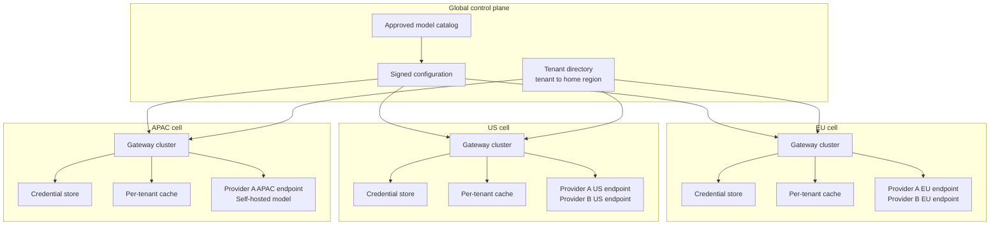

The cells share no runtime data path. The control plane distributes configuration only, and each cell keeps serving from its last-known-good configuration if the control plane is unreachable. A request for an EU tenant that arrives at the US cell is rejected or forwarded to the EU cell by the product tier, not processed locally. The implication for failure analysis is that a cell outage affects only that region's tenants, and fallback never crosses the residency boundary.

Key decisions and ADRs:

ADR-1: Regional cells, not a single global gateway with a residency filter.
Context: tenant content must stay in region. Decision: deploy independent cells and enforce residency by topology as well as policy. Consequences: higher operating cost (three clusters), simpler audit story, and region-scoped blast radius. Rejected alternatives: (a) one global gateway with region tags on routes, rejected because a single misconfiguration or cache bug can move content across regions, and because all prompts would transit one location; (b) a gateway per tenant, rejected on operating cost for 3,000 tenants.

ADR-2: Fallback only within the region.
Context: availability pressure invites cross-region failover. Decision: fallback rungs are same-region only: same model other zone, other provider in region, smaller model, cached answer, deferred queue. If none remain, return a structured unavailable error. Consequences: lower worst-case availability than global failover, no compliance exposure. Rejected: cross-region fallback with tenant consent flags, deferred to a later release when contract terms allow it for specific tenants.

ADR-3: Bring-your-own-key tenants get isolated credential, quota, and breaker scope.
Decision: store tenant keys encrypted under per-tenant keys in the cell's vault, resolve them from authenticated tenant identity only, and scope breakers and quotas per credential. If a tenant key fails, return `credential_error`, and never fall back to the platform key. Rejected: automatic fallback to the platform key, because it changes the billing and data terms the tenant chose.

ADR-4: Per-tenant cache namespaces, exact-match only for tenant documents, semantic cache for public help content only.
Decision: cache keys include tenant, user permission scope, pinned model version, and prompt variant. Semantic caching is limited to the public help-center assistant. Rejected: a shared semantic cache across tenants, because of leakage and timing channel risks.

ADR-5: Central service with thin client library, enforced by egress policy.
Decision: applications reach providers only through the cell gateway, with provider egress denied elsewhere. Rejected: an in-process library, because credentials would spread across all services.

**Numbers.** Traffic is 12,000,000 requests per month; assume an average of 3,500 input and 450 output tokens. With a mid-tier route at $1.00 and $4.00 per million tokens (illustrative), cost per request is $0.0035 + $0.0018 = $0.0053, so $63,600 per month. With 25 percent of requests served by a small model at $0.20 and $0.80 (cost $0.0007 + $0.00036 = $0.00106), the blended cost is $0.75 \times 0.0053 + 0.25 \times 0.00106 = 0.003975 + 0.000265 = \$0.00424$, or $50,880 per month, a saving of $12,720. Whether to take the saving depends on the small model passing the gate on the 25 percent of requests it takes (classification and short drafts). The gateway cost: three cells with six instances each, with infrastructure of perhaps $9,000 per month and 1.5 engineers of operation. The cells pay for themselves in avoided compliance risk rather than in token savings.

**Validation evidence.** Policy tests assert that no request with home region EU reaches a non-EU route (property test over 100,000 generated requests); a game day takes one provider offline in a cell and measures the breaker time and fallback quality; a cache isolation test attempts cross-tenant reads and asserts zero hits; an egress test attempts to reach provider hosts from an application namespace and asserts denial; invoice reconciliation matches within 2 percent.

### 22.2 Design B: internal enterprise gateway with budgets

**Context.** A large company has 40 internal teams building AI features, a monthly model budget of $90,000, and a security rule that internal confidential data may only go to approved enterprise-contract routes. Teams currently use personal keys and shared spreadsheets. The goal is visibility, budgets, and fewer security exceptions.

**Architecture.** A single central gateway service, active in two regions for availability, with team-level identities, a catalog of six approved models, per-team budgets, and showback reports. Budget enforcement has tiers.

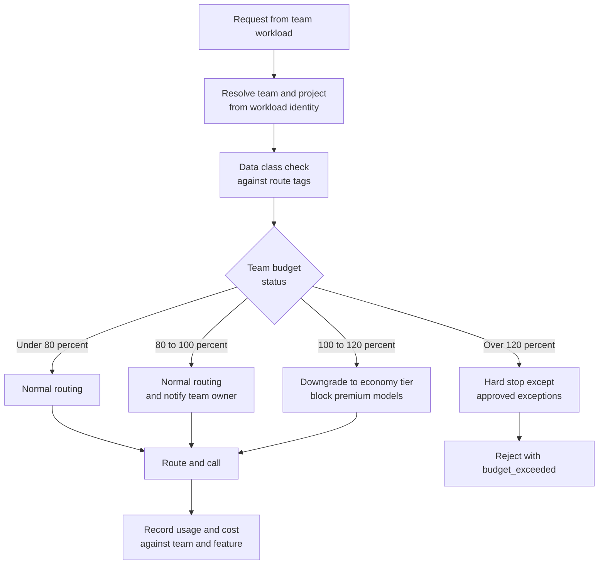

The flow shows that budget status is evaluated after identity and data class, and that it selects a routing mode rather than only rejecting. The graduated response keeps products alive at the cost of quality, and a hard stop exists as a backstop against loops. The implication is that the budget service must be reliable and fast, since it is on the request path: team balances are cached in the gateway with short refresh, and spend is accounted asynchronously with periodic hard reconciliation.

ADRs:

*ADR-1: Enforce budgets in the gateway, not through finance reports.* Decision: real-time soft limits with a graduated response and daily hard checks. Rejected: monthly invoice review alone, because loops burn the budget in hours.

*ADR-2: Team-level credentials and identity, with central provider keys.* Decision: teams authenticate with workload identity; provider keys live only in the gateway. Rejected: team-owned provider accounts with a spreadsheet, because they defeat visibility and security control.

*ADR-3: A small catalog of six models.* Decision: approve a small set, each with an owner and data classes, and add models through a request process with an evaluation. Rejected: open access to any model, because each model is a data-sharing decision and a support burden.

*ADR-4: Showback first, chargeback later.* Decision: publish per-team cost reports monthly and attach chargeback after two quarters of data quality. Rejected: immediate chargeback, because attribution errors would cause disputes.

*ADR-5: Budget exceptions are time-boxed and logged.* Decision: a team lead can request an exception with an expiry. Rejected: permanent overrides.

**Numbers.** Budget $90,000 is allocated across 40 teams: ten larger teams at $4,000 each ($40,000), twenty medium teams at $1,500 each ($30,000), ten small teams at $500 each ($5,000), with the rest as a $15,000 central reserve for exceptions and shared services ($40,000 + $30,000 + $5,000 + $15,000 = $90,000). Consider one larger team with a $4,000 budget that has spent $2,600 by day 12 of a 30-day month. Its run rate is $2,600 / 12 = $216.67 per day, so projected spend is $6,500, which is 62.5 percent over budget. At 80 percent ($3,200), reached on day 15 at that pace, the owner is notified with the projection. At 100 percent ($4,000), reached on day 19, the gateway downgrades the team to economy models. The notification at day 15 leaves time for the team to fix a loop or request an exception before any degraded mode.

**Validation evidence.** Replay of three months of historical usage (from the pre-gateway spreadsheet and provider invoices) through the budget policy to predict how many teams would have hit each tier; a load test that exercises budget lookups at 3 times peak; reconciliation between gateway-recorded cost and provider invoices (target within 3 percent); and a security test confirming that no team workload can reach provider hosts directly.

## 23. Comparison and Common Mistakes

### 23.1 Fallback and resilience mechanisms compared

| Mechanism | Helps against | Does not help against | Cost | Main risk |
| --- | --- | --- | --- | --- |
| Retry with backoff | Transient errors | Sustained outage, quota exhaustion | Low | Amplification |
| Hedged request | Tail latency | Outage | Extra tokens (about the hedge fraction) | Duplicate side effects, extra load |
| Circuit breaker | Sustained failure, slow failures | Quality regressions | Low | Wrong thresholds, flapping |
| Same model other region | Regional incident | Provider-wide incident | Quota in two regions | Residency violation |
| Other provider | Provider-wide incident | Shared dependency failure | Second integration and quota | Behavior and data-terms difference |
| Smaller model | Capacity shortage | Hard capability needs | Low | Lower quality |
| Cached answer | Any outage for repeat questions | Novel questions | Cache storage | Staleness, leakage |
| Deterministic response | Total outage | Needs for generation | Development | Narrow coverage |
| Queue for later | Outage for async work | Interactive work | Storage, delay | Data at rest, backlog |
| Load shedding | Overload | Provider failure | None | User impact if misprioritized |

### 23.2 Common mistakes

| Mistake | Cause | Consequence |
| --- | --- | --- |
| Lowest-common-denominator contract | Fear of provider differences | Features needed by workloads become impossible, teams bypass the gateway |
| Hiding differences silently | Wanting a clean abstraction | Fallback changes behavior unobserved, structured output or tool calls break |
| Relaxing hard rules during outages | Pressure to stay available | Compliance incident worse than the outage |
| Retrying at several layers | Defaults in SDKs, mesh, and gateway | Multiplied load on a failing provider, longer outage |
| Fallback never exercised | No game days | First real use finds expired keys, missing quota, untested prompts |
| Trusting caller-supplied tenant or data class | Convenience | Cross-tenant access and policy bypass |
| Floating model aliases in production | Convenience | Silent behavior changes, broken parsers |
| Shared cache across tenants | Hit-rate optimization | Data leakage, cache poisoning |
| Product prompts stored in the gateway | Central convenience | Release bottleneck, platform team makes product decisions |
| Counting policy denials as provider failures | Single error counter | Breakers open for the wrong reason |
| Logging full prompts by default | Debugging convenience | A shadow data store with all the privacy risk |
| No egress enforcement | Trust in teams | Gateway is advisory, shadow integrations flourish |
| Config changes without replay | Speed | A rule edit reroutes traffic unnoticed |
| Learned router without default | Enthusiasm | Router failure or drift stops or degrades everything |
| Reading only token savings | Easy metric | Cheaper policy that costs more after errors |

## 24. Design-Review Checklist

Use this list in architecture reviews. Each item should have an answer and, where possible, evidence.

Purpose and boundary:

- Is there a second consumer or a cross-team requirement that justifies a shared gateway?
- Is the placement (library, sidecar, central) chosen with reasons, and is bypass prevented by network policy?
- Are non-responsibilities written down, with no product prompts or agent logic in the gateway?

Contract:

- Is there a documented request and response schema, versioned independently of adapters?
- Does capability negotiation fail closed when no route supports the request?
- Are provider-specific features available through typed extensions that restrict routing?
- Is there an error taxonomy with retry and fallback behavior per class?

Routing:

- Are hard constraints separated from soft preferences, with fail-closed behavior?
- Do trusted sources provide tenant, data class, and residency?
- Are quality floors per task backed by evaluation on the task, not public benchmarks?
- Are cost comparisons made per accepted answer, including error cost?
- Does a learned router, if any, have a static default and operate only within the eligible set?

Versions:

- Are production routes pinned, with deprecation dates tracked and alerts configured?
- Is there a migration process with shadow and canary stages, and a rollback route?
- Do scheduled golden-prompt runs detect silent changes?

Fallback and resilience:

- Is each fallback rung declared, evaluated, and exercised in game days?
- Are fallbacks independent in failure domain, quota, and policy?
- Is retrying done at one layer, with a budget and jitter?
- Do deadlines propagate and leave time for later rungs?
- Are breakers scoped per route and credential, with failure classes defined?
- Is degraded output marked in the response?

Limits:

- Are limits token-based with reserve-and-reconcile?
- Are provider limits mirrored, with a safety margin?
- Are tenants isolated by weights, caps, and concurrency limits?
- Are priority classes and shedding order defined?

Security:

- Do applications hold no provider keys, and is egress restricted to the gateway?
- Are credentials short-lived or rotated, scoped narrowly, and never logged?
- Are caller-supplied destinations rejected?
- Is the gateway runtime hardened, and are dependencies pinned and verified?
- Are tenant keys resolved only from authenticated identity?

Hooks, cache, and data:

- Are hook failure policies (open or closed) explicit?
- Is hook latency budgeted and measured?
- Are caches partitioned by tenant and authorization scope with retention rules?

Observability and governance:

- Does each request emit attributed metadata, including attempts and policy and model versions?
- Is cost reconciled with invoices, with anomaly detection and hard caps?
- Does the approved catalog record data-handling terms, and is there an owner for terms changes?

Operations:

- Is configuration versioned, validated, replay-tested, and rolled out in stages?
- Are the gateway's own SLOs defined, with capacity headroom and a control-plane-independent data plane?
- Have contract tests, chaos tests, and replay tests been run recently?

## 25. Exercises

1. **Token bucket.** A tenant has a limit of 300,000 tokens per minute and a bucket capacity of 30,000 tokens. Requests cost 12,000 tokens each. Three requests arrive at the same instant on a full bucket. Which are admitted, and what retry-after does the gateway return for the third?

2. **Retry amplification.** A request passes through an SDK, a service mesh sidecar, and the gateway, each retrying up to three times (four attempts in total). What is the worst-case number of provider calls for one user request? Which layers should retry, and what budget would you set?

3. **Per-success cost.** Route X costs $0.50 and $2.00 per million input and output tokens with a pass rate of 0.80. Route Y costs $3.00 and $12.00 with a pass rate of 0.95. For a request of 2,000 input and 300 output tokens, compute cost per request and cost per accepted answer for each. If a failed answer costs $0.30 in rework, which route has the lower total cost per request?

4. **Concurrency.** The gateway receives 150 requests per second, with a mean time in system of 6 seconds for streaming responses. How many requests are in flight on average? If one instance supports 200 concurrent streams at a safe utilization, how many instances do you need, allowing for the loss of one of three zones?

5. **Fallback availability.** The primary route has 99.9 percent availability and the alternate 99.5 percent. Compute availability of the pair if failures are independent. Then assume 40 percent of primary outages also take down the alternate. Compute the pair's availability and the expected downtime in a 30-day month in each case.

6. **Canary sizing.** Baseline pass rate is 0.95. You want to detect a drop of 3 percentage points with 95 percent confidence and 80 percent power. How many graded samples per arm do you need? If 1.5 percent of canary requests are graded and the canary gets 4,000 requests per day, how long does the canary take?

7. **Semantic cache design.** A team wants a shared semantic cache for an internal HR assistant that answers from employee-specific data. List the correctness and authorization risks, and propose a design that keeps the benefit for part of the traffic.

8. **Streaming failure contract.** Specify the stream contract for a chat product whose gateway loses the upstream connection after 200 tokens. Choose among partial flag, restart, resume, and buffering, and say what the client does in each case and what the metrics record.

9. **Residency under failure.** A tenant must stay in an EU region set. Provider A's EU endpoint is down, and a US endpoint of provider A is healthy. Describe what the gateway does and which three alternatives you reject, with reasons.

10. **Price change.** A provider raises the input price of your primary route by 50 percent, from $3.00 to $4.50 per million tokens. Output stays at $15.00. For requests with 6,000 input and 500 output tokens, compute the cost change per request and per month at 2 million requests, and say which routing or caching changes you would test first.

### Answer outlines

1. Refill rate is 5,000 tokens per second. The first request leaves 18,000, the second leaves 6,000, and the third (12,000) is rejected. Retry-after is $(12{,}000 - 6{,}000)/5{,}000 = 1.2$ seconds.

2. $4^3 = 64$ provider calls in the worst case. Retry at the gateway only, with zero retries in the SDK and mesh for model traffic, and a retry budget near 10 percent of first attempts with jittered exponential backoff, honoring retry-after.

3. Route X: $2{,}000 \times 0.50/10^6 + 300 \times 2.00/10^6 = 0.001 + 0.0006 = \$0.0016$; per accepted answer $0.0016/0.80 = \$0.0020$. Route Y: $0.006 + 0.0036 = \$0.0096$; per accepted answer $0.0096/0.95 \approx \$0.0101$. With failure cost $0.30: X costs $0.0016 + 0.20 \times 0.30 = \$0.0616$; Y costs $0.0096 + 0.05 \times 0.30 = \$0.0246$. Route Y has the lower total.

4. Little's law: $150 \times 6 = 900$ in flight. To tolerate losing one of three zones with two zones carrying 900: each surviving zone needs $450$ concurrent, requiring $\lceil 450/200 \rceil = 3$ instances per zone, so 9 instances in total across three zones (three per zone), at the stated safe utilization.

5. Independent: $1 - (0.001 \times 0.005) = 99.9995\%$, expected downtime $0.000005 \times 43{,}200 \approx 0.22$ minutes. With 40 percent correlation: probability both down is $0.001 \times (0.005 \times 0.6 + 0.4) = 0.000403$, so availability is 99.9597 percent and downtime is about 17.4 minutes. Correlation dominates the result, which is why failure-domain mapping matters more than adding a third provider.

6. $n \approx 2 \times 0.95 \times 0.05 \times 7.84 / 0.03^2 = 0.7448/0.0009 \approx 830$ per arm. Graded canary samples per day are $4{,}000 \times 0.015 = 60$, so it takes about 14 days. Improve it with a higher graded fraction, an automated grader with validated agreement, or offline evaluation first.

7. Risks: answers contain one employee's data; semantic similarity matches questions from different people; permission scope varies by user and role; timing reveals whether someone asked; cached responses retain personal data. Design: no shared cache for personalized answers; cache only generic policy questions (for example leave policy text) in a namespace keyed by the policy document version; require a similarity threshold validated on a labeled sample; exclude any response whose retrieval context included person-specific records; set a time to live tied to document updates.

8. A defensible answer is "fail with partial flag" as the default for chat: the gateway emits an error event with `partial=true`, the client shows the text with a notice and a retry control, the metrics count a mid-stream failure for the route and feed the breaker, and the usage record estimates tokens from observed output. Restart is acceptable for non-visual consumers. Resume is rejected for cross-model seams. Buffering applies to structured outputs.

9. The gateway uses same-region rungs only: same model in another EU zone, a second provider with an EU endpoint, a smaller EU model, a cached answer, or a deferred queue; otherwise it returns a structured unavailable error. Rejected: the US endpoint (violates residency), relaxing the residency tag under an "emergency" flag (turns an outage into a compliance incident), and a caller override of region (untrusted input).

10. Input cost per request rises from $6{,}000 \times 3.00/10^6 = \$0.018$ to $6{,}000 \times 4.50/10^6 = \$0.027$, an increase of $0.009$ per request. Output cost is $500 \times 15.00/10^6 = \$0.0075$ and unchanged. Total per request goes from $0.0255 to $0.0345 (35.3 percent). At 2 million requests per month the increase is $18,000. First tests: prefix caching to reduce repeated input tokens, trimming prompts and retrieved context, routing simple requests to a cheaper route that passes the gate, and checking whether the cascade should start with a cheaper model.

## 26. Summary

A model gateway gives applications a stable contract over volatile providers, and it gives the organization one place to enforce residency, credentials, budgets, and observability. Its value depends on keeping the boundary narrow: translate and protect, do not own product prompts, agent logic, or evaluation. Place it as a central service when several teams or compliance rules require non-bypassable enforcement, and enforce that with egress controls.

Design the contract with capability negotiation and typed extensions, so that differences stay visible and fallbacks fail closed instead of dropping features. Separate hard constraints from soft preferences in routing, never relax hard constraints during an outage, and judge routing choices by cost per accepted answer rather than token price. Pin model versions, migrate through shadow and canary stages, and detect silent changes with golden prompts.

Build fallback chains from rungs that are independent, evaluated, and exercised, and mark degraded results. Retry at one layer with a budget, hedge only where it pays, propagate deadlines, and use breakers scoped per route. Limit by tokens, mirror provider limits, and isolate tenants. Treat the gateway itself as a tier-one, high-value target: hardened, with its own redundancy and a data plane that survives control-plane failures. Test it with contract tests, policy tests, chaos, and replay, and roll out routing changes as carefully as code.

## 27. Code Examples

- [`01_adapter_normalizer.py`](../code/python/model-gateway-chapter/01_adapter_normalizer.py) translates one gateway request into two invented provider shapes, normalizes their responses, negotiates capabilities, and maps errors to the taxonomy.
- [`02_policy_router.py`](../code/python/model-gateway-chapter/02_policy_router.py) filters routes by hard constraints, ranks by cost per success, and computes the blended cost and quality of a tier mix.
- [`03_breaker_retry_ratelimit.py`](../code/python/model-gateway-chapter/03_breaker_retry_ratelimit.py) simulates a circuit breaker through an outage, computes retry amplification, and steps through a token bucket.
- [`04_cache_and_fallback_economics.py`](../code/python/model-gateway-chapter/04_cache_and_fallback_economics.py) computes cache savings and break-even, the availability of a fallback pair with and without correlated failures, and a cost anomaly score.

All four scripts use only the standard library and were run with Python 3.14; the output quoted in this chapter was produced by them.
