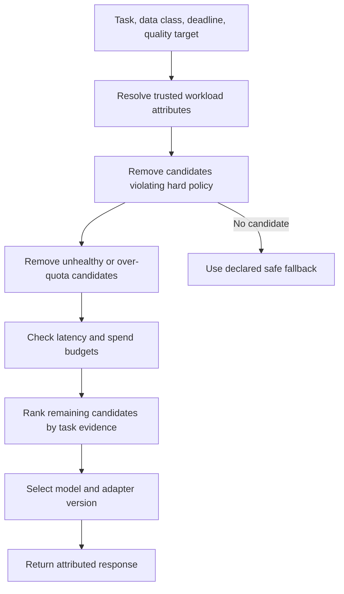
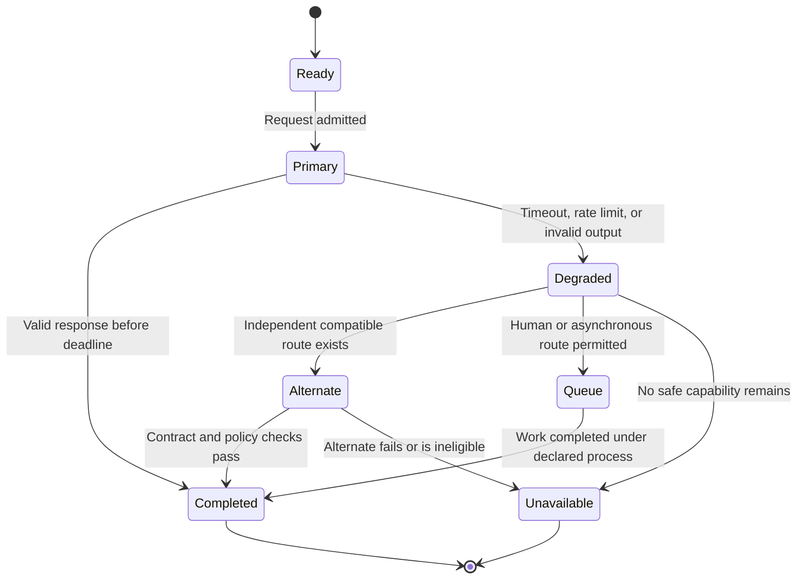
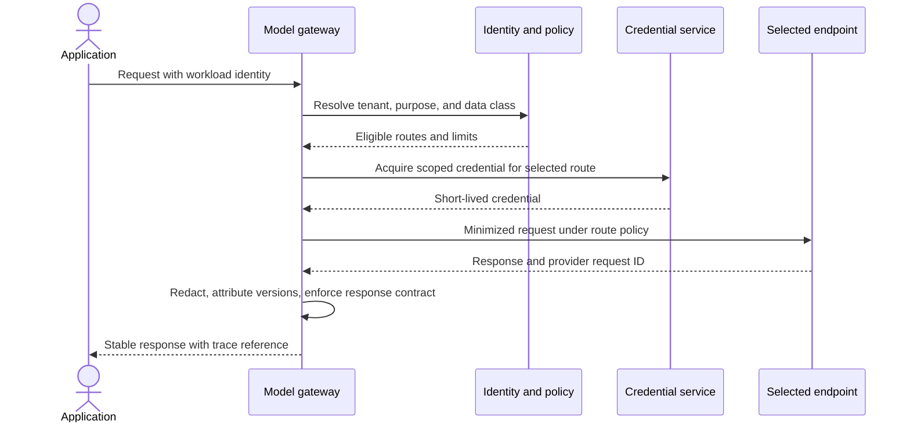
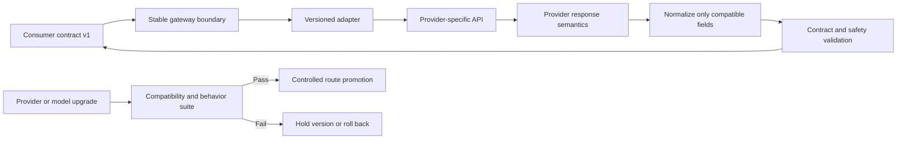

# Model Gateway, Routing, and Fallback Architecture

Part: [17 — AI Architecture](PART_OVERVIEW.md)

A model gateway provides a workload-facing contract across one or more model endpoints. It can centralize authentication, policy-aware routing, request limits, version attribution, and fallback behavior. It is not automatically a general-purpose Application Programming Interface (API) Gateway: Part 08 owns API gateway architecture, while this chapter focuses on model-specific routing, provider adapters, and capability-preserving degradation.

## Define the Gateway Boundary

Place the gateway where multiple consumers need common model controls or where routing decisions must remain independent from application code. A thin adapter may be enough for one workload. A shared gateway becomes valuable when it enforces consistent budgets, residency, model attribution, or credential handling across teams. It becomes harmful when it accumulates business logic, hides provider differences, or creates an unbounded central dependency.

```mermaid
flowchart LR
    ConsumerA[Product workflow A] --> Gateway[Model gateway]
    ConsumerB[Product workflow B] --> Gateway
    Gateway --> Auth[Identity and workload policy]
    Gateway --> Router[Model and provider router]
    Router --> AdapterA[Provider adapter A]
    Router --> AdapterB[Self-managed runtime adapter]
    Router --> Specialized[Specialized task service]
    Gateway --> Telemetry[Versioned request metadata]
```

Keep the stable contract narrow: task intent, allowed inputs, response shape, deadline, privacy class, and required quality tier. Provider-specific controls such as tool schemas, context limits, streaming behavior, and safety parameters may not map one-to-one. The adapter should expose incompatibility rather than silently flattening materially different semantics.

## Route on Explicit Policy

Routing can consider task type, data classification, region, availability, quality tier, cost budget, and measured capability. Resolve hard constraints first, then optimize preferences among eligible candidates. A cheap model must not receive data it is not allowed to process; a high-quality model must not bypass a tenant or safety boundary. Record the policy inputs and selected model version for each decision.

Do not rely on model self-reported capability or a static vendor ranking. Maintain task-specific evaluation evidence and route only among candidates that pass release gates. Routing policies need an owner, review cadence, change history, and a way to roll back a bad rule without redeploying every consumer.

## Make Fallback Capability-Preserving

Fallback should preserve the caller's contract while honestly reducing capability. It may return a cached answer with age, defer work to a human queue, switch to a compatible model, use deterministic rules, or declare the task unavailable. A secondary provider is not a valid fallback if it shares the same quota, region, network, policy, or data-retention failure.

Retries consume the original deadline and spend budget. Use bounded retry rules for transient errors, avoid retrying non-idempotent actions, and include jitter or admission control to prevent synchronized request storms. Preserve the original failure in telemetry even when fallback succeeds; otherwise degraded operation looks indistinguishable from the primary path.

## Protect Credentials and Tenant Context

The gateway should obtain credentials from managed identity or a secret boundary and select credentials only after resolving trusted workload and tenant context. Do not accept arbitrary endpoint URLs, provider keys, or region overrides from a caller. Redact or minimize content in gateway logs, and ensure telemetry does not become a shadow prompt store.

Provider credentials should not be returned to consumers. Rotate credentials and audit access separately from model prompt content. If the gateway is shared across tenants, enforce tenant context in authorization, quota, caching, and trace correlation; an application-supplied tenant string is not sufficient proof of identity.

## Preserve a Stable Contract Without Hiding Change

An adapter translates request and response shapes, but cannot guarantee semantic equivalence. A provider migration may change tokenization, tool-call behavior, refusal style, context handling, streaming order, or output variance. Version the workload contract and adapter independently; test each candidate against contract, safety, quality, latency, and cost gates before routing real traffic.

Avoid a lowest-common-denominator contract that strips capabilities every workload needs. Prefer explicit capability negotiation or separate task contracts for materially different behavior. Publish deprecation dates and migration evidence so consumers can move without a surprise provider switch.

## Worked Case: Customer Support Summary

Several support products summarize case history, but one handles sensitive health-related requests and another serves public product questions. The gateway derives data class from trusted application identity, excludes public endpoints for restricted cases, and routes only among candidates that passed summary-quality and leakage tests. Both callers receive the same stable fields: summary, source references, model version, and a status indicating complete, deferred, or unavailable.

When the primary service reaches its quota, the gateway checks whether an independent, policy-compatible candidate remains within the deadline. If not, it queues the case for human handling rather than sending restricted content to a public model. Routing outcomes preserve provider request IDs and failure causes while avoiding raw prompt logging. A gradual release compares quality and correction work before expanding traffic.

## Review Questions

1. Which shared responsibilities justify a model gateway rather than a local adapter?
2. How are hard policy constraints separated from routing preferences?
3. What dependencies make two apparent providers a shared failure domain?
4. Which provider semantics cannot be hidden behind a stable contract?
5. How can fallback success remain visible as degraded operation?

A model gateway is useful when it centralizes controls that consumers should not reinvent. Keep the boundary narrow, route only among eligible and evaluated candidates, protect credentials and tenant context, and make every fallback visible to the caller and operator.
