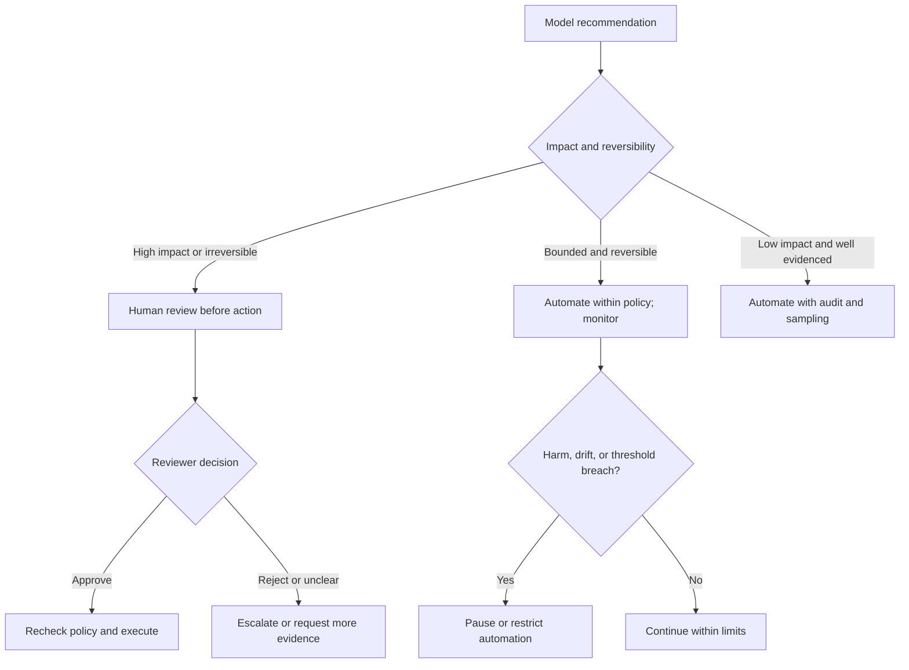
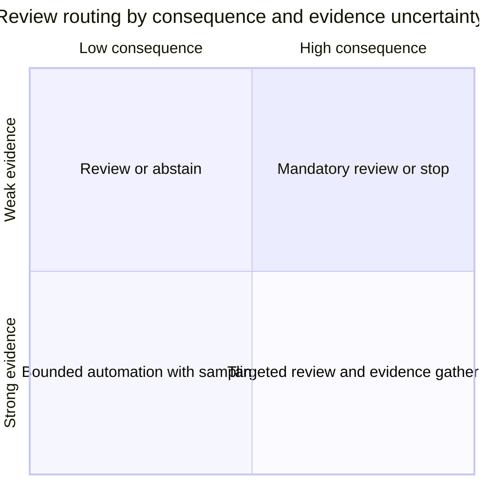
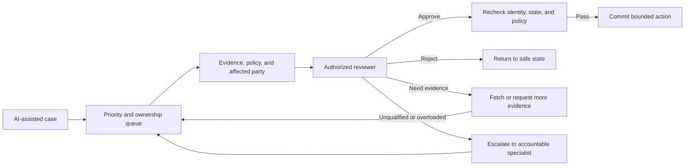
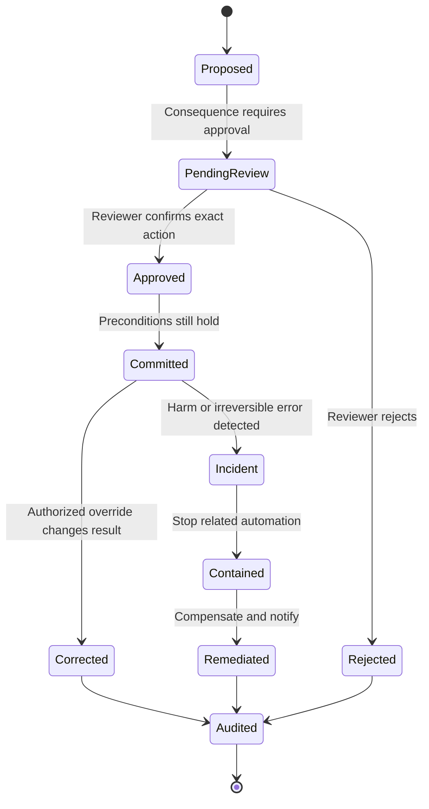
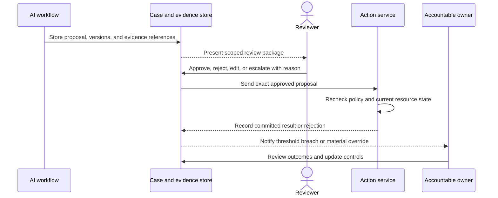

# Human Oversight and AI-Assisted Workflow Integration

Part: [17 — AI Architecture](PART_OVERVIEW.md)

Human oversight is an architectural control, not a checkbox added after model selection. The workflow must place people where they can meaningfully detect, correct, or stop harmful outcomes, while making review capacity and accountability explicit. The model may recommend; the application and authorized people determine which actions can occur.

Part 16 owns evaluation and guardrail techniques. Part 15 owns security controls, and Part 23 owns broader communication and collaboration skills. This chapter focuses on the system placement of review, escalation, override, and evidence.

## Choose the Human Role

Human-in-the-loop means a person reviews or approves before a consequential action. Human-on-the-loop means a person monitors an automated process and can intervene. Human-out-of-the-loop means no person participates in the operational decision path. These labels are not sufficient by themselves: specify the exact authority, timing, workload, information, and response opportunity.

Use pre-action review when errors can cause material harm and a person can assess the evidence before commitment. Use monitoring and intervention when actions are bounded, reversible, and too frequent for individual review. Avoid nominal oversight where a person sees only a score, must approve an unmanageable queue, or cannot stop the system.

Select the level using consequence, reversibility, uncertainty, scale, and available reviewer expertise. Reassess when the workflow changes. A model update or a new tool action can move a previously low-risk use case into a higher-impact category.

## Route Review by Evidence and Consequence

Confidence scores are not calibrated authority. They may support triage only after validation on the relevant population and task. Combine model uncertainty with consequence, data quality, policy rules, and disagreement signals. A high-confidence recommendation can still require review for a high-impact action; a low-confidence, low-impact result may be handled through a clarifying question rather than a costly escalation.

Define thresholds and exceptions in policy, not in ad hoc prompt text. Validate them against false acceptance and unnecessary escalation rates, reviewer capacity, and subgroup effects. If no trustworthy uncertainty signal exists, route based on consequence and observable input conditions rather than inventing a confidence threshold.

## Design the Review Queue and Interface

A review request should contain the proposed action or conclusion, relevant source evidence, uncertainty or known limitations, policy criteria, affected person or resource, and the consequence of approving. Show what the model did not inspect, stale or missing inputs, and any conflict. The reviewer should be able to approve, reject, request evidence, edit within safe bounds, or transfer ownership.

Queue design is a capacity problem. Estimate arrival rate, service time, coverage windows, priority rules, and aging behavior. If the queue exceeds a threshold, the system should reduce intake, route to a deterministic process, or declare delay; it should not quietly convert human review into rubber-stamp approval. Track reviewer workload and time-to-decision as quality and safety signals.

## Make Override and Rollback Real

An override must be executable, not merely recorded. It may cancel a pending action, revoke a generated recommendation, restore prior data, reverse a reversible operation, or initiate a compensation workflow. Some effects cannot be undone; in those cases, the architecture needs containment, notification, remediation, and accountable incident ownership.

Keep approval and execution separate enough to recheck state immediately before commitment. When a reviewer changes a recommendation, preserve the original and corrected values with reason codes; do not overwrite evidence. A rollback plan should name the action owner, affected scope, time limit, and what cannot be restored.

## Preserve Accountability and Feedback

The system should identify who owns the workflow, who approves a specific action, who operates the model path, and who responds to harm. Logging only “human approved” obscures who acted and what they saw. Record reviewer identity, role, decision, timestamp, evidence references, policy version, model and prompt version, and whether the executed action matched the approved proposal.

Feedback should improve the system without treating every override as a new training label. Some overrides reflect policy changes, missing evidence, reviewer preference, or model error. Classify the cause, protect personal data, and use reviewed examples for evaluation or training only under the appropriate governance process.

## Worked Case: Fraud Alert Investigation

A transaction-monitoring model ranks alerts for analysts. Low-risk alerts can be prioritized automatically, but account closure and funds holds require an authorized analyst and policy checks. The review view shows transaction history relevant to the alert, the rule or evidence that contributed, known missing data, and the exact proposed action. Analysts can dismiss, request more evidence, or escalate; a model score alone cannot freeze an account.

If the queue is overloaded, the system applies a documented priority and service-level rule, not a lower approval threshold. Overrides are categorized as false alert, missing context, policy exception, or model issue. A material increase in false alerts triggers recalibration or rollback, while a high-impact missed case initiates incident review. The architecture distinguishes the analyst's decision from the model's ranking and preserves both in the audit trail.

## Review Questions

1. Which decisions require pre-action review, and why is monitoring alone insufficient?
2. What information lets a reviewer disagree with the model?
3. How does queue overload change the system's behavior?
4. Which effects can be reversed, and how are irreversible errors contained?
5. Which human decisions are valid feedback for evaluation or training?

Human oversight works when authority, evidence, capacity, and intervention are designed into the workflow. Route review by consequence and evidence, make override operational, and preserve accountability without treating human approval as a substitute for policy enforcement.
