# Human Oversight and AI-Assisted Workflow Integration

Part: [17 — AI Architecture](PART_OVERVIEW.md) · Status: Revised (in-depth rewrite)

## 1. Introduction

Most production AI systems that matter involve a person somewhere. A model drafts a clinical note and a clinician signs it. A classifier scores a loan application and an underwriter decides. A moderation model flags a post and a trust-and-safety agent removes it or restores it. A software agent proposes a database change and an engineer approves it. The question for an architect is rarely whether to involve a person. The question is where the person sits, what the person can see, what the person is allowed to do, how many cases the person can honestly handle, what happens after the person decides, and how anyone later reconstructs what happened.

Oversight is easy to claim and hard to deliver. A process diagram with a box labelled "human review" proves nothing about whether the human can detect an error. A reviewer who sees only a recommendation and an Approve button, who has forty seconds per case, who has approved ninety-eight of the last hundred cases, and who will be measured on throughput, is not an oversight mechanism. That reviewer is a signature collector. The system around such a reviewer has the legal and reputational appearance of control and none of the error-catching function. This chapter treats oversight as an engineered subsystem with inputs, capacity, failure modes, measurements, and an owner.

After reading this chapter you should be able to:

- Explain what human oversight is for, separate its four purposes (catching errors, assigning accountability, conferring legitimacy, and producing learning), and say what oversight cannot do.
- Use the vocabulary precisely (human-in-the-loop, human-on-the-loop, human-out-of-the-loop, human-in-command) and attach decision rights to each.
- Choose an automation level for a decision using an impact-by-reversibility matrix and revisit it when conditions change.
- Derive a review threshold from error costs and review capacity, and run the arithmetic.
- Design a review queue: prioritization, service-level agreements (SLAs), sampling, batching, assignment, expiry, escalation tiers, and four-eyes (two-person) control.
- Size a reviewer team with Little's Law and an Erlang C model, and predict what happens when handling time or arrival rate moves.
- Recognize automation bias, complacency, anchoring, and rubber-stamping, and design countermeasures that are measurable.
- Design the review interface so that evidence, uncertainty, and the exact action are visible, and avoid patterns that manipulate the reviewer.
- Define who may reject, edit, override, and escalate, what each action triggers, and what recourse affected people have.
- Pick among integration patterns (draft-and-edit, suggest-and-confirm, propose-and-approve, act-and-notify with undo, and sampled audit of autonomous actions).
- Design handoffs from agents and chat to humans, rollback and compensation for AI-initiated actions, and an audit trail with a named accountable owner.
- Capture reviewer feedback for evaluation and improvement without creating feedback loops, and run quality assurance on the reviewers themselves, including inter-reviewer agreement with kappa.
- Plan workforce, ergonomics, fatigue, and wellbeing, especially for harmful content.
- Monitor oversight health and detect oversight decay.
- Map regulatory requirements for human oversight (the European Union Artificial Intelligence Act, called the EU AI Act below, and sector rules) to concrete design features.
- Weigh the cost and benefit of oversight with numbers, and apply it to three worked designs: loan pre-screening, a clinical documentation assistant, and content moderation.

### 1.1 Why an architect owns this

Oversight is an architectural concern because its effectiveness is set by decisions made well before a reviewer opens a case. The recommendation payload decides what the reviewer can see. The routing policy decides how many cases reach reviewers. The queue and the staffing decide how much time each case receives. The permission model decides whether a reviewer's rejection actually stops an action. The log schema decides whether an auditor can ever tell what the reviewer saw. A product manager can request "human in the loop," and a model team can supply a confidence score, but neither controls the cross-cutting design that makes the loop meaningful. The solution architect is the person positioned to hold these pieces together.

There is also a risk-transfer reason. When an organization puts a person in a decision path, it transfers some responsibility to that person. If the system makes it practically impossible for the person to exercise that responsibility, the organization has transferred blame without transferring control. Courts, regulators, and employees increasingly recognize this pattern. The architect's job includes making sure the transfer is honest.

### 1.2 Scope and ownership

This chapter owns the placement and operation of human review around consequential AI recommendations and actions. Several neighbouring chapters own related material, and this chapter recaps and links instead of re-teaching it.

| Topic | Owner | What this chapter does with it |
| --- | --- | --- |
| Governance principles, risk tiers, impact assessment, accountability, recourse lifecycle | [Part 16 CH31: Responsible AI and Safety Governance](../16_AI_and_GenAI/CH31_Responsible_AI_and_Safety_Governance.md) | Recaps the human-authority principle in Section 2 and builds the system controls that carry it out |
| Agent approval services, executor authority, identity binding, tool tiers | [Part 17 CH06: Agentic System Architecture and Tool Boundaries](CH06_Agentic_System_Architecture_and_Tool_Boundaries.md) | Recaps in Section 15 and Section 17 and focuses on the human side of the approval, not the service mechanics |
| Policy enforcement, guardrails, privacy and security controls, incident response | [Part 17 CH12: AI Safety, Security, Privacy, and Governance Architecture](CH12_AI_Safety_Security_Privacy_and_Governance_Architecture.md) | Treats enforcement as a dependency and says what oversight needs from it |
| Evaluation harness, online quality, traces, feedback correlation | [Part 17 CH11: Evaluation and Observability Architecture for AI Systems](CH11_Evaluation_and_Observability_Architecture_for_AI_Systems.md) | Defines oversight-specific metrics and feedback records that feed that harness |
| Model release, canary, rollback | [Part 17 CH10: AI Platform and Model Lifecycle Architecture](CH10_AI_Platform_and_Model_Lifecycle_Architecture.md) | Explains how a silent model change breaks oversight calibration |
| Reliability patterns, degradation | [Part 17 CH13: Reliability and Resilience Patterns for AI Workloads](CH13_Reliability_and_Resilience_Patterns_for_AI_Workloads.md) | Uses degradation modes when the review queue saturates |

Part 16 CH31 owns the statement that high-impact systems need meaningful human authority, risk-tiered approval, stop controls, and recourse. Part 17 CH06 owns the approval service for agent tools: how an approval is bound to the exact action digest, how it expires, and how the executor checks it. Part 17 CH12 owns enforcement: the policy engine that ultimately refuses a disallowed action regardless of what any person or model says. This chapter owns what sits between those: the reviewers, the queue, the interface, the routing, the evidence, and the measurement of whether the human part works.

### 1.3 A running example

To keep the arithmetic concrete, the chapter uses a document-classification workload in several sections. A model classifies incoming insurance claims documents into "pay," "deny," and "needs investigation." The business processes 10,000 documents per day. A wrong automatic decision that reaches a customer costs on average 200 currency units (rework, complaint handling, leakage, and occasional legal exposure). A human review costs 4 units fully loaded. A reviewer fixes a model error 90 percent of the time. These numbers are illustrative. They are chosen to make the arithmetic readable and the trade-offs visible. Real values come from your own cost accounting, and Section 24 shows how to estimate them.

## 2. What Oversight Is For, and What It Is Not

A design that cannot say what the human is for will produce a human who does nothing useful. There are four distinct purposes, and each demands a different design.

### 2.1 Error catching

The first purpose is to catch model errors before they cause harm. This is the purpose people think of first. It demands that the reviewer have information the model lacked or interpreted poorly, enough time to use it, and the authority to stop the outcome. It also demands that reviewers be independent enough from the model's output that they notice when it is wrong. A reviewer who sees only the model's conclusion has a weak basis for disagreement because the cheapest path is to accept it.

Error catching has a measurable form. Of the model errors that arrive in the review queue, what fraction does the reviewer fix? That is the catch rate. The running example assumes 0.90. If it is 0.60 in practice, the economics in Section 7 change a lot, and if it is near zero the review is decoration.

### 2.2 Accountability

The second purpose is to ensure that a named, competent person or role answers for a decision. Models cannot be held responsible. A fraud analyst who approves an account freeze can be asked why. An engineer who approves a production change can be asked what they checked. Accountability demands identity, role, authority, and a record. It does not demand that the person independently re-derive every decision. It does demand that the person had a real opportunity to understand and refuse, because accountability without that opportunity is unfair to the person and unreliable for the organization.

Accountability also has a failure mode that review designers rarely discuss: diffusion. When the model proposes, the reviewer approves, the manager signs off on the process, and the vendor supplies the model, each party may believe another is the real decision maker. A good design names one accountable owner per decision class and states what that owner is accountable for.

### 2.3 Legitimacy

The third purpose is legitimacy. Some decisions are accepted by affected people, by regulators, or by the public only if a person decided. This holds even when the model would, on average, be more accurate. A custody recommendation, a benefit denial, a firing, a medical diagnosis delivered to a patient, and a criminal sentence are examples where the acceptability of the decision depends partly on who made it and whether the affected person could be heard. Legitimacy shapes where a human must be present independent of model accuracy. It also means that a human who simply relays a model decision does not supply legitimacy. The affected person, the court, or the regulator will ask whether the person actually decided.

Legitimacy needs different design features from error catching. It needs a path for the affected person to be heard, a reason that can be communicated, and a decision maker with authority to depart from the model. Section 14 covers contesting and recourse.

### 2.4 Learning

The fourth purpose is learning. Reviewer decisions are one of the best sources of labeled data about where the system fails. Each override, edit, and escalation is a signal about the model, the policy, the data, or the interface. A design that treats reviewers only as a gate wastes that signal. A design that treats every reviewer action as ground truth corrupts the evaluation set, because reviewers make mistakes, hold varying standards, and are influenced by what the model showed them. Section 19 covers how to capture feedback usefully and avoid circular reasoning.

### 2.5 What oversight is not

Several beliefs about oversight lead to bad designs.

Oversight is not a substitute for policy enforcement. A reviewer can be tired, tricked, or wrong. Hard limits (maximum refund, forbidden data fields, blocked recipients) belong in deterministic code that checks the action no matter who approved it. Part 17 CH12 owns that enforcement layer. A reviewer approval narrows nothing and widens nothing about what the policy engine allows.

Oversight is not a fix for a bad model. If a model's error rate is 30 percent on a class of cases, routing everything to reviewers does not fix it. It converts a model problem into a staffing problem and typically produces rubber-stamping. Oversight handles residual error. It does not replace evaluation and improvement.

Oversight is not a throughput control that can be tuned without consequences. Lowering the review rate to save cost changes the error profile. Raising the review rate without raising staffing changes the time per case, and that changes the catch rate. These effects are coupled, and Section 9 and Section 10 quantify them.

Oversight is not the same as transparency. Showing the user that "AI was used" does not give anyone the power to stop or correct the outcome. Disclosure and control are separate features.

Oversight is not a single event. A pre-action approval is one form. Monitoring, sampling, appeal, and post-hoc audit are other forms. A mature design uses several, each covering the weaknesses of the others.

Oversight is not free of harm to the reviewer. Review work can be monotonous, stressful, or traumatic. A design that ignores the reviewer's wellbeing will lose its reviewers or degrade their performance. Section 21 covers this.

### 2.6 Recap of the governance principle

Part 16 CH31 states the governance principle that high-impact AI systems require meaningful human authority, risk-tiered approval, stop controls, and recourse. The word "meaningful" does the work. Meaningful oversight means the human has the information, competence, time, and authority to change the outcome, and the system behaves differently when the human disagrees. This chapter turns that principle into design requirements, and the checklist in Section 31 lets a design reviewer test whether each requirement is met.

## 3. The Vocabulary and Decision Rights

The standard terms are useful as labels for a first conversation. They are not specifications. Each term needs attached decision rights before it describes a design.

### 3.1 The four terms

**Human-in-the-loop** (HITL) means a person takes part in each decision before it takes effect. The person approves, rejects, or edits the specific case. The system waits. Throughput is bounded by reviewer capacity. HITL fits decisions with high impact, low reversibility, or a legal requirement for individual human decision.

**Human-on-the-loop** (HOTL) means a person supervises an automated process and can intervene, but does not touch each case. The system acts, and the person watches dashboards, samples results, and can pause or change behavior. Throughput is not bounded by reviewer capacity, but the ability to prevent harm is bounded by how quickly the person notices and how quickly a stop takes effect. HOTL fits bounded, reversible, or high-volume decisions.

**Human-out-of-the-loop** (HOOTL) means no person participates in the operational decision path. People still design, test, deploy, and audit the system, and some person owns it. Out of the loop describes the operating moment, not the lifecycle. HOOTL fits low-impact, easily reversible, well-evidenced decisions, such as spam filtering of obvious bulk mail or cache warming.

**Human-in-command** (HIC) means a person or body retains authority over whether and how the system is used at all: the power to decide when to deploy, restrict, pause, or retire the system, and to set its limits. The term appears in European policy discussions of trustworthy AI. In architecture terms it means an accountable owner holds a kill switch, a scope-change approval, and a review of the system's performance at defined intervals. HIC sits above the others. A HOOTL system still needs a human in command.

### 3.2 Why the labels are not enough

Two systems can both be labelled "human-in-the-loop" and differ by orders of magnitude in real oversight. One shows a reviewer the source documents, the model's reasoning summary, the policy criteria, and the exact action, with fifteen minutes per case and the authority to reject without penalty. The other shows a score and an Approve button with thirty seconds per case and a throughput target. Both are HITL. Only the first is meaningful.

The same applies to HOTL. A dashboard that no one checks outside business hours does not allow intervention during a weekend incident. A stop control that needs a change ticket does not stop anything within the harm window.

### 3.3 Decision rights

For each human role in a workflow, write the decision rights as a short specification. The following dimensions cover most cases.

| Dimension | Question | Example answers |
| --- | --- | --- |
| Trigger | What brings a case to this person? | Every case, below-threshold confidence, random sample, policy rule, user complaint |
| Information | What can they see? | Source evidence, model output, uncertainty, policy text, history, affected person's statement |
| Actions | What can they do? | Approve, reject, edit within bounds, request evidence, escalate, defer |
| Authority | What can they decide alone? | Amounts up to a limit, reversible actions, nothing above tier 1 |
| Time | How long do they have? | Case SLA, expiry, maximum review length, cooling-off period |
| Consequence | What happens after each action? | Execute, return to safe state, route to tier 2, notify the affected person |
| Independence | Who must not review? | The requester, the author of the prompt, anyone with a conflict |
| Accountability | What do they answer for? | Accuracy of their decision, adherence to procedure, escalation when unsure |

A decision-rights table written per role is more useful in a design review than a diagram that says "human review." It also exposes absurd combinations early, such as a reviewer who is accountable for outcomes but has no authority to reject, or one who has authority but not enough information.

### 3.4 Decision rights across the roles

Most workflows involve more than one human role. Distinguishing them avoids confusion in incidents.

The **requester or subject** is the person the decision affects or the person who initiated the task. They may be able to edit the input, provide evidence, or contest the outcome.

The **first-line reviewer** handles ordinary cases within defined authority.

The **specialist or second-tier reviewer** handles escalations, ambiguous cases, and cases above first-line authority.

The **approver for four-eyes control** is an independent second person who must confirm certain actions. Section 8.7 covers this.

The **workflow owner** is accountable for the process outcomes, staffing, and the metrics in Section 22.

The **model owner** is accountable for model behavior, calibration, and changes. The model owner is a different role from the workflow owner in most organizations, and the two often disagree about where an error originated. The audit trail in Section 18 exists partly to settle that question with evidence.

The **human in command** is the executive or committee that can approve, restrict, or retire the capability. This role may sit on a risk committee that meets quarterly, with an operational delegate who holds the kill switch.

### 3.5 A decision-rights example

Consider the insurance claims workflow in the running example. A written decision-rights statement for the first-line claims reviewer might read as follows.

Trigger: every claim classified "deny," every claim with calibrated confidence below 0.95, and a random 2 percent sample of auto-approved claims. Information: the claim file, the extracted fields with source highlights, the policy clauses the model cited, the model's proposed decision and confidence band, and the customer's prior claims. Actions: approve, change the decision, request documents, escalate to the specialist. Authority: up to 25,000 currency units. Time: 20 minutes target, escalation if open longer than 4 working hours. Consequence: approve and change trigger a payment or denial letter after a policy recheck, and escalate moves the case to tier 2. Independence: the reviewer cannot review claims where they are the policyholder, a relative, or a claimant in the same period. Accountability: accuracy measured by sampled audit and canary cases, not by throughput.

This statement is short and testable. Each line maps to a control in the system: the routing rule, the evidence payload, the permission model, the timer, the action service, and the metric definitions.

## 4. Automation Levels versus Impact

A decision about how much to automate should come from the impact of an error and the ability to recover, not from enthusiasm about the model. The standard way to organize the choice is to cross the level of automation with the impact of the decision.

### 4.1 A ladder of automation levels

A useful ladder has six rungs. The ladder is adapted from the long-running human factors literature on levels of automation (for example, Sheridan and Verplank's 1978 scale, later refined by Parasuraman, Sheridan, and Wickens in 2000), simplified for AI-assisted workflows.

1. **Inform.** The system presents information or a ranked list. The human makes the decision from scratch. Example: a search results page of similar past cases.
2. **Suggest.** The system proposes one or more options with evidence. The human chooses and acts. Example: a draft reply the agent may use or discard.
3. **Propose and approve.** The system prepares the full action. A human must approve before it executes. Example: a refund prepared by an agent that waits for a supervisor.
4. **Act and notify with undo.** The system acts within limits, tells a person, and offers a bounded window to reverse. Example: an automatic reclassification of a support ticket, reversible for 24 hours.
5. **Act and sample.** The system acts autonomously. A sample of actions is audited after the fact. Example: auto-approval of small claims with a 2 percent audit.
6. **Act and monitor.** The system acts autonomously. A human watches aggregate behavior and can pause. Example: an anti-spam filter.

Rungs 1 and 2 leave the decision with the human and use the model as an aid. Rung 3 is classical human-in-the-loop. Rungs 4 to 6 are progressively more autonomous and correspond to human-on-the-loop and, in the limit, out-of-the-loop for operations.

### 4.2 The impact axis

The impact of a decision has several parts, and a single "high, medium, low" rating hides them. Consider these:

- **Severity.** How bad is the harm to a person or the organization if the decision is wrong? Denial of medical care and a mislabelled newsletter are far apart.
- **Reversibility.** Can the effect be undone, how fast, and at what cost? An email sent to a customer cannot be unsent. A database field can be restored.
- **Scale.** How many people or records are affected by one error or one burst of errors? Automation can repeat the same error ten thousand times before anyone looks.
- **Breadth of the affected population.** Does the error fall equally on everyone or disproportionately on a group? Part 16 CH31 owns the fairness assessment. Here the architecture question is whether the review design can surface subgroup effects.
- **Detectability.** Will the error be noticed soon without extra effort? A wrong tax filing might surface a year later.
- **Legal and regulatory status.** Some decisions carry a legal requirement for human involvement or for a right to human review. Section 23 covers these.

Rate each part and take the worst as the impact tier, not the average. A reversible, low-severity, wide-scale decision is still wide-scale.

### 4.3 The matrix

The matrix below suggests a default maximum automation rung for each impact tier. The defaults are a starting point for the conversation. Evidence of model quality, review capacity, and regulatory constraints move the decision.

| Impact tier | Typical features | Default maximum rung | Typical controls |
| --- | --- | --- | --- |
| Critical | Irreversible or life, liberty, or livelihood effects, or legally restricted | Rung 2 or 3 | Pre-action individual review by a qualified person, four-eyes for the most severe, right to contest |
| High | Material harm, hard to reverse, or affects a protected class | Rung 3 | Pre-action approval, evidence display, sampling of approvals, stop control |
| Medium | Moderate harm, reversible within a window | Rung 4 | Undo window, notification, review of low-confidence cases, sampled audit |
| Low | Minor, easily reversible, local | Rung 5 | Sampled audit, anomaly monitoring |
| Minimal | Trivial or internal, high volume | Rung 6 | Aggregate monitoring, periodic review |

The matrix is a ceiling. A system with a weak model, an unfamiliar population, or an inexperienced team operates at a lower rung. A system can move up a rung only with evidence: audited escape rates within tolerance over a stated period, a validated calibration, and an agreed rollback.

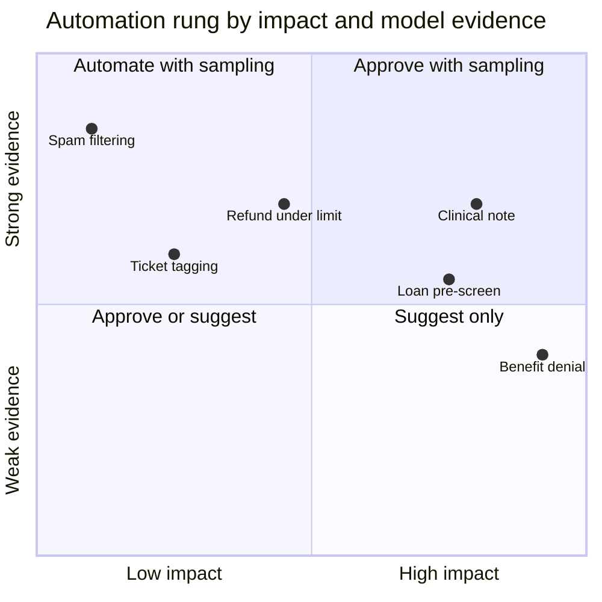

The quadrant chart shows how two inputs jointly drive the choice. Strong evidence on a low-impact decision allows heavy automation. Weak evidence on a high-impact decision restricts the model to suggestions. The upper-right region is the one that causes the most debate: strong evidence for a high-impact decision. Here the architecture often still requires individual review, because evidence on average accuracy does not remove the harm from the individual errors that remain, and because accountability and legitimacy purposes persist. The positions in the chart are illustrative placements, not measured data.

### 4.4 Choosing a level step by step

A practical procedure for a design workshop follows.

1. **Name the decision.** State what is decided, by whom today, and what changes in the world when it is decided.
2. **Rate impact on each part** from Section 4.2 and take the worst.
3. **Look up the ceiling** in the matrix.
4. **Check legal constraints.** If a rule requires individual human decision, the ceiling is rung 3 or lower regardless of the matrix.
5. **Assess evidence.** Ask what the offline and online evaluations say about error rate on the real population, whether confidence is calibrated, and how stable the model is. Weak evidence lowers the rung.
6. **Check capacity.** Compute the reviews per day the chosen rung needs and compare with staff available (Section 9). If capacity is short, the options are to add staff, narrow the scope, route by risk to a cheaper path, or lower the rung. Quietly raising the approval rate is not an option.
7. **Define the demotion rule.** State in advance what evidence moves the decision down a rung, such as an audited escape rate above a limit, a drift alarm, or a model change.
8. **Write the decision as an ADR** (architecture decision record) with the alternatives rejected.

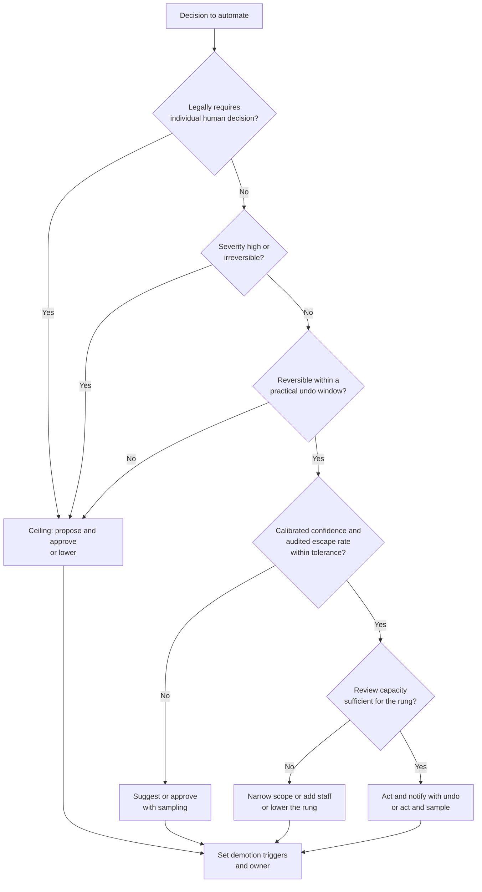

The decision tree turns the matrix into a sequence of questions, and each "no" lands on a more conservative rung. Two features matter. First, the capacity question is explicit: a design that needs more reviews than the team can perform has to change before launch. Second, every branch ends in a demotion rule, because the right rung today is not necessarily the right rung after a model update, a change in the user population, or a new tool.

### 4.5 Rungs are per action, not per product

A single product usually contains several decisions at different rungs. An email assistant may auto-label messages (rung 6), propose a reply draft (rung 2), and send a reply only after confirmation (rung 3) or send acknowledgments on a schedule with an undo window (rung 4). An agent that reads data, drafts a change, and applies it to production spans rungs 1 to 3 within one session. Assign the rung to each action type, and enforce it at the action service, not in the prompt. Part 17 CH06 describes tool tiers, which are the enforcement form of this assignment.

### 4.6 When a model update changes the rung

Moving to a new model version, a new prompt, a new retrieval corpus, or a new tool can shift error rates and calibration in ways that a casual release process will miss. The rung that was justified by six months of audited evidence on the old version is not justified by a smoke test on the new one. Treat a change to anything in the decision path as a trigger to re-evaluate the rung: either keep the new version at the lower rung until it earns evidence, or run it in shadow mode (computing outputs without acting) and compare. Part 17 CH10 describes canary releases, and Section 25 covers the silent-update failure scenario.

## 5. Routing Cases to Humans: Uncertainty and Consequence Signals

Routing decides which cases reach a person and which proceed without one. It sits between the model output and the queue. Good routing sends reviewers the cases where a human adds the most value per minute of attention, and it never lets low-evidence, high-consequence cases through on the strength of a single number.

### 5.1 Two independent axes

Routing uses two kinds of signals that should be kept separate in the design.

**Evidence signals** estimate how likely the model output is to be wrong. They come from the model, the input, and the surrounding checks.

**Consequence signals** estimate how bad it is if the output is wrong. They come from the business context: the amount of money, the type of action, the customer's status, the reversibility, and regulatory flags.

Neither axis alone is sufficient. A model that is 99 percent confident about a 5-million-unit transfer still warrants review because the cost of the one-in-a-hundred error is large. A model that is 60 percent confident about which of three newsletter templates to use does not need a human at all, because the cost is tiny and a wrong pick is trivial to correct. The routing rule combines both, and the decision of how is a policy owned by the workflow owner, not a model hyperparameter.

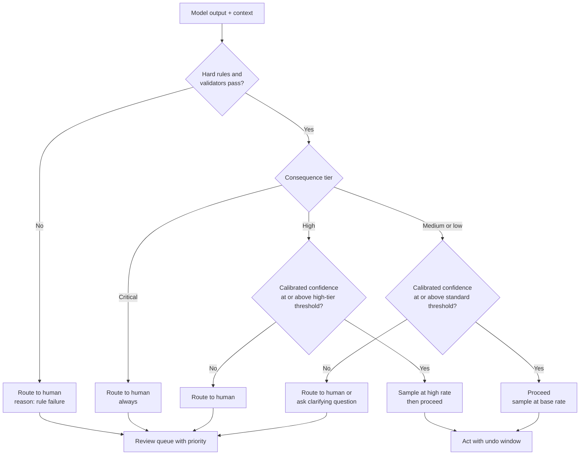

The diagram shows hard rules first, consequence second, and confidence third. Hard rules come first because they are cheap, deterministic, and explainable, and they catch cases a statistical signal can miss (a payee on a sanctions list, a missing mandatory field). Consequence comes before confidence because the consequence tier decides which confidence threshold applies, or whether any threshold applies at all. Every path that skips review still passes through sampling, which gives the system a measurement of what the automatic path gets wrong. Without that sample there is no evidence about the automatic path, and the confidence threshold cannot be validated.

### 5.2 Sources of uncertainty signals

For a classical classifier, the main signal is the predicted class probability, after calibration. For generative and agentic systems, usable signals are more varied and less reliable. Common ones follow.

**Calibrated class probability.** For a classifier or scorer with a validated calibration (Part 16 CH03 Section 8 and Part 16 CH06 Section 7 teach calibration), the probability of the predicted class is the primary signal. It is only as good as the calibration set's resemblance to production.

**Token log-probabilities.** For a generative model that exposes them, the probabilities of the chosen tokens in a short constrained answer (for example, a label or a yes/no) can be a useful uncertainty signal. For long free-form text they correlate weakly with factual correctness, because fluent text can be low-perplexity and wrong. Not every hosted model exposes log-probabilities, so check the provider's current documentation.

**Verbalized confidence.** Asking a model "how confident are you" produces a number that is cheap to get and is usually poorly calibrated, often clustering at high values. It may carry some signal on some tasks, but it must be calibrated against labeled outcomes on your task before it drives routing. Treat any such number as an input feature to a calibration step, not a probability.

**Agreement across samples or models.** Run the model several times with sampling, or run two different models, and measure agreement. Disagreement is a useful signal for routing and is usually better ranked than self-reported confidence. Cost grows with the number of runs, so it is typically reserved for medium and high consequence cases.

**Grounding and evidence coverage.** For retrieval-based systems (Part 17 CH05), check whether each claim in the output is supported by retrieved passages, how strong the retrieval scores are, and whether the answer cites sources. Low coverage is a strong routing signal for "needs a person".

**Distance from the training or calibration distribution.** Embedding-space distance to known cases, input length outliers, rare languages, unusual formats, and new customer segments are signals that the calibration may not hold. Out-of-distribution inputs deserve a lower trust in the confidence score, which is a reason to route them for review regardless of score.

**Validator and tool results.** Schema validation, arithmetic cross-checks, reference-data lookups, and consistency checks between extracted fields all produce binary signals that are far more reliable than model self-assessment. A model-extracted invoice total that does not equal the sum of line items is a routing trigger.

**Input quality.** Poor scans, truncated documents, missing attachments, or conflicting sources should reduce automation even when the model sounds sure. A reviewer can request the missing evidence; the model cannot.

**Conformal prediction sets.** Part 16 CH06 Section 8 teaches conformal prediction. A conformal set with more than one label, or an empty set, is a principled abstention signal with a coverage guarantee under exchangeability. It is a good fit for routing when a calibration set is available and the data distribution is stable.

### 5.3 Combining signals

Signals can be combined in a rules table, a learned meta-model, or both. A rules table is auditable and fast to change. A learned router (a small classifier trained to predict "the model is wrong" from the signals above plus metadata) can be more accurate, but it needs labeled errors and its own calibration, and it adds a model whose behavior also needs oversight. A pragmatic path starts with rules, then adds a learned router once the review decisions have produced enough labeled outcomes, and compares it against the rules on a held-out period.

A rules table for the running claims example might look like this.

| Condition | Route |
| --- | --- |
| Any validator fails | Human, tier 1 |
| Decision is "deny" | Human, tier 1 |
| Claim amount above 25,000 | Human, tier 2 |
| Calibrated confidence below 0.95 | Human, tier 1 |
| Input quality flag set | Human, tier 1, request documents |
| New policy product (fewer than 500 labeled cases) | Human, tier 1 |
| None of the above | Auto-approve, 2 percent sampled |

The "deny" rule shows the point of consequence-based routing. The model may be highly confident about a denial, but a wrongful denial harms a customer and creates regulatory exposure, so denials get a person. The table also includes a cold-start rule for new products. Calibration needs data, so a population with few labeled cases has no validated confidence, and the correct response is review until evidence exists.

### 5.4 Abstention and clarifying questions

Routing to a reviewer is not the only response to uncertainty. In a conversational system, the cheapest response to ambiguity is often to ask the user a clarifying question. In a pipeline, it may be to fetch more data, run a more accurate and more costly model, or return "cannot determine" to the caller. The routing policy should state which responses are allowed per uncertainty reason. Sending every uncertain case to a human is the most expensive remedy and consumes the scarcest resource.

## 6. The Calibration Requirement

A confidence threshold is meaningful only if the confidence means something. The requirement is that among cases with reported confidence $c$, about a fraction $c$ of the model's answers are correct. This is calibration. Without it, a threshold of 0.95 does not mean 95 percent correct, and every cost calculation built on the score is wrong.

### 6.1 Measuring calibration

The standard summary is the expected calibration error (ECE). Partition the scores into bins, and for each bin $b$ with $n_b$ items out of $n$ total, compare the average confidence $\text{conf}_b$ with the empirical accuracy $\text{acc}_b$:

$$\text{ECE} = \sum_{b} \frac{n_b}{n}\,\left|\text{acc}_b - \text{conf}_b\right|$$

ECE is a single number that hides where the problem lies, so inspect the reliability diagram (accuracy plotted against confidence) and, for routing, the bins just above the threshold. A model can have a small overall ECE and still be badly overconfident exactly in the 0.95 to 0.99 region that matters for auto-approval.

### 6.2 Why calibration decays

Calibration is a property of a model on a population at a time. It decays because of the following.

- **Population shift.** New customers, new products, seasonal patterns, or a change in upstream data change the distribution of inputs and the true error rate within each score bin.
- **Prior shift.** A change in the base rate of the target class shifts the posterior probability even if the model's discrimination is unchanged.
- **Model or prompt change.** A new model version, a revised prompt, a new retrieval index, or a changed temperature changes the score distribution. A calibration map fitted on the old scores is wrong for the new ones.
- **Adversarial adaptation.** Where some actors benefit from being approved, they learn what an easy case looks like and produce inputs that score high. Section 25 returns to this.
- **Label delay.** Truth for some tasks arrives weeks later, so the calibration the team believes in is a month old.

Because calibration decays, the requirement is not a one-time check at launch. It is a monitored property with a refresh cadence and an alarm. The monitoring uses the sampled audit of auto-approved items (Section 22) as ground truth for the high-confidence bins.

### 6.3 Worked example: the cost of a miscalibrated bin

In the running example, the 0.95 bin carries 20 percent of traffic, 2,000 items per day. If the model is calibrated, 5 percent of these are wrong: 100 errors. Suppose the policy auto-approves the 0.95, 0.98, and 0.995 bins, which together carry 45 percent of traffic, or 4,500 items. Calibrated errors in the auto path are 100 (from the 0.95 bin) plus 30 (0.98 bin, 1,500 items at 2 percent) plus 5 (0.995 bin, 1,000 items at 0.5 percent), a total of 135 per day.

Now suppose a data change leaves the 0.95 bin with a true accuracy of 0.90. Errors in that bin double to 200, and total auto-path errors become 235 per day. The extra 100 errors per day at 200 units each cost 20,000 units per day, about 7.3 million units per year, and nothing in the dashboards shows it because the model still reports the same confidence. Only an independent audit of the auto path can reveal it. This is the quantitative argument for sampling the automatic path.

### 6.4 Recalibration and the recalibration trap

If calibration drifts, the standard repair is to refit a calibration map (Platt scaling, isotonic regression) on recent labeled data. Two cautions apply. First, the labeled data must be independent of the reviewers' reliance on the model, otherwise the calibration learns the reviewers' agreement with the model rather than the truth. Second, recalibration using only reviewed cases is biased, because reviewed cases were selected by low confidence. The auto-path sample is the unbiased source for the high-confidence bins. Part 17 CH11 covers how the evaluation harness holds these samples apart from training data.

### 6.5 When there is no trustworthy uncertainty signal

Some systems have no usable calibrated score: a free-form generation task, a new model with no labeled history, or a third-party model with no logits. Do not invent a threshold. Route by consequence and observable input conditions instead. Review every case above a consequence tier, review all cases for a stated ramp-up period, apply validators, and use a random sample for the rest. Build the labeled history that would later support a calibrated router. A random sample is the honest default because it needs no assumptions about the model.

## 7. Choosing Thresholds from Error Costs and Review Capacity

With a calibrated score, the threshold is a decision problem. Two quantities set it: the economics of errors and reviews, and the capacity of the review team. The runnable script [01_threshold_optimizer.py](../code/python/human-oversight-chapter/01_threshold_optimizer.py) reproduces every number in this section.

### 7.1 The cost model

For one item with model confidence $c$ (the probability that the model is right), let $C_e$ be the cost of an error that reaches the customer, $C_r$ the cost of a review, and $q$ the probability that a reviewer fixes a model error. Reviewing an item changes the expected error cost from $(1-c)\,C_e$ to $(1-c)(1-q)\,C_e$ and adds $C_r$. Reviewing is worthwhile when the saving exceeds the cost:

$$(1-c)\,q\,C_e > C_r \quad\Longleftrightarrow\quad 1-c > \frac{C_r}{q\,C_e}$$

Define the break-even error rate $\epsilon^* = C_r / (q\,C_e)$. Review any item whose model error rate exceeds $\epsilon^*$. With the running example, $C_r = 4$, $q = 0.9$, $C_e = 200$, so $\epsilon^* = 4 / 180 = 0.0222$, and the break-even confidence is $1 - 0.0222 = 0.9778$. Items with confidence below 0.9778 are worth reviewing in an unconstrained world.

The formula makes the sensitivity visible. The script prints the break-even confidence for several error costs.

| Cost of an error $C_e$ | Review when confidence is below |
| --- | --- |
| 50 | 0.9111 |
| 100 | 0.9556 |
| 200 | 0.9778 |
| 500 | 0.9911 |
| 2,000 | 0.9978 |

At a cost of 2,000 per error, even a 99.7 percent confident output is worth a look. For decisions of that severity, the threshold approaches "review everything", which agrees with the matrix in Section 4.

### 7.2 A full worked table

The running example has eight confidence bins with the traffic shares and confidences below. Policy "review bins up to and including confidence $c$" gives the following results at 10,000 items per day. The numbers come from the script.

| Review bins up to | Reviews per day | Residual errors per day | Cost per day | Within 3,000-review capacity |
| --- | --- | --- | --- | --- |
| none | 0 | 1,260.0 | 252,000 | yes |
| 0.55 | 500 | 1,057.5 | 213,500 | yes |
| 0.65 | 1,200 | 837.0 | 172,200 | yes |
| 0.75 | 2,200 | 612.0 | 131,200 | yes |
| 0.85 | 3,700 | 409.5 | 96,700 | no |
| 0.90 | 5,500 | 247.5 | 71,500 | no |
| 0.95 | 7,500 | 157.5 | 61,500 | no |
| 0.98 | 9,000 | 130.5 | 62,100 | no |
| 0.995 | 10,000 | 126.0 | 65,200 | no |

Check one row by hand. Reviewing bins up to 0.75 covers shares 0.05, 0.07, and 0.10, which total 0.22, so 2,200 reviews per day. Model errors inside those bins are $0.05 \times 0.45 + 0.07 \times 0.35 + 0.10 \times 0.25 = 0.0225 + 0.0245 + 0.025 = 0.072$ of traffic, or 720 items. Reviewers miss 10 percent of them, leaving 72. Errors in the unreviewed bins are $0.15 \times 0.15 + 0.18 \times 0.10 + 0.20 \times 0.05 + 0.15 \times 0.02 + 0.10 \times 0.005 = 0.0225 + 0.018 + 0.010 + 0.003 + 0.0005 = 0.054$, or 540. Residual errors are $72 + 540 = 612$. Cost is $2{,}200 \times 4 + 612 \times 200 = 8{,}800 + 122{,}400 = 131{,}200$.

The unconstrained optimum is to review up to the 0.95 bin: 7,500 reviews and 61,500 per day. That agrees with the break-even rule, since the 0.95 bin has error rate 5 percent (above 2.22 percent) and the 0.98 bin has error rate 2 percent (below). Reviewing the 0.98 bin adds cost, as the next row confirms: 62,100.

Compare against no review at all. The unconstrained optimum saves $252{,}000 - 61{,}500 = 190{,}500$ per day. The review cost is $7{,}500 \times 4 = 30{,}000$ per day. The benefit-to-cost ratio is 6.35 to 1, which justifies the review function. Note also that the optimum still leaves 157.5 errors per day, a reminder that review reduces errors and does not remove them. Section 22 explains the audit that measures what remains.

### 7.3 Adding the capacity constraint

Assume the team can review 3,000 items per day at the intended quality (Section 9 derives this number from staffing). The unconstrained optimum needs 7,500, which is 2.5 times the capacity. The constrained problem is to maximize the saving subject to at most 3,000 reviews. Because each review has a net value that rises with the model error rate, the greedy solution reviews the lowest-confidence items first until capacity is used.

The net value of one review in bin $c$ is $(1-c)\,q\,C_e - C_r$. For the bins that matter:

| Bin | Error rate | Net value per review |
| --- | --- | --- |
| 0.85 | 0.15 | $0.15 \times 180 - 4 = 23$ |
| 0.90 | 0.10 | $0.10 \times 180 - 4 = 14$ |
| 0.95 | 0.05 | $0.05 \times 180 - 4 = 5$ |
| 0.98 | 0.02 | $0.02 \times 180 - 4 = -0.4$ |

Reviewing all bins up to 0.75 uses 2,200 reviews. The remaining 800 reviews go to the next bin, the 0.85 bin (1,500 items per day). The team reviews 800 of the 1,500, chosen at random or by a finer score, and gains $800 \times 23 = 18{,}400$. The cost falls from 131,200 to 112,800. The script's whole-bin table lists only the feasible whole-bin policy (131,200); the partial-bin solution is a further 18,400 improvement.

Two operational insights follow. The first is the shadow price of capacity. At the margin, one extra review slot per day is worth 23 units, so adding capacity is justified as long as an extra slot costs less than that. Adding 700 slots (to reach the 3,700 needed for whole bins up to 0.85) saves $700 \times 23 = 16{,}100$ per day, from 112,800 to 96,700. A reviewer who handles 50 reviews a day at a fully loaded cost of 200 per day costs 4 per review, so each slot costs less than it earns at that margin. Capacity decisions should be made at the margin, using this value, and not by headcount targets.

The second insight is the fallback when capacity cannot grow. Leaving 4,300 items unreviewed that have a 5 to 15 percent error rate is expensive: the residual error cost is large. Alternatives to buying capacity include a cheaper first-pass check (a second model or a rule set that clears obvious cases), narrowing the product scope, reducing the autonomy of the automatic path for the riskiest bins by returning a "cannot process yet" response, or reducing handling time with a better interface. Section 12 and Section 24 return to the interface and the economics.

### 7.4 What the script ignores

The model of this section is deliberately simple. It assumes the reviewer's catch rate $q$ is constant, whereas Section 10 shows that $q$ falls with load and with the reviewer's trust in the model. It assumes errors cost the same in every bin, whereas errors in high-value cases cost more. It assumes calibration holds. It assumes reviews are independent of one another. And it ignores the learning value of reviews, which shifts the optimum toward reviewing somewhat more than the pure cost calculation suggests. When the assumptions are important, extend the model rather than abandoning it: let $C_e$ depend on case value, let $q$ be a function of utilization, and add a sampling cost for the auto path.

### 7.5 Thresholds by segment, with care

Different segments often warrant different thresholds because $C_e$ differs. Large claims, new customers, and regulated products justify lower tolerance. Segment thresholds based on action cost are legitimate. Thresholds that differ by demographic group, or by features that proxy for a demographic group, carry different legal and ethical consequences, and the owner for that decision is the governance process in Part 16 CH31, not a modeling default. Part 16 CH03 Section 7 makes the same distinction. Whatever thresholds are chosen, report review rate and escape rate by segment so that unequal treatment is visible.

### 7.6 Hysteresis and threshold changes

Changing the threshold changes the review load, sometimes abruptly. A threshold moved from 0.95 to 0.98 in the running example raises reviews from 7,500 to 9,000 per day, a 20 percent jump. Make threshold changes through a controlled process (ticketed, approved by the workflow owner, logged in the audit trail, with an expected load estimate), and avoid oscillation by using separate thresholds for entering and leaving a state. If the queue is saturated, the system should not lower the review threshold automatically to relieve the queue. That would trade the symptom for the harm. Section 8.5 describes what to do instead.

## 8. Review Queue Design

A review queue is the mechanism that connects routing to reviewers. Its design determines wait times, fairness, quality, and whether safety is preserved under load. Queue design is a service design problem with safety constraints.

### 8.1 What a queue item is

A queue item is a work order, not just a pointer to a case. It should carry the case identifier, the reason for routing (the rule or signal that sent it), the consequence tier, the deadline, the required skill and authority, the version of the model and policy, the evidence references, and the state of the item. The reason for routing is valuable to the reviewer, who can focus on the trigger, and to the analyst, who can compute review yield per rule.

### 8.2 State machine of a review item

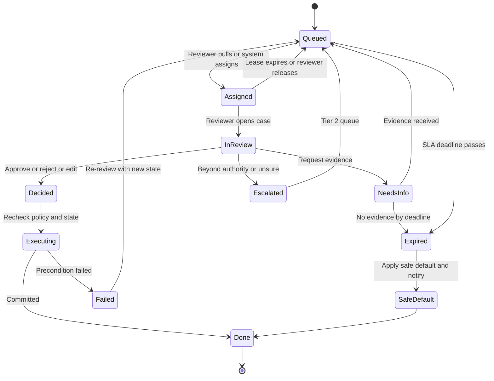

The state machine shows design decisions that are easy to miss. An assigned item holds a lease and returns to the queue if the reviewer abandons it, so no case is stuck behind an absent person. An item that exceeds its SLA does not silently approve. It moves to a safe default state with a notification, and the safe default is defined per action: for a refund request, deny and tell the customer a person will follow up; for a content flag, leave the content in the more restrictive state if the harm is severe, and in the more permissive state otherwise. An approved item does not execute directly. It moves to an executing state that rechecks policy and the current state of the resource, because the world may have changed while the case waited. A failed recheck returns the case to the queue, with the new state visible.

### 8.3 Prioritization

Not all items are equal, and first-in, first-out ordering is rarely right. A scoring rule can combine consequence, deadline, and age. For example,

$$\text{priority} = w_c \cdot \text{consequence} + w_d \cdot \frac{1}{\text{time to deadline}} + w_a \cdot \text{age}$$

with the age term preventing starvation of low-consequence items. Keep the rule simple enough to explain to a reviewer. Many teams use strict priority classes (urgent, normal, low) with aging that promotes an item to the next class after a set time. A strict class is easier to reason about, and the queue's load analysis is then per class.

Priority must not be set by the model's output in a way an attacker or a bug can exploit. If the model assigns "low priority" to adversarial inputs, those inputs wait longest. Where the priority uses a model signal, ensure that consequence and deadline floors cap how low an item can go.

### 8.4 Service-level agreements

An SLA for a review queue has at least three parts: time to first touch, time to decision, and the expiry behavior. Different classes carry different SLAs. A fraud hold on a card in use might need a decision in 10 minutes at all hours. A mortgage pre-screen might allow one business day. Write the SLA as a percentile target, not an average, such as "95 percent of urgent items decided within 15 minutes". Section 9 shows how to staff for a percentile target. The SLA must tie to a consequence of missing it, which is the expiry behavior and an alert to the queue owner.

### 8.5 What the system does when the queue is saturated

Saturation is the central test of whether oversight is real. The system needs a documented set of responses ordered from least to most disruptive:

1. **Alert and add capacity.** Page the queue owner, call in additional reviewers, and extend hours.
2. **Reprioritize.** Review the highest-consequence items first and defer the rest within their SLA.
3. **Reduce intake.** Throttle the workflow at the entry point: queue new requests, return an expected delay, or pause a lower-priority feature. This protects review quality.
4. **Degrade to a deterministic path.** Route to a rule-based process that is slower or more conservative, for example, requiring documents from the customer.
5. **Declare delay.** Tell affected people their case will take longer. This is honest and cheap.
6. **Pause automation.** For a high-risk workflow, stop auto-approval and, if needed, stop the workflow.

What the system must not do is lower the review threshold or auto-approve expired items to clear the backlog. Both turn a capacity problem into an undetected error problem. A system that does this has the form of oversight and has removed its function. Part 17 CH13 covers load shedding and degradation patterns that apply here.

### 8.6 Sampling

Sampling serves three goals, and each uses a different design.

**Quality estimation of the automatic path.** A uniform random sample of auto-approved items, reviewed by qualified people without seeing the model's output when possible, estimates the escape rate. Sample size depends on the rate to be detected. The script [03_reviewer_quality.py](../code/python/human-oversight-chapter/03_reviewer_quality.py) shows that to observe at least one escape with 95 percent probability you need about 149 audited items if the true rate is 2 percent, 598 for 0.5 percent, and 2,995 for 0.1 percent. Those numbers come from $n = \ln(0.05)/\ln(1-p)$.

**Risk-focused sampling.** Oversample segments with higher risk: new products, large amounts, borderline scores, or recent model changes. Weight the estimates back for population-level statements.

**Reviewer quality control.** Re-review a sample of each reviewer's decisions, and inject known cases (Section 11). These samples measure reviewers, not the model.

Sampling rates should be defined in policy, vary by risk, and be independent of reviewer behavior. If a reviewer can see that an item is a sample or a canary, the measurement is spoiled.

### 8.7 Four-eyes control

Four-eyes control requires two independent people to confirm certain decisions. It is a standard control in finance and a requirement for some biometric identification uses (the EU AI Act requires verification by at least two natural persons for certain remote biometric identification results, with narrow exceptions; see Section 23). The design questions are independence and diminishing returns.

Independence means the second reviewer must not be influenced by the first. If the second reviewer sees the first reviewer's approval before deciding, the second review tends to ratify the first. Blind second review, where the second person sees the case but not the first decision, preserves independence. Conflicts also matter: the two cannot report to the same manager if collusion is a risk, and neither can be the requester.

Diminishing returns arise because two reviewers' errors are often correlated. If each reviewer misses 10 percent of model errors independently, a blind second review reduces misses to 1 percent. If they share the same bias or are both anchored by the model, the second review adds much less. The value of the second reviewer is therefore measured by their independent disagreement rate, which can be checked with the agreement statistics in Section 20.

Reserve four-eyes control for the highest tier, because it doubles the review cost for the cases where it applies. In the running example, doubling the cost of a review from 4 to 8 units for a segment where an error costs 20,000 units is plainly worthwhile. For a segment where an error costs 50, it is not.

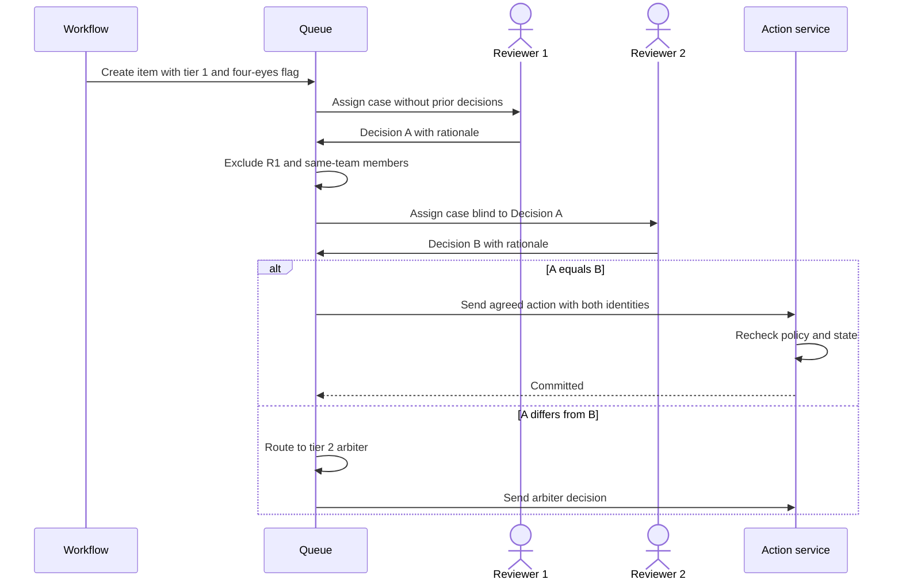

The sequence shows blindness and exclusion enforced by the queue. The system, not the reviewers, guarantees independence. A disagreement is a signal to be kept and analyzed, because a high disagreement rate means unclear policy, low-quality evidence, or unequal reviewer training. The tier 2 arbiter's decision, with both original decisions, is also a high-quality labeled example for the evaluation set.

### 8.8 Assignment and batching

Assignment can be push (the system assigns) or pull (reviewers choose from a list). Push assignment gives control of skills, conflicts, and workload balance. Pull assignment gives reviewers autonomy but invites cherry-picking easy cases and leaving hard ones. A hybrid works well: reviewers pull from a queue that the system has already filtered by skill and conflict rules, with the highest-priority item presented first and no skip option without a recorded reason.

Batching groups similar items so the reviewer can use context efficiently. Reviewing twenty invoices from the same vendor in a row reduces switching cost. Batching has a safety cost: it encourages pattern-matching and fast approval of the group. Use batching for low-consequence, homogeneous items, and use small batches with mandatory item-level confirmation for higher tiers. Never offer an "approve all" button for items that need individual judgment. If a bulk action exists for low-tier items, log it as a bulk action with the filter used, so the audit trail can show exactly what was approved.

### 8.9 Escalation tiers

Escalation moves a case to someone with more authority, expertise, or independence. A typical structure has tier 1 for ordinary reviews, tier 2 for specialists and arbitration, and tier 3 for an accountable manager or committee for the rare policy-level question. For each tier, define entry criteria, authority, SLA, and the form of the handoff. The escalating reviewer should state why, so tier 2 does not start from scratch. Reviewers should never be penalized for reasonable escalation, since the penalty teaches them to guess. Track escalation rate as a health metric: a rate near zero suggests reviewers are afraid to escalate or lack information, and a very high rate suggests a policy gap or a training gap.

### 8.10 Expiry

Every item needs an expiry rule for two clocks. The SLA clock ends the item's life in the queue and leads to the safe default. The validity clock limits how long an approval remains valid after the reviewer decides. An approval for a payment given today should not execute after the account state changes next week. Part 17 CH06 covers how approvals are bound to an action digest and an expiry in the agent setting. For human review of model recommendations in general, the principle is the same: the approval applies to a specific proposal, in a specific state, for a short time.

## 9. Reviewer Capacity Arithmetic

Review is a service system. The standard tools of queueing theory give a practical way to size the team and to predict how it behaves as conditions change. The script [02_staffing_model.py](../code/python/human-oversight-chapter/02_staffing_model.py) implements the formulas and a simulation check.

### 9.1 Little's Law and offered load

Little's Law states that in a stable system, the average number of items in the system $L$ equals the arrival rate $\lambda$ times the average time an item spends in the system $W$:

$$L = \lambda W$$

It holds regardless of arrival distribution or service order, which makes it reliable for quick checks. Apply it to the service part alone and you get the average number of reviewers busy at any moment, called the offered load $a$ in Erlangs:

$$a = \lambda \cdot \frac{1}{\mu} = \lambda \cdot h$$

where $h$ is the mean handling time and $\mu = 1/h$ is the service rate per reviewer. With 90 reviews arriving per hour and a 6-minute mean handling time, $a = 90 \times 0.1\ \text{h} = 9$ Erlangs. Nine reviewers' worth of work arrives every hour. Fewer than nine reviewers cannot keep up, and the queue grows without bound. Exactly nine would keep up on average with a very long queue, since random fluctuations in arrivals and handling times would build up.

The same law applied to the queue part says the average number waiting equals the arrival rate times the average wait: $L_q = \lambda W_q$. If the mean wait is 0.53 minutes (c = 12), then $L_q = 1.5\ \text{per minute} \times 0.53\ \text{min} \approx 0.8$ cases waiting on average.

### 9.2 Utilization and the hockey stick

Utilization is $\rho = a/c$ for $c$ reviewers. A team of 12 with $a = 9$ runs at 75 percent. Waiting time depends on utilization in a sharply nonlinear way. As $\rho$ approaches 1, wait grows toward infinity. For a single-server queue with exponential service, mean wait scales with $\rho/(1-\rho)$, which is 3 at 75 percent, 9 at 90 percent, and 19 at 95 percent. A team that looks acceptable at 75 percent can become unusable at 94 percent after a modest increase in work.

### 9.3 The Erlang C model

Erlang C models a queue with Poisson arrivals, exponential handling times, $c$ identical servers, and an unlimited waiting room. The probability that an arriving item must wait is

$$C(c, a) = \frac{\dfrac{a^{c}}{c!}\cdot\dfrac{c}{c-a}}{\displaystyle\sum_{k=0}^{c-1}\frac{a^{k}}{k!} + \dfrac{a^{c}}{c!}\cdot\dfrac{c}{c-a}}, \qquad a < c$$

The mean time in the queue is $W_q = C(c,a)/(c\mu - \lambda)$, and the wait distribution has the tail $P(W_q > t) = C(c,a)\,e^{-(c\mu-\lambda)t}$. From the tail you can solve for the percentile, such as the 95th: $t_{95} = \ln\!\big(C/0.05\big)/(c\mu-\lambda)$ when $C > 0.05$, and zero otherwise.

Here is the script's output for $\lambda = 90$ per hour, handling 6 minutes, and teams of 10 to 15.

| Reviewers | Utilization | Probability of waiting | Mean wait (min) | 95th percentile wait (min) |
| --- | --- | --- | --- | --- |
| 10 | 90.0% | 0.67 | 4.0 | 15.6 |
| 11 | 81.8% | 0.43 | 1.3 | 6.5 |
| 12 | 75.0% | 0.27 | 0.5 | 3.3 |
| 13 | 69.2% | 0.16 | 0.2 | 1.7 |
| 14 | 64.3% | 0.09 | 0.1 | 0.7 |
| 15 | 60.0% | 0.05 | 0.0 | 0.0 |

The smallest team that meets "95th percentile wait at most 15 minutes and utilization at most 80 percent" is 12. A 10-person team meets the mean-wait figure of 4 minutes, but misses a 15-minute percentile target and runs at 90 percent utilization, which leaves no slack for illness or complex cases. The simulation in the script, with 200,000 reviews, gives mean waits of 1.27, 0.53, and 0.11 minutes for teams of 11, 12, and 14, matching the formula values 1.29, 0.53, and 0.11.

### 9.4 Sensitivity to handling time

The most important lesson is how fast the wait grows when handling time rises. If a new case type, a poorer interface, or a more careful review process raises handling time from 6.0 to 7.5 minutes (25 percent), offered load rises from 9 to 11.25 Erlangs. The 12-person team's utilization goes from 75.0 to 93.8 percent, and the mean wait goes from 0.5 minutes to 7.6 minutes, about fifteen times longer. A 25 percent change in work produced a 1,400 percent change in waiting. This is why teams that look comfortable fall over after a product launch or a policy change.

It also explains why a reviewer under time pressure responds in the way Section 10 describes. When the queue lengthens, reviewers speed up, and speeding up reduces the time spent per case and the catch rate. The system sees the queue shrink and reads it as recovery.

### 9.5 From seats to people: shrinkage

Erlang C counts seats staffed at any given moment. Reviewers are not available for the whole shift: breaks, meetings, training, calibration sessions (Section 20), time off, and wellbeing breaks (Section 21) reduce availability. Shrinkage is the fraction of paid time not available. If shrinkage is 30 percent, 12 seats require $12 / 0.7 = 17.1$, so 18 people, spread over the hours of coverage. Add coverage for time zones, nights, and weekends if the SLA demands it, and recognize that skill-segmented queues split the pool: pooling reviewers across skills improves efficiency, and specialization lowers it, so a team split into five narrow specialties needs more people than one pool of generalists.

### 9.6 Where the model is wrong

Erlang C assumes exponential handling times. Real review times are skewed, with many quick cases and a long tail of hard ones. Variation increases waiting. The Allen-Cunneen approximation scales the mean wait by $(1 + c_s^2)/2$ where $c_s$ is the coefficient of variation of the handling time, equal to 1 for exponential. A coefficient of variation of 1.4 (a squared value of about 2) raises mean wait by about half. Arrivals are also not smooth: they come in bursts after batch jobs, market events, or outages, and hourly rates vary through the day. Use the model for first estimates and for sensitivity, then validate against production data or a discrete-event simulation with empirical distributions. Treat the numbers as a floor.

Another gap is that the model treats service as independent of load. Section 10 shows that the catch rate depends on time per case, which depends on load. A complete model couples them: when utilization exceeds a limit, quality drops, not only latency. A practical design rule is a utilization ceiling (often 75 to 80 percent for judgment work) set for quality reasons, with staffing and intake limits designed to hold it.

### 9.7 Deriving the 3,000 per day capacity

The 3,000-review capacity used in Section 7 follows from this arithmetic. Suppose each reviewer works 7 productive hours per day at 6 minutes per review, which is 70 reviews, but at a utilization ceiling of 75 percent the usable number is about 52 per reviewer-day. Thirty-two such reviewers would deliver about 1,680 reviews, so 3,000 per day would need 58 people before shrinkage. The point of the calculation is that capacity is derived from handling time, utilization ceiling, and hours, and it moves when any of them moves. A claim that "the team can review 3,000 per day" should come with these assumptions.

## 10. How Oversight Fails in People: Automation Bias, Complacency, Anchoring, and Rubber-Stamping

A review process fails when the people in it behave in ordinary human ways under the conditions the design creates. The failure is predictable, and the design can anticipate it. The best-known reviews of this literature are Mosier and Skitka (1996) on automation bias and Parasuraman and Manzey (2010) on complacency and bias in human use of automation. Ben Green (2022) argues in a review of government algorithm policies that requirements for human oversight often assume people can do things the research shows they do poorly. Madeleine Clare Elish (2019) described the "moral crumple zone": the human operator absorbs the blame for failures of a system they could not control.

### 10.1 The four patterns

**Automation bias** is the tendency to favor suggestions from an automated system and to discount contradictory information. It shows up in two forms. Errors of commission occur when a person follows an incorrect recommendation. Errors of omission occur when a person fails to notice a problem because the system did not flag it. Studies in aviation, medicine, and other fields find both. In a mammography reading study reported by Dratsch and colleagues (2023), radiologists with less experience were more likely to follow an incorrect AI suggestion than more experienced readers. Treat results like this as evidence that the effect is real, and measure it in your own population rather than assuming a size.

**Complacency** is reduced vigilance when a system is usually right. A monitor who sees ten thousand correct outputs and then one wrong one is poorly placed to notice it. The more reliable the automation, the less the human attends to it, which is the "ironies of automation" that Lisanne Bainbridge described in 1983: the system is automated because it is mostly right, and the human is retained for the rare cases it gets wrong, which is when the human is least practiced and least alert.

**Anchoring** is the tendency to adjust insufficiently from an initial value (Tversky and Kahneman, 1974). A model's proposed answer is an anchor. A reviewer who sees the proposal first forms a judgment around it. Showing a proposed price, a proposed diagnosis, or a proposed risk score first produces assessments clustered near it, even when the reviewer believes they are evaluating independently.

**Rubber-stamping** is the observable outcome: a reviewer approves almost everything quickly. It can result from the three effects above, from overload, from incentives that reward speed, from a culture in which overriding the model is seen as obstruction, or from a lack of information that makes disagreement impossible. Rubber-stamping is a symptom with several possible causes, so a fix needs diagnosis.

### 10.2 Conditions that produce them

Several design conditions raise the risk. A high model accuracy makes disagreement rare and attention low. A high workload leaves no time to verify. A single-number summary encourages acceptance of the number. A default of "approve" on an unfocused screen makes approval the easiest action. A throughput metric rewards speed. A culture where the model's output is treated as the standard makes overriding the model a burden on the reviewer, who must justify the departure. Absent training, reviewers do not know the model's weaknesses. Pure repetition erodes attention. Isolation, with no peer comparison, removes a source of calibration.

### 10.3 What it looks like in data

Rubber-stamping leaves a recognizable pattern in the data. The script [03_reviewer_quality.py](../code/python/human-oversight-chapter/03_reviewer_quality.py) prints an illustrative table of reviewer behavior as workload rises.

| Load (arrival over capacity) | Seconds per review | Override rate (%) | Canary catch rate (%) |
| --- | --- | --- | --- |
| 0.60 | 95 | 14.0 | 78 |
| 0.80 | 70 | 9.5 | 71 |
| 0.95 | 41 | 4.2 | 52 |
| 1.05 | 22 | 1.1 | 31 |

These figures are illustrative, constructed to show a shape, and are not measurements. The shape is typical, however, and real data usually show the same: as load rises, time per review falls, the override rate falls, and the catch rate on known errors falls with them. At a load of 1.05 the reviewer overrides 1.1 percent of cases and catches 31 percent of seeded errors. A dashboard that tracks only queue length and throughput reads this team as healthy, since the queue is shrinking quickly. A dashboard that tracks override rate and seeded-error catch rate reads it as failing.

A second pattern shows up in agreement statistics. Raw agreement between two reviewers can be high because most cases are easy. The script's rubber-stamp example has two reviewers agreeing on 96 percent of 200 cases, but chance agreement is 94.2 percent because 97 percent of decisions from both were approvals, so Cohen's kappa is only 0.31. Raw agreement flatters rubber-stamping. Section 20 shows the calculation.

### 10.4 A diagnostic model

When override rates are low, determine which of four explanations applies before changing anything.

1. **The model is genuinely very accurate.** Low override is correct, and the audit escape rate and seeded-error catch rate are both good.
2. **Reviewers lack the information to disagree.** The interface shows only the conclusion. Fix the evidence display.
3. **Reviewers lack time.** Handling time is shorter than a thorough review requires. Fix capacity or intake.
4. **Reviewers lack the incentive or safety to disagree.** Performance management penalizes overrides or escalations. Fix the incentive.

The canary and audit measurements in Section 11 distinguish the first explanation from the other three: if seeded errors are missed, the low override rate is not because the model is right.

## 11. Countermeasures and How to Measure Them

No countermeasure removes the effects in Section 10. The aim is to reduce them and to measure how much remains. Each measure below pairs a design change with a metric that would show whether it works.

### 11.1 Blind or independent-first review

Ask the reviewer to form a judgment before seeing the model's proposal, or to see the evidence first and the proposal after a deliberate step. The mechanism is to reduce anchoring. Variants include a required initial selection (the reviewer picks a category or records a number, then the model's proposal appears), or a two-stage screen. The cost is time, so the technique suits high-tier decisions. Measure the change in agreement with the model and the catch rate on seeded errors, comparing a blind arm and a standard arm in an experiment on comparable cases.

### 11.2 Forcing functions

A forcing function requires a specific cognitive act before the decision can proceed. Examples include requiring the reviewer to select which evidence snippet supports each key field, to type the amount or the identifier being approved (for a payment), or to answer a short verification question about the case. The aim is to make "approve" require engagement. Forcing functions add friction, so match their strength to the consequence. A forced typed confirmation is reasonable for a funds transfer and excessive for a tag change. Measure the time cost and the catch rate, and watch for workarounds: reviewers who copy text without reading it have defeated the function.

### 11.3 Seeded errors and canary cases

A canary case is a case with a known correct answer, inserted into the queue so that it looks like any other. Seeded errors are canaries where the model's proposal is deliberately wrong. They measure whether reviewers detect errors. The key requirements are the following.

- **Realism.** Canaries must be indistinguishable from real cases in form, source, and metadata. Build them from real historical errors where possible, with the sensitive identifiers handled under privacy rules.
- **Coverage.** Include the error types that matter: subtle extraction errors, wrong policy application, hallucinated citations, and cases where the correct answer is to escalate.
- **Rate.** A modest rate, such as 2 to 5 percent of the queue, gives enough data without much cost. Tune it to the precision of the estimate you need.
- **Ethics and transparency.** State in policy and training that canaries exist. Do not use canary failures as grounds for individual punishment in the first instance. Use them for calibration and coaching. Staff who feel trapped will find ways to detect canaries or to avoid review work.
- **Isolation.** Canary decisions must never execute real actions or enter real customer records. The action service must recognize them.

The estimate has uncertainty. With 41 of 60 seeded errors caught, the catch rate is 68.3 percent, but the 95 percent Wilson interval runs from 55.8 to 78.7 percent. A team needs a few hundred canaries per reviewer group to detect a change of ten points reliably, and fewer to detect a collapse.

### 11.4 Rotation and varied tasks

Long periods of uniform review erode attention. Rotating reviewers between queues, between review and other work, and between decision types reduces vigilance decrement. Rotation also spreads knowledge and reduces the chance that one reviewer's idiosyncrasy becomes the policy in practice. Set maximum continuous review durations, with breaks, and treat them as a safety control and not as a perk (Section 21).

### 11.5 Disagreement analysis

Track every override and analyze the pattern. Which reviewers override most, and which least? Which case types produce overrides? Does the override rate differ by time of day, queue depth, or the model version? Which overrides are later upheld in audit, and which are reversed? A reviewer whose override rate is much lower than peers with similar cases may be rubber-stamping or may be excellent; the canary and audit data separate the two. A reviewer whose overrides are often reversed in audit may be too aggressive or may not understand the policy. Disagreement analysis is also the source of the model improvement signals in Section 19.

### 11.6 Make disagreement cheap

If overriding the model takes five more clicks and a free-text justification than approving, the system teaches approval. Provide one-click rejection with a structured reason, and require rationale detail where it matters for the record (high-tier edits), not where it only adds friction. Managers should be explicit that disagreement is valued, and the performance metrics should reflect it. A measure of success is the share of reviewers who override at least occasionally and the share whose overrides are upheld.

### 11.7 Show uncertainty and base rates appropriately

A well-designed uncertainty display reduces unwarranted trust, but a poorly designed one increases it. Section 12 covers presentation. The measure is whether reviewers' agreement with the model varies with the displayed uncertainty in the expected direction: lower agreement when the model flags low confidence, and still-substantial independent checking when it flags high confidence.

### 11.8 Counter-incentives: avoid the metrics that cause the problem

Do not rank reviewers on throughput alone. Combine throughput with catch rate on canaries, agreement with tier 2 on audits, and escalation appropriateness. Publish team-level metrics, and use individual metrics for coaching. A metric that is gamed becomes useless, and a quality metric gamed by detecting canaries is a reason to refresh the canaries and to audit their realism.

### 11.9 Summary of countermeasures

| Countermeasure | Targets | Cost | Primary metric |
| --- | --- | --- | --- |
| Blind or independent-first review | Anchoring | More time per case | Canary catch rate, agreement with model |
| Forcing function | Complacency | Friction | Time per case, catch rate |
| Seeded errors | Measurement of all four | Canary construction and upkeep | Catch rate with interval |
| Rotation | Complacency, fatigue | Scheduling, training | Catch rate over shift time |
| Disagreement analysis | Rubber-stamping, model issues | Analyst time | Override rate by reviewer and case type |
| Cheap rejection | Rubber-stamping | Interface work | Share of overrides, escalation rate |
| Balanced incentives | Rubber-stamping | Management change | Throughput versus catch rate |

No single row is enough. A design that uses several rows covers the failure modes of the others. The table also shows that most countermeasures have both a cost and a measurable signal, which makes them suitable for a business case.

## 12. The User Experience of Review

The interface determines what a reviewer can perceive, how long a review takes, and what the easiest action is. Poor interface design can undo every other effort in this chapter. Interface design here means the content and structure of the review screen, which are architectural because the data pipeline must supply what the screen shows.

### 12.1 Show evidence, not only conclusions

The reviewer must be able to check the model's conclusion against its sources. Show the source material the conclusion relies on, with the relevant passages highlighted: the clause in the contract, the lines in the transaction history, the fields on the scanned form with their image regions. Link every claim in a generated summary to the passage supporting it. Where the system cannot supply evidence for a claim, mark the claim as unsupported. A reviewer who has to search for the evidence will often skip the search.

Show also what the model did not see: documents that were missing, retrieval that returned nothing, data that is stale, and policies that changed since the model was configured. This is the "known limitations" panel. It is frequently the most useful part of the screen, because it tells the reviewer where to concentrate.

### 12.2 Diff views for edits and agent changes

When the model proposes a change to something that exists, whether a document, a configuration, a code change, or a record, show a diff of before and after. A reviewer reading only the new version cannot see what changed and tends to approve what looks plausible. A diff focuses attention on the changed parts. For generated drafts, a diff against the previous draft or the source template shows what the model added. Large diffs need structure: group by risk, collapse formatting-only changes, and highlight changes that touch sensitive fields (amounts, recipients, permissions, dosages).

### 12.3 Display uncertainty with care

An uncertainty display should help the reviewer allocate attention and should not become a number to trust blindly. Practical guidance follows.

- Prefer categorical bands tied to actions ("Check carefully," "Standard check") over a precise score, because a reviewer cannot interpret 0.9137 and may anchor on it.
- Explain what drives the band: "amount above limit," "field extracted with low legibility," "no matching precedent."
- Do not show uncertainty as the only reason to review. Some of the highest-risk errors come with high confidence.
- Test the display. A "high confidence" label can raise approval rates even when the model is no more accurate, as the research on automation bias would predict. Run an experiment comparing displays on the catch rate for seeded errors.
- Show uncertainty at the field level when the decision depends on several extracted fields. A single case-level score hides which field is doubtful.

### 12.4 Explanation limits

Model-generated explanations are persuasive and not necessarily faithful. A language model that explains its recommendation produces text that sounds reasonable, and research on chain-of-thought faithfulness (for example, Turpin and colleagues, 2023) shows that the stated reasoning may not reflect the factors that drove the output. For classical models, feature attributions (such as SHAP or LIME) describe the model's behavior locally under assumptions, and they can mislead when features correlate. Several rules follow.

- Use explanations that point to checkable evidence (a source passage, a rule that fired, a precedent case), and avoid explanations that are only fluent narrative.
- Label narrative explanations as generated, and do not let them stand in for evidence.
- Evaluate whether explanations improve reviewer accuracy. Some studies find that explanations increase trust without increasing correctness, a form of automation bias. Measure the effect on seeded-error detection.
- Do not claim an explanation is the reason for a decision in a notice to an affected person unless it is. Section 14 covers notices.

### 12.5 Exact-action confirmation

The reviewer must approve the exact action that will execute. The confirmation shows the amount, the recipient, the resource identifiers, the affected count, and the effect. If the action is parameterized (a bulk update of 4,300 rows), show the count and a sample, and let the reviewer see the filter. The approval binds to a digest of the action, and the action service rejects any executed action that does not match. Part 17 CH06 Section 9 describes the digest binding. In the human interface, the corresponding rule is that the screen shows what the digest represents. A reviewer who approves "update customer records" without seeing which records has not approved the action in any meaningful sense.

### 12.6 Avoid dark patterns in review interfaces

Dark patterns in review interfaces nudge reviewers toward approval. Examples include a large green Approve button beside a small gray Reject link, a default selection of "approve," a countdown that pressures speed, a confirmation that appears pre-filled with the model's answer, a justification box that is optional for approval and mandatory for rejection, and "approve all" at the top of a list. They are common because they raise throughput, which is easy to measure. Remove them. Give approve, reject, edit, and escalate equal visual weight. Do not pre-select. Do not show a countdown for the reviewer; show the SLA to the queue owner. Make the rationale requirements symmetric where possible, with quick structured reasons for all actions.

The same applies to interfaces for affected users. A review request screen that discourages contest (hidden links, long forms, misleading wording) defeats the recourse that Section 14 requires, and regulators treat deceptive design as a defect.

### 12.7 Speed and ergonomics of the screen

Time per review is dominated by information gathering, not by clicking. Put the evidence in one view, with keyboard navigation, avoid switching between systems, preload the next case, and allow the reviewer to resize or reorder panels. The goal is to cut time spent on locating things, not time spent on thinking. Measure time on segments of the review (time to first action, time on evidence panels, time to decision) so that improvements target the right part. A 20 percent reduction in handling time from better layout is worth more than most staffing changes, since Section 9 shows how sensitive waits are to handling time.

### 12.8 Accessibility and diversity of reviewers

Review interfaces need accessibility features (screen reader support, keyboard operation, color-independent cues) for reviewers with disabilities, and they must work for reviewers working in different languages and regions. Provide language support for source material and translation tools whose output is labeled, since reviewers may otherwise rely on a machine translation that has its own errors.

## 13. Authority and Override

The power to override must be defined, enforced, and traced. An override that exists only on a slide is not an override.

### 13.1 Who can do what

A matrix of roles and actions makes authority explicit. A plausible matrix for a consequential workflow follows. "Own" means within the reviewer's authority limit.

| Action | Tier 1 reviewer | Tier 2 specialist | Workflow owner | Model owner | Requester or subject |
| --- | --- | --- | --- | --- | --- |
| Approve proposal | Own limit | Higher limit | No | No | No |
| Reject proposal | Yes | Yes | No | No | Contest only |
| Edit proposal within bounds | Yes | Yes | No | No | Provide evidence |
| Escalate | Yes | Yes | Yes | Yes | Request |
| Override a prior decision after commit | No | Yes | Yes | No | Appeal |
| Pause automation for a segment | No | Request | Yes | Yes | No |
| Change thresholds or routing | No | No | Approve | Propose | No |
| Roll back a model version | No | No | Approve | Execute | No |
| Read the audit trail | Own cases | Team | All | Technical view | Own case summary |

The matrix has several design consequences. Pausing and rollback sit with owners who can act in minutes. Threshold changes require a proposer and an approver, which is a separation of duties. Reviewers cannot change their own authority. The requester can contest but cannot approve. Every cell is enforced by the application's authorization layer and logged, in keeping with the authority limits in Part 17 CH06 and the enforcement controls in Part 17 CH12.

### 13.2 What each action triggers

For each reviewer action, define the next step in the workflow.

**Approve** moves the item to execution with a policy and state recheck. The approval is bound to the exact proposal and expires.

**Reject** returns the workflow to a safe state, which differs per workflow. In a refund workflow, the request is declined and the customer notified. In a draft workflow, the draft is discarded and the user is told. In a monitoring workflow, the alert is closed with a reason. Reject must always have a defined result, and the system must not leave the item in an ambiguous state.

**Edit** produces a new proposal. The system keeps the original and the edit, re-runs the validators on the edit, and decides whether the edited proposal needs a second approval. If the edit exceeds bounds (for example, raising an amount above the limit), the edit requires escalation. An edit is a decision by the reviewer, so it carries the reviewer's accountability for the new content, which makes it important to show the reviewer clearly that they are now the author.

**Request evidence** places the item in a waiting state with a deadline, sends a request to the party who can supply the evidence, and returns the item to the queue on receipt.

**Escalate** moves the item to the next tier with the reviewer's reason and the case context, and releases the reviewer from the item. An escalation is not a failure.

**Defer** is a deliberate hold with a reason and a time limit. Without a limit, deferral becomes a hiding place for hard cases.

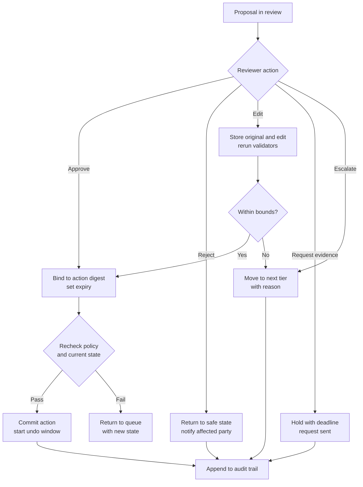

The flowchart shows that every branch ends in the audit trail, and that approval does not mean execution. The recheck step catches changed state, expired policy, and edits that pushed a value outside bounds. It also shows that an edit outside bounds cannot be executed by the person who made it; it must go up a tier.

### 13.3 Overriding after commit

After an action commits, someone may discover it was wrong. Post-commit override covers the reversal of a committed decision by a person with the authority to do so. The design questions are who may reverse, within what time, using which mechanism (Section 17), and how affected people are told. For decisions that affect people, the reversal path overlaps with the appeal path in Section 14. For decisions that affect systems, the reversal path overlaps with rollback and compensation. In both cases, record the reversal as a new event linked to the original and do not mutate history.

### 13.4 Stopping the system

The most important override is the stop. An authorized person must be able to pause automation for a segment, a workflow, or a model version, quickly and without needing the model team. The stop control should take effect within a time stated in the design (seconds to minutes for high-impact workflows) and should be tested regularly in drills. EU AI Act Article 14 includes the ability to intervene in the operation of the system or interrupt it through a stop button or similar procedure; Section 23 covers the mapping. A stop that requires a deployment is not a stop button. A stop that leaves in-flight actions running needs a defined semantic: finish safely, or cancel and compensate.

### 13.5 Separation of duties

The person who requests an action, the person who approves it, and the person who can change the controls around it should differ for high-tier workflows. A reviewer who can also adjust the thresholds that route cases to them, or edit the sampling rate that audits their own decisions, can hide poor performance. Likewise, the team that owns the model should not alone own the audit of the model's escape rate. Independence in measurement matters as much as independence in approval.

## 14. Contesting Decisions and Recourse for Affected People

When an AI-assisted decision affects a person, human oversight inside the organization is not enough. The affected person needs a way to learn what happened, to say what is wrong, and to obtain a review by someone who can change the outcome. Part 16 CH31 owns the recourse lifecycle at the governance level. This section covers the system features that make it work.

### 14.1 The legal background in brief

Several laws and rules bear on contest and recourse, and the details depend on jurisdiction and sector. The following is a high-level orientation, not legal advice.

- Under the EU General Data Protection Regulation (GDPR), Article 22 gives a data subject the right not to be subject to a decision based solely on automated processing that produces legal or similarly significant effects, with exceptions. Where the exceptions apply, the controller must provide suitable safeguards, including at least the right to obtain human intervention, to express a point of view, and to contest the decision. The Court of Justice of the European Union held in the SCHUFA case (C-634/21, December 2023) that the automated production of a probability value can itself count as a decision under Article 22 when a third party draws strongly on it. That ruling matters for score-and-review designs: a human review that nearly always follows the score may not take the process outside Article 22.
- The EU AI Act, Article 86, gives a person affected by a decision taken on the basis of the output of certain Annex III high-risk systems a right to obtain clear and meaningful explanations from the deployer about the role of the AI system in the decision and the main elements of the decision. Check the current text and its application date (Section 23).
- In the United States, credit decisions are subject to adverse action notice requirements under the Equal Credit Opportunity Act and its implementing Regulation B, which require a statement of the specific reasons for the action, and the Fair Credit Reporting Act adds notice and dispute rights where consumer reports are used. Consumer Financial Protection Bureau guidance in 2022 stated that complex models do not excuse creditors from giving specific reasons. Verify the current state of guidance with counsel.
- Sector rules in health, employment, and public benefits add further requirements, including notice, review, and in some jurisdictions bans or limits on solely automated decisions.

### 14.2 The elements of a recourse path

A recourse path has these parts.

1. **Notice.** The affected person is told that an AI-assisted process contributed to the decision, in plain language, at the time of the decision. Notice includes how to ask for review.
2. **Reasons.** The person receives the principal reasons for the outcome, specific to their case and drawn from the actual factors, not generic text. For models that cannot provide faithful reasons, the process should use the policy criteria and evidence checked by the reviewer, which are real.
3. **Access to the evidence.** The person can see or correct the data used about them, within the limits of security and the rights of others.
4. **A way to contest.** A simple channel, with a stated deadline for requesting review and no requirement to understand the technology.
5. **Independent human review.** The reviewer on appeal has authority to change the outcome, was not the reviewer on the original decision, has access to the full case, and is not anchored by the model's score. Review of a decision by the same person who made it, or by a person who can only confirm, gives little protection.
6. **A decision with reasons and a timeline.** The person is told the result and the next step, within a stated time.
7. **Correction.** If the decision was wrong, the system corrects the outcome, makes the person whole as far as possible, and corrects the underlying data.
8. **Feedback.** The case is analyzed for systemic causes, and the result goes back into the evaluation set (Section 19) with attention to privacy.

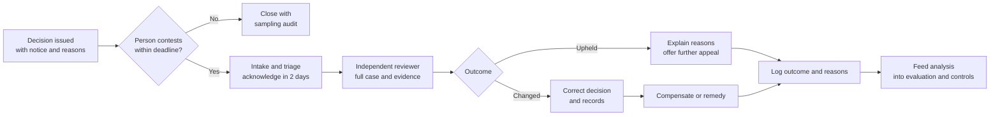

The flowchart places independent review between intake and outcome, and it routes both outcomes to logging and learning. An important design point is the "upheld" branch, which still explains the reasons and offers further appeal, since a bare rejection leaves the person without recourse. The appeal reversal rate (Section 22) is a measure of both original decision quality and appeal reviewers' independence: a rate near zero may mean the original decisions are excellent or that the appeal is a formality.

### 14.3 Design implications

Recourse needs data. The system must retain the case record, the evidence, the model and policy versions, and the reviewer's decision long enough to handle appeals, which should be consistent with regulation and with data minimization (Section 18). The recourse channel needs an owner with authority, and a service level. The review on appeal should be sampled for quality like any other review. Affected-person-facing text should be tested for comprehension. And the system should handle the special case in which the model's output cannot be explained at the level of detail a notice demands, by choosing a model or a process that can meet the notice requirement before launch, not after a complaint.

## 15. Integration Patterns for AI-Assisted Workflows

Five integration patterns cover most designs. They differ in where the human acts, what the system does without the human, and what the human can undo. This section describes each with its mechanism, its best use, its failure modes, and its controls.

### 15.1 Draft and edit

The model produces a draft of an artifact (an email, a report, a code change, a clinical note). A person edits and then sends or saves it. The person is the author of record. This is rung 2 on the automation ladder. It fits tasks where a person has to be the author, where editing is faster than writing, and where a wrong draft costs little if caught.

The main risk is under-editing: the person accepts the draft with little change, so errors in the draft pass into the record. The controls are to highlight the parts of the draft that came from uncertain sources, to flag claims without evidence, to show the draft's provenance in the saved artifact, to sample finished artifacts for audit, and to make it easy to see what the author changed. Measure the edit distance between draft and final, the share of drafts sent unchanged, and the error rate in sampled final artifacts. A very high unchanged share is a warning sign when the draft quality is imperfect.

### 15.2 Suggest and confirm

The system offers a suggested action or value inline (an autocomplete, a recommended code, a suggested next step), and the person confirms by accepting it. The suggestion is small and frequent. It fits interactions where the person remains in control of the task and the suggestion saves effort.

The risk is acceptance without checking, and the compound risk of many small unverified acceptances. Controls include making the suggestion visually distinct, requiring explicit acceptance (no auto-accept on typing), logging acceptance and rejection with context, and monitoring acceptance rates by user and by suggestion type. A rising acceptance rate is ambiguous: the model may have improved, or the user may have stopped checking. Seeded wrong suggestions in a controlled sample can tell the two apart.

### 15.3 Propose and approve

The system prepares a complete action and a person must approve it before it happens. This is rung 3, and it is the standard pattern for consequential actions. The agent approval pattern in Part 17 CH06 is an instance. It fits high-impact or irreversible actions, and actions with legal sign-off requirements.

Its risks are the ones in Sections 10 and 11: rubber-stamping, queue overload, and stale approval. Controls are the exact-action confirmation (Section 12.5), approval expiry and recheck (Section 8.10), queue capacity management (Section 9), and sampled re-review of approvals. This pattern bounds throughput by reviewer capacity, so it requires the capacity arithmetic.

### 15.4 Act and notify with undo

The system acts within defined limits, tells the affected person or the responsible person, and offers a bounded window to reverse the action. This is rung 4. It fits medium-impact, reversible actions in which pre-approval would be too slow or too costly: automatic rescheduling, categorization, small credits, routing.

The risk is that nobody notices or undoes in time. Controls are a notice that actually reaches someone who can judge it (not buried in a digest), an undo that is one action and works, a window matched to how quickly errors become visible, and measurement of the undo rate. A near-zero undo rate may mean the system is right or that notifications are ignored. Section 17 covers designing undo.

### 15.5 Sampled audit of autonomous actions

The system acts autonomously (rung 5). A sample of its actions is reviewed after the fact by qualified people. The audit estimates the escape rate, finds systematic errors, and triggers corrective action. It fits low-impact, high-volume decisions.

Its risk is that the sample is too small, too slow, or biased, so errors compound before detection. Controls are a sampling design with stratification by risk, audit turnaround matched to the error damage rate, a defined escape-rate tolerance with an automatic response when exceeded (demote the rung or pause), and reviewer independence from the model's output. The calculation in Section 8.6 shows the sample size needed to see a given rate.

### 15.6 Comparing the patterns

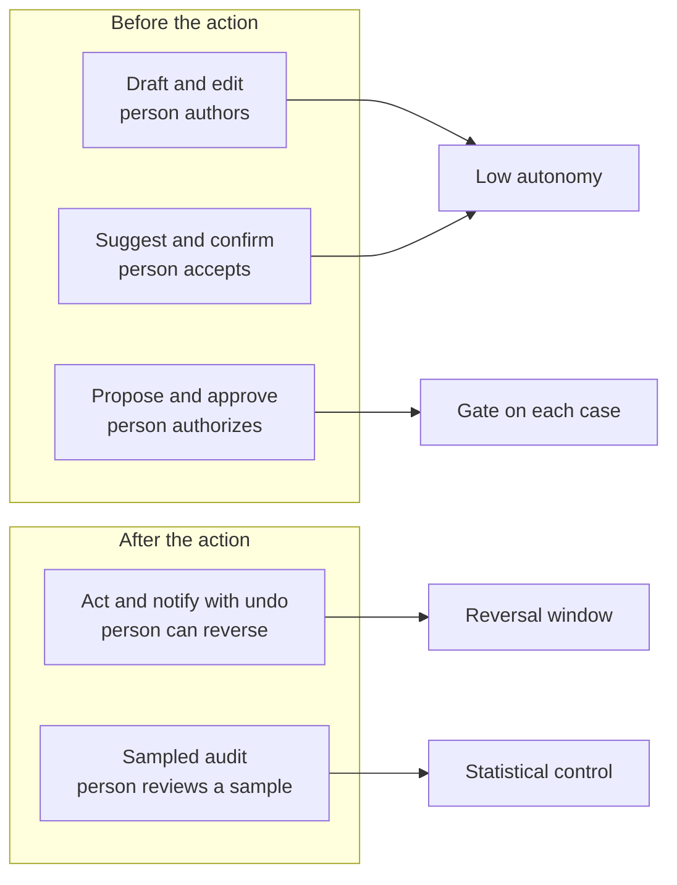

The grouping shows the main division: three patterns put the human before the action, and two put the human after it. Patterns before the action protect against errors when the human reliably catches them. Patterns after the action depend on reversibility and detection. Many systems combine them: propose-and-approve for the high-tier slice, act-and-notify for the middle, and sampled audit for the bulk, with a monitor over everything. The routing rules in Section 5 decide which slice a case falls into.

| Pattern | Rung | Human acts | Strength | Weakness | Best fit |
| --- | --- | --- | --- | --- | --- |
| Draft and edit | 2 | Before | Person is the author | Under-editing | Writing, notes, code |
| Suggest and confirm | 2 | Before | Low friction | Unverified acceptance | Inline assistance |
| Propose and approve | 3 | Before | Gate on each action | Capacity, rubber-stamping | High-impact actions |
| Act and notify with undo | 4 | After | Speed | Ignored notices, irreversibility | Reversible medium-impact |
| Sampled audit | 5 | After | Scalable | Late detection | Low-impact high-volume |

## 16. Handoff from Agents and Chat to Humans

Many AI-assisted workflows begin in a conversation: a customer chat, an internal helper, or an agent working on a task. At some point the system needs a person to take over. The handoff is a point of high risk and a frequent source of frustration, because the person who receives it has to understand what happened and the person being served has to avoid repeating themselves. Part 17 CH06 Section 17 covers the agent runtime side of escalation and takeover. This section covers the human side and the design of the transfer.

### 16.1 Why handoffs happen

A handoff has one of several triggers, and the trigger affects how it should work.

- **Capability limit.** The system cannot do what is requested, or its confidence is low.
- **Authority limit.** The request needs an approval or an exception the agent may not grant.
- **Policy trigger.** The topic (a complaint, a legal threat, self-harm, a regulated advice request) requires a person by rule.
- **User request.** The user asks for a person. A system that obstructs this request erodes trust and may violate rules in some jurisdictions or sectors.
- **Failure.** The system loops, errs repeatedly, or a tool fails.
- **Monitor trigger.** A supervising process detects distress, risk, or an anomaly.

### 16.2 Cold, warm, and supervised handoff

A **cold handoff** passes the person to a queue with little context. The human starts over, and the user repeats everything. It is cheap to build and costly to experience.

A **warm handoff** passes a structured context package with the user. The human sees a summary, the key facts, what was tried, what the system proposed, and why it escalated. The user is told what is happening and is not asked to repeat. The receiving human can accept or decline before the user is transferred.

A **supervised handoff** keeps the model in an assist role during the human's work: the person leads, and the model drafts replies, retrieves documents, and fills forms. It combines the draft-and-edit pattern with the handoff.

### 16.3 The context package

The package should carry what the receiver needs and should minimize what it exposes. A reasonable structure follows.

| Field | Content | Note |
| --- | --- | --- |
| Reason for handoff | Trigger and the specific rule or signal | Lets the receiver start in the right place |
| User goal | The user's stated request in their words | Quoted, not paraphrased only |
| Summary | Short, labeled as machine-generated | Allow the receiver to open the full transcript |
| Verified facts | Facts confirmed by tools or records, with sources | Separate from claims the user made |
| Unverified claims | What the user said that is not confirmed | Prevents the model's guess from becoming fact |
| Actions taken | Tool calls made and their results | Includes any side effects already applied |
| Actions pending | Proposed or in-flight actions | With state and any hold |
| Identity and authentication state | What has been verified and how | Avoid asking again, avoid assuming more than was verified |
| Sentiment or risk flags | Distress, urgency, vulnerability | Use cautiously and with privacy review |
| Suggested next step | The model's proposal, labeled | Receiver may ignore it |
| Full transcript reference | Link to the full record | For audit and for the receiver's checking |

The summary is the highest-risk field. A model-generated summary can omit the key fact, can state a user claim as verified, or can quietly change a number. The receiver should be able to open the transcript and see source quotes for the key facts. Test summaries against transcripts as part of the evaluation set.

Privacy applies to the package. Pass the minimum needed for the receiver's role. A tier 1 agent may not need the full payment history that the model had access to. Redact data that the receiver's role should not see, and log what was passed.

### 16.4 The handoff protocol

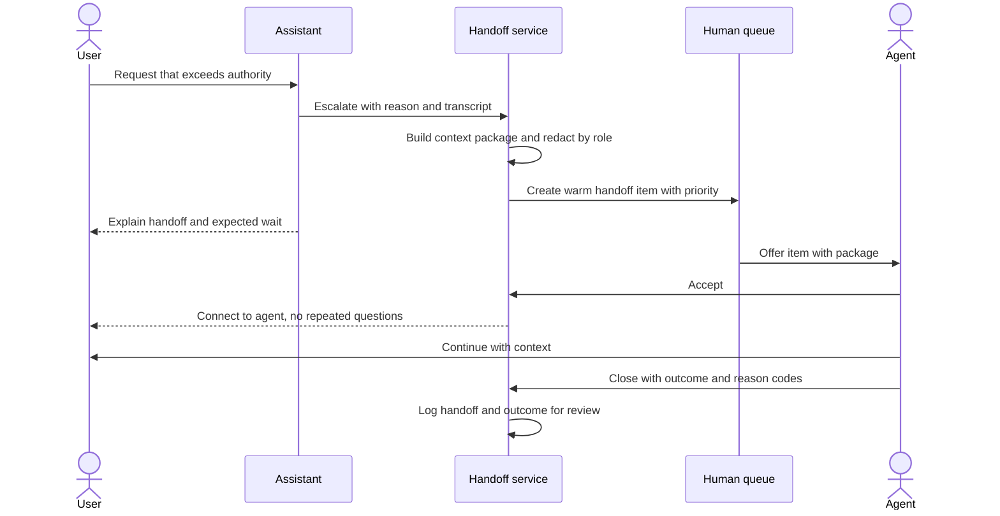

The sequence has three features worth noting. The assistant tells the user what is happening and what to expect, so the user does not experience silence. The handoff service builds the package and applies role-based redaction, which keeps the logic out of the prompt. The agent explicitly accepts, which closes the transfer and starts the human's accountability. If no agent accepts within the SLA, the service takes a defined action: keep the user informed, offer a callback, or escalate to a supervisor, and never leave the user in a dead end.

### 16.5 Handoff in the other direction

Handback happens when the human finishes and the assistant resumes. The assistant should receive the human's decision and any instructions as structured data. It should not infer them from free text, and it should not undo what the human decided. After a handback, the assistant should be limited by the human's constraints, such as "do not offer a refund on this order again."

### 16.6 Failure modes of handoff

Common failures are a handoff that loops (the user is bounced between the assistant and a queue), a package that omits the key fact, a package that leaks data the receiver should not see, a handoff that is accepted by nobody, a user who is never told the handoff happened, and an assistant that continues to act on the case in parallel with the human. The last one is dangerous: after handoff, the assistant's write access to the case should be suspended or tied to the human's instructions. Measure handoff rate, time to acceptance, repeated-question rate, post-handoff resolution time, and user satisfaction on handoff cases. A falling handoff rate can mean improved automation or an assistant that has learned to refuse to hand off, and the measure that separates the two is user-requested handoffs that did not occur.

## 17. Rollback, Compensation, and Undo Windows for AI-Initiated Actions

When a human reviewer or an automated monitor decides an action was wrong, the system needs a way to repair the world. Reversibility is a property of the action and the system around it, and it should be designed in, not discovered in an incident.

### 17.1 Classes of reversibility

Classify each action type before deciding its automation rung.

**Naturally reversible actions** can be undone exactly, by restoring prior state. Examples are changing a label, editing a draft, toggling a flag. The reversal uses stored prior values.

**Compensable actions** cannot be undone exactly, but their effects can be offset by a compensating action. Examples are a refund (compensates a charge), a credit note, a replacement shipment, a corrective filing. Compensation costs money or effort, may be imperfect, and may be visible to the customer.

**Irreversible actions** cannot be undone or compensated adequately. Examples are a sent message, a disclosed secret, a deleted record with no backup, a medical administration, a public statement, a wrongful arrest. Containment, notification, and remediation replace undo.

The classification determines the rung. Irreversible actions should not be automated without pre-action review. Compensable actions can be automated within a limit, where the expected compensation cost is acceptable and the undo window is real.

### 17.2 Designing undo

An undo must be executable. A usable design includes these elements.

- **Stored prior state.** Capture what is needed to restore, at the moment of action, in a way that survives the action. For database changes, use versioned rows, soft deletion, or event-sourced history. Do not rely on reconstructing the prior state from logs after the fact.
- **A named undo operation.** For every action in the tool registry, define its inverse or its compensation, including parameters. Actions without an inverse are marked irreversible and routed accordingly.
- **A bounded window.** State how long undo is available and why. Some actions become irreversible at a boundary: a payment batch cut-off, an email sent externally, a downstream system's processing. The window is the time until the boundary, not an arbitrary number.
- **A safe undo path.** Undo is itself an action that can fail or conflict (the record has since changed). Check preconditions, apply the same authorization checks, and handle partial failure.
- **Visibility.** The person who might want to undo needs to know the action occurred and how to reverse it. An undo that is not discoverable is not an undo.
- **Idempotency.** Undo requests may repeat. The operation should be safe to apply twice.

### 17.3 Compensation for multi-step actions

An agent action often spans several systems: create an order, charge a card, reserve inventory, send an email. If a later step fails or the whole sequence is rejected, the earlier steps must be unwound. The standard approach is the saga pattern: each step has a compensating step, and a coordinator runs the compensations in reverse order when needed. The coordinator records progress durably, so it can resume after a crash. Part 17 CH06 Section 11 covers durable execution. Compensation is best effort, so the design states which steps cannot be compensated (the email already went out) and places those steps last, after approval, so that the reversible steps are the ones done speculatively.

### 17.4 The state of an AI-initiated action

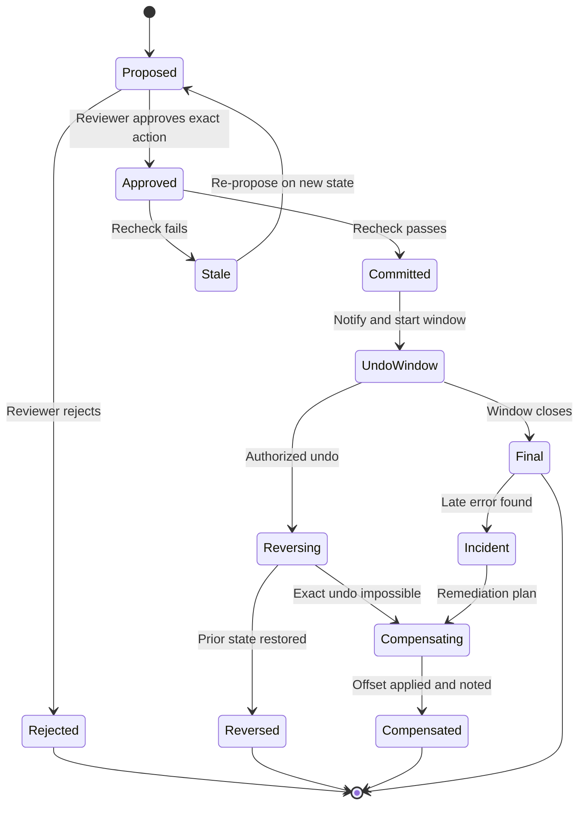

The diagram separates the undo window from the final state and shows that a late-discovered error moves from final to an incident, with compensation as the remedy. This is the honest picture: not every error is found in the window, and the design needs a path for the ones found later. Each transition is logged with the actor and reason.

### 17.5 Containment for irreversible effects

When an effect cannot be undone, the system's job is to limit its spread and repair what can be repaired. Containment includes stopping related automation (so the same error does not repeat), identifying the full scope of affected cases (the audit trail and the version information make this possible), notifying affected parties promptly with accurate information, offering remediation, and recording the incident for review. Section 13.4 covers the stop. The scope query in particular depends on the audit trail: "all cases decided by model version X between times T1 and T2 with confidence above 0.95" is an answer a system can give only if those fields were recorded.

### 17.6 Worked example: sizing an undo window

An automatic ticket-routing system reassigns support tickets. A misrouted ticket is noticed when the receiving team opens it, which takes a median of 3 hours and a 95th percentile of 20 hours. A customer-visible effect (an auto-reply with the wrong promise) occurs at routing. If the undo window is 1 hour, it closes before many errors are noticed, so most errors become final. An undo window of 24 hours covers the 95th percentile of detection. The design sets the window at 24 hours for routing and holds customer-visible replies for a 15-minute delay, giving a chance to cancel before they send. The point is that the window is derived from the detection time distribution, and customer-visible and non-visible effects have different boundaries.

## 18. Audit Trail and the Accountable Owner

When something goes wrong, or when a regulator or a court asks, the organization needs to reconstruct what the system proposed, what the human saw, what the human decided, and what executed. The audit trail is the mechanism, and the accountable owner is the person who stands behind it.

### 18.1 What to record

A review event should carry enough to reconstruct the decision.

| Field group | Contents | Purpose |
| --- | --- | --- |
| Case | Case identifier, workflow, tier, affected resource | Locate the event |
| Input | Reference or hash of the input data, version of each source | Reproduce the context |
| Model path | Model identifier and version, prompt version, retrieval index version, tool versions, configuration | Attribute errors to a version |
| Output | The proposal, the confidence and bands, the validators' results | What the system said |
| Routing | Rule or signal that sent the case to a reviewer, or sampling reason | Why a human saw it |
| Presentation | Version of the review screen, fields and evidence shown, whether evidence panels were opened | What the reviewer could see |
| Reviewer | Identity, role, authority at the time, queue | Who decided |
| Decision | Action, edits (before and after), reason codes, free-text rationale | What was decided and why |
| Timing | Assigned, opened, decided, executed timestamps | Time per review and SLA |
| Execution | The action executed, its digest, result, whether it matched the approved proposal | Close the loop |
| Downstream | Later reversal, appeal, or audit finding linked to the event | Outcome and learning |

Recording the presentation is the field most often omitted, and it matters most for investigations: whether the reviewer had the information to disagree is the central question in many reviews of failures. The screen version and the evidence set shown are enough, without storing screenshots.

### 18.2 Data model

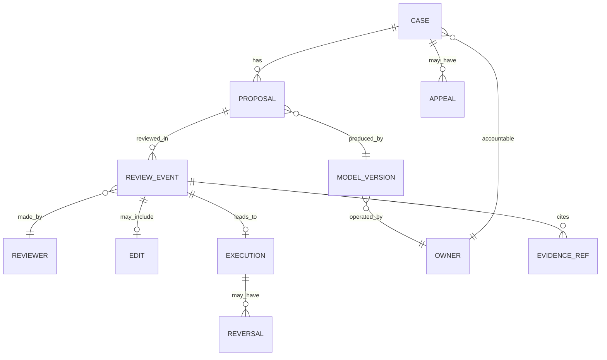

The model separates the proposal (produced by a model version) from the review event (made by a reviewer) from the execution (the action performed), because they have different actors and different times. A case can have multiple proposals and review events, for example after an edit, an escalation, or an appeal. The execution links to any reversal, which keeps history intact. The case links to the owner, and the model version links to its operating owner, which settles the question of who answers for which part.

### 18.3 Integrity

An audit trail is useful only if it is trustworthy. Properties to design for are append-only storage, tamper evidence, access control with logging of reads, time synchronization, and separation of the log from the systems it observes. Tamper evidence can be achieved with hash chaining: each record includes the hash of the previous record, so editing any record breaks the chain after it. The script [04_audit_chain_and_decay.py](../code/python/human-oversight-chapter/04_audit_chain_and_decay.py) demonstrates a minimal chain. It prints that the chain is intact on three records, then, after the decision in entry 1 is edited from "approve" to "reject", reports that the first bad index is 1. A production design publishes periodic anchors (the latest hash) to a separate system or to write-once storage so that an insider with database access cannot rebuild the whole chain. Regulated sectors have specific record-keeping requirements, such as write-once, read-many storage; check the rules that apply.

### 18.4 Retention

Retention balances the need to reconstruct and the duty to minimize. Some rules set minimums. The EU AI Act requires providers of high-risk systems to keep automatically generated logs for a period appropriate to the intended purpose and at least six months, unless other law provides otherwise (Articles 19 and 26(6)), and requires deployers to keep logs under their control for at least six months. Financial and health regulations often require years. Data protection law pushes the other way: keep personal data no longer than necessary. A practical approach tiers the data. Keep the structured event record (identifiers, versions, decisions, timestamps) for the full period. Keep large payloads such as raw documents and full transcripts for a shorter period or in a more restricted store. Pseudonymize identifiers where reconstruction needs only linkage. Support deletion requests without breaking the chain, for example by storing personal data in a separate vault referenced by a token, and deleting the vault entry while the chain keeps the token.

### 18.5 Privacy and access

Audit data is sensitive: it combines personal data, decisions about people, and reviewers' identities. Limit access by role, log access, and keep reviewer identities visible to those who need accountability and hidden from those who might harass reviewers (for example, in content moderation, where reviewers face threats). Do not use the audit trail as a surveillance tool on reviewers beyond the quality purposes stated in policy and agreed with the workforce, since monitoring that exceeds that purpose raises employment-law and morale issues.

### 18.6 The accountable owner

Each workflow needs a named accountable owner, a role with authority over the workflow's outcomes, staffing, and controls. The owner is distinct from the reviewers (who answer for individual decisions) and from the model owner (who answers for the model's behavior). The owner's responsibilities are explicit.

- Approve the automation rung and the demotion triggers.
- Own the thresholds, the routing policy, and changes to them.
- Ensure staffing and training match the capacity model.
- Review the oversight metrics at a stated cadence and act on them.
- Receive escalations of threshold breaches and material overrides.
- Own the recourse path and the incident response for the workflow.
- Sign off on changes to the model path that affect decisions, jointly with the model owner.

Writing this down avoids the diffusion described in Section 2.2 and gives auditors and regulators one point of contact. It also protects reviewers, who should not carry accountability for design decisions they could not influence. The sequence below shows how the audit trail and the owner interact in a material override.

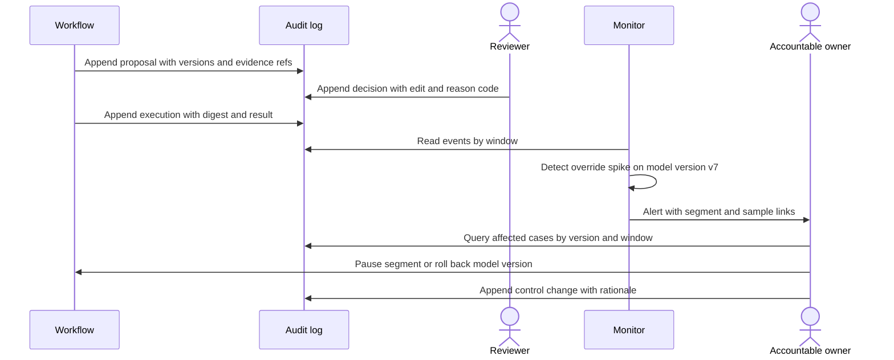

The sequence highlights that the monitor reads from the same log and that the owner's actions, such as pausing a segment, are also logged. The query by version and window is possible only because the proposal events recorded the model path.

## 19. Feedback: From Reviewer Decisions to Evaluation and Improvement

Reviewer decisions are valuable signals, and also easy to misuse. This section covers how to capture them, what they can and cannot support, and how to avoid loops that fool the team.

### 19.1 Capture structured reasons

A free-text rationale is hard to analyze. Pair it with a structured reason taxonomy. For overrides, reasons might include: model factual error, missing evidence the model did not have, policy interpretation difference, policy changed, input quality problem, reviewer preference or style, tool or data bug, and out-of-scope request. The reviewer picks one or more. A small taxonomy of 8 to 15 items is usable. Review it regularly, and add "other" with a text field to find missing categories. Include the evidence the reviewer relied on when it differs from the model's, as a structured pointer.

The taxonomy's value is that different reasons lead to different actions. A model factual error feeds the model's evaluation set. A policy change updates rules and prompts. A missing-evidence reason leads to retrieval or data work. A style preference is noise for the model and a signal for the reviewer training. Treating all overrides as model errors misdirects the improvement effort.

### 19.2 Label quality

A reviewer's decision becomes a label only after quality control. Problems are reviewer error, inconsistent standards, anchoring on the model's output (which makes agreement with the model inflated and disagreement under-recorded), and drift in standards over time. Improve label quality with the following.

- Use adjudicated labels for evaluation: cases where two independent reviewers agree, or where a tier 2 arbiter decided.
- Weight or filter by reviewer reliability, as measured on canaries.
- Keep a gold set labeled by experts under a documented guideline, and refresh it.
- Record the guideline version with each label.
- Measure agreement (Section 20) on the label set, and treat low agreement as a defect in the guideline, not just in the reviewers.

### 19.3 What feedback can feed

Feedback has three destinations with different governance.

**Evaluation sets.** Add reviewed cases, especially disagreements and escalations, to the offline evaluation sets that guard changes to the model. This is the lowest-risk and highest-value use. Keep a held-out set that the model team does not tune on. Part 17 CH11 covers the evaluation harness.

**Routing and thresholds.** Use outcomes to recalibrate and to refit the router. Use unbiased samples for the high-confidence region (Section 6.4).

**Training and fine-tuning.** Using reviewer decisions as training data is possible and carries more risk: label noise, privacy obligations (personal data used for training needs a lawful basis and notice), contamination of evaluation, and feedback loops. Apply data governance (Part 16 CH30), version the datasets, and require approval.

### 19.4 Feedback loops to avoid

The first loop is **the circular label**. If reviewers anchor on the model, and reviewer decisions become training labels, the next model learns to agree with the old model. Agreement rates rise and measured accuracy rises without any real improvement. Break the loop with independent-first review for the cases used as labels, with adjudication, and with audits against ground truth from outcomes where available.

The second is **selection bias**. Cases sent to reviewers are those the model was unsure about. A model retrained only on reviewed cases sees a distorted sample. Include the random sample of the auto path.

The third is **survivorship in outcomes**. If a model's approvals produce outcomes (loans repaid) and its denials produce none (no data on whether denied applicants would have repaid), outcome labels exist only for approved cases. Credit modelers call the attempt to correct this reject inference, and it has well-known limits. An exploration policy, such as approving a small random sample of borderline denials under tight limits, can produce outcome data, and it requires ethical and legal approval since it exposes some applicants to risk.

The fourth is **the reviewer adaptation loop**. Reviewers learn the model's quirks and compensate silently, for example by always editing a certain field. If those edits are not captured as feedback, the model never improves, and the process slowly depends on invisible human patches. Track frequent edit patterns, and treat them as defect reports.

The fifth is **gaming through the metric**. If the model team is judged by override rate, and reviewers are pressured to override less, the metric improves while quality does not. Keep the model team's metrics tied to audited escape rate and canary-confirmed quality, not to raw override rate.

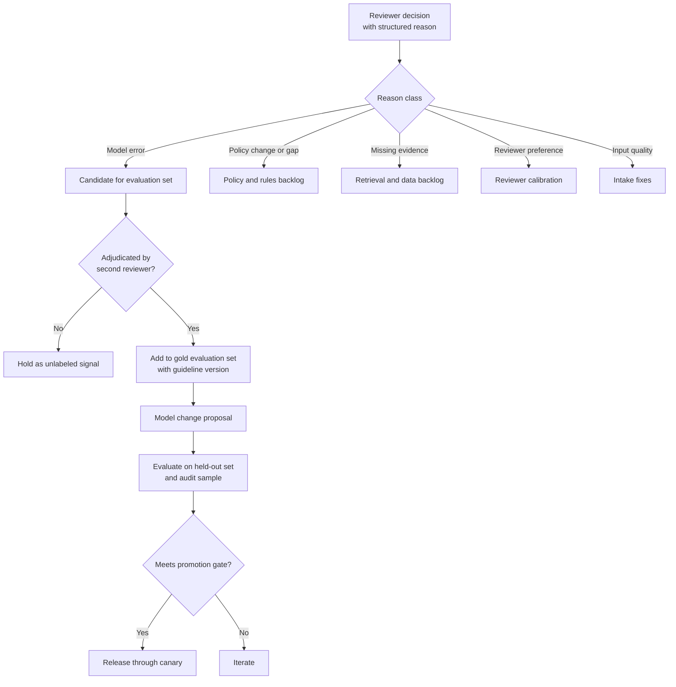

The flowchart shows reasons routed to different owners and the adjudication step that guards the evaluation set. Only adjudicated model-error cases enter the gold set. This keeps the gold set clean, and it makes the model improvement path auditable. The gate at the end connects to the lifecycle described in Part 17 CH10.

## 20. Quality Assurance of Reviewers

Reviewers are a measurement instrument and a decision maker. Their quality needs managing like any other component of the system.

### 20.1 Calibration sessions

A calibration session brings reviewers together to review the same cases and discuss discrepancies. The purpose is to align on the guideline, surface ambiguities, and update the guideline. A typical rhythm is weekly or biweekly at first, then monthly. Use a mix of ordinary cases and hard ones, including cases where the model was wrong. Record the outcomes: guideline changes, new examples, and unresolved questions. The sessions also give reviewers a voice in the process, which helps retention.

### 20.2 Inter-reviewer agreement and Cohen's kappa

Agreement between two reviewers on the same cases measures consistency. Raw percent agreement overstates it, because some agreement happens by chance, especially when one decision is common. Cohen's kappa corrects for chance:

$$\kappa = \frac{p_o - p_e}{1 - p_e}$$

where $p_o$ is the observed proportion of agreement and $p_e$ is the proportion expected by chance, computed from each rater's marginal distribution: $p_e = \sum_k p_{A,k}\,p_{B,k}$.

**Worked example.** Two reviewers independently label 200 cases as approve or reject.

| | B approves | B rejects | Total |
| --- | --- | --- | --- |
| A approves | 150 | 10 | 160 |
| A rejects | 15 | 25 | 40 |
| Total | 165 | 35 | 200 |

Observed agreement: $p_o = (150 + 25)/200 = 0.875$. Reviewer A approves 160 of 200 (0.80) and rejects 40 (0.20). Reviewer B approves 165 (0.825) and rejects 35 (0.175). Chance agreement: $p_e = 0.80 \times 0.825 + 0.20 \times 0.175 = 0.66 + 0.035 = 0.695$. Then $\kappa = (0.875 - 0.695)/(1 - 0.695) = 0.18/0.305 = 0.590$.

The raw agreement looks good at 87.5 percent, but kappa is 0.59, which by the common benchmarks of Landis and Koch (1977) is moderate agreement. The standard error is approximately $\sqrt{p_o(1-p_o) / (n(1-p_e)^2)}$, which here is $\sqrt{0.109375/(200 \times 0.0930)} = 0.077$, so an approximate 95 percent interval is 0.59 plus or minus 0.15, or about 0.44 to 0.74. The sample is too small to say much more. Agreement of this level means the guideline leaves substantial room for different decisions, and decisions based on a single reviewer's judgment carry noise.

**The rubber-stamp case.** Suppose two reviewers approve nearly everything and agree on 192 of 200 cases, with the table 190, 4, 4, 2. Observed agreement is 0.96. Each reviewer approves 97 percent of cases, so $p_e = 0.97 \times 0.97 + 0.03 \times 0.03 = 0.9409 + 0.0009 = 0.9418$, and $\kappa = (0.96 - 0.9418)/(0.0582) = 0.313$. High raw agreement with low kappa signals that agreement is mostly the shared habit of approving. The script prints both figures.

**Limits of kappa.** Kappa depends on prevalence: when one category is very common, kappa can be low despite high raw agreement, which is partly a feature (it reveals that the agreement carries little information) and partly a limitation (it penalizes a genuine easy majority). Report the confusion table and the raw agreement alongside kappa. For ordinal scales, use weighted kappa. For more than two raters, use Fleiss' kappa or Krippendorff's alpha, which handles missing ratings and different scales. Agreement measures consistency, not correctness: two reviewers can agree and both be wrong. Combine with canary accuracy.

**What to do with the number.** There is no universal threshold. A common working target for decisions with legal consequence is kappa above about 0.7 on adjudication-grade categories, with lower values triggering guideline review. Treat a drop in kappa after a policy change as evidence that the guideline is unclear, and treat a drop in kappa for one reviewer against peers as a coaching signal.

### 20.3 Reviewer performance measures

Use several measures for each reviewer and for the team, not one.

- Catch rate on seeded errors, with interval.
- Agreement with adjudicated labels on a sample.
- Override rate, interpreted in context (Section 11.5).
- Escalation appropriateness: share of escalations upheld by tier 2, and share of non-escalated cases later found to need it.
- Time per review distribution, watching both very short and very long.
- Evidence engagement: whether evidence panels are opened on cases where the model's evidence is weak.
- Rationale quality in a sample.

Use the measures for coaching and calibration first. Use them for consequences only through a documented, fair process, and recognize that aggressive use drives gaming and concealment.

### 20.4 Training and onboarding

Reviewers need training in the domain, the policy, the tool, the model's behavior, and the cognitive risks in Section 10. An onboarding path could include the following.

1. **Domain and policy**: the rules and the reasons behind them, with worked cases.
2. **Tool use**: the interface, shortcuts, and the escalation path.
3. **Model literacy**: what the model does well, where it fails, what its confidence means, and known failure patterns. Include examples of confident errors.
4. **Bias awareness**: automation bias and anchoring, with exercises in which the model is wrong and the reviewer's task is to catch it.
5. **Shadowing and supervised practice**: reviews checked by a mentor, with feedback.
6. **Certification**: a test on a set of canaries and adjudicated cases before the reviewer works independently, with a threshold.
7. **Continuing education**: updates on policy and model changes, with a short test.

Under the EU AI Act, deployers of high-risk systems must assign human oversight to people who have the necessary competence, training, and authority (Article 26(2)), and the Act's AI literacy provision (Article 4) applies to providers and deployers of all AI systems. As amended by the Digital Omnibus on AI in 2026, it requires them to take measures to support AI literacy among their staff, without guaranteeing a specific level for any individual (verify the current wording on the [European Commission AI Act Service Desk](https://ai-act-service-desk.ec.europa.eu/en/ai-act/article-4)). Training records are part of the evidence either way.

### 20.5 When a model changes, retrain

A model update changes the error profile. Notify reviewers of material changes, update the model literacy training, and run a short canary set on the new version before relying on the reviewers' judgment of it. Reviewers' sense of what the model gets wrong goes stale when the model changes, and an old heuristic ("it always misreads the date field") can mislead.

## 21. Workforce, Ergonomics, Fatigue, and Wellbeing

The reviewers are people with limits. A design that ignores them is brittle in the way a design that ignores memory limits is brittle.

### 21.1 Vigilance and fatigue

Sustained attention to a monotonous task declines within tens of minutes. This is the vigilance decrement documented since Mackworth's studies of radar operators in the 1940s. Review performance falls over a shift, with time since the last break, and with sleep loss. Design for it:

- Set maximum continuous review durations and mandatory breaks, and measure catch rate by time since break to find the real curve for your task.
- Limit total daily review hours for demanding task types, and put varied work in the rest of the day.
- Avoid long night shifts for critical queues where possible, and treat shift-end cases as higher risk (route canaries and four-eyes accordingly).
- Do not set targets that make breaks costly.

### 21.2 Ergonomics

Physical and cognitive ergonomics matter. Good screens, comfortable seating, low noise, and tools that reduce clicking and scrolling reduce errors and injury. Cognitive ergonomics means limiting context switching, presenting information in a consistent layout, avoiding interruptions during review, and not requiring reviewers to hold facts in memory that the screen could show.

### 21.3 Workload design

Cap the daily queue per reviewer based on capacity analysis, with a reserve for complex cases and escalations. Give reviewers control over pacing within bounds. Provide a visible way to flag overload (for example, an "I need help" signal) that triggers the saturation responses in Section 8.5. A reviewer who feels unable to flag overload will stop doing careful work and begin approving.

### 21.4 Reviewers of harmful content

Content moderation and safety review expose reviewers to violence, abuse, and other harmful material. Research and litigation have documented psychological harm, including post-traumatic stress symptoms, among moderators. The design obligations are significant.

- **Reduce exposure.** Use automation to filter, blur, or grayscale, to reduce audio, and to show text first. Provide an option to view the media at a reduced level of detail. Limit the volume and the time in the worst categories.
- **Rotate.** Move people between categories and between harmful and neutral queues.
- **Support.** Provide access to counseling and mental health support, accessible during work time and confidential, with the option to opt out of categories without penalty.
- **Screen and inform.** Tell candidates what the work involves before hire, obtain informed consent, and provide ongoing opt-outs.
- **Monitor wellbeing,** with the employee's consent and privacy protection, and do not make wellbeing disclosures a performance issue.
- **Pay and conditions.** Provide fair pay and secure employment terms. Outsourced moderation workforce conditions have been the subject of public reporting and legal claims, and a company is accountable for the conditions of its contractors.
- **Protect identities.** Hide reviewer identities from the people being reviewed and from the public.

### 21.5 Fairness to reviewers

Reviewers are accountable for their decisions only to the extent that they had the means to decide well. Metrics and discipline must reflect that. If a model failure produces a bad outcome after a reviewer approved on the evidence shown, the first question is whether the system gave the reviewer what was needed, not who clicked. Systems that blame the human at the end of a chain of design decisions display the moral crumple zone described in Section 10.

### 21.6 Sourcing the workforce

Reviewers can be employees, contractors, vendors, or domain experts such as clinicians and underwriters. The mix affects quality, confidentiality, and cost. Domain experts are expensive and scarce, and their time should be used where expertise matters: use trained generalists for tier 1 checks that need judgment but not specialist knowledge, and use specialists for escalations, arbitration, and canary construction. Confidentiality, data residency, and security requirements for the reviewer environment (no local copies, controlled screens) follow from the data being reviewed.

## 22. Metrics and the Detection of Oversight Decay

Oversight degrades unless it is measured. Decay is gradual, and the absence of visible incidents can be the result of a decayed control hiding errors, not of a safe system.

### 22.1 The core metrics

| Metric | Definition | What it tells you | Pitfall |
| --- | --- | --- | --- |
| Override rate | Share of reviewed cases where the reviewer changed or rejected the proposal | Whether reviewers disagree, and with which cases | Low may mean a good model or a rubber stamp |
| Reviewer-model agreement | Share of cases where the final decision equals the proposal | Mirror of override rate | Same |
| Inter-reviewer agreement | Kappa between reviewers on shared cases | Consistency of the guideline and training | Prevalence effects |
| Time per review | Distribution of decision time, by tier and case type | Depth of engagement | Fast is not always bad, so compare with catch rate |
| Canary catch rate | Share of seeded errors caught, with interval | Direct measure of error-catching | Needs realistic canaries |
| Escape rate | Error rate in a sampled audit of auto-approved and reviewer-approved items | Residual error | Needs adequate sample and independent auditors |
| Backlog age | Age distribution of queued items, especially the oldest | Capacity stress | Average hides the tail |
| SLA attainment | Percent of items decided within SLA, by class | Service level | Gaming through reprioritization |
| Escalation rate | Share of cases escalated, and share upheld | Judgment and safety to escalate | Both extremes suspicious |
| Appeal rate and reversal rate | Share contested, share changed on appeal | Decision quality and recourse health | Near zero reversals may indicate a formality |
| Review depth | Evidence panel opens, scroll depth, field edits | Evidence engagement | Proxy measure, can be gamed |
| Utilization | Busy time over available time | Capacity pressure | Quality may degrade before 100% |

Use distributions and intervals, not single averages, and break the metrics down by reviewer, by segment, by shift, by model version, and by routing reason.

### 22.2 Leading and lagging indicators

Escape rate and appeal reversal rate are lagging: they show harm after it occurred. Time per review, evidence engagement, override rate, backlog age, and utilization are leading: they show conditions that produce errors. A monitoring design uses both. Leading indicators warn early, and lagging indicators confirm real quality and keep the leading indicators honest, since a leading indicator that no longer correlates with escape rate has lost its meaning.

### 22.3 Detecting decay

Oversight decay shows up as a joint pattern: override rate falling, time per review falling, evidence engagement falling, and canary catch rate falling, often while the queue looks healthier. The script [04_audit_chain_and_decay.py](../code/python/human-oversight-chapter/04_audit_chain_and_decay.py) simulates 60 days in which decay begins on day 30. It uses an exponentially weighted moving average (EWMA) of the daily override rate, with smoothing factor 0.2, and flags when the smoothed series falls more than 40 percent below the baseline of the first 14 days. The baseline override rate is 0.123, and the first alert is on day 47, 17 days after the decay began. The median review time was 80 seconds on days 0 to 29 and 59 seconds in the ten days up to the alert. The data are synthetic, but they illustrate three points. A smoothed detector trades speed for fewer false alarms, so 17 days of delay is the price of that choice. Review time fell alongside override rate, which supports the diagnosis of declining engagement and not a model improvement. And a detector fed only by the override rate would not tell which of the four explanations in Section 10.4 applies, so the alert should trigger a canary run and an audit sample, not a conclusion.

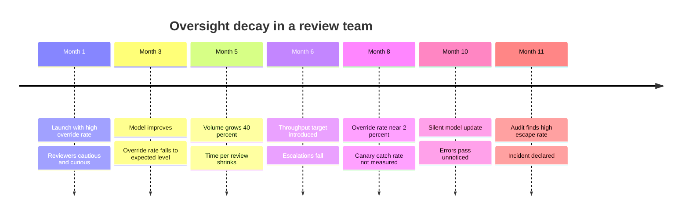

The timeline is a composite scenario, not data from a specific organization. It shows how decay accumulates from individually reasonable changes, each of which shifts the incentives or the load. The message is that no single event looks like the failure, and that the canary catch rate not being measured at month 8 is what allowed the decay to continue unseen. The countermeasure is to measure the catch rate continuously and to attach a response to each threshold.

### 22.4 Alert thresholds and responses

Pair each metric with a trigger and a response. For example: if the canary catch rate drops below a floor for a reviewer group, schedule a calibration session and increase canary frequency. If the audit escape rate exceeds tolerance, demote the rung for the affected segment and open an incident. If backlog age exceeds a limit, apply the saturation responses (Section 8.5). If appeal reversal rate rises, examine the reviewer instructions and the model. If the override rate falls more than a set fraction from baseline for two weeks, run the diagnostic in Section 10.4. A metric without a response is a report, not a control.

### 22.5 Reporting to the accountable owner

Give the accountable owner a short, regular oversight report: the core metrics with intervals, the trends, the incidents, the open actions, and any proposed rung changes. Include a plain-language statement of whether the oversight is working. Report to the human in command (Section 3.1) at the cadence the risk warrants. The report is also what a regulator or auditor will ask for, so building it routinely is cheaper than reconstructing it.

## 23. Regulatory Requirements for Human Oversight, Mapped to Design Features

Regulation changes faster than architecture, so this section teaches the mapping and tells you what to verify. The facts below were checked in October 2026 against the sources cited. This is orientation for design, not legal advice. Confirm the applicable text, dates, and national implementation with counsel.

### 23.1 The EU AI Act and where Article 14 sits

The EU AI Act (Regulation (EU) 2024/1689) sets human oversight as a requirement for high-risk AI systems. Article 14 requires that such systems be designed and developed, including with appropriate human-machine interface tools, so that natural persons can effectively oversee them while in use. The text is on the [European Commission AI Act Service Desk](https://ai-act-service-desk.ec.europa.eu/en/ai-act/article-14). The purpose is to prevent or minimise risks to health, safety, or fundamental rights, including risks that persist despite the other requirements. Measures must be commensurate with the risks, level of autonomy, and context of use, and can be built into the system by the provider or specified by the provider for the deployer to implement.

Article 14(4) lists what the people assigned to oversight must be enabled to do, as appropriate and proportionate:

- understand the relevant capacities and limitations of the system and monitor its operation, including detecting anomalies, dysfunctions, and unexpected performance;
- remain aware of the tendency to rely automatically or excessively on the output (automation bias), especially where the system provides information or recommendations for decisions taken by people;
- correctly interpret the output, using available interpretation tools and methods;
- decide in any situation not to use the system, or to disregard, override, or reverse its output;
- intervene or interrupt the system through a stop button or similar procedure that lets it come to a halt in a safe state.

Article 14(5) adds, for the remote biometric identification systems referred to in point 1(a) of Annex III, that no action or decision is taken on the basis of an identification unless it has been separately verified and confirmed by at least two natural persons with the necessary competence, training, and authority. The text exempts law enforcement, migration, border control, and asylum uses where Union or national law considers the requirement disproportionate.

The text matches the topics of this chapter closely. Article 14(4)(b) names automation bias in law, which makes Section 10 a compliance matter as well as a quality matter.

### 23.2 Related articles

Several other provisions interact with oversight design.

| Provision | Content in brief | Design consequence |
| --- | --- | --- |
| Article 12 (record-keeping) | High-risk systems must allow automatic recording of events over their lifetime | Event log with model path and review events (Section 18) |
| Article 13 (transparency to deployers) | Instructions for use, including capabilities, limitations, and human oversight measures | Reviewer training content and the limitations panel (Sections 12 and 20) |
| Article 26 (obligations of deployers) | Use per instructions, assign oversight to competent and trained people with authority, monitor operation, keep logs for at least six months, inform workers' representatives and affected people | Decision-rights table, reviewer certification, metrics, retention |
| Article 27 (fundamental rights impact assessment) | For certain deployers, an assessment before first use | Input to the choice of rung and oversight measures |
| Article 73 (serious incident reporting) | Providers report serious incidents to authorities | Incident path from monitoring to reporting (Part 17 CH12) |
| Article 86 (right to explanation) | A person affected by a decision based on output of certain Annex III systems may request explanation of the role of the system and main elements of the decision | Recourse path and reason capture (Section 14) |
| Article 4 (AI literacy) | Measures to support AI literacy among staff | Training and onboarding (Section 20) |

The logging duty is worth a note for architects: the six-month minimum for log retention in Articles 19 and 26 is a floor, and sector law or the need to handle appeals often sets a longer period.

### 23.3 The timeline after the Digital Omnibus

At the time of writing (October 2026), the dates changed from those in the original Act. The Digital Omnibus on AI, Regulation (EU) 2026/1744, signed on 8 July 2026 and published in the Official Journal on 24 July 2026, entered into force on 27 July 2026 ([EUR-Lex](https://eur-lex.europa.eu/eli/reg/2026/1744/oj/eng)). Reporting from the Council and from legal and standards commentary says it moves the application of the high-risk obligations for stand-alone systems listed in Annex III from 2 August 2026 to 2 December 2027, and for AI embedded in products covered by Annex I product legislation to 2 August 2028 (see the [Council press release of 7 May 2026](https://www.consilium.europa.eu/en/press/press-releases/2026/05/07/artificial-intelligence-council-and-parliament-agree-to-simplify-and-streamline-rules/pdf/)). Some commentary notes that systems placed on the market before the new dates face the requirements only on substantial modification. Prohibited practices and the general-purpose model rules were already applicable under the original schedule, and some transparency obligations under Article 50 keep earlier dates. These details are the kind that change, so verify them against the Official Journal text and the Commission's guidance before relying on a date in a plan.

For an architect the consequence is practical. Dates affect when a legal obligation attaches, but they do not change what good oversight is, and building the Article 14 features now is cheaper than retrofitting them in 2027. Treat the delay as time to do it well.

### 23.4 Other rules that shape oversight

**GDPR Article 22.** Restricts decisions based solely on automated processing with legal or similarly significant effects, and requires safeguards (human intervention, expressing a point of view, contesting). Section 14.1 covers the SCHUFA ruling on scores. A human who merely applies a score does not by that fact remove the decision from Article 22, so the human review needs substance.

**Digital Services Act (EU).** For online platforms, Article 17 requires a statement of reasons to affected users when content is removed or restricted, and Article 20 requires an internal complaint-handling system whose decisions are taken under the supervision of appropriately qualified staff and not solely by automated means. Article 21 provides for out-of-court dispute settlement. These bear directly on the content moderation design in Section 29. Check the current text.

**Credit and consumer finance (United States).** Adverse action notices under the Equal Credit Opportunity Act and Regulation B must state specific reasons, and the Consumer Financial Protection Bureau has said that creditors using complex algorithms must still give them. Model risk management guidance from US banking regulators (the Federal Reserve and Office of the Comptroller of the Currency guidance known as SR 11-7) expects effective challenge of models by independent, competent staff, which is the same idea as meaningful oversight.

**Health.** Clinical decision support and documentation tools may fall under medical device rules. Under the US framework, software that supports a clinician can be excluded from device regulation only when, among other criteria, the clinician can independently review the basis for the recommendation and does not rely primarily on it. The details and the regulator's guidance have been updated recently, so verify the current position. In the EU, the Medical Device Regulation and the AI Act may both apply to a product.

**Employment, public benefits, and other sectors.** Many jurisdictions add notice, human review, or limits on automated decision-making in employment and public services. Identify the sector rules in the design phase.

### 23.5 Mapping requirements to design features

| Requirement | Design feature | Chapter section |
| --- | --- | --- |
| Effective oversight by natural persons (Art. 14(1)) | Decision-rights table, evidence display, capacity model, utilization ceiling | 3, 9, 12 |
| Understand capacities and limitations, detect anomalies (14(4)(a)) | Limitations panel, model literacy training, monitoring dashboards, drift alarms | 12, 20, 22 |
| Awareness of automation bias (14(4)(b)) | Training, blind review, canaries, forcing functions | 10, 11, 20 |
| Correct interpretation of output (14(4)(c)) | Uncertainty display, evidence links, explanation limits | 12 |
| Disregard, override, reverse (14(4)(d)) | One-click rejection, authority matrix, undo | 11, 13, 17 |
| Stop button (14(4)(e)) | Pause by segment, rollback by version, drills, safe halt semantics | 13.4 |
| Two-person verification for certain biometric identification (14(5)) | Blind four-eyes with exclusion rules | 8.7 |
| Competence, training, authority of overseers (26(2)) | Certification, onboarding, authority limits | 3, 20 |
| Logging and retention (12, 19, 26(6)) | Hash-chained event log, tiered retention | 18 |
| Explanation to affected people (86) and GDPR safeguards | Recourse path, reasons capture, independent review | 14 |
| Informing workers and affected persons | Notice templates, worker consultation | 14, 21 |

A design review can use this table as a traceability matrix. For each row, point to the component and the test that shows the feature works, such as a stop drill, a canary catch-rate report, or an audit query. A requirement that has no test is a claim.

## 24. The Cost and Benefit of Oversight

Oversight costs money, time, and sometimes speed, so it needs a business case. The case rests on the economics in Section 7 plus the overhead of running the oversight function. All figures in this section continue the running example and are illustrative.

### 24.1 Gross benefit

Without review, the running example produces 1,260 errors per day, costing $1{,}260 \times 200 = 252{,}000$ per day. With the policy of reviewing bins up to 0.95, residual errors fall to 157.5 per day, costing 31,500. Gross error cost avoided is $252{,}000 - 31{,}500 = 220{,}500$ per day.

### 24.2 Costs

The direct review cost is $7{,}500 \times 4 = 30{,}000$ per day. Overheads add:

| Overhead item | Basis | Cost per day |
| --- | --- | --- |
| Audit sample of auto path | 2 percent of 2,500 auto items is 50 audits, at 12 units each for senior auditors | 600 |
| Canary cases | 3 percent of 7,500 reviews is 225 canaries, at 4 units | 900 |
| Tooling, queue platform, security, storage | Fixed, allocated per day | 1,200 |
| Total overhead | | 2,700 |

Total oversight cost is $30{,}000 + 2{,}700 = 32{,}700$ per day.

### 24.3 Net benefit and ratio

Net benefit is $220{,}500 - 32{,}700 = 187{,}800$ per day, or about 68.5 million per year ($187{,}800 \times 365 = 68{,}547{,}000$). The benefit-to-cost ratio is $220{,}500 / 32{,}700 = 6.74$. Even with generous assumptions about overhead, the review is worth running under these numbers. The conclusion depends on the cost of an error. If $C_e$ were 20 instead of 200, the same policy would lose money, and the break-even logic in Section 7.1 would drop the threshold to about 0.78 confidence (computed as $1 - 4/(0.9 \times 20) = 0.778$).

### 24.4 The cost of decayed oversight

Suppose the reviewer catch rate falls from 0.90 to 0.60 through overload and rubber-stamping, while everything else stays the same. Errors inside the reviewed set are 1,225 per day, so reviewers now miss $1{,}225 \times 0.40 = 490$ instead of 122.5. Adding the 35 auto-path errors, residual errors are 525 per day, costing 105,000. With the review cost of 30,000, the total is 135,000 per day, against 61,500 for healthy oversight. The decay costs $135{,}000 - 61{,}500 = 73{,}500$ per day, or about 26.8 million per year ($73{,}500 \times 365 = 26{,}827{,}500$), while the review spending is unchanged. The canary program costs 900 per day. That is 1.2 percent of the daily loss from the decayed state, and it is what detects the decay. This is the arithmetic that justifies measurement.

### 24.5 When review does not pay

The break-even catch rate for a bin with model error rate $\epsilon$ is $q^* = C_r/(\epsilon C_e)$. For the 0.95 bin ($\epsilon = 0.05$), $q^* = 4/(0.05 \times 200) = 0.40$. The reviewers must catch at least 40 percent of errors in that bin for the review to pay. For the 0.98 bin ($\epsilon = 0.02$), $q^* = 4/(0.02 \times 200) = 1.0$, so even a perfect reviewer only breaks even. These numbers explain why reviewing high-confidence bins is rarely economical, and why a falling catch rate can turn review in marginal bins from profitable to wasteful. They also show that the right threshold depends on the real catch rate, which should be measured and not assumed.

### 24.6 Costs that are hard to count

The model leaves out several things. Review speeds up learning and labels data, which has value. Review gives legitimacy and trust, which have commercial and regulatory value that shows up as avoided fines, avoided litigation, and retained customers. Slow review costs customers in latency and abandonment. Reviewer turnover costs hiring and training. And an incident from a missed error carries reputational damage that exceeds the direct cost. Include these as qualitative factors or as stated adjustments to $C_e$, and state the assumptions so a reader can contest them.

### 24.7 Reducing the cost of oversight

Four levers reduce cost without lowering safety. Better routing sends fewer, better-targeted cases to reviewers. Better interfaces cut handling time (Section 12.7), and Section 9 shows the nonlinear value of that. Automation of the checkable parts (validators, reference lookups) removes mechanical work. And better models reduce the number of errors to find. Each lever has its own measurement. Avoid the one lever that reduces cost by lowering quality: speeding reviewers up with targets that reduce the catch rate.

## 25. Failure Scenarios as Stimulus, Response, and Measure

Quality attribute scenarios describe how the system should behave under a stress. Each scenario below states the stimulus, the designed response, and the measure that shows the response worked. Part 17 CH13 uses the same format for reliability.

### 25.1 Reviewer overload

**Stimulus.** A marketing campaign doubles the arrival rate of reviewable items for six hours. Reviewers are at 75 percent utilization before the surge.

**Response.** The queue monitor detects backlog age above the limit within five minutes and pages the queue owner. The system reprioritizes by consequence, throttles intake of low-priority items with a stated delay message, calls in standby reviewers, and refuses to lower thresholds or auto-approve expired items. Items past SLA move to the safe default.

**Measure.** No item in the critical tier waits beyond its SLA. Canary catch rate during the surge stays within 5 points of baseline. No auto-approval of expired items occurs, shown by an audit query. Backlog returns to normal within two hours after the surge.

**Why it matters.** Section 9.4 shows that a rise of that size pushes a 75 percent utilized team toward saturation. Without a pre-agreed response, the pressure is relieved by speeding up reviewers, and the catch rate collapses (Section 10.3).

### 25.2 Drifted confidence

**Stimulus.** An upstream change in document formats lowers extraction accuracy in the 0.95 confidence bin from 95 to 90 percent. The reported confidence does not change.

**Response.** The audit sample of the auto path shows an escape rate above the tolerance for that bin. The monitor raises an alert, the owner demotes the rung for affected document types (auto-approval is paused or the threshold is raised), and the model team investigates. The calibration is refit from the unbiased sample.

**Measure.** Time from onset to detection is at most five days at a 2 percent audit sample (the bin yields 40 audited items per day, about 2 errors expected under calibration and 4 under drift, so 5 days gives about 10 against 20, a difference of about three standard deviations). Hidden loss before detection is bounded by $100 \times 200 = 20{,}000$ per day for those days, as in Section 6.3.

### 25.3 Silent model update

**Stimulus.** The hosted model provider updates the model behind an alias. The prompt is unchanged. The output style and the error profile change.

**Response.** The gateway pins versions and records the model identifier on each event (Part 17 CH08 and CH10). A canary evaluation set runs on a schedule and on any detected change in the response fingerprint. The score distribution monitor flags a shift. The system routes more cases to review while the new behavior is characterized, and the rung stays lower until the new version has earned evidence.

**Measure.** The event log lets the owner query the affected cases by model version and time. Detection within one canary cycle (for example, 24 hours). Percentage of events with a recorded model identifier is 100 percent. Reviewers are informed of the change and complete a short canary check before they resume normal throughput.

### 25.4 Adversarial inputs designed to look easy

**Stimulus.** A fraud ring learns that documents with a particular layout receive confidence above 0.99 and are auto-approved. They submit 50 fraudulent items per day of the 10,000 daily items.

**Response.** Random sampling of the auto path is independent of the confidence, so adversarial items are audited at the same 2 percent rate as others. Each day the expected number of audited fraudulent items is $50 \times 0.02 = 1$. Over five days, with 250 fraudulent items, the probability of at least one being audited is $1 - 0.98^{250} = 1 - e^{-5.05} = 0.994$. Once found, the pattern is added to the rules, the segment is demoted, and similar items are re-examined retrospectively using the audit trail.

**Measure.** Probability of detection within five days above 99 percent for this volume. Time to a rule or a model fix after detection. Number of retroactively found cases. Residual harm bounded by 250 items times the cost per error.

**Design note.** Defense depends on sampling that is not predictable by the attacker. Do not publish sampling rules, and avoid sampling schemes that depend on features an attacker can control. Where adversaries exist, add diversity of signals, because the more signals the system uses, the harder it is to craft an input that looks easy to all of them. Part 17 CH12 covers adversarial robustness controls.

### 25.5 Canary leakage

**Stimulus.** Reviewers discover that canary cases have a recognizable formatting artifact and begin to spot them.

**Response.** The canary program owner reviews the canary construction, regenerates the set from fresh real cases with the same pipeline, and tests distinguishability by asking an independent group to classify cases as real or canary. Canary results during the leaked period are marked as unreliable.

**Measure.** The independent group cannot classify canaries better than chance, with a stated test. Catch rate on refreshed canaries is compared with the previous period.

### 25.6 Audit log unavailable

**Stimulus.** The audit store is unreachable for 30 minutes.

**Response.** For high-tier actions, execution fails closed: the action service refuses to commit an approval it cannot log. For low-tier actions, events are buffered durably and replayed, with a gap marker, and the incident is recorded. The chain verification runs after recovery.

**Measure.** Zero committed high-tier actions without a log record. Buffered events replayed within one hour of recovery. Chain verification passes.

### 25.7 Reviewer unavailability and key-person risk

**Stimulus.** Only two reviewers are certified for a specialist category, and one leaves.

**Response.** The skills matrix shows single points of failure in advance. The system routes the category to tier 2 and starts accelerated certification. In the meantime, intake for that category is throttled or processed by a conservative deterministic path.

**Measure.** Number of categories with fewer than three certified reviewers is zero, reviewed monthly.

## 26. Comparison of Oversight Designs

| Design | Where the human acts | Throughput bound | Error catching | Accountability | Typical failure | Best use |
| --- | --- | --- | --- | --- | --- | --- |
| Review every case before action | Before | Reviewer capacity | High if staffed and engaged | Strong, per case | Rubber-stamping under load | Critical tier, legal requirement |
| Review by confidence threshold | Before, for part of the flow | Capacity for the routed share | Good in the low-confidence region | Strong for the routed share | Drifted confidence, uncovered auto path | Medium and high tiers with calibrated scores |
| Review by consequence rule | Before, for risky cases | Capacity for the risky share | Independent of model confidence | Strong | Rules too coarse | Where confidence is unreliable |
| Act with undo window and notice | After | Notice handling | Depends on notice reach | Moderate | Ignored notices | Reversible actions |
| Sampled audit | After, statistical | Audit sample size | Finds rate and patterns, not each error | Weak per case, strong per process | Late detection | Low-impact high volume |
| Monitoring with stop | After, aggregate | Monitor attention | Finds drift and bursts | Moderate | Alarm fatigue, slow stop | Minimal-impact systems |
| Two-stage (model then human, with second human for disagreements) | Before, layered | Higher cost per case | Highest | Strong | Cost, correlated errors | Highest-severity decisions |

The designs combine. A typical production arrangement uses consequence rules and confidence thresholds for the pre-action review, an undo window for the middle, sampled audit for the bulk, and monitoring with a stop across everything. The table also makes the cost-quality trade-off visible: more human involvement per case increases cost and, up to the capacity limit, increases error catching. Beyond the capacity limit, quality falls.

## 27. Worked Design A: Loan Pre-Screening

### 27.1 Context

A lender receives 2,400 consumer loan applications per day. A model produces a pre-screening result so that applicants learn quickly whether they are likely to qualify and so that underwriters spend time on the right files. Creditworthiness evaluation of natural persons is a listed high-risk use in Annex III of the EU AI Act, and credit decisions carry adverse action and fair lending obligations in many jurisdictions. The lender operates in both the EU and the US. The design must be defensible to a regulator and affordable.

The model emits one of three bands with calibrated probabilities and reason codes: "likely eligible," "refer," and "likely decline." Illustrative traffic shares from the validation period are 35, 45, and 20 percent.

### 27.2 Design

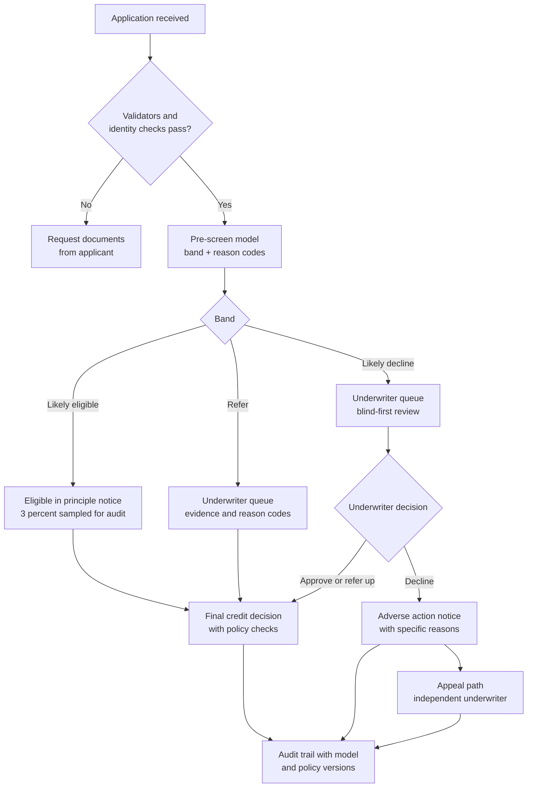

The central choice is that no applicant is declined by the model alone. Every "likely decline" goes to an underwriter, and the underwriter sees the file and the reason codes. Applicants in the "likely eligible" band get an in-principle notice that states plainly that it is not a final decision, because the final credit decision still passes policy checks and verification. Three percent of in-principle approvals are audited by senior underwriters, who see the file without the model band, to estimate the escape rate (applications that should have been referred or declined).

Reviewers in the decline queue use blind-first review: they record an initial assessment of affordability and risk flags before the band is displayed. This costs about one extra minute per case and reduces anchoring on the decline label. Reason codes in the adverse action notice derive from the factors the underwriter confirmed against the file and from the model's documented reason codes where the model is interpretable by construction. The system does not turn free-form model text into a legal reason.

### 27.3 Capacity arithmetic

Reviews per day are 45 percent of 2,400 (1,080 refer) plus 20 percent (480 decline), totaling 1,560, plus the 3 percent audit of the 840 in-principle approvals (about 25), for roughly 1,585. Handling time is 9 minutes for refer and decline cases (the blind-first step is included). Workload is $1{,}560 \times 9 = 14{,}040$ minutes, or 234 hours per day. If each underwriter has 7 hours on the job and a utilization ceiling of 75 percent, productive review time is 5.25 hours per person-day, so the team needs $234 / 5.25 = 44.6$ person-days per day. With 30 percent shrinkage the headcount is $44.6 / 0.7 = 63.7$, or 64 underwriters. The Erlang C check (Section 9.3) on 3 applications per minute spread over a working day gives a utilization consistent with the ceiling. Peak hours need additional capacity, so staffing is set from the peak-hour arrival rate, not the daily average.

If management asks to cut the team by a quarter, the options are to raise the share of in-principle approvals (which raises audit risk), lower the model's refer band by raising its confidence cut-offs (which changes who gets declined by a person), or reduce handling time with a better file view. The ADR below records why the first two are rejected without evidence.

### 27.4 Architecture Decision Record

**Title.** Underwriter decides every decline; model pre-screens only.

**Context.** The use case is high-risk under EU law, adverse action rules require specific reasons, the model has an audited escape rate of 1.5 percent on the in-principle approvals during a pilot (6 of 400 audited, 95 percent interval 0.69 to 3.23 percent), and underwriting capacity is the dominant cost.

**Decision.** Use rung 3 (propose and approve) for refer and decline. Use rung 5 (act and sample) for in-principle eligibility, which is a non-binding notice. Keep final credit decisions subject to policy checks. Provide a contest path with an independent underwriter.

**Alternatives rejected.**

1. *Automatic decline with appeal.* Cheaper by 480 reviews per day, about 31 percent of the 1,560 daily reviews. Rejected because it places the burden on applicants, risks GDPR Article 22 issues, and makes adverse action reasons depend on the model's explanation. Appeal rates among declined applicants are typically low, so wrongful declines would persist.
2. *Score-only display for underwriters.* Cheaper to build. Rejected because it invites anchoring, gives underwriters nothing to disagree with, and fails the evidence requirement in Article 14(4)(c).
3. *Full manual underwriting with the model as a reference only.* Highest quality, no efficiency gain. Rejected on cost, but retained as the fallback if the audit escape rate exceeds tolerance.
4. *Confidence-only routing.* Rejected because declines need review regardless of confidence, and because calibration across applicant segments was not yet validated.

**Consequences.** Staffing of about 64 underwriters at current volume. A canary and audit program. Fairness monitoring by segment owned by the governance function (Part 16 CH31). A demotion rule: if the audit escape rate upper bound exceeds 2 percent over a rolling month, the in-principle notice is paused for the affected segment.

**Validation evidence required before launch.** Calibration by segment on a held-out period, canary catch rate of at least 70 percent by underwriters in certification, appeal path tested end to end, and the stop control exercised in a drill.

### 27.5 Risks that remain

Population shift after a marketing campaign could change calibration. The audit sample, stratified by acquisition channel, is the control. Underwriters might defer to the "likely decline" label despite blind-first review, which the canary program measures. And reason-code text might be reused without the underwriter's confirmation, which the action service prevents by requiring a confirmed reason before a notice can be sent.

## 28. Worked Design B: Clinical Documentation Assistant

### 28.1 Context

A health system deploys an assistant that listens to a clinic visit with patient consent, transcribes it, and drafts a visit note in the clinic's template. The clinician reviews, edits, and signs. The note enters the medical record and informs later care and billing. Clinicians see 20 patients a day. Hours of documentation after clinic are a known burden, and the aim is to reduce them without adding errors to the record.

The legal and professional position is that the clinician is the author of the record and responsible for it. The tool is therefore a drafting aid at rung 2, and the architecture has to make that responsibility practicable.

### 28.2 Error types

The dominant risks in a draft are omission (a symptom or instruction left out), hallucination (a finding or a negative that was never said), misattribution (a statement by the patient recorded as the clinician's observation), wrong laterality or units, medication errors (name, dose, route, frequency), and wrong negation ("no chest pain" turned into "chest pain"). Errors in medications, allergies, laterality, and negations are the highest consequence. Notes are long, so the reviewer's attention is limited, and the draft is fluent, which encourages skimming.

### 28.3 Design

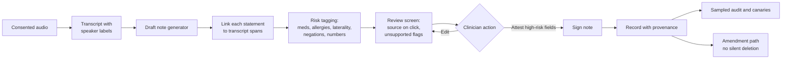

The generator links every sentence to the transcript spans that support it. Clicking a sentence highlights the source. Sentences with no support are flagged "not found in the conversation." A separate tagger identifies high-risk elements and lists them in a compact panel at the top: medications with dose, allergies, laterality, negations, and numbers. Before signing, the clinician attests to the high-risk panel by confirming each item or editing it. The attestation is a forcing function with a bounded cost: a typical note has perhaps six to ten such items, and each is a single confirmation. Low-risk narrative need not be attested individually.

The record stores provenance: the note is marked as drafted with machine assistance, the draft version and the final version are retained, and the edit distance is stored. Amendments follow the medical record rules, so a signed note is amended with a dated addendum and not overwritten. Audio is retained for a short period needed for quality checks and is then deleted, consistent with the consent given and local rules. Patient consent and notice are captured as part of the encounter workflow, and the patient may decline.

### 28.4 Measuring whether it works

The team measures four things. First, the clinician's time: the note takes 7 minutes to produce manually, and the target is 4 minutes with the assistant, including review (illustrative figures). Second, the share of notes signed with no edits, which should stay well below the point at which it indicates skimming, and which the team watches by clinician and by note length. Third, the escape rate in a sampled audit by trained documentation specialists who compare note and recording. Fourth, the catch rate on canaries: a set of historical encounters in which known errors were inserted into the draft (a wrong dose, a flipped negation, a wrong side), presented to clinicians in the normal workflow, with the clinicians informed under policy that such cases exist.

Audit arithmetic matters here. In a pilot, specialists audit 400 notes and find 6 with a material uncaught error, an escape rate of 1.5 percent with a 95 percent Wilson interval of 0.69 to 3.23 percent (script 03). The clinical governance committee's tolerance is 1 percent. The point estimate is above tolerance, and the interval does not exclude the tolerance either way. The team does not declare success. It investigates the error types (the 6 errors are mostly negations and omissions), changes the display of negations, and re-audits. To show a rate below 1 percent with 95 percent confidence when no errors are found, the team needs about 300 audited notes (the "rule of three": $3/n < 0.01$ gives $n = 300$). That figure sets the audit size for the next phase.

### 28.5 Architecture Decision Record

**Title.** Clinician is author of record; machine drafts with source-linked statements and attested high-risk fields.

**Context.** Fluent drafts raise automation bias risk. Notes are legal records. Clinician time is the scarce resource, and the system's benefit comes from saved documentation time.

**Decision.** Rung 2 (draft and edit). Source linking for every statement. A high-risk panel with attestation before signing. No auto-signing at any volume. Sampled audit and canaries. Short audio retention.

**Alternatives rejected.**

1. *Auto-sign notes where the confidence is high.* Rejected because the clinician is the legally responsible author, confidence scores for free text lack validated calibration, and the cases that matter are the high-confidence errors.
2. *Show the draft with no source links.* Rejected because verifying a claim would require replaying audio, which no clinician will do under time pressure.
3. *Attest every sentence.* Rejected because the time cost would remove the benefit, and attestation fatigue would turn it into a click-through. Attesting only the high-risk panel keeps the confirmation meaningful.
4. *Store only the final note.* Rejected because the provenance of the draft and the edit distance are needed for audit, for incident analysis, and for monitoring reliance.

**Consequences.** Slightly longer review than a skim, which is intended. A documentation-quality audit function. A training module on the assistant's known error patterns. Monitoring of unedited-note share and of edit distance by clinician. A demotion rule: if the audit escape rate exceeds tolerance for two consecutive months, high-risk attestation extends to additional fields, and if it persists the assistant is withdrawn for that specialty.

### 28.6 Risks that remain

Clinicians under time pressure may attest without reading. Canary catch rate by clinician, reported as coaching data, is the check. Specialty vocabulary or accents may degrade the transcript for some patients, so audit sampling stratifies by language and accent group to find unequal performance. A model update may change error patterns, which the release process treats as a change to the decision path (Section 4.6).

## 29. Worked Design C: Content Moderation

### 29.1 Context

A social platform receives 2 million posts per day. Classifiers flag about 3 percent for possible policy violations, which is 60,000 items. Actions are removal, reduced distribution, labeling, and account penalties. Errors in both directions cause harm: leaving up harmful content hurts people, and wrongly removing content silences users and erodes trust. Reach matters, because a harmful post seen by a million people is worse than one seen by ten. Reviewers face distressing material. The platform is subject to the EU Digital Services Act and other rules.

### 29.2 Design

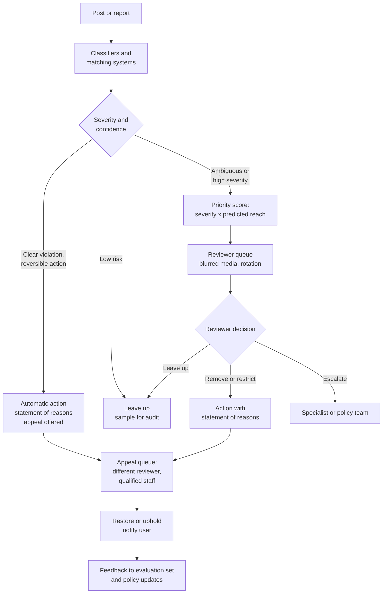

The design divides content into three paths. Clear, reversible violations (for example, bulk spam, or content matching known prohibited material by deterministic matching) get automatic action, a statement of reasons to the user, and an appeal. Ambiguous or severe items go to reviewers, ordered by a priority score that multiplies severity by predicted reach over the next hour, so that content likely to spread is seen first. Low-risk items stay up, with a random sample audited to estimate how much harm the classifiers miss.

All appeals go to a different reviewer from the original, and appeals of automated actions are decided by qualified staff and not by an automated system, consistent with the complaint-handling expectations of the Digital Services Act. Reviewer outcomes feed an evaluation set after adjudication, and policy ambiguities found in disagreements go to the policy team.

### 29.3 Capacity arithmetic

Suppose 40 percent of the 60,000 flagged items are handled automatically (24,000) and 60 percent (36,000) go to review. At 45 seconds each, the workload is $36{,}000 \times 45 / 3600 = 450$ hours per day. The wellbeing policy caps harmful-content review at 5 hours per reviewer per day (Section 21.4), so on-duty reviewers needed are $450/5 = 90$. With 30 percent shrinkage, the headcount is $90/0.7 = 128.6$, or 129.

Reviewers remove or restrict 40 percent of what they see, which is 14,400 items. Together with the 24,000 automatic actions that makes 38,400 actions per day. If 5 percent are appealed, there are 1,920 appeals per day. At 4 minutes each, appeal work is $1{,}920 \times 4 / 60 = 128$ hours, needing $128 / 5 = 25.6$ on-duty appeal reviewers. These are separate from the first-line team to preserve independence. The appeal reversal rate is the most informative quality measure: a reversal rate of 12 percent on automatic actions and 6 percent on human actions (illustrative) would show where first-instance accuracy is weakest and would justify raising the confidence bar for automation of the weaker categories.

The priority score matters for harm reduction under a capacity limit. If the team can review all items within 4 hours on average but a viral item gets 80 percent of its views in the first hour, a first-in, first-out queue protects nobody. Sorting by predicted reach moves the item to the front. The same sorting risks neglecting low-reach harmful content, so an aging term guarantees a maximum wait.

### 29.4 Reviewer wellbeing in the design

Media is blurred or shown in reduced resolution by default, with audio off, and the reviewer chooses to reveal detail only when needed. Queues of the most severe categories are staffed by volunteers who have opted in with informed consent, rotated frequently, and capped at fewer hours. Counseling is available during work hours and is confidential. Metrics for these queues emphasize quality and not speed. Reviewer identities are hidden from users and from the public. Those measures are costs, and they are included in the 129-person estimate through the 5-hour cap and the shrinkage allowance.

### 29.5 Adversarial dynamics

Bad actors adapt. They alter images, use coded language, and post at times when staffing is thin. They also try to trigger mass reports against opponents' content to exploit automated action. Controls include random sampling of the leave-up path (to measure evasion), rate limits and weighting of reports by reporter reliability, retroactive sweeps when a new evasion pattern is found (the audit trail lets the platform find all content scored under the old model version), and human review of automated action triggered by report spikes.

### 29.6 Architecture Decision Record

**Title.** Automate only clear, reversible violations; prioritize human review by severity times reach; separate appeals.

**Context.** Volume is too high for universal review. Harm depends on reach. Wrongful removal affects speech rights and trust. Reviewers are at risk of psychological harm.

**Decision.** Three paths (automatic, human, leave up with sampling). Priority by severity and predicted reach with aging. Appeals by different qualified staff. Wellbeing controls as design requirements. Stop control per policy category.

**Alternatives rejected.**

1. *Review everything flagged.* Rejected on cost and on harm to reviewers: it would need 150 reviewers on duty instead of 90 at the 5-hour cap, since 60,000 items at 45 seconds is 750 hours and 750/5 = 150, or 214 people with shrinkage (150/0.7 = 214.3) instead of 129.
2. *Automate all high-confidence removals, including severe and ambiguous categories.* Rejected because errors in ambiguous categories are costly and hard to reverse in public perception, and because confidence is not validated across languages and cultural contexts.
3. *Crowd or user-vote moderation as the main path.* Rejected as the main path because of manipulation risk and inconsistent standards, though user reports remain an input.
4. *First-in, first-out review.* Rejected because it ignores reach.
5. *Appeals handled by the original team.* Rejected because it removes independence and anchors on the first decision.

**Consequences.** A larger and more complex operation than a pure-automation design. A need for reach prediction, with its own model that needs evaluation. Policy teams staffed to resolve ambiguity. Transparency reporting from the audit trail.

**Review trigger.** A rise in appeal reversal rate above a set level for any category lowers automation for that category. A rise in sampled leave-up harm above tolerance raises review depth or reduces thresholds with capacity added first.

## 30. Common Mistakes

Each mistake below has a cause and a consequence.

1. **Treating "human in the loop" as the design.** The cause is that the term sounds sufficient. The consequence is a screen with an Approve button and no evidence, which supplies liability without control. Specify the decision rights (Section 3.3).
2. **Showing only the conclusion and a score.** The cause is a minimal interface built from the model output. The consequence is a reviewer who cannot disagree and a regulator who finds the oversight ineffective. Show evidence and limitations (Section 12).
3. **Sizing the team on average load.** The cause is ignoring queueing effects. The consequence is a team at 94 percent utilization during ordinary peaks, with waits that grow fifteen-fold after a 25 percent increase in handling time (Section 9.4).
4. **Clearing a backlog by lowering the threshold or auto-approving expired items.** The cause is pressure to meet SLAs. The consequence is hidden errors and an oversight process that exists on paper (Section 8.5).
5. **Using throughput as the main reviewer metric.** The cause is that throughput is easy to measure. The consequence is rubber-stamping and falling catch rate (Section 11.8).
6. **Trusting an uncalibrated confidence score.** The cause is using a score because it exists. The consequence is thresholds that do not mean what the team believes, and errors concentrated in the auto path (Section 6).
7. **No sample of the automatic path.** The cause is believing that review covers risk. The consequence is no evidence on escape rate and no early warning of drift (Sections 6.3 and 8.6).
8. **Treating every override as a training label.** The cause is a wish to use all feedback. The consequence is label noise, circular reinforcement of the model's own errors, and privacy exposure (Section 19).
9. **Letting reviewers see which cases are canaries or samples.** The cause is weak isolation. The consequence is invalid measurements and gaming (Section 11.3).
10. **Approval that does not bind to the action.** The cause is separating the approval record from the executed action. The consequence is that what runs differs from what the reviewer saw (Section 12.5).
11. **Undo that does not exist.** The cause is assuming reversal is possible. The consequence is irreversible errors at scale (Section 17).
12. **Logging "approved" without who saw what.** The cause is minimal logging. The consequence is that an investigation cannot tell whether the reviewer could have known (Section 18).
13. **Ignoring reviewer wellbeing.** The cause is treating reviewers as interchangeable. The consequence is turnover, harm, litigation, and degraded decisions (Section 21).
14. **Leaving the model change out of oversight planning.** The cause is separate release processes for model and workflow. The consequence is a silent shift in error profile under unchanged oversight (Section 4.6).
15. **No accountable owner.** The cause is shared responsibility. The consequence is that nobody changes the controls when the metrics decline (Section 18.6).

## 31. Design-Review Checklist

Use this checklist in an architecture review of an AI-assisted workflow. A "no" is not necessarily a defect, but it needs a written reason.

**Purpose and level**

- [ ] The decision is named, and impact is rated on severity, reversibility, scale, population effects, detectability, and legal status.
- [ ] An automation rung is chosen per action, with the matrix and the evidence recorded in an ADR.
- [ ] Demotion triggers and the owner of the rung are defined, and model or prompt changes re-open the decision.

**Roles and authority**

- [ ] Decision rights are written for each role: trigger, information, actions, authority, time, consequence, independence, accountability.
- [ ] Reject, edit, escalate, and stop each have a defined next state, and the application enforces authority.
- [ ] A named accountable owner exists, separate from the reviewers and the model owner.

**Routing and thresholds**

- [ ] Routing uses consequence and evidence signals, with validators first.
- [ ] Confidence is calibrated on the production population, with a refresh cadence and an unbiased sample for the auto path.
- [ ] Thresholds derive from error costs and measured catch rate, and capacity limits are explicit.

**Queue and capacity**

- [ ] Priority, SLAs by percentile, expiry behavior, and safe defaults are defined.
- [ ] The staffing model uses arrival rate, handling time, utilization ceiling, and shrinkage, with sensitivity to handling time.
- [ ] Saturation responses are documented, and none lowers the threshold or auto-approves expired items.
- [ ] Four-eyes control is used where the tier warrants it and is blind and independent.

**Human factors and interface**

- [ ] The screen shows evidence, limitations, diffs for changes, field-level uncertainty, and the exact action.
- [ ] No dark patterns, and rejection is as easy as approval.
- [ ] Countermeasures exist for automation bias: blind-first review where warranted, forcing functions, canaries, rotation.
- [ ] Reviewers are trained and certified, including on the model's known failure patterns.

**Recourse, rollback, audit**

- [ ] Affected people have notice, reasons, a contest path, and independent human review.
- [ ] Each action has undo, compensation, or an irreversible classification with containment.
- [ ] The audit trail records input, model path, output, routing, presentation, reviewer, decision, timing, execution, and later outcomes, with integrity and retention rules.
- [ ] Privacy and access controls cover the audit data and reviewer identities.

**Feedback, quality, wellbeing**

- [ ] Overrides carry structured reasons, and only adjudicated labels enter gold evaluation sets.
- [ ] Inter-reviewer agreement (kappa with confusion table) and canary catch rate are tracked.
- [ ] Break rules, workload caps, and wellbeing controls exist, with strong controls for harmful content.

**Metrics and regulation**

- [ ] Override rate, time per review, canary catch rate, escape rate, backlog age, escalation rate, and appeal reversal rate are monitored with responses attached.
- [ ] The regulatory mapping (Section 23.5) is complete, and each row has a test.
- [ ] The stop control has been exercised in a drill.

## 32. Exercises

1. **Vocabulary.** A team says its agent is "human-in-the-loop" because a reviewer receives an email with a link to approve each tool call. The reviewer has 90 approvals a day and sees only the tool name. List five missing decision-right dimensions and say what you would add for each.

   *Outline.* Information (parameters, evidence, impact), time (SLA and per-case time), independence (requester excluded), authority (limits per tier), consequence (what rejection does), plus exact-action binding. The answer should note that volume of 90 per day with no context risks rubber-stamping.

2. **Matrix.** A system drafts replies to customer emails (rung 2) and wants to send replies automatically for "order status" questions. Classify impact, choose a rung, and define two demotion triggers.

   *Outline.* Low severity, mostly reversible (a wrong status causes a follow-up contact), high scale. Rung 4 or 5 with an undo or sample. Triggers: audited escape rate above a stated percentage, a change in the order system's data schema, a model change, or a rise in customer re-contact rate.

3. **Threshold.** Using $C_e = 120$, $C_r = 3$, $q = 0.8$, compute the break-even model error rate and confidence. Then say what happens to the break-even confidence if the catch rate falls to 0.5.

   *Answer.* $\epsilon^* = 3 / (0.8 \times 120) = 3/96 = 0.03125$, so break-even confidence is 0.96875. With $q = 0.5$, $\epsilon^* = 3/60 = 0.05$, break-even confidence 0.95, so fewer bins are worth reviewing and the review value falls.

4. **Capacity.** Reviews arrive at 60 per hour, handling takes 5 minutes, and the SLA wants the mean wait under 2 minutes. Find the offered load and the minimum number of reviewers by reasoning, then check with the script. What happens if handling time becomes 6 minutes?

   *Outline.* Offered load is $60 \times 5/60 = 5$ Erlangs, so at least 6 reviewers are needed to be stable. Run `mmc` in script 02 for 6, 7, and 8 reviewers and compare the mean wait. At 6 minutes the load is 6 Erlangs, so 7 reviewers are the minimum for stability, and the wait at a given team size rises sharply.

5. **Kappa.** Two reviewers label 100 cases. Both say "approve" on 80, both say "reject" on 8, and A approves while B rejects on 7, and A rejects while B approves on 5. Compute observed agreement, chance agreement, and kappa. Interpret.

   *Answer.* $p_o = 88/100 = 0.88$. A approves 87, rejects 13. B approves 85, rejects 15. $p_e = 0.87 \times 0.85 + 0.13 \times 0.15 = 0.7395 + 0.0195 = 0.759$. $\kappa = (0.88 - 0.759)/(1 - 0.759) = 0.121/0.241 = 0.502$. Moderate agreement. The guideline needs work, and raw agreement of 88 percent overstates consistency.

6. **Decay.** The override rate has fallen from 12 percent to 5 percent over two months, and time per review fell from 80 to 50 seconds. Give the four explanations and the measurements that distinguish them.

   *Outline.* Model improvement, lack of information, lack of time, lack of incentive (Section 10.4). Distinguish with canary catch rate, audit escape rate, evidence engagement, and reviewer interviews or incentive review. Do not conclude from the override rate alone.

7. **Audit.** An audit of 500 auto-approved items finds 3 escapes. Compute the escape rate and say whether you can claim it is below 1 percent. How many audited items with zero escapes would you need to claim below 1 percent at about 95 percent confidence?

   *Outline.* 0.6 percent point estimate. The 95 percent interval is wide, roughly 0.2 to 1.8 percent, so you cannot claim below 1 percent. The rule of three gives about 300 items with zero escapes.

8. **Design.** Design oversight for an agent that proposes and executes changes to cloud security group rules. Choose the rung, the approval content, the blast-radius limits, the undo path, and the audit fields. Link your answer to Part 17 CH06 for the approval service.

   *Outline.* Rung 3 for changes that open ports to the internet or modify production, rung 4 with undo for narrow, reversible changes in non-production. Approval shows the rule diff, the resources affected, and the effective exposure. Undo is the stored prior rule set. Policy engine blocks forbidden patterns regardless of approval. Audit has the proposal, digest, approver, and the executed change.

9. **Recourse.** A declined applicant asks for an explanation and a human review. List the elements the system must supply and what makes the review independent.

   *Outline.* Notice, case-specific reasons, access to data, a simple contest channel, a different reviewer with authority and the full file, blind-first treatment of the model band, a timeline, correction and compensation, and feedback to evaluation.

10. **Cost.** For the running example, recompute the net benefit per day if the audit sample increases to 5 percent of the auto path and the reviewer catch rate is 0.7.

    *Outline.* Reviewed errors 1,225, residual in reviewed $1{,}225 \times 0.3 = 367.5$, plus 35 auto errors gives 402.5, costing 80,500. Review cost 30,000. Audit cost $0.05 \times 2{,}500 \times 12 = 1{,}500$, canary 900, tooling 1,200. Total cost is $80{,}500 + 30{,}000 + 1{,}500 + 900 + 1{,}200 = 114{,}100$ per day, compared with 252,000 for no review, so the net benefit is $252{,}000 - 114{,}100 = 137{,}900$ per day.

## 33. Summary

Human oversight is an engineered subsystem. It serves four purposes: catching errors, assigning accountability, conferring legitimacy, and generating learning. It does not replace policy enforcement, model quality, or transparency. The vocabulary of in, on, and out of the loop, and in command, only becomes a design when each human role has written decision rights.

The automation level is chosen from impact, reversibility, legal status, evidence, and review capacity, and is demoted when evidence weakens. Routing uses consequence and calibrated evidence signals. Thresholds follow from the error cost, the review cost, and the measured catch rate, and in the running example the break-even confidence is 0.9778 and the capacity-constrained optimum differs from the unconstrained one. Queue design needs priorities, percentile SLAs, safe defaults on expiry, and a rule that saturation never lowers the bar. Staffing follows from Little's Law and Erlang C: utilization near one makes waits grow sharply, and a 25 percent rise in handling time produced a fifteen-fold rise in mean wait.

People are the weak point and the control. Automation bias, complacency, anchoring, and rubber-stamping are predictable, and countermeasures such as blind-first review, forcing functions, seeded errors, rotation, and disagreement analysis are measurable. Interfaces must show evidence, uncertainty at the field level, diffs, and the exact action, and must avoid dark patterns. Authority, override, stop, and recourse need defined next states and enforcement.

Integration patterns (draft-and-edit, suggest-and-confirm, propose-and-approve, act-and-notify with undo, and sampled audit) place the human before or after the action, and most systems combine them. Handoffs carry structured context. Actions have undo, compensation, or an irreversible classification with containment. An append-only, hash-chained audit trail records the model path, the presentation, the reviewer, and the outcome, under retention and privacy rules, and a named accountable owner answers for the workflow.

Feedback improves the system only when reasons are structured, labels are adjudicated, and loops are avoided. Reviewers are measured and trained, with kappa corrected for chance, protected from fatigue and harm, and monitored for decay with leading and lagging indicators and a response attached to each. The regulatory requirements, notably Article 14 of the EU AI Act, map onto these features, and the dates moved with the Digital Omnibus on AI, which makes verification of dates part of the plan. The cost-benefit case holds in the running example, with a ratio of 6.74, and the cost of decayed oversight is large enough to justify the measurement programs that detect it.

## 34. Code Examples

- [01_threshold_optimizer.py](../code/python/human-oversight-chapter/01_threshold_optimizer.py) computes the review cost, residual errors, and feasibility for each threshold, the break-even confidence, and its sensitivity to the cost of error.
- [02_staffing_model.py](../code/python/human-oversight-chapter/02_staffing_model.py) implements Little's Law, Erlang C waiting probability, mean and 95th percentile wait, and a simulation check of the formula.
- [03_reviewer_quality.py](../code/python/human-oversight-chapter/03_reviewer_quality.py) computes Cohen's kappa for two examples, Wilson intervals for canary catch rate and audit escape rate, required audit sample sizes, and an illustrative table of reviewer behavior under load.
- [04_audit_chain_and_decay.py](../code/python/human-oversight-chapter/04_audit_chain_and_decay.py) demonstrates a hash-chained audit log with tamper detection and an EWMA detector of oversight decay on synthetic data.

Run each with `python <file>`. All use only the standard library, and their printed output is the source of the numbers quoted in Sections 6, 7, 8, 9, 10, 11, 18, 20, 22, and 28.
