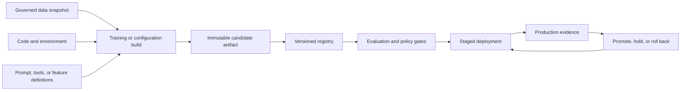
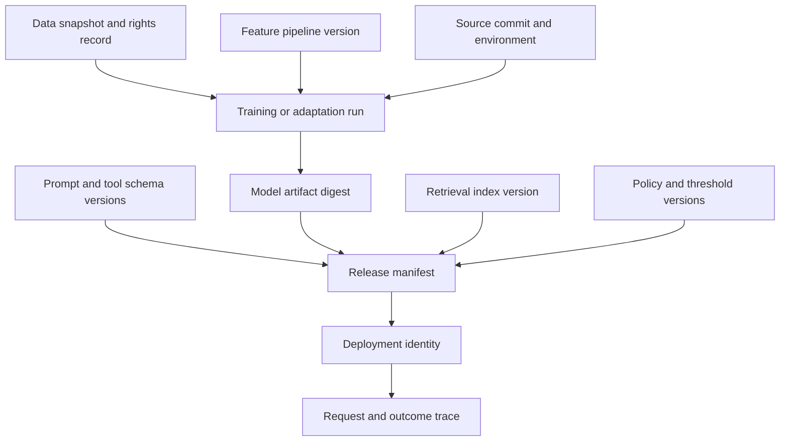
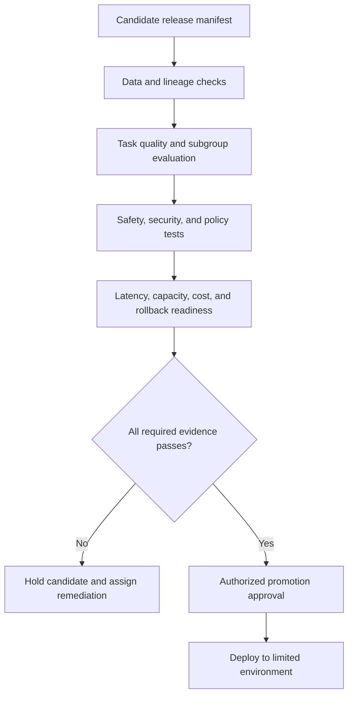
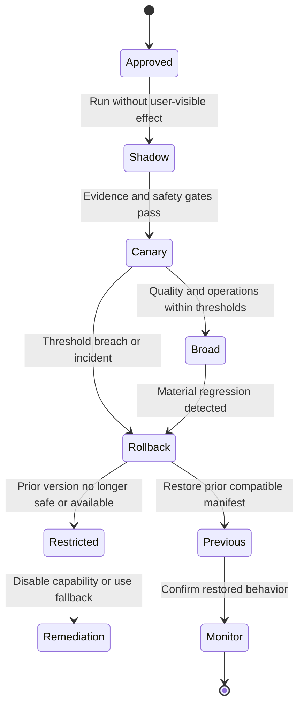

# AI Platform and Model Lifecycle Architecture

Part: [17 — AI Architecture](PART_OVERVIEW.md)

An AI platform connects data preparation, experiments, artifacts, evaluation, serving, monitoring, rollback, and retirement. Its architecture should make a model or prompt change traceable and reversible without turning every workload into the same pipeline. Machine Learning Operations (MLOps) and Large Language Model Operations (LLMOps) techniques are covered in Part 16 CH29; this chapter designs the system boundaries and promotion controls around them.

## Design the Lifecycle Boundary

The lifecycle includes more than model weights. Behavior can change through source data, feature code, prompt templates, retrieval indexes, tool schemas, thresholds, provider versions, and runtime configuration. Assign immutable identifiers and ownership to each behavior-changing artifact. Define which changes require a full evaluation, a limited regression suite, or a policy review.

The registry is a control point for identity and approval, not merely a file store. Record artifact digest, source lineage, build provenance, evaluation results, intended consumers, allowed regions, and expiration or review date. Keep secrets out of artifacts and separate permissions to create, approve, and deploy a release.

## Preserve Artifact Lineage

A release can combine several independently versioned inputs. Store a release manifest that links model and prompt versions, retrieval/index version, application build, tool contract, policy bundle, and runtime settings. Without this manifest, an incident may identify a model name but not the complete behavior that produced the response.

Lineage should enable impact queries in both directions: which deployments use an artifact, and which inputs contributed to a deployment. Protect the graph because it can contain sensitive dataset names or system topology. Apply retention and deletion rules to metadata as well as payloads.

## Gate Promotion on Evidence

Promotion gates should be tied to task requirements and consequences. They may include data validation, reproducible build checks, task-specific quality, subgroup behavior, safety and security tests, latency, capacity, cost, and operator readiness. A gate result must name the evaluated artifact and dataset, thresholds, failures, exceptions, and approver. Passing a benchmark does not waive legal, privacy, or policy approval.

Keep hard release gates separate from advisory metrics. If a threshold changes, record why and who approved the change; do not adjust it merely to make a candidate pass. For generative workloads, combine automated evaluation with targeted human review and adversarial testing. Part 16 owns detailed evaluation design; the platform must preserve results and enforce the agreed gate.

## Roll Out and Roll Back Deliberately

Use shadow, canary, or staged rollout when online comparison is safe and the workload allows it. Shadow traffic must respect data policy and avoid duplicate side effects. Canary allocation should be stable enough to compare outcomes and should include rollback thresholds for quality, safety, latency, cost, and incident signals. Rollback restores a complete compatible release manifest, not only the model binary.

Define rollback time objectives, who can trigger rollback, which state changes are irreversible, and what the user sees. Some releases change schemas or downstream data; those require expand-and-contract migration or compensation rather than a simple pointer reset. Preserve incident evidence for the failing release while preventing further harmful traffic.

## Retire Models and Migrate Consumers

Retirement starts when a model is superseded, unsupported, unsafe, uneconomic, or no longer justified. Find every consumer, endpoint, batch job, cache, evaluation suite, and artifact that depends on it. Publish a deprecation window, replacement contract, migration guide, and final shutdown date. Keep a secure, access-controlled record of the retired manifest when required for audit; do not leave a dormant endpoint exposed indefinitely.

```mermaid
flowchart LR
    Trigger[Support, risk, cost, or strategy trigger] --> Inventory[Find consumers and dependencies]
    Inventory --> Replacement[Select and validate replacement or fallback]
    Replacement --> Notify[Notify owners and publish migration window]
    Notify --> Migrate[Move consumers and verify behavior]
    Migrate --> Drain[Stop new traffic and drain scheduled work]
    Drain --> Disable[Disable endpoint and credentials]
    Disable --> Archive[Retain permitted provenance and evaluation evidence]
    Archive --> Review[Confirm deletion and closure obligations]
```

Retirement can require deletion of weights, caches, prompts, indexes, and backups, but legal retention or incident obligations may require evidence preservation. Separate operational shutdown from data deletion and record the policy basis for each. Confirm that no caller silently routes to an unmaintained version after the published date.

## Worked Case: Quarterly Model Upgrade

A support-assistant team plans to replace its production model. The release manifest pins the model, prompt, retrieval index, policy rules, and application version. The candidate passes the shared task suite, citation checks, sensitive-data tests, subgroup review, and load profile. It runs in shadow mode on permitted traffic, then a small canary with no autonomous write tools. The team compares answer support, correction time, latency, and cost against the active release.

When the canary shows a rise in unsupported answers, the release controller restores the prior manifest and blocks further promotion. The incident links affected request traces to the candidate versions and evaluation examples. The team updates tests, reassesses the candidate, and keeps the retired model's endpoint disabled. If the prior version has a critical vulnerability, the rollback target is instead a constrained human-support route.

## Review Questions

1. Which artifacts belong in the release manifest beyond model weights?
2. How does the platform ensure an evaluation result applies to the deployed artifact?
3. What conditions trigger rollback, and what can a pointer reset not undo?
4. How are consumers and data obligations handled during retirement?

Lifecycle architecture makes behavior-changing artifacts identifiable, evaluated, promotable, recoverable, and ready for retirement. Treat each release as a governed manifest, enforce evidence gates, and design rollback and retirement for the whole system rather than a single model file.
