# AI Platform and Model Lifecycle Architecture

Part: [17 — AI Architecture](PART_OVERVIEW.md) · Status: Revised (in-depth rewrite)

## 1. Introduction

An organization that ships one AI feature can get by with a notebook, a cloud account, and a careful engineer. An organization that ships thirty cannot. Each team will pick its own model provider, store prompts in its own repository, build its own retrieval index, write its own evaluation script, and decide for itself when a change is safe. Six months later nobody can answer basic questions. Which teams call a model that the provider retires next quarter? Which production answer was produced by which prompt, index, and model? Who approved the change that doubled the monthly bill? A platform exists to answer these questions with a system instead of a meeting.

This chapter teaches the architecture of that system. It covers two things that are closely linked. The first is the **AI platform**: the shared capabilities, interfaces, and operating model that let many teams build, release, and operate AI features. The second is the **model lifecycle**: the states an AI artifact moves through from a proposal to retirement, and the gates that control each move. The word "model" is used loosely in the title. In a modern system the unit that changes behavior is not only a set of weights. It is a bundle of weights or a provider model identifier, prompt templates, a retrieval index, tool schemas, guardrail policies, an evaluation suite, and runtime configuration. The platform has to version, test, promote, and roll back that bundle as one thing.

### 1.1 Reader outcomes

After this chapter you should be able to:

1. Decide whether an AI platform is justified, what it should contain, and which parts to build, buy, or compose.
2. Draw a reference architecture with a control plane, a data plane, and a multi-environment topology, and state the rules for what may move between environments.
3. Write and validate a release manifest that pins every behavior-changing artifact, and explain why a model identifier alone is not a version.
4. Design a lifecycle state machine with owners and gates, compose evaluation gates into one policy, and do the go/no-go arithmetic.
5. Choose a release strategy (shadow, canary, blue/green, progressive, or flag-controlled) and define automatic rollback criteria.
6. State which artifacts can be rolled back instantly, which cannot, and how to roll back dependent artifacts together.
7. Run a multi-tenant platform with quotas, isolation, chargeback, and policy as code.
8. Retire models, including models retired by an external provider, without breaking consumers.
9. Set up the team topology, operating model, service levels, and maturity path for the platform team.
10. Reason about failure scenarios and produce two complete designs with recorded decisions.

### 1.2 Why this matters to a solution architect

A solution architect is usually the person who signs the design for a single AI feature, and is also the person asked, a year later, why there are nine different ways to deploy a model. The architect's leverage is in the seams between systems. The platform is the place where those seams become explicit. A good platform design makes the common path cheap and safe, makes the uncommon path possible with review, and makes every path observable. A poor one either becomes a bottleneck that teams route around, or becomes a catalogue of tools that no one operates as a product.

There is a second reason. AI behavior can change without a code change. A provider can update a hosted model behind a stable name. A retrieval index can be rebuilt overnight. A prompt can be edited in a web console. If the organization's release process only tracks application code, then most of the behavior that matters escapes review. The lifecycle architecture in this chapter closes that gap.

### 1.3 Scope and ownership

This chapter owns the platform and lifecycle architecture. Mechanics taught elsewhere are recapped in a few sentences and linked.

| Topic | Owner | What this chapter does |
|---|---|---|
| Experiment tracking, model registry mechanics, drift statistics, deployment strategies as techniques, MLOps and LLMOps pipelines | [Part 16 CH29 MLOps and LLMOps](../16_AI_and_GenAI/CH29_MLOps_and_LLMOps.md) | Recaps in section 2, then designs the platform around them |
| GPU scheduling, accelerators, cluster components | [Part 16 CH27 AI Infrastructure and Platform Components](../16_AI_and_GenAI/CH27_AI_Infrastructure_and_Platform_Components.md) | Treats compute scheduling as a platform concern (section 12) |
| Serving topology and model placement | [CH07 Inference Serving and Model Placement](CH07_Inference_Serving_and_Model_Placement.md) | Links; the platform provides the paved path to it |
| Gateway, routing, fallback | [CH08 Model Gateway, Routing, and Fallback](CH08_Model_Gateway_Routing_and_Fallback_Architecture.md) | Uses the gateway as the platform's enforcement and discovery point |
| Evaluation design, trace metadata, drift signals | [CH11 Evaluation and Observability Architecture](CH11_Evaluation_and_Observability_Architecture_for_AI_Systems.md) | Defines gates that consume CH11 evidence, not the evaluation methods |
| Security, privacy, governance controls | [CH12 AI Safety, Security, Privacy, and Governance](CH12_AI_Safety_Security_Privacy_and_Governance_Architecture.md) | Integrates approval records and audit evidence into lifecycle gates |
| Reliability patterns | [CH13 Reliability and Resilience Patterns](CH13_Reliability_and_Resilience_Patterns_for_AI_Workloads.md) | Applies them to the platform's own failure modes |
| Cost and sustainability | [CH14 AI Cost, Performance, and Sustainability](CH14_AI_Cost_Performance_and_Sustainability_Decisions.md) | Provides cost attribution plumbing and budget enforcement |
| Cloud cost mechanics | [Part 9 CH14 Cost Optimization](../09_Cloud_Computing/CH14_Cost_Optimization.md) | Links |
| Data architecture and rights | [CH04 AI Data Architecture](CH04_AI_Data_Architecture_and_Preparation_Boundaries.md) | Consumes the data snapshot identifier and rights record |

### 1.4 A running example

Most numbers in this chapter come from one illustrative organization, called Meridian Insurance here. It has 40 product and data teams building AI features: claims summarization, a customer support assistant, fraud scoring, document classification, an underwriting copilot, and many smaller internal tools. It runs in three cloud regions and uses a mix of hosted provider models and a few self-hosted open-weight models with fine-tuned adapters. All figures are illustrative. They are chosen to make the arithmetic visible, not to claim typical values.

## 2. Background: The Lifecycle and What Part 16 Already Taught

### 2.1 A recap of MLOps and LLMOps

Part 16 CH29 teaches the mechanics at length. In short:

- **Lineage** records which data, code, and configuration produced an artifact.
- A **registry** stores versioned artifacts with metadata and stage labels.
- **Drift monitoring** compares production inputs and outputs with a reference to detect change.
- **Gates** are automated checks that block a promotion when evidence does not meet a threshold.
- **Deployment strategies** (shadow, canary, blue/green) limit the blast radius of a bad release.
- **LLMOps** extends this to prompts, retrieval indexes, tool definitions, and evaluation sets for generative systems.

This chapter does not re-teach those mechanics. It asks a different question: given those mechanics, how do you assemble them into a platform that forty teams can use, and into a lifecycle that an auditor can follow? The answer involves product thinking, a unified artifact model, environment topology, policy composition, tenancy, and an operating model.

### 2.2 The lifecycle at a glance

The first diagram shows the whole loop. Candidates are built from governed inputs, stored as immutable artifacts, evaluated, released in stages, observed in production, and fed back into new candidates or into retirement.

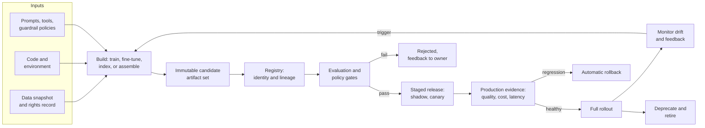

Read the diagram from left to right and note three properties. Every build input is governed before it enters. The registry sits between build and evaluation so that evaluation always runs against an identified artifact rather than "whatever is on the engineer's laptop". And there are two exits from the loop besides a successful rollout: rejection before release and rollback after release. A platform that only models the successful path will fail on the first bad release.

### 2.3 What is different about AI artifacts

Several properties make AI lifecycle management harder than ordinary application release management:

1. **Behavior is probabilistic and measured, not asserted.** A unit test passes or fails. An evaluation suite produces a distribution of scores. A gate must therefore reason about thresholds, sample sizes, and uncertainty (section 8).
2. **Behavior depends on many artifacts at once.** A support assistant's answer depends on the model, the system prompt, the retrieved passages, the tool schemas, and the guardrails. Changing any one can change the answer.
3. **Some artifacts are not under your control.** A hosted model version can be updated or retired by the provider on the provider's schedule (section 16.5).
4. **Rollback is not always symmetric.** Reverting a prompt is instant. Reverting a re-embedded index can take hours. Reverting a memory store that agents have written to may be impossible without losing user data (section 11).
5. **Cost is a first-class behavior.** A model swap that improves quality by two points and triples cost is a product decision, not an engineering detail.
6. **Data rights follow the artifact.** A model trained on a dataset inherits obligations from that dataset. If consent is withdrawn, the lineage graph must say which models and releases are affected (section 6).

## 3. The Platform as an Internal Product

### 3.1 Tools versus a platform

Many organizations say they have an AI platform when they have a collection of tools: a managed notebook service, an experiment tracker, a model registry, a vector database, a gateway, and a dashboard. Each tool may be good. The collection is not a platform unless someone has done the work of making them fit together for a defined set of users with defined expectations. The difference is observable:

| Property | Collection of tools | Platform as a product |
|---|---|---|
| Users | "Everyone" | Named user segments (application teams, data scientists, model owners, risk reviewers) |
| Entry point | A wiki page listing tools | A golden path with a template that produces a working service in a day |
| Promises | None | Published service levels, a support channel, an on-call rotation |
| Roadmap | Whatever the owners of each tool decide | A prioritized backlog informed by user research and adoption data |
| Measurement | Tool uptime | Lead time to production, change failure rate, adoption, user satisfaction |
| Failure when ignored | Nothing visible | Shadow usage grows, and the platform team loses relevance |
| Integration | Each team wires tools together | Integration is the platform's job, tested once |

The practical test is the "new team" test. A team that has never used the platform should be able to deploy an evaluated, monitored, cost-tracked feature to production using a documented path, with help from a template and not from a personal favor. If that takes three months and five meetings, the organization has tools.

### 3.2 Users and their jobs

Platform thinking starts with users and what they are trying to do. Meridian's platform team identified four segments by interviewing teams, using the same method taught in [Part 2](../02_Design_Thinking_and_Product_Management/PART_OVERVIEW.md) for products.

| Segment | Count | Job to be done | Pain without a platform |
|---|---|---|---|
| Application teams | 28 | Add an AI feature to a product with minimal ML expertise | Provider onboarding, security review, and evaluation harness rebuilt per team |
| Data science and ML teams | 8 | Train or fine-tune models, run experiments | Waiting for GPUs, no reproducibility, no path to production |
| Model and prompt owners | 12 (overlap) | Own quality of a specific model or prompt in production | No visibility into regressions, no safe way to roll out changes |
| Risk, security, and compliance reviewers | 6 | Approve high-risk uses and produce audit evidence | Evidence is collected by hand, differs per team, and is stale |

Each segment has a different definition of success. Application teams want speed and a stable interface. Data scientists want flexibility and compute. Model owners want observability and control over releases. Reviewers want evidence they can trust without re-deriving it. A platform that serves only data scientists will be ignored by application teams, who are the majority and who generate most of the production traffic.

### 3.3 Golden paths

A **golden path** is a documented, supported, and automated route for a common task. It is not a mandate. Teams may leave it, and when they do, they accept that the platform team supports them less and the governance function reviews them more. The reason for the trade is economic: the platform team has finite capacity, so it concentrates on a few paths and makes them excellent.

Meridian defined five golden paths:

1. **Hosted-model feature.** An application calls a hosted model through the gateway, with a prompt from the prompt registry, an evaluation suite from a template, and standard observability.
2. **RAG feature.** Path 1 plus a managed retrieval index with versioned embeddings and an ingestion pipeline (see [CH05](CH05_Retrieval_Augmented_Generation_System_Architecture.md)).
3. **Agent feature.** Path 1 plus tool registry entries with scoped credentials (see [CH06](CH06_Agentic_System_Architecture_and_Tool_Boundaries.md)).
4. **Self-hosted model or adapter.** Training or fine-tuning on shared compute, registration, evaluation, and deployment to the shared serving cluster (see [CH07](CH07_Inference_Serving_and_Model_Placement.md)).
5. **Batch scoring.** Scheduled predictions from a registered model, with output validation and lineage.

Each path comes with a repository template, a pipeline definition, a default evaluation suite, a default dashboard, an alert set, a cost tag scheme, and a checklist of approvals by risk tier. The template is the unit of adoption. A golden path without a template is documentation, and documentation drifts.

### 3.4 Service levels for a platform

A platform that offers no promises cannot be depended on. The platform team should publish service level objectives (SLOs) for the things its users depend on. The distinction between a service level indicator (SLI, the measurement), a service level objective (SLO, the target), and a service level agreement (SLA, a contractual commitment) is taught in Part 14. For the platform, the useful SLOs fall into three groups.

**Availability and latency of shared runtime services:**

| Service | SLI | SLO (illustrative) |
|---|---|---|
| Model gateway | Fraction of requests that the gateway itself does not fail (excludes provider errors) | 99.95 percent monthly |
| Gateway added latency | p99 added by the gateway, excluding model time | Under 40 ms |
| Registry read path | Fraction of artifact fetches that succeed | 99.9 percent monthly |
| Prompt and config delivery | Time from publish to active in production | p95 under 2 minutes |

**Responsiveness of workflows:**

| Workflow | SLI | SLO (illustrative) |
|---|---|---|
| Evaluation run for a standard suite | Time from trigger to report | p90 under 25 minutes |
| New-team onboarding | Time from request to first deployed feature in a sandbox | Under 2 working days |
| Training job start | Time from submission to GPU allocation, standard priority | p90 under 4 hours |

**Support:**

| Item | SLO (illustrative) |
|---|---|
| Critical platform incident | Acknowledge in 15 minutes, 24x7 |
| Normal support request | First response in 1 working day |
| Deprecation notice | At least 180 days before removal of a supported interface |

Separate the SLOs of the platform from the SLOs of the features built on it. A feature team inherits the platform's availability as an upper bound. If the gateway is 99.95 percent available and the feature calls the gateway once per request, the feature cannot honestly promise more than 99.95 percent without a fallback (see [CH13](CH13_Reliability_and_Resilience_Patterns_for_AI_Workloads.md)). The worked arithmetic: 99.95 percent monthly availability over a 30-day month (43,200 minutes) allows 43,200 × 0.0005 = 21.6 minutes of unavailability. A feature that promises 99.99 percent (4.32 minutes per month) while depending serially on that gateway has promised something its dependency cannot deliver.

### 3.5 Roadmap and adoption metrics

The platform roadmap should be driven by observed friction, not by the interests of the platform engineers. Meridian's team reviews three inputs every quarter: onboarding interviews, the support queue categorized by cause, and "off-path" analysis (what teams built outside the golden paths, and why).

Adoption is the primary evidence that a platform product is working. Useful metrics:

| Metric | Definition | Meridian baseline | Target after 12 months |
|---|---|---|---|
| Path coverage | Production AI workloads deployed through a golden path divided by all known production AI workloads | 22 of 61 = 36 percent | 52 of 65 = 80 percent |
| Gateway traffic share | Model calls routed through the gateway divided by estimated total model calls (provider billing as the denominator) | 48 percent | 95 percent |
| Lead time to production | Median days from first commit of a feature to production release | 41 days | 12 days |
| Self-service rate | Platform requests completed without a ticket | 30 percent | 85 percent |
| Developer satisfaction | Quarterly survey, 1 to 5 | 2.9 | 4.0 |
| Registered artifact share | Production artifacts with a manifest and lineage divided by all production artifacts | 18 percent | 100 percent |

Two of these deserve attention. Gateway traffic share uses the provider's billing as the denominator, because teams that bypass the gateway do not appear in gateway logs. This is the discovery technique for unmanaged usage described in section 17. And lead time to production is the metric that justifies the platform's existence to finance: if the platform cuts median lead time from 41 to 12 days across roughly 20 new features per year, it returns about 29 days × 20 = 580 feature-days of calendar time, which the organization can value against the platform team's cost.

A caution on metrics. Mandating adoption (every team must use the gateway) produces compliance, not value. The metric to watch is whether teams choose the path when they could do otherwise. Voluntary adoption of a path is a signal that the path is better than the alternative.

### 3.6 When a platform is not justified

A platform has a cost: a team, an operating model, and the constraints it places on users. For fewer than about five production AI workloads, or for an organization with a single product team, a thin shared library and a short set of conventions usually beat a platform. Section 22 designs exactly that minimal viable platform. The decision rule: build a platform when the cost of duplicated effort across teams plus the cost of uncontrolled risk exceeds the cost of the platform team. Meridian's estimate, in illustrative figures:

- Duplicated effort: 40 teams × an average of 0.25 engineer-years per team per year spent on evaluation harnesses, provider onboarding, and deployment scripts = 10 engineer-years per year.
- Platform team: 9 engineers.
- The platform also removes risk (no unregistered models, evidence for audits) that is not priced in this calculation.

The platform pays for itself on effort alone, once the paths are good enough that teams stop rebuilding. The condition is "once the paths are good enough", which is why product discipline matters more than the technology choice.

## 4. Platform Capability Map

### 4.1 The capabilities

A capability map names what the platform must be able to do, independent of products. It lets you decide, capability by capability, whether to build, buy, or compose. Meridian's map has twelve capabilities.

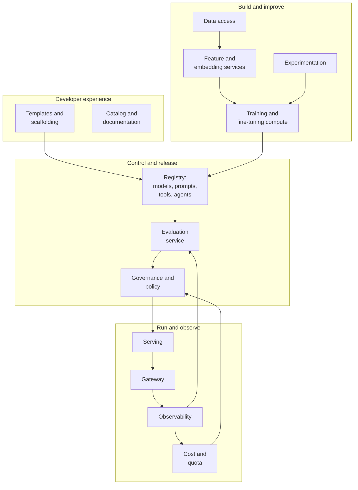

The diagram groups capabilities by role in the lifecycle. The arrows show the main dependencies: training feeds the registry, the registry feeds evaluation, evaluation feeds governance, governance authorizes serving, and observability feeds evaluation and cost. The loop from observability back to evaluation is how production evidence becomes new test cases (see [CH11](CH11_Evaluation_and_Observability_Architecture_for_AI_Systems.md)).

### 4.2 What each capability must provide

| Capability | Core responsibility | Interface that users see | Typical failure if missing |
|---|---|---|---|
| Data access | Governed access to datasets with rights and purpose checks | Catalog entries, snapshot identifiers, access requests | Training on data nobody approved |
| Feature and embedding services | Shared, versioned features and embeddings | Feature views, embedding endpoints with model identifiers | Training-serving skew, mismatched embedding versions |
| Experimentation | Track runs, compare results, reproduce | Experiment tracker, run identifiers | Results nobody can reproduce |
| Training and fine-tuning compute | Schedule accelerators fairly and efficiently | Job submission with queue and quota | GPU hoarding, idle capacity, long waits |
| Registry | Identity, versions, lineage, stage labels for models, prompts, tools, agents | Registry API and web catalog | Unknown artifacts in production |
| Evaluation service | Run suites reproducibly, store reports, compare to baselines | Suites as code, report links in pull requests | Each team invents its own pass criteria |
| Serving | Run models with scaling, batching, and placement | Deployment spec, endpoints | Inconsistent deployments, wasted accelerators |
| Gateway | Single access point to models with routing, limits, logging | One base URL and credentials per workload | No central log, no key hygiene, no switching |
| Observability | Traces, metrics, quality signals, correlated by version | Dashboards, trace search, alerts | Cannot attribute a regression to a change |
| Governance and policy | Risk tiering, approvals, policy-as-code, audit evidence | Policy checks in CI, approval records | Manual reviews that scale linearly with teams |
| Cost and quota | Attribution, budgets, quotas, chargeback | Cost dashboards by team and feature, budget alerts | Surprise bills and no accountability |
| Templates and developer experience | Scaffolding, documentation, support | Repository templates, a portal | Every team starts from zero |

### 4.3 Build, buy, or compose

For each capability, there are three options.

- **Build** means the organization writes and operates the component.
- **Buy** means a vendor product or managed service is adopted as is, with its interface as the platform's interface.
- **Compose** means the platform wraps one or more products behind an organization-owned interface, so that the product can change without changing users.

The deciding factors differ by capability. The following decision criteria apply:

1. **Differentiation.** Does this capability make the business better against competitors? For most enterprises, none of the twelve does. Differentiation lives in the models, data, and product.
2. **Interface stability.** Is the user-facing interface something you want to own for five years? Owning the interface and renting the implementation (compose) protects you from product churn, which is high in AI tooling.
3. **Integration cost.** How much work is it to make the product follow your identity, tenancy, tagging, and audit rules?
4. **Operational cost.** Who carries the pager? Managed services move the pager.
5. **Exit cost.** How hard is migration if the product stops fitting?
6. **Regulatory and residency constraints.** Some data cannot go to some products or regions.

Meridian's decisions, in illustrative form:

| Capability | Decision | Reason |
|---|---|---|
| Data access | Compose over the existing data catalog | Catalog and rights checks already exist; add snapshot identifiers |
| Feature and embedding | Buy a managed feature store; build a thin embedding service that pins model versions | Feature stores are commodity; embedding version pinning is a policy matter |
| Experimentation | Buy a managed experiment tracker | Commodity |
| Training compute | Compose: Kubernetes plus a batch scheduler plus cloud accelerators | Needs organization-specific quota and fair-share rules |
| Registry | Build a thin registry service over an object store and a database, with an open artifact-metadata format | No product models prompts, tools, and agents together with organization-specific lifecycle states |
| Evaluation service | Compose: open-source evaluation libraries inside an organization-owned runner | Suites are code; the runner enforces reproducibility and report schema |
| Serving | Buy managed endpoints for hosted models; compose open-source serving on the shared cluster for self-hosted | Per CH07 |
| Gateway | Compose: a gateway product with organization-owned plugins | Per CH08 |
| Observability | Compose over the existing telemetry stack with AI-specific attributes | Per CH11 |
| Governance and policy | Build policy-as-code rules on a standard policy engine | Policies are the organization's own |
| Cost and quota | Compose: cloud billing exports plus gateway usage logs into the existing finance data model | Per CH14 |
| Templates | Build | The templates encode the golden paths |

Observe the pattern. The platform builds mostly the thin layers that encode organization-specific rules (registry, policy, templates) and composes or buys heavy commodity infrastructure. This keeps the platform team small. Section 21 returns to this with migration between platforms.

### 4.4 Capability maturity, not capability completeness

Not every capability needs to exist at launch. Capabilities have dependencies, and some deliver most of the value early. A rough ordering that has held up across organizations: first the gateway and cost attribution (cheap, immediate visibility), then the registry and release manifest (identity), then the evaluation service and gates (safety), then self-service templates (scale), then advanced capabilities such as automated retraining and multi-region promotion. Section 20 turns this ordering into a maturity model.

## 5. Reference Platform Architecture

### 5.1 Control plane and data plane

A useful way to organize the platform is to separate the **control plane** from the **data plane**, as networks and Kubernetes do.

- The **control plane** decides and records. It holds the registry, release manifests, policies, approvals, lifecycle state, quotas, and configuration. It is low in request volume and high in consequence. A control plane outage should stop changes, not stop serving.
- The **data plane** does the work. It handles inference requests, retrieval, tool calls, and batch jobs. It is high in request volume. It must keep running when the control plane is down, using the last known good configuration.

The separation matters for failure design. If the data plane fetches the registry on every request, a registry outage becomes a production outage. If the data plane caches signed, versioned configuration and refreshes it asynchronously, a registry outage becomes a deployment freeze (see section 18, registry outage during an incident).

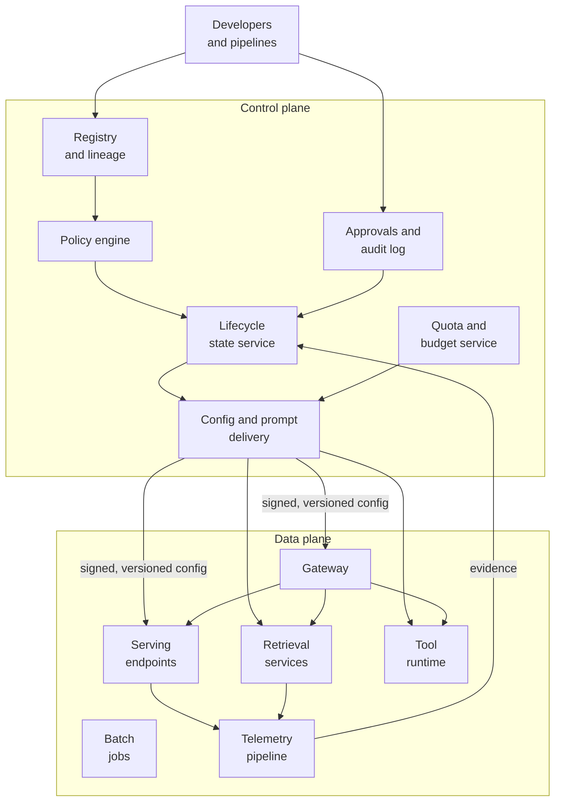

The diagram shows configuration flowing one way, from the control plane to the data plane, as signed and versioned bundles. Evidence flows the other way, from the data plane through telemetry into the lifecycle state service, which can trigger a hold or a rollback. The data plane never queries the policy engine on the hot path. It acts on what the control plane already decided. This is a design rule worth stating: **decisions are made ahead of time and delivered as data, so the request path has no dependency on the machinery that makes decisions.**

There is one exception. Per-request policy checks such as content filtering or authorization of a tool call are data-plane functions and run locally, with rules delivered as bundles. They do not call a central service per request.

### 5.2 Multi-environment topology

AI platforms need more environments than a typical web application, because experimentation needs freedom that production must not allow, and because evaluation needs data that development should not see.

| Environment | Purpose | Data | Who can deploy | Model access |
|---|---|---|---|---|
| Sandbox | Exploration, prototypes, learning | Synthetic or public data only | The individual or team | Gateway sandbox tier with low quota, no sensitive data allowed |
| Development | Build and integrate features | Synthetic and approved sample data | The owning team | Cheaper models, lower rate limits |
| Staging (pre-production) | Full evaluation and release rehearsal | Production-shaped data under controlled copying rules (section 5.4) | The pipeline only | Same models and versions as production |
| Production | Serve real users | Real data | The pipeline only, after approvals | Production gateway tier |

Sandbox and development are separated because sandbox is deliberately permissive and short-lived. Sandbox resources are deleted after a time limit (for example 30 days) and nothing in sandbox is allowed to be promoted. Anything worth keeping must be re-created from a template in development. This rule removes a large class of "the prototype became production" incidents.

### 5.3 Separation by account, project, or subscription

Environments should be separated at the strongest isolation boundary the cloud offers: separate accounts in Amazon Web Services, projects in Google Cloud, or subscriptions in Microsoft Azure. Chapter-level treatment of these boundaries is in [Part 9 on landing zones and cloud foundations](../09_Cloud_Computing/PART_OVERVIEW.md). The reasons to prefer account-level separation over namespaces in a single account:

1. **Blast radius.** A mistaken permission or runaway job in development cannot touch production resources.
2. **Identity and access.** Production access can be limited to the pipeline role and a small break-glass group.
3. **Quota and billing.** Quotas and budgets apply per account, so a development loop cannot consume production's GPU quota or spend.
4. **Audit.** Production audit logs are separate and can be made immutable.

The cost is operational overhead: more accounts, more pipelines, and cross-account artifact sharing. The platform absorbs that cost by automating account vending and by making the registry a shared service that all environments read from.

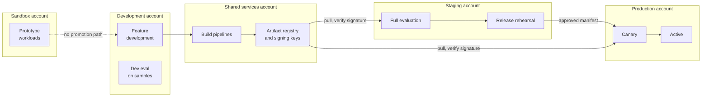

The dashed arrow from sandbox signals that code and ideas move by re-creation, not by promotion. The solid path shows that artifacts move from development through the shared build pipeline into the registry, then are pulled and verified by staging and production. The production account pulls artifacts; nothing pushes into it from development. This pull model means production decides what it accepts, based on signatures and approved manifests.

### 5.4 Data movement rules between environments

The hardest environment question in AI is data. Staging evaluations need realistic data, and production data is the most realistic. The rules must be explicit.

1. **Code and artifacts move forward; production data never moves backward by default.** Artifacts (models, prompts, indexes) are promoted from development toward production. Real user data does not flow from production to development.
2. **Staging may receive production-shaped data by one of three controlled methods**, in descending order of preference:
   - *Synthetic data* generated to match statistical shape and failure cases of production. Safest, lowest fidelity.
   - *Masked or tokenized samples* with direct identifiers removed and quasi-identifiers generalized, with a documented re-identification risk assessment.
   - *Production replays inside the production boundary*: run the evaluation in a production-controlled evaluation environment that holds real data and emits only aggregate scores. Highest fidelity, strictest access.
3. **Evaluation datasets are artifacts.** They are versioned, owned, access-controlled, and carry their own lineage. A golden set built from production traces inherits the production data classification.
4. **Embeddings are data.** An index built from sensitive documents is as sensitive as the documents. Indexes do not move to lower environments without the same treatment as the source.
5. **Prompts and logs may contain user content.** Traces copied for debugging obey the same rules as data.
6. **Models trained on production data are classified at that level.** A fine-tuned adapter trained on customer data cannot be shared into a sandbox.
7. **Every cross-environment data movement is logged** with the dataset or artifact identifier, the requester, the purpose, and the approval record.

The rule set follows from one principle: **classification travels with the artifact.** The registry stores a data classification and a list of allowed environments per artifact. A promotion workflow refuses to place an artifact into an environment that its classification forbids. Section 9 shows this as a policy rule.

### 5.5 Registry placement and signing keys

The registry sits in a shared services account. Signing keys for artifacts live in a key management service that only the build pipeline can use for signing, and every environment's runtime can use for verification. Developers cannot sign. This is a separation of duties issue; it is detailed in section 7.

A regional replication concern follows. Meridian operates in three regions. Production in each region needs registry reads even if the shared account's region is unavailable. The pattern is a read replica of the registry metadata and artifact store in each region, with signatures verified locally. Replication lag becomes a promotion constraint: a release is "available in region X" only when its artifacts and manifest are replicated there. The promotion workflow checks replication status before beginning a regional rollout.

## 6. The Unified Artifact Model and Release Manifest

### 6.1 Why a model identifier is not a version

Suppose an incident review asks which model produced a wrong answer on a given date. The log says `provider-model-x`. That is not an answer. The same identifier may have pointed to different weights on different days if the provider updates an alias. The prompt may have been edited twice that week. The retrieval index may have been rebuilt with a new embedding model. A tool schema may have added a required field. The guardrail policy may have been tightened. Any one of those can explain the wrong answer, and the log names none of them.

The cure is to treat the *behavior-defining set* as the unit of release. That set is called here a **release**. A release is an immutable, versioned list of exact artifact versions, with digests, and a record of the evidence that justified shipping it. The list is the **release manifest**.

### 6.2 The artifact types

Seven artifact types define behavior in most generative and predictive systems. Each has an identity, an owner, a store, and a rollback profile.

| Artifact type | What it is | Identity | Typical store | Owner |
|---|---|---|---|---|
| Model | Weights, an adapter, or a pinned hosted-model version | Digest for weights; provider name plus dated version for hosted models | Object store or provider | Model owner |
| Prompt | System prompt, templates, few-shot examples, output schema | Content digest plus semantic version | Prompt registry | Prompt owner |
| Retrieval index | Chunks, embeddings, metadata, and the embedding model identifier | Build identifier plus corpus snapshot plus embedding model version | Vector store plus manifest file | Retrieval owner |
| Tool schema | Names, parameters, descriptions, permissions of tools an agent may call | Digest plus version | Tool registry | Tool owner |
| Guardrail policy | Input and output filters, thresholds, refusal rules | Digest plus version | Policy repository | Safety owner |
| Evaluation suite | Test cases, graders, thresholds | Digest plus version | Evaluation repository | Quality owner |
| Runtime configuration | Temperature, token limits, routing rules, timeouts, feature flags | Digest plus version | Configuration service | Service owner |

Two points need emphasis. First, the evaluation suite is part of the release because a result is meaningless without knowing what was measured. A gate that passed on suite version 20 says nothing about suite version 21. Second, the embedding model is a dependency of the index. An index built with embedding model A cannot be queried with embedding model B and give meaningful similarity scores (the geometry differs). The manifest must record that dependency so that a validator can reject an inconsistent pair (see [CH05](CH05_Retrieval_Augmented_Generation_System_Architecture.md) and [Part 16 CH16](../16_AI_and_GenAI/CH16_Embeddings_and_Semantic_Representations.md)).

### 6.3 A worked release manifest

The manifest below is illustrative and uses a compact YAML form. Names of providers and models are placeholders; use the exact dated identifiers that your provider documents. Digests are shortened here for readability, though real digests are 64 hexadecimal characters.

```yaml
release: support-assistant@2026.10.3
owner_team: customer-support-ai
risk_tier: 2
created_by: release-pipeline
created_at: 2026-10-14T09:12:00Z
artifacts:
  model:
    id: provider-model-x
    version: "2026-08-01"        # dated snapshot, never an alias such as "latest"
    digest: sha256:a1f0...
  prompt:
    id: support-prompt
    version: "14"
    digest: sha256:b2c4...
    expects_tool_schema: "3"
  index:
    id: kb-index
    version: "88"
    digest: sha256:c3d9...
    corpus_snapshot: kb-2026-10-12
    embedding_model: embed-v2
  embedder:
    id: embed-v2
    version: "2"
    digest: sha256:d4e1...
  tools:
    id: support-tools
    version: "3"
    digest: sha256:e5f7...
  guardrails:
    id: policy-bundle
    version: "9"
    digest: sha256:f608...
  eval_suite:
    id: support-evals
    version: "21"
    digest: sha256:1729...
  config:
    id: runtime-config
    version: "5"
    digest: sha256:283a...
evidence:
  eval_report: reports/support-assistant/2026.10.3/eval.json
  eval_suite_version: "21"
  gates_passed: [quality, safety, latency, cost, fairness, security]
  approvals:
    - role: model_owner
      by: a.rivera
    - role: risk_reviewer
      by: j.okafor
signature:
  signer: release-pipeline
  verified: true
rollback_to: support-assistant@2026.09.7
compatibility_window_days: 14
data_classification: confidential
allowed_environments: [staging, production]
```

Read the manifest as a contract with four parts. The `artifacts` block pins everything. The `evidence` block records why the release is allowed. The `signature` block lets any environment verify that the manifest was produced by the pipeline and not edited by hand. The `rollback_to`, `compatibility_window_days`, `data_classification`, and `allowed_environments` fields carry operational rules that later sections use.

Several design choices are visible. Hosted model versions are dated snapshots, not aliases. Where a provider offers only an alias, the manifest records the alias and the date it was last observed to resolve to a given behavior, and the release adds a scheduled re-evaluation (section 18 covers dependency version drift). The manifest is data, not code, so it can be validated, diffed, and stored without executing anything. And the manifest is *itself* an artifact with a digest: the signature covers the canonical serialization of the manifest.

### 6.4 The manifest validator

The validator is the first gate. It runs without models, so it is cheap and fast, and it catches a class of errors that otherwise surface as production incidents. The runnable example [01_release_manifest_validator.py](../code/python/ai-platform-lifecycle-chapter/01_release_manifest_validator.py) checks the following rules:

1. Every required artifact type is present.
2. No version is missing, empty, or `latest`.
3. Every digest has the form `sha256:` followed by 64 lowercase hexadecimal characters.
4. The tool schema version the prompt expects equals the tool schema version in the manifest.
5. The embedding model that built the index equals the embedding model used for queries.
6. The signature is verified.
7. The evaluation report ran the same suite version the manifest pins.
8. A release at risk tier 2 or higher names a `rollback_to` release.

The script validates one good manifest and one deliberately broken manifest. Its output, which can be reproduced by running the file:

```text
GOOD support-assistant@2026.10.3: PASS
BAD support-assistant@2026.10.4: FAIL (8 errors)
  - missing artifact: guardrails
  - model: unpinned version 'latest'
  - model: invalid digest 'sha256:abc'
  - prompt expects tool schema 4 but manifest pins 3
  - index built with embed-v3 but query embedder is embed-v2
  - signature not verified
  - eval report ran suite 20 but manifest pins 21
  - tier >= 2 requires rollback_to
```

Each error maps to a real incident class. An unpinned model produces behavior drift after a provider update. A tool schema mismatch yields failed tool calls that look like model errors. An index and embedder mismatch produces plausible but wrong retrieval, which is the hardest of these to notice because nothing throws an exception. A suite version mismatch means that the evidence does not apply to this release.

### 6.5 Compatibility rules between artifacts

The validator's rules 4 and 5 are examples of **compatibility constraints**. A platform should express these constraints as data attached to artifact types, not as code in each pipeline. A small set covers most cases:

| Constraint | Meaning | Example |
|---|---|---|
| Exact match | Two fields must be equal | Index embedding model equals query embedder |
| Range | A dependency must fall inside a declared range | Prompt works with tool schema 3.x |
| Capability | A model must support a feature the prompt or tools need | Structured output or tool calling supported by the pinned model |
| Context budget | Sum of prompt, retrieved content, and output cap fits in the model's context window | 8,000-token prompt plus 6 retrieved passages of 700 tokens plus 1,000-token output cap equals 13,200 tokens, which must be below the window |
| Region | All artifacts are available in the target region | Adapter replicated to eu-west |
| Classification | Artifact classification allows the environment | Confidential adapter not in sandbox |

The context budget example works as follows. A prompt of 8,000 tokens (system instructions and few-shot examples), six retrieved passages of 700 tokens each (6 × 700 = 4,200), and a 1,000-token output cap sum to 8,000 + 4,200 + 1,000 = 13,200 tokens. If the candidate model has a 16,000-token window, this passes with 2,800 tokens of headroom. If a cost-saving swap to a model with an 8,192-token window is proposed, the manifest validator fails the release at build time instead of letting production truncate silently. Check the model's documented context length in the provider's documentation at the time of the release; it drifts between versions.

### 6.6 Manifest granularity: one manifest or many

A practical question is whether each feature gets one manifest or whether shared components such as the gateway policy have their own. The rule: **a manifest describes one deployable behavior.** Shared components that several features use (a shared embedding model, a shared guardrail bundle) are separate artifacts referenced by version from each feature manifest. When a shared artifact changes, every manifest that references it must be re-validated and re-evaluated. This is the platform's job: the registry's dependency graph can list the manifests that reference an artifact, which turns "we changed the shared guardrail bundle" into a list of releases that need a re-evaluation run. Section 7 shows the graph.

## 7. Lineage, Provenance, Signing, and the Model SBOM

### 7.1 The lineage graph

Lineage records how artifacts were produced from other artifacts. For an AI system it forms a directed graph from data through training to model to release to deployment to prediction. The graph answers questions in both directions. Upstream queries ask "what produced this answer?" Downstream queries ask "what is affected if this input is withdrawn?"

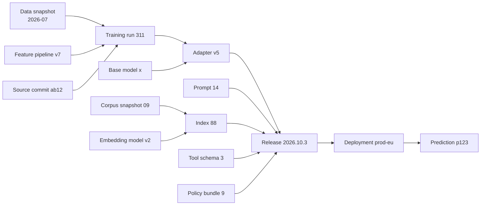

The graph shows that a single prediction has fourteen upstream artifacts, counting everything from the deployment back to the commit. The runnable example [04_lineage_and_retirement.py](../code/python/ai-platform-lifecycle-chapter/04_lineage_and_retirement.py) builds this exact graph and reports:

```text
Upstream of prediction_p123: 14 artifacts
Downstream of data_snap_2026_07 (revoke if rights withdrawn): ['adapter_v5', 'deployment_prod_eu', 'prediction_p123', 'release_2026.10.3', 'train_run_311']
Downstream of embed_v2: ['deployment_prod_eu', 'index_88', 'prediction_p123', 'release_2026.10.3']
```

The two downstream queries show why lineage is an operational tool and not documentation. If the data owner withdraws rights to the July snapshot, the first query lists the training run, the adapter, the release, and the deployment to act on. If the embedding model is found to have a flaw, the second lists the index and everything that depends on it. In both cases the answer takes seconds to compute, whereas without lineage it takes a week of meetings.

### 7.2 What to record at each edge

Each edge in the graph needs enough metadata to be useful. A minimum record per node:

- **Identity:** type, name, version, content digest.
- **Producer:** the pipeline run or person, the source commit, the environment image digest.
- **Inputs:** the identifiers of every input artifact and dataset snapshot.
- **Parameters:** hyperparameters or build configuration, or a digest of them.
- **Time and place:** when and in which account and region.
- **Rights and classification:** the data classification and a link to the rights record.
- **Evidence:** links to evaluation reports and approvals.

Prediction-level lineage (linking an individual output to its deployment) is a trace attribute, not a registry write. Writing a lineage record per prediction would overwhelm any registry. Instead, each request log carries the release identifier and the deployment identifier, and the registry resolves the rest on demand. [CH11](CH11_Evaluation_and_Observability_Architecture_for_AI_Systems.md) designs that metadata path. The platform's responsibility is to guarantee the release identifier is in every trace.

### 7.3 Provenance: proving how an artifact was built

Lineage says what went in. **Provenance** is a verifiable statement of how an artifact was built: which pipeline, which source, which builder identity. The distinction matters under attack. An attacker who can push an artifact into the registry can forge lineage metadata. Provenance that is signed by the build system, and that a verifier checks against policy, resists that.

A widely adopted framework for build provenance is the Supply-chain Levels for Software Artifacts (SLSA), which defines levels of increasing assurance for how builds are controlled and recorded. See the [SLSA specification](https://slsa.dev/spec/) for the current levels and requirements; check the version you are targeting because the specification has been revised. In practice, a platform aims for: builds run only in a controlled pipeline, the pipeline produces a signed provenance statement, and deployment refuses artifacts without a valid statement from an approved builder.

### 7.4 Signing and verification

Signing binds an artifact digest to an identity. The mechanics for container images and generic artifacts are well established; open tooling such as [Sigstore](https://docs.sigstore.dev/) offers keyless signing based on short-lived certificates and a transparency log, and Open Container Initiative (OCI) registries can store signatures and attestations next to artifacts. Verify the current tool capabilities in their documentation before committing to a design.

A sound signing design has these properties:

1. **Only the pipeline signs.** The signing identity belongs to the build pipeline, not to individuals. Developers who can sign can bypass gates.
2. **Verification happens at every trust boundary.** The staging runtime verifies before pulling. The production runtime verifies again. Each verifier checks the signature, the signer identity against an allow list, and the provenance against policy.
3. **Signatures cover digests, not names.** A tag can be moved; a digest cannot.
4. **The manifest is signed as well.** Signing the artifacts but not the manifest allows an attacker to swap which artifacts a release references.
5. **Key rotation and revocation are rehearsed.** A signing key compromise must have a documented response: revoke, identify all artifacts signed in the window, re-verify or re-sign.
6. **Prompts and configuration are signed too.** They are the most frequently changed and the most often forgotten artifact types.

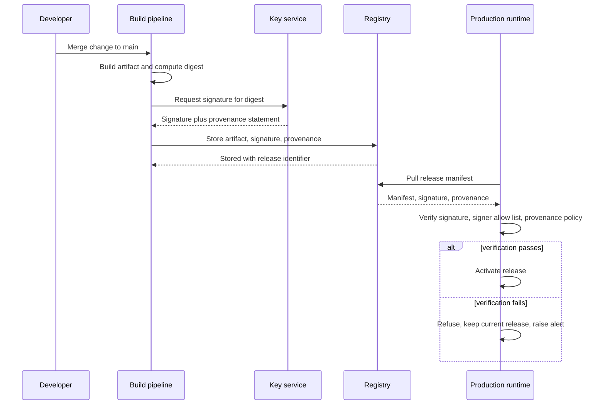

The sequence shows that the developer never touches the signing key and that the runtime does not trust the registry blindly. The `alt` branch is the point: a failed verification must leave the current release in place and raise an alert, not fail open. A platform that fails open on verification errors during an outage will eventually load something unverified.

### 7.5 The model software bill of materials

A software bill of materials (SBOM) lists the components inside a software artifact. For AI systems, the equivalent is sometimes called an AI bill of materials or model SBOM. It extends the idea to datasets, base models, adapters, and training configuration. The [CycloneDX specification](https://cyclonedx.org/) includes support for describing machine learning components (check the current specification version for the exact fields), and the Software Package Data Exchange (SPDX) project has also published AI-related profiles. Treat both as evolving formats: choose one, generate it from the manifest and lineage graph rather than writing by hand, and verify the field names in the current specification.

A model SBOM serves four purposes:

1. **Vulnerability response.** If a serving library or a model file format has a published flaw, the SBOM lists which releases include it.
2. **License compliance.** Base models and datasets carry licenses with conditions. The SBOM makes the list inspectable.
3. **Data rights.** Datasets and their consent conditions are listed so that withdrawal can be traced.
4. **Customer and regulator requests.** Some customers and regulators ask for the composition of an AI system. Generating the SBOM from the registry makes that a report instead of a project.

A concern specific to model files: some serialization formats can execute code when loaded. Scan and prefer formats designed to hold tensors only, and load untrusted models in an isolated environment. The details belong to [CH12](CH12_AI_Safety_Security_Privacy_and_Governance_Architecture.md); the platform's role is to run the scan as a gate before registration.

### 7.6 Rights, retention, and the right to remove

Lineage gives the platform a way to honor data withdrawal and deletion requests that affect training data, as far as the law and the contract require. Regulations differ by jurisdiction and change; this chapter does not give legal guidance. The architectural obligations are:

- Every training and index build records its dataset snapshot identifiers.
- The registry can answer "which artifacts and deployments derive from dataset D?" in one query.
- A runbook exists for each answer: re-index without the removed documents (hours), retrain or fine-tune without the data (days), or document why the artifact is retained.
- Retention rules apply to the artifacts themselves. A retired model's weights and its evaluation reports are kept for the retention period that audit requires, and no longer.

## 8. The Lifecycle State Machine and Evaluation Gates

### 8.1 States

A release or artifact moves through named states. Naming the states and who may move between them turns an informal process into one that a system can enforce and an auditor can inspect. Meridian's lifecycle has eight states.

| State | Meaning | Who owns the transition out |
|---|---|---|
| Proposed | An intended change is registered with purpose, risk tier, and owner | Product owner and model owner |
| Developing | Artifacts are being built in sandbox or development | Developing team |
| Evaluated | A registered candidate has a complete evaluation report | Evaluation service (automated) |
| Approved | Gates passed and required approvals recorded for the risk tier | Approvers by tier |
| Canary | Serving a controlled fraction of production traffic | Release controller (automated) with model owner on call |
| Active | Serving full production traffic | Model owner |
| Deprecated | Still serving existing consumers; new use blocked; sunset date set | Platform and model owner |
| Retired | Not served; artifacts archived per retention | Platform |

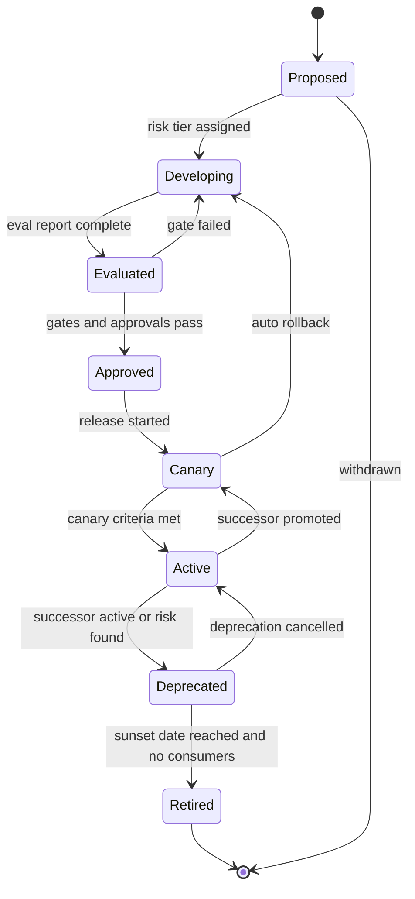

The `Canary --> Developing` transition is the automatic rollback path. A release that fails canary criteria does not stay in a limbo state; it returns to development with its evidence attached so the owner can fix it. The `Deprecated --> Active` transition exists because deprecation decisions are sometimes reversed, for example when a successor has an unexpected defect; the state machine should allow it with a recorded reason.

State is attached to a specific release or artifact version and not to a model name. The same model can have one version Active and another Canary at the same time. The state service enforces that only transitions in the diagram are possible. A direct jump from Developing to Active is rejected, and so is any attempt to edit state through a database console. Every transition writes an immutable audit record: who or what, when, from which state to which, with which evidence identifiers.

### 8.2 Gates as composed policy

A **gate** is a check that must pass for a transition. The Evaluated to Approved transition is the main one, and it is where most of the AI-specific judgment sits. Rather than writing a single script that runs everything, define each gate as an independent policy with a name, an input, a threshold, and an owner, then compose them.

Six gate families cover most releases:

| Gate | Question | Typical measure | Typical rule |
|---|---|---|---|
| Quality | Is it at least as good as the current release on the tasks that matter? | Pass rate or score on the evaluation suite | Non-inferior to baseline within a margin, with a confidence bound |
| Safety | Does it avoid prohibited behavior? | Violation rate on a red-team set; count of critical failures | Rate below limit and zero critical failures |
| Latency | Does it meet the response time budget? | p95 and p99 latency under load | Within a multiple of baseline or an absolute budget |
| Cost | Does it stay within the cost budget? | Cost per thousand requests | Increase below a limit, or inside the budget |
| Fairness | Do results hold across subgroups? | Gap in pass rate between best and worst subgroup | Gap below limit |
| Security | Are artifacts and dependencies free of known critical issues? | Vulnerability scan, model file scan, secret scan | Zero critical findings |

Gates are **hard** or **soft**. A hard gate blocks the release when it fails. A soft gate produces a warning that an approver must acknowledge. Use hard gates for safety, security, and anything with a legal consequence. Use soft gates for measurements that are noisy or that involve a legitimate trade-off, such as a small quality regression accepted for a large cost saving. The decision of which gates are hard at which tier is a governance policy (section 9).

The evaluation methods themselves (how to build suites, how to grade, how to avoid contamination) belong to [CH11](CH11_Evaluation_and_Observability_Architecture_for_AI_Systems.md) and [Part 16 CH24](../16_AI_and_GenAI/CH24_Generative_AI_Evaluation_Guardrails_and_Hallucinations.md). The platform's job is to run the suite reproducibly, store the report, and apply the policy.

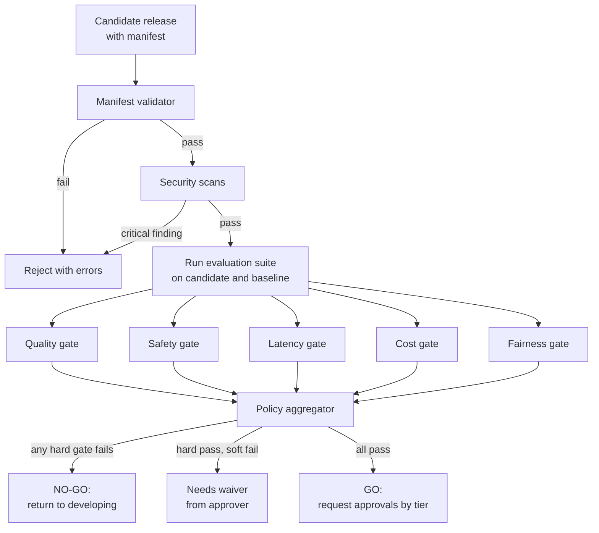

The diagram makes three outcomes explicit: reject, no-go, and go-with-waiver. Cheap checks (the validator and security scans) run before expensive ones (evaluation runs that consume model calls), which keeps cost down. The aggregator is a pure function of the gate results and the policy for the risk tier, which means the decision is reproducible: the same evidence and policy always give the same answer.

### 8.3 Worked go/no-go arithmetic

The runnable example [03_composed_gate_policy.py](../code/python/ai-platform-lifecycle-chapter/03_composed_gate_policy.py) evaluates a candidate against a baseline. The illustrative setup: 400 evaluation cases for each arm, a red-team set of 500 prompts, and a tier 2 policy with six hard gates.

**Quality gate (non-inferiority).** The candidate passes 352 of 400 cases, so $\hat p_c = 352/400 = 0.880$. The baseline passes 340 of 400, so $\hat p_b = 0.850$. The observed difference is 0.030. The standard error of the difference for two independent proportions is

$$SE = \sqrt{\frac{\hat p_c(1-\hat p_c)}{n} + \frac{\hat p_b(1-\hat p_b)}{n}}$$

where $n = 400$ for each arm. The two variance terms are $0.88 \times 0.12 / 400 = 0.000264$ and $0.85 \times 0.15 / 400 = 0.00031875$. Their sum is $0.00058275$ and the square root is $SE = 0.02414$. The 95 percent lower confidence bound on the difference is $0.030 - 1.96 \times 0.02414 = 0.030 - 0.04731 = -0.01731$, that is, $-1.73$ percentage points. The policy allows a non-inferiority margin of $-2.0$ points. Since $-1.73 \ge -2.0$, the gate passes. Note what it does and does not say: the candidate is not shown to be better (the lower bound is negative), only not worse by more than the margin. If the team wants to claim an improvement, it needs a higher bound or more cases. With paired scoring on the same cases, the standard error is usually smaller than this unpaired approximation; use the paired form when the evaluation service provides it. The statistics of evaluation are in [Part 16 CH06](../16_AI_and_GenAI/CH06_Model_Evaluation_Validation_and_Selection.md).

**Safety gate.** 4 violations on 500 red-team prompts is a rate of 0.8 percent against a limit of 1.0 percent, and the count of critical failures is zero. Both conditions hold, so it passes. The point estimate hides uncertainty: with 500 prompts, 4 violations has a wide interval, so a mature policy also bounds the upper confidence limit or requires a larger set for higher tiers.

**Latency gate.** Baseline p95 is 2.1 seconds. The rule allows up to 1.2 times baseline, which is 2.52 seconds. The candidate's p95 is 2.4 seconds, so it passes.

**Cost gate.** Baseline cost is \$11.00 per thousand requests. The rule allows an increase of up to 25 percent, giving a limit of \$13.75. The candidate costs \$14.50, which is an increase of $14.50 / 11.00 - 1 = 31.8$ percent. The gate fails.

**Fairness gate.** Subgroup pass rates are 0.89 and 0.85, a gap of 4.0 percentage points against a 5.0-point limit. It passes.

**Security gate.** Zero critical vulnerabilities, so it passes.

Because cost is a hard gate and failed, the aggregated decision is NO-GO. The script prints:

```text
Candidate 1
  quality  PASS  diff lower 95% bound -1.73 pp (limit -2.0 pp)
  safety   PASS  violations 4/500 = 0.8%, critical 0
  latency  PASS  p95 2.40s vs limit 2.52s
  cost     FAIL  cost/1k $14.50 vs $11.00 = +31.8% (limit +25.0%)
  fairness PASS  worst subgroup gap 4.0 pp (limit 5.0 pp)
  security PASS  critical vulnerabilities 0
  decision: NO-GO
```

The team then routes easy requests to a smaller model (see [CH08](CH08_Model_Gateway_Routing_and_Fallback_Architecture.md)), lowering the cost to \$12.80 per thousand requests. That is $12.80 / 11.00 - 1 = 16.4$ percent, which is under the 25 percent limit. The second run passes all six gates and returns GO. The worked example shows the value of composition: the failing gate named the exact property to fix, and the other gates still protect the release after the fix.

### 8.4 Gate design pitfalls

- **Thresholds set after seeing results.** If the margin is chosen to make the candidate pass, the gate has no power. Set thresholds in policy, versioned, before the run, and record the policy version in the report.
- **Evaluation set reuse.** Tuning a prompt against the gate's own cases overfits them. Keep a held-out set that development does not see and refresh it from production feedback.
- **Single-number gates.** A candidate may improve average quality and break a critical slice. Gate on slices that matter (language, product line, customer tier), not only on the average.
- **Flaky graders.** If a model grades the outputs, the grader is a versioned dependency with its own variance. Pin it and measure its agreement with human labels.
- **Gate fatigue.** A gate that always passes is not testing anything, and a gate that fails randomly trains teams to rerun until green. Track each gate's pass rate and flake rate as platform metrics.
- **Skipping gates for urgent fixes.** Urgent fixes need a fast path, not a bypass. The fast path runs a reduced but non-empty gate set, and records the exception (section 9.4).

## 9. Promotion Workflows, Approvals by Risk Tier, and Policy as Code

### 9.1 Risk tiers drive the workflow

Not every change deserves the same scrutiny. A rule that requires a committee review for every prompt tweak will be bypassed. A rule that lets any change reach production unreviewed will eventually cause harm. A **risk tier** assigns a scrutiny level to a use case, and the workflow depends on the tier. The tier belongs to the use case and is assigned during the Proposed state, using criteria from the governance function ([CH12](CH12_AI_Safety_Security_Privacy_and_Governance_Architecture.md) and [Part 16 CH31](../16_AI_and_GenAI/CH31_Responsible_AI_and_Safety_Governance.md)). Regulations such as the European Union Artificial Intelligence Act use their own risk categories; map your internal tiers to whichever regimes apply, and check the current text and dates of application with legal counsel because implementation timelines have been amended.

Meridian uses four tiers:

| Tier | Description | Examples |
|---|---|---|
| 0 | Internal, no personal data, no decisions, output reviewed by the author | Meeting summarizer for one team, code assistant |
| 1 | Internal or customer-facing assistance with human review of every output | Draft replies to customers that an agent sends |
| 2 | Customer-facing output without per-item human review, or use of personal data | Support assistant, claims summarization shown to adjusters |
| 3 | Affects rights, money, or safety; regulated | Fraud scoring that blocks payment, underwriting recommendations |

### 9.2 Promotion requirements by tier

The table shows what the lifecycle requires for each tier. The change type matters as well: a model change or a prompt change that alters behavior needs more than a configuration change that does not.

| Requirement | Tier 0 | Tier 1 | Tier 2 | Tier 3 |
|---|---|---|---|---|
| Manifest validation | Required | Required | Required | Required |
| Security scans | Required | Required | Required | Required |
| Quality gate | Smoke suite | Full suite, soft | Full suite, hard | Full suite, hard, with slice checks |
| Safety gate | Basic filters | Red-team set, soft | Red-team set, hard | Extended red-team, hard, independent |
| Fairness gate | Not required | Report only | Hard if personal data | Hard, with documented metric choice |
| Canary | Optional | 10 percent for 1 hour | Staged, 4 steps | Staged, 4 steps plus extended soak |
| Approvals | Owner self-approves | Model owner | Model owner and platform release manager | Model owner, risk reviewer, and accountable executive |
| Audit evidence package | Automatic log | Automatic | Generated and stored | Generated, stored, and reviewed |
| Re-evaluation cadence | None | Quarterly | Monthly and on dependency change | Monthly and on any dependency or data change |
| Rollback test | None | Documented | Exercised before first release | Exercised before every major release |

Observe two aspects of this design. The cost of the process increases with tier, but the tooling is the same, so a team moving from tier 1 to tier 2 enables more gates and does not change platforms. And approvals are *records in the registry*. An approval that lives in an email thread cannot be enforced by the state service or shown to an auditor.

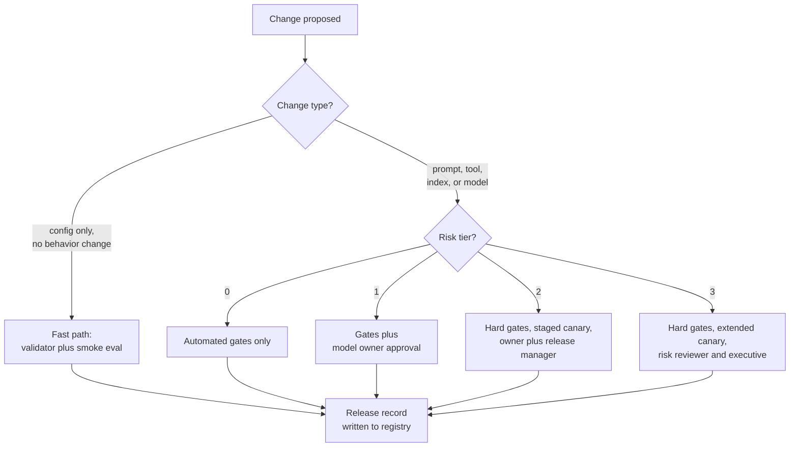

The decision tree has two branches that matter. The "config only" branch earns a fast path because it changes no behavior-defining artifact; the validator confirms that the claim is true by checking that no artifact digest other than configuration changed. The tier branch selects the approval chain. The tree is evaluated by the policy engine from manifest metadata, not by a person's judgment at the time of release.

### 9.3 Segregation of duties

Three permissions should be held by different people or systems: *create* a candidate, *approve* it, and *deploy* it. The developer creates. The model owner and, for higher tiers, the risk reviewer approve. Only the pipeline deploys, using credentials that no human holds. A developer cannot approve their own change to tier 2 or 3. The registry enforces this by comparing the identity that created the candidate with the identity on the approval and rejecting a match. This is the AI equivalent of the "four eyes" principle used in financial systems.

For small teams, one person may hold two roles at low tiers. The policy can allow this at tier 0 and tier 1 while still recording it.

### 9.4 Policy as code

Policies should be written as code, stored in version control, tested, and evaluated by a policy engine. The Open Policy Agent (OPA) and its Rego language are one widely used option; others exist. The advantage of policy as code over a wiki page is that the same rule runs in the pull request, in the pipeline, at admission to the cluster, and in the registry, with one definition.

An illustrative Rego policy for the rules above follows. Verify the syntax against the OPA version you run, since the language was revised for OPA 1.0.

```rego
package ai.release

import rego.v1

default allow := false

required_gates := {
    "0": {"validator"},
    "1": {"validator", "security", "quality"},
    "2": {"validator", "security", "quality", "safety", "latency", "cost", "fairness"},
    "3": {"validator", "security", "quality", "safety", "latency", "cost", "fairness", "slice"},
}

passed := {g | some g in input.evidence.gates_passed}

missing := required_gates[sprintf("%d", [input.risk_tier])] - passed

env_allowed if input.target_environment in input.allowed_environments

separation_ok if input.created_by != input.approvals[_].by

allow if {
    count(missing) == 0
    env_allowed
    separation_ok
    input.signature.verified
}

deny contains msg if {
    count(missing) > 0
    msg := sprintf("missing gates: %v", [missing])
}

deny contains msg if {
    not env_allowed
    msg := sprintf("classification %v not allowed in %v", [input.data_classification, input.target_environment])
}
```

The policy takes the manifest and target environment as input. It returns an allow decision and a list of denial messages. The last rule is the data movement rule from section 5.4 made executable: an artifact whose manifest lists only staging and production in `allowed_environments` cannot be placed in the sandbox.

Policy as code needs its own discipline. Policies are versioned, and the version used is recorded in the evidence block. Each rule has unit tests with allowed and denied examples. A change to a policy goes through review by the owner of the governance function. A "dry run" mode lets a new policy report what it would have denied before it is enforced, which prevents a policy rollout from breaking forty teams on a Monday.

### 9.5 Exceptions and waivers

Real operations need exceptions: an urgent fix for a live defect, a justified soft-gate failure, a temporary use of an unapproved model. A waiver is an *artifact*, with an owner, a reason, a scope (which release, which gate), an expiry date, and an approver one level above the requester. The policy engine treats a valid waiver as evidence for the named gate. Expired waivers stop working without anyone remembering to revoke them. The platform reports the number of active waivers per team as a governance metric, because a rising number signals either a gate that no longer fits or a team under pressure.

The urgent-fix path deserves specifics. It allows a reduced gate set (validator, security scan, and a targeted regression suite for the defect), requires the on-call model owner and the platform on-call to approve, and creates a mandatory follow-up task to run the full gate set within five working days. It never allows an unsigned artifact or a skipped manifest.

## 10. Release Strategies at the Architecture Level

### 10.1 Choosing a strategy

Part 16 CH29 describes deployment strategies as techniques. The platform's job is to offer them as configurable, safe, and observable primitives. The five that matter for AI systems:

| Strategy | Mechanism | What it tells you | Cost | Best for |
|---|---|---|---|---|
| Shadow | Candidate receives a copy of live requests; responses are not returned to users | Behavior and cost on real inputs without user impact | Double model cost for the shadowed share | Model swaps, new retrieval, tier 2 and 3 first look |
| Canary | A small share of live traffic is served by the candidate | Real user-visible quality, latency, and errors | Small | Almost every change |
| Blue/green | Two full environments; traffic switched at once | Fast cutover and instant switch back | Double capacity during the switch | Self-hosted serving where capacity is the issue; schema-compatible changes |
| Progressive delivery | Staged canary with automated analysis between steps | Evidence at each fraction, with automatic advance or rollback | Small | Tier 2 and 3 releases |
| Feature-flag-controlled prompt | Prompt or configuration version selected by flag per user, tenant, or percentage | Fast, targeted exposure and quick revert | Negligible | Prompt and configuration changes |

Shadow mode has a trap particular to AI: if the candidate calls tools with side effects, shadow traffic would execute them twice. Shadow requests must run with tools in a dry-run or recorded mode, or the shadow comparison must stop at the proposal of a tool call. Shadow mode also doubles the data exposure. The candidate receives real user data, so it must pass the same data-handling review as production.

### 10.2 Traffic-split mechanics

Splitting traffic looks simple and has several details that decide whether the experiment is valid.

1. **Deterministic assignment.** Hash a stable key (user identifier, tenant, or conversation identifier) with a salt and map the hash to a bucket from 0 to 9,999. A request goes to the canary when its bucket is below `fraction × 10,000`. The same user then sees the same variant across requests, which avoids confusing behavior flips within a conversation.
2. **Unit of randomization.** For multi-turn conversations, randomize at the conversation level. Switching model or prompt in the middle of a conversation changes style and breaks references to earlier turns.
3. **Sample ratio check.** Compare the observed split with the intended split. If 5 percent was intended and 3.1 percent arrived, something is wrong with assignment or logging, and the experiment's results should not be trusted. The Part 2 chapter on A/B testing ([CH27](../02_Design_Thinking_and_Product_Management/CH27_A_B_Testing.md)) covers the statistics.
4. **Comparison population.** Compare the canary with the baseline over the *same time window*, since the baseline from last week has different traffic.
5. **Isolation of side effects.** If the canary writes to a shared memory store or vector index, a rollback does not remove those writes. Canary writes go to a namespace that can be dropped, or the canary is read-only for state until promotion.
6. **Cache effects.** A semantic cache keyed on the prompt may serve baseline answers to canary users. Include the release identifier in the cache key.
7. **Sticky routing at the gateway.** The gateway applies the split using the active release's routing rule, which is part of the signed configuration (see [CH08](CH08_Model_Gateway_Routing_and_Fallback_Architecture.md)).

### 10.3 How much traffic is enough

The canary must serve enough requests to detect a regression that matters. For a two-proportion comparison, the sample size per arm for a one-sided test is approximately

$$n \approx \frac{(z_{\alpha} + z_{\beta})^2 \, [\,p_1(1-p_1) + p_2(1-p_2)\,]}{(p_2 - p_1)^2}$$

where $p_1$ is the baseline error rate, $p_2$ is the rate that must be detected, $z_\alpha$ is the normal quantile for the false-alarm rate, and $z_\beta$ is the quantile for the desired power (the probability of catching a true regression). Take $p_1 = 0.02$ and $p_2 = 0.03$, a one-sided false alarm rate of 1 percent ($z_\alpha = 2.33$), and 80 percent power ($z_\beta = 0.84$). Then $(z_\alpha + z_\beta)^2 = 3.17^2 = 10.05$. The variance terms are $0.02 \times 0.98 = 0.0196$ and $0.03 \times 0.97 = 0.0291$, summing to $0.0487$. The squared difference is $0.01^2 = 0.0001$. So

$$n \approx \frac{10.05 \times 0.0487}{0.0001} \approx 4{,}895$$

requests per arm. Now relate that to the traffic. A service handling 50 requests per second sends 2.5 requests per second to a 5 percent canary, which is 9,000 per hour, so the canary reaches 4,895 requests in about 33 minutes. At 1 percent, 0.5 requests per second gives 1,800 per hour, which needs about 2.7 hours. The calculation tells the platform team two things. The first stage of a progressive rollout is a smoke test for gross failures, not a statistical test for a one-point regression. And a low-traffic service needs a longer soak or a larger canary fraction, or it must accept that it can only detect large regressions.

### 10.4 Automatic rollback criteria

Rollback criteria are written before the release, as part of the release record. A useful set combines three kinds of rule:

- **Guardrail rules** fire immediately on absolute thresholds: error rate above a ceiling, timeout rate above a ceiling, a safety classifier flagging any critical output, cost per request above a hard limit. They need little data.
- **Comparative rules** fire when the canary is statistically worse than the baseline over the same window, once a minimum sample is reached.
- **Business rules** use delayed signals such as thumbs-down rate, escalation to a human, or task abandonment. These arrive slowly and need a longer soak time.

The decision logic is a small program. The runnable example [02_canary_decision_simulation.py](../code/python/ai-platform-lifecycle-chapter/02_canary_decision_simulation.py) uses a window of 10,000 requests per stage, stages at 1, 5, 25, and 50 percent, a baseline error rate of 2.0 percent, and these rules: roll back if the canary error rate exceeds 5.0 percent; do not reject on the comparative test below 500 canary requests; otherwise roll back if the one-sided z statistic exceeds 2.33. The z statistic is

$$z = \frac{\hat p_c - \hat p_b}{\sqrt{\hat p(1-\hat p)\left(\frac{1}{n_c} + \frac{1}{n_b}\right)}}$$

where $\hat p$ is the pooled error rate across both arms. The script uses expected counts so the result is reproducible. Its output:

```text
Scenario A (healthy): canary true error rate 2.0%, baseline 2.0%
  stage   1%: canary n=  100 errors=  2 | base n= 9900 errors=198 | z= 0.00 -> ADVANCE (too little evidence to reject)
  stage   5%: canary n=  500 errors= 10 | base n= 9500 errors=190 | z= 0.00 -> ADVANCE
  stage  25%: canary n= 2500 errors= 50 | base n= 7500 errors=150 | z= 0.00 -> ADVANCE
  stage  50%: canary n= 5000 errors=100 | base n= 5000 errors=100 | z= 0.00 -> ADVANCE
  result: promoted to 100 percent
Scenario B (regression): canary true error rate 3.0%, baseline 2.0%
  stage   1%: canary n=  100 errors=  3 | base n= 9900 errors=198 | z= 0.71 -> ADVANCE (too little evidence to reject)
  stage   5%: canary n=  500 errors= 15 | base n= 9500 errors=190 | z= 1.54 -> ADVANCE
  stage  25%: canary n= 2500 errors= 75 | base n= 7500 errors=150 | z= 2.92 -> ROLLBACK (z above limit)
  result: rolled back, 100 percent of traffic returned to baseline
```

Scenario B shows the arithmetic of detection. At 1 and 5 percent the one-point regression is invisible to the test (z of 0.71 and 1.54), which is consistent with the sample-size calculation: 500 requests is far below the roughly 4,900 needed. By 25 percent, with 2,500 canary requests, the z value of 2.92 exceeds the limit and the release is rolled back. The harm done is bounded: during the 25 percent stage, a quarter of that window's traffic saw a 3 percent error rate instead of 2 percent, which is 25 additional errors per 2,500 requests. A regression that large would be caught faster by a guardrail rule, and a regression that small is acceptable to catch at 25 percent. This is the central design trade-off: smaller early stages limit harm while larger stages give statistical power.

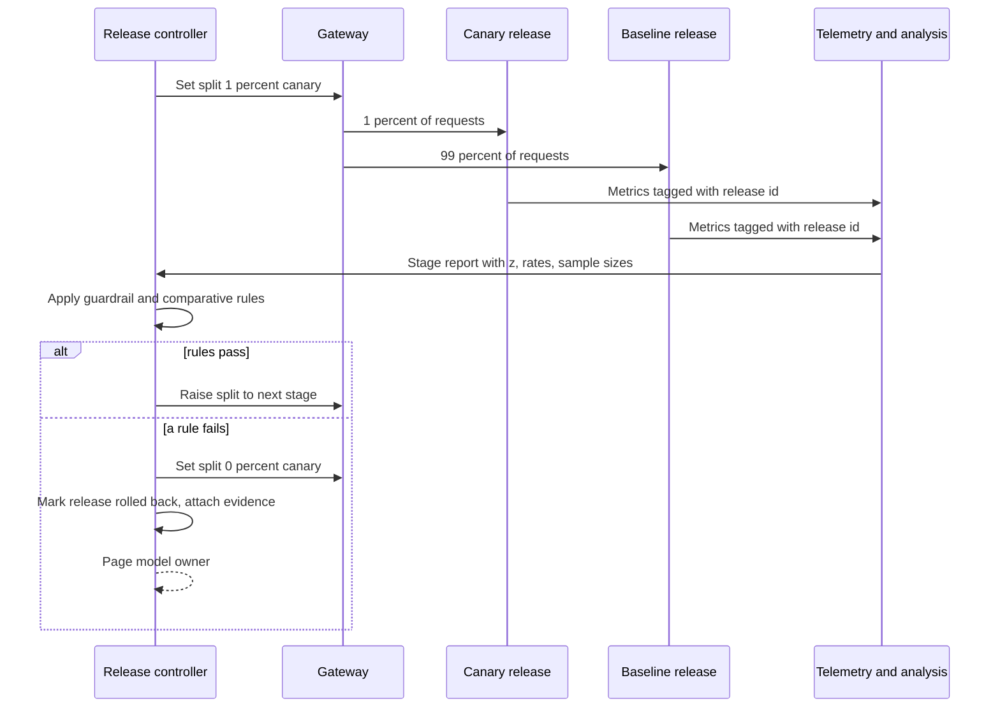

The sequence shows that rollback is a configuration change at the gateway, so it takes effect in the time it takes to propagate signed configuration, typically seconds to a minute. This is why the split belongs in the gateway's configuration and not in the application's code: an application redeploy would take minutes to hours.

### 10.5 Blue/green and its limits for AI

Blue/green keeps two complete stacks and switches traffic between them. For self-hosted models it is attractive because loading a large model onto accelerators takes minutes, and the green stack can be fully loaded and warmed before cutover. Its limits for AI:

- It doubles accelerator capacity during the switch. At Meridian's scale, a 8-GPU serving deployment costs 8 more GPUs for the overlap period. At an illustrative \$2.50 per GPU-hour and a 2-hour overlap, the one-time cost is 8 × 2.5 × 2 = \$40, which is negligible. For a 256-GPU deployment, the same overlap costs \$1,280 and requires that many free GPUs to exist, which is the harder constraint.
- It switches all traffic at once, so it provides no gradual evidence. Combine it with a canary on the green stack before the full switch.
- State that lives outside the stacks (indexes, memory stores, caches) is shared or must be switched together.

### 10.6 Feature-flag-controlled prompts

Prompts are the most frequently changed artifact and are cheap to change. A feature flag service that selects a prompt version per user segment gives an instant, auditable switch. Guidelines:

1. The flag's possible values are registry versions, not free text. A flag cannot point at a prompt that is not in the registry, signed, and evaluated.
2. Changing a flag in production is a release event. It writes an audit record and, for tier 2 and above, passes the gates and approvals. The convenience of a flag must not become a way around governance.
3. Flags have owners and expiry dates. A prompt flag that stays at 100 percent for a quarter should be folded into the next release manifest and the flag removed.
4. The release identifier in traces includes the resolved prompt version, so attribution still works.
5. The flag service itself is a dependency. If it is down, the data plane uses the last known configuration.

## 11. Rollback Design

### 11.1 What can be rolled back instantly

Rollback is the reverse of a release, and its cost depends on the artifact. Before choosing a release strategy, decide which artifacts are reversible and at what cost. The table classifies the common artifacts. "Time to roll back" assumes the previous version is retained and available.

| Artifact | Reversibility | Typical time to roll back | Obstacles |
|---|---|---|---|
| Runtime configuration | Instant | Seconds to 1 minute | None, if versioned |
| Prompt version | Instant | Seconds to 2 minutes | Prompts depend on tool schema and output format; downstream parsers may have changed |
| Routing rule at the gateway | Instant | Seconds to 1 minute | None |
| Guardrail policy | Instant | Seconds to 2 minutes | Rolling back a safety fix reintroduces the defect; requires a compensating control |
| Hosted model version (pinned) | Fast | 1 to 5 minutes | Provider must still serve the old version; retirement dates apply |
| Hosted model via alias | Not controllable | None | Provider moved the alias; you cannot choose |
| Self-hosted model weights | Fast to moderate | 5 to 30 minutes | Load time on accelerators; capacity for both versions |
| Fine-tuned adapter | Moderate | 5 to 30 minutes | Adapter is bound to a specific base model version; roll back together |
| Retrieval index (previous retained) | Moderate | 5 to 60 minutes | Previous index must be retained and queryable; embedding model must match |
| Retrieval index (rebuild required) | Slow | Hours | Rebuild time depends on corpus size and embedding throughput |
| Embedding model change | Slow | Hours to days | Index and queries must both change; requires re-embedding |
| Tool schema change | Depends | Minutes if backward compatible, otherwise coordinated | Tools have consumers beyond this release |
| Database or API schema | Hard | Hours to days | Migrations may be destructive; use expand-and-contract |
| Agent memory or user-profile store | Often not possible | Not applicable | Users and agents wrote new data; rollback loses it or leaves it inconsistent |
| Model trained on newer data | Fast to switch, but irreversible in effect | Minutes | Data already used cannot be un-used; consider rights |
| Actions taken by an agent | Not reversible by platform | Not applicable | Emails sent, orders placed; requires compensating actions |

The table has an uncomfortable bottom half. Instant rollback applies to artifacts the platform controls and that hold no accumulated state. Rollback is weakest where state accumulates: memory stores, indexes updated by live ingestion, and the real-world effects of agent actions. A design review should ask, for every release, "which of the changed artifacts is on the hard side of this table, and what is our plan?"

### 11.2 Compatibility windows

When a release changes two artifacts that depend on each other, you need both versions to coexist during the rollout, or you need to change them together. A **compatibility window** is the period during which old and new versions of an interface are both supported so that either side can roll back independently. The manifest's `compatibility_window_days` field records it.

Consider a change to the output format of a prompt, say from free text to a JSON object, consumed by a downstream parser. Three safe sequences exist:

1. **Expand, then migrate, then contract.** First deploy a parser that accepts both formats. Then release the new prompt. After the window closes with no rollback, remove support for the old format. During the window either side can be reverted.
2. **Versioned interface.** The response includes a `schema_version` field and consumers handle both.
3. **Atomic pair.** Release prompt and parser together under one manifest and roll them back together. This works only when you control both and can deploy them atomically.

The same pattern applies to tool schemas, index metadata schema (the fields that filters rely on), and event formats.

### 11.3 Rolling back dependent artifacts together

A release manifest makes rollback a single operation, "activate release R_prev", which restores every pinned artifact at once. This is its largest practical benefit. Without a manifest, a team that rolls back the model but forgets the prompt has made a third configuration that was never tested.

Some dependencies cross manifests. If the shared guardrail bundle changes from version 9 to version 10 and 14 releases reference it, the rollback unit is the bundle, and the platform must show which releases carry the changed bundle. The registry's dependency query (section 6.6) lists them.

The rollback target must be viable. Before activating `rollback_to`, the controller checks:

1. All artifacts in the target manifest are still retained and verified.
2. The target's model version has not been retired by its provider.
3. Compatible versions of external dependencies (tools, schemas) still exist.
4. The target passes the signature and policy checks. If a policy changed since the target was released and the target now violates it, the controller blocks the rollback and requires an approval, because the choice is between two imperfect options.

Retention is a cost to plan. Index storage example: an index of 40 million chunks with 1,024-dimensional vectors stored as 4-byte floats takes 40,000,000 × 1,024 × 4 = 163.84 gigabytes of raw vectors, before index structures and metadata. Keeping the previous version warm in a vector store doubles memory cost for that index. Keeping it cold in object storage at an illustrative \$0.023 per gigabyte-month costs about 163.84 × 0.023 = \$3.77 per month, but a cold copy turns a 5-minute rollback into a restore that may take an hour or more. The choice depends on tier: tier 3 keeps the previous index warm; tier 1 keeps it cold.

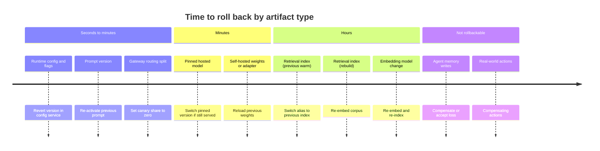

The timeline groups the artifacts by recovery time, and it should be used when setting the recovery time objective for a release. If a release changes the embedding model, the honest recovery time is hours, so the canary criteria must be stricter, or the release should be blue/green on a complete duplicate index. If a release changes only a prompt, instant rollback justifies a faster path.

### 11.4 Rollback is a tested capability

Teams often have a rollback process that has never been used. At tier 2 and 3, the platform requires a rollback exercise before the first production release, and records the measured time to roll back as a platform metric (section 21). A common finding in exercises is that the previous artifact was garbage-collected by a retention job. Use retention rules that protect any artifact referenced as `rollback_to` by an Active release.

### 11.5 Roll forward as an alternative

Sometimes rollback is not the best choice. If the previous release has a known defect, a rollback reintroduces it. If a data migration has already happened, rolling back the application breaks it. The alternative is **roll forward**: a quick fix released through the fast path. The decision rule: roll back when the previous release is known good and the rollback is cheap and safe; roll forward when rollback is risky or the previous state is not recoverable. The incident commander makes the choice, and the platform's duty is to make both fast.

## 12. Compute Scheduling as a Platform Concern

### 12.1 Why scheduling belongs to the platform

Accelerators are expensive and scarce, so a multi-team organization cannot let each team buy and idle its own. The platform provides the scheduler, the quotas, and the fairness rules. The components (accelerator types, interconnects, device plugins, cluster operators) are covered in [Part 16 CH27](../16_AI_and_GenAI/CH27_AI_Infrastructure_and_Platform_Components.md), and the Kubernetes mechanics are in [Part 9 CH08](../09_Cloud_Computing/CH08_Kubernetes.md). This section covers the platform design decisions.

Three workload classes compete:

| Class | Characteristics | Priority | Scheduling needs |
|---|---|---|---|
| Online serving | Latency sensitive, steady, needs headroom for spikes | Highest | Reserved capacity, autoscaling, no preemption |
| Training and fine-tuning | Long, can checkpoint, needs many GPUs at once | Medium | Gang scheduling (all workers start together), fair share, preemptible with checkpoints |
| Batch and evaluation | Bursty, tolerant of delay | Lowest | Backfill into idle capacity, preemptible |

### 12.2 Mechanisms

1. **Quotas per team or namespace.** A guaranteed amount plus a ceiling for borrowing idle capacity. Guaranteed capacity gives predictability and borrowing gives efficiency.
2. **Priority classes and preemption.** A serving surge can preempt a batch job, which resumes from its checkpoint. Training jobs must write checkpoints at intervals chosen so that the work lost on preemption is acceptable.
3. **Gang scheduling.** A distributed job needing 16 GPUs must receive all 16 or none. Partial allocation deadlocks the cluster when several jobs each hold part of what they need. Job queueing systems for Kubernetes provide this, for example Kueue or Volcano; check which one your platform version supports.
4. **Topology awareness.** Place workers on nodes with fast interconnects. A job placed across slow links can run several times slower.
5. **Bin packing and sharing.** Small inference models should share a GPU through partitioning (for example hardware multi-instance partitioning on supported devices) or time slicing, instead of holding a whole device. Time slicing gives no memory isolation, so use it only within a trust boundary.
6. **Spot or preemptible capacity** for fault-tolerant jobs, at a discount that varies; check the current cloud pricing.
7. **Reservations and commitments** for steady serving capacity, with the commitment sized to the sustained base load, not the peak (see [Part 9 CH14](../09_Cloud_Computing/CH14_Cost_Optimization.md)).

### 12.3 Worked utilization arithmetic

Meridian has a pool of 64 GPUs. A month has about 730 hours, so the pool offers 64 × 730 = 46,720 GPU-hours. Before the platform scheduler, each team held static allocations and measured utilization was 38 percent, so useful work consumed 46,720 × 0.38 = 17,754 GPU-hours. After introducing shared queues, borrowing, and backfill, measured utilization is 60 percent, or 28,032 GPU-hours. The difference is 10,278 GPU-hours. At an illustrative \$2.50 per GPU-hour, the additional capacity is worth about \$25,700 per month, either as work completed or as GPUs the organization no longer needs to buy. The calculation shows why the scheduler counts as part of the platform: the saving accrues across teams and no single team has the incentive to build the scheduler.

A caution: utilization is not the only goal. A cluster at 95 percent utilization has long queues. The platform should report queue wait time next to utilization. Meridian's target is utilization of 55 to 70 percent with p90 queue wait for standard-priority training under four hours (the SLO in section 3.4). Beyond that range, add capacity or tighten quotas.

### 12.4 Capacity planning for release operations

Release operations themselves consume capacity: evaluation runs, shadow traffic, canaries, blue/green overlap. Include them in the capacity model. A rough budget: if 40 teams each run about 6 evaluation runs per week, and each run uses 0.5 GPU-hours (for self-hosted models) or the equivalent token cost (for hosted models), the weekly GPU demand from evaluation alone is 40 × 6 × 0.5 = 120 GPU-hours, which is small against 10,000 or more GPU-hours per week of training and serving. The costly part is usually hosted-model tokens for large suites, which section 15 treats under cost attribution.

## 13. Drift and Quality Feedback into Retraining and Re-Indexing

### 13.1 The feedback loop as an architectural element

A release is not the end of the lifecycle. Once Active, a release meets a world that changes: users ask new kinds of questions, the documents in the knowledge base change, upstream data distributions move, and the provider updates its services. The platform needs a path from production evidence back to a new candidate. The signal design (what to measure, how to sample, how to redact) is the subject of [CH11](CH11_Evaluation_and_Observability_Architecture_for_AI_Systems.md), and drift statistics are in [Part 16 CH29](../16_AI_and_GenAI/CH29_MLOps_and_LLMOps.md). This section covers where the loop attaches to the lifecycle and how triggers become governed work.

Five kinds of feedback exist, with different latency and different consequences:

| Feedback | Examples | Latency | Typical response |
|---|---|---|---|
| Input drift | Query topic distribution shifts; new languages; new document types | Hours to days | Add cases to evaluation sets; consider re-indexing or prompt changes |
| Output quality drift | Rising thumbs-down rate, rising escalation, falling groundedness score | Hours to weeks | Investigate; roll back if sharp; retrain or re-prompt if gradual |
| Outcome drift | Delayed ground truth: fraud confirmed weeks later, claims later reversed | Weeks to months | Retrain predictive models on labeled outcomes |
| Dependency change | Provider updates a hosted model; embedding model replaced; source documents updated | Event-driven | Scheduled re-evaluation; re-index |
| Cost and latency drift | Token use per request grows; p95 rises | Hours to days | Optimize prompts, caches, routing |

### 13.2 Triggers

A **trigger** converts evidence into a proposed change. Triggers should be explicit rules held in the platform, with owners, because an implicit trigger ("someone will notice") fails silently. Four trigger families cover most needs.

1. **Scheduled.** A re-index every night for a fast-changing corpus, a retraining every quarter, a monthly re-evaluation of hosted-model behavior against the golden set.
2. **Threshold.** A metric crosses a limit for a sustained period: population stability index above 0.2 on a key feature for three days, groundedness score below 0.85 on a daily sample, more than 8 percent of queries returning no result.
3. **Event.** A new embedding model version appears, a provider announces a model retirement, a corpus owner publishes a bulk update, a rights withdrawal arrives.
4. **Volume of labeled feedback.** Retrain or refresh evaluation sets when 2,000 new labeled examples have accumulated.

A trigger does not deploy anything. It *creates a proposal* in the Proposed state with the evidence attached, and the normal lifecycle applies. The only automatic actions are the ones that reduce harm without changing behavior: raising an alert, increasing sampling, or, in tightly bounded cases, rolling back. A fully automatic retraining-to-production loop skips the gates, and for tier 2 and 3 workloads it removes the human accountability that the governance function relies on. Tier 0 and tier 1 workloads may automate more, with gates still in place.

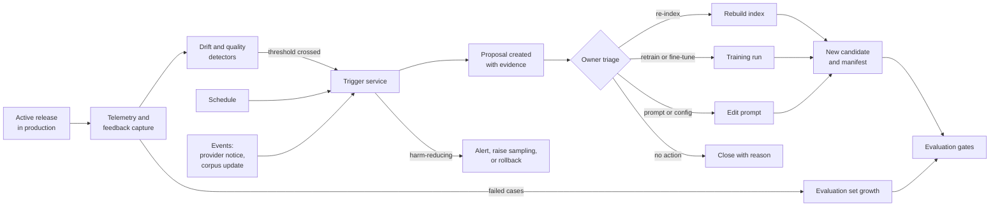

The diagram separates detection from decision. Detectors and the trigger service are automated. The owner triages a proposal, because the right response to a quality drop depends on its cause, and a platform cannot diagnose every cause. Note the lower path: failed production cases flow into the evaluation set, which strengthens future gates. This keeps the gates honest, because a gate whose test cases are two years old does not protect against today's failures.

### 13.3 Worked trigger arithmetic

Suppose the support assistant's daily groundedness score (fraction of sampled answers whose claims are supported by retrieved passages) has a baseline mean of 0.91 with a day-to-day standard deviation of 0.01 on a daily sample of 600 answers. A reasonable alert fires when the score is below the mean by three standard deviations, which is 0.91 − 0.03 = 0.88. Two consecutive days below 0.88 create a proposal, to avoid reacting to a single noisy day.

Check the sampling noise. With 600 samples and a true rate of 0.91, the binomial standard error is $\sqrt{0.91 \times 0.09 / 600} = \sqrt{0.0001365} = 0.0117$. The observed day-to-day standard deviation of 0.01 is consistent with pure sampling noise. So a daily threshold at three times 0.01 is slightly tighter than three sampling standard errors (0.035), and the "two consecutive days" rule is what keeps the false-alarm rate manageable. If the platform lowered the daily sample to 150, the standard error would double to 0.0234, and the same threshold would fire constantly by chance. The lesson is to set thresholds from the sampling error of the metric, not from intuition.

### 13.4 Retraining versus re-indexing versus re-prompting

The owner's triage uses a short decision procedure. The cheaper, faster, and more reversible interventions are tried first.

1. **Is it a retrieval problem?** If answers are wrong because the knowledge base is stale, missing a document, or chunked poorly, re-indexing or fixing ingestion is the remedy. Time scale: hours. Reversibility: moderate (the previous index is retained).
2. **Is it a prompt or configuration problem?** If the model has the information but is instructed poorly, a prompt change is the remedy. Time: minutes to days. Reversibility: instant.
3. **Is it a routing or model selection problem?** If a different model suits a segment better, change routing at the gateway. Time: days. Reversibility: instant.
4. **Is it a model capability problem that persists across prompts?** Consider fine-tuning an adapter ([Part 16 CH20](../16_AI_and_GenAI/CH20_Fine_Tuning_PEFT_and_LoRA.md)). Time: days to weeks. Reversibility: moderate.
5. **Is it a predictive model with outcome drift?** Retrain on fresh labeled data. Time: days to weeks. Reversibility: fast to switch.

When a drift trigger touches the embedding model or the chunking logic, the index must be rebuilt in full. A rebuild of 40 million chunks at an illustrative embedding throughput of 2,000 chunks per second takes 40,000,000 / 2,000 = 20,000 seconds, which is about 5.6 hours. Plan the rebuild as a new index version built beside the old one and switched by alias, so that serving continues from the old index until the new one passes its gates. The cost of the rebuild includes embedding compute and the doubled storage during the overlap.

### 13.5 Avoiding feedback hazards

- **Feedback contamination.** If model outputs are used as training labels without independent verification, the model learns its own errors. Keep a firewall between generated content and ground-truth labels.
- **Selection bias in feedback.** Users who click thumbs-down are not a random sample. Combine voluntary feedback with randomized review samples.
- **Privacy.** Production data used for evaluation sets or retraining carries consent and retention constraints (see [CH12](CH12_AI_Safety_Security_Privacy_and_Governance_Architecture.md) and [Part 16 CH30](../16_AI_and_GenAI/CH30_AI_Data_Governance_Privacy_and_Provenance.md)). Record the permission to reuse in the lineage graph.
- **Retraining cadence without evidence.** Retraining on a calendar when nothing has drifted adds cost and risk without benefit. The release gates are an expense; spend them when there is a reason.
- **Feedback loops in the product.** A recommender that shapes what users see then trains on what they click amplifies its own bias. Track exposure and use exploration traffic.

## 14. Registries for Prompts, Tools, and Agents

### 14.1 Beyond the model registry

Traditional MLOps centers on a model registry. In generative systems, much of the behavior and most of the day-to-day change lives in other artifacts. A platform therefore needs registries, or registry views, for at least four artifact families.

| Registry | Contents | Key metadata | Why it needs registry treatment |
|---|---|---|---|
| Model registry | Weights, adapters, pinned hosted-model entries | Base model, training data lineage, license, evaluation reports, allowed regions, provider retirement date | Identity, rights, and retirement |
| Prompt registry | System prompts, templates, few-shot sets, output schemas | Owner, variables, expected tool schema, compatible models, evaluation results | Frequent change; direct behavioral effect |
| Tool registry | Tool names, input and output schemas, descriptions, required scopes, side-effect class | Owner, data classification, rate limits, idempotency, approval requirement, consumers | Agents act through tools; a tool is a privilege |
| Agent registry | Agent definitions: role, model policy, allowed tools, memory configuration, autonomy level | Owner, risk tier, manifest, allowed tenants | The unit that users and auditors actually reason about |

An agent definition references prompts, tools, and a model policy, so the agent registry sits on top. This is the same dependency structure as the release manifest, and in practice the manifest *is* the record of an agent release.

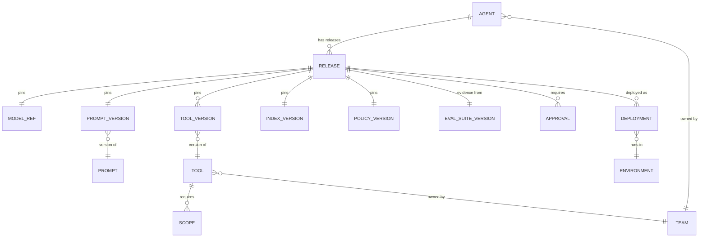

The entity diagram shows that a release pins specific versions of other registries' entries and is deployed into environments. The ownership edges matter as much as the version edges: every entity has a team, so a notification about a deprecation or a vulnerability reaches a person.

### 14.2 The prompt registry

A prompt in source control gets history and review. A prompt registry adds what source control lacks: evaluation results attached to each version, a status in the lifecycle, a runtime API for fetching a pinned version, and a record of which releases use it. Practical points:

1. **Versions are immutable.** Editing creates a new version. Fetching by name resolves to a version through a release or a flag, never to "latest" in production.
2. **Variables are declared.** The registry stores the template's variables and their types, so the validator can check that the application supplies them.
3. **Compatibility is recorded.** Which models the prompt was evaluated against, and which tool schema versions it expects.
4. **Sensitive content.** Prompts often contain business rules and sometimes example customer data. Classify them and scan for secrets and personal data before registration.
5. **Fetch performance.** The data plane caches prompt versions locally. A prompt fetch on the request path would add latency and a dependency.
6. **Source of truth.** Choose whether the registry or the repository is authoritative. A common pattern: the repository is authoritative for authoring and review, a pipeline publishes versions to the registry, and runtime reads only from the registry.

### 14.3 The tool registry

A tool is an interface through which a model can cause effects. A tool registry makes the privilege visible. Record for each tool:

- **Side-effect class:** read-only, reversible write, irreversible write, external communication, financial. The class feeds approval requirements and autonomy limits (see [CH06](CH06_Agentic_System_Architecture_and_Tool_Boundaries.md) and [CH09](CH09_Human_Oversight_and_AI_Assisted_Workflow_Integration.md)).
- **Scopes and credentials:** what permission the tool uses, and whether it acts with the end user's identity or a service identity.
- **Schema versions:** with compatibility rules. Adding an optional field is compatible; adding a required field or renaming one is not.
- **Idempotency:** whether retries are safe.
- **Consumers:** which agent releases use which tool version, so that a breaking change can be planned.
- **Description text:** the natural-language description is part of the tool's behavior. A change in wording can change when a model calls the tool. Treat description changes as behavior changes and run the agent evaluation suite.

The Model Context Protocol (MCP) is one standard way to expose tools to models ([Part 16 CH22](../16_AI_and_GenAI/CH22_Model_Context_Protocol.md)). The registry should track MCP servers as tool providers with owner, version, and trust level. Third-party MCP servers are external dependencies and fall under the same review and pinning rules as other external components.

### 14.4 The agent registry

An agent is a composition, and its registry entry is the thing a reviewer approves: the allowed tools, the autonomy level, the memory configuration, and the data scopes. The registry answers questions such as "which agents can send external email?" and "which agents can read customer records?" with a query. Without it the answer is a survey. For governance, the agent's risk tier is the maximum over its tools' side-effect classes and the data classification it can read, so adding one irreversible-write tool to a tier 1 agent raises it to at least tier 2 and triggers the appropriate gates. The policy engine computes this from the manifest.

### 14.5 Registry operations

The registries are control-plane services and need operational care:

- **Availability model.** The data plane reads from caches (section 5.1). The registry's write path can be down for a while without harming serving.
- **Backup and restore.** Registry metadata is the memory of the platform. Back it up, test restoration, and keep the object store for artifact bytes versioned.
- **Access control.** Read is broad, write is narrow, approve is narrower, delete is rarely allowed. Deletion of an artifact referenced by a release or retained for audit is blocked.
- **Search and discovery.** The catalog is the entry point for teams. If they cannot find an existing prompt, tool, or evaluation suite, they create a duplicate.
- **Garbage collection.** Retention policies delete artifacts that are unreferenced and older than the retention window. They must never delete `rollback_to` targets or artifacts under legal hold.

## 15. Multi-Tenant Platform Design, Self-Service, and Cost Attribution

### 15.1 What a tenant is

A **tenant** in the platform is a team or a business unit that owns workloads and is accountable for their cost and behavior. Do not confuse this with the tenants of a customer-facing product (customers of Meridian). Both kinds of tenancy exist, and the platform must handle the first while enabling the second (for example, per-customer index partitions, discussed in [CH05](CH05_Retrieval_Augmented_Generation_System_Architecture.md)).

### 15.2 Isolation layers

Isolation is a set of layers, each with a cost. Choose a layer per risk, not a single answer for everything.

| Layer | Isolation mechanism | Strength | Cost and friction |
|---|---|---|---|
| Identity and access | Per-team roles; workload identities; no shared credentials | Baseline | Low |
| Namespace | Per-team Kubernetes namespaces with resource quotas and network policies | Moderate | Low |
| Node pool | Dedicated nodes for sensitive teams or workloads | Strong for compute | Moderate; lower packing efficiency |
| Account, project, or subscription | Separate cloud accounts per team or per business unit | Strongest administrative boundary | Higher; account vending needed |
| Gateway virtual keys | Per-team keys with per-key budgets, rate limits, and model allow lists | Moderate | Low |
| Data partitioning | Per-team or per-tenant indexes, buckets, and encryption keys | Strong for data | Moderate |
| Cryptographic | Per-tenant encryption keys managed in a key service | Strong for data at rest | Moderate |
| Hardware | Dedicated accelerators with no sharing | Strongest for GPU side channels | High |

A pragmatic default: namespaces plus gateway virtual keys plus per-team data stores for all teams, node pools or separate accounts for tier 3 or highly sensitive workloads, and dedicated GPUs only where a risk assessment requires it. Sharing a GPU between mutually untrusting tenants through time slicing offers no memory isolation, so reserve it for workloads inside one trust boundary.

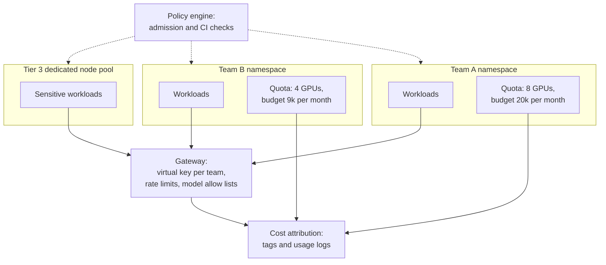

The diagram shows that tenancy controls are applied at three places: at admission (policy checks on what may be created), at runtime (quotas and virtual keys), and in accounting (attribution). A tenant cannot exceed its quota or use a model outside its allow list, and every unit of use is tagged to an owner.

### 15.3 Noisy neighbors

A **noisy neighbor** is a tenant whose load degrades the experience of others. In AI platforms the shared resources that suffer are provider rate limits, accelerator memory and compute, gateway capacity, vector database capacity, and evaluation queues. Controls:

1. **Per-tenant rate limits and token budgets** at the gateway, so one team cannot consume the organization's whole provider quota. A provider rate limit shared across the company is a shared resource; allocate it. For example, if the organization has 2,000,000 tokens per minute with a provider and 40 teams, an even split gives 50,000 per team, which is wasteful. Allocate a guaranteed share per team (say 20,000, or 800,000 total) and a shared burst pool of the remainder (1,200,000) with per-team ceilings.
2. **Priority classes** so that interactive traffic preempts batch traffic inside the shared pool.
3. **Separate pools** for evaluation and production traffic, so that a large evaluation run cannot starve live requests.
4. **Concurrency limits and queue depth limits** per tenant on shared serving, with backpressure (see [CH13](CH13_Reliability_and_Resilience_Patterns_for_AI_Workloads.md)).
5. **Fair-share scheduling** of the GPU queue (section 12).
6. **Noisy-neighbor detection:** per-tenant usage metrics that show the top consumers and trigger a notification when a tenant exceeds its share by a set factor.

### 15.4 Self-service with guardrails

Self-service is the platform's scaling mechanism. It means a team can create resources, deploy releases, and obtain access without a ticket, within limits enforced by automation. Guardrails make self-service safe:

1. **Templates and scaffolding.** A command or portal action generates a repository with the pipeline, manifest, evaluation suite skeleton, dashboards, and cost tags already wired.
2. **Pre-approved patterns.** A pattern the governance function reviewed once (for example "RAG over internal documents with department-level access control, tier 1") can be instantiated without further review as long as the parameters stay inside declared limits.
3. **Policy checks in continuous integration.** The same policies as the release gates run on pull requests so that a violation is found in minutes at the developer's desk.
4. **Quotas and budgets by default.** New namespaces and keys start with a modest quota, increased on request with a justification.
5. **Safe defaults.** Private networking, encryption, logging with redaction, and least-privilege roles are defaults. Opting out requires a waiver.
6. **Paved escape hatches.** When a team needs something the paths do not cover, there is a documented request process, a time-boxed review, and a path to turn the result into a new pattern.

A measurable goal for self-service is the proportion of requests that need no human step. Meridian's target is 85 percent self-service. The 15 percent that remain are tier 3 approvals, quota increases above a threshold, and new model onboarding, which are legitimate human decisions.

### 15.5 Cost attribution, budgets, and chargeback

Cost control starts with attribution: every cost line carries an owner. The strategy and optimization techniques are in [CH14](CH14_AI_Cost_Performance_and_Sustainability_Decisions.md) and [Part 9 CH14](../09_Cloud_Computing/CH14_Cost_Optimization.md); the platform provides the plumbing.

**Tagging.** Every resource and every gateway request carries `team`, `feature`, `environment`, `release`, and `cost_center`. Resource tags are applied by templates and enforced by policy at admission, and request-level attributes are set from the virtual key and from a mandatory header. Untagged spend goes to a visible "unallocated" account that the platform team must drive toward zero.

**Sources.** Cloud billing exports give infrastructure cost. Gateway logs give token usage per request, which multiplied by the price per token gives hosted-model cost. Token prices differ for input and output and change over time, so read the current price list and store the price version with each calculation. Shared costs (the gateway, the registry, the platform team) are allocated by a stated rule.

**Allocation rule example.** Meridian's shared platform costs are \$180,000 per month. Allocate 50 percent by share of gateway requests and 50 percent by share of GPU-hours. Team C sent 4 percent of requests and used 10 percent of GPU-hours. Its allocation is 180,000 × (0.5 × 0.04 + 0.5 × 0.10) = 180,000 × 0.07 = \$12,600. Publishing the rule matters more than its precision, because teams accept an allocation they can recompute.

**Showback and chargeback.** *Showback* reports cost to teams without billing them. *Chargeback* transfers the cost to the team's budget. Showback is a good first step, because it builds trust in the numbers. Chargeback changes behavior more strongly but invites disputes, so move to it when the data is accepted. Free tiers for sandbox usage keep experimentation cheap.

**Budgets and enforcement.** A budget at team and feature level with alert thresholds at 50, 80, and 100 percent of the monthly amount. Enforcement options increase in severity: notify, require approval for new deployments, throttle non-production use, and block. For production, blocking is rarely acceptable, so use a soft ceiling with an escalation path and let the gateway degrade gracefully (for example, route to a cheaper model) according to a policy the team chose in advance.

**Unit economics.** Beyond totals, the platform reports cost per successful task or per thousand requests per feature. The cost gate in section 8.3 uses this figure. Unit cost is the number that lets a product owner decide whether a feature is worth running.

## 16. Deprecation, Retirement, and Consumer Migration

### 16.1 Why retirement needs design

Platforms accumulate. Old models, prompts, indexes, and endpoints keep serving because someone depends on them, and no one knows who. Each retained artifact has a cost (compute, storage, security patching, cognitive load) and a risk (outdated safety behavior, unsupported libraries, expiring licenses). Retirement is a design activity with its own state, owners, and timeline.

### 16.2 The inventory of consumers

You cannot migrate consumers you cannot name. The consumer inventory has two sources:

1. **Declared consumers.** Teams register as consumers when they obtain a gateway key or reference an artifact in a manifest. This is the registry's dependency graph.
2. **Observed consumers.** Gateway and serving logs show which keys, services, and networks call each endpoint. Observed callers not in the declared list are unregistered use (see section 17).

The retirement runbook starts with a join of both. The runnable example [04_lineage_and_retirement.py](../code/python/ai-platform-lifecycle-chapter/04_lineage_and_retirement.py) models five consumers of a base model, with their daily request volumes and migration status:

```text
Retiring base_model_x: 160,000 of 300,000 requests/day not migrated (53.3%)
Blocked by: ['checkout-bot', 'hr-faq', 'shadow-notebook']
```

Arithmetic: total traffic is 120,000 + 80,000 + 20,000 + 60,000 + 20,000 = 300,000 requests per day. Three consumers have not migrated: checkout-bot (120,000), hr-faq (20,000), and an unregistered notebook (20,000). They sum to 160,000, which is 160,000 / 300,000 = 53.3 percent. The remaining 46.7 percent has migrated. The retirement date cannot be met until the blocked list is empty, and the list includes a consumer that only observed traffic revealed.

### 16.3 The deprecation timeline

A deprecation has a fixed sequence of communications and technical steps. The sunset date is set at the start, with the notice period required by the platform's SLO (180 days for supported interfaces at Meridian).

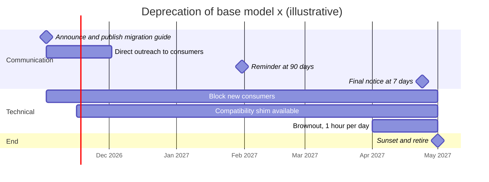

The same script computes these dates: announce 2026-11-02, sunset 180 days later on 2027-05-01, a reminder at T minus 90 days on 2027-01-31, a brownout from T minus 30 days on 2027-04-01, and a final notice at T minus 7 days on 2027-04-24. The sequence of phases:

1. **Announce.** Publish the deprecation with the reason, the successor, the sunset date, and a migration guide. State the evaluation evidence for the successor so teams know what to expect.
2. **Block new use.** From the announcement, new keys and new manifests cannot reference the deprecated artifact. The policy engine enforces it.
3. **Reach out.** Contact each declared and observed consumer owner directly. A mailing list announcement alone reaches few people.
4. **Provide a compatibility shim.** If the successor differs in interface or behavior, a shim at the gateway can translate requests (for example, parameter names or response formats) so that consumers can migrate in two steps: first switch to the shim, then adapt at leisure. A shim should have its own sunset date.
5. **Run brownouts.** In the final weeks, turn the deprecated endpoint off for an hour each day, then for longer. Consumers that did not read the notices discover themselves, with a safe and quickly reversible failure.
6. **Sunset.** Turn off serving. Keep the artifacts archived for the retention period and the registry record permanently.
7. **Verify.** Confirm that no traffic arrives. Traffic after sunset means an unknown consumer, who should be contacted.

### 16.4 Migration support

Migration is a project for each consumer team, and the platform decides how much help to give. The migration guide should list behavior differences and a regression suite that consumers can run: the platform supplies a ready-to-run comparison, built from the evaluation service, that runs the consumer's golden cases on both models and shows differences. The cost of migration for a consumer is the engineering time plus re-validation. A rough planning figure from experience is a few days for a prompt-only consumer and several weeks for a consumer with fine-tuned adapters or tightly tuned prompts. Fine-tuned adapters cannot be moved between base models and must be retrained against the new base, so adapter consumers need the longest notice and the most help.

### 16.5 External provider model retirement

When a provider retires a hosted model version, the timeline is set by the provider, not by the platform. Providers publish deprecation schedules; read your provider's current policy, since terms vary and change. The platform's job is to convert the provider's notice into the internal timeline above, with less slack.

1. **Subscribe to provider notices** and route them to the registry, which holds the provider's retirement date as metadata for each pinned hosted-model entry.
2. **Query impact.** The dependency graph lists every release that pins the retiring version. This takes minutes.
3. **Work backward from the provider's date.** If the provider retires the model on 2027-03-31, the platform's own consumer deadline must be earlier: at least the time needed for evaluation, canary, and one rollback cycle. Meridian's rule is provider date minus 45 days for the internal sunset, which for this example is 2027-02-14.
4. **Treat the successor as a new model, not a patch.** Even if the provider calls it a minor update, behavior differs, so every consumer re-runs its evaluation suite and goes through the lifecycle.
5. **Maintain a successor candidate pipeline.** Run the golden sets against the provider's announced successors as soon as they are available so that a retirement notice finds you with evidence already in hand.
6. **Check regional availability.** A successor may not be available in all regions or under the data residency terms you use.
7. **Handle unpinned aliases.** An alias that moves silently is a retirement without notice. Pin where the provider allows it, and schedule frequent behavior checks where it does not (section 18).

Provider retirement also forces the "mass deprecation" scenario in section 18, when many releases pin the same retiring model.

### 16.6 Retiring other artifact types

Prompts, indexes, tools, and policies retire too, with type-specific wrinkles:

- **Indexes:** retire only after the releases that reference them are retired or migrated, and after the rollback window. Delete vectors derived from restricted data on the schedule the rights record requires.
- **Tools:** a breaking change to a tool is a retirement of the old version. Keep the old version during the compatibility window.
- **Evaluation suites:** keep them. A retired model's suite is a baseline for future comparisons and an audit record.
- **Agents and endpoints:** disable credentials and routes, remove DNS records, and delete cost tags so that costs stop accruing to a ghost.

## 17. Shadow IT and Unmanaged Model Usage Discovery

### 17.1 The problem

Teams under pressure will use a model through a personal account, a browser tool, or a provider key stored in a notebook. The result is **shadow AI**: usage outside the platform's visibility and controls. It carries data leakage risk, uncontrolled cost, unreviewed outputs in customer-facing paths, and invisible dependencies on providers. A platform that responds only with prohibition tends to drive usage further out of sight. The better response combines detection, a path that is easier than the workaround, and clear rules.

### 17.2 Discovery methods

No single method finds everything, so combine several.

| Method | What it sees | Limitation |
|---|---|---|
| Provider billing and invoices | Paid usage by account and key | Misses free tiers and personal accounts |
| Cloud billing and cost tags | Managed AI services, GPU instances, vector databases | Untagged or personal-account spend invisible |
| Egress and DNS logs | Calls to known provider domains from corporate networks | Encrypted payloads; mobile and home networks |
| Secrets scanning in repositories | Provider API keys committed to code | Only code that is scanned |
| Dependency scanning | SDKs for provider libraries in repositories and images | Does not show actual use |
| Identity provider and single sign-on logs | Sign-ins to AI applications with corporate identity | Does not show use via personal identity |
| Endpoint and browser controls | Use of web AI tools on managed devices | Intrusive; privacy and works-council considerations |
| Expense reports and procurement | Subscriptions bought by teams | Slow |
| Surveys and amnesty programs | Use that people volunteer | Depends on trust |

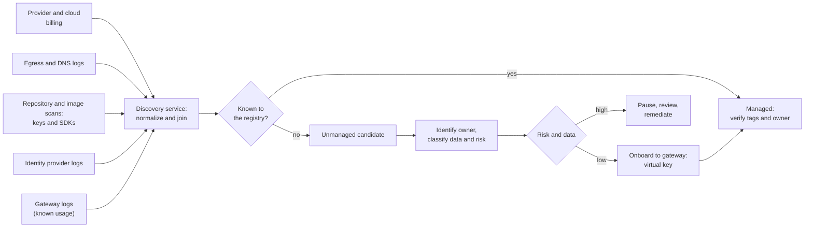

The diagram shows discovery as a reconciliation: sources of actual use on the left are compared with the registry of known use. The gap is the work list. The branch on risk matters: a team that used a model for a low-risk internal summarizer is helped onto the platform, and a team that sent customer records to an unapproved service has an incident to handle.

### 17.3 Worked discovery arithmetic

Meridian reconciles provider invoices with gateway logs for one month. Provider invoices across all accounts total \$412,000. The gateway logs show spend of \$198,000. So the gateway covers 198 / 412 = 48.1 percent of billed spend, and \$214,000 (51.9 percent) of spend is outside the gateway. Of that, finance can map \$151,000 to known teams with direct provider contracts (managed but ungoverned), and \$63,000 belongs to accounts nobody on the platform team recognizes. The first group needs migration and the second needs investigation. The 48 percent figure is the gateway traffic share metric from section 3.5.

### 17.4 Making the paved road the easy road

Detection finds shadow usage once. Prevention depends on why people left the path:

- **Slow onboarding.** If getting a key takes three weeks, people use personal keys. Target onboarding of under two working days (section 3.4).
- **Missing models.** If the platform lacks the model a team needs, add a process to evaluate and onboard it quickly.
- **Missing features.** If the gateway does not support a provider feature a team needs (for example a structured output mode), prioritize it, since the team will route around the gateway otherwise.
- **Unclear rules.** Publish a short acceptable use policy that says what data may go where. Many incidents arise from honest uncertainty.
- **Cost.** Offer a free sandbox tier within a small budget so that curiosity does not require a purchase.

Technical enforcement supports the policy. Egress rules in production networks allow provider traffic only from the gateway. That makes bypass a visible failure and not a silent leak, and combined with an easy path it is accepted.

## 18. Failure Scenarios

The platform's own failures need the same rigor as the failures of the AI features it hosts. Each scenario below is written as a quality-attribute scenario: a stimulus, the response the architecture should produce, and a measure that says whether it did. The numbers are targets to set in your own context, with illustrative values here.

### 18.1 A bad artifact is promoted

**Stimulus.** A prompt change that passed the gates reaches 100 percent of traffic. Two hours later the assistant begins refusing a class of valid claims questions. The evaluation suite did not contain that class.

**Expected response.**

1. Online detectors flag a rise in refusal rate and in escalations, tagged by release identifier.
2. The release controller compares against the previous release's rate. A guardrail rule exceeds its limit and the controller activates `rollback_to` automatically (tier 2 and above), or pages the model owner with a one-click rollback (tier 1).
3. The registry marks the release as rolled back, attaches the evidence, and blocks re-promotion until a new candidate references the incident.
4. Failed cases are added to the evaluation set so that the next gate covers the class.
5. A blameless review asks why the suite lacked the class, and which process (feedback sampling, domain review) should have supplied it.

**Measures.** Time from defect introduction to detection: under 30 minutes at the 25 percent stage, which the progressive rollout should have caught before 100 percent. Time to rollback after detection: under 5 minutes for a prompt change. Fraction of affected requests: bounded by the traffic share at detection. In this scenario the failure was a gap in the evaluation set, which the canary stage should have narrowed. If the release had skipped the canary because the change was labeled "config only", the platform's labeling rule is at fault: the validator must verify that the change set really contained only configuration digests.

### 18.2 The registry is down during an incident

**Stimulus.** A production incident requires rolling back a release. The registry service is unavailable because of a regional failure.

**Expected response.**

1. The data plane keeps serving from its cached, signed configuration. The outage by itself causes no serving impact.
2. The rollback target must be reachable without the registry. Each regional runtime keeps the last N manifests (for example, the Active release and its `rollback_to`) in a local store together with the artifacts they need, verified at the time they were cached.
3. The release controller offers a "break-glass" rollback that accepts a locally cached, signature-verified manifest and writes an audit record to a local append-only log, which is reconciled with the registry when it returns.
4. Break-glass use needs two-person approval and generates a review item.
5. New promotions are frozen until the registry is back, by policy.

**Measures.** Serving availability during the registry outage: unchanged from baseline. Time to roll back using the cached manifest: under 10 minutes. Audit gap: zero unreconciled break-glass records after recovery. Registry recovery time objective: 30 minutes for the read path, 4 hours for the write path (illustrative). This scenario is the reason for the control-plane and data-plane split in section 5.1, and for retaining rollback targets locally (section 11.3).

### 18.3 Dependency version drift

**Stimulus.** A release pins a hosted model by an alias because the provider offers no dated snapshot for that tier. The provider updates the model behind the alias. A formatting behavior changes, and a downstream parser fails on 3 percent of responses.

**Expected response.**

1. A scheduled behavior check runs the golden set against the alias daily and compares with the stored baseline. The check detects a change in output format or score.
2. The alert names the dependency, the metric, and the releases that reference the alias (from the dependency graph).
3. The owner decides: adapt the parser, tighten the prompt, pin another dated model, or route to a fallback model through the gateway ([CH08](CH08_Model_Gateway_Routing_and_Fallback_Architecture.md)).
4. The release record notes that the alias is an unpinned dependency, which raises the re-evaluation cadence for those releases and is visible to approvers.

Library drift is the same class of problem. A serving image that builds with unpinned Python packages changes behavior without any change in the repository. The cure is lock files, image digests in the manifest, and rebuilding from the lock file only on purpose.

**Measures.** Time from provider change to detection: at most 24 hours (the check interval). Affected requests before detection: at most one day of traffic for the alias-dependent features. Share of production releases with unpinned external dependencies: reported monthly, with a target of zero for tier 3.

### 18.4 Mass deprecation

**Stimulus.** A provider announces the retirement of a model version in 120 days. Thirty-one of Meridian's production releases pin it.

**Expected response.**

1. The dependency query lists the 31 releases and their owners in minutes.
2. The platform opens one migration epic with 31 child tasks, grouped by risk tier, and sets the internal sunset 45 days before the provider date: day 75.
3. The platform runs a standard comparison of the successor against each release's golden set, automatically, and posts the results to each owner. Owners of releases with no regression only need to approve.
4. Capacity for evaluation is reserved. If each comparison run costs 1.2 GPU-hours or the equivalent hosted-token cost, 31 runs cost about 37 GPU-hours plus repeats.
5. The platform schedules canaries so that no more than a set number of high-traffic releases switch in one week, to avoid a thundering herd on the successor's provider rate limit.
6. Releases that cannot migrate in time get an explicit risk acceptance from their accountable executive, a written fallback, and a decision to retire the feature if necessary.

**Measures.** Releases migrated by internal sunset: target 100 percent, with a measured 90 percent by day 60 as an early indicator. Unplanned outages from the retirement: zero. Capacity: successor rate limit headroom confirmed with the provider before the first wave.

### 18.5 Signing key or build pipeline compromise

**Stimulus.** A report indicates that the build pipeline's signing identity may have been used by an unauthorized party in the last 48 hours.

**Expected response.**

1. The key service revokes the signing identity. Runtimes that refresh their trust configuration stop accepting new artifacts signed with the old identity. Running releases continue to serve.
2. The registry lists all artifacts signed in the window (query by signer and time) and the releases that include them.
3. Each listed artifact is re-verified by rebuilding from source in a clean pipeline and comparing digests. Reproducible builds make this practical; where artifacts are not reproducible, they are treated as untrusted until re-evaluated.
4. Releases containing unverifiable artifacts roll back to the last release signed before the window.
5. A new signing identity is issued, trust configuration updated, and a post-incident review changes the pipeline's controls.

**Measures.** Time to revoke: under 15 minutes. Time to enumerate affected releases: under 1 hour. Time to restore a verified state for tier 3 releases: under 8 hours.

### 18.6 A noisy neighbor exhausts the shared provider quota

**Stimulus.** A batch job in one team's namespace sends 10 times its normal volume, exhausting the organization's tokens-per-minute allocation with the provider. Interactive features in other teams receive rate-limit errors.

**Expected response.** The gateway's per-team ceilings cap the batch job at its burst limit. Priority rules reserve the guaranteed share for interactive traffic. The gateway queues or sheds the excess batch calls first. The usage dashboard shows the top consumer, and the platform notifies the owner. Fallback routing sends overflow interactive traffic to a secondary provider if configured.

**Measures.** Error rate of other teams' interactive traffic during the event: under 0.1 percent increase. Time to detect the top consumer: under 5 minutes. Time to restore normal quota use: under 15 minutes.

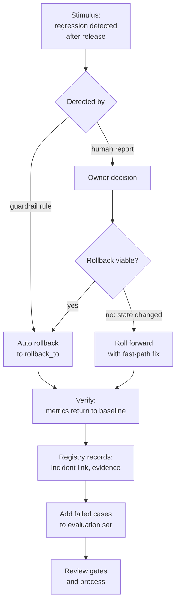

The flow ties the failure scenarios together: whatever the stimulus, the platform should detect, restore, verify, record, and learn. The "rollback viable?" decision is the one that needs rehearsal, since it depends on the state classification in section 11.1.

## 19. Governance Integration, Team Topology, and Operating Model

### 19.1 Governance as a property of the lifecycle

Governance that sits outside the lifecycle (a review board with slide decks) does not scale and does not produce reliable evidence. Governance integrated into the lifecycle means the platform collects the evidence as a by-product of normal work. [CH12](CH12_AI_Safety_Security_Privacy_and_Governance_Architecture.md) designs the controls; the platform's role is to carry them.

| Governance need | Platform mechanism | Evidence produced |
|---|---|---|
| Know all AI systems | Registry entries are mandatory for production; discovery reconciles with billing | Inventory with owners and tiers |
| Classify risk | Risk tier assigned in Proposed state, validated by a rule set | Tier record with rationale |
| Approve before use | Approval records by role and tier, enforced by the state machine | Signed approval with identity and time |
| Test before release | Gates with versioned policies and reports | Evaluation reports linked to the release |
| Control change | Release manifests and lifecycle states | Immutable audit log of transitions |
| Monitor in use | Telemetry tagged with release identifier; drift triggers | Dashboards, alert history |
| Respond to incidents | Rollback, incident links, post-incident reviews | Incident records attached to releases |
| Retire safely | Deprecation workflow | Consumer migration record |
| Demonstrate compliance | Evidence package generated from the registry | Report per release or per system |

External frameworks give a vocabulary for what to demonstrate. The [NIST AI Risk Management Framework](https://www.nist.gov/itl/ai-risk-management-framework) organizes risk management into govern, map, measure, and manage functions, and the [ISO/IEC 42001](https://www.iso.org/standard/81230.html) standard specifies requirements for an AI management system. Legislation such as the European Union Artificial Intelligence Act imposes obligations that depend on risk category and role; the dates of application are phased, so confirm current obligations with legal counsel. The architecture's contribution is that a request such as "show the technical documentation and the logs for this system" becomes a query against the registry and not a project.

### 19.2 The audit evidence package

For each tier 2 and 3 release, the platform assembles a package from existing records:

1. The release manifest with digests and the signature verification result.
2. The risk tier, intended purpose, and prohibited uses from the Proposed record.
3. The lineage graph: data snapshots, rights records, and training or index builds.
4. The evaluation report with suite version, policy version, and gate results.
5. Approvals: who, in which role, when, and any waivers.
6. The canary results and the rollback criteria used.
7. The monitoring configuration and the on-call owner.
8. Known limitations and the human oversight design ([CH09](CH09_Human_Oversight_and_AI_Assisted_Workflow_Integration.md)).
9. Change history since the previous release.

Generating this package automatically on every release is easier than assembling it during an audit. It also exposes missing evidence early: a release whose package is incomplete cannot reach Approved.

### 19.3 Team topology

How teams are organized determines whether the platform works. The vocabulary of Team Topologies (Skelton and Pais, 2019) is useful: *stream-aligned teams* deliver product features, a *platform team* provides internal services that reduce the stream-aligned teams' cognitive load, *enabling teams* help others adopt practices, and *complicated-subsystem teams* own areas needing deep expertise.

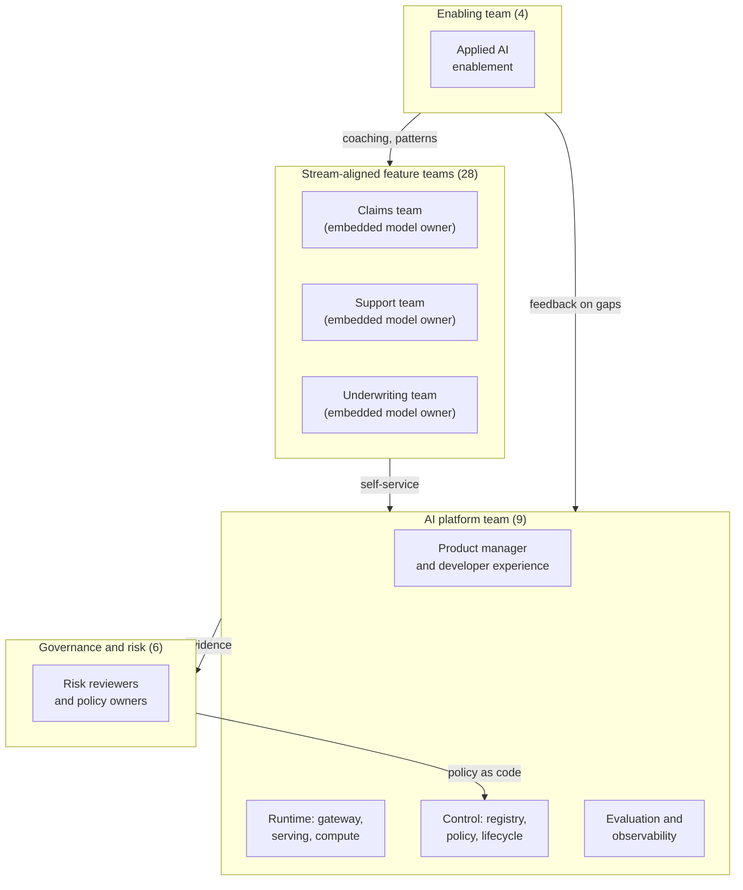

The platform team in this arrangement has four sub-groups. A product manager owns the roadmap and talks to users. A runtime group runs the data plane. A control group runs the registry, policy engine, and lifecycle service. An evaluation and observability group provides the evaluation service and the telemetry pipeline. The enabling team teaches. It runs office hours, writes patterns, pairs with teams on their first release, and relays gaps back to the platform. Governance staff write policy as code with the control group and receive evidence in return, which moves their work from reviewing documents to reviewing exceptions.

**Embedded model owners** deserve a note. Each feature team names a model owner: the person accountable for quality of the models, prompts, and indexes in production. This is a role, not necessarily a full-time job. It prevents the situation where the platform is blamed for the behavior of a feature, and it gives the registry someone to notify. The platform team does not own feature quality. It owns the platform's service levels.

### 19.4 RACI for lifecycle activities

R means responsible (does the work), A accountable (one owner who answers for the result), C consulted, and I informed.

| Activity | Feature team | Model owner | Platform team | Governance and risk | Executive sponsor |
|---|---|---|---|---|---|
| Define use case and risk tier | R | C | C | A | I |
| Build candidate artifacts | R | A | C | I | I |
| Maintain evaluation suite | C | A | R (tooling) | C | I |
| Operate gates and policy engine | I | I | A, R | C | I |
| Approve tier 2 release | I | A | C | I | I |
| Approve tier 3 release | I | R | C | R | A |
| Execute release and canary | R | A | R (controller) | I | I |
| Roll back a release | R | A | R | I | I |
| Operate gateway, registry, serving | I | I | A, R | I | I |
| Manage deprecation and migration | R (consumers) | R | A | C | I |
| Provider relationship and notices | I | C | A, R | C | I |
| Audit evidence | C | C | R | A | I |
| Cost budget per feature | A | R | C | I | I |
| Platform budget and roadmap | C | C | R | C | A |

A RACI table is only useful if each row has one accountable party. The platform team is accountable for the machinery and the feature team is accountable for what runs on it. The most frequent confusion is rollback: the model owner is accountable for the decision, and the platform team is responsible for making the mechanism fast and reliable.

### 19.5 On-call and the operating model

Two on-call rotations are needed. The **platform on-call** covers the gateway, registry, release controller, serving cluster, and evaluation service. It is staffed by the platform team 24 hours a day for critical services, with the SLOs from section 3.4. The **model owner on-call** is a feature-team rotation that responds to quality alerts on their release. The two meet in incidents, where a good runbook says who leads for which symptom: if the gateway's error rate is high, the platform leads; if one feature's groundedness score falls with the gateway healthy, the model owner leads.

The operating model has a regular rhythm:

- **Weekly:** platform triage of support requests and gate failures; review of cost anomalies and active waivers.
- **Monthly:** SLO review; adoption metrics; release and incident review; a review of deprecations due in the next 180 days.
- **Quarterly:** roadmap planning from user research and off-path analysis; policy review with governance; rollback and break-glass exercises; maturity self-assessment (section 20).
- **Annual:** build-versus-buy review of each capability (section 21.3) and a review of tier criteria against regulation.

Intake needs a rule. The platform team accepts three kinds of work: roadmap items, support, and platform debt, with a stated capacity split (for example 60, 25, and 15 percent). A visible split prevents support from consuming all capacity, and prevents the roadmap from ignoring the users' daily pain.

## 20. Platform Maturity Model and Self-Assessment

### 20.1 Five levels

Maturity models are simplifications. Their value is in starting a conversation about the next step. This one has five levels.

| Level | Name | Description |
|---|---|---|
| 0 | Ad hoc | Teams work independently. Models, prompts, and keys are unmanaged. No inventory. |
| 1 | Visible | A gateway or registry exists and an inventory is maintained. Cost is attributed. Releases are manual but recorded. |
| 2 | Controlled | Release manifests, lineage, evaluation gates, and rollback are in place for production. Risk tiers drive approvals. |
| 3 | Self-service | Golden paths and templates cover most use cases. Policy as code runs in CI and at admission. Multi-tenant quotas and chargeback work. |
| 4 | Adaptive | Drift and feedback triggers create governed proposals. Progressive delivery rolls back automatically. Deprecation and provider changes are handled by routine. The platform's metrics drive its roadmap. |

### 20.2 Self-assessment

Score each dimension from 0 to 4 using the level descriptions. Be strict: score the lowest level at which the capability works for *all* production workloads, not the best team.

| Dimension | Level 0 | Level 2 | Level 4 |
|---|---|---|---|
| Inventory and ownership | No list | All production AI systems registered with owners | Discovery reconciles billing, network, and code continuously |
| Artifact identity | Model names only | Manifests pin all artifact types for production | Signed manifests, provenance, and SBOM generated automatically |
| Environments | One shared environment | Separate dev, staging, production accounts | Account vending, data movement rules enforced by policy |
| Evaluation gates | Manual spot checks | Versioned suites and hard gates for tier 2 and up | Gates composed by policy; suite grows from production feedback |
| Release strategy | Replace in place | Canary with manual analysis | Progressive delivery with automatic rollback |
| Rollback | Redeploy old code | Manifest rollback tested annually | Rollback exercised quarterly; time to rollback measured |
| Observability | Application logs | Traces tagged with release identifier | Quality, cost, and drift correlated by release; triggers governed |
| Tenancy and cost | Shared keys, no attribution | Per-team keys, showback | Quotas, budgets, chargeback, noisy-neighbor controls |
| Self-service | Tickets for everything | Templates for the main path | 85 percent of requests are self-service |
| Deprecation | None | Manual notices | Automated impact queries, brownouts, provider-notice ingestion |
| Governance | Document reviews | Approval records in the registry | Evidence packages generated on every release |

**Worked scoring example.** A company scores itself: inventory 2, artifact identity 1, environments 2, gates 2, release strategy 1, rollback 1, observability 2, tenancy and cost 2, self-service 1, deprecation 0, governance 1. The sum is 2 + 1 + 2 + 2 + 1 + 1 + 2 + 2 + 1 + 0 + 1 = 15 out of 44, an average of 15 / 11 = 1.36. The overall level is the average rounded down, so level 1, but the lowest dimensions (deprecation at 0, and several at 1) set the priorities. A heuristic for choosing the next investment: raise the lowest dimensions that are prerequisites for others. Artifact identity (manifests) comes before release strategy and rollback because canary and rollback operate on manifests. In this example the next quarter's work is manifests, a tested rollback, and an inventory of consumers for deprecation.

A second heuristic: do not pursue level 4 on all dimensions. The right target depends on risk. A company with only tier 0 and tier 1 workloads may reasonably stay at level 2 for release strategy, while a company with tier 3 workloads needs level 4 on gates, rollback, and governance.

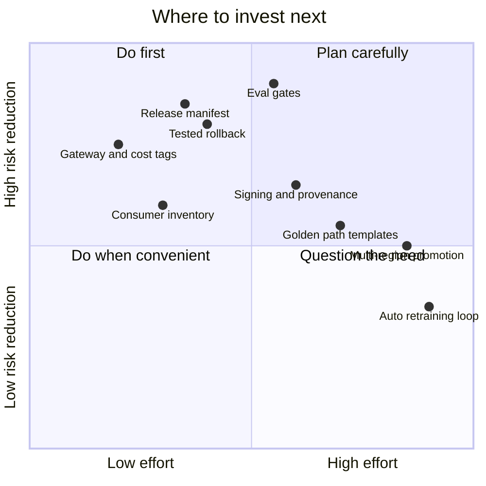

The chart is a prioritization aid, and the positions are judgments for the illustrative company. It reflects the ordering from section 4.4: low-effort visibility and identity steps first, then gates, and the most complex automation last. Your own chart should come from your risk register and your effort estimates.

## 21. Platform Metrics, Build Versus Buy, and Migration Between Platforms

### 21.1 Delivery metrics for the platform

The DevOps Research and Assessment (DORA) research popularized four delivery metrics that translate well to AI releases. Adapt them and add rollback timing and adoption.

| Metric | Definition for AI releases | Meridian illustration |
|---|---|---|
| Lead time to production | Time from the first commit of a candidate (or the trigger) to Active | Median 12 days (target) from 41 |
| Release frequency | Production releases per team per month | Median 3 per team per month |
| Change failure rate | Releases that needed rollback, hotfix, or waiver divided by all releases | 9 of 120 releases in a quarter = 7.5 percent |
| Time to restore | Time from detection to restored baseline behavior | Median 11 minutes (rollback), p90 45 minutes |
| Time to rollback | Time from decision to rolled-back state, measured in exercises | Median 3 minutes for prompt, 25 minutes for adapter |
| Gate reliability | Share of gate runs that are flaky (different results on rerun) | 2.1 percent |
| Adoption | Path coverage, gateway share, registered artifact share (section 3.5) | 80 percent, 95 percent, 100 percent targets |
| Platform availability | SLOs from section 3.4 | 99.96 percent gateway |
| Cost per thousand requests | Fleet-level unit cost | Trend downward quarter on quarter |
| Satisfaction | Survey score | 4.0 target |

A change failure rate of 9 of 120 is 7.5 percent. Whether that is acceptable depends on tier: a tier 0 release failing is a nuisance, and a tier 3 failure is an incident, so report the rate by tier. Do not use change failure rate to compare teams. It punishes teams that have good detection and rewards teams that fail silently.

### 21.2 Using the metrics

Metrics describe the platform, and they guide its roadmap. A rising lead time with falling gate reliability points at the evaluation service. A rising change failure rate at tier 2 with stable gate reliability points at an incomplete evaluation set. A falling gateway share points at a missing capability or slow onboarding. Reading metrics as a diagnostic is the discipline; targeting a single metric invites gaming.

### 21.3 Build versus buy for platform components

Section 4.3 gave the criteria. Four further considerations apply when the decision is revisited:

1. **Total cost over three years.** Compare the vendor's license plus integration against the build team's salary, operations, and opportunity cost. Teams habitually underestimate build operations (upgrades, security patches, on-call) at 30 to 50 percent of the initial build cost per year. This is a planning heuristic and not a measured constant.
2. **Fit with the tier model.** Few products implement an organization's lifecycle states and approval roles. If the product cannot express your tier-based gates, you will wrap it with your own layer. That is acceptable (compose), but count the layer's cost.
3. **Interface ownership.** Whatever you buy, keep your own interface at the boundary: your manifest format, your gateway base URL, your registry API. When the product changes, the interface does not.
4. **Open formats.** Prefer products that export in documented open formats, since your exit path depends on them.

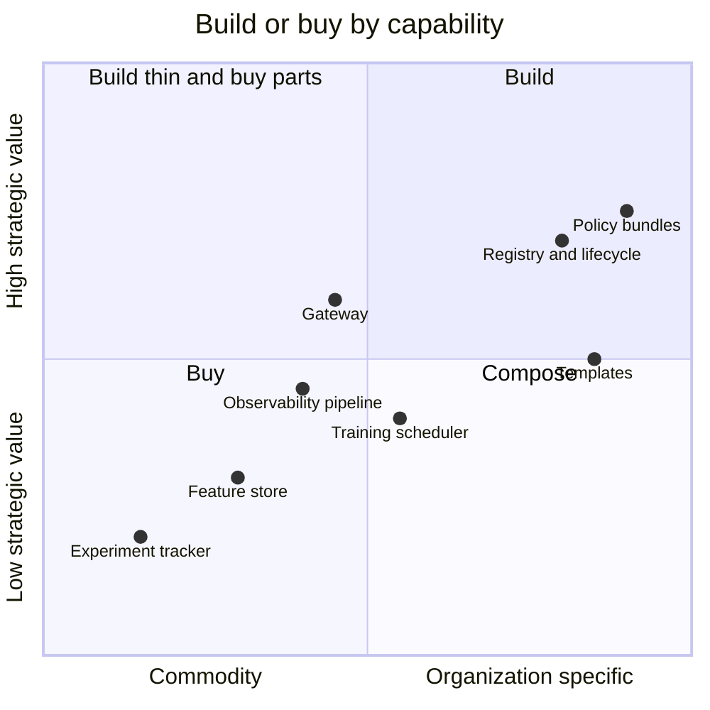

Capabilities near the lower left are bought. Capabilities encoding organization-specific rules (registry lifecycle, policy bundles, templates) are built thin on top of commodity storage and engines. The middle is composed. The chart agrees with the decisions in section 4.3.

### 21.4 Migrating between platforms

Organizations change platforms: a vendor is acquired, a product stops fitting, a merger joins two platforms, or a cloud changes. Migrations of AI platforms are risky because behavior must not change unintentionally. The approach that works is a strangler migration around stable interfaces.

1. **Freeze the interfaces.** Define the manifest format, gateway interface, and registry API that teams use. Place them in front of the old platform if they are not already.
2. **Inventory.** Use the registry and discovery to list every artifact, consumer, and dependency on the old platform.
3. **Build the new implementation behind the same interfaces.** Do not ask teams to change code at this step.
4. **Dual-run.** Mirror traffic (shadow) to the new implementation and compare outputs and latency with the old. For registries, dual-write new artifacts to both.
5. **Migrate by cohort.** Start with tier 0 and tier 1 workloads, then move up, with each cohort passing the gates on the new platform.
6. **Preserve identifiers and lineage.** Artifact digests and release identifiers must survive migration, because lineage and audit refer to them. Import historical lineage with the original timestamps, and mark the migration as an event.
7. **Keep the old platform read-only for the retention period** so that audit queries and rollbacks to pre-migration releases still work.
8. **Retire the old platform** when metrics show no traffic and the retention requirement is met.

**Worked sizing.** A migration of 61 production workloads, with cohorts of 12, 15, 20, and 14 by tier, taking an average of 6 engineer-days each (re-validation, cutover, monitoring) costs 61 × 6 = 366 engineer-days. At 220 working days per engineer-year, that is 366 / 220 = 1.66 engineer-years, plus the platform team's work building and running the new implementation and the dual-run costs. Compare it with the annual benefit to decide whether the migration is worth it. Shadow traffic doubles hosted-model cost for the mirrored share: mirroring 100 percent of a workload costing \$30,000 per month for a 2-week soak costs about \$15,000 extra, so mirror a sample (10 percent costs about \$1,500) for most workloads.

## 22. Worked Design A: A Minimal Viable Platform for a Small Company

### 22.1 Context

Tallow Logistics (illustrative) has 90 employees, 12 engineers, and three AI features in production or soon to be: a shipment-status chat assistant, a document extraction pipeline for customs forms, and an internal search over operating procedures. It uses hosted models only. It has one cloud account in each of two environments (development and production), no dedicated ML staff, and one engineer, Priya, who spends about 30 percent of her time on AI infrastructure. The company handles customer shipment data and some personal data of drivers. Its tiers: chat assistant tier 2, extraction tier 1, internal search tier 1.

### 22.2 Requirements and constraints

| Requirement | Target |
|---|---|
| Know what is in production and who owns it | Complete list, updated by every release |
| Reproduce and roll back any release | Rollback within 10 minutes for prompt or model changes |
| Evaluate before shipping | A suite of 150 cases per feature, run on every change |
| Control cost | A monthly budget alert per feature |
| Limit effort | Less than 0.3 engineer-year of platform work per year after setup |
| Avoid lock-in to one provider | Switch provider in days |

### 22.3 The design

The design uses existing tools and a few small pieces of code. It is a thin implementation of the same concepts the enterprise platform has.

```mermaid
flowchart LR
    subgraph REPO["Git repository (monorepo)"]
        PRM["prompts/ (versioned files)"]
        TLS["tools/ (schemas)"]
        EVS["evals/ (cases and graders)"]
        MAN["releases/ (manifest per release)"]
    end
    subgraph CIP["Continuous integration"]
        VAL["Manifest validator"]
        EVR["Eval runner"]
        GATE["Gate script:<br/>thresholds in file"]
    end
    subgraph RUN["Production account"]
        GWY["Thin gateway library<br/>plus proxy"]
        APPS["Three applications"]
        FLG["Config store:<br/>active release id"]
        LOG["Logs with<br/>release id and cost tags"]
    end
    PRM --> VAL
    TLS --> VAL
    MAN --> VAL
    EVS --> EVR
    VAL --> GATE
    EVR --> GATE
    GATE -->|"merge to main"| FLG
    FLG --> APPS
    APPS --> GWY
    GWY --> LOG
    LOG --> DSH["Cost and quality dashboard"]
```

The pieces and what each replaces from the enterprise design:

1. **Git as the registry.** Prompts, tool schemas, evaluation cases, and release manifests live in one repository. A release is a manifest file that pins file digests and the provider model version. Git history provides immutability, review, and audit. No registry service is run.
2. **A manifest validator** like the one in [01_release_manifest_validator.py](../code/python/ai-platform-lifecycle-chapter/01_release_manifest_validator.py), run in continuous integration.
3. **An evaluation runner** that runs the suite against the candidate and the active release and applies a small gate script. Thresholds live in a file and are reviewed like code. The quality gate uses the non-inferiority check from section 8.3 with 150 cases. With only 150 cases the standard error is larger: at pass rates near 0.85, $\sqrt{2 \times 0.85 \times 0.15 / 150} = \sqrt{0.0017} = 0.0412$, so a 95 percent bound is about 8 percentage points wide on each side. The gate can reliably catch only large regressions, which the team accepts for tier 1 and compensates for with a slower canary and the human review that tier 1 provides. For the tier 2 chat assistant the team grows its suite to 400 cases, which narrows the bound to about 5 points.
4. **Release activation by configuration.** The active release identifier lives in a managed configuration store. The application reads it at start and refreshes every minute. Rollback means setting the identifier back, which takes under two minutes.
5. **A gateway as a thin library** wrapping the provider SDK plus a lightweight proxy for key management. It adds the release identifier and the cost tags to every call, applies a monthly token budget per feature, and supports a secondary provider for failover.
6. **Two accounts.** Development and production are separate, with production deployable only by the pipeline. Sandbox is a developer's own limited-budget key.
7. **Canary by percentage in the configuration store**, hashed on the user identifier for the chat assistant. Tier 1 features release to 100 percent after one hour at 10 percent.
8. **A monthly review.** Once a month, Priya reviews cost per feature, provider deprecation notices, active releases, and the inventory file. The review takes about two hours.

### 22.4 Cost of the design

Setup: about 25 engineer-days (validator and runner reuse, pipeline, gateway wrapper, dashboards). Ongoing: the monthly review (2 hours), evaluation maintenance (about 4 hours per week across features), and incident response when needed, totaling roughly 0.15 engineer-year per year, under the 0.3 target. Evaluation run costs: 3 features × about 10 runs per week × 400 cases × \$0.003 per case (an illustrative blended token cost) = 3 × 10 × 400 × 0.003 = \$36 per week, about \$1,900 per year. Cheap enough that the team should run suites on every change.

### 22.5 Architecture decision records

**ADR-A1: Use Git as the registry, not a registry product.**

- *Context.* Three features, 12 engineers, hosted models only.
- *Decision.* Prompts, tools, evaluations, and manifests live in Git. A pipeline writes the active release identifier to a configuration store.
- *Consequences.* No service to run. The history is auditable. We lose cross-repository search and a dependency graph (we use one monorepo to avoid needing one).
- *Rejected alternatives.* (1) A managed model registry product: it adds an operational surface and a learning curve, and none of its features address prompts and manifests. (2) A custom registry service: building it costs more than Git and adds nothing at this scale.
- *Revisit when.* More than 15 production workloads, multiple repositories, or tier 3 workloads.

**ADR-A2: Pin provider model versions and run a daily behavior check.**

- *Context.* The provider offers dated snapshots for the models in use, and an alias for one tier.
- *Decision.* Pin dated snapshots everywhere possible. For the alias, run the golden set daily and alert on change.
- *Consequences.* Predictable behavior, a small daily cost (about 150 cases × \$0.003 = \$0.45 per day per alias-dependent feature), and a forced migration when the provider retires a snapshot.
- *Rejected alternatives.* (1) Always use the alias for automatic improvements: it gives silent behavior change. (2) Self-host an open-weight model for stability: it needs GPU operations that the company cannot staff.

**ADR-A3: A thin gateway library with a proxy, not a full gateway product.**

- *Context.* Need cost attribution, key hygiene, and failover with minimal effort.
- *Decision.* A library wraps the provider SDK to add release identifier, tags, and budgets, with a minimal proxy that holds the keys.
- *Consequences.* Meets the three needs. It lacks advanced routing and rate-limit sharing, which the company does not need now.
- *Rejected alternatives.* (1) Applications call the provider directly with keys in their configuration: no central cost view and key sprawl. (2) A full gateway product: more capability than needed and a service to operate. (See [CH08](CH08_Model_Gateway_Routing_and_Fallback_Architecture.md).)

**ADR-A4: One shared evaluation approach with per-feature suites.**

- *Context.* One engineer maintains the tooling.
- *Decision.* One runner, three suites, thresholds in files. Production feedback adds cases monthly.
- *Consequences.* Uniform gates at low cost. Suites for small samples detect only large regressions (section 22.3), which is recorded as a known limitation.
- *Rejected alternatives.* Skipping automated evaluation for tier 1 features: leads to uncontrolled changes. A third-party evaluation platform: not needed at three features.

**ADR-A5: No shared GPU infrastructure.**

- *Decision.* Hosted models only, so no training, no scheduler, no model serving.
- *Revisit when.* A feature needs fine-tuning, or data residency prohibits hosted models.

### 22.6 What the design deliberately omits

It omits signing and provenance beyond Git commit signing and protected branches, a lineage graph (Git history and manifests suffice), multi-region promotion, chargeback (there is one team), policy engine (the gate script is the policy), and a deprecation workflow beyond the monthly review. Each omission is a recorded decision with a trigger for revisiting. This is what minimal means: every concept in the chapter appears in a smaller form, and nothing is left out because it was forgotten.

## 23. Worked Design B: An Enterprise Platform for 40 Teams

### 23.1 Context and requirements

Meridian, introduced in section 1.4, has 40 teams, 61 production AI workloads (22 on golden paths), three regions, regulated lines of business, and a mix of hosted and self-hosted models. The requirements, with quality attribute targets:

| Quality attribute | Target |
|---|---|
| Lead time to production | Median 12 days, from 41 |
| Gateway availability | 99.95 percent monthly |
| Time to roll back a tier 2 or 3 release | Under 10 minutes for prompt and config, under 30 for adapters |
| Evidence | Audit package for every tier 2 and 3 release, generated automatically |
| Provider concentration | No single provider above 60 percent of tokens; fallback for critical features |
| Cost | Platform team and shared services below 12 percent of total AI spend |
| Security | No unsigned artifact in production; no direct provider egress from production except the gateway |
| Adoption | 80 percent path coverage in 12 months |

The platform team has nine people. The shared platform cost is \$180,000 per month (from section 15.5), against total AI spend of, say, \$1,500,000 per month, which is 12 percent, at the target limit.

### 23.2 The architecture

```mermaid
flowchart TB
    subgraph TEAMS["Feature teams (40)"]
        TPL["Golden path templates"]
        REPOS["Team repositories"]
    end
    subgraph SHARED["Shared services account"]
        CIP["Build and signing pipelines"]
        REG["Registry: models, prompts,<br/>tools, agents, manifests"]
        POL["Policy engine and<br/>approval service"]
        LCS["Lifecycle and release<br/>controller"]
        EVAL["Evaluation service"]
        KMS["Key service"]
    end
    subgraph DEVS["Development accounts"]
        DEVW["Team workloads"]
    end
    subgraph STGS["Staging accounts"]
        STGW["Evaluation and rehearsal"]
    end
    subgraph PRDR["Production accounts, per region"]
        GW["Gateway"]
        SRV["Serving cluster:<br/>shared GPU pool"]
        RET["Retrieval services"]
        CACHE["Signed config<br/>and manifest cache"]
    end
    subgraph OBSV["Observability and cost"]
        TEL["Telemetry pipeline"]
        FIN["Cost attribution"]
        DSC["Discovery service"]
    end
    REPOS --> CIP
    TPL --> REPOS
    CIP --> KMS
    CIP --> REG
    REG --> POL
    POL --> LCS
    LCS --> EVAL
    EVAL --> STGW
    LCS -->|"approved release"| CACHE
    CACHE --> GW
    GW --> SRV
    GW --> RET
    GW --> TEL
    SRV --> TEL
    TEL --> LCS
    TEL --> FIN
    DSC --> REG
    DEVW --> CIP
```

### 23.3 Decisions

**ADR-B1: A thin custom registry and lifecycle service over an object store, with an open metadata format.**

- *Context.* The registry must model models, prompts, tools, agents, and release manifests, with organization-specific states and approvals.
- *Decision.* Build a service of about 4,000 lines on managed object storage and a managed relational database. Export and import use documented open formats (manifest YAML, a published model-metadata format) so the contents survive a platform change.
- *Consequences.* The registry encodes exactly the lifecycle in section 8. It costs about 1.5 engineers to maintain. Teams reach it through templates, so they rarely see it directly.
- *Rejected alternatives.* (1) Adopt the model registry of the managed ML platform and extend it with tags: it cannot enforce the lifecycle transitions or model prompts and tools as first-class artifacts, and would tie the platform to one cloud. (2) Use Git alone: workable for 10 teams, it lacks the cross-team dependency queries and approval records that 61 workloads and auditors need.

**ADR-B2: Separate accounts per environment and region, with a pull-based production.**

- *Decision.* Production accounts per region pull signed manifests and artifacts from the shared services account, and verify signatures locally.
- *Consequences.* Strong blast radius control and independent audit logs. Cost: account vending automation and cross-account replication.
- *Rejected alternatives.* (1) Namespaces in a single account: insufficient isolation for regulated workloads and quota coupling. (2) Push-based deployment from the pipeline: it requires the pipeline to hold production credentials, which enlarges the attack surface.

**ADR-B3: Data plane serves from signed cached configuration.**

- *Decision.* The gateway and serving read a signed configuration bundle, refreshed asynchronously. No request-path calls to the registry or policy engine.
- *Consequences.* Registry outage becomes a promotion freeze, and a change takes up to a minute to propagate. Break-glass rollback uses the cached manifest (section 18.2).
- *Rejected alternative.* Per-request policy and registry lookups: simpler to reason about, but couples availability of serving to the control plane.

**ADR-B4: Policy as code on a standard engine, run in CI, at admission, and in the release controller.**

- *Decision.* One policy repository, tested and versioned, owned jointly by governance and the control group.
- *Consequences.* One definition of each rule. Dry-run mode for rollouts. Policy authors need engineering skills, which governance staff acquire through pairing.
- *Rejected alternative.* Review boards for every release: does not scale to about 120 releases per quarter and produces inconsistent evidence.

**ADR-B5: Progressive delivery with automatic rollback for tier 2 and 3; manual for tier 0 and 1.**

- *Decision.* The release controller applies four stages with comparative and guardrail rules (section 10.4).
- *Consequences.* Less harm per bad release. Requires online metrics tagged by release. Low-traffic features cannot use comparative tests and rely on guardrails and longer soak.
- *Rejected alternative.* Fully automatic retraining-to-production: removes accountable approval and is unacceptable at tier 2 and 3 (section 13.2).

**ADR-B6: One shared GPU pool with quotas, fair share, and gang scheduling.**

- *Decision.* Compose a Kubernetes batch queue with priority classes; reserve capacity for serving; backfill training and evaluation.
- *Consequences.* Utilization from 38 to about 60 percent (section 12.3). Preemption requires checkpointing discipline from training teams. Tier 3 workloads with isolation requirements use a dedicated node pool.
- *Rejected alternative.* Per-team GPU allocations: simple and fair on paper, but leave capacity idle and raise total cost.

**ADR-B7: Gateway as the only egress to model providers, with virtual keys, quotas, and fallback.**

- *Decision.* Production networks permit provider traffic only from the gateway. Each team gets virtual keys with budgets. Critical features have a secondary provider.
- *Consequences.* Complete usage visibility, bypass becomes a visible failure, a gateway outage is serious (hence the 99.95 percent target, multi-zone deployment, and a degrade-to-cached-routing mode).
- *Rejected alternatives.* (1) Direct provider access with central key management: no routing or per-request policy. (2) A single provider: concentration risk and no leverage during deprecations.

**ADR-B8: Deprecation as a first-class workflow with provider notice ingestion.**

- *Decision.* The registry stores provider retirement dates, the lifecycle service computes impact, and the internal sunset is set at provider date minus 45 days.
- *Consequences.* Mass deprecation (section 18.4) becomes routine. Requires staff time each quarter for the successor comparison pipeline.

### 23.4 Validation evidence

A design of this size should be validated before and during rollout. Meridian planned the following, with illustrative acceptance criteria:

1. **Game day for registry outage:** disable the registry in a staging region during a simulated incident and execute break-glass rollback. Acceptance: serving unaffected, rollback under 10 minutes, audit reconciled.
2. **Canary rehearsal:** inject a known regression in staging at 3 percent error rate. Acceptance: automatic rollback at or before the 25 percent stage in 10 of 10 trials.
3. **Manifest coverage:** run the validator across all 61 workloads' manifests. Acceptance: 100 percent pass or recorded waiver by end of quarter 2.
4. **Discovery reconciliation:** gateway traffic share from 48 to 95 percent over 12 months, measured monthly (section 17.3).
5. **Lead time:** pilot with six teams. Acceptance: median lead time under 20 days in the pilot, then 12 days across the fleet.
6. **Cost:** shared platform cost below 12 percent of AI spend.
7. **Deprecation drill:** simulate a provider notice and measure the time to produce the impact list (target under 30 minutes) and the first-wave migration plan (target under 2 days).

### 23.5 Rollout plan

The rollout follows the maturity ordering. Quarter 1: gateway, cost tags, discovery, and the registry with manifests, with all tier 2 and 3 workloads registered. Quarter 2: evaluation service, gates, and risk-tier approvals; signed artifacts for tier 3. Quarter 3: release controller with canary and rollback exercises; golden paths 1 and 2 with templates. Quarter 4: multi-tenant quotas and chargeback, paths 3 to 5, deprecation workflow, and the first quarterly maturity self-assessment. At the end of the year the expected self-assessment moves from an average of about 1.4 to about 3.0.

### 23.6 What was rejected at the architecture level

Two broader alternatives were considered and rejected. A **federated model** in which each business unit runs its own platform was rejected because the duplicated effort of about 10 engineer-years per year would reappear, and because the audit story would depend on 40 different implementations. A **single mandatory pipeline for all workloads** was rejected because predictive batch scoring, hosted-model features, and self-hosted adapters have different lifecycles, and a pipeline to fit all would fit none. The chosen design offers shared control plane services and a few golden paths, and it lets workloads leave a path with additional review.

## 24. Comparison of Platform Approaches

| Dimension | Tool collection | Minimal viable platform (Design A) | Enterprise platform (Design B) | Fully managed vendor platform |
|---|---|---|---|---|
| Typical size | Any | 1 to 10 teams | 20 or more teams | Any |
| Platform staffing | None dedicated | 0.1 to 0.3 engineer | 6 to 12 engineers | 1 to 3 engineers integrating |
| Release identity | Model names | Manifest files in Git | Signed manifests in a registry | Vendor's version objects |
| Evaluation gates | Per team, ad hoc | Shared runner, thresholds in files | Service with composed policy | Vendor evaluation features, limited policy |
| Rollback | Redeploy | Configuration pointer | Release controller, break-glass | Vendor-dependent |
| Tenancy and cost | Shared keys | Tags and per-feature budgets | Quotas, virtual keys, chargeback | Vendor accounts and tags |
| Governance evidence | Manual | Git history and logs | Generated package | Partial; export needed |
| Lock-in | Low | Low | Medium (own interfaces) | High unless interfaces are wrapped |
| Main risk | Sprawl, no accountability | Outgrown at around 15 workloads | Bottleneck or low adoption | Fit with tiers and exit cost |
| Choose when | Fewer than 3 workloads | Small team, hosted models, tier 0 to 2 | Many teams, regulated tiers, mixed models | Fast start, a single cloud, low customization |

No row is a ranking. The right column depends on the number of teams, the highest tier, the model mix, and the staff available. Treat the transitions as planned: the minimal platform is designed so that its manifest format carries into the enterprise registry, which is why section 21.4 insists on stable interfaces.

## 25. Common Mistakes

| Mistake | Cause | Consequence | Correction |
|---|---|---|---|
| Treating the model name as the version | The registry tracks models only | Incidents cannot be attributed; rollbacks restore the wrong combination | Release manifests pinning all artifact types |
| Building the platform before the users | Technology-led roadmap | Low adoption, shadow usage grows | Interview users, ship one golden path first, measure adoption |
| Mandating the platform without making it better | Compliance-led rollout | Workarounds, hidden usage | Make the path faster than the alternative; use egress controls for safety |
| One gate set for every tier | Simplicity | Tier 0 teams are slowed, tier 3 is under-checked | Gates and approvals by risk tier |
| Setting thresholds after seeing results | Pressure to ship | Gates lose meaning | Version thresholds in policy before the run |
| Unpinned hosted model aliases | Convenience | Silent behavior change | Pin dated versions; daily behavior checks where not possible |
| Registry on the request path | Simple design | Registry outage becomes serving outage | Signed cached configuration in the data plane |
| Untested rollback | Assumed to work | Target artifact missing, or incompatible | Scheduled rollback exercises; retention protects `rollback_to` |
| Rolling back model but not prompt or index | No manifest | A configuration nobody tested | Roll back the manifest as a unit |
| Embedding model change without re-index | Treating embeddings as an internal detail | Plausible but wrong retrieval | Validator rule linking index and embedder |
| Fully automatic retraining into production | Enthusiasm for automation | No accountable approval; feedback contamination | Triggers create proposals; gates and owners stay |
| Deprecation by email only | Low effort | Surprise outages at sunset | Consumer inventory, brownouts, direct outreach |
| Ignoring provider retirement dates | No ownership of provider relationship | Forced emergency migration | Notice ingestion, internal sunset at provider date minus margin |
| Shared GPU time slicing across trust boundaries | Utilization pressure | No memory isolation between tenants | Partition hardware or separate pools for untrusting tenants |
| Chargeback before trusted data | Wanting to control cost quickly | Disputes and erosion of trust | Showback first; publish the allocation rule |
| Platform team owning feature quality | Unclear roles | Blame without control | Embedded model owners and the RACI in section 19.4 |
| Flags that bypass governance | Convenience | Prompt changes reach production without gates | Flags select registry versions; changes are release events |
| Platform metrics used to rank teams | Management pressure | Gaming and hidden failures | Use metrics diagnostically and report by tier |

## 26. Design-Review Checklist

Use this list in architecture reviews of the platform or of a feature's use of it. An answer of "no" requires a recorded decision.

**Product and adoption**

- Are the platform's users and their jobs named, with a published golden path for each main use case?
- Are service levels published and measured, and is there a support channel and on-call rotation?
- Are adoption metrics (path coverage, gateway share, registered artifact share) tracked against a denominator that includes bypassing teams?

**Architecture**

- Are control plane and data plane separated, and does the data plane serve from cached signed configuration?
- Are dev, staging, production, and sandbox separated at account, project, or subscription level, with rules for data movement written as policy?
- Does classification travel with each artifact, and does promotion refuse forbidden environments?
- Is the capability map complete, and is each capability marked build, buy, or compose with a reason?

**Artifacts and lineage**

- Does every production release have a manifest that pins model, prompt, index, tools, guardrails, evaluation suite, and configuration by version and digest?
- Is the validator run on every candidate, with compatibility rules for index-embedder, prompt-tool, and context budget?
- Is lineage queryable upstream and downstream, including data snapshots and rights?
- Are artifacts and manifests signed by the pipeline only, verified at each trust boundary, and is the key compromise response rehearsed?
- Is an SBOM generated from the registry?

**Lifecycle and gates**

- Is the lifecycle a state machine with named owners, immutable audit records, and no bypass transitions?
- Are gates composed as policy, versioned, and set before the run, with hard and soft gates distinguished?
- Do approvals and rollback tests scale with the risk tier, and does segregation of duties hold?
- Is there a fast path for urgent fixes that reduces but never removes checks, and are waivers time-boxed?

**Release and rollback**

- Is there a documented release strategy per tier, with traffic split by stable key, sample ratio checks, and side-effect isolation?
- Are automatic rollback criteria defined before release, including guardrail and comparative rules?
- Is each changed artifact classified by rollback reversibility, with a plan for the irreversible ones?
- Are rollback targets retained, verified, and available without the registry?

**Feedback and change**

- Do drift and quality triggers create governed proposals, and do failed production cases feed the evaluation set?
- Are thresholds for triggers based on the sampling noise of the metric?

**Tenancy, cost, and compute**

- Are tenants isolated by identity, namespace, gateway key, and data store, with stronger isolation for sensitive tiers?
- Are quotas, rate limit allocations, and noisy-neighbor detection in place?
- Is cost attributed to team and feature, with a published allocation rule and budget alerts?
- Is GPU capacity scheduled with quotas, priorities, and gang scheduling, with queue wait reported alongside utilization?

**Retirement and governance**

- Are consumers inventoried from declared and observed sources, and does deprecation follow a timeline with brownouts?
- Are provider retirement dates stored and monitored, with an internal sunset ahead of the provider date?
- Is unmanaged model usage discovered by reconciling billing, network, code, and identity sources?
- Is audit evidence generated from the registry for every tier 2 and 3 release?

**Operations**

- Are RACI, on-call, and the operating rhythm defined, and is a maturity self-assessment run quarterly?
- Are failure scenarios (bad artifact, registry outage, dependency drift, mass deprecation) rehearsed with measured results?

## 27. Exercises

**Exercise 1.** A team says its release is "model gpt-class-x, version 3 of the prompt". List five other artifacts that could change behavior and are not named in that statement, and write the manifest fields that would pin them.

*Answer outline.* Retrieval index version (and corpus snapshot), embedding model, tool schema version, guardrail policy version, runtime configuration (temperature, token limit, routing rule), evaluation suite version. Fields: `index.version`, `index.embedding_model`, `tools.version`, `guardrails.version`, `config.version`, `eval_suite.version`, each with a digest. Also the exact dated model version in place of any alias.

**Exercise 2.** A candidate passes 468 of 600 evaluation cases. The baseline passes 456 of 600. The policy requires the lower 95 percent bound of the difference to be at least $-2.5$ percentage points. Does the quality gate pass?

*Answer.* $\hat p_c = 0.78$, $\hat p_b = 0.76$, difference $0.02$. Variance terms: $0.78 \times 0.22 / 600 = 0.000286$ and $0.76 \times 0.24 / 600 = 0.000304$. Sum $0.000590$, $SE = 0.02429$. Lower bound $= 0.02 - 1.96 \times 0.02429 = 0.02 - 0.04761 = -0.02761$, that is $-2.76$ points. This is below $-2.5$, so the gate fails. More cases or a paired analysis could narrow the bound.

**Exercise 3.** Your service handles 20 requests per second and the baseline error rate is 1 percent. You want to detect a rise to 1.5 percent with a one-sided false alarm rate of 1 percent and power of 80 percent. How long must a 10 percent canary run?

*Answer.* $(2.33 + 0.84)^2 = 10.05$. Variances: $0.01 \times 0.99 = 0.0099$ and $0.015 \times 0.985 = 0.014775$, sum $0.024675$. Squared difference $0.005^2 = 0.000025$. $n \approx 10.05 \times 0.024675 / 0.000025 \approx 9{,}919$ requests per arm. The canary receives $20 \times 0.10 = 2$ requests per second, so $9{,}919 / 2 \approx 4{,}960$ seconds, about 83 minutes. A guardrail rule is needed for the first hour because the statistical rule cannot fire sooner.

**Exercise 4.** Classify the following changes as instantly reversible, reversible with effort, or effectively irreversible, and state the rollback plan: (a) a system prompt wording change; (b) a new embedding model with a full re-index; (c) a new column in the conversation memory store that agents have begun to fill; (d) a fine-tuned adapter replacing the previous one.

*Answer outline.* (a) Instant: re-activate previous prompt version. (b) Reversible with effort: keep the previous index and embedder, switch alias back (minutes if warm, longer if cold), otherwise re-embed (hours). (c) Effectively irreversible for the data written: use expand-and-contract, keep the old format readable, and decide in advance how to treat new rows on rollback. (d) Reversible with effort: reload the previous adapter, which is bound to its own base model version, so roll back adapter and base model together.

**Exercise 5.** A provider announces retirement of a model version on 2027-06-30. Your rule is an internal sunset of provider date minus 45 days, and you have 18 releases pinned to the version. Compute the internal sunset and, if the platform can run 3 migrations in parallel, each taking 2 weeks, state whether the schedule is feasible when the announcement arrives on 2026-12-01.

*Answer.* June 30 minus 45 days: June has 30 days, so minus 30 gives May 31, minus 15 more gives May 16. Internal sunset: 2027-05-16. Available time from 2026-12-01 to 2027-05-16 is 166 days, about 23.7 weeks. At 3 parallel migrations of 2 weeks, 18 releases need 6 waves of 2 weeks, 12 weeks. That fits, leaving about 11 weeks of margin, assuming that evaluation capacity is available and that the first wave starts within roughly two weeks. Tier 3 releases should go first.

**Exercise 6.** Design the data-movement rule set for a team that wants to test a retrieval index in staging built from production customer documents. State what you allow, what you refuse, and what evidence you record.

*Answer outline.* The index inherits the classification of its source. Refuse copying the production index into staging. Allow (in order of preference) a synthetic corpus with a matching size and structure, a masked sample with a documented re-identification risk assessment, or running evaluation inside the production boundary with aggregate-only outputs. Record dataset and index identifiers, requester, purpose, approver, and expiry. Embeddings are data, so delete the staging copy at expiry.

**Exercise 7.** Meridian reconciles one month of provider invoices (\$520,000) with gateway logs (\$338,000). Of the unmatched spend, finance attributes \$120,000 to teams with their own contracts. Compute the gateway share and the unidentified spend, and propose the next three actions.

*Answer.* Gateway share $= 338 / 520 = 65.0$ percent. Unmatched $= 520 - 338 = \$182{,}000$. Unidentified $= 182 - 120 = \$62{,}000$. Actions: investigate the unidentified accounts with procurement and the identity provider logs; migrate the contracted teams to gateway virtual keys with a deadline and a free onboarding session; and add egress rules so production workloads can reach providers only through the gateway.

**Exercise 8.** Draft the ADR for a 15-person start-up that must choose between Git-as-registry and a managed registry product. State two consequences and the revisit trigger.

*Answer outline.* Context: four hosted-model features, no GPUs, one team. Decision: Git-as-registry with manifest files and a validator in continuous integration. Consequences: no service to run, auditable history, but no cross-repository dependency query and no enforced lifecycle transitions beyond protected branches. Revisit when workloads exceed about 15, when multiple repositories make impact queries painful, or when a tier 3 use case needs enforced approvals.

**Exercise 9.** Score your own organization with the table in section 20.2. Identify the two lowest dimensions, say which depends on which, and write a one-quarter plan.

*Answer outline.* Any consistent scoring is acceptable. A defensible plan raises artifact identity before release strategy and rollback, and raises the consumer inventory before deprecation. The plan names owners, an acceptance test for each item, and the metric (for example, the registered artifact share) that will show progress.

## 28. Summary

An AI platform is an internal product. Its value shows as adoption and as shorter, safer paths to production, and the evidence is in lead time, change failure rate, time to roll back, and the share of production workloads on its golden paths. A collection of tools is not a platform until someone makes the pieces fit and answers for the result.

The unit of release is the manifest: model or pinned provider version, prompt, retrieval index and its embedding model, tool schemas, guardrail policy, evaluation suite, and configuration, each by version and digest. The validator catches inconsistent combinations before they reach users. Lineage records how artifacts were produced and answers upstream and downstream questions. Signing and provenance prove that the pipeline produced what the runtime loads.

The lifecycle is a state machine with owners and gates. Gates are composed policies that distinguish hard from soft failures, are set before the run, and are applied by risk tier. The arithmetic in section 8.3 shows how one failing gate (cost) names the fix while the others continue to protect the release. Release strategies trade harm against evidence: shadow and small canaries limit harm, larger stages give statistical power, and rollback criteria are written before the release.

Rollback is easy for configuration, prompts, and routing, harder for model weights, adapters, and indexes, and often impossible for accumulated state and real-world actions. The release manifest makes the possible rollbacks one operation, and compatibility windows make independent rollbacks safe. The control plane decides ahead of time and delivers signed data to a data plane that keeps serving when the control plane fails.

Multi-tenancy needs isolation layers, quotas, noisy-neighbor controls, attribution, and a published allocation rule. Self-service with guardrails scales the platform team. Deprecation is a designed workflow with a consumer inventory, brownouts, and a margin before provider retirement dates. Discovery reconciles billing, network, code, and identity with the registry to find unmanaged use. Governance evidence is produced as a by-product of the lifecycle. The operating model assigns accountable owners, on-call, and a rhythm of review, and a maturity model guides sequencing: visibility and identity first, then gates and rollback, then self-service, then adaptive automation. A small company needs the same concepts in a smaller form, and the platform's interfaces should be stable enough for it to grow into the larger one.

## 29. Code Examples

All scripts use only the Python standard library and print the output quoted in this chapter. They were run with Python 3 to confirm the quoted output.

- [01_release_manifest_validator.py](../code/python/ai-platform-lifecycle-chapter/01_release_manifest_validator.py) validates a good and a broken release manifest against the pinning, digest, compatibility, signature, and evidence rules in section 6.4.
- [02_canary_decision_simulation.py](../code/python/ai-platform-lifecycle-chapter/02_canary_decision_simulation.py) simulates staged canary decisions with a guardrail rule and a z-test rule for a healthy and a regressing candidate, as in section 10.4.
- [03_composed_gate_policy.py](../code/python/ai-platform-lifecycle-chapter/03_composed_gate_policy.py) composes six evaluation gates and computes the go/no-go decision for two candidates, as in section 8.3.
- [04_lineage_and_retirement.py](../code/python/ai-platform-lifecycle-chapter/04_lineage_and_retirement.py) queries a lineage graph upstream and downstream and plans a model retirement with a consumer inventory and dated milestones, as in sections 7.1 and 16.

## 30. References and Further Reading

Facts that change quickly should be checked in the current documentation before you rely on them: provider model retirement policies, token prices, rate limits, context window sizes, and regulatory application dates.

- Skelton, M. and Pais, M. (2019). *Team Topologies*. IT Revolution Press. Source of the stream-aligned, platform, and enabling team vocabulary.
- Forsgren, N., Humble, J., and Kim, G. (2018). *Accelerate*. IT Revolution Press. Origin of the delivery metrics adapted in section 21.1.
- [Supply-chain Levels for Software Artifacts (SLSA)](https://slsa.dev/spec/) for build provenance levels.
- [Sigstore documentation](https://docs.sigstore.dev/) for artifact signing and verification.
- [CycloneDX](https://cyclonedx.org/) for software and machine learning bills of materials.
- [NIST AI Risk Management Framework](https://www.nist.gov/itl/ai-risk-management-framework) for governance vocabulary.
- [ISO/IEC 42001](https://www.iso.org/standard/81230.html) for AI management system requirements.
- [Open Policy Agent documentation](https://www.openpolicyagent.org/docs/latest/) for policy as code with Rego.
- Companion chapters: [Part 16 CH29 MLOps and LLMOps](../16_AI_and_GenAI/CH29_MLOps_and_LLMOps.md), [CH11 Evaluation and Observability](CH11_Evaluation_and_Observability_Architecture_for_AI_Systems.md), and [CH14 Cost, Performance, and Sustainability](CH14_AI_Cost_Performance_and_Sustainability_Decisions.md).
