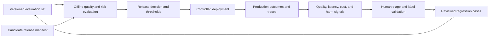
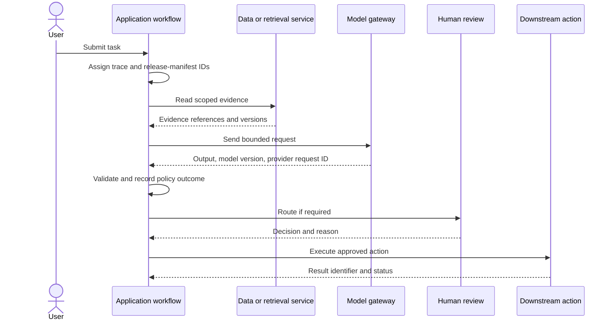
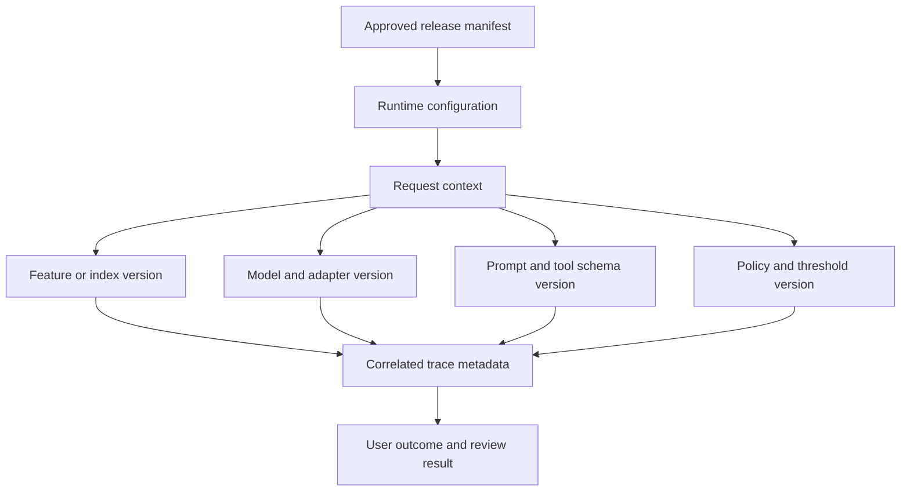
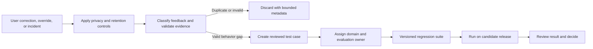
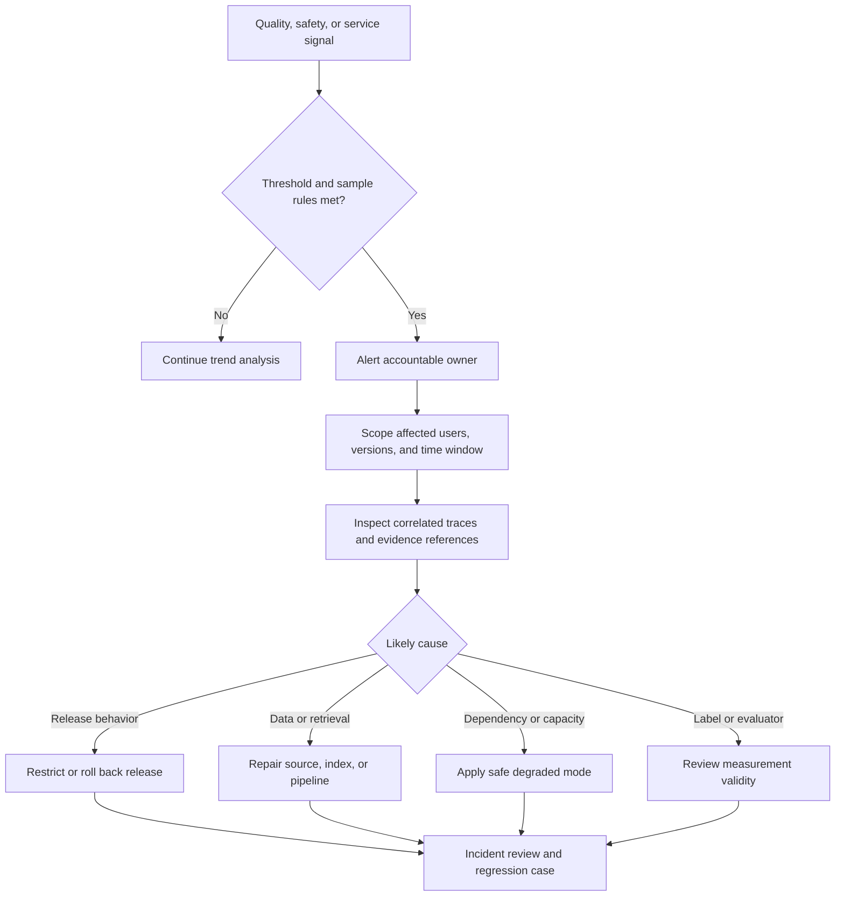

# Evaluation and Observability Architecture for AI Systems

Part: [17 — AI Architecture](PART_OVERVIEW.md)

AI observability architecture connects a user-visible outcome to the data, model, prompt, retrieval, policy, and runtime decisions that produced it. It must support release evaluation, live diagnosis, and safe feedback while minimizing sensitive-data exposure. Part 14 owns observability platforms and telemetry mechanics; Part 16 owns evaluation methods. This chapter specifies the evidence and correlation contracts between them.

## Connect Offline and Online Evidence

Offline evaluation estimates behavior on a controlled dataset before release. Online signals show what happens under real traffic, evolving populations, and operational dependencies. Neither replaces the other: offline data can be stale or unrepresentative, while online feedback is selective and arrives after users are affected. Use online signals to identify questions and incidents, then update reviewed evaluation cases rather than treating every interaction as ground truth.

Keep evaluation set lineage, label process, and known gaps. Changes to a judge model, rubric, or sampling method can change measured quality even when the candidate is unchanged. Version the evaluator and record the evidence used for each release decision.

## Trace the Request Across Components

A request trace should link identity context, retrieval or feature access, model endpoint, validation, human review, and downstream action. Use a correlation identifier and span relationships rather than placing full prompts and responses into every telemetry event. Record stable references to sensitive evidence where authorized; enforce retention and access policy on the trace store.

Define a trace schema that remains useful across providers: workload and tenant identifiers, request ID, model and prompt version, index or feature version, policy result, latency stages, token or compute usage where available, validation status, and outcome reference. Do not use raw user text as a high-cardinality metric label. Part 14 owns trace transport and storage decisions.

## Attribute Behavior to Versions

Version attribution needs to travel from release configuration into every request and derived evaluation. A human-readable model name can be reused or redirected; prefer immutable artifact digests or provider version identifiers, and record the adapter and routing policy too. A response may depend on multiple versions, including prompts, retrieval indexes, guardrails, and tool schemas.

Fail closed when the runtime cannot report the version required by the release contract. If an external provider changes behavior behind a stable name, record the provider's available deployment identity and schedule a re-evaluation. Version metadata is operational evidence, not a substitute for testing.

## Curate Feedback Into Evaluation

Feedback can be explicit, such as a correction or complaint, or implicit, such as abandonment, repeated edits, or other behavior. It is biased by who chooses to respond, the interface, and the outcome's visibility. Triage feedback for validity, privacy, representativeness, and causal relevance before adding it to a regression set or training corpus.

Do not automatically train on user corrections or operator overrides. Verify whether the correction reflects factual error, a policy update, user preference, or a changed source. Apply consent and data-governance rules before retaining feedback; preserve a reason code and label provenance so future reviewers can interpret it.

## Detect Regressions and Investigate Incidents

AI quality signals should be paired with service health and workflow outcomes. Track task-specific quality indicators alongside latency, error rate, saturation, cost, abstention, correction, and escalation. Establish alert thresholds from a baseline and account for sample size and delayed labels. A sudden score change can result from traffic mix, evaluator changes, source freshness, model routing, or a real behavior regression.

Define who can restrict traffic and what signals justify immediate action. The incident process should preserve the release manifest and sampled evidence needed for investigation while respecting privacy. Close the loop by adding a reviewed regression case or documenting why the signal was not actionable.

## Worked Case: Unsupported Answer Increase

After a prompt and model update, a support assistant's citation-validity signal declines. The observability pipeline correlates the change to the new manifest, identifies which regions and traffic cohorts are affected, and samples traces under approved redaction rules. Reviewers find that the new model often cites a retrieved passage that does not support the claim. The team restricts the canary, returns traffic to the prior manifest, and adds reviewed failure cases to the evaluation suite.

The investigation also checks whether a retrieval-index refresh or evaluator change caused the apparent regression. It compares candidate and prior releases on the same evaluation set and verifies the index version in traces. The incident closes only after the corrected candidate passes the gate and a staged rollout reproduces the improvement without increasing latency or cost beyond agreed limits.

## Review Questions

1. Which version identifiers must be attached to an online outcome?
2. Why should user feedback be reviewed before it becomes a training label?
3. How can traffic-mix change resemble model drift?
4. What evidence does an incident responder need without retaining raw prompts indefinitely?
5. Which signal can trigger restriction or rollback, and who owns that decision?

AI observability is useful when evidence is attributable and can drive a decision. Connect offline gates to production traces, preserve version and policy context, treat feedback as biased evidence, and make incident signals actionable without over-collecting sensitive content.
