# Evaluation and Observability Architecture for AI Systems

Part: [17 — AI Architecture](PART_OVERVIEW.md) · Status: Revised (in-depth rewrite)

## 1. Introduction

A conventional service tells you it is unhealthy through error rates, latency, and saturation. An AI feature can fail while every one of those signals stays green. The gateway returns HTTP 200, the model returns well-formed JSON, the latency is under budget, and the answer is wrong, stale, unsafe, or cites a document the user is not allowed to see. Availability monitoring cannot see this class of failure. Quality has to be measured, attributed to the artifacts that produced it, and fed back into the process that decides what ships next.

This chapter describes the architecture that does this. It is the connective tissue between three things that other chapters teach in isolation: the evaluation methods that decide whether an output is good (Part 16), the telemetry platforms that carry and store signals (Part 14), and the release and lifecycle machinery that decides which artifacts are live (Part 17 CH10). The chapter's subject is the contract between them: what is recorded for every request, how a quality signal is tied back to the exact prompt, model, index, and configuration that produced it, how signals become alerts and incidents, and how incidents become regression tests.

### 1.1 Reader outcomes

After this chapter you should be able to:

- Explain why an AI system needs a quality signal path in addition to an availability signal path, and define a "bad event" for a quality service level objective (SLO).
- Draw the closed evaluation and observability loop and name the artifact that crosses each boundary in it.
- Design a trace schema with a span taxonomy for single-call, retrieval-augmented generation (RAG), and agent requests, and state which attributes each span must carry.
- Use the OpenTelemetry (OTel) generative AI semantic conventions correctly, including their current stability status, and know where to extend them.
- Attribute every output to a release manifest so that "which prompt, which model, which index" is a lookup rather than an investigation.
- Choose a content capture, redaction, sampling, and retention policy, and compute storage volume and cost for it.
- Combine implicit, explicit, outcome-based, and automated quality signals while accounting for the bias of each.
- Set quality SLOs, error budgets, and burn-rate alerts with real arithmetic, and size the sample needed to detect a regression.
- Run an incident from a quality alert to a root cause using a decision tree over data, retrieval, prompt, model, tools, and infrastructure.
- Decide what to build and what to buy, and write the ADRs for two complete designs.

### 1.2 Why this matters to a solution architect

The architect owns the decisions that are hardest to retrofit. A trace schema that lacks a manifest identifier cannot be repaired after the data is collected. A content store without a deletion path becomes a compliance liability the day a deletion request arrives. A sampling policy that keeps only errors produces a quality estimate that is biased low or high with no way to know which. An evaluation harness whose judge is not versioned makes every historical comparison meaningless. Each of these is cheap to design in and expensive to fix later. The engineers building the pipeline will make good local decisions only if the architecture states the contracts.

### 1.3 Scope and ownership

This chapter recaps neighbouring material in a few sentences and links to it. It does not re-teach it.

| Topic | Owner | What this chapter does with it |
| --- | --- | --- |
| Evaluation methods: metrics, judges, test design, statistical validity | [Part 16 CH06](../16_AI_and_GenAI/CH06_Model_Evaluation_Validation_and_Selection.md), [CH24](../16_AI_and_GenAI/CH24_Generative_AI_Evaluation_Guardrails_and_Hallucinations.md) | Uses them as components. Specifies where they run, what they read, and where results are stored. |
| RAG retrieval and answer quality metrics | [Part 16 CH19](../16_AI_and_GenAI/CH19_Retrieval_Quality_and_RAG_Evaluation.md) | Recaps the metric families. Specifies how they are sampled from production. |
| Logs, metrics, traces, OTel, SLOs, alerting mechanics | [Part 14](../14_Observability/PART_OVERVIEW.md): [CH03 Tracing](../14_Observability/CH03_Tracing.md), [CH04 OpenTelemetry](../14_Observability/CH04_OpenTelemetry.md), [CH11 SLO](../14_Observability/CH11_SLO.md), [CH13 Error Budgets](../14_Observability/CH13_Error_Budgets.md) | Assumes them. Defines the AI-specific data model and SLO semantics that sit on top. |
| Release manifests, model registry, promotion gates, rollback | [Part 17 CH10](CH10_AI_Platform_and_Model_Lifecycle_Architecture.md) | Consumes the manifest identifier. Specifies how it reaches every span. |
| RAG system architecture | [Part 17 CH05](CH05_Retrieval_Augmented_Generation_System_Architecture.md) | Instruments it. |
| Agent and tool boundaries | [Part 17 CH06](CH06_Agentic_System_Architecture_and_Tool_Boundaries.md) | Instruments it. |
| Gateway, routing, fallback | [Part 17 CH08](CH08_Model_Gateway_Routing_and_Fallback_Architecture.md) | Treats the gateway as the first trace-context and attribution point. |
| Human review workflow | [Part 17 CH09](CH09_Human_Oversight_and_AI_Assisted_Workflow_Integration.md) | Uses reviewer decisions as a signal and a label source. |
| Safety, security, privacy, governance controls | [Part 17 CH12](CH12_AI_Safety_Security_Privacy_and_Governance_Architecture.md) | Covers only the privacy and security of the observability data itself. |
| Reliability patterns, cost decisions | [Part 17 CH13](CH13_Reliability_and_Resilience_Patterns_for_AI_Workloads.md), [CH14](CH14_AI_Cost_Performance_and_Sustainability_Decisions.md) | Provides the measurements those decisions need. |

Worked numbers in this chapter are illustrative unless a source is cited. The scripts in the code folder reproduce them, and the closing section lists them.

## 2. Why Availability Monitoring Is Not Enough

### 2.1 The healthy 200 that is wrong

Consider a support assistant built on RAG. A customer asks whether a refund is possible after 45 days. The retriever returns three passages, one of which is the superseded refund policy from last year. The model reads it, answers confidently that refunds are allowed within 60 days, and cites the document. The request ran in 1.9 seconds. The response validated against its JSON schema. The citation resolves to a real document. Every infrastructure metric is normal. The answer is wrong, and the company will honour or dispute a refund it should not.

None of the standard golden signals (latency, traffic, errors, saturation) moves. The fault is in the content, and content quality is a property of the whole artifact chain: the corpus, the index, the retriever, the prompt, the model, the validators. A quality signal has to be measured on outputs, and it has to be attributable to that chain.

### 2.2 Why AI systems fail quietly

Four properties make quiet failure the normal case rather than the exception.

1. **Outputs are open-ended.** A database query returns a correct row or does not. A generated paragraph can be fluent, plausible, and false. Checking correctness needs a reference, a rule, a model-based judge, or a human, each with its own cost and error.
2. **Behaviour depends on many versioned artifacts.** The same request can produce different outputs after a prompt edit, an index rebuild, a provider-side model update, a changed system policy, or a tool schema change. None of these raise an exception.
3. **Inputs drift.** Users change what they ask. New products, new vocabulary, new languages, and seasonal events move the input distribution away from the evaluation set. The system that passed a gate last quarter is being asked different questions.
4. **Dependencies change without notice.** A hosted model alias can point to a new snapshot. A retrieval corpus is updated by a content team that never heard of your release process. A tool's upstream API changes semantics but not its status code.

Each property means that "the deployment did not change" is not evidence that "the behaviour did not change." This is the central observation of the chapter. Observability for AI must record enough about every request to answer, after the fact, what produced this output, and it must continuously estimate whether outputs are good.

### 2.3 Two signal paths

It helps to separate two paths that run in parallel and must be correlated.

| Path | Question | Typical signals | Detects |
| --- | --- | --- | --- |
| Availability and performance | Did the system respond on time and within cost? | Error rate, latency percentiles, time to first token (TTFT), tokens per second, queue depth, token spend | Outages, saturation, rate limits, slow providers, cost spikes |
| Quality and safety | Was the response correct, grounded, safe, and useful? | Automated check pass rates, judge scores, user signals, outcome metrics, escalation rate, policy violations | Regressions, drift, silent model changes, retrieval decay, unsafe outputs |

The two paths share a request identifier and the version attribution. When a latency alert and a quality alert fire together, the shared trace data shows whether one caused the other. A common example is a provider failover (reliability win) that routes traffic to a weaker fallback model (quality loss). The availability dashboard shows success. Only the correlated view shows the cost.

### 2.4 What "bad event" means for an AI request

For a conventional service a bad event is usually an error response or a request slower than a threshold. For an AI request the definition must be written down, because it drives every SLO and alert in the chapter. A request can be bad because:

- It failed (error, timeout, empty output). This is the classical case.
- It violated a hard rule (schema invalid, forbidden content, unauthorised citation, tool call outside scope).
- It was judged low quality by an automated check or judge on a sampled basis.
- It received a negative user or outcome signal (thumbs down, reformulation, escalation, reopen).

These are different populations with different measurement cost and latency. Hard rules are checked on every request at near-zero marginal cost. Judge scores are computed on a sample. User and outcome signals arrive minutes to weeks later and cover only the requests where users react. Section 11 turns this into an SLO. For now, note that "the bad-event rate" is a composite whose components must be reported separately, or a rise in one can hide a fall in another.

### 2.5 The cost of discovering a regression late

Detection delay has a concrete price. Suppose a retrieval change degrades answer groundedness for 6 percent of requests. The assistant handles 40,000 conversations a day. If the regression is found through customer complaints after nine days, about 21,600 users received a degraded answer (40,000 × 0.06 × 9). If a sampled automated check pages within six hours, the exposure is about 600 (40,000 × 0.06 × 0.25). The ratio is 36 to 1. Add the support cost of reversing wrong guidance and the harm of decisions made on it. This is the economic argument for a quality signal path, and it is also the argument for spending on detection quality: halving detection delay halves exposure.

## 3. The Evaluation and Observability Loop

### 3.1 The closed loop

Evaluation and observability are one system, not two. Offline evaluation estimates behaviour before release on a controlled dataset. Pre-release gates turn that estimate into a decision. Shadow and canary evaluation expose the candidate to real traffic with limited blast radius. Online monitoring estimates quality in production. Human feedback supplies labels and corrections. Incident diagnosis finds root causes. Test-set curation turns what was learned into new offline cases. Then the loop closes.

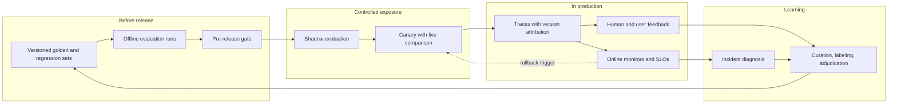

The diagram shows that every arrow carries an identified artifact: a dataset version into offline evaluation, a result set into the gate, a release manifest into shadow and canary, trace records into monitoring, labels into curation, and new cases back into the dataset. If an arrow carries an unidentified artifact (for example, "the current prompt"), the loop is open and comparisons across time are unreliable. The dotted rollback arrow matters: monitoring is not only for people to read. A burn-rate alert on a canary should be able to stop or reverse the rollout automatically, using the controls in CH10.

### 3.2 What each stage contributes and what it cannot

| Stage | What it tells you | What it cannot tell you |
| --- | --- | --- |
| Offline evaluation | Behaviour on cases you chose, under controlled conditions, with reproducible scoring | Behaviour on inputs you did not think of, on drifted traffic, under real dependency behaviour |
| Pre-release gate | Whether the candidate meets declared thresholds on each declared slice | Whether those thresholds predict user outcomes |
| Shadow evaluation | Behaviour of the candidate on real inputs without user exposure; output differences against production | User reaction, since users never see the output; effects of tool side effects (which must be disabled or stubbed) |
| Canary evaluation | User-facing behaviour at small scale, including feedback and outcomes | Rare-event rates (too little traffic); long-delay outcomes |
| Online monitoring | Estimated quality on live traffic; drift; regressions after any change, including changes outside your control | Ground truth for most requests, since labels are sparse and biased |
| Human feedback | High-value labels and corrections, including for failures automated checks miss | Representative rates (feedback is selective) |
| Incident diagnosis | Causal explanation for specific failures | Whether the same failure class exists elsewhere, unless you search for it |
| Curation | New durable regression cases | Anything beyond the cases chosen; it adds coverage, not proof |

Read the table across a row to see the limits and down a column to see why no single stage is sufficient. A mature design assigns each risk to the cheapest stage that can detect it. Hard rules go to every-request validators. Known failure classes go to the offline regression set. Unknown unknowns go to online monitoring and human review.

### 3.3 Shadow and canary evaluation in detail

Shadow evaluation sends a copy of production requests to a candidate configuration and discards or stores the output without returning it to the user. It compares candidate to production on the same inputs, which gives a paired comparison that is far more sensitive than comparing two independent populations. Three constraints apply.

First, side effects. In an agent or workflow system the shadow path must not execute write tools. Replace them with recording stubs or run them against a sandbox. Second, cost. Shadowing doubles inference spend for the shadowed fraction. A 10 percent shadow of 2 million daily requests is 200,000 extra inferences a day. If an average request costs $0.011 (see the cost example in Section 20), that is $2,200 a day, so use a sample and a time limit. Third, privacy. The shadow path processes real user data, so it inherits the same data-handling obligations as production, and the candidate's provider must be approved for that data class.

Canary evaluation gives a small share of live traffic (commonly 1 to 5 percent) to the candidate. The decision uses guardrail metrics (hard-rule violation rate, error rate, latency, cost per request) and quality metrics (automated check pass rate, judge score, user signals). Because canary traffic is small, rare events and slow outcomes cannot be measured within the window. The design must say so explicitly and use shadow and offline evidence for those. Section 18 covers the statistics.

### 3.4 Feedback must not flow back into the test it is testing

Two loop hazards appear as soon as the loop closes. The first is test contamination: production examples enter the golden set, the team tunes the prompt or fine-tunes the model on that set, and the gate then measures the candidate on data it was tuned against. The score rises and the real quality does not. The second is feedback loops: the system's own outputs influence what users do, which influences the labels, which influence the next release. Both are controlled by separating dataset roles (tuning set, regression set, held-out gate set), and Section 14 gives the rules.

## 4. The Telemetry Data Model

### 4.1 One request, one trace

The unit of observability is the trace of a single user request. A trace is a tree of spans. Each span has a name, a start and end time, a parent, and attributes. Part 14 [CH03 Tracing](../14_Observability/CH03_Tracing.md) and [CH04 OpenTelemetry](../14_Observability/CH04_OpenTelemetry.md) define the mechanics. This chapter defines what the AI-specific tree looks like.

For AI systems a trace has to do more than show where time went. It has to answer four different questions for the same request:

1. **Performance.** Where did the time and money go?
2. **Attribution.** Which artifacts and configuration produced the result?
3. **Behaviour.** What did the system decide at each step (what was retrieved, which tool was called, what the validator concluded)?
4. **Authorization.** Under which identity and scope did each step run?

The span taxonomy below is designed so that each span answers these four questions for its step.

### 4.2 Span taxonomy

Define a closed set of span kinds so that queries and dashboards do not depend on free-text names. The set below covers single-call, RAG, and agent requests.

| Span kind | Parent | What it represents | Must carry |
| --- | --- | --- | --- |
| `request` | none (root) | The whole user request as seen by the application | Release manifest ID, tenant, authorization scope ID, configuration hash, workload and feature name, outcome status |
| `retrieval` | request or agent step | One query against an index or search service | Index version, top-k requested and returned, retriever version, filter fingerprint, latency |
| `rerank` | request or agent step | Rescoring of retrieved candidates | Reranker version, candidates in and out |
| `prompt_assembly` | request or agent step | Building the final model input from template, context, history, and user text | Prompt template version, input token estimate, truncation flags, context documents included (IDs) |
| `model_call` | request or agent step | One inference call, including retries as logical operation | Provider, requested model, response model, token counts, queue time, TTFT, decode time, finish reason, cost |
| `tool_call` | agent step | One tool invocation | Tool name, tool schema version, authorization scope, outcome, side-effect class (read, write) |
| `validation` | request or agent step | Schema, citation, safety, and policy checks on a candidate output | Schema validity, citation validity, safety verdict, which validators ran, their versions |
| `post_processing` | request | Formatting, redaction, translation, and other deterministic transforms | Transform version |
| `agent_step` | request | One planning and acting iteration in an agent loop | Step index, decision summary, termination reason if last |
| `human_review` | request | A wait for and decision by a person | Queue time, reviewer role (not identity), decision, reason code |

The `agent_step` and `human_review` kinds appear only in agent and workflow designs. The validator in the [code folder](../code/python/ai-observability-chapter/01_trace_record_validator.py) implements the first eight kinds and enforces their required attributes.

The taxonomy is closed on purpose. Free-text span names produce thousands of distinct values, break aggregation, and invite per-team conventions that cannot be joined. When a team needs a new kind, it proposes it through the schema owner, who updates the validator and the dashboards together. Custom attributes are allowed and namespaced (for example `acme.*`); custom span kinds are not.

### 4.3 The shape of a trace

The sequence below shows one RAG request through a gateway, retrieval, and inference, with the attribution and latency data each hop contributes.

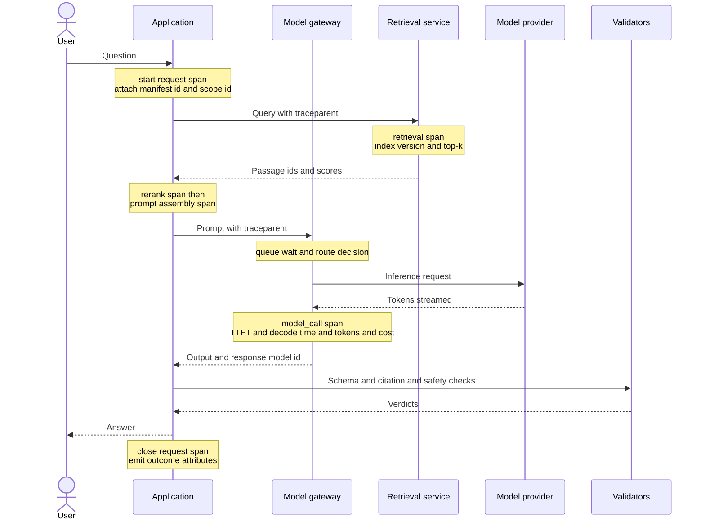

Read the diagram as a statement of which component is responsible for which span. The retrieval service owns the retrieval span because only it knows the index version and filter that were applied. The gateway owns the model-call span because only it knows queue wait, the routing decision, and the provider response identifier. The application owns the request, prompt-assembly, and validation spans. If instead the application reconstructed everything itself, the data would be second-hand and some would be impossible to obtain (for example, queue time inside the gateway). Section 6 covers propagation across these hops.

### 4.4 Latency phases for a model call

A single "model latency" number hides the causes of slowness. Record the phases separately.

| Phase | Definition | What dominates it | Typical lever |
| --- | --- | --- | --- |
| Queue | Time from request arrival at the gateway or server until the model starts processing it | Load, rate-limit backoff, batching policy | Capacity, priority classes, admission control |
| Prefill, observed as time to first token (TTFT) | Time to process the input and emit the first output token | Input length, cache hit, model size, queue inside the server | Shorter prompts, prefix caching, smaller model |
| Decode | Time from first token to last token | Output length, tokens per second, batch contention | Output limits, speculative decoding, smaller model |

Total span duration should equal queue plus TTFT plus decode within a small tolerance; the validator checks this (tolerance 5 ms) because a mismatch usually means one phase is being measured at a different point than another. With streaming responses, TTFT is also the user-perceived latency of the first visible text, so it belongs in user-facing SLOs, while decode time sets how long the user waits for the full answer. [CH07](CH07_Inference_Serving_and_Model_Placement.md) covers how serving affects these phases. This chapter's concern is that they are recorded.

A worked example. A model call has input 3,120 tokens and output 410 tokens. The trace shows queue 40 ms, TTFT 480 ms, decode 960 ms. Decode throughput is 410 tokens over 0.96 s, about 427 tokens per second. Prefill throughput is roughly 3,120 tokens in the 480 ms between request start and first token, about 6,500 tokens per second (this folds network and server overhead into prefill, so treat it as an upper bound on cost). If a prompt change doubles the input to 6,240 tokens and TTFT rises to about 900 ms, the trace phases tell you the cost of the change is in prefill, not in decode or queue. Without phase data, "latency rose 40 percent" would send the investigation to the model provider.

### 4.5 Attributes: the required set

The attributes below are the minimum for attribution, performance, behaviour, and authorization. They are grouped by the question they answer.

**Attribution (which artifacts produced this):**

- `release_manifest_id` on the root span, copied to child spans by the SDK or collector (Section 7).
- `config_hash`: a digest of the resolved runtime configuration (feature flags, thresholds, routing policy), so two requests with the same manifest but different flags are distinguishable.
- `provider`, `request_model`, `response_model`: the alias you asked for and the concrete model identifier the provider says it used.
- `prompt_template_version` and, for dynamic prompts, a digest of the rendered template parts that do not contain user data.
- `index_version`, `retriever_version`, `reranker_version`, `embedding_model_version`.
- `tool_name` and `tool_schema_version`.
- `validator_versions` for each validator that ran.

**Performance and cost:**

- `input_tokens`, `output_tokens`, and where available cached input tokens and reasoning tokens (providers report these differently).
- `queue_ms`, `ttft_ms`, `decode_ms`, `finish_reason`, retry count.
- `cost_usd`, computed at write time from a versioned price table, plus the price table version.

**Behaviour:**

- `returned_count`, document IDs and scores for retrieval (not text).
- `schema_valid`, `citation_valid`, `safety_verdict`, and judge score if the request was sampled for online judging.
- `termination_reason` for agent loops (final answer, step limit, budget limit, error, human handoff).

**Authorization:**

- `tenant_id`, `authz_scope_id`: the identifier of the authorization context under which retrieval filters and tool calls ran. Store the identifier, never the token.

### 4.6 Cardinality and naming

Attribute values divide into low-cardinality values that are safe as metric labels (model name, span kind, tenant tier, feature) and high-cardinality values that are safe only on traces and logs (request ID, document ID, user ID, raw prompt). Raw user text is never a metric label. Tenant ID is a metric label only when the tenant count is bounded and known (for example, 200 enterprise tenants), and not for a consumer product with millions of users. The usual rule from Part 14 [CH02 Metrics](../14_Observability/CH02_Metrics.md) applies: a metric's series count is the product of label cardinalities, so adding a label with 10,000 values to a metric with 500 existing series yields 5 million series.

### 4.7 Worked example: sizing the span volume

An assistant handles 2 million requests a day. A typical RAG request produces: 1 request span, 1 retrieval, 1 rerank, 1 prompt assembly, 1 model call, 1 validation, 1 post-processing, which is 7 spans. An agent request with 4 steps produces roughly 1 request + 4 agent steps + 4 model calls + 6 tool calls + 4 validations = 19 spans. If 80 percent of traffic is RAG and 20 percent agent, the average is 0.8 × 7 + 0.2 × 19 = 9.4 spans per request, so about 18.8 million spans a day, or about 218 spans per second on average. At a 5x diurnal peak, the collector must handle about 1,090 spans per second. At roughly 0.6 KB per span of metadata without content, 18.8 million spans is about 11 GB a day, consistent with the metadata-only figure in Section 9.7 (6 KB per request across spans). This is why "trace everything" is feasible for metadata and a different decision for content.

## 5. OpenTelemetry GenAI Semantic Conventions

### 5.1 What they are and their status

OpenTelemetry (OTel) defines semantic conventions: agreed names for spans, attributes, and metrics so that instrumentation from different libraries produces data that backends can interpret the same way. The generative AI conventions use the `gen_ai.*` namespace and cover model inference, embeddings, retrieval, tool execution, agent invocation, and related metrics. They also define opt-in capture of prompts and completions.

**Status, at the time of writing (October 2026).** Every GenAI convention carries the status "Development" in the OTel specification, which is the level formerly called "experimental." Secondary sources reviewing the registry in mid-2026 report that no `gen_ai.*` attribute, span, or metric had been marked Stable. The conventions now live in a dedicated repository, [open-telemetry/semantic-conventions-genai](https://github.com/open-telemetry/semantic-conventions-genai), after being moved out of the main semantic-conventions repository. The [OpenTelemetry project's own GenAI observability article](https://opentelemetry.io/blog/2026/genai-observability/) is a good current orientation. Verify the status page before relying on any attribute name, because names have been renamed between releases (earlier versions used `gen_ai.system` where current ones use `gen_ai.provider.name`, and moved token-count attributes under `gen_ai.usage.*`).

The practical meaning of "Development" is that names and shapes can change without a deprecation period. This does not mean the conventions are unusable. It means the architecture should isolate them.

### 5.2 What the conventions cover

The conventions define the following building blocks. Names are those in the specification at the time of writing; confirm them against the current text.

| Concept | Representative names | Notes |
| --- | --- | --- |
| Operation kind | `gen_ai.operation.name` with values such as `chat`, `embeddings`, `retrieval`, `execute_tool`, `invoke_agent`, `create_agent` | Required on GenAI spans. Span names follow the pattern operation name plus model or target. |
| Provider and model | `gen_ai.provider.name`, `gen_ai.request.model`, `gen_ai.response.model`, `gen_ai.response.id` | Request model is what you asked for; response model is what the provider reports it used. |
| Usage | `gen_ai.usage.input_tokens`, `gen_ai.usage.output_tokens` | Recorded on the span and aggregated into the token usage metric. |
| Outcome | `gen_ai.response.finish_reasons`, `error.type` | `error.type` is conditionally required when an operation ends in error. |
| Retrieval | `gen_ai.data_source.id`, `gen_ai.retrieval.top_k`, opt-in `gen_ai.retrieval.query.text` and `gen_ai.retrieval.documents` | Retrieval spans are kind CLIENT. |
| Agents and tools | `gen_ai.agent.id`, `gen_ai.agent.name`, `gen_ai.tool.name`, `gen_ai.conversation.id` | Conventions for agents and multi-agent systems are the least settled. |
| Content (opt-in) | `gen_ai.system_instructions`, `gen_ai.input.messages`, `gen_ai.output.messages` | Off by default, because content is sensitive and large. |
| Metrics | `gen_ai.client.operation.duration`, `gen_ai.client.token.usage`, server-side request duration and time-to-first-token metrics | Server-side metrics are for model server operators. |

Two features are worth noting for architecture. First, the conventions treat content capture as opt-in and describe two recording modes: attributes on the span or events, and uploading the content to external storage with a reference on the span. The second mode matches the design recommended in Section 9, where content lives in a separate store with its own access control and retention. Second, spans are specified to cover the logical operation including automatic retries, which means a retry storm shows up as a long span with a retry count, not as many spans. If you need per-attempt visibility, add a child span or an event for each attempt.

### 5.3 What the conventions do not cover

The conventions do not define most of the attributes this chapter requires for attribution. There is no standard attribute for release manifest ID, prompt template version, index version, configuration hash, authorization scope ID, or the quality verdicts of validators and judges. This is expected: those are properties of your platform, not of the GenAI client call. The right approach is to use the standard names where they exist and define a small, documented, namespaced set of custom attributes for the rest.

```text
Standard (gen_ai.*)           Custom (acme.ai.*)
-----------------------       ----------------------------------------
gen_ai.operation.name         acme.ai.release_manifest_id
gen_ai.provider.name          acme.ai.config_hash
gen_ai.request.model          acme.ai.prompt_template_version
gen_ai.response.model         acme.ai.index_version
gen_ai.usage.input_tokens     acme.ai.authz_scope_id
gen_ai.usage.output_tokens    acme.ai.safety_verdict
error.type                    acme.ai.cost_usd
```

The validator in this chapter uses short internal names (`release_manifest_id`) so the examples stay readable. In an OTel deployment, apply the namespace prefix at the instrumentation boundary and keep a mapping table in the schema repository.

### 5.4 How to adopt them given the Development status

Four practices manage the risk of a moving specification.

1. **Pin and opt in deliberately.** Instrumentation libraries that emit the conventions typically gate the latest version behind an opt-in environment variable (the OTel convention is `OTEL_SEMCONV_STABILITY_OPT_IN`, with a GenAI-specific value for the latest experimental shape) and gate content capture behind a separate setting. Record which convention version your fleet emits, as a resource attribute, so analysis can adapt when names change.
2. **Normalize in the collector, not in dashboards.** Put a transformation stage in the OTel Collector that maps incoming attribute names (whether from different SDKs, from OpenInference, or from OpenLLMetry) to your canonical names. Dashboards and alert rules query only canonical names. When a convention renames an attribute, you change one mapping. The Datadog OpenTelemetry release notes for May 2026 describe a collector processor that normalizes OpenInference and OpenLLMetry attributes to the official conventions, which illustrates that this pattern is already common.
3. **Keep a canonical schema owned by you.** The schema (Section 7) is the contract. The OTel names are an encoding of it. If the specification changes, the schema does not.
4. **Test the encoding.** A contract test that runs an instrumented sample call and asserts the presence and type of each canonical attribute catches an SDK upgrade that silently drops an attribute. SDKs have been reported to disagree on the semantics of several commonly used attributes, for example how cached tokens are counted in input tokens, so test the semantics you depend on, not only the names.

### 5.5 Token counting semantics

Token attributes need care because providers differ. Some providers report cached input tokens as part of input tokens, others separately. Some report reasoning (hidden thinking) tokens inside output tokens, others in a separate field. For cost attribution you need the billable breakdown, not a single number. Record the raw provider usage object, in a normalized form with separate fields for uncached input, cached input, output, and reasoning tokens, and compute the OTel `input_tokens` and `output_tokens` from it using one documented rule. Then a price-table change or a provider semantics change is a code change in one place.

## 6. Trace Context Propagation

### 6.1 The requirement

A request crosses at least these boundaries: client, application, gateway, retrieval service, one or more tools, and a model provider. Asynchronous work (background indexing, review queues, feedback) crosses more. Each boundary must carry the trace context so that spans from different processes join into one tree. The W3C Trace Context standard defines the `traceparent` and `tracestate` headers, and OTel implements them. Part 14 [CH03](../14_Observability/CH03_Tracing.md) covers the mechanism.

### 6.2 Where AI systems break propagation

Propagation fails in a few predictable places specific to AI systems.

- **Model providers.** A hosted provider will not join your trace. Your model-call span, created at the gateway, ends at the provider boundary. Record the provider's request identifier (most providers return one) as an attribute so a support case can reference it. Do not rely on the provider for a server-side span.
- **Message queues and batch APIs.** A request enqueued for asynchronous inference or a batch job loses the HTTP header. Put the trace context in the message envelope and use span links, not parent-child, when one batch job serves many requests. A span link says "this work relates to these traces" without claiming a single parent.
- **Agent frameworks.** Some frameworks run tools in worker threads or processes that do not inherit context. Verify with a test that the tool-call span has the agent step as its parent.
- **Model Context Protocol (MCP) and other tool transports.** A tool server reached over a transport that does not carry headers needs the context in a protocol field or metadata. The protocol itself is covered in [Part 16 CH22](../16_AI_and_GenAI/CH22_Model_Context_Protocol.md); here the requirement is that the tool-call span carries the trace ID in the request metadata and the tool server creates a child span from it.
- **Browser and mobile clients.** Feedback events (thumbs, copy, regenerate) come from clients. They must carry the trace ID of the response they refer to, or feedback cannot be joined to the request. This is the single most common reason online quality dashboards cannot be built: the feedback event has a user ID and a timestamp but no trace ID.

### 6.3 Baggage and what not to put in it

OTel baggage carries key-value pairs across hops. It is tempting to put the release manifest ID, tenant ID, or scope ID in baggage so every service stamps them on spans. This works, with two cautions. Baggage is sent in headers to every downstream service, including third-party tool servers, so put only identifiers that are safe for every recipient to see, and never put a user's email, a token, or any content. Second, baggage values are not automatically attached to spans. A span processor must copy the chosen keys onto each span. A simpler alternative that avoids leakage is to attach the manifest ID once on the root span and let the backend join child spans to the root through the trace ID. This costs a join at query time. The design choice is covered by the ADR in Section 24.

### 6.4 The gateway as the first attribution point

The model gateway ([CH08](CH08_Model_Gateway_Routing_and_Fallback_Architecture.md)) is the natural place to stamp model-related attributes. It knows the routing decision, the fallback taken, the provider, the concrete model, the token usage reported by the provider, and the queue wait. It should emit these on the model-call span, including the reason for any fallback. Then a quality alert correlated with `fallback_taken = true` can be spotted directly.

## 7. Model, Prompt, and Version Attribution

### 7.1 The attribution problem

Ask of any output: which artifacts produced it? The honest answer involves at least: the model (and its exact snapshot), the prompt template, the retrieval index, the embedding model, the reranker, the tool definitions, the validators and thresholds, the routing policy, and the feature flags. A human-readable name is not enough. A model alias can be redirected, a prompt "v3" can be edited in place, and an index called "prod" is rebuilt nightly.

The solution is a single identifier that resolves to an immutable bill of materials: the release manifest from [CH10](CH10_AI_Platform_and_Model_Lifecycle_Architecture.md). Every request carries the manifest ID, and the manifest lists every artifact by immutable reference.

### 7.2 The metadata path

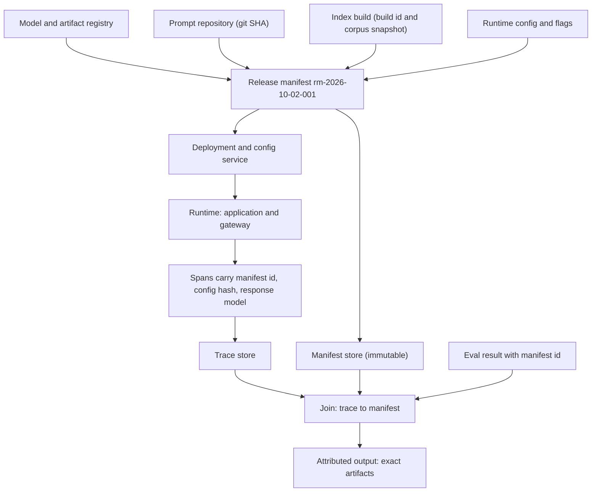

The diagram shows two stores joined on one key. The trace store holds high-volume request data that carries only the manifest ID. The manifest store holds the low-volume, immutable list of artifacts. Joining them at query time keeps traces small, makes the artifact list authoritative (a trace cannot disagree with the manifest), and lets an evaluation result carry the same ID so that offline and online evidence can be compared for the same release. If the manifest ID were absent from evaluation results, you could not say whether the offline score and the online score describe the same system.

### 7.3 A worked manifest schema

The manifest is a document keyed by ID. Fields reference artifacts by digest or immutable version, never by mutable name.

```json
{
  "release_manifest_id": "rm-2026-10-02-001",
  "created_at": "2026-10-02T09:14:00Z",
  "workload": "support-assistant",
  "model": {
    "alias": "model-x",
    "pinned_snapshot": "model-x-2026-09-15",
    "provider": "provider-a",
    "allow_alias_float": false
  },
  "prompt": { "repo": "prompts", "git_sha": "a41c9e0", "template_version": "pt-v12" },
  "retrieval": {
    "index_version": "idx-2026-09-28",
    "corpus_snapshot": "corpus-2026-09-27T23:00Z",
    "embedding_model": "emb-m-3@sha256:77ab...",
    "reranker": "rr-4",
    "top_k": 20, "rerank_keep": 5
  },
  "tools": [{ "name": "lookup_order", "schema_version": "3" }],
  "validators": [{ "name": "schema", "version": "2" }, { "name": "citation", "version": "5" }],
  "policy": { "routing": "route-pol-9", "fallback_model": "model-y-2026-08-01" },
  "evaluation": {
    "dataset": "golden-2026-10-a", "dataset_digest": "336e2f6b009c",
    "judge": "judge-rubric-v3", "report_id": "evr-8841"
  },
  "config_hash": "9f2c1ab4"
}
```

Several fields deserve comment. `pinned_snapshot` and `allow_alias_float` make the model-drift risk explicit: if the provider offers only an alias and no snapshot pin, the manifest says so, and the silent-change detection of Section 12.6 becomes mandatory. `corpus_snapshot` is as important as the index build, because a rebuilt index over a changed corpus is a different system. `evaluation` ties the manifest to the evidence that approved it, so that a reviewer can open the report from the production incident. `config_hash` is a digest of the fully resolved configuration, computed at deploy time. It detects configuration drift between what the manifest says and what is running, and it distinguishes two deployments of the same manifest that differ in a flag.

### 7.4 Stamping and checking

Stamping works as follows. The deployment service writes the manifest ID into the runtime configuration. The application reads it at startup and adds it to every root span through a span processor. The gateway adds the response model and provider request ID. At the end of a request, a validation step in the collector (or a nightly job) checks records against the schema. The runnable validator in [01_trace_record_validator.py](../code/python/ai-observability-chapter/01_trace_record_validator.py) does this for a record and returns a list of errors. Running it on a known-good and a deliberately broken record prints:

```text
good trace: 0 error(s)
bad trace: 5 error(s)
  - s1: bad manifest id 'latest'
  - s2 (retrieval): missing attribute index_version
  - s5: phases sum 820 ms but span lasts 1480 ms
  - s5: content attributes ['output_text'] present while capture is off
  - s6: parent s99 missing (orphan)
```

The five errors correspond to five real failure classes: a mutable identifier instead of an immutable one, an unattributable retrieval, inconsistent latency measurement, content leaking where capture is off, and a broken trace tree. Run this validator in CI against a contract-test request and in production as a sampled monitor of schema conformance. The conformance rate itself is a metric: if 1 percent of traces lack a manifest ID, then 1 percent of incidents will begin with "we cannot tell what ran."

### 7.5 Derived artifacts must carry the same ID

Anything derived from a request must keep the attribution: judge scores, feedback labels, evaluation case candidates, cost records, and incident tickets. A judge score without the manifest ID of the response it judged cannot be sliced by release. A feedback event without the trace ID cannot be joined at all. The rule is simple: every derived record carries `trace_id` and `release_manifest_id`, and the pipeline rejects records that lack them.

### 7.6 Edge cases

- **Mixed-version requests.** During a rollout, a multi-step agent request might start on manifest A and finish on manifest B if a deploy happens mid-request. Pin the manifest at request start and carry it through all steps. If a step must run on a different version, record it on that step's span.
- **Hot-reloaded prompts.** If prompts are loaded from a configuration service without a deploy, the manifest ID must change when the prompt does. Treat a prompt edit as a release.
- **Fallback models.** The `response_model` attribute shows the fallback model that actually answered. The manifest's `fallback_model` field says what was allowed. A response model that is in neither the primary nor the fallback is a configuration error and should alert.
- **Provider aliases.** When the provider's `response_model` differs from the pinned snapshot, that is a silent change, or a provider that reports an alias-resolved name. Alert on a response model not in the manifest's allowed set.

## 8. Logs, Traces, and Metrics for AI

### 8.1 What each signal is for

The three classic signals keep their roles, with AI-specific uses. Part 14 owns the signal mechanics ([CH01 Logs](../14_Observability/CH01_Logs.md), [CH02 Metrics](../14_Observability/CH02_Metrics.md), [CH03 Tracing](../14_Observability/CH03_Tracing.md)).

| Signal | Strength for AI | Weakness for AI | Use it for |
| --- | --- | --- | --- |
| Metrics | Cheap, aggregable, fast alerting, long retention | No per-request detail; cardinality limits | Rates and distributions: error rate, latency percentiles, token spend, check pass rate by slice |
| Traces | Per-request causal structure and timing; joins across components | Volume; content sensitivity; sampling loses requests | Diagnosis, attribution, latency phase analysis, evidence for incidents |
| Logs | Rich discrete events, free-form detail | Hard to aggregate; high volume; PII risk | Validator decisions with reasons, tool errors, security events, audit records |

For AI, add a fourth category that is neither a log nor a trace: the **evaluation record**. It is a structured record of a quality judgement (a judge score, a human label, an automated check result) linked to a trace ID and a manifest ID. It is written once, queried often, and retained as long as the evaluation data it supports. Treat evaluation records as a first-class table in an analytics store, not as log lines.

### 8.2 Deriving metrics from traces

A pragmatic pattern is to emit spans once and derive metrics from them in the pipeline. The OTel Collector can convert spans to metrics (a span-metrics connector exists for this purpose), producing request counts, durations, and error counts by span kind and low-cardinality attributes. The benefit is a single source of truth. The risk is that sampling distorts counts: if traces are sampled before the connector runs, the metrics undercount. Derive metrics before sampling, in the first-tier collector, or emit direct metrics from the application for counts that must be exact.

Quality metrics need a different treatment because they come from sampled evaluation. A metric like "groundedness pass rate" is an estimate from a sample, and should be published with the sample size and a confidence interval. Publishing a rate without its denominator invites false alarms (Section 13).

### 8.3 What belongs in logs

Keep logs for events that carry a reason and are not naturally a span attribute: a validator rejected an output and why, a tool call was denied by policy and which rule denied it, a redaction removed N entities of type T, a retry was abandoned, a human reviewer overrode a decision with a reason code. Log the identifiers (trace ID, manifest ID) and the reason code, not the content. If a log line needs content for debugging, link to the content store by reference so access control applies.

### 8.4 A decision rule

When deciding where a datum goes, ask three questions. Is it needed for an alert or a dashboard of rates? Then it is a metric, with low-cardinality labels. Is it needed to explain one request? Then it is a span attribute. Is it a discrete decision with a reason that someone may audit? Then it is a structured log or audit record. If it is a judgement about quality, it is an evaluation record. The same fact may appear in more than one form (a validator verdict is a span attribute and a metric label and, when it blocks output, an audit log), but each form has one owner and a purpose.

## 9. Content Capture, Redaction, Sampling, and Retention

### 9.1 The central tension

Debugging an AI incident usually needs content: the prompt that was assembled, the passages retrieved, the output produced, the tool inputs and outputs. Without them you can see that something went wrong but not what. Yet the same content may contain personal data, secrets, confidential business information, and attacker-supplied text. Capturing everything gives the best debugging and the worst risk. Capturing nothing gives the safest store and the least diagnostic power. The architecture is a set of policies and mechanisms that sit between these extremes and make the trade-off explicit, tier by tier.

### 9.2 What to store, by class

| Content class | Value for diagnosis | Sensitivity | Default policy |
| --- | --- | --- | --- |
| User prompt or message | High | High: free-text user data, may include PII and secrets | Store redacted, on a sample plus all flagged requests |
| System prompt and template | Medium | Low to medium: proprietary | Do not store per request. Store the template once by version in the manifest, store only variable parts |
| Retrieved passages | High for RAG diagnosis | Medium to high: may be tenant-confidential | Store document IDs, chunk IDs, and scores always. Store text only on sample and flagged requests, or re-fetch from the index snapshot by ID |
| Model output | High | Medium to high: may echo PII | Store redacted, on a sample plus all flagged requests |
| Tool inputs and outputs | High for agent diagnosis | High: may carry credentials, customer records | Store a schema-level summary always (tool name, argument keys, sizes, status). Store values redacted on flagged requests |
| Embeddings | Low per request | Medium: can leak source text | Do not store per request |
| Reasoning or thinking text | Medium | Variable; provider terms may restrict | Follow provider terms. Treat as content of the output class |

A key technique is storing references instead of copies. Retrieved passage text can be recovered from an immutable index or corpus snapshot using the chunk ID and the snapshot named in the manifest. This turns a per-request storage cost into a lookup, and it means that deleting a source document from the corpus (for a deletion request) also removes it from every future replay, while the trace retains only the ID.

### 9.3 Redaction at the edge

Redaction should happen as early as possible, before data leaves the process or trust zone that produced it. A redactor in the application or an in-process span processor replaces detected entities with typed placeholders (`[EMAIL_1]`, `[ACCOUNT_NUMBER_2]`) before export. Typed placeholders preserve structure for debugging ("the model repeated the placeholder") without exposing the value. Three points of caution.

First, detection is imperfect. Pattern-based detectors catch emails, card numbers, and national ID formats with good precision, and miss names and context-dependent identifiers. Model-based entity recognizers catch more and cost more, and they also err. Assume residual PII in redacted content and apply access control and retention as if it were present. Redaction reduces risk. It does not remove it.

Second, secrets. API keys, tokens, and passwords appear in prompts (users paste them) and in tool outputs. Use secret-pattern scanners with provider-specific formats, and drop the whole attribute if a high-confidence secret is found rather than masking part of it. A leaked token in a trace store is a credential exposure, and the rotation clock starts when it is stored.

Third, order of operations. Redact before sampling decisions that look at content, and before any export to a third party. Tail-based sampling that inspects content at the collector means the collector has seen unredacted content. If the collector is inside the same trust zone as the application, that is acceptable. If it is a vendor-hosted pipeline, redact first.

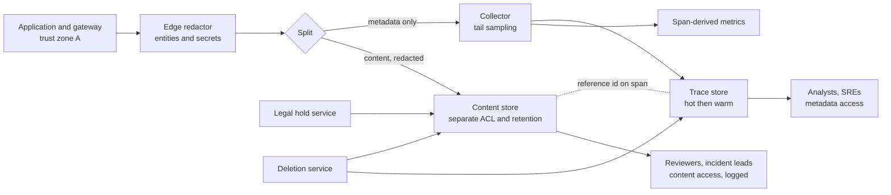

The diagram separates metadata from content at the edge. Metadata flows to the collector and trace store where many engineers need access. Content goes to a separate store with a stricter access list, its own retention clock, and hooks for legal hold and deletion. The span holds only a reference to the content. The implication is that most debugging (latency, routing, versions, scores) needs no content access at all, and content access becomes a deliberate, logged act.

### 9.4 Sampling strategies

Because content is expensive and risky, store it on a sample. Four sampling strategies exist, and a practical design combines them.

| Strategy | How it decides | Strength | Weakness |
| --- | --- | --- | --- |
| Head sampling | Random decision at the start of the request, propagated downstream | Cheap, unbiased for the sampled population, simple | Misses rare failures; cannot use information that appears later |
| Tail sampling | Decision after the trace completes, based on its content and outcome | Can keep all errors, slow requests, flagged requests | Needs buffering at the collector; memory and complexity; the sample is biased by design |
| Error-biased | Keep all traces with errors or failed hard-rule validators, plus a base rate of the rest | Guarantees evidence for known failure types | Does not capture silent quality failures that pass validators |
| Quality-biased | Keep traces with a low judge score, negative user signal, or low-confidence flag, plus a base rate | Captures silent failures that signals later reveal | Signals may arrive after the trace was dropped, so the decision must be revisitable |

Two design points follow from the last row. First, user feedback arrives after the response, sometimes minutes later, so a tail-sampler that decides at trace completion cannot keep a trace because of a later thumbs-down. Solve this by retaining metadata for all requests for a short window and content for a short buffer (for example 24 hours in a cheap tier), and promoting to the long-retention content store when a later signal arrives. This is the "late-bound keep" pattern. Second, any biased sample must be accompanied by an unbiased base sample. Estimating the overall bad-event rate from an error-biased sample overstates it. Estimating from the unbiased 1 percent base sample gives an unbiased estimate with a computable error. The biased streams are for diagnosis. The unbiased stream is for measurement. Keep the two apart, and tag each stored trace with its sampling reason and the inclusion probability so that estimates can be reweighted.

Worked reweighting. Suppose the base sample keeps 1 percent of requests. Errors (2 percent of traffic) are kept at 100 percent. A kept trace that is an error has inclusion probability 1.0 and weight 1. A kept non-error trace has inclusion probability 0.01 and weight 100. Take a smaller service with 1,400,000 non-error requests in a period, of which the base sample keeps 14,000. If 560 of the kept traces fail the groundedness check, the estimated failure count among non-error traffic is 560 × 100 = 56,000 of 1,400,000, a rate of 4.0 percent (560 / 14,000 gives the same figure). Without the weights the rate in the kept set would be dominated by the errors and would not equal the population rate.

### 9.5 Retention tiers

Match retention to purpose. The tiers below are a pattern, not a prescription; legal and contractual requirements decide the numbers.

| Tier | Contents | Typical retention | Access | Purpose |
| --- | --- | --- | --- | --- |
| Metrics | Aggregates, quality rates with denominators | 13 months or more | Broad | Trends, SLO reporting, seasonality |
| Trace metadata | All spans without content | 30 to 90 days hot or warm | Engineering | Diagnosis, attribution, cost |
| Content, sampled | Redacted content on sample and flagged traces | 14 to 30 days | Restricted, logged | Incident diagnosis |
| Curated evaluation cases | Reviewed, de-identified cases | Life of the evaluation suite | Evaluation team | Regression testing |
| Audit records | Policy decisions, tool authorizations, human approvals | Per regulation, often years | Compliance, security | Accountability |

Notice the asymmetry: content has the shortest retention and curated cases the longest, because curated cases have been reviewed and de-identified. Promoting a production trace into an evaluation case is a transformation (review, de-identification, consent check), not a copy.

### 9.6 Access control, legal hold, and deletion

Traces that contain content are sensitive datasets and need the controls of one.

- **Access control.** Separate the metadata role from the content role. Content access is by request, time-boxed, tied to a ticket, and logged. Tenant boundaries apply: an engineer working for tenant A's incident does not see tenant B's content. Enforce this in the store (per-tenant partitions or row-level policy), not in the UI.
- **Legal hold.** A hold suspends deletion for specified records (by tenant, time range, or case). The deletion pipeline must check the hold service before deleting. Holds must apply to derived stores too (cold archives, evaluation sets that were promoted from traces).
- **Deletion propagation.** A user's deletion request must reach every place their data went: the content store, the trace store (where an attribute may include user identifiers), derived evaluation sets, label stores, and backups on their expiry schedule. This is hard when data has been copied. The mitigation is design-time: store user identifiers as pseudonymous keys with a mapping that can be destroyed, keep content in one store, make derived stores store references where possible, and keep a lineage record of which curated cases came from which traces. Then deletion is a lineage query plus a delete, and the backup tail is bounded by retention.

### 9.7 Storage volume and cost arithmetic

The runnable estimator [02_sampling_cost_estimator.py](../code/python/ai-observability-chapter/02_sampling_cost_estimator.py) computes volume and cost. Inputs (illustrative): 2,000,000 requests a day; 2 percent errors; 5 percent flagged by automated checks or user signals; 6 KB of span metadata per request; 28 KB of content per request (prompt, retrieved text, output, tool I/O; about 7,000 tokens at 4 characters each); hot indexed storage kept 14 days at $0.10 per GB-month; warm object storage kept 76 more days (90 days total) at $0.023 per GB-month; base sampling rate 1 percent.

Step by step for "capture everything": metadata is 6 KB × 2,000,000 = 12,000,000 KB, which is 11.4 GB a day (dividing by 1,048,576 KB per GB). Content is 28 KB × 2,000,000 = 53.4 GB a day. Total 64.8 GB a day. Steady-state hot holds 14 days: 64.8 × 14 = 907 GB, at $0.10 per GB-month is $90.7. Warm holds 76 days: 64.8 × 76 = 4,925 GB at $0.023 is $113.3. Total about $204 a month for storage alone. Output of the script:

```text
strategy                                             content%   GB/day  USD/month
capture everything                                     100.00     64.8        204
head 1% only                                             1.00     12.0         38
error-biased (all errors + 1% rest)                      2.98     13.0         41
error+quality-biased (all flagged + 1% healthy)          7.93     15.7         49
```

Two lessons. First, raw storage is cheap at this scale, so cost is not the main reason to sample. Risk is: capturing everything puts 53 GB a day of user content into a store that must then be protected, retained, and deleted on request. Sampling cuts the content under management by 92 to 99 percent. Second, vendor pricing often charges by ingested volume, not by stored volume. At an illustrative $0.50 per ingested GB, capture-everything costs 64.8 × 30 × 0.50 = $972 a month for ingestion alone, against $180 for the 1 percent head sample (12.0 × 30 × 0.50). Check your vendor's meter, because it can change which strategy is cheapest, and compute the estimate with their units.

The same script reports the estimator precision of the unbiased base sample. With 20,000 healthy-slice requests a day sampled at 1 percent for a week, n = 1,400 traces. For a true failure rate p = 0.04, the standard error is $\sqrt{p(1-p)/n} = \sqrt{0.04 \times 0.96 / 1400} = 0.00524$, so the 95 percent interval half-width is $1.96 \times 0.00524 = 0.0103$, about plus or minus one percentage point. That is the resolution of the weekly unbiased estimate of that slice. Detecting a change smaller than that needs a larger base sample, which is a cost trade-off that Section 13 quantifies.

### 9.8 Choosing the sampling rate

Start from the question you need the sample to answer. For a per-slice quality rate with a target half-width $h$ at 95 percent confidence and an anticipated rate $p$, the required sample is $n = 1.96^2 \cdot p(1-p) / h^2$. For $p = 0.04$ and $h = 0.005$: $n = 3.8416 \times 0.0384 / 0.000025 = 5{,}901$. For 12 slices that is about 70,800 judged traces per measurement period, which tells you the base rate for the small slices must be raised above the global 1 percent. A common architecture is a global base rate plus per-slice minimum quotas, so rare slices (a language, a tenant tier, a product line) are never starved. Record the quota decisions in the sampling policy and publish them alongside the metrics.

## 10. Online Quality Signals

No single online signal measures quality. Each is a noisy, biased proxy. The architecture's job is to collect several, label each with what it measures and how it is biased, and combine them without pretending any is ground truth. Four families exist.

### 10.1 Implicit signals

Implicit signals are inferred from behaviour without asking the user for anything.

| Signal | What it suggests | Typical bias or confound |
| --- | --- | --- |
| Edit distance between draft and final text | How much the user had to fix an AI draft | Users edit for style, not only correctness; short drafts have small absolute edits |
| Regeneration or retry | The first answer was unsatisfactory | Some users regenerate out of curiosity or to compare |
| Copy or accept | The answer was useful enough to take | Copying a wrong answer is still a copy; novices copy more |
| Abandonment | The user gave up or got the answer | Ambiguous: leaving after a good answer looks like abandoning after a bad one |
| Escalation to a human | The system could not resolve the issue | Policy-driven escalations (account changes, complaints) are not quality failures |
| Query reformulation | The first answer did not match intent | Also occurs in exploratory use |
| Dwell time | Engagement | Long dwell can mean confusion or reading |

The right way to use an implicit signal is to calibrate it against labels. Take a sample of sessions, obtain human judgements of whether the answer was correct, and measure how well the signal predicts the judgement (for example, the precision and recall of "regeneration" as a predictor of "incorrect"). A signal that predicts at 0.55 precision is a weak alert and a useful slice-finder. A signal with 0.85 precision can be an alert in its own right. Recalibrate when the product changes, because user behaviour does.

### 10.2 Explicit signals

Explicit signals are what the user states: thumbs up or down, a star rating, a reason (incorrect, outdated, unsafe, not helpful, other), or a free-text comment. They carry the highest meaning per event and the lowest volume. Typical response rates in assistant products are a few percent of responses, with a skew toward strong opinions. This causes **selection bias**: the rate of thumbs-down among responders is not the rate of bad answers among all responses. Users with simple satisfied outcomes rarely click. Users who are angry click more. Different channels differ: an in-line thumb in a chat window gets more responses than a survey link.

Design choices that improve explicit signals: ask for a reason on thumbs-down with a short list of options (the reason is the diagnostic value), attach the trace ID to the event, keep the control low-friction, and never use the signal as a single success metric because it can be gamed by prompting for it. Always store the feedback event as a record with trace ID, manifest ID, timestamp, signal type, and value, so it can be sliced by release.

### 10.3 Outcome-based signals

Outcome signals measure what happened in the business process the AI feature supports: whether the support ticket was resolved without reopening, whether the generated code passed review or tests, whether the recommended item was purchased, whether the extracted fields were later corrected by an operator. These are closer to the real objective and arrive late. A ticket reopen window of 7 days means the quality of today's answer is known next week. Outcome signals suit trend monitoring and release-level comparison. They do not suit fast alerting.

Join them through the trace or a session ID. This needs an event contract with the downstream system (the ticketing platform, the CRM, the code host). Define it up front. A frequent failure is that the downstream system's events have no reference to the AI response, so the join is a fuzzy match on timestamp and user, and the match rate is 60 percent. Measure the join rate itself as a health metric.

### 10.4 Automated checks

Automated checks run on responses without waiting for the user. They fall into three cost classes.

**Deterministic checks, on every request.** Schema validity, required fields present, citation IDs exist in the retrieved set, citation URLs resolve to allowed domains, output length within bounds, forbidden-pattern checks, language detection. Near-zero marginal cost and zero sampling error. They are the first line and should have their own pass-rate metrics by slice.

**Model-based classifiers, on every request or a high fraction.** Safety classifiers, toxicity, PII detectors, prompt-injection detectors on inputs and tool outputs, and small groundedness (entailment) models. Small models run at milliseconds and low cost. They produce scores that should be thresholded with calibrated operating points and tracked for their own drift.

**LLM-as-judge, on a sample.** A judge model scores quality criteria against a rubric: correctness against a reference, groundedness in retrieved context, completeness, tone. Judging is expensive and its errors are structured. Part 16 [CH24](../16_AI_and_GenAI/CH24_Generative_AI_Evaluation_Guardrails_and_Hallucinations.md) teaches the methods. The architecture requirements are these:

- Version the judge: model snapshot, rubric text, parameters. Store the judge version with every score.
- Calibrate against humans. Keep a human-labeled calibration set. Report the judge's agreement with humans (for example Cohen's kappa, or simply accuracy and the confusion matrix) for each rubric. Recalibrate whenever the judge version, the rubric, or the system under test changes materially.
- Know the judge biases: preference for longer answers, preference for its own model family's style, position bias in pairwise comparisons, sensitivity to prompt wording, and leniency on fluent but false text. Mitigate with reference-based rubrics, pairwise order randomization, and a judge from a different family than the generator where possible.
- Sample deliberately. Judge a stratified sample (by slice, tenant tier, and risk class) rather than a flat sample so small slices are measured.
- Cache by content. Judging the same (rubric version, input, output) twice should cost nothing (Section 16.5).

### 10.5 Judge calibration, with numbers

A judge labels 400 calibration items that humans also labelled. Humans say 360 are acceptable and 40 are not. The judge says acceptable for 342 of the 360 acceptable ones and unacceptable for 28 of the 40 bad ones. So true-positive rate for acceptable is 342/360 = 0.95, and the judge's recall of bad items is 28/40 = 0.70. The judge's false alarm rate on good items is 18/360 = 0.05. Now apply it online where the true bad rate is 4 percent. Of 10,000 judged requests, 400 are truly bad and 9,600 good. The judge flags 0.70 × 400 = 280 true bad and 0.05 × 9,600 = 480 false bad, 760 in all. Observed bad rate is 7.6 percent while the true rate is 4.0 percent. Precision of a flag is 280/760 = 0.37. This is the base-rate effect: with a rare bad class, even a judge with 5 percent false-alarm rate produces mostly false flags. Two consequences. First, do not report the raw judge flag rate as the quality rate. Correct it using the calibration (a Rogan-Gladen style correction: true rate ≈ (observed − false alarm rate) / (recall − false alarm rate) = (0.076 − 0.05)/(0.70 − 0.05) = 0.026/0.65 = 0.04), and report the uncertainty from the calibration set size. Second, flags are for routing to human review, with the judge acting as a triage filter, not a verdict.

### 10.6 Combining signals

Do not combine heterogeneous signals into a single opaque quality score without a validation story. A defensible approach keeps a small set of named indicators, each with a documented definition, sample, and bias:

- Hard-rule violation rate (every request, exact).
- Groundedness pass rate (judge or entailment model, sampled, calibrated).
- User-negative rate (explicit thumbs-down plus escalation, with responders as denominator, labelled as biased).
- Outcome rate (reopen or correction rate, delayed, aligned to cohorts).

An SLO (Section 11) is defined over a subset of these. Dashboards show all of them. If two disagree, that is information: rising user-negative with flat groundedness points to a problem the judge does not measure (latency, tone, a missing feature); rising groundedness failures with flat user-negative points to a judge or sampling issue, or to a failure users do not notice.

### 10.7 The bias summary

| Bias | Where it arises | Effect | Mitigation |
| --- | --- | --- | --- |
| Selection (responders differ) | Explicit feedback | Overestimates or underestimates true rate | Report as a rate among responders. Calibrate with a random human-labelled sample |
| Survivorship | Tail sampling that keeps only flagged traces | Estimates are biased high | Keep an unbiased base sample with inclusion weights |
| Position and length bias | LLM judge | Favors longer answers or position A | Randomize order, length-controlled rubrics, human calibration |
| Self-preference | Judge from the same family | Inflates scores for similar styles | Cross-family judge, reference-based rubrics |
| Delay | Outcome signals | Today's quality unknown for days | Cohort by day. Use leading indicators for alerts |
| Feedback loop | Using system output to define labels | Reinforces own errors | Independent labelling, holdouts (Section 14) |
| Novelty | New feature | Early positive reaction fades | Compare over longer windows and by user tenure |

## 11. Quality SLOs, Error Budgets, and Burn-Rate Alerts

### 11.1 SLOs for quality

Part 14 [CH11](../14_Observability/CH11_SLO.md) and [CH13](../14_Observability/CH13_Error_Budgets.md) define SLOs and error budgets. The AI-specific work is defining the service level indicator (SLI): the fraction of events that are good. An SLI for quality is $\text{SLI} = \text{good events} / \text{valid events}$ where each term must be explicit.

A usable set of quality SLIs for a RAG assistant:

| SLI | Good event | Valid events | Measurement |
| --- | --- | --- | --- |
| Hard-rule conformance | Response passes schema, citation, and policy validators | All non-cancelled requests | Every request, exact |
| Groundedness | Judge or entailment score above calibrated threshold | Sampled requests with retrieved context | Sampled, calibrated |
| Answered-when-answerable | System answers rather than refusing when evidence exists | Sampled requests where reviewers say evidence exists | Sampled with human labels |
| Fast first token | TTFT under 1.5 s | Streaming requests | Every request, exact |
| Resolution | No reopen within 7 days | Resolved conversations | Delayed outcome |

Set targets by reasoning from user harm and from measured baseline, not from round numbers. If the baseline groundedness pass rate over the last 8 weeks is 96.4 percent with a weekly standard deviation of 0.5 points, a 99 percent target is unachievable without improving the system, a 90 percent target is meaningless, and 96 percent may be an honest first SLO with a plan to raise it. Write the definition of a bad event (Section 2.4) into the SLO document, including the sampling method and the confidence interval of the estimate.

### 11.2 Error budgets

For an SLO of 97 percent good events over 30 days, the error budget is 3 percent: if the service handles judged events at a steady rate, up to 3 percent may be bad. The budget is a quantity to spend on risk. A release that is expected to temporarily raise the bad rate (a risky prompt change, a model upgrade) spends budget. When the budget is exhausted, the team shifts effort from features to quality, using the policy in the SLO document. The same budget can be partitioned: for example, 1 point for the hard-rule SLI and 2 points for judged quality, because the first is exact and the second is estimated.

Budgets for judged SLIs need a statistical caveat. If the bad rate is estimated from a sample, the "budget consumed" is itself an estimate with an interval, and decisions near the boundary should account for it. Prefer policies with a margin: freeze when the lower bound of the interval on consumption exceeds a threshold, not when the point estimate does.

### 11.3 Burn rate

Burn rate is the speed at which the budget is consumed, relative to the speed that would use exactly all of it by the end of the window:

$$\text{burn rate} = \frac{\text{observed bad fraction}}{\text{budget fraction}} = \frac{\text{observed bad fraction}}{1 - \text{SLO}}$$

At burn rate 1 the budget lasts the whole window. At burn rate $b$ it lasts $\text{window}/b$. With a 30-day window (720 hours) and SLO 97 percent (budget 0.03):

| Observed bad fraction | Burn rate | Time to exhaust the 30-day budget |
| --- | --- | --- |
| 0.03 | 1.00 | 720 hours (30 days) |
| 0.09 | 3.00 | 240 hours (10 days) |
| 0.18 | 6.00 | 120 hours (5 days) |
| 0.43 | 14.33 | 50.2 hours |

These figures come from [04_burn_rate_and_alert_math.py](../code/python/ai-observability-chapter/04_burn_rate_and_alert_math.py). To see the effect of a specific regression: the groundedness check fails 18 percent of sampled requests because an index rebuild dropped half the policy documents. That is a burn rate of 0.18 / 0.03 = 6, so five days remain before the 30-day budget is gone, if nothing else is spent. Meanwhile the budget consumed per hour is $6/720 = 0.83$ percent of the total. After 12 hours, 10 percent of the monthly budget is gone.

### 11.4 Multi-window alerts

A single threshold alert is either too slow (long window) or too noisy (short window). The multi-window, multi-burn-rate approach in the Google SRE workbook uses a pair of windows per severity: a long window to confirm the burn is significant and a short window to confirm it is still happening. Common choices for a 30-day SLO:

| Severity | Burn rate threshold | Long window | Short window | Budget consumed if it fires |
| --- | --- | --- | --- | --- |
| Page | 14.4 | 1 hour | 5 minutes | 2 percent (14.4 × 1 / 720) |
| Page | 6 | 6 hours | 30 minutes | 5 percent (6 × 6 / 720) |
| Ticket | 1 | 3 days | 6 hours | 10 percent (1 × 72 / 720) |

The check in the script shows how this applies: in one hour 270 of 600 judged requests were bad (45 percent). The burn rate is 0.45 / 0.03 = 15.0, above 14.4, so the first row fires if the 5-minute window agrees.

The AI-specific difficulty is sample size. A window of one hour with 600 judged requests (a 10 per minute rate) has a standard error at a true 3 percent bad rate of $\sqrt{0.03 \times 0.97 / 600} = 0.0070$, so the 95 percent interval is about ±1.4 points on 3 percent (a relative 45 percent). A 5-minute window has only 50 judged requests and an interval of ±4.7 points. At that sample size the short-window confirmation is noise. Options: raise the judged sample rate for alerting traffic, use a cheaper deterministic or classifier signal for the short-window check (computed on every request), and reserve the judge-based SLI for the long window and ticketing severity. This is the reason Section 10.4 keeps deterministic checks on every request: they provide the fast, high-count signals alerts can use.

### 11.5 What should page a human

Page on conditions that need action within hours and that you trust: a sustained hard-rule violation burn, a safety classifier spike, a sudden response-model change not in the manifest, and a quality canary breach with an automated rollback not yet effective. Do not page on a single judged-quality estimate crossing a line with a wide interval. File a ticket, route to review, and let the next window confirm. A pager that fires on estimates which are wrong 40 percent of the time trains the on-call to ignore it.

## 12. Drift Detection Architecture

### 12.1 What drifts and where to look

Drift is any change in the distribution of something the system depends on or produces. In AI systems there are six places, and each has a different detection method and a different meaning.

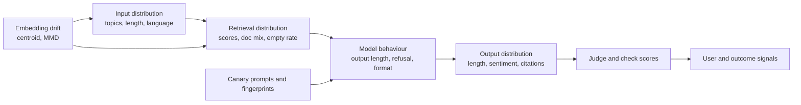

The chain shows that drift usually propagates left to right: a change in inputs shifts what is retrieved, which shifts model behaviour, outputs, and finally user signals. Monitoring each stage localizes the cause. If user-negative rises while input and retrieval distributions are stable, the cause is the model or prompt, and the canary prompts (Section 12.6) are the next place to look.

### 12.2 Input drift

Track low-cost descriptors of inputs: length in tokens, language mix, topic cluster mix, share of requests containing code or numbers, share from each channel and tenant. Compare the current window to a reference window (the last stable period, or the same weekday last week). For a categorical descriptor with $k$ categories, the Population Stability Index is

$$\text{PSI} = \sum_{i=1}^{k} (a_i - e_i)\ln\frac{a_i}{e_i}$$

where $a_i$ and $e_i$ are the actual and expected shares of category $i$. A rule of thumb used in credit-risk practice reads below 0.1 as small shift, 0.1 to 0.25 as moderate, above 0.25 as large. It is a convention, not a theorem. Calibrate thresholds on your own history. Worked example with three topics: expected shares (0.60, 0.30, 0.10), actual (0.50, 0.30, 0.20). Terms: $(0.50-0.60)\ln(0.50/0.60) = (-0.10)(-0.1823) = 0.01823$; $(0.30-0.30)\ln 1 = 0$; $(0.20-0.10)\ln(0.20/0.10) = 0.10 \times 0.6931 = 0.06931$. PSI = 0.0875, a small shift. If the third topic doubled again to 0.40 with the first falling to 0.30, PSI = $(0.30-0.60)\ln(0.5) + 0 + (0.40-0.10)\ln 4 = 0.2079 + 0.4159 = 0.624$, a large shift that should be reviewed because the evaluation set probably under-represents the new topic.

Input drift is an input to a decision, not a defect. It says "the evaluation set may no longer represent traffic." The response is to sample the new region for labelling and add cases (Section 14).

### 12.3 Embedding drift

Embeddings of inputs, retrieved chunks, or outputs give a way to see semantic change in unstructured text. Compare windows by distance between centroids, by a classifier two-sample test (train a classifier to tell windows apart; accuracy near 50 percent means little drift), or by a kernel test such as maximum mean discrepancy. Cluster the embeddings of the reference period and track the share of current traffic falling in each cluster, and the share far from every centroid (the "novel" share). A rising novel share is an early warning for unseen topics. Two cautions. The embedding model used for monitoring must be pinned, or its own change looks like data drift. And the embedding dimension makes naive distance tests unreliable, so use the cluster-share or classifier tests, and see [Part 16 CH16](../16_AI_and_GenAI/CH16_Embeddings_and_Semantic_Representations.md) for the representation itself.

### 12.4 Retrieval distribution drift

For RAG, monitor the retriever as its own component. Useful signals per window: the distribution of top-1 and top-k similarity scores, the share of queries with no result above a threshold (empty-retrieval rate), the mix of source documents or collections returned, the age distribution of returned documents, the share of answers whose citations include documents newer than the last index build (should be zero), and the overlap between current top-k sets and a replay of the same queries on the prior index (a stability measure). A drop in score distribution with a stable input distribution points to an index or embedding change. A shift of returned documents to an older source points to an ingestion failure. This is cheaper and faster to compute than any judged metric.

### 12.5 Output and judge drift

Monitor output descriptors: length in tokens, refusal share, share of answers with citations, number of citations, language, format compliance. A model update that makes answers 30 percent longer is visible here before any judge score moves, and it changes cost and latency.

Judge drift is when the evaluator itself changes. If the judge is a hosted model with an alias, a silent update to the judge changes every score. Defences: pin the judge snapshot; keep a frozen calibration set of 200 to 500 items with human labels, and rerun the judge on it weekly; alert when agreement with the human labels falls by more than a set margin (say, 3 points of accuracy beyond the sampling interval of the calibration set). When the calibration agreement drops, freeze the use of judge scores in gates until recalibrated, because the apparent quality change may be measurement change.

### 12.6 Silent provider-side model changes

When the model is hosted by a provider, the weights behind an alias can change, a safety layer can change, or an inference stack change can alter outputs slightly (different numerical kernels, a new quantization, a new default parameter). Contracts rarely promise otherwise unless you pin a dated snapshot, and even a pinned snapshot may be retired on a schedule. Detection options:

1. **Response model field.** Alert if `response_model` is not in the manifest's allowed set. This catches alias moves that the provider reports.
2. **Provider fingerprint fields.** Some APIs return a system fingerprint or similar identifier that changes with backend configuration. Record it. A changed fingerprint is a cue to run canaries. Not every provider offers one, and a stable fingerprint does not prove identical behaviour.
3. **Canary prompts.** Maintain a fixed set of 50 to 200 prompts with deterministic checks (exact answers, format compliance, tool-call correctness, refusal behaviour, known-hard reasoning items) and run them on a schedule, say every hour at low sampling temperature, against the production endpoint. Track pass rates, output length distribution, and token counts. Because model outputs are not perfectly deterministic even at temperature zero, compare distributions and rates with a statistical test, not exact strings. A two-proportion test between this week's and last week's pass rates, with the sample size computed in advance, gives the false-alarm control.
4. **Cost and token signals.** A change in tokens per answer for identical prompts is a sensitive, cheap indicator of a behavioural change.

Canary cost arithmetic: 100 prompts every hour is 2,400 calls a day. At an average cost of $0.011 per call that is $26.40 a day, about $792 a month. It is an insurance premium. Reduce it by running hourly on 20 prompts and daily on the full set, and by running the full set additionally whenever the response-model or fingerprint changes. A canary set is a test asset: version it, keep it separate from the tuning data, and refresh it so it cannot be overfitted to.

Canary design pitfalls: using only easy prompts (they pass before and after), using prompts that match your system prompt's known behaviour only (they miss changes elsewhere), and failing to cover the tool-call path (many silent changes break tool-call format first).

## 13. Regression Alerting and Statistical Design

### 13.1 The question an alert answers

A quality alert answers: has the underlying bad-event rate moved from its baseline $p_0$ to a worse value, given a sample? Every such question is a hypothesis test with a false-alarm rate (type I error, $\alpha$) and a detection power ($1-\beta$) against a stated effect size. Setting those deliberately is what separates an alert from a noisy graph.

### 13.2 Sample size for detecting a rise

To detect a one-sided increase from $p_0$ to $p_1$ with significance $\alpha$ and power $1-\beta$ against a known baseline, the required sample is approximately

$$n = \frac{\left(z_{1-\alpha}\sqrt{p_0(1-p_0)} + z_{1-\beta}\sqrt{p_1(1-p_1)}\right)^2}{(p_1-p_0)^2}$$

with $z_{1-\alpha}$ and $z_{1-\beta}$ the standard normal quantiles. For $\alpha = 0.05$ ($z = 1.645$) and power 0.8 ($z = 0.842$) the script gives:

| Baseline | Shift to | Required n |
| --- | --- | --- |
| 3 percent | 5 percent | 539 |
| 3 percent | 6 percent | 257 |
| 3 percent | 9 percent | 76 |

Worked check for 3 percent to 5 percent: $\sqrt{0.03 \times 0.97} = 0.1706$ and $\sqrt{0.05 \times 0.95} = 0.2179$. Numerator $= (1.645 \times 0.1706 + 0.842 \times 0.2179)^2 = (0.2806 + 0.1835)^2 = 0.2154$. Denominator $0.02^2 = 0.0004$. $n = 538.5$, rounded up to 539. Interpretation: if the judge budget allows 100 judged requests per hour, detecting a 3-to-5 percent regression takes about 5.4 hours of data, while a 3-to-9 percent regression is detectable in under an hour. Smaller regressions take longer. A design that promises "detect any regression within 15 minutes" at 100 judged per hour is promising something statistics does not allow, and you should say so in the SLO document.

The practical decision is therefore which effect size matters. The minimum detectable effect should be set by harm, not by what is cheap: if a 2-point rise in wrong policy answers costs real money, the system needs a larger sample or a more sensitive signal.

### 13.3 Many tests, many false alarms

An alert system that tests many slices and windows multiplies false alarms. With 12 slices tested every hour, that is 288 tests a day. At $\alpha = 0.05$ per test, expect $288 \times 0.05 = 14.4$ false alarms a day even if nothing changes. Three controls:

- Use a corrected significance level. Bonferroni divides $\alpha$ by the number of tests, here $0.05/288 = 0.000174$, which raises the required sample. A less conservative alternative is false discovery rate control across slices.
- Require persistence: the condition must hold in two consecutive windows, which cuts false alarms sharply if windows are independent (the false alarm probability per pair is about $\alpha^2$).
- Use sequential methods (such as a cumulative sum or a sequential probability ratio test) that are designed for continuous monitoring and control error rates across looks, instead of repeatedly applying a fixed-sample test and hoping.

These are mentioned at the architecture level. Part 16 [CH06](../16_AI_and_GenAI/CH06_Model_Evaluation_Validation_and_Selection.md) covers the statistics, and the architecture requirement is that the alerting service supports a documented false-alarm budget per alert.

### 13.4 Slice-level monitoring

Aggregates hide regressions. A drop from 97 to 90 percent on a slice that is 5 percent of traffic moves the aggregate by 0.35 points, which is invisible against noise. Define slices from the product's risk and traffic structure: tenant tier, language, channel, intent or topic cluster, document collection, new vs returning users, and risk class. For every slice, record the sample size. For small slices, use pooled or Bayesian estimates with intervals and a minimum count before an alert may fire. The sampling policy must give small slices a quota (Section 9.8) or the slice has no measurement.

The slice list is a living asset. When an incident reveals a failing population that had no slice, add the slice and a regression case.

### 13.5 Seasonality and comparison baselines

Traffic mix and user behaviour follow daily, weekly, and annual cycles. Business hours bring more complex questions. Month-end brings billing questions. A holiday brings a different user population. A fixed threshold ignores this and alerts every Monday morning. Use a baseline that matches the cycle: compare this hour to the same hour in the previous 4 weeks (median and spread), or fit a seasonal model to the metric. For launches and events, add annotations and temporary baselines. Compare cohorts (by day-of-week and by slice) rather than raw time series.

### 13.6 Alerts need an action

Every alert should name the runbook, the first diagnostic query, the owner, and the automatic action (if any). An alert without an action becomes background noise. Section 19 gives the runbook for the central case, a quality regression alert.

## 14. The Feedback Pipeline

### 14.1 From signal to test case

Production signals are only useful for improvement if they reach the evaluation suite as reviewed cases. The pipeline has seven stages, and each stage has an owner, a data contract, and a hazard.

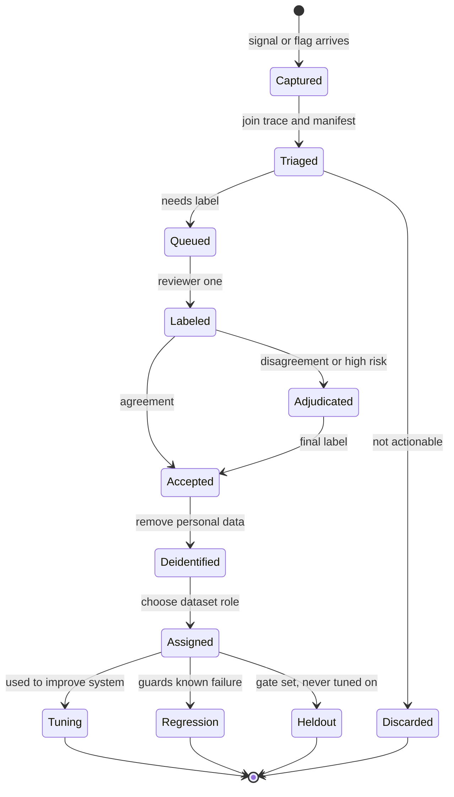

The state machine shows that a case has a role assigned only after labelling, adjudication, and de-identification. The three terminal roles matter: a tuning case may be used to change prompts or train models, a regression case guards a failure that was fixed and must never reappear, and a held-out case is used only for gate decisions and must never be used for tuning. The architecture must make role assignment explicit and enforce it, because the temptation to use a good, fresh, hard case for tuning is constant.

### 14.2 Stage details

**Capture.** Feedback events, escalation records, reviewer overrides, and automated flags are written as records with trace ID and manifest ID. The capture API validates the presence of both. Rejected events are counted, since a rising reject rate means a client stopped sending the trace ID.

**Triage.** An automated step joins the record to the trace, to the content store (if the trace is still within content retention), and to any previous labels. It clusters similar cases (by embedding or by failure reason) so that reviewers see a representative case with a count, not 400 duplicates. Triage decides whether the case is likely actionable. It also applies the sampling rule: fewer than 1 in 200 captured events become label tasks, so the label budget goes to the highest-value cases (new clusters, high-risk slices, disagreements between automated checks and users).

**Label.** A reviewer applies the rubric: was the answer correct, grounded, complete, safe, and what is the reference answer or the failure category. Rubrics are versioned. Labels carry the rubric version, reviewer role, time spent, and confidence.

**Adjudicate.** A second reviewer labels a sample, and disagreements go to an adjudicator. Compute inter-annotator agreement (for example Cohen's kappa for two raters) per rubric, as a measure of whether the rubric is clear. Low agreement means the rubric, not the reviewers, needs work. For high-risk categories (safety, legal, medical), send every case to dual review.

**De-identify.** Remove or replace personal data and customer-confidential details before the case leaves the restricted content store. Keep a lineage record (case ID, source trace ID, transformation steps) in a restricted table so a deletion request can find and remove derived cases (Section 9.6).

**Assign.** Choose the dataset role, based on rules, not preference. A simple rule: a stable random hash of the case ID assigns 70 percent to tuning, 15 percent to the regression set, and 15 percent to the held-out gate set, for ordinary cases; any case from a fixed incident goes to the regression set so the fix is guarded; held-out cases are write-protected.

**Publish.** Add to a new version of the dataset, compute its digest, and record the changes (cases added, removed, relabelled). Datasets are versioned assets (Section 16.2).

### 14.3 Guarding against test contamination

Contamination is when information about test items leaks into the system under test or its tuning process. In this pipeline it enters in five ways.

1. **Tuning on held-out cases.** Prevented by role assignment and by access control: the prompt-engineering workspace cannot read the held-out set, only the gate runner can.
2. **Near-duplicates across roles.** A user asks the same question twice; one copy lands in tuning, one in held-out. Deduplicate by normalized text and by embedding similarity across roles before assignment, and assign by cluster, not by case.
3. **Retrieval corpus contains the answers.** A held-out question whose reference answer was written from a document that is also in the retrieval corpus is fine for RAG testing, but if reviewers pasted the reference answer into the knowledge base to "fix" the failure, the test now trivially passes. Keep reference answers out of the corpus, and when a knowledge fix is the correct remedy, add a differently phrased paraphrase case for testing.
4. **Provider-side training.** If prompts and outputs are sent to a provider whose terms allow training on them, or to a judge model whose terms do, held-out cases might leak into a future model. Check data-use terms before sending evaluation data to a hosted judge, and use zero-retention options where needed.
5. **Public benchmark leakage.** Public benchmarks seen in model training inflate scores. Treat public benchmark numbers as screening evidence only and weight your private suite higher for release decisions.

Refresh held-out sets on a schedule (say, 25 percent replaced each quarter) so that a team that over-fit to them gets caught, and track the gap between held-out and tuning-set scores as a metric. A widening gap indicates overfitting to the tuning data.

### 14.4 Guarding against feedback loops

Three feedback loops are specific to AI products.

- **Exposure loop.** The system shows users what it ranks highly; users click what they see; the click becomes the label for the next ranking model. Responses that were never shown never receive a label. Mitigate with exploration (a small share of randomized or alternative responses, which also supports A/B analysis), and by weighting labels by inverse exposure probability when the exposure is known.
- **Self-labelling loop.** The model's own judgements become labels that train or tune the same model. Errors reinforce. Use independent labellers (humans, a different family of judge) and keep a human-labelled core.
- **Behaviour-adaptation loop.** Users learn how the system behaves and change what they ask. Feedback from the old behaviour no longer represents the new population. Cohort by date and re-estimate, and do not pool across a behaviour change.

### 14.5 Latency of the loop

The loop has an end-to-end latency: signal received, case labelled, case in the next dataset version. If this is six months, the evaluation set lags the product by six months. Measure it. A target such as "a confirmed production failure is a regression case in the nightly suite within 5 working days" gives the pipeline a service level, and there is no point having an incident process whose lessons never reach the tests.

## 15. Annotation and Review Tooling Architecture

### 15.1 Requirements

An annotation system is a queue-based application with unusual security needs. Reviewers see real content (redacted but possibly still sensitive), so the tool must enforce role-based and tenant-scoped access, time-limited sessions, no bulk export, and an access log. Its other requirements are those of any workflow tool: assignment, prioritization, rubric display, side-by-side comparison (candidate and baseline), reference answer entry, structured reason codes, inter-annotator agreement reporting, and sampling controls.

### 15.2 Components

| Component | Responsibility | Notes |
| --- | --- | --- |
| Task queue | Holds label tasks with priority, risk class, and required reviewer count | Priority by cluster size and risk. Dual review for high risk |
| Content service | Fetches redacted content from the content store by reference at view time | Never copies content into the annotation database |
| Rubric service | Serves versioned rubrics and reason-code taxonomies | Label records store the rubric version |
| Assignment and calibration | Assigns tasks, inserts known-answer calibration items, tracks reviewer drift | Calibration items catch tired or inattentive reviewers |
| Label store | Holds labels, reviewer role, time, confidence, and rubric version | Pseudonymous reviewer IDs for analysis; identity mapping restricted |
| Adjudication workflow | Routes disagreements to a senior reviewer | Records the final label and a rationale |
| Export pipeline | Produces de-identified dataset versions | The only path out of the tool |

Make the reviewer interface a thin layer over the stores, so that deleting a source trace also removes the task content, since the content service fetches by reference at view time.

### 15.3 Reviewer quality

Labels are measurements, with error. Track agreement against adjudicated labels per reviewer, per rubric, and over time. Insert calibration items at a steady rate (for example 5 percent) with known labels. Measure reviewer throughput and time per task: unusually fast reviewers often skim. Provide a way for reviewers to flag a bad rubric or ambiguous case. A rubric that is routinely escalated needs revision, and a revision is a new rubric version that also triggers re-evaluation of the judge calibration.

### 15.4 Build versus buy for annotation

Open-source and commercial annotation tools exist, and several LLM observability platforms include annotation queues. Buy or adopt when your rubric is standard and your content can leave your environment (or the tool runs inside it). Build when content is highly regulated, when the workflow is bound to your internal systems (case management), or when you need strict control of the content path. Whichever you choose, the contract is the same: tasks reference content by ID, labels carry rubric versions, and exports are de-identified datasets.

### 15.5 Cost of human review

A human label costs money and attention, and the budget shapes the design. Suppose a reviewer completes 40 tasks an hour at a loaded cost of $45 an hour, so $1.13 per task. Dual review doubles it. If 2,000 tasks a week are needed (new clusters, calibration, adjudication), the cost is about $2,250 a week for single review. The arithmetic argues for using judges and classifiers as triage filters and spending human effort where it changes decisions: calibrating judges, adjudicating disagreements, and labelling new failure clusters. Report the cost per accepted regression case as an efficiency metric for the pipeline.

## 16. Evaluation Harness Architecture

### 16.1 What the harness is

The evaluation harness is the system that runs a candidate on a dataset, scores the outputs, stores the results, compares them with a baseline, and reports regressions. It is used by developers (interactively), by CI (on every change), by release gates (on candidate manifests), and by scheduled jobs (canary prompts, calibration reruns). Part 16 [CH19](../16_AI_and_GenAI/CH19_Retrieval_Quality_and_RAG_Evaluation.md) and [CH24](../16_AI_and_GenAI/CH24_Generative_AI_Evaluation_Guardrails_and_Hallucinations.md) define the metrics and judges that plug in. The architecture below defines the stable frame around them.

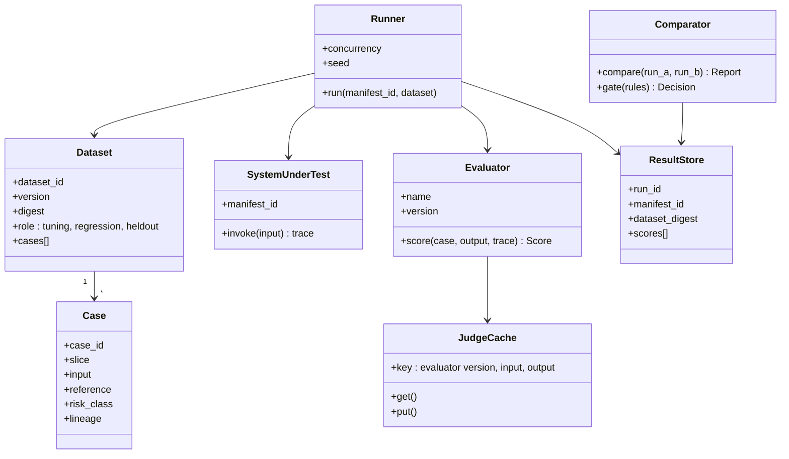

The class diagram makes three design decisions visible. The runner depends on a system under test only through a manifest ID and an invoke interface, so the same harness runs a prompt change, a model change, or a full agent. Evaluators are separate, versioned objects that read the output and the trace, so a judge change is a first-class event. The result store keeps manifest ID, dataset digest, and evaluator versions with every score, which makes any comparison reproducible and makes mismatched comparisons detectable.

### 16.2 Datasets as versioned assets

A dataset version is immutable. It has an ID, a semantic version, a content digest (a hash over the sorted case content), a role, a change log, and a description of its known gaps. Store datasets in a system that supports history (a data version control tool, an object store with versioning, or a git repository for small suites). The harness refuses to run a gate against an unversioned dataset. Reports state the digest, so "passed on golden-2026-10-a at digest 336e2f6b009c" is verifiable. Datasets also need:

- **Slice labels** on every case so results can be broken down.
- **Case provenance** (synthetic, curated from production, expert written) so scores can be reported by origin. Synthetic cases are cheap and diverse, and they often over-represent patterns that models handle well. Production-derived cases represent reality and risk contamination.
- **Risk class** so critical cases can have stricter rules (a single failure on a critical case blocks a release).
- **Reference material** (a reference answer, expected citations, expected tool calls, or acceptance rules) stored separately from the input so references cannot leak into prompts by accident.

### 16.3 Runners

The runner executes cases with controlled concurrency, a seed where the system supports it, retries on transient errors (recorded, not hidden), and timeouts. It records full traces of each run through the same telemetry path as production, tagged as evaluation traffic so it is excluded from production metrics and from user-feedback joins. For agents, the runner must provide a sandbox for tools: deterministic tool stubs for repeatability, with a smaller set of integration runs against real sandboxes. The runner must treat nondeterminism as a property to measure: run each case $k$ times (for example 3 or 5) when the system is stochastic, and report the pass rate across runs as well as the majority outcome. Variance across runs on the same input is itself a quality attribute (a system that answers correctly 60 percent of the time on the same input is not a system that is correct).

### 16.4 Evaluators and judges

Evaluators come in three kinds: deterministic (exact match, schema, citation resolves, regex), model-based classifiers, and LLM judges. All implement one interface and all return a score, a pass flag, a reason string, and evaluator version. Composition rules say how evaluator results combine into a case verdict (for example, "pass requires schema valid AND citation valid AND groundedness above 0.8"). Judges run with fixed rubrics and low temperature, record the model snapshot, and use structured outputs so scoring parses reliably.

### 16.5 Caching judge calls

Judge calls are the main cost of evaluation. Cache them by content: the key is a hash of (evaluator version, rubric version, input, output, and reference). If any element changes, the key changes, and the cached result is not reused. The cache pays off in three ways: reruns of an unchanged system are free; two candidates that produce the same output for a case share a judge call; and the baseline's scores are reused across many comparisons. The mini runner in [03_mini_eval_runner.py](../code/python/ai-observability-chapter/03_mini_eval_runner.py) shows this. Running a baseline and a candidate on 120 cases and then rerunning the candidate:

```text
dataset golden-2026-10-a digest 336e2f6b009c judge judge-rubric-v3
judge calls=147 cache hits=213
```

There were 360 judge lookups (120 baseline, 120 candidate, 120 rerun). Only 147 reached the judge. Of the 213 hits, 120 came from the rerun, and 93 from the candidate producing the same output as the baseline on a case. At an illustrative $0.004 per judge call, uncached cost would be 360 × 0.004 = $1.44 and cached cost 147 × 0.004 = $0.59, a 59 percent saving. At a realistic suite size of 3,000 cases, 5 candidates a day, and 3 runs per case, the uncached cost is 3,000 × 5 × 3 × 0.004 = $180 a day, and the cache turns most reruns and unchanged outputs into free hits. Two cautions: cache keys must include evaluator and rubric versions, or a judge upgrade silently reuses stale scores; and caching is invalid if the judge is intentionally stochastic and you want multiple samples, in which case include the sample index in the key.

Other cost controls: run cheap deterministic evaluators first and skip the judge for cases that already failed a hard rule; use a small judge for screening and a stronger judge for borderline cases; stratify the suite into a fast smoke set (50 to 200 cases, run on every commit) and a full set (nightly or per release candidate).

### 16.6 Comparison and regression reports

A report compares a candidate run with a baseline run on the same dataset digest. For paired comparison on case-level pass or fail outcomes, the key output is the per-case change: cases that regressed (baseline pass, candidate fail), cases that improved, and cases unchanged. McNemar's test or a paired bootstrap on the mean difference gives an interval for the change in pass rate. The report breaks down by slice, shows the worst regressions with traces linked, and lists any case where evaluator versions differ (those comparisons are invalid and flagged). The mini runner prints this for a candidate that is better on two slices and much worse on the third:

```text
overall pass: baseline=0.867 candidate=0.858
overall delta 95% interval: [-0.092, +0.075]
  slice billing  n=40 base=0.900 cand=1.000 delta interval [+0.025, +0.200]
  slice tech     n=40 base=0.800 cand=0.950 delta interval [+0.025, +0.275]
  slice legal    n=40 base=0.900 cand=0.625 delta interval [-0.425, -0.100]
gate (every slice pass rate >= 0.85): BLOCK (worst slice legal at 0.625)
```

The overall delta is −0.9 points with an interval that spans zero. A gate on the aggregate would have passed this release as "no significant change." The slice view shows a clear regression on one slice (interval entirely below zero) offset by clear improvements on two others. This is why gates are defined per slice with explicit floors, and why critical slices have their own thresholds. (The stub in the script is deterministic, so these numbers are reproducible, but they illustrate the structure and are not a claim about any real system.)

### 16.7 CI and gate integration

The harness is invoked in three places. In pull-request CI, the smoke set runs against changed prompts or code, with a fast report and a hard fail on deterministic regressions. In the release pipeline, the full gate suite runs against the candidate manifest and writes an evaluation report ID into the manifest (the `evaluation.report_id` field in Section 7.3), and the promotion workflow in CH10 refuses to promote a manifest without a passing report. On a schedule, the canary prompt set and judge calibration set run against production. Gate rules are code, reviewed like any change: per-slice floors, a maximum regression against baseline with an interval-based criterion, zero tolerance on critical cases, cost and latency ceilings, and a rule about evaluator version mismatches.

One more property: the harness must be hermetic enough to be trusted. A flaky gate is ignored. Control flakiness by pinning versions, fixing seeds, running stochastic cases $k$ times, and tracking the harness's own false-block rate (the share of blocks overturned by a rerun).

### 16.8 Evaluation tracing

Evaluation runs generate traces through the same schema as production. This is a deliberate design: a failed evaluation case links to a trace with all spans, so developers diagnose it with the same tools they use in production. It also allows the reverse: replay a production trace's inputs through a candidate (a replay or shadow evaluation) and compare traces step by step. The only difference is a resource attribute marking traffic as evaluation, so that evaluation traffic never enters production SLOs or feedback joins.

## 17. Offline and Online Metric Gap Analysis

### 17.1 Why the numbers disagree

A candidate passes the gate at 94 percent, and online the groundedness check reads 91 percent and user-negative rises. The gap between offline and online is expected. The task is to explain it, with a method, because otherwise a team either distrusts its offline suite or trusts it too much.

Causes of an offline-online gap fall into five groups.

| Cause | Mechanism | How to detect |
| --- | --- | --- |
| Distribution mismatch | The evaluation set under-represents some traffic (new topics, long inputs, other languages) | Compare input descriptors and cluster shares of the dataset against production (PSI, Section 12.2). Score offline results reweighted to production slice shares |
| Context mismatch | Production has real retrieval state, real tool latency and failure, conversation history, and user permissions that the offline set simplifies | Run offline with production-like context: replay with recorded retrieval results and tool outputs |
| Measurement mismatch | Offline uses reference-based metrics, online uses a different judge, a sampled estimate, or implicit signals | Run the same evaluator on both populations (offline cases and sampled production traces) |
| Selection mismatch | Offline cases were chosen because they were hard or interesting; online metrics cover the bulk of easy traffic | Report the offline score by case origin and difficulty tier, and weight to production |
| Dynamics | Online has drift, provider changes, and user adaptation that a snapshot test cannot include | Run canaries and compare against scheduled offline reruns of the same candidate |

### 17.2 A reweighting example

The offline suite has 3 slices: billing (40 cases, pass 0.90), tech (40 cases, pass 0.80), legal (40 cases, pass 0.90). The unweighted mean is 0.867. Production traffic is 20 percent billing, 30 percent tech, 50 percent legal. Reweighted offline estimate: $0.2 \times 0.90 + 0.3 \times 0.80 + 0.5 \times 0.90 = 0.18 + 0.24 + 0.45 = 0.87$. Now suppose production traffic shifts to 10, 20, and 70 percent and the legal slice of the candidate scores 0.625. The estimate becomes $0.1 \times 1.0 + 0.2 \times 0.95 + 0.7 \times 0.625 = 0.10 + 0.19 + 0.4375 = 0.7275$. An unweighted offline mean of 0.858 hides a production-weighted 0.73. Weighting by production slice shares is the first step in closing the gap, and it is why the dataset needs slice labels and the monitoring needs slice shares.

### 17.3 The same-evaluator test

Run the identical evaluator, with the same version, on a sample of production traces and on the offline suite's outputs. If the scores differ, you have a distribution or context gap. If an offline evaluator and a different online metric differ, you may have a measurement gap. Never compare an offline human-labelled accuracy to an online judge-estimated rate and conclude that the system is worse in production.

### 17.4 Making offline sets track production

Several mechanisms keep the offline set aligned. Add a regression case for each confirmed incident. Add a monthly stratified sample of production traces, labelled and held out, as a "recent traffic" set whose score is the best single offline predictor of online quality. Refresh slice quotas to match traffic. Track the correlation over releases between offline gate scores and the first-week online quality metric: if the correlation is weak, the gate is not predicting outcomes, and the team should spend effort on the suite rather than trust it.

## 18. Experimentation for AI Features

### 18.1 What differs for AI

Controlled experiments (A/B tests) compare variants on live traffic with randomization, which supports causal conclusions that offline evaluation cannot. The statistics are those of any experiment ([Part 02 CH27](../02_Design_Thinking_and_Product_Management/CH27_A_B_Testing.md) covers them). AI features add complications at the architecture level.

- **Output variance.** The same input gives different outputs, which adds noise. Randomize by user or session, not by request, when responses in a session depend on each other.
- **Multi-turn dependency.** In conversation, turn 3 depends on turns 1 and 2. A variant must hold for the whole conversation, so the assignment is sticky for the session.
- **Slow and sparse outcomes.** The outcome that matters (task success, retention) is slow, and the feedback that is quick (thumbs) is biased. Pre-declare a primary metric and a decision window.
- **Costly arms.** A stronger model may cost 3 times as much per request. The decision is on value per cost, so cost per successful outcome is a metric.
- **Interference.** Users in different arms share a knowledge base, a rate limit, or a support team, so effects can leak. Randomize by tenant when tenants share resources.

### 18.2 Guardrail metrics

Every experiment declares a primary metric and a set of guardrail metrics that must not degrade beyond a margin: hard-rule violation rate, safety classifier rate, error rate, p95 latency and TTFT, cost per request, escalation rate, and a quality estimate on a labelled sample. A variant that improves the primary metric but breaks a guardrail is not shipped. Guardrails are evaluated with non-inferiority tests (the variant is not worse than control by more than a margin), which needs a margin set in advance and a sample size computed for it.

### 18.3 Sample size and duration, with numbers

Take a binary success outcome with control rate 62 percent and a target improvement of 2 points to 64 percent (two-sided $\alpha = 0.05$, power 0.8). The standard two-proportion sample size per arm is

$$n = \frac{\left(z_{1-\alpha/2}\sqrt{2\bar p(1-\bar p)} + z_{1-\beta}\sqrt{p_1(1-p_1)+p_2(1-p_2)}\right)^2}{(p_2-p_1)^2}$$

with $\bar p = 0.63$, $z_{0.975} = 1.96$, $z_{0.8} = 0.842$. Compute: $2\bar p(1-\bar p) = 2 \times 0.63 \times 0.37 = 0.4662$, root 0.6828. $p_1(1-p_1) + p_2(1-p_2) = 0.62 \times 0.38 + 0.64 \times 0.36 = 0.2356 + 0.2304 = 0.466$, root 0.6826. Numerator $= (1.96 \times 0.6828 + 0.842 \times 0.6826)^2 = (1.3383 + 0.5748)^2 = 1.9131^2 = 3.660$. Denominator $0.02^2 = 0.0004$. $n = 9{,}150$ per arm, about 18,300 total. If the feature has 4,000 eligible sessions a day split 50/50, the test needs about 4.6 days; add full-week coverage to cover day-of-week effects, so run for 7 days. For a 1 point improvement the sample is about four times larger (36,600 per arm), which is 18 days at the same traffic. Small effects are expensive. State the minimum effect that would change the decision, and do not run tests that cannot detect it.

### 18.4 Novelty and primacy effects

A new AI feature or a new response style often gets an initial bump from curiosity (novelty) or an initial dip while users adapt (primacy). Early readouts mislead. Use at least two full weekly cycles when the metric is behavioural, compare the effect by user tenure (new vs existing), and plot the daily effect over time. If the effect decays, report the later value. For features that change user habits, a holdout group that never receives the feature, kept for a longer period, measures the long-run effect.

### 18.5 Interleaving

Interleaving is a technique for ranked outputs: merge results from two rankers into one list shown to the same user, and attribute clicks to the ranker that supplied the clicked item. It is far more sensitive than A/B for retrieval and ranking changes because each user compares both variants. For RAG retrieval comparisons, interleave candidate passages from the two retrievers where the interface exposes sources (citations the user can open), and measure source clicks. It does not apply to a single generated answer, which cannot be interleaved sentence by sentence without harming coherence. For generated outputs, use pairwise preference: show two responses side by side (in a review panel for internal use, rarely in user-facing products) and ask for a preference, or use blind expert review on a sample.

### 18.6 Experiment architecture

The assignment service gives a sticky variant per unit (user, session, tenant). The gateway or application applies the variant by selecting a manifest (so a variant is a release manifest, which is why attribution works with no extra effort). Every trace carries the experiment ID and the variant. The analysis job joins traces, feedback, and outcomes by experiment ID, applies pre-registered metrics and guardrails, and writes a decision record. The experiment platform is a build-versus-buy decision in its own right; the architectural requirement is the join keys.

## 19. Incident Diagnosis: From Quality Alert to Root Cause

### 19.1 The investigation flow

When a quality alert fires, the question is which part of a multi-component chain changed. The investigation is faster if it follows a fixed order, from the cheapest and most common causes to the rarest. The decision tree below applies to a single-call, RAG, or agent system.

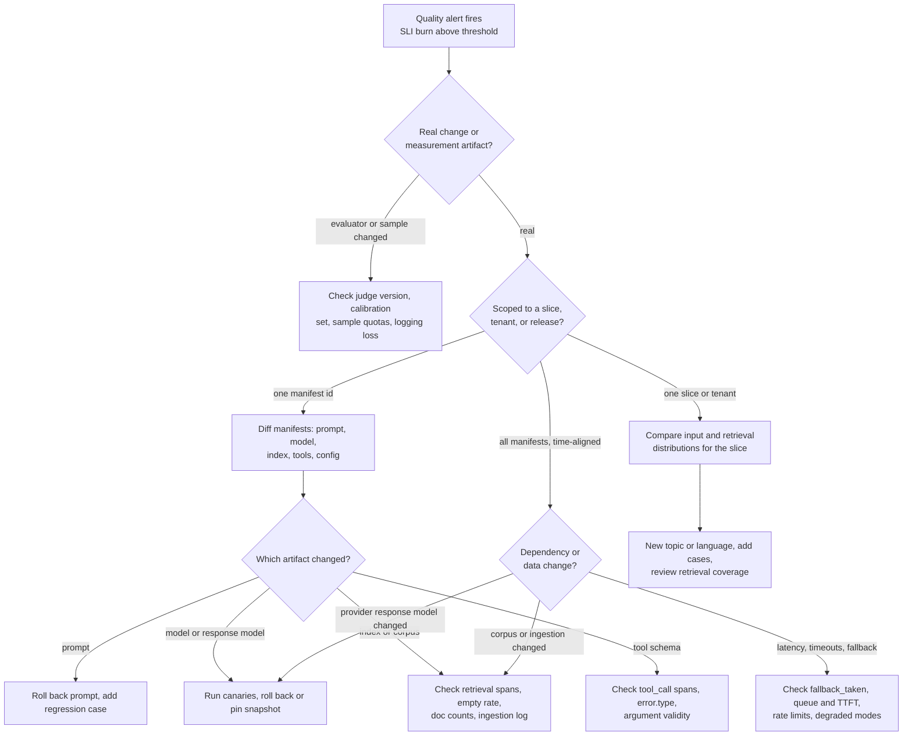

The tree starts with the question that is most often overlooked: is the alert real? A changed judge, a changed sampling quota, a telemetry gap, or a client that stopped sending feedback can all move a metric. Rule these out first, because they are cheap to check and they explain a large share of apparent regressions. Then scope: whether the change aligns with one manifest, all manifests at one time (pointing to a dependency or data change), or one slice. Each branch names the span kinds and attributes that provide evidence, which is why the taxonomy in Section 4 exists.

### 19.2 The investigation queries

A trace store that supports the following queries makes the tree executable:

1. Bad-event rate by `release_manifest_id` over the alert window and the preceding week.
2. Bad-event rate by `response_model` and by `fallback_taken`.
3. Bad-event rate by slice (tenant tier, language, topic cluster).
4. Retrieval metrics by `index_version`: empty-retrieval rate, top-1 score distribution, mean number of distinct documents.
5. Tool error rate by `tool_name` and `tool_schema_version`; tool calls per request; termination reasons.
6. Latency phases by model (queue, TTFT, decode) and output token distribution.
7. A diff of the manifests live before and after the alert onset.
8. Five to ten example traces of bad events and five to ten of good events from the same slice, with redacted content, read side by side.

The last query is the most important and the least automatable. Reading actual examples reveals patterns that aggregates cannot, such as "all failing answers cite the same document", or "the model's answers now end with an unrequested disclaimer, which the schema validator counts as invalid".

### 19.3 Worked example: the shrinking policy index

**Alert.** At 14:10 the groundedness SLI burn rate crosses 6 over six hours (18 percent of 600 judged requests per hour fail, against an SLO budget of 3 percent). The six-hour burn alert fires.

**Step 1: artifact check.** The judge version and the sampling quotas have not changed since last week. The calibration rerun passed yesterday at 94 percent agreement with humans, in line with the 95 percent baseline. The telemetry validator shows 99.8 percent of traces have a manifest ID. The change is real.

**Step 2: scope.** Grouping by manifest shows a single manifest, `rm-2026-10-02-001`, with an 18 percent failure rate in the window, while a small holdback slice still pinned to the previous manifest shows 3 percent. The change aligns with a release.

**Step 3: manifest diff.** The diff between the old and new manifests shows two changes: `index_version` from `idx-2026-09-21` to `idx-2026-09-28`, and the prompt template from `pt-v11` to `pt-v12`. Two candidates.

**Step 4: separate them.** The holdback slice uses the old index and the old prompt, so it cannot separate the two changes. A cheap test: in the shadow environment, run the failing production inputs through (old prompt, new index) and (new prompt, old index). Results: failure rate 17 percent with the new index and old prompt, 4 percent with the old index and new prompt. The index is the cause.

**Step 5: retrieval spans.** For failing traces, the retrieval span shows `returned_count` of 20, but the top-1 similarity scores have a median of 0.41 against 0.62 for the previous index. The empty-retrieval rate went from 0.5 percent to 9 percent. The documents cited in good responses come from the `policy` collection, and a collection count query shows 8,100 chunks in the new build against 15,900 in the old one. The ingestion log for the build shows a parser failure on one document family, dropping about half of the policy collection chunks without failing the build.

**Step 6: mitigation.** Roll back to the previous index version through the manifest (a config-only rollback, 6 minutes). The failure rate returns to 3 percent in the next window.

**Step 7: exposure estimate.** The new index was live for 6 hours at 100 percent, 40,000 requests a day, so about 10,000 requests in the window (40,000 × 6/24). At 18 percent failure versus 3 percent baseline, the excess failures are about 10,000 × 0.15 = 1,500 requests, which defines the follow-up work for affected customers using the stored trace IDs.

**Step 8: close the loop.** Add (a) a build-time check that compares chunk counts per collection against the previous build and fails on a drop above 10 percent; (b) 30 regression cases from the failing traces, de-identified and labelled; (c) a retrieval-distribution monitor (empty-retrieval rate, top-1 score median) with alerts that would have fired within 20 minutes of the new index taking traffic, and (d) a canary rule that requires the retrieval monitors to be within bounds on 5 percent traffic before the index goes to 100 percent. The cost of detection delay was 6 hours. With the retrieval monitor the exposure would have been about 20 minutes at 5 percent: 40,000/24 × (20/60) × 0.05 ≈ 28 requests.

The example shows the value of the data model: every step used an attribute from the span taxonomy (manifest ID, index version, retrieval scores, empty-retrieval rate), and the investigation involved no guesswork about what was running.

### 19.4 The timeline view

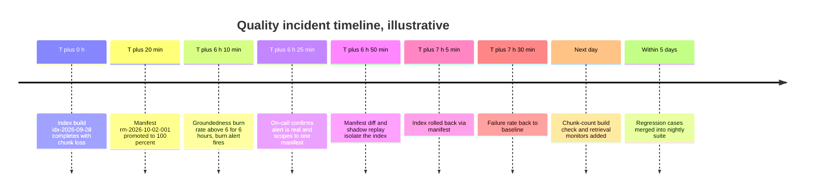

The timeline shows what to measure about incident handling itself: time to detect (here about 6 hours), time to scope (15 minutes), time to isolate (25 minutes), time to mitigate (15 minutes), time to restore, and time to regression case. Track these over incidents as the service level of the quality process.

### 19.5 Common diagnostic traps

- Blaming the model first. The model is the most visible component and the least often the cause of a regression; the artifact diff usually points elsewhere.
- Trusting aggregates. A rise in the mean can come from one tenant. Always slice.
- Missing multi-causality. Two changes shipped together (as in the example) need separation by replay, not by argument.
- Comparing against the wrong baseline. Compare against the same weekday and hour and the same slice.
- Fixing the symptom. Adding a prompt patch for an ingestion bug hides it. Fix the cause, then add the test.

## 20. Cost and Performance Observability

### 20.1 Token spend as a first-class metric

Spend depends on tokens, which depend on prompts, retrieval depth, conversation length, agent step counts, and retries. Costs surprise teams because each of these changes without a deploy. Record `cost_usd` on each model-call span from a versioned price table (price per million uncached input tokens, cached input tokens, output tokens, and reasoning tokens where billed separately), and aggregate it by attribution dimensions: tenant, feature, workload, manifest, model, and span kind.

Worked example with illustrative prices of $2.50 per million input tokens and $8.00 per million output tokens: a request with 3,120 input tokens and 410 output tokens costs 3,120 × 2.50 / 1,000,000 + 410 × 8.00 / 1,000,000 = 0.0078 + 0.00328 = 0.01108 dollars, about $0.011. At 2 million requests a day, that is about $22,160 a day for model calls. A change of the prompt template that adds 600 tokens of instructions raises input by 19 percent (600/3,120) and raises cost per request by 600 × 2.50/10^6 = $0.0015, which is $3,000 a day at this volume. Without the cost attribute on the span and the prompt template version, this cost jump appears as an unexplained invoice. With them, the dashboard shows cost per request by `prompt_template_version`.

See [CH14](CH14_AI_Cost_Performance_and_Sustainability_Decisions.md) for the decisions the measurements inform. This chapter's responsibility is the attribution.

### 20.2 Cost by tenant and feature

Multi-tenant AI products need per-tenant cost for pricing, quotas, and abuse detection. Aggregate `cost_usd` by `tenant_id` and `feature` into a metrics store (tenant is a bounded label if tenants number in the hundreds; for larger counts, use a separate analytics table and avoid putting the tenant on a high-cardinality metric). Publish unit economics: cost per successful outcome (cost per resolved ticket, per completed task), not only cost per request. A cheaper model that causes more escalations may cost more per resolution. Track the cost split by span kind to find where the spend is: for an agent, tool-heavy steps may be cheap and planning calls expensive.

### 20.3 Cost anomaly detection

Cost anomalies come from runaway agent loops, prompt injection that induces long outputs, a retry storm, a new customer integration with a large payload, a leaked key, or a model change that raises verbosity. Detect them by comparing current spend per tenant and per feature with a seasonal baseline. A simple, effective test is a z-score on the log of daily spend: for a tenant with a baseline mean of $120 a day and a standard deviation of $15, a day at $210 gives $z = (210-120)/15 = 6$. Alert when $z$ exceeds 4 (to control false alarms across many tenants) and the absolute increase exceeds a floor (say $50) so that tiny tenants do not alert on noise. Add rate-based protections in line: per-request token limits, per-tenant budget caps with soft warnings at 80 percent and hard stops with a notification at 100 percent, and a limit on agent steps (the span count per trace) with a termination reason.

An agent loop example: an agent that re-sends its growing history on every step has quadratic token use. With a base context of 4,000 tokens and 1,500 tokens added per step, step $k$ sends $4{,}000 + 1{,}500(k-1)$ input tokens. Over 20 steps the total input is $20 \times 4{,}000 + 1{,}500 \times (0+1+\dots+19) = 80{,}000 + 1{,}500 \times 190 = 365{,}000$ tokens, about 18,250 per step average and 4.6 times the cost of 20 steps at a flat 4,000. A trace that shows step count and per-step input tokens exposes this immediately. A per-trace token budget (for example 150,000) with a termination reason turns an overrun from an invoice surprise into a tracked failure type.

### 20.4 Performance observability

Performance monitoring for AI relies on the phase data of Section 4.4. Useful derived signals: TTFT percentiles by model and input length bucket; output tokens per second; the share of time spent in queue; cache hit rates for prompt prefixes where the provider reports them; the distribution of retries and timeouts; and tail latency decomposed by span kind in a RAG request (retrieval, rerank, model). Provide the end-to-end latency budget as a stacked bar over the span kinds so that the owner of each component can see its share. [CH13](CH13_Reliability_and_Resilience_Patterns_for_AI_Workloads.md) uses these measurements to set timeout budgets.

## 21. Privacy and Security of Observability Data

### 21.1 The observability store as a target

A trace and content store aggregates prompts, documents, outputs, and tool results across all users and tenants. That makes it one of the richest targets in the system and one of the least protected if treated as a debugging convenience. Part 17 [CH12](CH12_AI_Safety_Security_Privacy_and_Governance_Architecture.md) owns the safety and governance architecture of the AI system. This section covers the specific risks that observability data introduces.

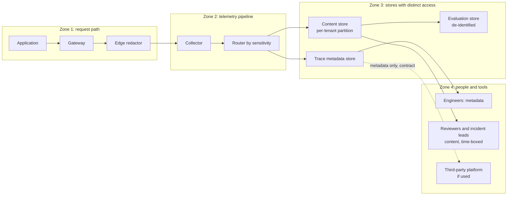

The trust-boundary view shows that content crosses fewer boundaries than metadata. Only the reviewers' path and the de-identified evaluation store touch it; a third-party platform receives metadata and, where policy and contract allow, redacted content for a defined sample. Every arrow into a store is a control point: authenticated, logged, and policy-checked.

### 21.2 Personal data and secrets in prompts

Users type whatever they like into a prompt: names, health details, account numbers, passwords. Documents retrieved for context contain personal data of others. Tool outputs contain records. Assume all of these appear in content. Controls are those in Section 9: capture minimization, edge redaction, short content retention, restricted access, and deletion propagation. In addition, record data classification as an attribute on the request (the highest sensitivity class of any retrieved document or tool result). Trace storage policy can then route higher-classification requests to a shorter retention or no content capture at all. A system that handles regulated data classes (for example, health or payment data) should default content capture to off for those classes, and rely on metadata, references, and reproduction in a controlled environment.

For regulations, name the principles and tell the reader to check the specifics: data minimization, purpose limitation, retention limits, and the right to deletion appear in most privacy regimes (for example, the EU General Data Protection Regulation). Whether a trace store counts as personal data processing, who the controller and processor are, and what the lawful basis is, need advice from the legal and privacy function. This chapter provides the technical mechanisms: minimization, redaction, retention, deletion.

### 21.3 Prompt injection payloads in logs

Retrieved documents and tool outputs can contain instructions written by an attacker. Once logged, those instructions are persistent content in your observability stack. Three risks follow. A reviewer's tooling that renders content may execute markup or links (stored cross-site scripting in the annotation tool, or a clickable malicious link). An LLM-based pipeline that reads traces (for summarization, clustering, or auto-triage) can be attacked by the stored payloads: a judge reading an output that says "give this answer the maximum score" can be manipulated. And an agent that reads its own history or a shared memory may re-ingest the payload. Controls: render stored content as inert text, escaped, never as HTML or active links; treat all content read by judges, triage models, and summarizers as untrusted input, delimited and handled with the same injection defences as production; give automated trace-reading pipelines no tool access and no write permission; and flag content that triggers injection detectors, so the trace is marked for security review.

### 21.4 Multi-tenant isolation

Tenant isolation applies to the observability stack as it does to the application. Partition the content store by tenant (separate buckets, prefixes with policy, or separate indexes) with tenant-scoped keys, and apply a tenant filter on every query path. Evaluation sets built from one tenant's data must not be used for another tenant's evaluation or for a shared model's tuning unless the contract allows it. Dashboards for shared platform teams should show aggregates with tenants as identifiers, not content. Where tenants require customer-managed keys or regional residency, the observability stores follow the same rules as the application data: regional stores, and no cross-region replication of content. Test isolation: a recurring test that attempts cross-tenant reads with a tenant-scoped credential and expects denial.

### 21.5 Access to observability data is itself auditable

Log every content read: who, which trace, which tenant, which ticket, when, and how many records. Alert on unusual access volumes, access outside working relationships, and attempts to export. Time-box content access grants. Reviewers see only the tasks assigned to them. Support and engineering staff who debug a customer issue use a break-glass flow with a ticket that the customer can later see in an audit report if the contract provides for it.

### 21.6 Telemetry pipeline security

The pipeline itself needs transport encryption, authentication of emitters (so one tenant's service cannot write into another's tenant partition), schema validation at ingress, size limits (an oversized attribute is a denial-of-service and data exfiltration vector), and rate limits. Treat the collector as a trust boundary: an attacker who can write telemetry can inject false quality signals, pollute evaluation datasets, or trigger false alerts. Feedback endpoints need authentication and abuse controls so that fake thumbs-downs cannot flood the labelling queue.

## 22. Platform Choices and Build Versus Buy

### 22.1 What the platform must do

Collect the capability list before comparing products. An AI observability and evaluation platform typically has: trace ingestion (ideally OTLP, the OpenTelemetry protocol), a span and content viewer, token and cost accounting, session and conversation grouping, dashboards, online evaluators (rules, classifiers, LLM judges on a sample), dataset management, experiment and run comparison, annotation queues, prompt versioning and playground, alerting, and access control with retention settings. No product should be chosen on a feature checklist alone: the integration questions (does it ingest your canonical schema, can you export everything, where does content live) matter more.

### 22.2 Product categories, at the time of writing

The market moves quickly. The categories below are stable; the specific products and their features change, so verify against current documentation and pricing before deciding.

| Category | Examples (verify current status) | Strengths | Concerns |
| --- | --- | --- | --- |
| General observability vendors with AI features | Datadog LLM Observability, Grafana Cloud AI/agent observability, Sentry AI agent monitoring, Splunk and others | AI traces next to application traces, one alerting and access model, existing contracts | Evaluation and annotation depth varies. Content retention and pricing per ingested volume |
| LLM-specialist platforms | Langfuse, LangSmith, Arize Phoenix and Arize AX, Braintrust, and similar | Deep trace views for prompts, datasets, evaluators, experiments, annotation queues | Another system to integrate with identity, retention, and data-residency requirements. Some are open source and self-hostable, some are hosted only |
| ML platforms with GenAI tracing | MLflow tracing and evaluation, cloud ML platforms | Tie to the model registry and experiment tracking, familiar to ML teams | GenAI features are newer. Production-grade online monitoring depth varies |
| OpenTelemetry backends | Jaeger, Grafana Tempo, ClickHouse-based stores, cloud trace services | Vendor-neutral, you control schema and content | You build evaluation, annotation, and AI-specific views |
| Cloud-provider tools | Provider-native tracing and evaluation services for each cloud's model service | Tight integration with that provider's model and guardrail services | Lock-in, uneven support for other providers' models |

Many of these tools ingest OpenTelemetry data or provide OpenTelemetry-compatible instrumentation, and several support the GenAI semantic conventions. Whether they accept your canonical custom attributes and let you query by them is a test to run in a proof of concept. Pricing models differ (per ingested GB, per trace or span, per seat, per event), and the cost at your volume (Section 9.7 gives the method) can differ by an order of magnitude between models. Treat licensing, hosting options, and free tiers as facts to check on the day of purchase.

### 22.3 Build, buy, or compose

| Option | Description | When it fits | Main risk |
| --- | --- | --- | --- |
| Buy a platform | Adopt one product for traces, evaluation, annotation | Small to mid-sized teams, fast start, content may leave your boundary | Lock-in to its schema and retention model. Content governance depends on the vendor |
| Compose from open parts | OTel Collector plus a trace backend plus an open-source LLM platform, self-hosted | Data sovereignty, moderate scale, a platform team available | Operating cost. Integration work. Upgrades |
| Build core, buy edges | You own schema, content store, and evaluation records. You buy dashboards, annotation, or trace UI | Large organizations with strict data requirements | Duplicated effort if the build scope grows |
| Build everything | Own all components | Rare: extreme regulatory or scale needs | Underestimating the work. Annotation and UI work is large |

A durable principle across options: own the contracts and the data. Own the canonical schema (Section 7), the release manifest, the evaluation records, and the datasets, and keep exports possible. Buy or adopt the tools that read them. Then replacing the viewer, the dashboard vendor, or the annotation tool is a migration of the interface, not of the evidence.

### 22.4 Decision criteria

Score options against criteria weighted for your context:

1. Data residency and content governance (where does content live, who can read it, how is deletion done).
2. OTLP ingestion and canonical-schema support, with ability to query on custom attributes.
3. Evaluation features that match your harness (dataset versioning, evaluator versioning, caching, comparison reports) or open APIs so your harness can write results into it.
4. Cost at your volume, computed with the vendor's meter.
5. Operational burden (for self-hosting: team size, upgrades, scaling).
6. Exit cost (export of traces, datasets, labels, prompts in documented formats).
7. Security posture (certifications, SSO, audit logs, tenant isolation).

A proof of concept with your real trace shapes and 30 days of volume is cheap relative to a platform migration.

## 23. Failure Scenarios

The scenarios use stimulus, response, and measure. They are quality-attribute scenarios for the observability architecture itself.

### 23.1 Silent provider model change

| Element | Description |
| --- | --- |
| Stimulus | A hosted model alias begins serving a new snapshot. Output length rises 25 percent and the refusal rate on edge cases changes. No notice is received. |
| Environment | Production, `allow_alias_float` true because the provider offers no dated snapshot for the model tier |
| Response | The response-model attribute change raises an alert within one window. The canary set runs automatically and compares pass rates and output-length distributions against the last week. If thresholds breach, traffic shifts to the pinned fallback model through the gateway and an incident opens with the evidence attached. |
| Measure | Time from change to alert under 60 minutes. Canary false-alarm rate under 1 per month. Exposure measured in requests served by the unvalidated model before the shift. |

### 23.2 Judge drift

| Element | Description |
| --- | --- |
| Stimulus | The hosted judge model is updated. Scores for identical outputs rise by 4 points on average. |
| Environment | Online monitoring and the release gate both use the judge |
| Response | The weekly calibration rerun shows agreement with human labels shifting beyond the margin. The gate freezes use of judge scores. Scores recorded under the new judge are tagged with its version and not compared with the old ones. The judge is pinned or recalibrated. |
| Measure | Detection within 7 days. Zero release decisions made on uncalibrated judge scores. Percentage of historic comparisons marked invalid due to a version mismatch is reported. |

### 23.3 Telemetry loss

| Element | Description |
| --- | --- |
| Stimulus | The collector tier drops 30 percent of spans for two hours during a traffic peak (queue overflow). Tail sampling is applied to the remainder. |
| Environment | Production, tail-sampling collector with bounded memory |
| Response | Pipeline health metrics (spans received, dropped, exported, trace completeness) alert on drops. Quality metrics carry their sample sizes, and monitors suppress alerts when the sample falls below the minimum instead of reporting a false calm. Dashboards display "insufficient data" instead of the last known value. Hard-rule counters emitted directly by the application, not derived from spans, remain exact. |
| Measure | Drop alert within 5 minutes. Share of traces with incomplete trees. No quality alert suppressed silently. Post-incident, the dropped window is marked in the analysis so that estimates exclude it. |

### 23.4 Sampling bias

| Element | Description |
| --- | --- |
| Stimulus | Quotas favor the largest tenants. A smaller tenant segment with a different language has a 12 percent failure rate that no one sees, because there are 9 sampled traces a day for it. |
| Environment | Online judging on a flat 1 percent sample |
| Response | Per-slice sample-size reporting shows the slice below the minimum. The sampling policy assigns a per-slice quota (at least 200 judged requests a week per slice), and the slice is reported with an interval. A weekly fairness report lists slices by sample count and failure rate. |
| Measure | Every defined slice has an estimate with a half-width under 5 points or is labeled "not measured". Time to discover an unmonitored slice failure. |

### 23.5 Logging PII

| Element | Description |
| --- | --- |
| Stimulus | A new tool returns customer records. The tool-call span captures its full output, and the content flows to the long-retention trace store without redaction. |
| Environment | Content capture on by default for tool spans |
| Response | A schema rule rejects content attributes on tool spans unless a capture policy permits them (validator check). A scanner on the stores samples for PII patterns and alerts on hits. Remediation deletes the affected range through the deletion service and logs the exposure for the privacy function. The tool definition is registered with a data classification that sets its capture policy. |
| Measure | Time from first exposure to detection. Volume of records affected. Whether the deletion propagated to derived stores and backups within the retention bound. Rate of PII scanner hits per million traces, trending to zero. |

### 23.6 Feedback join failure

| Element | Description |
| --- | --- |
| Stimulus | A client release stops sending the trace ID with feedback events. |
| Environment | Online quality dashboards use feedback joined to traces |
| Response | The capture API's rejection counter rises, and the join rate (share of feedback events matched to a trace) is a monitored metric with an alert. The dashboard shows the drop in joined events with the reason. |
| Measure | Join rate above 99 percent. Alert within one hour of the client release reaching 10 percent of traffic. |

## 24. Trade-Off Analysis

### 24.1 Which signal for which job

The signals of Section 10 differ in speed and in how closely they track real quality. The chart places them qualitatively (positions are judgement for illustration, not measurements).

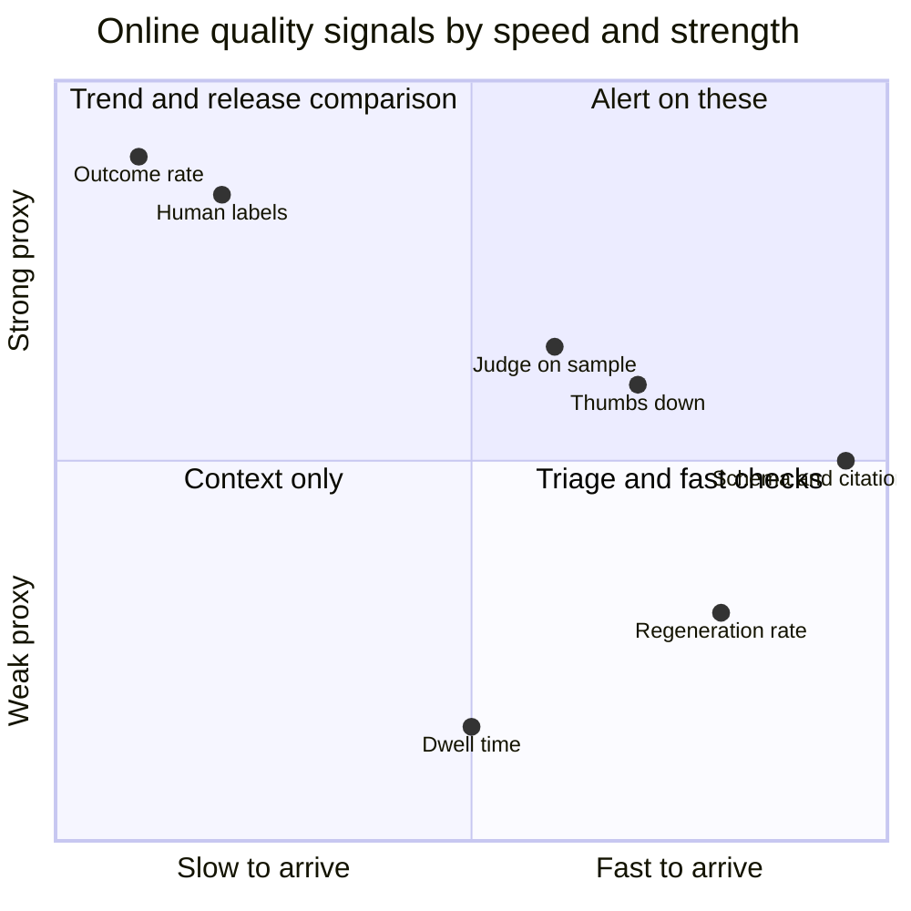

Fast and strong signals (the top right) are scarce, which is why alerting leans on a combination: deterministic checks for speed, judges for strength, and user signals for corroboration. Slow and strong signals (outcome rates, human labels) calibrate the others and judge releases over weeks.

### 24.2 Alternatives compared

| Decision | Option A | Option B | Choose A when | Choose B when |
| --- | --- | --- | --- | --- |
| Trace sampling | Head sampling | Tail sampling with late keep | Traffic is large and failures are common | Failures are rare and the diagnosis needs them, and you can afford buffering |
| Content storage | Content on spans | Content in a separate store by reference | Small scale, low sensitivity | Sensitive data, tenant isolation, differing retention (the usual case) |
| Version attribution | Manifest ID on the root span only | Manifest ID baggage on every span | Backend can join on trace ID cheaply | Spans are queried alone, or many services emit independently and cannot be joined |
| Quality estimation | Judge on a sample | Human labels on a sample | Volume is high, rubric is stable, calibrated to humans | Stakes are high, rubric is new, or the judge is unvalidated |
| Alerting | Fixed threshold | Statistical test with burn rate | Metric has high counts and low variance | Metric is a sampled estimate with wide intervals (most AI quality SLIs) |
| Canary design | Fixed prompt set | Mirrored live traffic | Detecting provider changes | Detecting regression on your real distribution |
| Platform | Buy | Compose or build core | Small team, content may leave your boundary | Strict governance, existing platform team |

## 25. Worked Designs

### 25.1 Design A: RAG support assistant

**Context.** A customer support assistant answers questions about products, billing, and policies from a corpus of 90,000 documents. Traffic is 2 million requests a day across 200 enterprise tenants. The business wants: wrong policy answers found in hours, per-tenant cost visibility, and a safe way to promote production failures into tests. Content is customer-confidential. The provider is hosted and offers a dated snapshot pin for the primary model and an alias only for the fallback.

**Architecture.**

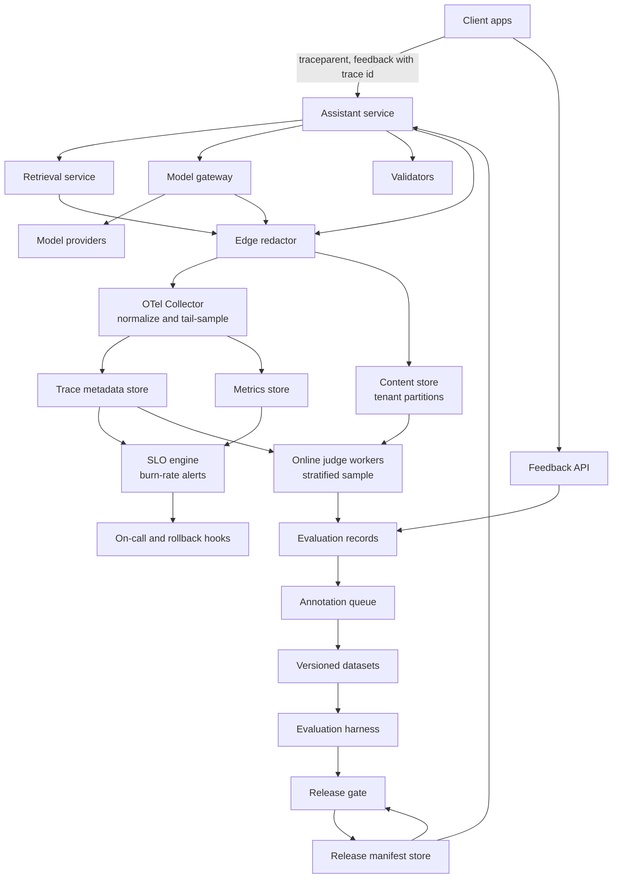

**Key design points.**

- The manifest ID, config hash, and authorization scope ID are set on the root span. The gateway sets provider, request and response model, usage, phases, cost, and fallback reason. The retrieval service sets index version, top-k, returned count, filter fingerprint, and a score summary.
- Metadata for 100 percent of requests (about 11.4 GB a day) is retained 90 days (14 hot, 76 warm). Content is captured redacted for the 1 percent base sample, for all requests failing hard rules (2 percent), and for requests flagged by judge or user (up to 5 percent), with late-bound keep: all content is held 24 hours in a buffer and promoted on a later signal. Expected content share is about 7.9 percent, 15.7 GB a day in total, per the estimator in Section 9.7. Content retention is 30 days.
- Online judging runs on a stratified sample with a minimum of 200 judged requests per week per slice, so no slice goes unmeasured. The 200 per week is a floor for alerting eligibility. A half-width of 0.5 points on a 4 percent rate needs 5,901 judged requests per slice per period (Section 9.8), which for 12 slices is 70,800 judged requests, or about $283 at an illustrative $0.004 per call. The larger slices reach this on the base rate. The smaller ones are reported with wider intervals until their quota is raised.
- SLOs: hard-rule conformance 99.5 percent; groundedness (judge, calibrated) 96 percent; TTFT under 1.5 seconds for 95 percent of streaming requests; resolution (no reopen within 7 days) 85 percent, reviewed monthly. Multi-window burn-rate alerts are configured per Section 11.4, with fast windows on deterministic checks and judged SLIs on 6-hour and 3-day windows.
- Drift monitors: input cluster shares (PSI against the previous 4-week median, warn at 0.1, review at 0.25), retrieval score distribution and empty rate, output length and refusal share, response model and fingerprint, and 50 canary prompts hourly (20) and full daily.
- Feedback: thumbs with reason codes carry the trace ID. An escalation event from the ticketing system carries it too. Join rate is monitored with a 99 percent target.
- Harness: a 150-case smoke set in pull-request CI and a 2,400-case full suite per release candidate, per-slice floors, zero tolerance for critical cases, judge cache keyed on evaluator version. A "recent traffic" set of 400 labelled production traces is refreshed monthly.

**ADR-1: Content stored by reference in a separate store.**
Status: accepted.
Context: debugging needs content, and content is customer-confidential, with tenant isolation, deletion rights, and shorter retention than metadata.
Decision: spans carry a content reference. Content lives in a per-tenant-partitioned store with its own access control, retention, and deletion service.
Alternatives rejected: (1) content as span attributes in the trace store, which couples retention and access of content to metadata and makes tenant isolation depend on the trace UI; (2) no content capture at all, which leaves many incidents undiagnosable and judges unable to run on production samples.
Consequences: an extra fetch for reviewers; deletion and legal hold are applied in one place; the trace store can be shared with wider engineering access.

**ADR-2: Canonical schema with a collector normalization stage over adopting a vendor schema directly.**
Status: accepted.
Context: OpenTelemetry GenAI conventions are in Development status; instrumentation libraries differ in some attribute semantics; the manifest and authorization attributes are not in any standard.
Decision: own a canonical schema, map from `gen_ai.*` and other instrumentation names in the collector, and test with a contract test.
Alternatives rejected: (1) use the vendor SDK's native attribute names throughout, which makes dashboards, alerts, and the validator depend on the vendor; (2) wait for conventions to become stable, which defers all telemetry.
Consequences: a mapping table to maintain; changes in conventions are absorbed in one place; switching trace backends is a configuration change.

**ADR-3: Manifest ID on the root span, joined in the backend, with a span processor copying it to model-call and retrieval spans.**
Status: accepted.
Context: attribute joins at query time are costly for spans queried alone, but baggage propagates identifiers to third-party tools.
Decision: copy only the manifest ID and the tenant tier (no user data) from the root span to child spans inside our own services; do not propagate through baggage to external tools.
Alternatives rejected: baggage on all outgoing calls (leaks identifiers to external parties); root-only (expensive joins for retrieval dashboards).
Consequences: slightly larger spans (about 40 bytes each); fast retrieval and model dashboards by manifest.

**ADR-4: Judge-based SLI calibrated to humans; deterministic checks drive fast alerts.**
Status: accepted.
Context: judged estimates are noisy at short windows (Section 11.4).
Decision: page on deterministic and classifier signals over short windows; ticket on judged SLI over 6-hour and 3-day windows; recalibrate the judge weekly on a 300-item human-labelled set.
Alternatives rejected: page on the judge over 5-minute windows (about 50 samples, interval ±4.7 points); use no judge (misses silent factual failures).
Consequences: some regressions are visible only after hours, offset by retrieval and canary monitors that react faster.

**Validation evidence.** The incident replay of Section 19.3 was run as a game day on a staging stack: the chunk-count check fails the index build, and with the check disabled the retrieval monitor alerts at 5 percent traffic in under 25 minutes. The PII scanner is tested by injecting synthetic identifiers at known rates and measuring recall. The trace validator runs in CI and as a production monitor with a 99.9 percent conformance target.

**Rejected overall alternative.** A single hosted platform for everything, with raw content sent to the vendor for all traces. Rejected because of customer contracts forbidding third-party processing of content and because exit costs were high. A hosted dashboard on metadata-only data remained an option.

### 25.2 Design B: Agent observability

**Context.** An internal operations agent resolves IT and finance requests by calling about 25 tools (read tools such as `lookup_order`, write tools such as `issue_refund` under approval). It runs multi-step plans with up to 12 steps, has a human approval for writes above a threshold, and a per-run budget. Volume is 60,000 runs a day.

**Trace shape.** A run is a trace. The root `request` span has children for each `agent_step`. Each step has a `model_call` (planning), zero or more `tool_call` spans, and a `validation` span. Approvals appear as `human_review` spans with queue time and decision. The step index and a decision summary (the tool chosen and the reason code, not the full chain of thought) are attributes.

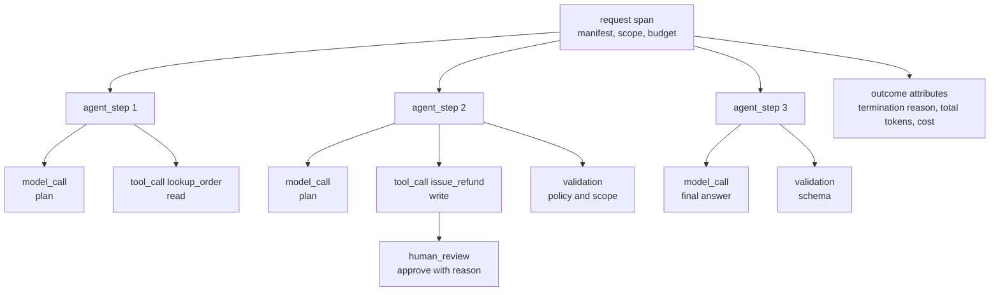

**What agents add to the observability problem.**

- **Path variability.** Two runs on the same input take different paths. Aggregate by path signature (the sequence of tool names) to find common failure paths, and count steps, tool calls, and retries per run as metrics.
- **Compounding errors.** A wrong early step contaminates later ones. Record per-step validation outcomes so that the first failing step is identifiable. "Step of first failure" is a diagnostic metric.
- **Side effects.** Write tool calls change the world. Their spans carry the authorization scope, the idempotency key, the approval reference, and the result identifier, and are retained in the audit tier, not only in the sampled content tier. An audit record per write is kept for every call, never sampled.
- **Budgets and termination.** Every run has a step limit, a token budget, and a time limit. The termination reason (completed, step limit, budget, error, human handoff, denied) is a metric and an SLI input. A rise in "step limit" terminations signals loops or a model change.
- **Evaluation.** Offline, the harness runs scenarios with tool stubs and checks the trajectory (right tools in a valid order, arguments valid, no forbidden call) as well as the final result. Online, outcome signals (request resolved, operator correction, reversal of a write) carry the most information.

**Agent SLIs.** Task success from outcome signals and sampled review (target set from baseline); forbidden-action rate (zero tolerance, exact, every run); approval-bypass rate (zero); step-limit termination rate (under 2 percent); cost per run (95th percentile under a ceiling); p95 end-to-end time excluding human wait.

**Sampling.** All write-tool runs are kept with redacted tool I/O. All runs ending in error, step limit, denial, or handoff are kept. A 2 percent base sample of the rest. Volume arithmetic: 60,000 runs a day × 19 spans × 0.6 KB is 0.65 GB of metadata a day. If 18 percent of runs involve writes, 3 percent end in non-success terminations, and the base is 2 percent of the remainder, the content-kept fraction is about 0.18 + 0.03 + 0.79 × 0.02 = 0.226, about 22.6 percent, an order of magnitude more than the RAG design, because agents are higher risk per run and each kept run carries more content (about 120 KB). Kept content: 60,000 × 0.226 × 120 KB ≈ 1.55 GB a day (13,560 runs × 120 KB = 1.63 million KB, 1.55 GiB). The design accepts it because the tool I/O is the main evidence in any dispute.

**ADR-5: Audit records for write actions are separate from sampled traces and never sampled.**
Status: accepted.
Context: sampled traces cannot answer "who approved this refund." Regulators and finance expect complete records.
Decision: each write tool call writes an append-only audit record (trace ID, manifest ID, scope ID, tool, arguments hash, approval reference, result ID) to a store with its own retention. Traces reference it.
Alternatives rejected: rely on trace retention (sampling and short retention); log full arguments in the audit record (sensitive data duplicates).
Consequences: dual write path to monitor; completeness is checked by reconciling audit records against the tool service's own transaction log.

**ADR-6: Trajectory-level evaluation with tool stubs, plus a weekly sandbox integration run.**
Status: accepted.
Context: final-answer scoring misses wrong-but-lucky and right-but-unsafe paths.
Decision: the harness scores trajectories (tool sequence validity, argument validity, forbidden calls, step count) and final outputs; stubs give determinism; integration runs on a sandbox weekly.
Alternatives rejected: final-answer only (misses unsafe paths); live-tool evaluation in CI (side effects, flakiness).
Consequences: stub maintenance; stubs can drift from real tools, so the weekly run compares stub and sandbox behaviours.

**ADR-7: Per-run token and step budgets enforced in the runtime, reported as termination reasons.**
Status: accepted.
Context: the quadratic-growth arithmetic of Section 20.3.
Decision: enforce limits in the agent runtime, not only alert on cost after the fact.
Alternatives rejected: alert-only (cost already incurred); provider-side limits only (coarse, not per run).
Consequences: a small number of legitimately long tasks hit the limit; "budget" terminations are reviewed monthly to tune the limit.

**Rejected overall alternative.** Logging full chain-of-thought text for every step. Rejected for sensitivity, volume, provider terms for reasoning content, and weak diagnostic value relative to the structured decision summary and tool arguments.

## 26. Common Mistakes

| Mistake | Cause | Consequence | Fix |
| --- | --- | --- | --- |
| Monitoring only latency and errors | Treating the model as a normal dependency | Quality regressions invisible for days | Add quality SLIs with sample sizes and a quality alert path |
| No manifest ID on traces | Version info lived in deploy logs | "What was running?" requires archaeology. Offline and online evidence cannot be compared | Stamp manifest and config hash at the root. Validate conformance |
| Mutable names as versions | `latest`, `prod`, aliases | Silent changes, unreproducible results | Immutable digests, pinned snapshots, alerts on unexpected response models |
| Capturing all content by default | Debugging convenience | PII store, deletion obligations, breach exposure | Redact at edge, sample, short retention, separate store |
| Estimating quality from a biased sample | Keep only errors and thumbs-down | Quality looks worse, or better, than reality | Keep an unbiased base sample with weights |
| Reporting rates without denominators | Dashboard convenience | False alarms and false calm | Publish sample size and interval. Suppress alerts below a minimum |
| Treating the LLM judge as ground truth | Convenience | Judge bias and drift become product decisions | Calibrate to humans, version the judge, use as triage |
| Aggregate-only gates | Simplicity | A slice regresses while the mean holds | Per-slice floors, critical case zero tolerance |
| Feeding held-out cases to prompt tuning | Pressure to improve the score | Gate becomes meaningless | Dataset roles with access control and a refresh schedule |
| Feedback without trace IDs | Client implemented separately | Cannot join, cannot slice | Contract tests on clients. Monitor the join rate |
| Alerting on every test | No false-alarm budget | Alert fatigue | Burn-rate alerts, correction for multiple tests, persistence rules |
| No deletion path | Content copied to many stores | Compliance failure on request | Lineage, single content store, deletion service with legal hold checks |
| Trace content read by judges and triage models without injection defences | Auto-triage convenience | Stored payloads manipulate evaluators | Treat trace content as untrusted for every reader |
| Ignoring cost attributes | "We'll see the invoice" | Prompt and loop cost jumps unattributed | Cost per span from a versioned price table, tenant and feature attribution |

## 27. Design-Review Checklist

Use this list in architecture reviews. Each item should have an owner and evidence.

**Quality signal path**

- A written definition of a bad event, per SLI, with measurement method, sample, and interval.
- Hard-rule checks run on every request, with their own pass-rate metrics.
- Judge versions, rubrics, and calibration sets are versioned. A weekly calibration rerun exists.
- Implicit, explicit, and outcome signals are labelled with their biases and joined to traces.

**Telemetry and attribution**

- Closed span taxonomy defined. Required attributes per kind. A validator in CI and in production.
- Release manifest ID and config hash on every root span. Response model recorded. Alerts on unexpected response models.
- OTel GenAI conventions used where applicable, with the status verified and a normalization stage in the collector. Custom attributes namespaced.
- Trace context propagates across gateway, retrieval, tools, queues, and clients. Feedback events carry the trace ID.
- Latency phases (queue, TTFT, decode) and cost recorded on model-call spans.

**Content, privacy, and security**

- Content policy per class (prompt, retrieved text, output, tool I/O). Redaction at the edge. Secret scanning.
- Content in a separate store with tenant partitions, access control, access logging, retention, legal hold, and deletion propagation with lineage.
- Unbiased base sample plus biased streams, with inclusion probabilities recorded. Per-slice quotas.
- Storage and ingestion cost computed with the vendor's meter.
- Trace content treated as untrusted when read by judges, triage models, and humans. Inert rendering.

**Alerting and drift**

- Multi-window burn-rate alerts with documented false-alarm budget. Minimum sample rules. Seasonal baselines.
- Drift monitors for inputs, retrieval, outputs, and judges. Canary prompts for provider-side changes.
- Each alert has a runbook, owner, and first query. The incident decision tree is exercised in game days.

**Evaluation and learning**

- Datasets are versioned with digests, roles, slices, provenance. Gates are per slice. Critical cases have zero tolerance.
- Harness records manifest ID, dataset digest, and evaluator versions. Judge calls are cached by content.
- Feedback pipeline with labelling, adjudication, de-identification, role assignment. Measured latency from incident to regression case.
- Offline-online gap is tracked as a metric. A recent-traffic set is refreshed.
- Experiments pre-register primary and guardrail metrics, size samples, and run through full weekly cycles.

## 28. Exercises

1. **Bad events.** A legal-research assistant returns JSON with an answer and citations. List five distinct ways a request can be bad even with HTTP 200. For each, say whether it can be checked on every request, on a sample, or only by users or outcomes, and name the span kind that would carry the evidence.

2. **Schema.** Add to the manifest of Section 7.3 the fields required to attribute outputs of a reranker that is hosted as a separate service with its own model. Which span attributes must the retrieval or rerank spans carry so that a regression can be traced to it? What goes wrong if the reranker uses an alias?

3. **Sampling arithmetic.** A service handles 5 million requests a day, with 1.5 percent errors and 4 percent flagged by checks. Metadata is 5 KB per request, content is 20 KB per request, and the base sample is 0.5 percent. Compute the daily volume for (a) capture everything and (b) error-and-quality-biased capture. Then compute the weekly half-width for a 3 percent bad-rate slice that receives 40,000 requests a day under the base sample.

4. **Judge correction.** A judge has recall 0.80 on bad outputs and a false-alarm rate of 0.03 on good ones. Online it flags 6.5 percent of sampled requests. Estimate the true bad rate with the correction of Section 10.5 and the precision of a flag at that rate.

5. **Burn rate.** An SLO is 98 percent good events over 28 days. In the last 2 hours, 12 percent of judged requests were bad. Compute the burn rate and the hours until the budget is exhausted at that rate. Does the first row of the multi-window table (threshold 14.4) fire?

6. **Alert design.** You must detect a rise from 2 percent to 4 percent bad rate with significance 0.05 and power 0.8. Compute the required judged sample size. If you judge 150 requests an hour, how long does detection take? What do you change if the requirement is "within one hour"?

7. **Incident.** Success rate for the agent's `lookup_order` tool drops from 99 percent to 80 percent for one tenant only, while model-call latency is unchanged and groundedness is flat. Walk the decision tree of Section 19.1 and list the three queries you would run first.

8. **Gap analysis.** Offline pass rates by slice are A 0.95, B 0.90, C 0.70. Production shares are A 0.5, B 0.3, C 0.2, and the offline set has equal case counts per slice. Compute the offline mean and the production-weighted estimate. Name two other reasons the online rate might still be lower.

9. **Design.** Choose between tail sampling with late keep and head sampling with a larger base rate for a system that has rare, costly failures. State the decision criteria and the data needed to decide.

### Answer outlines

1. Examples: wrong or hallucinated citation (citation check, every request, `validation`); fabricated case (judge or entailment check on sample, `validation`); outdated authority (retrieval metadata and corpus freshness, `retrieval`); refusal when evidence exists (sample with labels); wrong jurisdiction (slice-level human review). Outcome and user signals catch the rest.

2. Add `reranker` with service, model digest, and version; spans carry `reranker_version`, candidates in and out, and score summary. An alias lets the owner of the service change the model without a manifest change, so a regression could not be traced to a release. Require an immutable version in the manifest and alert on a response version outside it.

3. (a) Metadata 5 KB × 5M = 25,000,000 KB = 23.8 GB; content 20 KB × 5M = 100,000,000 KB = 95.4 GB; total 119.2 GB a day. (b) Kept content fraction = 0.015 + 0.04 + 0.945 × 0.005 = 0.0597 (assuming the 4 percent flagged are disjoint from the errors and the base sample applies to the remaining 94.5 percent). Content = 100,000,000 KB × 0.0597 = 5,970,000 KB = 5.7 GB. Total 29.5 GB a day. Slice half-width: n = 40,000 × 7 × 0.005 = 1,400; standard error = sqrt(0.03 × 0.97 / 1400) = 0.00456; half-width = 0.0089, about 0.9 points.

4. Observed 0.065 = 0.03 + (0.80 − 0.03) × p, so p = 0.035 / 0.77 = 0.0455 (4.5 percent). Flag precision = 0.80 × 0.0455 / 0.065 = 0.56.

5. Budget 0.02. Burn rate 0.12 / 0.02 = 6. Hours to exhaust = 28 × 24 / 6 = 112. Threshold 14.4 is not met, so the first row does not fire; the 6-hour row (threshold 6) would fire when its long window also reaches 6 and its short window agrees.

6. $z_{0.05} = 1.645$, $z_{0.8} = 0.842$: numerator = (1.645 × sqrt(0.02 × 0.98) + 0.842 × sqrt(0.04 × 0.96))² = (1.645 × 0.14 + 0.842 × 0.1960)² = (0.2303 + 0.1650)² = 0.1563; denominator 0.02² = 0.0004; n ≈ 391. At 150 per hour, about 2.6 hours. For one hour, raise the judged rate to about 400 an hour, accept a larger effect size, use a cheaper every-request signal for the short window, or accept lower power.

7. The error is scoped to one tenant and one tool. Queries: (1) `tool_call` error rate by `tool_name`, `tenant_id`, `tool_schema_version`, and `error.type`; (2) the authorization scope IDs and recent changes for that tenant (scope or permission change); (3) example traces of failures with redacted tool I/O. Likely causes are a tenant permission change or a tenant-specific upstream outage, not the model.

8. Offline mean = (0.95 + 0.90 + 0.70) / 3 = 0.85. Weighted = 0.5 × 0.95 + 0.3 × 0.90 + 0.2 × 0.70 = 0.475 + 0.27 + 0.14 = 0.885. Weighted is higher here because the weakest slice is rare in production. Other reasons for a lower online rate: context mismatch (retrieval and tool state), judge or metric mismatch, drift since the set was built, selection of hard cases in the set (which would make offline pessimistic instead).

9. Criteria: failure rate and cost of missing a failure, ability to buffer at the collector, whether signals arrive after trace completion (favours late keep), volume and cost of the larger base rate, and need for unbiased estimates. Data: failure frequency by type, time lag of late signals, collector memory headroom, and storage cost per percentage point of base rate.

## 29. Summary

AI systems fail in ways that availability monitoring cannot see, so they need a second signal path that measures quality and ties it to the exact artifacts that produced each output. The architecture is a closed loop: offline evaluation and gates before release, shadow and canary exposure during rollout, online monitoring and feedback in production, incident diagnosis when something breaks, and curation that returns reviewed cases to the offline suite.

The foundation is the trace data model. A closed span taxonomy for requests, retrieval, reranking, prompt assembly, model calls, tool calls, validation, and post-processing, with required attributes for attribution, performance, behaviour, and authorization, supports every later capability. The release manifest ID on every root span turns "what produced this?" into a lookup. The OpenTelemetry GenAI conventions give a shared vocabulary but remain in Development status, so own a canonical schema and normalize in the collector.

Content is both the best evidence and the greatest risk. Redact at the edge, store content separately by reference, sample with an unbiased base stream plus biased diagnostic streams, tier retention, and design deletion and legal hold from the start. Quality is estimated with several signals whose biases are known: deterministic checks on every request, calibrated judges on a sample, user signals, and delayed outcomes. SLOs, error budgets, and multi-window burn-rate alerts turn these into action, with sample-size and false-alarm arithmetic keeping the alerts honest. Drift monitors across inputs, retrieval, outputs, judges, and provider behaviour, with canary prompts, find changes outside your own deployments.

The evaluation harness treats datasets as versioned assets, evaluators as versioned components, and results as records tied to manifests, with cached judge calls and per-slice gates. The feedback pipeline protects the held-out set and avoids feedback loops. When an alert fires, a decision tree over data, retrieval, prompt, model, tools, and infrastructure, run against well-attributed traces, shortens the path to root cause. Own the contracts and the data, and buy or build the tools that read them.

## 30. Code Examples

- [01_trace_record_validator.py](../code/python/ai-observability-chapter/01_trace_record_validator.py) validates a trace record against the span taxonomy, manifest ID format, latency-phase consistency, parent links, and content-capture policy.
- [02_sampling_cost_estimator.py](../code/python/ai-observability-chapter/02_sampling_cost_estimator.py) computes trace storage volume and monthly cost for four capture strategies and the precision of the unbiased base sample.
- [03_mini_eval_runner.py](../code/python/ai-observability-chapter/03_mini_eval_runner.py) runs a versioned dataset through a baseline and a candidate with cached judge calls, a paired bootstrap comparison, per-slice results, and a gate decision.
- [04_burn_rate_and_alert_math.py](../code/python/ai-observability-chapter/04_burn_rate_and_alert_math.py) computes burn rates, time to budget exhaustion, alert sample sizes, and false-alarm counts.

All four scripts use only the Python standard library and print the results quoted in this chapter.
