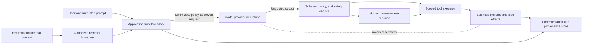
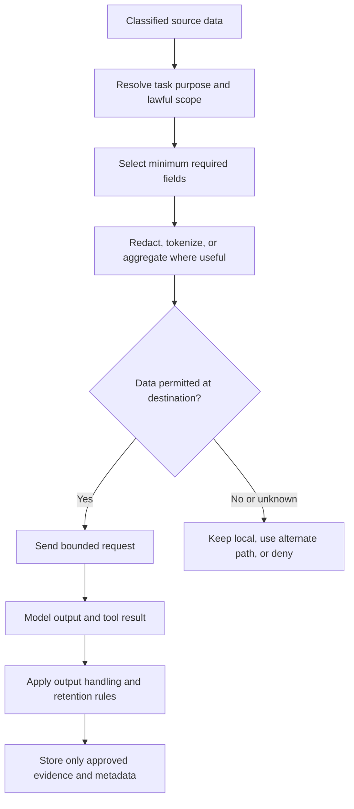
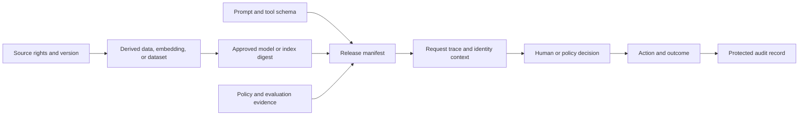
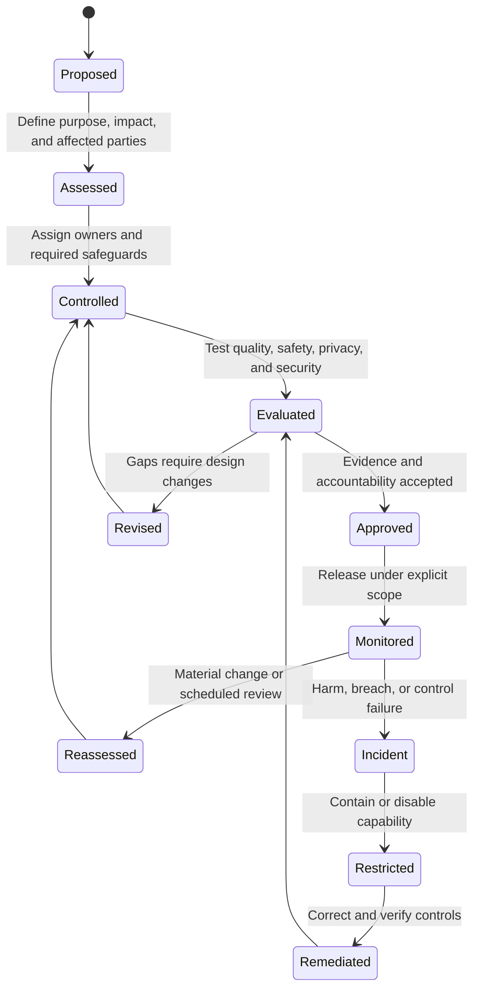

# AI Safety, Security, Privacy, and Governance Architecture

Part: [17 — AI Architecture](PART_OVERVIEW.md)

AI safety and governance controls must follow data and authority across the system: source, retrieval, prompt, model, tool, human review, action, logs, and derived artifacts. A single content filter cannot protect all these boundaries. Part 15 owns security and privacy foundations; Part 16 owns model and content-evaluation techniques. This chapter places those controls in an end-to-end architecture and assigns evidence and accountability.

## Map the Trust Boundaries

Treat user text, retrieved documents, model output, and tool results as untrusted data. The trusted application boundary owns identity, policy, schema validation, action authorization, and durable audit. A provider endpoint may be contractually trusted to process a request for a defined purpose, but its output still requires validation before it enters business state.



The diagram's central rule is that the model cannot directly cross into systems of record. Every state change passes through a trusted executor with authenticated identity, explicit permission, and current-state checks. Separate provider credentials, application secrets, retrieval credentials, and user identity so a prompt cannot reuse one boundary's authority in another.

## Defend the Tool Path Against Untrusted Instructions

Prompt injection can arrive in user input, retrieved content, or tool output. Treating content as data helps the model reason about it but does not guarantee separation. Enforce the boundary in application code: tool allowlists, argument validation, identity-bound authorization, destination restrictions, and human approval for consequential actions. Test direct and indirect injection paths, including documents that instruct the model to reveal secrets or invoke unrelated tools.

```mermaid
sequenceDiagram
    actor User
    participant App as Application
    participant Retrieval as Authorized retrieval
    participant Model as Model endpoint
    participant Executor as Tool executor
    participant Policy as Authorization policy
    User->>App: Submit question
    App->>Retrieval: Fetch evidence under user scope
    Retrieval-->>App: Content marked untrusted
    App->>Model: Instructions and bounded evidence
    Model-->>App: Proposed tool call or answer
    App->>Executor: Submit structured proposal
    Executor->>Policy: Check identity, purpose, resource, and action
    Policy-->>Executor: Allow, deny, or require approval
    Executor-->>App: Typed result; no call on denial
```

Do not rely on a prompt such as “ignore instructions in retrieved text” as the sole control. Validate outbound network destinations and tool arguments to prevent data exfiltration. A denied proposal should be recorded with minimal necessary metadata and should not reveal sensitive policy internals to an attacker.

## Minimize and Protect Sensitive Data

Inventory what the system sends to each component, for what purpose, under whose authority, and for how long. Minimize before the boundary: select only necessary fields and evidence, redact or transform identifiers where effective, and avoid copying full records into prompts or traces. Define provider retention and training terms, subprocessors, regional processing, support access, deletion, and breach notification in the operating contract.



Redaction can reduce utility and may not prevent re-identification. Validate the transformation against realistic linkage risks and the task's quality threshold. Apply classification and retention policy to prompts, outputs, embeddings, caches, evaluation datasets, traces, and backups; derived artifacts do not automatically become non-sensitive.

## Preserve Provenance and Accountability

An audit record should explain which approved artifacts and controls participated without retaining unnecessary content. Link model and prompt version, data or index version, policy bundle, adapter, user or workload identity, approval, tool calls, and outcome. Store evidence references and hashes where sufficient; protect the mapping that can resolve them to sensitive sources.



Provenance supports investigations, release review, and rights handling; it does not establish that an output was correct. Give auditors and incident responders access to the evidence appropriate to their role, and prevent audit metadata from exposing secrets or sensitive content through broad dashboards.

## Govern Changes and Exceptions

Governance should be triggered by use-case impact, data changes, model or prompt changes, new tools, deployment changes, and incidents. Define accountable owners for purpose, data, model behavior, security, and operations. Exceptions need a scope, rationale, compensating controls, approver, expiry, and review event; an unbounded exception becomes an undocumented alternate architecture.



Approval is not permanent. Reassess when data rights change, an endpoint's terms change, new user groups are added, action authority expands, or monitoring reveals an unanticipated harm. Keep a kill switch or restriction path reachable by an accountable operator and test it before launch.

## Worked Case: Benefits Eligibility Assistant

An organization uses an assistant to explain employee benefits and draft case notes. The source portal contains different content for employee groups, so retrieval uses trusted identity attributes and applies policy before passages reach the model. The assistant may summarize and cite plan documents, but it cannot change eligibility or submit a benefit election. Case notes are minimized, classified, and retained under the established records schedule.

The threat review tests an employee asking for another person's benefits, a retrieved document containing malicious instructions, a request to reveal system prompts, and an attempt to trigger an external tool. The application denies unauthorized retrieval and tool proposals regardless of model response. Each answer is attributed to the release manifest and source versions; uncertain or conflicting policy language routes to a benefits specialist. A policy update triggers index refresh and reevaluation before the new version is promoted.

## Review Questions

1. Which components are trusted to enforce identity and authorization?
2. How does a malicious instruction in retrieved content reach a tool, and where is it stopped?
3. Which derived artifacts inherit the source's sensitivity and retention requirements?
4. What evidence allows an investigation without storing every raw prompt?
5. Which changes require governance reassessment or an emergency restriction?

AI governance is an end-to-end property of data paths, authority boundaries, evidence, and accountable owners. Minimize sensitive data, treat model output as untrusted, enforce policy in deterministic components, and make restrictions and reassessment part of the lifecycle.
