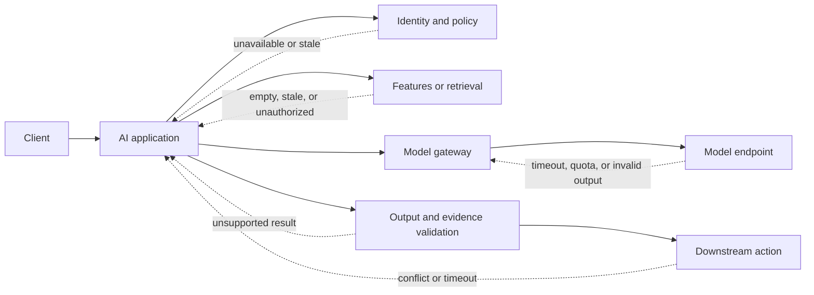
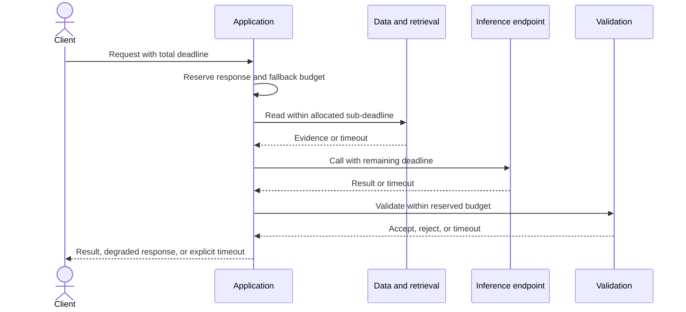
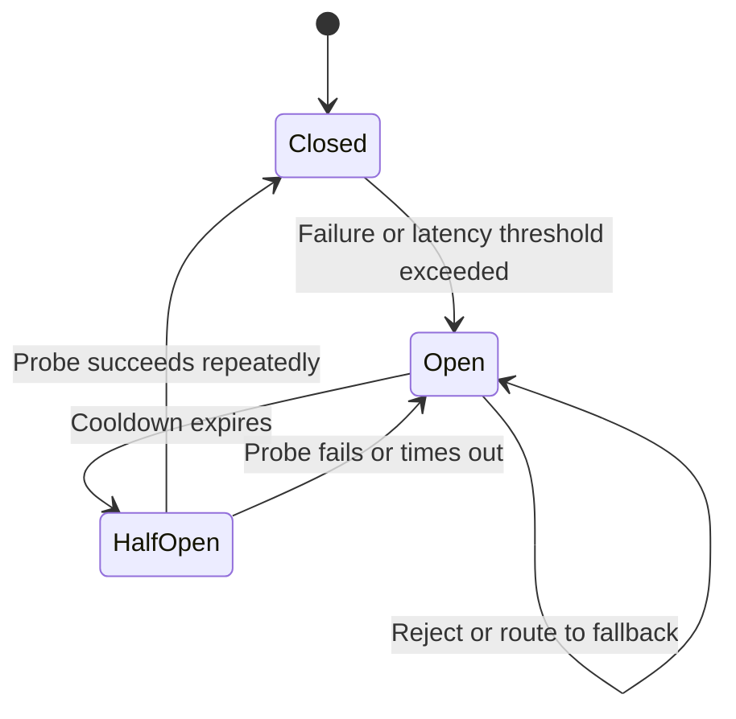
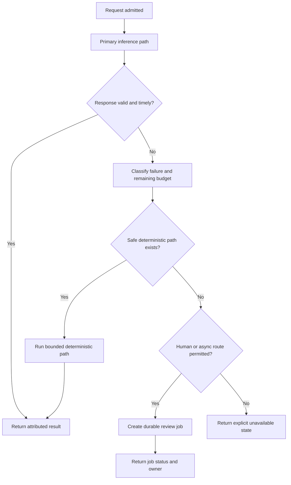
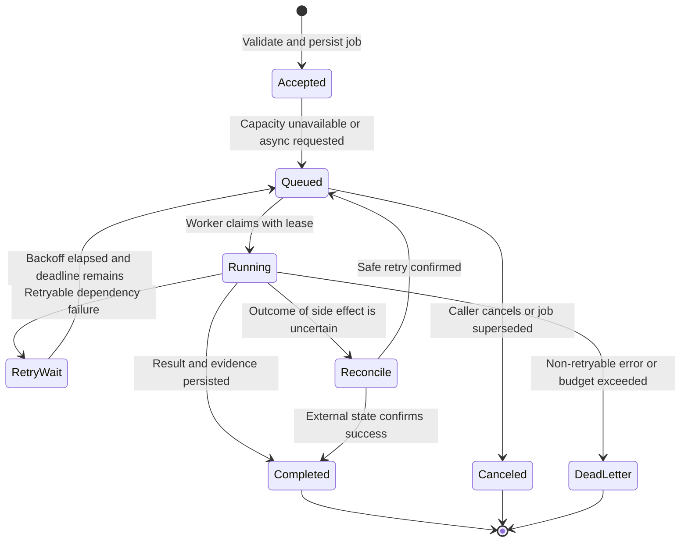

# Reliability and Resilience Patterns for AI Workloads

Part: [17 — AI Architecture](PART_OVERVIEW.md)

AI workloads add dependencies with variable latency, quota limits, model loading, and output uncertainty. Reliability architecture must contain dependency failure and preserve a useful contract without treating a plausible response as a successful one. Part 07 owns distributed-system reliability foundations; this chapter applies them to inference, retrieval, and agent workflows.

## Model the Dependency Failure Modes

An inference request may depend on identity, data, retrieval, routing, model serving, policy validation, and an action system. Distinguish failures that prevent computation from failures that make the output untrustworthy. A model endpoint returning HTTP success with invalid or unsupported output is an application failure even when infrastructure is healthy.

For each dependency, specify timeout, retryability, failure signal, owner, and safe degraded behavior. Keep dependency-health signals distinct from quality signals: a provider can be available while output quality regresses, and retrieval can be healthy while its index is stale.

## Budget the End-to-End Deadline

Set a deadline at the entry point and allocate time to authentication, retrieval, inference, validation, and response delivery. Propagate remaining time rather than granting each component a fresh full timeout. Reserve budget for a safe fallback or a clear timeout response. Cancel work after a caller disconnect where possible, especially expensive generation or queued work with no remaining consumer.

The allocation should reflect measured tail latency, not average time. If retrieval consumes most of the budget, generation may have no time to complete; if the model consumes all of it, policy validation is bypassed under pressure. Define whether each stage is mandatory, optional, or replaced by a fallback when the budget is nearly exhausted.

## Contain Repeated Dependency Failure

A circuit breaker prevents a failing dependency from consuming all callers and workers. It typically transitions from closed to open after a failure threshold, then permits limited probes in a half-open state. Tune thresholds to avoid oscillation; count meaningful failures and distinguish invalid business output from transient transport errors. A breaker does not fix the dependency and should expose open-state behavior to callers.

Use bulkheads to isolate workloads with different deadlines, privacy classes, or consequences. Bound concurrency and queue depth per dependency. Apply retries only to transient, idempotent operations; exponential backoff with jitter reduces synchronized pressure. Respect provider retry hints and rate limits, and do not retry an action when its completion status is unknown without first reconciling state.

## Degrade to a Safe Capability

When a model is unavailable, choose a fallback before the incident. It may be deterministic rules, a cached result with visible age, a human queue, asynchronous completion, a smaller approved model, or explicit unavailability. The fallback must satisfy data policies and avoid turning a lower-quality path into silent overreach. A deterministic business rule must remain authoritative for access, payment, eligibility, or other hard constraints.

Degraded behavior should be visible in response metadata and operational metrics. Monitor fallback rate, age of cached data, queue depth, and completion time. If fallback exceeds a threshold, reduce traffic or disable the feature instead of allowing a degraded mode to become the unreviewed normal path.

## Recover Queued Work Safely

Queues decouple producers from slow inference but introduce durability, ordering, retry, and duplication concerns. Persist job identity, tenant and purpose, data references, model/version constraints, deadline, and idempotency key. Encrypt and expire payloads according to policy; where possible, queue references to protected data rather than raw prompts. Define whether jobs can be canceled or superseded when source state changes.

Leases and idempotency prevent two workers from applying the same action concurrently. Dead-letter queues need an owner and retention limit, not indefinite storage. A retry that runs after a deadline or policy change can be harmful, so recheck authorization and current data before execution.

## Define Reliability Objectives

Service-Level Objectives (SLOs) should cover availability and latency for the user-visible contract, with separate indicators for quality, safe completion, fallback, and cost. An uptime target alone can be met while the system returns unsupported output. Quality signals often have delayed labels; pair leading indicators such as validation failure and abstention with later reviewer or user outcomes.

| Objective | Example indicator | Failure response |
|---|---|---|
| Request completion | Eligible requests completed before deadline | Degrade or defer work |
| Evidence integrity | Responses with valid, resolvable source references | Abstain or route to review |
| Safe action | Actions passing identity, policy, and precondition checks | Deny action and alert owner |
| Queue health | Oldest job age and backlog versus capacity | Apply admission control |
| Dependency resilience | Time spent in breaker-open or provider-limited state | Shift only to policy-compatible fallback |

Avoid one composite “AI reliability” score that hides a severe failure behind a healthy metric. Set thresholds by use case and impact, identify the decision owner, and rehearse dependency and recovery failures before broad release.

## Worked Case: Benefits Question Service

An employee benefits assistant retrieves plan details and drafts answers. The request has a four-second interactive deadline. Identity and retrieval are mandatory; generation is optional if the assistant can instead provide a link to the authoritative benefits portal. The application reserves time for citation checks and uses a breaker on the model dependency. When the provider is rate-limited, requests receive an explicit degraded response rather than repeated retries.

Long case summaries enter a durable queue with a defined completion window and cancellation semantics. Before execution, the worker checks current employee access and source freshness. A provider timeout after a downstream case note may have been written triggers reconciliation by idempotency key. Service dashboards show answer quality and fallback separately from endpoint availability, so operators can disable generation without disabling access to authoritative plan information.

## Review Questions

1. Which failures are infrastructure failures, and which make a successful response untrustworthy?
2. How is the total deadline divided among mandatory steps and fallback?
3. What conditions open and close the model circuit breaker?
4. How does a worker determine whether a timed-out side effect is safe to retry?
5. Which SLOs describe user value and safety beyond endpoint uptime?

Reliable AI workloads contain variable and unavailable dependencies without confusing availability for correctness. Propagate deadlines, bound retries and queues, make safe degradation explicit, and observe quality and fallback alongside service health.
