# Reliability and Resilience Patterns for AI Workloads

Part: [17 — AI Architecture](PART_OVERVIEW.md) · Status: Revised (in-depth rewrite)

## 1. Introduction

### 1.1 What this chapter is for

An artificial intelligence (AI) feature is a chain of dependencies, and several of them behave differently from the services that most reliability practice was written for. A model endpoint can answer in 800 milliseconds one minute and in 40 seconds the next. It can return Hypertext Transfer Protocol (HTTP) status 200 with a sentence that is wrong, with JavaScript Object Notation (JSON) that is cut off, or with a polite refusal. Its capacity is metered in tokens per minute, not only requests per second, and the owner of that capacity may be a provider whose status page you cannot edit. A retry can cost real money, repeat a side effect, or both. A vendor can change the model behind an alias overnight, so a system with zero errors can become less useful without any alert firing.

After this chapter you should be able to:

1. Explain what is different about reliability for AI workloads, and name the failure modes of an inference-dependent system together with the signal that detects each and the response that contains it.
2. Define reliability as the availability of a usable outcome, write latency and quality service level objectives (SLOs), and compute error-budget burn that combines hard failures with quality failures.
3. Design a deadline and timeout budget for a request path, and verify that per-hop timeouts nest inside the caller's budget.
4. Choose retry, backoff, hedging, and idempotency policies that do not amplify an outage, with the arithmetic to prove it.
5. Apply circuit breakers, adaptive concurrency limits, load shedding, bulkheads, queues, and client-side rate limiters to variable and metered inference traffic.
6. Design provider and region failover that is gated by evaluation, respects data residency, and has a tested cost.
7. Build degradation ladders, deterministic fallbacks, output repair loops, streaming recovery, and durable agent and batch execution.
8. Plan capacity, dependency maps, chaos experiments, disaster recovery, runbooks, and continuous integration tests that exercise failure on purpose.

The audience is the solution architect who must decide how much of this to build, where it lives, and what the user sees when it triggers. The chapter is deliberately long because each pattern has a tuning parameter that decides whether it helps or harms, and those parameters are where most designs fail.

### 1.2 Scope and ownership

Reliability foundations are owned elsewhere in this book. This chapter recaps them in a few sentences when needed, links the owner, and spends its words on what changes for inference, retrieval, and agent workloads.

| Topic | Owner | What this chapter does with it |
| --- | --- | --- |
| Replication, consensus, partitioning, CAP and PACELC trade-offs | [Part 07 CH05 to CH11](../07_System_Design_and_Distributed_Systems/CH05_CAP_Theorem.md) | Uses the vocabulary. Does not re-teach. |
| Idempotency, exactly-once processing, deduplication | [Part 07 CH16](../07_System_Design_and_Distributed_Systems/CH16_Idempotency.md), [CH17](../07_System_Design_and_Distributed_Systems/CH17_Exactly_Once_Processing.md), [CH19](../07_System_Design_and_Distributed_Systems/CH19_Deduplication.md) | Applies idempotency keys to generations and tool actions. |
| Sagas and compensation | [Part 07 CH13](../07_System_Design_and_Distributed_Systems/CH13_Saga_Pattern.md) | Applies compensation to multi-step agent runs. |
| Rate-limiting algorithms (token bucket, leaky bucket, windows) | [Part 08 CH11](../08_API_Architecture/CH11_Rate_Limiting.md) | Applies token-denominated limits and client-side limiters. |
| Gateway routing, fallback chains, breakers, quota mirroring | [Part 17 CH08](CH08_Model_Gateway_Routing_and_Fallback_Architecture.md) | Treats the gateway as one place where these patterns run. Adds the end-to-end view. |
| Serving, batching, GPU placement, autoscaling | [Part 17 CH07](CH07_Inference_Serving_and_Model_Placement.md) | Uses serving behavior as input to capacity resilience. |
| Agent loops, tool boundaries, state | [Part 17 CH06](CH06_Agentic_System_Architecture_and_Tool_Boundaries.md) | Adds checkpointing, replay safety, and poison-task handling. |
| Retrieval architecture and index design | [Part 17 CH05](CH05_Retrieval_Augmented_Generation_System_Architecture.md) | Adds index failure, rebuild, and stale-index handling. |
| Evaluation, tracing, and metrics | [Part 17 CH11](CH11_Evaluation_and_Observability_Architecture_for_AI_Systems.md) | Defines which reliability signals to emit. Does not design the telemetry stack. |
| Abuse, injection, and denial of wallet controls | [Part 17 CH12](CH12_AI_Safety_Security_Privacy_and_Governance_Architecture.md) | Covers the overlap with availability. |
| Unit economics and cost of redundancy | [Part 17 CH14](CH14_AI_Cost_Performance_and_Sustainability_Decisions.md) | Prices standby and hedging, then points to CH14 for the full model. |

Provider names, error codes, quotas, and prices change. Where this chapter cites a provider behavior it says "at the time of writing" and names what to verify. Numbers in worked examples are illustrative unless a source is linked.

### 1.3 A running example

Two systems appear throughout. The first is a customer-facing support assistant that answers questions from a knowledge base, can look up an order, and can start a refund through a tool. It has a 99.9 percent monthly target for a usable answer. The second is a nightly batch pipeline that enriches 4 million product records with a classification and a short description, and must finish before 06:00. Interactive systems are limited by latency and tail behavior. Batch systems are limited by throughput, retries, and recovery. Most patterns in this chapter are used differently by each, which is the reason to carry both.

## 2. What Makes AI Workloads Different for Reliability

Classical reliability work assumes that a dependency is either working or failing, that a successful response is a correct response, that a retry is cheap, and that capacity is bought in instances. Each assumption weakens for AI dependencies. The sections below name nine differences and the design consequence of each. They are the reason the rest of the chapter is not a copy of Part 07.

### 2.1 Variable latency with heavy tails

A conventional service call has a latency distribution that is narrow, with a 99th percentile (p99) perhaps three to five times the median. A generation call has latency that depends on the number of output tokens, the prompt length, queueing at the provider, and batching in the serving engine. Time to first token (TTFT) and the time between tokens are separate quantities. A request that produces 40 tokens and one that produces 1,800 tokens through the same endpoint can differ in total latency by more than an order of magnitude with no fault at all.

Two consequences follow. First, a single timeout value is wrong, because there is no one number that is above the slow-but-healthy tail and below the stuck-request region. Phases need separate timeouts: connect, time to first token, inter-token gap, and total. Second, latency percentiles must be measured per request class (short chat turn, long summary, tool-calling step) or the heavy tail of one class hides inside the average of another.

An illustrative distribution makes this concrete. Suppose output length is roughly log-normal with a median of 250 tokens and a 99th percentile of 1,600 tokens, and the model generates 60 tokens per second. Median generation time is about 4.2 seconds. The p99 generation time is about 26.7 seconds, 6.4 times the median. A timeout set at 10 seconds, chosen because the median is 4 seconds, would abort about 14 percent of healthy requests under this assumed distribution (10 seconds is 600 tokens, which sits 1.1 standard deviations above the median on the log scale, where the fitted log-standard-deviation is $\ln(6.4)/2.326 \approx 0.80$). Those aborted requests were making progress, and aborting them wastes the tokens already generated and the money paid for them.

### 2.2 Nondeterministic output

The same prompt can produce different outputs. Temperature zero reduces variation in many systems, but providers do not generally guarantee bit-for-bit determinism across calls, hardware, or versions. A retry of a failed generation returns a different answer than the first attempt would have. For idempotent read-only text that is fine. For a generation that selected a tool call, or whose text a user already saw part of, a retry creates inconsistency. Reliability design must decide which results are cacheable, which are replayable, and which can only be regenerated with a visible seam.

### 2.3 Quality is a reliability dimension

An HTTP 200 does not mean success. A model can answer confidently and incorrectly, refuse a legitimate request, ignore a format instruction, or cite a document that does not support the claim. From the user's perspective these are outages of the feature, even though every infrastructure metric is green. A reliability definition for AI therefore has to count quality failures in the same ledger as hard failures. Section 4 builds that ledger and the error-budget arithmetic that goes with it.

### 2.4 Rate, token, and quota limits

Providers meter more than one dimension: requests per minute, input tokens per minute, output tokens per minute, concurrent requests, and sometimes daily or monthly spend caps. A system can be under its request limit and over its token limit. Limits are per organization, project, model, or region, which means a batch job in one team can throttle an interactive product in another team that shares the account. Throttling is therefore a routine operating condition, not an exceptional fault, and the design must treat it as normal flow control.

Not every 429 is the same. A temporary rate limit clears in seconds and carries a retry hint. A spend cap or exhausted quota keeps failing until a human or a billing cycle changes something. At the time of writing, the Anthropic application programming interface (API) documentation states that a 429 caused by reaching a monthly spend cap has no retry-after header and keeps failing until access resumes ([Anthropic API errors](https://platform.claude.com/docs/en/api/errors)). Retrying that class of 429 is pure waste. Classification of the error body, not only the status code, is part of the design.

### 2.5 Capacity scarcity

Accelerators are scarce and slow to provision. For a self-hosted model, a failed graphics processing unit (GPU) node cannot be replaced in seconds: the scheduler must find a free device, pull a large container image, load tens or hundreds of gigabytes of weights into memory, warm caches, and compile kernels. Cold start is measured in minutes. For hosted models, the provider can run out of capacity and return an overload response to everyone at once. Spare capacity that is not already provisioned does not arrive when you need it, which makes headroom and reservations an architectural decision (section 17).

### 2.6 Silent upstream change

A provider alias such as a "latest" tag can move to a new model version. A hosted model can be retired on a published date. A safety layer in front of the model can be retuned. None of these produce an error. Quality, latency, refusal rate, and output length can all shift while uptime stays at 100 percent. Pinned versions, canary evaluations, and drift detection are reliability controls here, and the response to a detected shift is a rollback or a reroute, not a restart. [Part 17 CH08](CH08_Model_Gateway_Routing_and_Fallback_Architecture.md) covers aliasing and pinning. This chapter covers the incident side.

### 2.7 Long-lived streams

Streaming responses hold a connection open for seconds to minutes. A stream can fail after the server has already returned HTTP 200 and sent half of an answer. The Anthropic documentation, for example, notes that an error can occur after the API returns a 200 in a streamed response and is delivered as an error event instead of a status code (same errors page). Proxies, load balancers, and mobile networks drop idle connections. Long streams also hold concurrency slots for their whole duration, so by Little's law the number of in-flight requests is governed by stream duration more than by arrival rate. Section 13 covers partial-result semantics and resume.

### 2.8 Stateful multi-step runs

An agent run may make 5 to 50 model calls and several tool calls over minutes. Failure at step 17 of 20 should not discard 16 steps of paid work, and replaying the run must not repeat a refund. The unit of reliability is the run, not the call, and runs need checkpoints, idempotent tools, compensation, and a way to stop a loop that will never converge (section 14).

### 2.9 Expensive retries

A failed web request costs a few milliseconds of server time. A failed generation can cost the full price of its input tokens, a partial output, and the seconds of an accelerator. Retrying a 40,000-token prompt three times triples the input bill. Retries also compete with first attempts for the same scarce quota, so a retry storm during throttling reduces the capacity available to new, valid requests. Retries therefore need budgets (section 6) and must be accounted for in the cost model ([Part 17 CH14](CH14_AI_Cost_Performance_and_Sustainability_Decisions.md)).

### 2.10 Summary of differences and design consequences

| Difference | Design consequence | Section |
| --- | --- | --- |
| Heavy-tail, length-dependent latency | Per-phase timeouts, per-class percentiles, streaming budgets | 5 |
| Nondeterministic output | Decide replay versus regenerate per result type | 11, 13, 14 |
| Quality is part of reliability | Quality SLOs, shared error budget, canary evals | 4 |
| Token and quota limits | Client-side limiters, retry-after handling, spend-cap detection | 8 |
| Scarce capacity | Headroom, reservations, shortage playbooks | 17 |
| Silent upstream change | Pinning, drift alarms, rollback runbook | 4, 21 |
| Long-lived streams | Resume semantics, inter-token timeouts | 13 |
| Stateful multi-step runs | Checkpoints, idempotent tools, compensation | 14 |
| Expensive retries | Retry budgets, hedging limits, cost accounting | 6, 11 |

## 3. A Failure-Mode Taxonomy for Inference Dependencies

### 3.1 Dependency map

An inference request touches more components than the model. Each component has its own failure modes, and an outage in one is perceived by the user as an outage of the whole feature unless the design contains it.

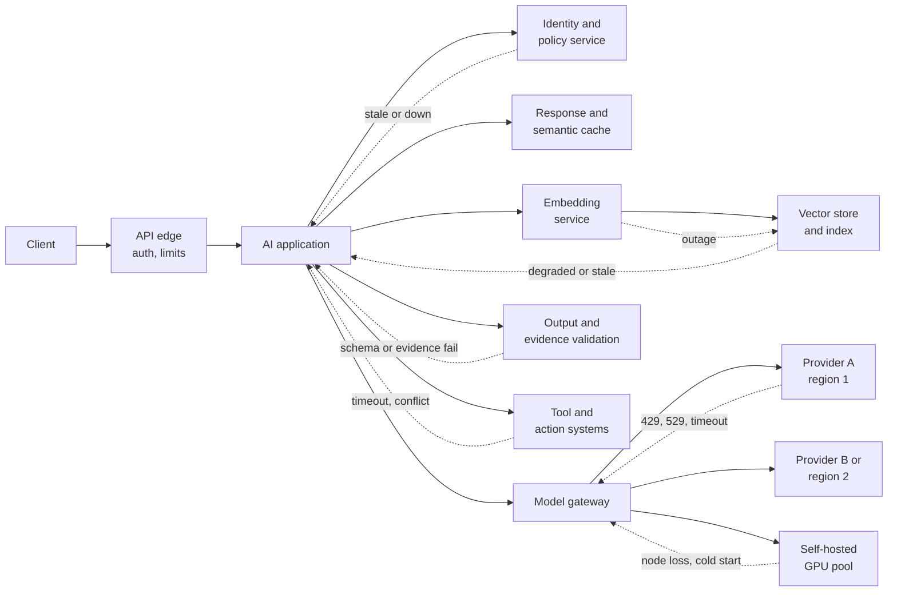

The diagram separates the synchronous path (solid arrows) from the failure signals that each dependency can emit (dotted arrows). It shows three points of concentration: the gateway, the vector store, and the application itself. A design review should ask, for each dotted edge, what the application does when it fires and what the user sees. The rest of the chapter answers that question pattern by pattern.

### 3.2 The taxonomy

Failures fall into two broad families. Some prevent computation (the call did not return). Others return a result that cannot be trusted (the call returned, but the result is unusable). The second family is easy to miss because infrastructure monitoring reports success. The table lists sixteen modes, how each is detected, and the first-line response. Section numbers point to the pattern that implements the response.

| # | Failure mode | Typical signal | Detection | First-line response |
| --- | --- | --- | --- | --- |
| 1 | Provider outage (region or service wide) | Connection errors, 5xx on nearly all calls | Error rate over a short window, status feed, synthetic probes | Breaker opens, fail over to alternate route or degrade (sections 9, 10) |
| 2 | Partial degradation (slow, elevated errors) | Latency p95 up, error rate 2 to 20 percent | Latency and error SLIs per route, outlier detection | Shift traffic share, shorten timeouts, hedge only if capacity exists (sections 5, 11) |
| 3 | Throttling (HTTP 429) | 429 with `Retry-After` or rate-limit headers | Count by error body type, remaining-quota headers | Honor retry hint, client-side limiter, queue, shed low priority (section 8) |
| 4 | Overload (529, 503) | 529 or 503, sometimes with retry hint | Status code and error type | Backoff with jitter, retry budget, fall back (sections 6, 9) |
| 5 | Timeout (connect, first token, inter-token, total) | No bytes by deadline, or stream stalls | Per-phase timers | Cancel, release slot, retry only if budget remains (section 5) |
| 6 | Truncated output | `finish_reason` or `stop_reason` of length, JSON cut off | Finish-reason check, parse failure | Raise limit once, continue generation, or fail to fallback (section 12) |
| 7 | Malformed output | Not parseable as the requested format | Parser error rate | Bounded repair loop, constrained decoding (section 12) |
| 8 | Schema violation | Parses, but a field is missing, wrong type, or out of enum | Schema validator | Repair once, then deterministic fallback (section 12) |
| 9 | Content-filter refusal | Refusal text, filter finish reason, 400 from safety layer | Refusal classifier, finish reason | Do not retry blindly. Rephrase path, alternate route if policy allows, or human handoff |
| 10 | Context-length error | 400 or 413, token count over limit | Pre-flight token count, error type | Truncate or summarize deterministically, route to longer-context model |
| 11 | Tool failure | Tool timeout, conflict, 4xx or 5xx from action system | Tool-level error taxonomy, trace | Idempotent retry, compensation, partial result (section 14) |
| 12 | Vector store degradation | Slow queries, partial results, node loss | Query latency, recall canary, shard health | Replica read, lexical search fallback, cache (section 16) |
| 13 | Embedding service outage | Embedding calls fail, queries cannot be embedded | Error rate on embedding route | Lexical search, cached query embeddings, alternate embedding model of the same space only |
| 14 | GPU node loss or cold start | Pod eviction, model load in progress, request queue growth | Node health, readiness, queue depth | Spare capacity, route away, admission control (section 17) |
| 15 | Stale index | Retrieved facts older than freshness SLO | Index freshness lag, document version check | Mark answers as possibly stale, re-ingest, restrict to fresh sources (section 16) |
| 16 | Quality regression without errors | No errors. Eval score, refusal rate, or length distribution shifts | Canary eval, shadow comparison, user feedback rate | Roll back or reroute to pinned version, open incident (sections 4, 21) |

### 3.3 Reading the taxonomy

Three observations guide the later design.

First, the signal for modes 6 to 10 and 16 is application level. No load balancer, service mesh, or gateway health check will see them unless the application validates the content and reports the result as a metric. A reliability design that stops at HTTP status codes covers about half the table.

Second, the correct response differs by mode even when the symptom ("the call failed") looks the same. A 429 from rate limiting should be queued and retried after the hinted delay. A 429 from a spend cap should page a human. A 529 should trigger backoff and probably an alternate route. A context-length error will fail again identically on every retry. A single "retry three times" policy applied to all four is wrong for three of them.

Third, some modes are correlated. A provider incident (mode 1) pushes traffic to the fallback, which hits its rate limit (mode 3), which trips its breaker, which concentrates load on the self-hosted pool, which suffers queue growth and cold starts (mode 14). Cascading is the normal shape of a large incident, so the design must be evaluated against combinations, not only single faults. Section 18 treats blast radius, and section 19 turns combinations into test scenarios.

### 3.4 Classification as code

Every client of a model API needs an error classifier that maps raw outcomes to a small set of actions. The classifier is a shared library or part of the gateway, not something each team writes. A compact version looks like this.

```python
from enum import Enum

class Action(Enum):
    RETRY_BACKOFF = "retry_backoff"      # transient, same route
    RETRY_AFTER = "retry_after"          # honor the server's delay
    FAILOVER = "failover"                # try another route now
    REPAIR = "repair"                    # fix the output, bounded
    DEGRADE = "degrade"                  # go down the ladder
    FAIL_FAST = "fail_fast"              # will not succeed on retry
    PAGE = "page"                        # needs a human

def classify(status: int, body_type: str, has_retry_after: bool) -> Action:
    if status == 429 and has_retry_after:
        return Action.RETRY_AFTER
    if status == 429:
        return Action.PAGE if body_type == "spend_limit" else Action.RETRY_BACKOFF
    if status in (500, 502, 503, 504, 529):
        return Action.RETRY_BACKOFF
    if status in (400, 413) and body_type == "context_length":
        return Action.DEGRADE
    if status in (400, 401, 403, 404):
        return Action.FAIL_FAST
    return Action.FAIL_FAST
```

The point is the shape: a finite set of actions, decided by status and error type, with a human page for conditions that no retry can fix. Error type strings differ by provider, so the gateway normalizes them ([Part 17 CH08](CH08_Model_Gateway_Routing_and_Fallback_Architecture.md) section 4). The status codes above reflect documented behavior of several providers at the time of writing; verify them for the providers you use, because cloud-hosted variants of the same model sometimes use different error names (for example, throttling exceptions in a cloud platform's own software development kit, SDK).

## 4. Defining Reliability for AI Systems

### 4.1 Availability of a usable outcome

The Google site reliability engineering books define a service level indicator (SLI) as a measured property of service behavior, a service level objective (SLO) as a target for that indicator, and an error budget as the allowed shortfall. This chapter keeps those definitions and changes what is counted. For an AI feature the useful indicator is the fraction of requests that produce a usable outcome:

$$
\text{usable fraction} = \frac{N_{\text{usable}}}{N_{\text{eligible}}}
$$

where $N_{\text{eligible}}$ is the number of valid requests that the system was supposed to serve (requests rejected for being malformed or unauthorized are excluded, because the system behaved correctly), and $N_{\text{usable}}$ is the number that satisfy all of these conditions:

1. The system returned a response, not an error, within the latency objective for its class.
2. The response passed mechanical validation (schema, evidence presence, policy checks).
3. The response met the quality objective, as measured by an evaluation method the team has chosen and calibrated.

A degraded response counts as usable only if it is within the contract the team has defined for that degraded mode, and it is labeled as degraded in telemetry so that the share of degraded answers is itself an SLI. A "search results only" answer to a question that needed synthesis meets the contract of the retrieval-only rung (section 11), and it is counted in a separate bucket so the team can see that 6 percent of this month's answers were degraded, even though the usable fraction stayed above target.

### 4.2 Three families of objectives

| Family | Example SLI | Example SLO (illustrative) | Measured by |
| --- | --- | --- | --- |
| Availability | Fraction of eligible requests that return a validated response | 99.9 percent per 30 days | 100 percent of traffic, from the application |
| Latency | Time to first token (TTFT), total time, per class | TTFT p95 under 1.5 s, total p95 under 8 s, p99 under 12 s | 100 percent of traffic, per phase |
| Quality | Fraction of sampled responses scoring at or above the threshold on the golden rubric | 97 percent at or above 4 of 5 on grounded-answer rubric | Sampled evaluation, with a calibrated judge or human review |

Latency objectives need to be per phase because an interactive assistant has several kinds of waiting. The user perceives TTFT as responsiveness, the inter-token rate as reading flow, and total time as completion. For a non-streaming call the total is all that matters, and the budget in section 5 is built from it. For batch work the latency SLO is a completion deadline for the whole job ("all 4 million records by 06:00"), with a throughput SLI beneath it.

Quality SLIs are sampled and delayed, which has two consequences. Sampling creates statistical noise, and delay lengthens the time to detect. Section 4.5 works the arithmetic.

### 4.3 Error budgets that combine hard and quality failures

Let $h$ be the fraction of eligible requests that fail hard (error, timeout, validation failure that could not be repaired), and let $q$ be the fraction of the remaining requests that return successfully but fail the quality objective. The fraction of bad requests is

$$
b = h + (1 - h)\,q
$$

and the usable fraction is $1 - b$. With an SLO of $s$, the error budget fraction is $1 - s$ and the burn rate is

$$
\text{burn} = \frac{b}{1 - s}
$$

A burn rate of 1 consumes the budget exactly at the end of the window. A burn rate of 14.4 consumes it in $30 / 14.4 \approx 2.08$ days of a 30-day window.

**Worked example 1: a healthy month.** The support assistant has an SLO of 99.9 percent per 30 days and serves 100,000 eligible requests per day, which is 3,000,000 per month. The error budget is $0.001 \times 3{,}000{,}000 = 3{,}000$ bad requests, equivalent to $43.2$ minutes of a total outage ($30 \times 24 \times 60 \times 0.001$). Measured behavior: $h = 0.002$ and $q = 0.006$. Then

$$
b = 0.002 + 0.998 \times 0.006 = 0.007988 \approx 0.00799
$$

The usable fraction is 99.201 percent, below the 99.9 percent target, and the burn rate is $0.00799 / 0.001 = 7.99$. At that rate the budget is exhausted in $30 / 7.99 \approx 3.8$ days. The result is instructive. Infrastructure availability of 99.8 percent would look acceptable on a conventional dashboard, and the team would think it was near its target. Adding a modest 0.6 percent quality failure rate takes the feature to an outage-equivalent of about 5.8 hours per month ($0.00799 \times 720$ hours), against the 43 minutes the target allows. The quality term dominates, which is typical, and it implies that investing in grounding, validation, and evaluation can buy more reliability than a second provider.

**Worked example 2: a silent model update.** On day 12 a provider moves an alias to a new version. Hard failures stay at 0.2 percent. The quality failure rate among successful answers rises from 0.6 percent to 3.0 percent (for example, more refusals and more ungrounded citations). Then

$$
b = 0.002 + 0.998 \times 0.030 = 0.03194
$$

The burn rate is $31.94$. The 3,000-request budget is spent at $4{,}167 \times 0.03194 \approx 133$ bad requests per hour (4,167 requests per hour is 100,000 divided by 24), which takes $3{,}000 / 133 \approx 22.5$ hours. A change that no health check can see consumes a monthly error budget in under a day. This is the quantitative reason to pin versions and run canary evaluations (sections 4.6 and 21).

### 4.4 Burn-rate alerting

A threshold on the raw error rate pages too often at small volume and too late when a slow leak exists. Multi-window, multi-burn-rate alerts are the standard answer. The Google SRE Workbook chapter on alerting on SLOs describes pairing a long and a short window for each burn rate so that an alert fires quickly and resets quickly. A commonly cited set for a 30-day SLO is shown in the table; verify the values against the current workbook before copying them.

| Severity | Burn rate | Long window | Short window | Budget consumed at alert time |
| --- | --- | --- | --- | --- |
| Page | 14.4 | 1 hour | 5 minutes | 2 percent |
| Page | 6 | 6 hours | 30 minutes | 5 percent |
| Ticket | 1 | 3 days | 6 hours | 10 percent |

Check one row: $14.4 \times (1 / 720)$ is 2 percent, because a 30-day window has 720 hours. Check another: $6 \times (6 / 720) = 5$ percent. Both match.

For AI systems, apply the same alerts to the combined bad fraction, but be careful about what feeds it. Hard failures and mechanical validation results are available for every request in near real time and suit short windows. Sampled quality judgments are scarce and delayed, and they suit the long windows. Run two burn-rate computations: one for the hard and mechanical part (fast), and one for the quality part (slow). Page on the fast one. Open a ticket or page during business hours on the slow one, unless a canary evaluation (section 4.6) provides a faster quality signal.

### 4.5 The sampling problem for quality SLIs

Suppose a judge scores a 5 percent random sample of traffic. At 4,167 requests per hour the sample is about 208 per hour. If the true quality failure rate is $q = 0.006$, the expected number of failures in a one-hour sample is $208 \times 0.006 = 1.25$. The standard error of the estimated rate is

$$
\text{SE} = \sqrt{\frac{q(1-q)}{n}} = \sqrt{\frac{0.006 \times 0.994}{208}} \approx 0.00536
$$

which is close to the rate itself. A one-hour window cannot distinguish 0.6 percent from 3 percent with confidence, because the 3 percent case would show about 6 failures against 1.25. A six-hour window has $n \approx 1{,}250$ and $\text{SE} \approx 0.0022$, which can distinguish the two cases but cannot resolve 0.6 percent from 1 percent. The practical conclusions are:

- Quality burn alerts use longer windows than hard-failure alerts, or a higher sampling rate on higher-risk traffic classes.
- Cheap, full-coverage proxies cover the gap: refusal rate, output length distribution, citation validity rate, schema-repair rate, and user thumbs-down rate. Each is a noisy but fast leading indicator.
- A canary prompt set run on a schedule against the production route gives a small, fixed, high-signal sample that does not depend on traffic volume. Section 4.6 describes it.

### 4.6 Canary evaluations as a quality probe

A canary evaluation is a fixed set of labeled prompts (for example, 150 cases covering the main intents and known failure patterns) that is sent through the real production path every 15 to 30 minutes, with deterministic scoring where possible. With 150 cases, a drop from 97 percent to 92 percent passing is 7 or 8 additional failures, which is a detectable step. The canary also exposes silent upstream changes: if the pass rate moves while no deployment occurred, the provider changed something. Canaries cost tokens (150 cases every 30 minutes is 7,200 calls per day), so keep the set small, use cheap scoring, and run it on every route in the fallback chain so that a failover target's degradation is known before you need it ([Part 17 CH11](CH11_Evaluation_and_Observability_Architecture_for_AI_Systems.md) covers evaluation design).

### 4.7 An error budget policy

A budget is useful only if exceeding it changes behavior. A policy that fits AI features:

1. Under 50 percent of budget consumed: normal feature work, including prompt and model changes with a canary.
2. 50 to 100 percent consumed: changes to prompts, models, and routing require an extra reviewer and a staged rollout. Reliability work is prioritized.
3. Budget exhausted: freeze model, prompt, and routing changes except reliability fixes and rollbacks, until the window recovers or the owner signs a documented exception.

The policy treats a model upgrade as a change like any deployment, which it is. It also gives the team a rule for the common conflict between shipping a better model and keeping the feature stable.

## 5. Deadlines and Timeout Budgets

### 5.1 One deadline, many hops

The user has one patience, and the request has one deadline. Each hop in the path should know how much of that deadline remains and spend no more than that. If each component applies its own timeout without regard to its caller, the timeouts do not compose: a caller waiting 10 seconds can call a service that retries internally for 25 seconds, and the caller gives up while the callee keeps working, wasting the downstream capacity on a result nobody will read.

The rule is that timeouts must nest. For a parent with remaining budget $R$, a child that makes $a$ attempts, each with timeout $t$, and total backoff delay $d$, nesting requires

$$
a \cdot t + d \le R - R_{\text{down}}
$$

where $R_{\text{down}}$ is the budget the parent must keep for the work that follows the child (validation, formatting, fallback). A configuration that violates this inequality is a latent fault: it works until the child is slow, and then the parent's timeout fires first, the child's retry is wasted, and the system returns an error when a fallback was still affordable.

### 5.2 Propagating the deadline

Deadlines are passed as data. Two forms are common. An absolute timestamp ("must finish by 12:00:09.800 UTC") is simple but depends on synchronized clocks, and skew of 200 milliseconds on a 2-second budget is a 10 percent error. A relative remaining time ("8,420 ms left") avoids skew, and each hop subtracts its own elapsed time and an allowance for network transit before forwarding. gRPC propagates a relative deadline natively. For HTTP, pass a header such as a remaining-milliseconds value and have a shared client library enforce it. The model gateway should accept the header and apply it to its provider call and its fallback decisions, so that a request with 1.2 seconds left does not start a 6-second generation.

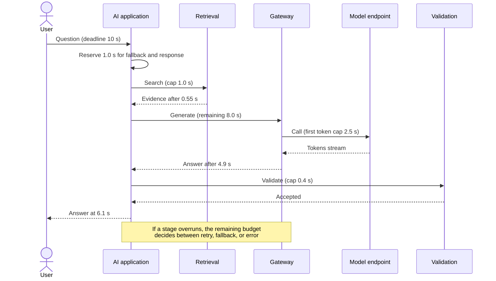

The diagram shows the request carrying its deadline and each stage receiving the smaller of its own cap and the remaining time minus the downstream reserve. The final note is the important part: when a stage overruns, the next decision is made from remaining time, not from a fresh timeout. In the example the answer arrives at 6.1 seconds, leaving 3.9 seconds of unused deadline. That slack is what a retry or a hedge would spend if the first attempt had failed early.

### 5.3 A worked allocation of a 10-second budget

Take the support assistant with a 10-second total deadline for a non-streaming mode (the budget is simpler to state, and streaming is treated in section 13). Reserve 1.0 second for the fallback path and the response write. That leaves 9.0 seconds for the stages. The measured p99 values for one attempt are in the second column of the table.

| Stage | Measured p99 (ms) | Naive timeout (ms) | Naive attempts | Naive worst case (ms) |
| --- | --- | --- | --- | --- |
| Authentication and policy | 150 | 300 | 1 | 300 |
| Retrieval | 600 | 1,200 | 2 | 2,400 |
| Reranking (optional) | 250 | 500 | 1 | 500 |
| Generation | 5,500 | 6,500 | 1 | 6,500 |
| Validation | 200 | 400 | 1 | 400 |
| Sum | 6,700 | | | 10,100 |

The sum of p99 values is 6,700 ms, which suggests there is room. The sum of naive worst cases is 10,100 ms, which exceeds the 9,000 ms usable budget. The configuration looks sensible stage by stage and is wrong in aggregate. The [budget checker](../code/python/ai-reliability-chapter/01_deadline_budget_checker.py) prints exactly this verdict:

```text
usable for stages   : 9000 ms
sum of p99 (1 try)  : 6700 ms
sum of worst cases  : 10100 ms

WARN worst case 10100 ms exceeds usable 9000 ms:
     timeouts do not nest; the deadline must cut stages short.

nesting check: FAIL
```

Now walk a slow day through the propagated deadline. Retrieval is slow and uses both attempts at its 1,200 ms timeout (2,400 ms in total), then rerank takes 250 ms, then generation needs 6,500 ms.

```text
  auth_and_policy  left= 9000 ms, used=  150 ms
  retrieval        left= 8850 ms, used= 2400 ms
  rerank           left= 6450 ms, used=  250 ms
  generation       left= 6200 ms, used= 6200 ms (cut by deadline)
  validation       left=    0 ms -> MANDATORY, no budget
```

Generation is cut at 6,200 ms by the deadline, and validation, a mandatory stage, has nothing left. The system would have to either skip validation (unsafe) or exceed the deadline (a user-visible failure). This is the failure the nesting rule prevents.

The fix has four parts.

1. **Retrieval gets one attempt and a cap of 1,000 ms.** A retry at the tail of a slow search rarely finishes in time. If retrieval is slow, the lexical fallback of section 16 answers faster than a second vector query. Retrieval p99 is 600 ms, so 1,000 ms leaves 67 percent of headroom over p99.
2. **Reranking is optional.** Its cap is 500 ms, and if remaining time at its start is under 3,000 ms, skip it.
3. **Generation gets a dynamic cap.** Its timeout is the smaller of a static ceiling and the remaining time minus the downstream reserve (validation cap plus response reserve, which is $400 + 1{,}000 = 1{,}400$ ms). With nothing consumed before it beyond typical values, the cap is $9{,}000 - 300 - 1{,}000 - 500 - 400 = 6{,}800$ ms in the worst case of all earlier stages using their full caps. The measured p99 of 5,500 ms fits with 1,300 ms of headroom.
4. **Validation is mandatory and has a reserved 400 ms.** It is never traded for generation time.

The resulting worst-case sum is $300 + 1{,}000 + 500 + 6{,}800 + 400 = 9{,}000$ ms, exactly the usable budget, so the nesting inequality holds by construction. The point is the method: allocate from measured tail latency, mark each stage mandatory or optional, reserve downstream cost before granting upstream time, and verify by arithmetic that the worst case fits.

### 5.4 Per-phase timeouts for generation

Inside the generation stage, a single total timeout hides two different stuck states. If no token arrives for 8 seconds, the request is probably queued or hung, and waiting longer is rarely rewarded. If tokens arrive steadily at 15 tokens per second where 60 is normal, the request is slow but alive. Use at least three limits:

| Phase | What it detects | Typical policy |
| --- | --- | --- |
| Connect | Network or load balancer failure | Short (1 to 2 s), retry on another connection |
| Time to first token | Queueing at the provider or serving engine | Cap at a multiple of measured p99 TTFT (for example 2 to 3 s for an interactive turn). On expiry, cancel and fail over |
| Inter-token gap | Stalled stream | 5 to 10 s without a token. On expiry, cancel. Decide between partial result and restart (section 13) |
| Total | Runaway or slow stream | The remaining deadline minus downstream reserve |

Add a floor on tokens per second for long answers. A stream that falls below one third of its expected rate for 10 seconds will probably miss its total deadline, and canceling early frees the slot for a fallback while time remains. The thresholds come from measured percentiles per request class, not defaults.

### 5.5 Cancellation

A deadline is only useful if work stops when it expires. When the caller disconnects or the deadline passes, cancel the downstream request. For streaming APIs this means closing the connection. For a self-hosted serving engine, check that the engine aborts generation when the client disconnects, because a request that continues to decode for a user who has left consumes accelerator time and a batch slot. For hosted APIs, verify what the provider bills when a client disconnects mid-generation; billing behavior for canceled requests differs between providers and changes over time. Also propagate cancellation through queues: a queued request whose deadline has passed should be dropped at dequeue, not processed.

### 5.6 What to do when the budget runs out

Define behavior at exhaustion in advance, per feature:

- If the answer is not ready but a fallback is, return the fallback with a label.
- If neither is ready, return a clear timeout message with a retry affordance. Do not return a half-formed answer unlabeled.
- Never skip a mandatory safety or validation stage to meet the deadline. An unvalidated answer returned on time is worse than a timely error for most regulated or action-taking features. Mark which stages are mandatory in the architecture record.

## 6. Retries Without Amplification

### 6.1 What a retry is for

A retry converts a transient fault into a delayed success. It helps only when the fault is short, independent between attempts, and the work is safe to repeat. Against a long fault, a retry adds load to a dependency that is already failing. Against a fault that depends on the request itself (a prompt that exceeds the context window), it never helps. The design questions are therefore which errors qualify, how long to wait, how many attempts to allow across the whole system, and whether the operation can be repeated safely. [Part 07 CH16](../07_System_Design_and_Distributed_Systems/CH16_Idempotency.md) owns the general theory of idempotency. This section applies it to inference.

### 6.2 Which outcomes are retryable

Use the error classifier of section 3.4 and refine it with the cost of the attempt.

| Outcome | Retry on the same route? | Notes |
| --- | --- | --- |
| Connection reset before any byte | Yes, once or twice | Usually free: the provider did no work. |
| 429 with a retry hint | Yes, after the hinted delay | Counts against the retry budget. Do not retry earlier than the hint. |
| 429 for a spend cap or exhausted quota | No | Page. Fail over only if the other route has its own budget. |
| 500, 502, 503, 529 | Yes, with backoff and jitter | Prefer an alternate route after the first failure if one exists. |
| Timeout before first token | Yes, if budget remains | The provider probably did little work. Cancel the first attempt before retrying. |
| Timeout after tokens began | Rarely | Partial work was billed and a regeneration differs from the first answer. See section 13. |
| 400 for malformed request, 401, 403, 404 | No | The same request fails again. |
| Context-length error | No, but degrade | Truncate, summarize, or reroute (section 11). |
| Refusal or content-filter stop | No blind retry | A retry may repeat the refusal or, worse, search for a phrasing that evades the filter. Route to a policy path. |
| Truncated output (length stop) | Not as a plain retry | Raise the limit once or continue (section 12). |
| Schema violation | A bounded repair, not a retry | Section 12. |

Two rows deserve emphasis. The timeout row separates failures by what the provider did. A request that timed out before first token has probably been queued or dropped, so the provider has billed little and a retry on another route is cheap. A request that timed out in the middle of a 3,000-token answer has consumed accelerator time and, depending on the provider, billing. Retrying it doubles the cost of a result the user may already have partly seen. The refusal row is a security point: an automated loop that rewrites a refused prompt until something passes is a jailbreak search that the operator built into the product.

### 6.3 Exponential backoff with jitter

Fixed-interval retries synchronize clients. If 1,000 clients fail at the same moment and each retries after exactly 500 ms, the dependency receives the same 1,000-request spike every 500 ms. Exponential backoff spreads attempts in time, and random jitter prevents the clients from re-synchronizing. The AWS Architecture Blog post "Exponential Backoff and Jitter" by Marc Brooker (2015) compares jitter variants by simulation and recommends full jitter, in which the wait before attempt $n$ is drawn uniformly from zero to a growing cap:

$$
w_n \sim \text{Uniform}\bigl(0,\ \min(c,\ b \cdot 2^{n})\bigr)
$$

where $b$ is the base delay, $c$ is the cap, and $n$ counts failures so far starting at zero. With $b = 0.5$ s and $c = 8$ s the ceilings are 0.5, 1, 2, 4, and 8 s, and the mean waits are 0.25, 0.5, 1, 2, and 4 s. Full jitter has a lower mean wait than an equal-jitter or no-jitter schedule and the lowest contention in the post's simulations, so it is the default here.

If the server sends a retry hint, use the larger of the hint and the jittered value. A hint is the server's statement of when it expects capacity, and retrying earlier is guaranteed to fail and may count against you. If the hint exceeds the remaining deadline, do not wait. Go to the fallback.

```python
import random

def backoff_delay(failures: int, base: float = 0.5, cap: float = 8.0,
                  hint: float | None = None) -> float:
    ceiling = min(cap, base * (2 ** failures))
    wait = random.uniform(0.0, ceiling)
    return max(wait, hint) if hint is not None else wait

def should_retry(attempt: int, max_attempts: int, remaining_s: float,
                 delay_s: float, typical_attempt_s: float,
                 budget_ok: bool) -> bool:
    if attempt >= max_attempts or not budget_ok:
        return False
    return remaining_s >= delay_s + typical_attempt_s
```

The second function carries the important rule. A retry is allowed only if the delay plus a typical attempt fits inside the remaining deadline. Without that check, a retry begins at 9.2 seconds of a 10-second budget and cannot finish, which wastes tokens and still returns an error.

### 6.4 The arithmetic of amplification

Retries at several layers multiply. Suppose the client library, the gateway, and the service each retry up to three attempts (two retries) on failure. A single user request can produce $3 \times 3 \times 3 = 27$ calls to the provider in the worst case. If every attempt fails independently with probability $f$, the expected number of calls per request at each layer is $1 + f + f^2$, and across three layers it is $(1 + f + f^2)^3$. The [retry and burn-rate script](../code/python/ai-reliability-chapter/02_retry_burn_and_token_bucket_math.py) prints:

```text
failure rate 0.1: worst=27 calls, expected=1.37 calls per request
failure rate 0.5: worst=27 calls, expected=5.36 calls per request
failure rate 1.0: worst=27 calls, expected=27.00 calls per request
```

At a 10 percent failure rate the cost is modest, at 1.37 times. At 50 percent failure it is 5.36 times, and in a total outage the provider receives 27 times the demand from clients that cannot succeed. The failure rate that rises during an incident is the same rate that raises load, so retries convert a partial outage into a worse one. This is a metastable failure pattern: the retry load keeps the dependency saturated after the original trigger has gone. Bronson and colleagues describe metastable failures in "Metastable Failures in Distributed Systems" (HotOS 2021), and retries are one of the standard sustaining effects they identify.

Three rules limit amplification.

1. **Retry at one layer.** Pick the layer that has the most context to decide (usually the gateway or a shared client library) and set retries at all other layers to zero. Document the choice in the architecture record. When a provider SDK retries internally by default, set its retry count explicitly and treat the SDK's retries as your layer, not an addition to yours.
2. **Cap attempts per request.** Two or three attempts total. Anything beyond that is the job of the fallback ladder, not the retry loop.
3. **Cap retries per client over time with a retry budget.** The Google SRE book chapter on cascading failures describes limiting retries to a small fraction of requests per client and a small number per request. A common form is: a client may issue retries equal to at most 10 percent of its first-attempt volume over a sliding window, plus a small floor so low-volume clients can still retry. With 100 first attempts per second, the client may send at most 10 retries per second, so the provider sees at most 110 calls per second no matter how badly it is failing. The script confirms: "first attempts 100/s, allowed retries 10/s, max provider load 110/s".

A retry budget is a form of load control, and it is the bound that makes the other two rules checkable. When the budget is exhausted the request does not wait for it. It moves down the ladder (fallback route, degraded answer, or error).

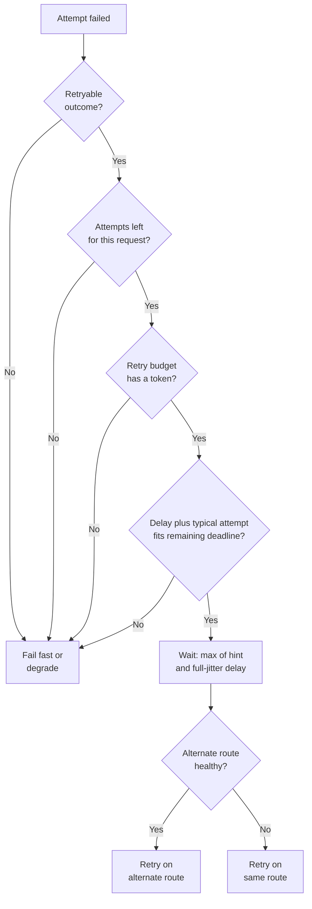

The flowchart orders the checks from cheapest and most definitive (is the error retryable at all) to most contextual (does it fit the deadline). Each "No" branch exits to a degrade or fail path, which means the retry loop is never the last line of defense. Note the final decision: after the checks pass, prefer an alternate route if one is healthy. Retrying a 529 against the same overloaded route is the worst option among those available.

### 6.5 Retries and cost

A retry of a model call is billed like any call when it reaches the model. Take an illustrative price of 3 dollars per million input tokens and a 40,000-token prompt (a document question). One attempt costs $40{,}000 \times 3 / 10^6 = 0.12$ dollars in input tokens. If the first attempt fails after the provider has processed the prompt, three total attempts cost 0.36 dollars. Rejections that occur before processing, such as most 429 and many 5xx responses, are typically not billed, but this depends on the provider and failure type, so check billing documentation and measure with your invoices. A retry policy has to be checked against both of these: the quota it consumes and the money it spends. Put retry counts and retry token totals in the cost telemetry ([Part 17 CH14](CH14_AI_Cost_Performance_and_Sustainability_Decisions.md)) so that a team can see that 7 percent of last month's input tokens were retries.

### 6.6 Idempotency for generations and tool actions

Calling a model is read-like: the call does not change your system, so calling it twice is safe for correctness and costs only money. The surrounding steps are different. Four situations matter.

1. **Duplicate user submissions.** A user taps send twice, or a mobile client retries on a flaky network. Two model calls run, two answers appear. Assign a client-generated request identifier and deduplicate at the application edge. Return the first request's result (or join its in-flight stream) for the same identifier.
2. **Duplicate side effects.** The model selects a tool call such as `issue_refund`. If the run is replayed after a crash, the tool must not execute twice. Idempotency belongs on the tool, keyed to the business intent.
3. **Regenerated tool arguments.** This is the subtle case. If the idempotency key is a hash of the exact arguments, a replay that regenerates the call with slightly different arguments (a reason string worded differently) produces a different key and a second refund. Key the action on the business identity instead: for example `refund:{order_id}:{line_item_id}`. Or persist the model's chosen call in the run's history before executing it, and on replay read the stored call instead of calling the model again (section 14).
4. **Partial streams.** A user saw 60 percent of an answer before a failure. A regeneration may differ from what they read. Section 13 gives the options.

Most hosted generation APIs do not provide an idempotency key for generation requests at the time of writing, so deduplication of generations has to be done by your gateway, using a request identifier and a short-lived store. A single-flight table (one in-flight generation per request identifier, with later arrivals waiting on it) also prevents the case in which a client timeout fires while the server is still generating, the client retries, and the server now pays for two identical generations.

## 7. Overload Control: Admission, Shedding, Bulkheads, and Queues

### 7.1 Why overload is the default failure

An inference path has a hard capacity ceiling set by token quotas, concurrency limits, or accelerator memory. Once offered load exceeds the ceiling, the system's response time grows without bound unless something decides which work to refuse. Little's law ties the quantities together: the mean number of requests in the system equals the arrival rate times the mean time in the system, $L = \lambda W$. The support assistant receives 100 requests per second and a request spends 6 seconds in the system, so about 600 requests are in flight. If provider latency doubles to 12 seconds at the same arrival rate, in-flight work doubles to 1,200.

Suppose the application caps concurrency at 800 for memory or provider reasons. Then service throughput is $800 / 12 = 66.7$ requests per second against 100 arriving, so 33.3 requests per second join a queue. After 60 seconds the queue holds 2,000 requests. A new arrival waits about $2{,}000 / 66.7 = 30$ seconds, three times the user's 10-second deadline. From that moment most completed work is wasted because the user has gone. This is why a queue without a deadline-aware discard policy makes overload worse: the system spends its capacity finishing requests nobody is waiting for, and goodput (useful completions per second) falls toward zero while throughput looks full.

### 7.2 Admission control

Admission control decides at the door whether a request may enter. It uses cheap signals available before work starts.

- **Concurrency.** Count in-flight requests per route and per tenant. Refuse or queue when a limit is reached. The limit should be adaptive (section 9.4) or tied to measured capacity.
- **Token budget.** Estimate the cost of the request: input tokens (known by counting) plus a bounded output allowance. Admit only if the estimated tokens fit in the client-side token bucket (section 8).
- **Deadline feasibility.** If the expected queue wait plus expected service time exceeds the remaining deadline, refuse now. A refusal that arrives in 20 ms leaves the user time to retry or see a fallback. A timeout that arrives after 10 seconds leaves nothing.
- **Priority.** Tag each request with a class: interactive paid user, interactive free user, internal tool, batch, background evaluation. Admit by class when capacity is short.

The cheapest, most valuable form is deadline feasibility, because it needs only a queue-length estimate and a latency estimate.

### 7.3 Load shedding

Shedding is deliberate refusal of some work so that the rest succeeds. The decision of what to shed is a product decision, and the architecture has to make it explicit.

| Shed first | Shed last | Reason |
| --- | --- | --- |
| Batch and background evaluation | Interactive paid traffic | Batch can wait. Interactive users cannot. |
| Requests with the largest estimated cost | Short requests | Shedding one 40,000-token request frees as much quota as shedding many short ones. |
| Optional features (suggestions, summaries) | The core answer | Optional features have a null fallback. |
| Requests whose deadline will expire in the queue | Requests with ample time | Their completion is waste. |
| Anonymous or unauthenticated traffic | Authenticated customers | Standard abuse protection. |

When shedding, return a fast, explicit response (HTTP 503 or 429 with `Retry-After`, or an in-product message) and a reason code that appears in telemetry. A queue under overload should serve newest-first (last in, first out) or discard from the front, because the oldest entries are the ones most likely to have expired. First-in first-out under overload guarantees that every completed request is late. Controlled-delay queue management, introduced by Nichols and Jacobson in "Controlling Queue Delay" (ACM Queue, 2012) for network queues, applies the same principle: keep the queue short by dropping when delay stays above a target.

The [outage simulation](../code/python/ai-reliability-chapter/03_breaker_retry_shedding_simulation.py) compares three policies over 120 seconds with 100 requests per second of demand. The provider is healthy for 30 seconds, fully down for 30, recovering at 70 calls per second for 30, then healthy. The fallback model can serve 60 requests per second. The model is a deterministic fluid approximation, not a measurement, so treat the figures as a demonstration of mechanism.

```text
--- naive ---  (3 attempts, no breaker, no fallback)
usable outcomes: 67.3 percent; provider calls: 21450 (demand 12000)

--- breaker --- (3 attempts, breaker, fallback model)
usable outcomes: 82.3 percent; provider calls: 8792 (demand 12000)
breaker transitions: closed->open at 32, open->closed at 62, closed->open at 67, ...

--- protected --- (2 attempts, 10 percent retry budget, breaker, fallback, shedding)
usable outcomes: 89.0 percent; provider calls: 9363 (demand 12000)
breaker transitions: closed->open at 32, open->closed at 62
```

Three readings matter. The naive policy sent 21,450 calls against 12,000 of real demand, a load multiplier of 1.79, and during the outage it sent 9,000 calls (three per request) into a dead endpoint. The breaker policy cut calls to the provider but flapped: it closed at tick 62 because a probe succeeded, then reopened at tick 67 when full traffic returned to a provider still at 70 calls per second, and repeated. The protected policy shed the 1,200 requests that neither the provider nor the fallback could take during the outage (and 120 more during recovery), kept the breaker closed after the first recovery, and reached the highest usable fraction. Its shed requests are visible as an explicit count, which is a better failure than 1,320 slow errors. Its provider calls (9,363) stayed below the 12,000 of demand, because the fallback and the shedding took traffic away from the provider while it was unwell.

### 7.4 Bulkheads

A bulkhead isolates resources so that failure or overuse in one class cannot starve another. The name comes from ship compartments. For AI workloads the useful partitions are:

- **By workload class.** Interactive and batch use separate concurrency pools and, where possible, separate provider projects or keys, because provider limits apply per organization or project. A nightly enrichment job that saturates the shared token limit at 02:00 would otherwise throttle a support assistant used by the night-shift team.
- **By tenant.** In a multi-tenant product, one tenant's burst should consume at most its share. Combine a guaranteed minimum per tenant with a shared burst pool.
- **By route.** Each provider and model gets its own concurrency pool and breaker so that a slow route does not hold threads and slots that other routes need.
- **By dependency.** Embedding calls, retrieval calls, and generation calls run in separate pools. A slow vector store should not consume the worker threads that generation needs.

A worked example: 1,000 concurrent slots are shared by interactive and batch. A batch job opens 1,000 parallel requests. Interactive traffic needs 300 slots at peak and receives none until batch calls complete, which takes 20 seconds each. With a bulkhead of 400 slots reserved for interactive and 600 for batch (with borrowing permitted only for the unused portion of the other pool and revocable at once), batch is limited to 600 and interactive always has at least 400. The cost is lower peak batch throughput (60 percent of the pool instead of 100 percent) and idle capacity if borrowing is disallowed, which is the usual price of isolation.

### 7.5 Queue-based load leveling

For work that does not need an immediate answer, a durable queue between the producer and the model smooths bursts into a steady rate the model quota can serve. The queue length absorbs a burst of 50,000 requests in 10 seconds and workers drain them at the quota rate. Use it for batch enrichment, document ingestion, notification generation, report drafting, and any asynchronous agent task. Four rules keep a queue from turning into a delayed failure.

1. Each message carries a deadline or expiry, and workers drop expired messages at dequeue.
2. The queue has a maximum age SLO ("95 percent of tasks start within 5 minutes") that is monitored and alerts on queue age, not only depth, because depth is meaningless without the drain rate.
3. Workers acknowledge a message only after the result is stored, and handlers are idempotent, since at-least-once delivery means duplicates.
4. A message that fails repeatedly goes to a dead-letter queue after a bounded number of attempts, with the failure reason, so one poison message cannot block or amplify forever (section 14.5).

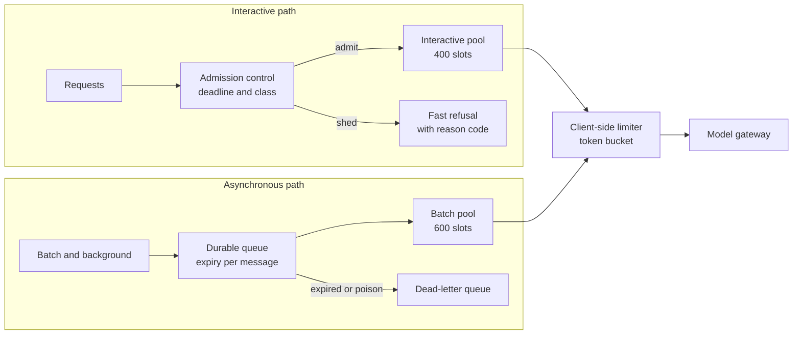

The diagram shows two paths into one limiter. The interactive path refuses early and has a reserved pool. The asynchronous path accepts everything and meters it. The shared limiter downstream is the point where the provider's token quota is enforced, and the next section covers it. The implication is that the system's response to overload differs by class on purpose: interactive traffic sees faster refusals, and batch sees longer waits.

## 8. Rate-Limit Handling and Client-Side Limiters

### 8.1 Recap

Part 08 CH11 owns rate-limiting algorithms: token bucket, leaky bucket, fixed and sliding windows. A token bucket holds up to a capacity $C$ of tokens, refills at a rate $r$, and a request that costs $k$ units is admitted if at least $k$ tokens are present. This section uses that algorithm in the role of a client: protect the provider's quota, not your own endpoint. The unit is the model token, not the request.

### 8.2 Why client-side limiting

If you wait for the provider to return 429, three problems follow. The 429 responses arrive after you have already sent too much, each wasted call may count against the limit in some designs, and every caller discovers the limit independently, so they all retry together. A client-side limiter placed in the gateway shapes traffic to the known quota before it leaves your network, which converts a stream of failed calls into a short local wait. The provider's limit is still the authority. The limiter is a best-effort estimate, kept consistent through the headers that providers return (for example, remaining requests, remaining tokens, and reset time; header names vary, so read them from the provider's documentation).

### 8.3 Reserving tokens before the call

The cost of a request is not known in advance because output length is unknown. A workable approach is reserve, then reconcile.

1. Count input tokens exactly (or estimate with the provider's tokenizer or counting endpoint).
2. Reserve input tokens plus the maximum output tokens the request is allowed to produce (`max_tokens`).
3. After the call, compute actual usage and refund the difference to the bucket.

The [script](../code/python/ai-reliability-chapter/02_retry_burn_and_token_bucket_math.py) works one case: a bucket with capacity 60,000 tokens and a refill of 1,000 tokens per second (a 60,000 tokens per minute limit). A request has 3,000 input tokens and a 4,000-token output ceiling, so 7,000 tokens are reserved; if the actual output is 600 tokens, 3,400 are refunded.

```text
tokens= 60000, request cost=8000: wait 0.0 s
tokens=  3000, request cost=8000: wait 5.0 s
tokens=     0, request cost=8000: wait 8.0 s
admission estimate: input 3000 + max_output 4000 = 7000 tokens reserved, refund difference when actual output is 600: 3400 tokens
sustained request rate at 1,500 tokens each: 40 requests per minute
```

The last line is the planning number: at 1,500 tokens per request, a 60,000 tokens-per-minute quota supports 40 requests per minute, or 0.67 per second. If the product expects 100 requests per second at that size, the quota must be roughly 150 times larger, or the design must change (smaller prompts, caching, a self-hosted model). Compute this ratio before building, not after launch.

Reserving the maximum output is conservative. If `max_tokens` is 4,000 and the real mean is 300, reservation holds 13 times the real use for the length of the call, and concurrency is throttled below what the quota could carry. Two mitigations: set `max_tokens` per request class from the measured 99th percentile of output length (so a classification call reserves 50 tokens, not 4,000), and use a reservation fraction such as the 90th percentile with a correction when the call overruns. Some providers count `max_tokens` toward the output-token limit at admission time, which makes the conservative reservation match their accounting. Verify this per provider.

### 8.4 Dimensions, sharing, and priority

A real quota has several dimensions, and the limiter enforces all of them: requests per minute, input tokens per minute, output tokens per minute, and concurrent requests. A request is admitted only if every bucket has room. Keep one limiter per (provider account, model, region) because limits are scoped that way, and mirror the provider's scope in configuration ([Part 17 CH08](CH08_Model_Gateway_Routing_and_Fallback_Architecture.md) covers quota mirroring).

Sharing the quota between classes needs a policy. A guaranteed share with borrowing works well. For example, interactive traffic is guaranteed 60 percent of the token rate, batch is guaranteed 20 percent, and the remaining 20 percent is a shared pool, with interactive able to preempt batch's borrowed share within one refill interval. Without this, whichever class sends more wins, and that is nearly always batch.

### 8.5 Handling provider headers and 429 bodies

On a 429, read the retry hint and the error body. Distinguish three classes: a short rate limit (wait for the hint, then retry), an acceleration limit or burst limit (reduce the rate of ramp-up, because some providers throttle sudden growth even under the nominal quota), and a hard cap (spend or monthly quota, page a human). On every response, update the limiter from the remaining-quota headers when they exist, so that one limiter reflects the combined effect of all clients in the account, including those outside your process. In a multi-instance deployment the limiter must share state or divide the quota: either a central limiter service (adds a hop and a dependency), or a static split of the quota across instances (simple, wastes headroom when instances are uneven), or a gossip or lease scheme in which instances lease slices of the quota. Dividing the quota statically across $n$ instances is the usual starting point, with a periodic rebalance.

### 8.6 Ramp-up and the cold limiter

After a restart, a deployment, or a recovery, do not release traffic at full rate. A cold local limiter has a full bucket and may send a burst that triggers provider-side throttling. Start with a partial bucket and refill, or ramp the rate over 30 to 60 seconds. The same logic applies to a breaker that closes: send a small share of traffic, then grow it.

## 9. Circuit Breakers and Adaptive Concurrency

### 9.1 The breaker state machine

A circuit breaker stops calls to a dependency that is failing, to give it time to recover and to save callers from waiting on doomed calls. Michael Nygard popularized the pattern in "Release It!" (first edition 2007). It has three states.

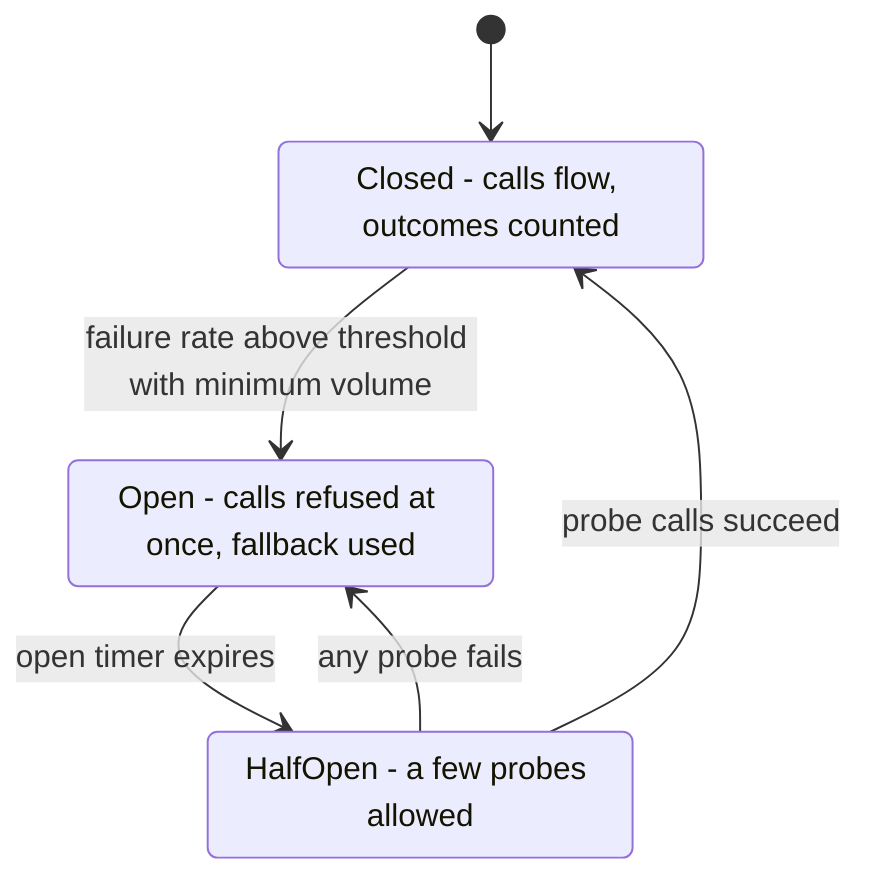

In the closed state calls pass and a sliding window counts outcomes. When the failure rate over the window exceeds a threshold, and the window holds enough calls to be meaningful, the breaker opens. In the open state calls are refused immediately and handled by the fallback, which costs microseconds and no quota. After a timer expires the breaker goes half-open and admits a few probe calls. If the probes succeed it closes. If any fails it reopens, typically with a longer timer.

### 9.2 Settings that matter for AI dependencies

- **Minimum volume.** A threshold of 50 percent failure means nothing on 3 calls. Require a minimum count (for example 20 calls in the window) before evaluating the rate. For low-traffic routes, use a longer window.
- **Slow calls count as failures.** For inference, a response that takes 40 seconds is often worse than an error, because it holds a slot. Count calls above a latency threshold (set from TTFT or total time per class) as failures, as Resilience4j's slow-call rate threshold does.
- **Which errors count.** 5xx, 529, timeouts, and connection errors count. Client errors (400, 401) and context-length errors do not, because they are not signs of provider health. A 429 for rate limiting is a flow-control signal; count it toward a separate limiter reaction, and open the breaker only if 429s persist and mean the route cannot serve traffic.
- **Per-route breakers.** One per provider, model, and region. A breaker on "the model gateway" as a whole hides which route is sick.
- **Quality breakers.** The same machinery works on mechanical quality signals. A breaker that opens when the schema-violation rate for a route exceeds 15 percent over 200 calls routes traffic away from a model that has started returning broken output, even though every response is HTTP 200. This is the automated response to mode 16 of the taxonomy, where the detection is statistical and the action is a reroute. Keep these thresholds conservative, and notify humans when they trip.
- **Half-open probes.** A successful probe at low volume does not show that the dependency can carry full load, as the simulation demonstrated. Close gradually: after the first successful probes, admit 10 percent, then 25, 50, and 100 percent, stepping only while the failure rate stays low. Probes should be real traffic of a cheap class or synthetic requests that do not use expensive prompts.

### 9.3 Flapping, and why the protected policy did not flap

In the simulation above, the plain breaker opened at tick 32, closed at tick 62, reopened at tick 67, closed at 77, reopened at 82, and closed at 92. Each cycle repeats the same mistake. During recovery the provider could serve 70 calls per second, and demand was 100. A single probe passed (a probe is one call and the provider could serve it), the breaker closed, full traffic arrived, the provider's capacity of 70 was exceeded by about 43 percent, failure rate climbed, and the breaker opened again. The protected policy avoided this because it kept shedding the excess demand that the fallback could not take and limited retries, so the offered load on the recovering provider stayed near the amount it could serve. The lesson is that a breaker alone is not a recovery strategy. Pair it with gradual re-admission and with a load limit on the recovering route, so that closing the breaker does not itself cause the next failure.

### 9.4 Adaptive concurrency limits

A fixed concurrency limit is either too low (waste) or too high (overload). Adaptive limiters find the limit from observed behavior. The simplest is additive increase, multiplicative decrease (AIMD), the rule from Transmission Control Protocol (TCP) congestion control: increase the limit by 1 for each window of successful, fast calls, and multiply it by a factor such as 0.9 when a call times out or is rejected. Netflix's open-source concurrency-limits library implements AIMD and latency-gradient variants (Vegas- and gradient-style limiters) for services.

A short example. The limit starts at 100. Each interval of 100 clean calls adds 1. After 20 clean intervals the limit is 120. A burst of timeouts at 120 cuts it to $120 \times 0.9 = 108$. The limit converges to a value slightly below the true capacity and tracks capacity changes in both directions, which a hand-set constant cannot do.

AI workloads break the standard assumption that latency rises only when the server is overloaded. Generation time depends on output length, so a window containing several long answers looks slow even though nothing is wrong, and a latency-gradient limiter will reduce concurrency for no reason. Three adjustments help:

1. Use TTFT as the congestion signal rather than total time. TTFT reflects queueing and prefill and is mostly independent of the output length.
2. Normalize total latency by output tokens (milliseconds per output token) when TTFT is not available.
3. Drive the limiter with explicit overload signals (429, 529, 503, timeouts) as the decrease trigger and use latency only as a secondary signal.

For self-hosted serving, the serving engine's own queue depth and key-value (KV) cache utilization are better signals than client-observed latency ([Part 17 CH07](CH07_Inference_Serving_and_Model_Placement.md)).

### 9.5 Choosing among overload patterns

| Pattern | Protects | Reacts to | Weakness | Use when |
| --- | --- | --- | --- | --- |
| Client-side token bucket | Provider quota | Known quota | Needs accurate quota and token estimates | Always, on each provider account |
| Adaptive concurrency | A route's capacity | Observed latency and rejections | Latency is noisy for variable-length output | The capacity is unknown or changes (shared GPU pools, hosted models) |
| Circuit breaker | Callers and the failing dependency | Failure and slow-call rates | Flaps without gradual re-admission | A route can be completely unavailable |
| Load shedding | The whole system | Queue wait versus deadline | Requires priority definitions | Offered load can exceed all capacity |
| Bulkhead | One class from another | Static partition | Idle capacity | Mixed interactive, batch, and multi-tenant traffic |
| Queue leveling | The model from bursts | Arrival variation | Added latency, needs expiry | Work tolerates delay |

These patterns compose in layers: the limiter sits closest to the provider, the breaker and adaptive limit sit above it per route, bulkheads partition the pools, and admission control and shedding sit at the front door. None replaces another.

## 10. Multi-Provider and Multi-Region Failover

### 10.1 What redundancy buys, and what it does not

A second route turns a total outage of the first into a degraded period, if three conditions hold: the second route is independent enough of the first to survive the same event, it has capacity for the diverted load, and it produces output that is good enough for the feature. Each condition fails more often than architects expect.

Independence is the first. If two providers both run on one cloud region, a regional event affects both. If both are reached through one gateway, the gateway is a shared failure point. If they share a billing account that hits a spend cap, both stop. A simple model of dependent failure is the beta-factor model from reliability engineering: a fraction $\beta$ of each route's unavailability $u$ is due to a common cause that hits both at once, and the rest is independent. The unavailability of the pair is approximately

$$
Q \approx \beta u + \bigl((1-\beta)u\bigr)^2
$$

Take two routes with 99.5 percent availability each, so $u = 0.005$. If they were fully independent the pair would have $u^2 = 0.000025$, or 99.9975 percent. With a common-cause fraction $\beta = 0.1$,

$$
Q \approx 0.1 \times 0.005 + (0.9 \times 0.005)^2 = 0.0005 + 0.00002025 = 0.00052025
$$

which is 99.948 percent. The common-cause term, 0.0005, is 25 times larger than the independent term it was supposed to be replaced by, and it alone sets the ceiling. The values of $\beta$ here are illustrative. The point is that every shared element (cloud region, network egress, identity provider, gateway, deployment pipeline, API key store, human operator) adds to $\beta$, and measuring it by listing shared elements is more informative than quoting provider availability numbers.

Capacity is the second. A fallback route needs enough quota to absorb the diverted share. In the simulation the fallback could take 60 requests per second against 100 of demand, so even a working failover left 40 percent of requests with no route and shedding decided who lost. Provider quotas are commonly granted per account and raised by request; a fallback account with the default low limit is not a fallback. Treat fallback quota as a provisioned resource with a named owner, and verify it by sending traffic.

Quality is the third. A cheaper or different model may meet only 90 percent of the quality bar. That is acceptable only if the feature's contract for a degraded mode says so, and the error budget accounts for the share of requests that were served by the lesser route (sections 4.3 and 11).

### 10.2 Topologies

| Topology | How it works | Recovery behavior | Cost | Main risk |
| --- | --- | --- | --- | --- |
| Single route with retries | One provider and model | None beyond retries | Lowest | Outage is a feature outage |
| Active-passive, warm | Primary takes all traffic. Secondary has quota, tested prompts, and a small live share | Switch in seconds when the breaker opens | Standby commitments plus test traffic | Secondary rots if not exercised |
| Active-active split | Traffic divided by weight across routes (for example 70/30) | A failed route's share moves to the other | Both routes at working volume | Prompts and evals must be maintained on both, and quality differs by route |
| Cross-region, same provider | Same model through two regional endpoints | Shifts when a region fails | Regional quota in both | Shared global control plane, residency limits |
| Cold standby | Alternate route configured but unused | Minutes to hours, and manual | Lowest of the redundant options | Quota and credentials unverified, so it often fails when needed |
| Self-hosted fallback | Open-weight model on own GPUs behind the same API | Depends on warm capacity | Reserved GPU cost | Cold start and capacity (section 17) |

Active-passive with a small continuous live share (1 to 5 percent) is the usual choice for interactive features. The live share keeps the secondary's quota, credentials, prompt template, and caches exercised, and it produces production-quality metrics for the secondary, so the eval gate below is fed by real data. It also surfaces silent breakage, such as a rotated key, before the day it matters.

### 10.3 Eval-gated failover

A route may receive failover traffic only if it is eligible. Eligibility is a recorded property, not an operator's impression in the middle of an incident. Maintain, per route, an eligibility record with:

- the latest score on the golden evaluation set for each use case (and the date), compared with the threshold for degraded mode;
- supported capabilities: tool calling, structured output, context length, language coverage, multimodal inputs;
- the prompt and tool-schema variant in use for this route;
- data-handling terms: region, retention, training-use policy, subprocessors;
- confirmed quota and the current share of traffic.

The router uses the record to filter candidates. A route whose last eval is older than a staleness limit (for example 14 days) or below threshold is ineligible for failover, and the system degrades down the ladder instead. This stops the incident-time failure in which traffic fails over to a model that cannot follow the output schema, converting a provider outage into a flood of repair loops and schema errors on the second route.

Prompts rarely port unchanged. Models differ in how they treat system prompts, tool-call formats, stop sequences, and few-shot examples. Tokenizers differ, so a prompt that is 3,000 tokens for one model may be 3,400 for another, which changes both the limiter's reservation and the context headroom. Keep a prompt variant per route under version control, test every variant in the same evaluation harness, and let the gateway translate request shapes ([Part 17 CH08](CH08_Model_Gateway_Routing_and_Fallback_Architecture.md)).

### 10.4 Residency-safe failover

Failover that moves personal or regulated data to a different jurisdiction can turn an availability incident into a compliance incident. Each tenant or data class has an allowed-region set, and the router intersects it with the set of eligible routes. If the intersection is empty, the correct response is to degrade (cached answer, retrieval only, queue, honest error), not to cross the boundary. Write this as a hard rule in the router, test it with a failover drill that includes a residency-restricted tenant, and have the gateway log which route and region served each request so that auditors can verify the rule held ([Part 17 CH12](CH12_AI_Safety_Security_Privacy_and_Governance_Architecture.md)). Some cloud platforms offer cross-region inference features that route a request to another region within a defined geography for capacity; confirm the geography boundaries and data-processing terms in the provider documentation before relying on them for regulated data.

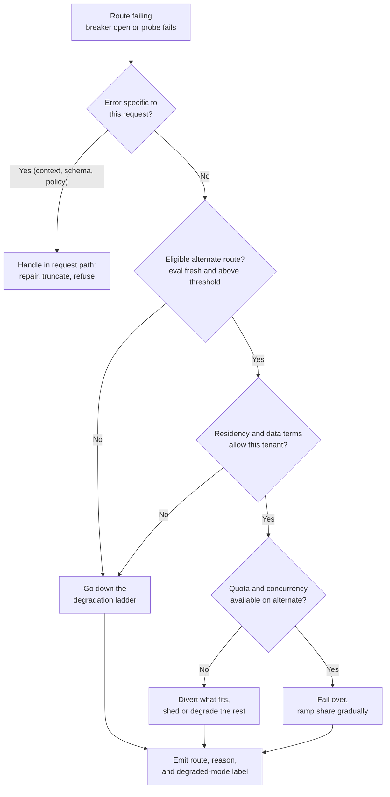

The decision tree puts request-specific errors first so that a malformed request does not trigger a route change, then checks eligibility, residency, and quota in the order that is cheapest and most absolute. Every branch ends in telemetry that names the route and reason. Notice that the quota branch does not abort failover when quota is partial: it diverts what fits. A partial rescue plus shedding beats an all-or-nothing rule.

### 10.5 Testing failover

An untested failover is a hypothesis. Run it three ways. First, the continuous live share described above. Second, a scheduled drill in production that sets the primary's weight to zero for 15 minutes in a low-traffic window, with the eval canary running on the secondary. Third, a fault-injection test in the integration environment that opens the primary breaker and asserts on the observable behavior (route, labels, residency, latency). Measure the cost of each drill: if 100 percent of traffic moves to a secondary priced 1.4 times higher for 15 minutes at 100 requests per second, a drill spends the equivalent of $0.4 \times 90{,}000$ requests of primary-priced traffic extra, a figure that can be quoted to finance in advance ([Part 17 CH14](CH14_AI_Cost_Performance_and_Sustainability_Decisions.md) covers redundancy cost).

## 11. Degradation Ladders, Deterministic Fallbacks, and Hedged Requests

### 11.1 The ladder

When the best path is unavailable, the system should step down to a worse but defined behavior, not jump from full capability to an error. A degradation ladder is an ordered list of rungs. Each rung has a contract (what it promises), a trigger (when the router goes there), a cost and latency, and a permission set (what actions it may take).

| Rung | Behavior | Typical trigger | Contract | Actions allowed |
| --- | --- | --- | --- | --- |
| 0. Primary | Preferred model, full retrieval, validation | Healthy | Full quality SLO | All, including write tools with confirmation |
| 1. Alternate route | Eligible secondary model or region | Primary breaker open, retry budget spent | Quality at the degraded-mode threshold | All, if the route supports tool use |
| 2. Smaller model | Cheaper or faster model, shorter context, fewer tools | Capacity short, deadline tight | Answers narrow intents. Declines complex ones | Read-only tools |
| 3. Cached or precomputed | Answer from response cache, semantic cache, or curated list of frequently asked questions (FAQ) | All model routes unavailable | Correct for covered questions, labeled with age | None |
| 4. Retrieval only | Ranked passages and links, no synthesis | Generation unavailable, search healthy | Evidence shown, user does the reading | None |
| 5. Deterministic rules | Keyword and rule engine, templates, last-known-good value | Retrieval also degraded | Narrow, predictable, tested without a model | Pre-approved only |
| 6. Human queue | Ticket or callback with context captured | No automated answer is safe | Service level in hours, not seconds | Human decides |
| 7. Honest error | Clear message, retry guidance, status link | Nothing else is possible | Truthful, fast | None |

Four design rules apply to the whole ladder.

1. **Every rung has a test.** A rung that has never run in production has an unknown failure rate, and the rung that is needed during an outage is the one least exercised. Exercise them in drills (section 19) and through a small percentage of live traffic where safe.
2. **Lower rungs lose permissions.** On a degraded rung the system has less information and less validation, so it should not take irreversible actions. The refund tool is available at rungs 0 and 1 with confirmation and disabled below, where a human takes over. Fail safe, not fail open.
3. **The user sees the degradation.** A label such as "Showing search results because the assistant is unavailable" is honest and sets expectations. Silent degradation corrupts the quality metrics and misleads users who think they have the full answer.
4. **Degraded traffic is counted.** The share of requests per rung is an SLI. If rung 3 serves 12 percent of traffic for a week, the product has changed even though no alert fired.

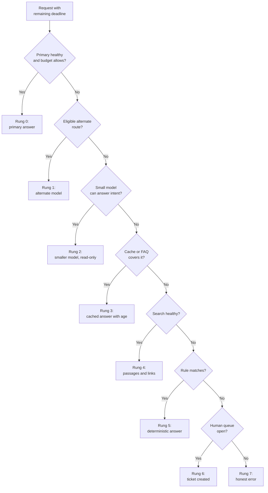

The flowchart reads top to bottom as the sequence a request follows when each earlier option is unavailable. In practice the router decides this from health state before the request starts (the breaker is open, so skip rung 0) and from the remaining deadline during the request. The implication for design is that each rung needs a health signal and a latency estimate the router can read cheaply.

### 11.2 A ladder in code

The [fault injection script](../code/python/ai-reliability-chapter/04_fault_injection_and_degradation_ladder.py) implements a small ticket-classification task with a model rung, a repair step, a rules rung, and a human queue. Each scenario injects a fault into a fake provider and prints the outcome:

```text
healthy                                    -> billing      src=model           {'calls': 1, 'repairs': 0, 'wait': 0.0, 'rung': 'primary'}
429 then ok                                -> billing      src=model           {'calls': 2, 'repairs': 0, 'wait': 2.0, 'rung': 'primary'}
malformed then repaired                    -> billing      src=model           {'calls': 2, 'repairs': 1, 'wait': 0.0, 'rung': 'primary'}
schema violation twice -> rules            -> billing      src=rules           {'calls': 2, 'repairs': 1, 'wait': 0.0, 'rung': 'rules'}
truncated twice, no rule match -> human    -> unclassified src=queue_for_human {'calls': 2, 'repairs': 1, 'wait': 0.0, 'rung': 'human_queue'}
outage: 503 x4 -> rules                    -> account      src=rules           {'calls': 4, 'repairs': 0, 'wait': 3.81, 'rung': 'rules'}
```

Read the rows as a specification. A single 429 costs one retry and 2 seconds of waiting. A malformed output costs one repair call. Two schema violations in a row step down to the rules rung, which classifies the ticket without a model. When no rule matches either, the ticket goes to a human with the label "unclassified" instead of a guess. The outage case burns four calls and 3.81 seconds before falling to rules, which is a bounded cost. Each result also records its source (`model`, `rules`, `queue_for_human`), which is what lets telemetry count degraded outcomes.

### 11.3 Deterministic fallbacks

A deterministic fallback has a property no model route has: its behavior is fully predictable, testable by unit tests, and independent of any provider. That makes it the right last automated rung. Examples for the support assistant: a rule that maps order-status questions with an order number to a templated status read from the order system; a curated FAQ keyed by intent with an exact-match or lexical retriever; and a "last known good" value, such as the last computed shipping estimate. A curated FAQ covering the top 200 questions might serve 30 to 40 percent of traffic in a typical support domain (an illustrative range, to be measured from your logs). That share is the fraction of users who still get a correct answer when every model route is down, which is why building it is worth more than a fourth provider.

Cached answers need care. A response cache keyed by the normalized question works only for non-personalized, non-time-sensitive content. A semantic cache returns the stored answer for a similar question, which risks returning an answer for a different question whose embedding is near. Use a conservative similarity threshold, bind entries to tenant and document version, store the creation time, and show the age. Never serve cached answers across tenants unless the content is public.

### 11.4 Hedged requests

A hedged request sends a second copy of a request if the first has not responded within a short delay, and uses whichever finishes first. Dean and Barroso describe the technique in "The Tail at Scale" (Communications of the ACM, 2013): defer the second request until the first has been outstanding longer than the 95th percentile latency, which adds only about five percent more load while cutting the tail substantially.

The arithmetic for time to first token. Assume TTFT has a median of 0.6 s, a p95 of 1.4 s, and a p99 of 6 s on each of two independent routes. Hedge after 1.4 s. The extra load is the fraction of requests still waiting at 1.4 s, which is 5 percent. A request is slow only if both the first request and the hedge are slow. For the combined TTFT to exceed 6 s, the first must exceed 6 s (probability 0.01) and the hedge must exceed 4.6 s (about 0.012 under the same distribution). Under independence the joint probability is $0.01 \times 0.012 = 0.00012$. The p99 of the hedged path falls from 6 s to roughly 2 to 2.5 s (the exact value depends on the shape of the distribution between p95 and p99, which this example does not specify), and the tail beyond 6 s falls from 1 percent to about 0.012 percent. Independence is the strong assumption. If both copies go to a single overloaded route, the two are slow together, the benefit disappears, and the extra load deepens the overload.

Hedging for AI is not free in the way it is for key-value reads.

- **Cost.** The hedge repeats the input tokens. At a 5 percent hedge rate the input bill rises about 5 percent for that route (outputs of the canceled copy are small if you cancel at once). This is a cost to price against the tail it removes.
- **Capacity.** Hedging adds load when the system is already slow. Disable hedging when the limiter is near its ceiling, when the breaker is half-open, or when retry budget use is high. Count hedges against the retry budget.
- **Where to hedge.** Hedge on TTFT, before any tokens have been sent to the user, and cancel the loser as soon as the winner emits its first token. After the first token the user is looking at one answer, and switching would produce a visible seam (section 13).
- **Target a different route.** Hedge to an alternate provider or region, or to another replica in the same pool when self-hosted, so the two requests do not share the cause of slowness.
- **Side effects.** Hedge only generation calls, never tool calls that mutate state, unless the tool is idempotent.

A related technique is to send a request to the alternate route from the start for a small share of traffic (the live share of section 10.2), which provides latency data on both routes without adding hedge load.

### 11.5 Choosing a level of degradation by feature

The right ladder depends on the feature's risk. Apply the stricter rules to features that take actions or give regulated advice.

| Feature type | Acceptable degraded behavior | Not acceptable |
| --- | --- | --- |
| FAQ-style support answers | Cached answer with age, retrieval only, link to help center | Invented answer without evidence |
| Order lookup and status | Templated status from the order system without a model | Guessing a status |
| Refund or account change | Human queue, or a confirmation form with no model | Automated action on an unvalidated model output |
| Medical or legal information | Honest error or human referral | A smaller model answering unreviewed |
| Search suggestions, summaries | Hide the feature | Slowing the core page for the sake of the suggestion |
| Batch classification | Delay, resume later, rules for the easy cases | Silently dropping records |

## 12. Output-Level Resilience: Validation and Repair

### 12.1 Why output validation is a reliability control

Four of the sixteen failure modes in section 3.2 are about what the model returned, not whether it returned. If downstream code assumes the output is well formed, a model that emits trailing prose after a JSON object, uses a key name once in a thousand calls, or stops at the token limit mid-string produces exceptions in parsers, wrong tool calls, or corrupted records. The application must treat the output as untrusted input. Validation is also a security boundary, because outputs can contain injected content ([Part 17 CH12](CH12_AI_Safety_Security_Privacy_and_Governance_Architecture.md)). This section covers its reliability side.

### 12.2 Layers of validation

Apply checks from cheapest to most expensive, and stop at the first failure.

1. **Finish reason.** Check whether generation ended normally (an end-of-turn or stop sequence) or because of the length limit, a content filter, or a tool call. A length stop means the output is incomplete regardless of how it looks.
2. **Syntax.** Parse the format (JSON, markup, YAML, database queries, code). Use a tolerant extractor for common wrappers such as code fences, then a strict parser.
3. **Schema.** Validate field presence, types, enums, ranges, and string patterns against a schema (JSON Schema or a typed model). Reject unknown fields if the downstream is strict.
4. **Business rules.** Check cross-field and domain constraints: refund amount at most the order total, a date in the future, a product identifier that exists.
5. **Evidence.** For grounded answers, check that each citation refers to a document that was in the retrieved set and that the quoted span appears in it. A string-match check is cheap and catches fabricated citations.
6. **Safety and policy.** Run output filters and leakage checks.
7. **Semantic quality.** A model-based judge is the most expensive check, applied to a sample or to high-risk outputs, with its cost and latency budgeted (section 4.5 and [Part 17 CH11](CH11_Evaluation_and_Observability_Architecture_for_AI_Systems.md)).

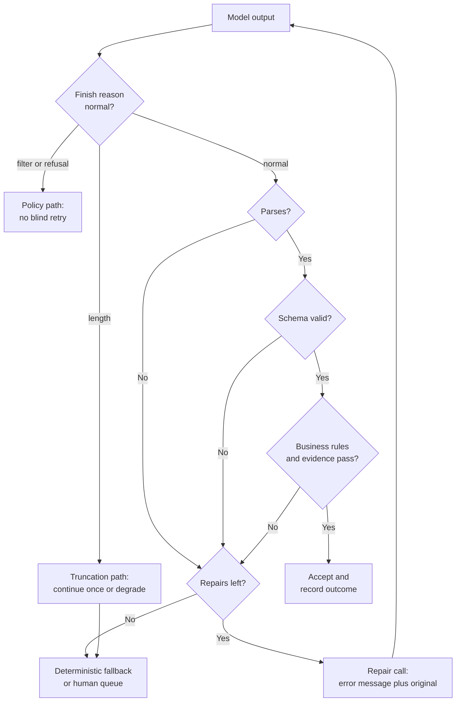

The flowchart gives each failure a different exit. Truncation and refusal never enter the repair loop, since repair would not fix them. Parse, schema, and rule failures share one bounded loop, whose exhaustion leads to the fallback rung from section 11. The loop is the only cycle in the diagram, and it has a counter.

### 12.3 Bounded repair loops

A repair call sends the original task, the faulty output, and the validator's error message, and asks for a corrected output. Bound it: at most one or two repairs per request, counted against the deadline and the retry budget.

The arithmetic shows why a small bound is enough. Suppose 3 percent of first outputs fail validation, and a repair succeeds 80 percent of the time, independently. After one repair the valid fraction is $0.97 + 0.03 \times 0.80 = 0.994$. After a second, it is $0.994 + 0.006 \times 0.80 = 0.9988$. The expected number of model calls per request is $1 + 0.03 + 0.006 = 1.036$. The first repair removes 0.024 of a possible 0.03 failure rate for 3 percent more calls, and the second removes 0.0048 more for 0.6 percent more calls. A third repair would remove another 0.001 and is rarely worth the latency. In practice the independence assumption is weak: an output that fails once for a structural reason (the prompt asks for something the model cannot produce in the format) fails again with the same cause. If the repair success rate on the second attempt is far lower than the first, the problem is the prompt or schema, and the right response is to fix it, using the repair-rate metric as the signal.

Repair has costs and risks. Each repair call repeats input tokens, so a long prompt makes repair expensive. A repair prompt that includes the model's earlier output may re-inject malicious content in the output. The repair of a tool call must go through the same authorization as the original. And repair success can hide a quality problem: a team that sees 99.9 percent valid outputs may not notice that 12 percent needed repair. Track first-pass validity and post-repair validity as separate numbers.

### 12.4 Constrained decoding and structured outputs

Several providers and open-source serving engines offer structured-output modes in which the decoder is constrained to produce tokens that match a JSON Schema or a grammar. This removes syntax errors for the supported schema subset and reduces schema violations to near zero. Three limits apply: constrained decoding guarantees form, not truth (a valid JSON object can contain a wrong value), generation can still stop at the token limit before the object closes, and each provider supports a subset of JSON Schema with limits on nesting and size that change between releases. Treat the feature as a reduction in repair rate and keep the validator, because it is the layer that works on every route including the fallback, which may not support constraints. Verify feature availability and schema limits in the current documentation of each provider.

### 12.5 Truncation

When the finish reason indicates the length limit, the output is incomplete. Options in order of preference:

1. Avoid it. Set `max_tokens` from the measured 99th percentile for the class, and instruct a bounded length.
2. Continue. If the API supports continuing from a partial assistant message, send the partial output and ask for the remainder, then join the two. Check the joined output with the same validators. Continuation can break structured outputs at the seam.
3. Regenerate with a larger limit once, if the deadline and budget allow.
4. Degrade to a shorter form (summary, first part only, with a label).

Do not accept a truncated structured output because it "mostly parses". A JSON object cut at a number boundary can parse as a valid but wrong value.

### 12.6 Refusals and tool-call validation

A refusal is a valid completion, not an error. The right response depends on whether it was appropriate. Classify refusals (a lightweight classifier or the provider's stop reason) and send them down a policy path: show the refusal with guidance, escalate to a human if the user's request was legitimate, and sample refusals for review. A rise in refusal rate on a fixed canary set is a strong signal of a silent upstream change. Do not rewrite and retry automatically, for the security reason in section 6.2.

A tool call produced by a model is a proposal. Validate the tool name against an allowlist for the current rung, the arguments against the tool's schema, and the authorization of the acting user for the specific resource. Reject calls that the user could not have performed directly ([Part 17 CH06](CH06_Agentic_System_Architecture_and_Tool_Boundaries.md)). This keeps a repaired or regenerated call from widening privileges.

## 13. Streaming Resilience

### 13.1 Why streaming changes the failure model

A streamed response sends tokens as they are generated. The user sees the first words within a second or two, which makes long answers feel responsive. It also changes what failure means. The HTTP status line arrives with the first byte, so by the time a fault occurs the status is already 200. Providers report mid-stream faults as error events inside the stream, as the Anthropic errors documentation describes for its streaming API, and a client that checks only the status code will treat a half answer as a full one. The failure can also come from the path rather than the provider: a load balancer idle timeout, a proxy that buffers, a mobile network switch, or a deploy that terminates the pod holding the connection.

Three consequences shape the design. A failure after the first token is visible, so the cost of recovery includes the user's confusion. A stream holds a slot for its entire life, so capacity planning uses stream duration. And a retry produces a different text from the one the user partly read.

### 13.2 The free window before the first token

Everything before the first token reaches the user is invisible. A route that fails in this window can be replaced by another route, the retry can repeat the request, and the user sees only a longer wait. This window is the cheapest place to make failure decisions, so set aggressive limits on it: a TTFT timeout that is a multiple of measured p99 TTFT (section 5.4), a hedge delay (section 11.4), and an immediate failover on connection errors. After the first token the options narrow, and every recovery action leaves a mark.

Some designs add a short buffer: hold the first 20 to 50 tokens or the first 300 milliseconds of the stream before sending anything to the client. This extends the free window a little and allows an output guard to inspect the opening text. The cost is added latency to first visible output, so use it only where early failure or early policy violations are common.

### 13.3 Partial results: options

When a stream fails after some tokens have been shown, the application chooses among four behaviors.

| Option | How it works | User sees | Cost and risk |
| --- | --- | --- | --- |
| Keep and mark | Show what arrived, append an "interrupted" marker and a retry control | A truncated answer that is clearly incomplete | No extra tokens. Honest. Needs user interface support |
| Discard and restart | Remove the partial text and start again, possibly on another route | A visible reset, then a new answer | Doubles the tokens for that request. The new answer may differ |
| Continue | Send the partial text as the beginning of the assistant turn (where the API allows) and generate the remainder | Seamless text, if it works | Seam errors, repeated sentences, extra input tokens. Not supported by all APIs. Verify before use |
| Resume from buffer | A server-side buffer holds the stream so a reconnecting client replays missed events | Seamless, no regeneration | Needs stateful stream storage and event identifiers. Works only if the model call itself has not failed |

Resume from buffer fits transport faults such as a mobile network drop, where the model side was healthy. Implement it with server-sent events using an event identifier on each message and the client's `Last-Event-ID` header on reconnection; the server keeps a ring buffer of the last few hundred events per stream for 60 seconds. For a fault in the model call, use keep-and-mark or discard-and-restart. A common pairing is: transport faults resume from the buffer, model faults keep and mark when more than a threshold of text was shown (say 100 tokens) and discard and restart otherwise.

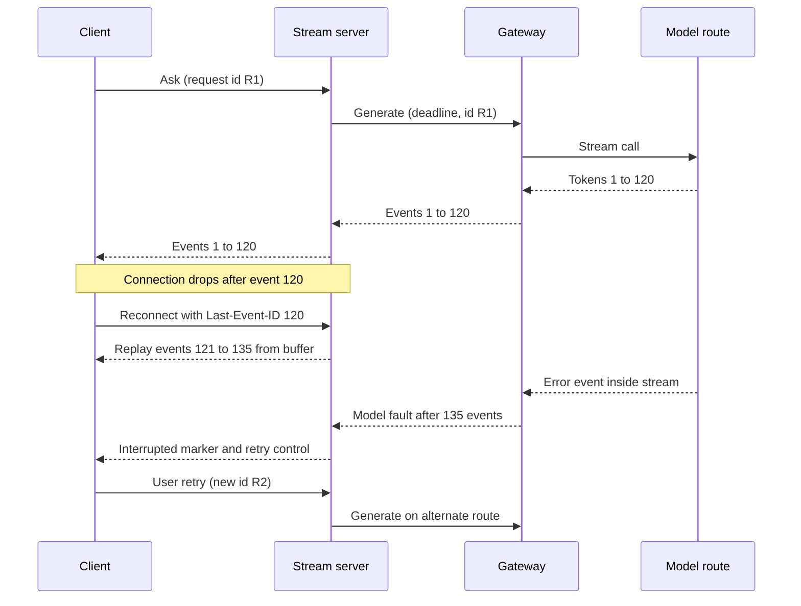

The diagram shows two different faults in one session. The connection drop is a transport fault, and the buffer repairs it invisibly. The error event from the model is a source fault, and no buffer can complete the answer, so the user sees a marker and may retry on an alternate route. Distinguishing the two is the reason to carry event identifiers and to log the cause of each interruption separately.

### 13.4 Validation versus streaming

Output validation (section 12) usually needs the complete output. Streaming shows partial output before it can be validated. Choose per feature:

- **Stream, validate after.** Acceptable when the risk of showing a bad token sequence is low (a chat answer to a general question). If validation fails, the client retracts or labels the text. Retraction is a visible failure, so do this only where validation failures are rare.
- **Stream by validated unit.** Buffer a sentence, a paragraph, or a JSON field, validate it, then release it. This works for text with chunk-level checks (safety filters on each paragraph) but not for whole-document constraints.
- **Do not stream.** For structured outputs consumed by code, streaming adds nothing for the user and removes the chance to repair. Call the model without streaming, or stream internally and release the whole result.

### 13.5 Transport details that cause real outages

- **Idle timeouts.** Intermediaries close connections that carry no bytes for a period (many default to 60 seconds, but defaults vary and are configurable, so check yours). A model that is reasoning silently before the first token can exceed it. Send a keep-alive comment line (`: ping`) in the event stream every 10 to 15 seconds.
- **Buffering proxies.** Some reverse proxies buffer responses by default, which turns a stream into one late burst. Disable response buffering on streaming routes and test through the real edge.
- **Compression.** Response compression can hold bytes until a block fills. Disable it for streams or flush at event boundaries.
- **HTTP/2 and multiplexing.** Many streams share one connection, so a connection-level failure kills all of them at once, and per-connection stream limits cap concurrency.
- **Client cancellation.** When a user closes the tab, the server must notice and cancel the upstream call (section 5.5). Test it. A leak here shows up as quota consumed by users who are gone.

### 13.6 Capacity and deployments

By Little's law, concurrent streams equal arrival rate times average stream duration. At 100 new streams per second and an average of 20 seconds, there are 2,000 open streams. Each holds a connection on the edge, memory in the gateway, and a slot at the provider. A rolling deploy that terminates a pod drops its streams unless the pod drains. Set the termination grace period above the maximum stream duration (say 120 seconds if streams are capped at 90), stop sending new streams to the pod when draining begins, and deploy in small batches. Without draining, a deploy of 10 pods at once breaks 100 percent of in-flight streams, while a rolling deploy at 10 percent breaks nothing. Set a maximum stream duration so a runaway generation cannot hold resources indefinitely.

## 14. Stateful Agent and Workflow Resilience

### 14.1 The run is the unit of reliability

[Part 17 CH06](CH06_Agentic_System_Architecture_and_Tool_Boundaries.md) describes agent loops and tool boundaries. For reliability the relevant fact is that a run may span dozens of model calls, tool calls, and waiting periods, so the probability that something fails during a run is much higher than for any single call. If each step succeeds with probability $p = 0.98$ and a run needs $n = 20$ steps, the probability that a run completes with no failure is $p^n = 0.98^{20} = 0.668$. Restarting failed runs from the beginning until one completes would cost on average

$$
E[\text{steps}] = \frac{1 - p^n}{(1-p)\,p^n} = \frac{1 - 0.668}{0.02 \times 0.668} \approx 24.9
$$

step executions per completed run, versus 20 for a run that never fails, and 20.4 ($20 / 0.98$) if only the failed step is retried from a checkpoint. Restarting from scratch costs about 22 percent more steps than checkpointing in this example, and it also repeats side effects and wastes elapsed time. With longer runs and more expensive steps the gap widens quickly: at 50 steps the same formula gives $p^n = 0.364$ and about 87.3 step executions per completion against 51 with checkpointing.

### 14.2 Checkpointing and durable execution

A checkpoint records enough state to resume a run after the process dies. For an agent, that means:

- the run identifier, owner, and original request;
- the message history, including model outputs and tool results, in order;
- the step counter and the budgets spent (tokens, tool calls, wall time, money);
- the model and prompt versions in use, so a resumed run is consistent;
- the status of each tool action (not started, started with idempotency key, confirmed);
- pending approvals and timers.

Write the checkpoint after every step that has a cost or an effect, before starting the next step. For side effects, the order matters: record the intent and idempotency key first, perform the action, then record the result. A crash between action and record leaves an "started" entry, and recovery must check the action system for the outcome before repeating it.

Durable execution engines, such as Temporal, AWS Step Functions, Azure Durable Functions, and similar systems, provide this pattern as infrastructure. They persist an event history of the workflow, and when a worker dies they replay the workflow code against the history to rebuild state. Replay requires that orchestration code be deterministic: it must not call the model or read the clock directly, because a replay would produce different values. The model call and tool call are executed as separate activities whose results are stored in the history, so on replay the stored result is returned instead of calling the model again. This is how a replay avoids both the cost of re-calling the model and the divergence of a regenerated answer. If you build your own, store each model output in the run record and make the orchestrator read from the record on resume. The choice between a workflow engine and a hand-built state machine on a database is one of effort and operations. An engine gives timers, retries, history, and visibility. A hand-built version is simpler to start and tends to grow into a poor engine.

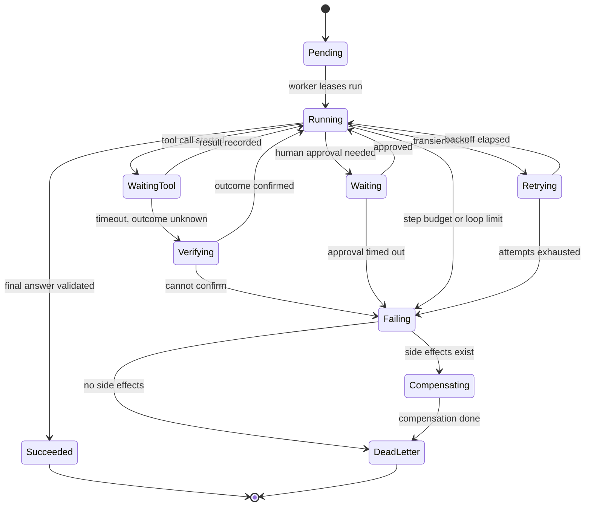

The state machine includes the states that sketches of agents often omit. `Verifying` handles the unknown-outcome problem: a tool call timed out after the request was sent, so the action may or may not have happened, and the run must query the action system before doing anything else. `Compensating` unwinds side effects when the run cannot finish. `DeadLetter` holds runs that need a human, with the checkpoint attached. The implication is that these paths need code and tests as much as the happy path.

### 14.3 Tools: idempotency, timeouts, and unknown outcomes

Every tool an agent can call should have a declared class: read-only, idempotent write, or non-idempotent write. Read-only tools can be retried freely. Idempotent writes accept an idempotency key and return the original result on a repeat, and retry is safe. A non-idempotent write must not be retried blindly and should usually be wrapped, either by adding a key at your tool adapter or by checking state before acting ("is there already a refund for this order line?").

When a write times out, the outcome is unknown. The correct sequence is: query the system of record using the business identifier, decide from the result whether the effect occurred, and then either record success or retry with the same key. [Part 07 CH16](../07_System_Design_and_Distributed_Systems/CH16_Idempotency.md) gives the theory; the agent-specific part is to make the verification a first-class state (as `Verifying` above), not an exception handler.

Give each tool its own timeout, its own breaker, and its own bulkhead, because an agent that calls a slow tool 30 times in a loop will hold its slot and its token budget for the whole period. Tool latency should come out of the run's deadline in the same way as model latency (section 5).

### 14.4 Compensation

When a run fails after side effects, undo them if they can be undone. [Part 07 CH13](../07_System_Design_and_Distributed_Systems/CH13_Saga_Pattern.md) owns the saga pattern. For an agent, a compensation action is registered when each effect is recorded: "cancel the pending refund", "release the reserved slot", "send a correction message". Some actions cannot be compensated (an email sent, a payment settled to an external party). These need an approval gate before execution, and the gate is part of reliability design, not only of safety design. Do the irreversible step last in the run, after the validations that might fail, so that failures before it leave nothing to undo.

### 14.5 Loops, budgets, and poison tasks

An agent loop can fail without error by never converging: it calls the same tool with the same arguments repeatedly, alternates between two states, or keeps decomposing the task. Bound every run with a maximum number of steps, a token budget, a wall-clock limit, and a cost cap, and detect repetition (the same tool call with the same arguments three times, or a repeated state hash). When a limit trips, stop the run, mark it failed with the reason, and route it to the dead-letter queue or to a human with the checkpoint attached.

A poison task is a unit of work that fails the same way every time it runs: an input that crashes the parser, a document that triggers a refusal, a request that makes the agent loop. Without a cap, the queue retries it forever, consuming quota and masking other work. Count attempts per task, not per message, and after the maximum (typically 3) move the task to a dead-letter queue with the error, the checkpoint, and the prompt and model versions. Review the dead-letter queue on a schedule, because its growth rate is a leading indicator of a regression: if it rises after a prompt change, the change is the suspect. Provide a replay tool so that fixed tasks can be re-submitted in bulk with rate control.

### 14.6 Model and prompt changes during a run

A run that starts on one model version and resumes after a rollout on another can behave inconsistently: the new model may interpret earlier turns differently or reject the tool schema. Record the model and prompt version at run start and pin the run to them for its lifetime where the provider allows, with a defined maximum run duration so that old versions can be retired. If a model is retired, the run policy should say whether to fail runs older than the retirement, re-plan from the checkpoint, or finish them on the pinned route during a grace period.

## 15. Batch and Asynchronous Recovery

### 15.1 What changes for batch

A batch job has no user waiting, so latency per item matters little. What matters is that the whole job completes before a deadline, that no item is lost or processed twice with different results, and that recovery from an outage is cheap. The reliability tools differ from the interactive set: sharding, manifests, idempotent writes, rate-controlled workers, and a deadline governor.

### 15.2 Throughput arithmetic for the nightly pipeline

The nightly pipeline enriches 4,000,000 product records between 22:00 and 06:00. The window is 8 hours, or 28,800 seconds, so the minimum rate is $4{,}000{,}000 / 28{,}800 = 138.9$ records per second. Suppose each record uses 1,200 input tokens and 150 output tokens. Total input is $4.8 \times 10^9$ tokens, which over 480 minutes is 10 million input tokens per minute. Total output is $6 \times 10^8$ tokens, or 1.25 million per minute. Those are the quotas the job needs for an exact fit, with no failures, which never happens.

Plan with margin. Target a 6-hour run, which gives a 2-hour slack: $4{,}000{,}000 / 21{,}600 = 185.2$ records per second, or 13.3 million input tokens per minute. Then account for overhead: assume 5 percent of calls are retried and 2 percent of records need a repair call, so the work is about 7 percent above the base. The planned 6 hours becomes about 6.4 hours of work. Suppose a provider outage stops the job for 90 minutes. The job then finishes at roughly $22{:}00 + 6.4 + 1.5 = 05{:}54$, only 6 minutes before the deadline. A plan that looked comfortable has almost no slack, so the pipeline needs a second lever: a catch-up rate above the plan (if quota allows 1.3 times the planned rate, the remaining work after the outage drains faster), a second provider for batch, or the ability to drop optional work.

Dimensioned quotas and rates are the batch equivalent of the user-facing headroom discussion. A job that needs 13.3 million tokens per minute on an account limited to 10 million cannot meet its deadline under any retry policy, and that fact should be discovered in design review, not at 04:00.

### 15.3 Sharded, resumable processing

Split the input into shards of a fixed size, for example 1,000 records, which gives 4,000 shards. Keep a manifest table with one row per shard: status (pending, leased, done, failed, quarantined), lease holder and expiry, attempt count, counts of records succeeded and failed, and the model and prompt versions used. A worker leases a shard, processes its records, writes results idempotently, and marks it done. If a worker dies, its lease expires and another worker takes the shard. Shard size balances overhead against loss: a smaller shard loses less work on failure and recovers faster, a larger shard has fewer manifest operations. At 1,000 records and 185 records per second a shard takes about 5.4 seconds of aggregate work, but a single worker handling 20 records per second takes 50 seconds, which bounds the work lost when a worker fails.

Write results idempotently. A natural key is the record identifier plus a hash of the input, the prompt version, and the model version. An upsert on that key makes a repeated shard harmless, and the version fields allow a later re-run with a new prompt to coexist with the old results. Never write results by append without a key, since a shard replay duplicates rows.

### 15.4 Poison records and partial failure

Within a shard, some records fail repeatedly: text that triggers a refusal, an empty field, content longer than the context. Retry a failed record a small number of times, then write it to a quarantine table with the error and move on. A pipeline that halts on one bad record out of four million will fail every night. Put a threshold on the quarantine rate (for example, halt and page if more than 2 percent of a shard is quarantined), since a high rate usually means a systematic fault such as a prompt change or schema drift, not bad data.

### 15.5 The deadline governor

A deadline governor computes the projected finish time from the remaining work and the observed rate, $T_{\text{finish}} = t_{\text{now}} + R / \lambda$ where $R$ is remaining records and $\lambda$ is the trailing throughput. When the projection moves past the deadline minus a safety margin, the governor takes a pre-agreed action in order: raise parallelism if quota remains, route part of the work to the secondary provider, switch the remaining records to a cheaper model or a shorter output, skip optional fields (the short description, keeping the classification), and finally page a human to decide. Each action must be declared in advance with its quality and cost, so the on-call engineer is choosing from a list, not inventing a response at 03:00.

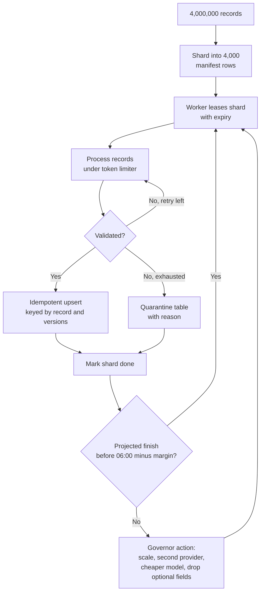

The flowchart shows the loop of lease, process, validate, write, and check. The two exits for failures (retry and quarantine) are bounded. The governor sits in the loop after each shard, so the pipeline reacts continuously to a slow night instead of discovering it at the deadline.

### 15.6 Provider batch interfaces

Several providers offer an asynchronous batch interface in which you submit a file of requests and collect results within a stated completion window (up to 24 hours is common), often at a lower price. These suit enrichment work with a loose deadline. They do not fit a job with an 8-hour window and a hard 06:00 cutoff unless the provider's window is shorter, and results may arrive late or expire. Check current terms, window, per-batch limits, and error handling before depending on them, and keep the interactive path available as a spill route for the tail. Treat each batch as a shard in the manifest, with a poll-and-reconcile step.

## 16. Data-Plane Resilience: Retrieval, Caches, and Indexes

### 16.1 Retrieval failure is a model-quality failure

When retrieval degrades, the model still answers, using less evidence or the wrong evidence. The answer may be fluent and wrong. So data-plane faults matter beyond availability: the usable-outcome SLI of section 4 must include evidence checks, and recall canaries must run against the real index. [Part 17 CH05](CH05_Retrieval_Augmented_Generation_System_Architecture.md) designs the retrieval architecture. This section covers keeping it available and honest.

### 16.2 Replicas, shards, and partial results

A vector index serves reads from replicas and spreads data across shards. A lost replica reduces capacity but not correctness. A lost shard removes a slice of the corpus, and queries that fan out to all shards may return results from the rest without error. A search that silently omits a shard is the worst case: the system reports success, recall falls by the shard's share of relevant documents, and answers drop evidence. Configure the query path to return an explicit partial flag and to treat a missing shard as an error for queries where completeness matters, or to attach the flag to the answer's metadata. Run an end-to-end recall canary of known questions with known source documents at a fixed interval; a drop identifies the problem faster than shard health metrics.

Keep at least two replicas of each shard in separate failure domains (zones), size the read path so that losing one zone leaves enough capacity at peak (section 17.3), and spread replicas so that one maintenance event does not take both.

### 16.3 Rebuild time as a design number

Know how long it would take to rebuild the index, because that time is part of your recovery time. A corpus of 50 million chunks with 1,024-dimension float32 embeddings holds $50 \times 10^6 \times 1{,}024 \times 4$ bytes $= 204.8$ GB of raw vectors, before the graph structure or other index overhead. Restoring that from a snapshot at an effective 500 MB/s takes $204.8 \times 10^9 / 500 \times 10^6 = 410$ seconds, under 7 minutes, plus loading into memory and any warm-up. Recomputing the embeddings from source documents is far slower. At an illustrative 2,000 chunks per second, 50 million chunks take 25,000 seconds, about 6.9 hours, and consume embedding-provider quota in competition with live queries. Two rules follow: store computed vectors in durable storage (not only inside the index), and snapshot the index on a schedule that matches the recovery point you need. When the embedding model changes, a new index in a new embedding space must be built and validated beside the old one, and queries must use the matching model for each, since vectors from different models are not comparable.

### 16.4 Stale indexes and freshness

Ingestion lag means the index trails the source. For some content, an hour is fine. For prices, policies, or incident status, an hour-old fact is a wrong answer. Track freshness lag (now minus the latest ingested update time) as an SLI per source, set a freshness objective per content class, and let the application react: when lag exceeds the objective for a source, add a "may be out of date" qualifier, prefer the live system of record for that fact (a direct lookup), or exclude that source. A document version check at answer time (compare the retrieved chunk's version with the current version in the source system) catches stale chunks that were never reindexed. Deletions are a special case: a removed or retracted document that remains in the index is both a correctness and a compliance risk, so tombstones must propagate promptly.

### 16.5 Fallbacks for retrieval

A retrieval degradation ladder mirrors the generation ladder. If the vector query is slow or failing: use a lexical (keyword, BM25) index that is built from the same documents and kept in a separate engine or tier; use cached results for popular queries; use a smaller candidate set with no reranker; and finally answer from the model alone with an explicit label that no evidence was retrieved, or decline. If the embedding service is down, queries cannot be embedded: serve lexical search, reuse embeddings of recent queries, or switch to an alternate embedding model only if its index exists in the same space (otherwise the vectors are unrelated and results are noise). Hybrid retrieval ([Part 17 CH05](CH05_Retrieval_Augmented_Generation_System_Architecture.md)) gives this fallback for free: lexical search is already running and tuned.

### 16.6 Cache stampedes and cold caches

When a popular cached item expires, many requests miss at once and all start the same expensive generation. If a question arrives at 20 requests per second and generation takes 6 seconds, then without protection about $20 \times 6 = 120$ duplicate generations run before the first one finishes and populates the cache. Defenses:

1. **Single-flight.** Only one request computes a given key. The others wait for the result.
2. **Stale-while-revalidate.** Serve the expired value, within a bounded staleness, while one request refreshes it.
3. **Jittered expiry.** Add random variation to time-to-live values so that related keys do not expire together.
4. **Early refresh.** Refresh popular keys shortly before expiry.

A cold cache after a deploy or a restart causes a similar surge. If 40 percent of requests normally hit the response cache, then at 100 requests per second the model sees 60 requests per second. With the cache empty, the model sees 100 per second, 1.67 times the normal load, in the minutes after deploy when other things are also changing. Warm the cache from recent popular keys before shifting traffic, persist the cache across restarts when the content allows, and roll out in small steps so that only part of the cache is cold at one time. The same applies to the limiter state (section 8.6), the embedding cache, and the prompt cache offered by some providers, whose hit rate affects both cost and latency, and whose behavior depends on provider-defined rules to verify.

## 17. Capacity Resilience

### 17.1 Headroom is a reliability parameter

Systems that run near their ceiling cannot absorb a burst, a failed node, or a retry wave. Queueing theory shows why. For a single queue with random arrivals and service (an M/M/1 model, used here as a rough guide), the mean time in the system grows as $1 / (\mu - \lambda)$, where $\mu$ is the service rate and $\lambda$ the arrival rate, and the factor $1/(1-\rho)$ with utilization $\rho = \lambda/\mu$ tells how fast latency grows: at 50 percent utilization it is 2, at 80 percent it is 5, at 90 percent it is 10, and at 95 percent it is 20. Real GPU serving with continuous batching behaves differently in detail, but the shape holds: latency rises sharply as saturation approaches. Operating targets in the 50 to 70 percent range of measured capacity at peak are typical for interactive workloads, and the right number is found by load testing for the point where p99 TTFT leaves its SLO.

### 17.2 Autoscaling lag

Autoscaling responds to load, but with delay. A self-hosted model replica adds capacity only after several steps, each with its own time.

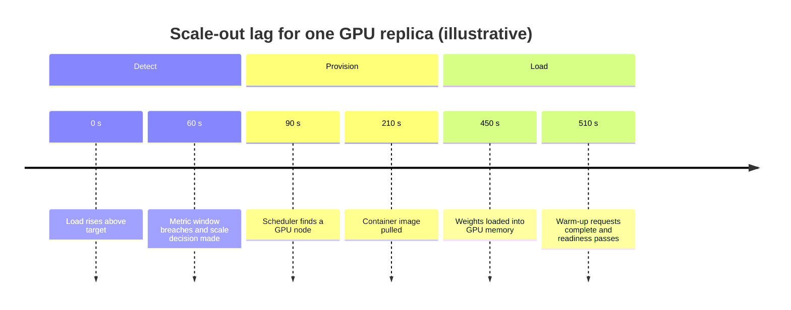

The timeline totals 510 seconds, about 8.5 minutes, from the start of a surge to the first useful token from the new replica. During that time the existing replicas carry all of the load. If traffic can grow by 5 percent per minute in a surge (a marketing event, a morning ramp), then over 8.5 minutes it grows by $1.05^{8.5} = 1.51$, or 51 percent. To absorb that without queueing, steady-state utilization must be at most $1/1.51 = 66$ percent of capacity, which is the headroom needed to cover the lag. Faster scaling reduces the required headroom, and the ways to do it are warm pools of idle replicas, preloaded images on nodes, weights cached on local disk or a shared fast volume, smaller models, and predictive scaling from schedules. For hosted models the provider owns this lag, and what you control is how fast your own consumption can grow against the quota and any acceleration limits.

### 17.3 N+1 and loss of a failure domain

Provision enough capacity to lose one unit and still meet the peak. Take a self-hosted pool of 8 replicas, each serving 12 requests per second, for a total of 96 per second against a peak of 70. Utilization at peak is $70/96 = 0.73$. If one replica fails, capacity is 84 and utilization 0.83. The M/M/1 latency factor $1/(1-\rho)$ moves from 3.7 to 6.0, so latency rises by about 1.6 times: degraded, not failed. If a second replica fails, capacity is 72 and utilization 0.97, with a latency factor of about 36, which is an outage in practice. To tolerate two losses with post-loss utilization at 85 percent, you need $70/0.85 = 82.4$ requests per second after losing two, that is 7 replicas, plus the 2 lost, so 9 replicas. If the pool spans three zones, the failure unit is a zone, not a replica: losing one of three zones removes a third of capacity, so each zone must be sized so that the other two carry the peak (50 percent more per zone than an even split). The cost of resilience is the extra 12.5 to 50 percent of capacity that sits idle, and it should appear in the capacity plan as a stated number.

### 17.4 GPU shortage and quota denial

A shortage can take three forms: the cloud cannot supply the GPU type in a region, the provider reduces your quota or throttles during peak demand, or a new model needs more memory than your pool offers. Defenses, from cheapest to most expensive:

- reserve or commit capacity for the baseline (reserved instances, provisioned throughput on a hosted platform) and use on-demand or shared capacity only for the peak;
- qualify more than one accelerator type and region, with serving configurations tested for each;
- keep a smaller or quantized model variant that fits in less memory and can serve during a shortage with a lower quality contract;
- keep a hosted fallback route with its own quota;
- maintain a shortage playbook that lists the order in which features are degraded.

A shortage playbook is a ranked list of what to give up: batch before interactive, free tier before paid, long contexts before short, optional features before core. Agreeing on this ranking before an event avoids arguing about it during one. [Part 17 CH14](CH14_AI_Cost_Performance_and_Sustainability_Decisions.md) covers the cost of reserved versus on-demand capacity.

### 17.5 Capacity of the dependencies you forget

Capacity planning often covers the model and ignores the vector store, the embedding service, the tool backends, the cache, and the gateway. A retrieval-heavy feature at 100 requests per second with 5 vector queries each sends 500 queries per second to the index. An agent that makes 8 tool calls per run sends 800 calls per second to the order system at the same user rate, which may be ten times its normal load. Include each dependency's capacity and its own failure behavior under overload, and include the protective limits (bulkheads, per-tool limiters) that keep an agent from overrunning a backend that was built for human-speed traffic.

## 18. Dependency Mapping, Static Stability, and Blast Radius

### 18.1 Serial dependencies multiply

If a request needs every one of $k$ components to succeed, the availability of the path is the product of their availabilities. Consider an assistant with these hard dependencies (illustrative values): authentication 99.99 percent, retrieval 99.9, one model provider 99.5, validation 99.99, and the order system 99.9 (for the order-lookup path). The product is $0.9999 \times 0.999 \times 0.995 \times 0.9999 \times 0.999 = 0.9928$, or 99.28 percent. That is below the 99.9 percent target before any quality failure is counted, and the single model provider is the cause. Reducing the dependence on the weakest element matters more than polishing the strong ones.

Now change the design for the answer path: a second eligible route with common-cause fraction giving the model path 99.95 percent (about the 99.948 percent figure from section 10.1), retrieval made a soft dependency by lexical fallback (effective 99.99 percent for the purpose of producing some answer), and the order system removed from the answer path for FAQ questions. The product is $0.9999 \times 0.9999 \times 0.9995 \times 0.9999 = 0.9992$, or 99.92 percent. The structure of the dependency graph, hard versus soft and serial versus alternative, is the design lever. A dependency becomes soft when a defined fallback produces a contract-meeting result without it.

### 18.2 Mapping and classifying

Build a dependency map for each feature as an artifact in the architecture record: every service, data store, third-party API, configuration source, secret store, identity provider, and control-plane action that the request path touches, including those hidden in client libraries and sidecars. For each, record: hard or soft, the fallback if soft, the timeout and retry policy, the owner, the capacity limit, and the failure signals. The act of building the map exposes shared dependencies (the same identity provider for the app and the gateway, the same domain name system provider for both providers) that raise the common-cause fraction.

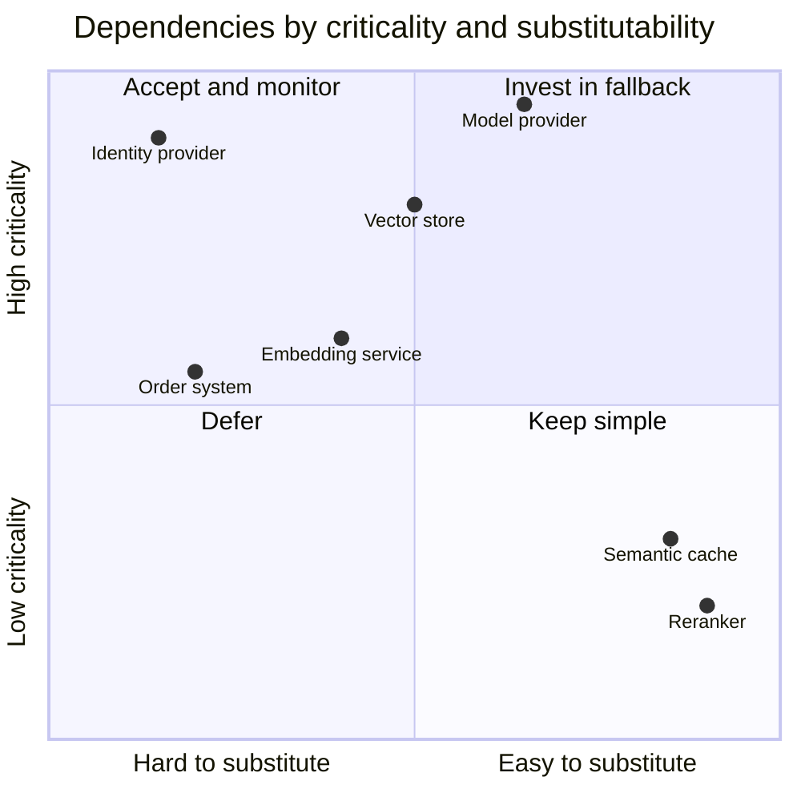

The chart sorts the support assistant's dependencies. The identity provider is critical and hard to replace, so the design must accept it as a single point of failure and mitigate it with cached sessions and short outages tolerated by token validity. The model provider and vector store are critical but substitutable (second route, lexical fallback), so they get the fallback investment. The reranker and semantic cache are optional and easy to drop. Positions are the judgment of the team that drew them. The value of the exercise is the argument over placement.

### 18.3 Static stability

A system is statically stable if it keeps working when a dependency's control plane or a recovery mechanism is unavailable, because the state it needs is already in place. The Amazon Builders' Library article on static stability using availability zones describes the idea for cloud capacity: pre-provision enough capacity in each zone so that losing a zone does not require launching new instances at the moment the control plane is under stress. For AI systems the principle applies to many elements:

- **Capacity.** Keep warm standby replicas and provisioned quota ahead of need, not scale-from-zero at failure time (section 17).
- **Failover configuration.** Hold the alternate route's credentials, prompt variant, and eligibility record in the running gateway, loaded locally. Do not depend on fetching a routing table from a configuration service, or on a provider status page, to decide to fail over. If the configuration service is down, the gateway keeps its last known good configuration.
- **Policy and identity.** Cache authorization decisions and keys with bounded lifetimes so a short outage of the policy service does not stop all traffic. Define fail-open or fail-closed per decision, with fail-closed for destructive actions.
- **Prompts and model versions.** Load prompts from a local bundle shipped with the deployment, not fetched per request from a registry.
- **Feature flags.** Evaluate from a local snapshot with a safe default.

The test of static stability is to remove the control plane (block the config service, the registry, the status feed) in staging and verify that existing traffic continues and the failover still works.

### 18.4 Blast radius and cells

Blast radius is the share of users or traffic affected by a fault. Reduce it by partitioning. A cell architecture runs several independent copies of the stack, each serving a subset of tenants, so a bad deploy, a poison prompt, or a noisy tenant hurts one cell. For AI features, also partition by provider account and quota (a spend cap tripped in one cell's account does not stop the others), by model version (roll out new versions to one cell first), and by tenant tier. A change should reach all cells only after passing through a canary cell with the evaluation gate. The cost is duplicated baseline capacity and more operational surface, so cells make sense when the product is large enough that a full outage is unacceptable and when tenants are isolatable.

## 19. Chaos Experiments and Game Days

### 19.1 Why test failure on purpose

Every pattern in this chapter is a prediction about behavior under failure: the breaker will open, the fallback will serve, the budget will hold, the shed requests will be low priority. A prediction that has never been tested is a hope. Chaos engineering, as described at principlesofchaos.org, is the practice of running experiments on a system in production-like conditions to build confidence in its ability to withstand turbulent conditions. The method is a loop: define steady state in measurable terms, state a hypothesis that it will hold under a specific fault, inject the fault with a limited blast radius, observe, and fix the gap.

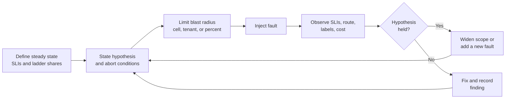

The loop shows two properties. The hypothesis and abort conditions are written before injection, so a surprising result stops the experiment instead of becoming an outage. And a passing experiment leads to a wider or different one, not to the end of the work.

### 19.2 Faults specific to AI systems

The usual infrastructure faults (kill a pod, add network latency, drop a zone) apply. The AI-specific faults below target the behaviors of earlier sections. Most can be implemented in a test gateway or sidecar that rewrites responses, with no need to touch the provider.

| Fault | How to inject | Hypothesis | What to observe |
| --- | --- | --- | --- |
| Provider returns 429 for 30 percent of calls | Gateway fault rule | Client limiter and retry budget hold. Provider load stays under 1.1 times demand | Retry ratio, queue age, shed count |
| Provider returns 529 for 100 percent of calls | Gateway fault rule | Breaker opens within 10 s. Fallback serves eligible tenants. Residency respected | Route share, breaker state, degraded label |
| First-token latency of 20 s on the primary | Delay rule | TTFT timeout fires. Hedge or failover. No slot leak | Cancellation count, in-flight gauge |
| Stream error after 100 tokens | Stream cutter | Interrupted marker or resume works. Billing tracked | Client behavior, partial-result rate |
| Output truncated by length stop | Force `max_tokens` low | No truncated record accepted | Validator rejects, fallback share |
| 5 percent of outputs malformed | Output mutator | Repair loop bounded. Repair rate alert fires | Calls per request, repair rate |
| Refusal on 10 percent of canary prompts | Response rewriter | Canary alert fires. No auto-rewrite loop | Alert latency |
| Embedding service down | Block egress | Lexical fallback serves. Label shown | Recall canary, fallback share |
| One vector shard unavailable | Stop a shard | Partial flag raised. Recall canary drops and alerts | Partial-result rate |
| Alias moves to a new model version | Swap behind a test alias | Pinned routes unaffected. Drift alarm on unpinned | Eval score, drift alert time |
| Quota lowered by 50 percent | Limiter config | Shedding by class, interactive protected | Goodput by class |
| Config service unreachable | Block it | Gateway keeps last known good, failover still works | Static stability check |
| Tool times out after sending the request | Tool stub | Run enters verify state. No double action | Idempotency key hits |
| Worker killed mid-run | Kill process | Run resumes from checkpoint. No repeated side effect | Resume count, duplicate actions |

Run the cheap, code-level experiments in continuous integration (section 22) and the infrastructure-level ones in staging and then production.

### 19.3 Running a game day

A game day is a scheduled, supervised exercise with people in their real roles. A workable format is three hours.

1. **Plan (a week before).** Choose two or three scenarios, such as "primary provider returns 529 during peak hour" and "spend cap on the batch account trips at 02:00". Write hypotheses, abort conditions (for example, abort if the user-facing usable fraction falls below 99 percent for 5 minutes), and the observers' roles.
2. **Brief.** Confirm who holds the abort decision, who communicates, and that customer support knows a test is running.
3. **Run.** The facilitator injects the fault. The on-call engineer works from the runbook only, without hints from the facilitator. A scribe records the timeline: time to detect, time to decide, time to mitigate, and each deviation from the runbook.
4. **Debrief.** Within a day, list what worked, what did not, and which runbook steps were wrong or missing. Create tracked actions with owners and dates, and re-test the fixes.

Measure the exercise. Time to detect, time to mitigate, and whether the system's own behavior matched the hypothesis are the outputs. A game day that ends with "it went fine" and no findings has probably tested too little.

### 19.4 Safety rules

Chaos in production needs guardrails. Start in staging and in a low-traffic window. Limit the blast radius to one cell, one tenant tier, or a small percentage. Make every fault reversible with a single switch, and test the switch. Exclude traffic types that must not see faults (safety-critical flows, regulated tenants unless they have agreed). Tell support and the incident channel. Never inject a fault that can cause an irreversible side effect, such as a double refund, without the idempotency protections in place. And do not run experiments while an error budget is already exhausted.

## 20. Disaster Recovery for AI Assets

### 20.1 Two numbers per asset

Disaster recovery planning sets, for each asset, a recovery point objective (RPO), the maximum tolerable data loss measured in time, and a recovery time objective (RTO), the maximum tolerable time to restore service. An AI system has more kinds of asset than a typical web application, and their recovery characteristics differ.

| Asset | Source of truth | Illustrative RPO | Illustrative RTO | Recovery method |
| --- | --- | --- | --- | --- |
| Prompts, tool schemas, routing rules | Version control, deployed bundle | 0 (every change is a commit) | Minutes | Redeploy last good bundle |
| Prompt and model registry, eligibility records | Registry database | Minutes | 30 minutes | Database restore, or rebuild from version control |
| Evaluation sets and golden labels | Version control or artifact store | 0 to 1 day | Hours | Restore from storage. Needed for gated rollouts, not for serving |
| Vector index | Source documents plus stored vectors | Hours (snapshot interval) | Under 1 hour with snapshot. Hours to days without | Restore snapshot. Else re-ingest and re-embed (section 16.3) |
| Embedding vectors | Durable object store | Hours | Hours | Restore objects. Rebuild index |
| Conversation and run state | Transactional database | Seconds to minutes | 30 minutes | Replica promotion, point-in-time recovery |
| Response and semantic caches | Derived | Not required | Not required | Rebuild gradually (warm-up) |
| Fine-tuned weights and adapters | Artifact registry | Per release | Hours | Replicated artifact storage in a second region |
| Self-hosted base model weights | Public or licensed source | Not applicable | Hours | Mirror in your own storage |
| Traces and evaluation logs | Telemetry store | Hours | Days (not on the serving path) | Restore for investigation. Mind retention rules |
| Provider API keys and secrets | Secrets manager | 0 | Minutes | Replicated secret store, rotation procedure |
| Gateway and limiter configuration | Version control | 0 | Minutes | Redeploy |

The right-hand columns separate assets by what recovery means. Derived data (caches, indexes built from stored vectors) is rebuilt and needs a rebuild-time estimate, not a backup. Primary data (run state, registry) needs replication and restore tests. Configuration needs version control and a deployment path that works without the failed region.

### 20.2 What a regional loss means

Suppose the primary region is lost, including the self-hosted GPU pool, the vector store, and the application tier. Recovery in a second region needs: the application and gateway deployed there; credentials for the providers valid from that region (some providers restrict by network or region, so confirm); the vector index restored from a snapshot replicated to the second region; GPU capacity available in that region (not guaranteed, so see section 17.4); run state restored from a replica; and DNS or traffic management changed to send users there. Each step has a time, and the sum is the RTO.

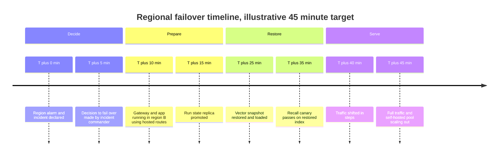

The timeline puts hosted model routes first, because they are available at once, while the self-hosted pool needs capacity and weights and scales out last. The restored index is validated by the recall canary before traffic is shifted, so the system does not serve from an index that loaded but is wrong. The implication is that the RTO depends on which assets are pre-provisioned in region B, and the quickest improvement is usually to pre-stage the snapshot and a minimum amount of hosted capacity.

### 20.3 Rules that apply to AI-specific recovery

- **Test restores.** A backup is a restore that has not yet failed. Restore the index and the run state into a scratch environment on a schedule, and run the recall canary and a sample of runs against them.
- **Keep the model route list independent of any single region.** The gateway in region B must reach the providers without depending on region A's configuration store (section 18.3).
- **Treat retention and deletion as part of DR.** Restoring traces, conversation logs, or vectors from backup can resurrect data that users asked to delete, or data past its retention period. The restore process must re-apply deletions recorded since the snapshot. Sensitive data in backups needs the same access controls and encryption as the primary.
- **Plan for retired models.** A fine-tuned model that depends on a base model that the provider retires is a DR scenario with a calendar date. Keep the adaptation data and training recipe so the model can be retrained on a replacement base.
- **Decide the degraded mode at RTO.** Between failure and full recovery, the system serves from some rung of the ladder. State which rung and for how long.

## 21. Runbooks, Incident Response, and On-Call

### 21.1 What belongs in a runbook

A runbook is the checklist an on-call engineer follows at 03:00 with partial information. Write it for the engineer who did not build the system. For each alert there should be: what the alert means in user terms, how to confirm it, the first safe mitigation (the one that can be done in five minutes and is reversible), escalation paths and contacts, and the decision criteria for the larger actions (fail over, freeze changes, roll back, page the provider). Link dashboards by name, give exact commands or console paths, and mark steps that are irreversible. Review runbooks after every incident and every game day.

### 21.2 Runbook set for an AI feature

| Runbook | Trigger | First mitigation | Escalate when |
| --- | --- | --- | --- |
| Provider outage | Breaker open on the primary, error burn alert | Confirm fallback is serving. Check route shares and degraded labels | Fallback also failing, or shed rate above 5 percent for 10 min |
| Elevated 429 | Throttle ratio above 2 percent | Check which limit (requests, tokens, concurrency). Lower batch share. Look for a runaway client | Spend cap error type, or interactive goodput falls |
| Spend cap or quota exhausted | 429 with the cap error body, or billing alert | Raise the cap through the account owner. Switch to a route with budget | Cap cannot be raised in 30 min |
| Latency regression | TTFT or total p95 burn alert | Compare routes. Shift traffic away from the slow route. Check output length distribution | Slowness on all routes |
| Quality regression | Canary pass rate drops, refusal or repair rate rises | Check for a deploy, prompt change, or provider version change. Pin or roll back | No change found and the drop persists |
| Stale or degraded index | Freshness or recall canary alert | Check ingestion job, shard health. Serve lexical fallback | Source system issue |
| GPU shortage or node loss | Pool capacity below peak | Shed batch. Route interactive to hosted fallback | Shortage persists past the reserved window |
| Dead-letter growth | DLQ rate above threshold | Sample failures for a common cause. Pause the producing job | Cause is a regression from a change |
| Cost spike | Spend rate alert | Identify tenant, route, or runaway loop. Apply the tenant limit or kill switch | Abuse suspected (section 24) |
| Safety incident | Policy violation reported | Disable the feature path or tool. Preserve evidence | Per the security incident process of [Part 17 CH12](CH12_AI_Safety_Security_Privacy_and_Governance_Architecture.md) |

### 21.3 A first-ten-minutes decision tree

The first minutes of an incident are spent deciding which kind of failure it is. A shared decision tree reduces the time and the chance of a wrong first action.

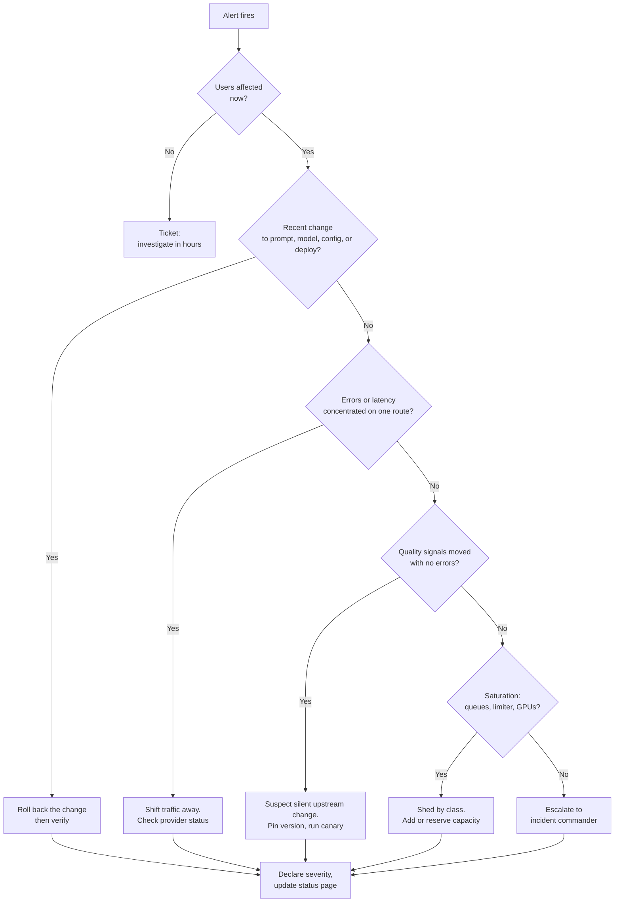

The tree puts a change check first because most incidents follow a change, and a rollback is the most reliable mitigation. The quality branch exists because the usual tooling asks only whether errors rose. The last branch, escalation, is a legitimate outcome of the tree. A runbook that pretends it can resolve everything trains people to delay asking for help.

### 21.4 Rollback as a primary mitigation

Prompts, model versions, retrieval parameters, and routing weights are all configuration and can be rolled back, provided they are versioned and deployed through the same pipeline as code. The rollback target must be known: the last version that passed the evaluation gate, kept deployable. Practice the rollback. If the previous model version has been retired by the provider, the rollback does not exist, which is another reason to track retirement dates in the registry and to test a fallback model before the date.

### 21.5 Alerting and on-call load

Page on symptoms users feel (burn rate on usable outcomes, latency SLO burn, saturation that will cause a miss in minutes) and ticket on causes. Alerts on individual 429s or single-route latency create noise that teaches people to ignore pages. Use the multi-window burn rates of section 4.4 for pages. Keep the pager load measurable (pages per shift, share actionable), and treat a high false-positive rate as a defect in the alert, not in the engineer. For services with global users, follow-the-sun rotation reduces night pages.

### 21.6 Communication and post-incident review

During an incident, assign roles: an incident commander who decides, an operator who executes, and a communicator who updates the status page and internal channels. AI incidents have one extra communication problem: users and support staff ask whether the answers they received during the incident can be trusted. Prepare a way to identify the affected window and requests (the route, model version, and degraded label are in the logs) so that the answer is specific.

A blameless post-incident review records the timeline, the contributing conditions, what detection and mitigation worked, and the corrective actions with owners. For AI features add three questions: Did a quality failure go undetected longer than a hard failure would have? Did any fallback behave differently from its eligibility record? Did the retry or hedging policy change the load on the failing dependency? Feed the answers back into the error budget policy of section 4.7.

## 22. Fault Injection in Continuous Integration

### 22.1 A fake provider with scripted faults

Many reliability defects can be caught in unit and integration tests with no real provider. Build a fake provider that returns a scripted sequence of outcomes: successes, error codes with retry hints, delays, truncated outputs, malformed JSON, stream cuts. The gateway, retry logic, validators, and fallbacks run against it with a fake clock, so tests that involve minutes of backoff finish in milliseconds. A compact example:

```python
from dataclasses import dataclass, field

@dataclass
class FakeProvider:
    script: list            # e.g. [("429", 2.0), ("ok", '{"label":"billing"}')]
    calls: int = 0
    log: list = field(default_factory=list)

    def call(self, prompt: str):
        kind, value = self.script[min(self.calls, len(self.script) - 1)]
        self.calls += 1
        self.log.append(kind)
        return kind, value

class FakeClock:
    def __init__(self):
        self.now = 0.0
    def sleep(self, seconds: float):
        self.now += seconds
```

The script lets a test describe an incident: three 529 responses followed by success, a 429 with a 2-second hint, or a malformed result followed by a valid one. Tests assert on the observable behavior, not on internals.

```python
def test_retry_respects_hint_and_budget():
    provider = FakeProvider([("429", 2.0), ("ok", "{}")])
    clock = FakeClock()
    result = run_with_policy(provider, clock, max_attempts=3, deadline_s=10)
    assert result.ok
    assert clock.now >= 2.0            # waited at least the server hint
    assert provider.calls == 2         # no extra attempts

def test_outage_does_not_amplify():
    provider = FakeProvider([("529", None)] * 100)
    result = run_many(provider, requests=100, max_attempts=3, retry_budget=0.10)
    assert provider.calls <= 110 + 5   # first attempts plus budgeted retries

def test_spend_cap_is_not_retried():
    provider = FakeProvider([("429_spend", None)] * 10)
    result = run_with_policy(provider, FakeClock(), max_attempts=3, deadline_s=10)
    assert provider.calls == 1 and result.action == "page"
```

(`run_with_policy` and `run_many` stand for your gateway's entry points.) These three tests encode the chapter's rules: waiting at least the hint, bounding the total calls in an outage, and refusing to retry a non-retryable class. The [fault injection script](../code/python/ai-reliability-chapter/04_fault_injection_and_degradation_ladder.py) is a runnable version of the same idea.

### 22.2 Property tests and contract tests

Some invariants hold over many inputs, which suits property-based testing: for any sequence of outcomes, the number of provider calls never exceeds attempts times requests; the sum of waits never exceeds the deadline; a request never finishes after its deadline plus a small tolerance; a tenant restricted to region R is never served by a route outside R; and the idempotency key of an action is stable across replays. A property test generates random fault scripts and checks these invariants, and finds corner cases such as an overlap of a hint longer than the remaining budget with a half-open breaker.

Contract tests pin the error classifier to the provider documentation. Maintain a fixture file of real error bodies and status codes from each provider (captured and sanitized) and assert on the action chosen. When a provider changes a field name, the fixture update shows up in review. Run the contract tests against the live provider on a schedule with a tiny request, to detect drift in behavior.

### 22.3 Timeout budget and nesting tests

Turn the budget arithmetic of section 5.3 into a test. A configuration test loads the timeout and retry settings for each stage, computes the worst-case sum, and fails the build if it exceeds the end-to-end deadline minus the reserved downstream time. The [budget checker](../code/python/ai-reliability-chapter/01_deadline_budget_checker.py) is that test in script form. Run it whenever a timeout, retry count, or stage list changes.

### 22.4 Load and soak tests with injected slowness

Run load tests against a fake provider with latency drawn from a heavy-tailed distribution and a scheduled slowdown, and check the overload mechanisms: the limiter holds the rate under quota, the breaker opens and closes without flapping, shedding keeps interactive goodput above target, and memory and connection counts are stable during a long soak. A soak of several hours catches slot leaks from cancellation bugs that short tests miss. Keep the results as a baseline and compare each release.

### 22.5 Evaluation gates as reliability tests

A change to a prompt, model, or retrieval setting is a deployment, and it needs a test that detects quality regressions: the golden evaluation set run on the candidate and the baseline, with a threshold and a statistical comparison. Include failure-oriented cases in the set: adversarial inputs, long inputs near the context limit, inputs that trigger refusals, and inputs that previously caused schema errors. Run the same set against each eligible failover route, so that eligibility records (section 10.3) are based on current data. [Part 17 CH11](CH11_Evaluation_and_Observability_Architecture_for_AI_Systems.md) covers the evaluation design.

## 23. Observability for Reliability

### 23.1 Signals to emit

[Part 17 CH11](CH11_Evaluation_and_Observability_Architecture_for_AI_Systems.md) designs the telemetry stack. This section lists the reliability signals that stack must carry. Emit them per route and per request class, as metrics for alerting and as trace attributes for diagnosis.

| Signal | Type | Why it matters | Used by |
| --- | --- | --- | --- |
| Usable-outcome ratio | SLI | The headline reliability number | Burn alerts |
| Hard error rate by type (429 class, 5xx, timeout, validation) | SLI | Separates causes | Runbook routing |
| TTFT, inter-token gap, total latency (p50, p95, p99) | SLI | Per-phase latency SLOs | Latency burn |
| Retry ratio and retries per request | Control | Detects amplification | Retry budget alerts |
| Retry budget remaining | Control | Shows when the system stops retrying | Capacity review |
| Hedge rate and hedge win rate | Control | Whether hedging pays for itself | Tuning |
| Breaker state and transitions per route | Control | Flapping, open time | Failover review |
| Limiter utilization and wait time | Control | Quota pressure before 429s | Capacity |
| Shed count by class and reason | Control | Who lost during overload | Priority review |
| Queue depth and oldest-message age | Saturation | Backlog health | Queue SLO |
| In-flight requests and open streams | Saturation | Concurrency headroom | Autoscaling |
| Degradation rung share | SLI | Hidden loss of capability | Product review |
| Finish-reason distribution | Quality proxy | Truncation and refusals | Drift detection |
| First-pass validity and repair rate | Quality proxy | Prompt or model regression | Quality burn |
| Output-length distribution | Quality proxy | Silent model change | Drift detection |
| Canary pass rate per route | Quality SLI | Fast quality probe | Quality alerts, eligibility |
| Index freshness lag and partial-result rate | Data-plane | Stale or incomplete evidence | Data-plane runbooks |
| Dead-letter queue depth and growth | Control | Poison tasks, regressions | Batch and agent runbooks |
| Cost per request and retry token share | Cost | Denial of wallet, retry waste | Cost alerts |
| Model and prompt version on every request | Context | Attribute shifts to changes | Incident review |

### 23.2 Cardinality and cost

Do not attach unbounded identifiers (user id, request id) to metrics. Use traces and logs for request-level detail and metrics for aggregates with bounded labels: route, model version, request class, error class, rung. Sample traces by default but retain all traces for failed or degraded requests, so incidents can be reconstructed. Prompt and response content in telemetry raises privacy obligations, so log metadata and hashes by default and gate content capture ([Part 17 CH12](CH12_AI_Safety_Security_Privacy_and_Governance_Architecture.md)).

### 23.3 Dashboards that match the runbooks

Build one dashboard per runbook trigger, not one with every chart. The top row shows the SLIs and burn rates. Beneath, group by dependency: gateway and routes (error classes, latency by phase, breaker state, limiter utilization, shares), retrieval (latency, partial results, freshness, recall canary), agent and batch (run states, dead-letter rate, queue age), and cost. Annotate with deployments, prompt and model changes, and provider status events. Most diagnosis consists of aligning a change in a signal with a change in the system, so the annotations are as valuable as the charts.

### 23.4 Synthetic probes and provider status

Synthetic probes send a small, fixed request to each route at a regular interval and measure the result. They detect outages on idle routes (the fallback) and give a signal when traffic is low. They cost tokens, so keep them tiny. Provider status pages and feeds are useful input for humans and for alert annotation. They lag the real onset of an incident and are not a safe trigger for automated failover, because a status feed is a dependency of its own (section 18.3).

## 24. Security, Abuse, and Denial of Wallet

### 24.1 Availability as a security property

An attacker or a buggy client can reduce availability without breaking in. Because AI calls are expensive and quota-limited, the effects are larger than for ordinary APIs. [Part 17 CH12](CH12_AI_Safety_Security_Privacy_and_Governance_Architecture.md) owns the threat model and controls. This section lists the overlaps with reliability.

- **Quota exhaustion.** A single tenant, or an unauthenticated user, sends many large requests and consumes the shared token quota. All other users receive 429 responses. The defense is per-tenant and per-user limits in tokens, admission control by class, and bulkheads (section 7).
- **Denial of wallet.** The attack aims at the bill: long prompts, requests that trigger long outputs, tool loops, and repeated retries. A spend cap protects the budget but turns the attack into an outage when it trips (the cap error of section 2.4). So the cap must be layered: per-tenant and per-key budgets that trip before the account cap, alerts at spend rate thresholds, and an emergency switch that disables expensive features while keeping core functions on.
- **Amplification by agents.** An injected instruction in a retrieved document can make an agent call tools repeatedly. Step, token, and cost budgets per run, and per-tool rate limits, bound the damage (section 14.5).
- **Retry amplification as self-attack.** A buggy client with no backoff, or a mobile app version that retries instantly, can overload the gateway. Per-client retry budgets and fast refusal of clients that ignore `Retry-After` are the control.
- **Slowloris-like streams.** Clients that open streams and read slowly hold slots. Maximum stream duration and a minimum read rate apply.

### 24.2 When resilience features widen risk

Failover and degradation can themselves create security and compliance exposure.

- **Fallback to a model with weaker guardrails.** A secondary model may not have the same safety behavior or output filters. The eligibility record must include safety evaluation, and the safety layers must run on every route, not only the primary.
- **Fallback that changes data handling.** A secondary provider may have different retention or training terms. The residency and data-term filter of section 10.4 applies to every request.
- **Caches across tenants.** A shared semantic cache that serves one tenant's answer to another leaks data. Scope keys by tenant and permission set.
- **Verbose error handling.** Returning raw provider errors or stack traces to users can leak prompts, system instructions, or internal topology. Return normalized messages and keep details in logs.
- **Fail open on policy.** If a policy or moderation service is down, decide explicitly whether to fail open (serve without it) or closed (refuse). For high-risk outputs and actions, fail closed. For low-risk content where the filter is advisory, a degraded mode may be justified, but it should be logged and reviewed.
- **Replays and DLQs.** Dead-letter queues and checkpoints contain prompts, user data, and tool results. They need the same access control and retention as the primary store.

### 24.3 Kill switches

Provide manual and automated switches that reduce risk quickly: disable a tool, disable a feature, force a rung, block a tenant, cap a tenant's spend, and pin a route. Each should be reachable from the runbook, work without a deploy, have an owner, and be tested in game days. A kill switch that nobody has used for a year may no longer work.

## 25. Quality-Attribute Scenarios and Trade-offs

### 25.1 Scenarios

A quality-attribute scenario states a stimulus, the environment, the required response, and a measure, so the requirement can be tested. The eight scenarios below are written for the support assistant and the batch pipeline. Each maps to a drill or test in this chapter.

| # | Attribute | Stimulus and environment | Required response | Measure |
| --- | --- | --- | --- | --- |
| 1 | Availability | The primary provider returns 529 on all calls during peak hour | Breaker opens, eligible secondary serves eligible tenants, other traffic degrades down the ladder | Usable fraction at least 99.5 percent during the event. Breaker open within 15 s. No request waits longer than its 10 s deadline |
| 2 | Latency | TTFT on the primary rises to 8 s for 20 percent of requests | TTFT timeout fires at 2.5 s, request moves to the alternate route before any token is shown | Interactive p95 total latency stays under 8 s. Extra provider load from hedges and retries at most 15 percent |
| 3 | Overload | Traffic reaches 1.8 times provisioned token quota because of a campaign | Admission control sheds batch first, then free-tier requests. Interactive paid traffic is protected | Goodput for paid interactive at least 99 percent. Every shed request has a reason code. No 429 from the provider for interactive calls |
| 4 | Quality drift | The provider moves an alias to a new model version without notice | Pinned routes are unaffected. Canary on any unpinned route detects the shift | Detection within 30 minutes. Rollback or reroute completed within 60 minutes. Quality burn alert fired |
| 5 | Recoverability | A worker running an agent dies at step 14 of 20 after a refund call was sent | The run resumes from the checkpoint, verifies the refund outcome, and does not issue a second refund | Zero duplicate side effects across 1,000 injected crashes. Resume within 60 s |
| 6 | Data-plane fault | One vector shard becomes unavailable | The query path marks results partial, the recall canary alerts, and answers carry an evidence caveat or use lexical fallback | Alert within 10 minutes. No answer cites a document without evidence. Recall on the canary set returns to target after recovery |
| 7 | Cost safety | A buggy client retries every failure immediately without delay | Per-client retry budget refuses excess retries. Spend alarm fires | Provider calls from that client at most 1.1 times its first attempts. Spend alarm within 5 minutes. No account-wide cap trip |
| 8 | Batch deadline | The provider is unavailable for 90 minutes during the nightly job | The deadline governor raises concurrency after recovery and spills part of the work to the secondary provider | All 4 million records complete by 06:00 with quarantine under 0.5 percent |

Each scenario names the measure that decides pass or fail, which makes it usable as an acceptance test and as the hypothesis of a game day.

### 25.2 Comparison of resilience patterns

| Pattern | Mitigates | Costs | Adds risk of | Priority for a new AI feature |
| --- | --- | --- | --- | --- |
| Deadlines and timeout nesting | Hung calls, wasted work | Engineering effort, propagation plumbing | None significant | First |
| Single-layer retries with budget | Transient faults | Small token cost | Amplification if misconfigured | First |
| Error classifier and spend-cap handling | Wasted retries, hidden caps | Shared library | Misclassification | First |
| Output validation and bounded repair | Format and schema failures | Extra calls when repairing | Hiding quality drift | First |
| Client-side token limiter | Throttling | Estimation error | Underuse of quota | Early |
| Circuit breaker per route | Dead routes | Tuning | Flapping | Early |
| Degradation ladder with FAQ and retrieval rungs | Total model outage | Content curation, UI | Silent degradation | Early |
| Load shedding and bulkheads | Overload, noisy neighbors | Idle reserved capacity | Wrongly shed customers | Early to mid |
| Warm secondary route | Provider outage | Standby, evaluation, prompt variants | Stale secondary | Mid |
| Hedging | Tail latency | Extra tokens, extra load | Overload amplification | Late, with data |
| Durable execution for agents | Crashes, long runs | Engine and operations | Complexity | When runs exceed minutes or have side effects |
| Cells | Blast radius | Duplicated capacity | Operational surface | At large scale |
| Self-hosted fallback | Provider dependence | GPUs, operations | Cold start, capacity | When contracts or data demand it |

The order reflects how much reliability each buys per unit of effort for a feature starting out. Items at the top require no new infrastructure and prevent the most common failures. Hedging and cells are refinements for systems with measured tail problems or very large scale.

## 26. Worked Design A: Customer-Facing Assistant at 99.9 Percent

### 26.1 Requirements

The assistant answers questions from a knowledge base, looks up orders, and can start a refund after user confirmation. It serves 100,000 eligible requests per day with a 10-second deadline in non-streaming mode (streaming is added in section 26.6). The target is 99.9 percent usable outcomes per 30 days, which allows 3,000 bad requests, or 43.2 minutes of equivalent total outage. The target counts severe failures: hard errors and severe quality failures such as a fabricated policy or a citation that does not support the claim. Milder quality shortfalls are tracked on a separate quality SLO of 97 percent at or above 4 of 5 on the grounding rubric, and they feed the change-freeze policy but not the 99.9 percent ledger.

Split the budget before designing: 1,200 bad requests for hard failures (0.04 percent), 1,500 for severe quality failures (0.05 percent), and 300 held as reserve for events that fit neither. The split sets targets for each team: hard-failure engineering must keep $h \le 0.0004$, and the evaluation and grounding work must keep the severe quality rate at most $0.0005$.

### 26.2 Starting point and arithmetic

The baseline design has one provider, three retries per layer at three layers, no fallback, and no output validation. Its serial availability (section 18.1) is about 99.28 percent, and with the retry configuration of section 6.4 a provider outage multiplies load by up to 27. Against a 99.9 percent target the baseline loses 0.72 percent of requests, about 5.2 hours per month of outage-equivalent ($0.0072 \times 720$ hours), which is 7.2 times the 43.2-minute budget.

### 26.3 Architecture decisions

**ADR-1: One retry layer, in the gateway.** Context: the application, the gateway, and the provider SDK each retry, with a worst case of 27 calls. Decision: retries only in the gateway, two attempts, full jitter with a 0.5 s base, a retry budget of 10 percent of first attempts, and SDK retries set to zero. Consequences: worst-case provider load is 1.1 times demand. Calls that need a third attempt move to the fallback route instead. Rejected: leaving retries at all layers because each team owns its layer (amplification of 27 in an outage); no retries at all (loses the 70 to 80 percent of transient faults that a single retry clears, an illustrative range to measure).

**ADR-2: Deadline of 10 seconds with nested stage budgets.** Decision: the allocation of section 5.3: retrieval one attempt with a 1,000 ms cap, optional rerank with a 500 ms cap skipped if less than 3,000 ms remain, generation with a dynamic cap, mandatory validation with 400 ms reserved, and a 1,000 ms reserve for fallback and response. The budget checker runs in continuous integration. Consequences: worst case sums to 9,000 ms of 9,000 usable. Rejected: independent per-service timeouts (their worst case summed to 10,100 ms).

**ADR-3: Warm secondary route with a 3 percent live share.** Decision: an eligible second provider (separate cloud region and account) carries 3 percent of traffic continuously, has its own prompt variant and quota sized for 70 percent of peak, and is evaluated nightly. The router sends failover traffic only to routes whose last evaluation is under 14 days old and above threshold, and respects tenant residency. Consequences: roughly 3 percent of traffic runs on the second route, and any quality difference shows up in telemetry. The common-cause model of section 10.1 gives a pair availability of about 99.95 percent with $\beta = 0.1$. The remaining 30 percent of peak without a route is handled by the ladder and shedding. Rejected: active-active 50/50 (doubles the evaluation and prompt maintenance surface and exposes half of users to the secondary's quality differences); cold standby (the quota and credentials would be unverified on the day of need); self-hosted fallback now (GPU reservation and operations cost not justified before the hosted path has been exhausted; revisit after one year of incident data).

**ADR-4: A seven-rung degradation ladder with actions disabled below rung 1.** Decision: rungs 0 to 7 of section 11.1. The refund tool exists only at rungs 0 and 1 and always needs user confirmation. A curated FAQ of the top 200 intents provides rung 3, and retrieval-only provides rung 4. Order-status questions have a templated deterministic path at rung 5 that reads the order system directly. Every response is labeled with its rung in telemetry, and rungs 2 to 7 show a visible banner. Consequences: with every model route down, the assistant can still answer an estimated 30 to 40 percent of questions correctly (to be measured from logs), and it never takes an automated action on an unvalidated output. Rejected: returning an error when generation fails (the ladder costs content work but converts most outages into degraded answers); generic apology text (counts as a failure in the ledger).

**ADR-5: Validation and bounded repair on every response.** Decision: finish-reason check, schema, evidence (citations must exist in the retrieved set and quoted spans must appear), business rules for the refund tool, and at most one repair call. First-pass validity and repair rate are SLIs. Consequences: with 3 percent first-pass failures and an 80 percent repair success, valid output reaches 99.4 percent at 1.03 calls per request (section 12.3). Residual failures take the ladder. Rejected: unbounded repair (latency and cost grow with no bound); accepting unvalidated JSON because the model rarely fails (that is the source of the 0.6 percent quality failure rate in the worked example of section 4.3).

**ADR-6: Pinned model versions, canary every 20 minutes, and an error budget policy.** Decision: all production routes use pinned versions. A 150-case canary runs on every route every 20 minutes, which is 7,200 calls per day per route. The error budget policy of section 4.7 governs changes. Consequences: a silent change in an unpinned alias would be detected in 20 to 40 minutes. Rejected: relying on provider announcements (silent changes do not announce themselves); sampling only user feedback (too slow, section 4.5).

**ADR-7: Separate accounts and concurrency pools for interactive and batch.** Decision: the nightly pipeline and the assistant use different provider accounts and bulkheads; the assistant's pool reserves 60 percent of the gateway's capacity. Consequences: a batch overrun cannot throttle users; peak batch throughput is capped. Rejected: one shared account with priority headers (priority features differ across providers and do not protect against account-level caps).

### 26.4 Expected result

The path availability computed in section 18.1 with the second route, lexical fallback, and the order system removed from the answer path is 99.92 percent. The ladder then converts most of the remaining hard failures into degraded but contract-meeting answers, which count as usable under the definition of section 4.1 and are tracked in the degraded-share SLI. The residual hard-failure rate targeted is 0.04 percent, within the 1,200-request allocation. The severe quality rate depends on grounding and evaluation work, not on infrastructure.

### 26.5 Validation evidence to collect before launch

| Evidence | Method | Pass criterion |
| --- | --- | --- |
| Timeout nesting | Budget checker in CI | Worst-case sum at most 9,000 ms |
| Retry bound | Fault-injection test (section 22.1) with 100 percent 529 | Provider calls at most 1.1 times first attempts |
| Failover | Game day with primary at zero weight | Scenario 1 measures met |
| Residency | Drill with a restricted tenant | Zero requests served outside the allowed regions |
| Ladder rungs | Forced-rung test for each rung | Contract met. Refund disabled below rung 1 |
| Idempotency | 1,000 injected crashes during refund | Zero duplicate refunds |
| Canary | Swap a test alias | Detected within 30 minutes |
| Load | Soak at 1.8 times quota | Scenario 3 measures met |

### 26.6 Streaming extension

When streaming is enabled, the TTFT timeout and failover decision remain in the free window before the first token (section 13.2). A heartbeat every 15 seconds keeps intermediaries from closing quiet streams. Transport faults resume from a 60-second buffer, and model faults produce the interrupted marker. The refund confirmation step is never streamed: the application shows the structured action card after validation. Pod termination grace is set to 120 seconds with a 90-second stream limit. The ledger counts an interrupted stream as a bad request unless the user's retry succeeds within the same session, which is a policy choice to record.

## 27. Worked Design B: Nightly Batch Enrichment Pipeline

### 27.1 Requirements

The pipeline enriches 4 million product records with a category and a 60-word description between 22:00 and 06:00. Each record uses about 1,200 input and 150 output tokens. A record must be written exactly once per prompt and model version, and a missing record may fall back to the previous night's enrichment. The deadline is a business commitment (the catalog is published at 06:00), and results must pass schema and content validation.

### 27.2 Sizing

From section 15.2, the minimum rate is 138.9 records per second, and a 6-hour plan needs 185.2 records per second and 13.3 million input tokens per minute. With 7 percent retry and repair overhead the useful rate at that load is $185.2 / 1.07 = 173.1$ records per second. The provider account for batch is sized at 20 million input tokens per minute so the job can run at 1.5 times the plan during catch-up. This is a budget line that must be agreed before launch.

### 27.3 Architecture decisions

**ADR-B1: Shards and a manifest.** 4,000 shards of 1,000 records in a manifest table with leases, attempt counts, and version fields. Consequence: a worker failure loses at most one shard of in-flight work (about 50 seconds at 20 records per second per worker). Rejected: a single long-running process that restarts from the beginning (at a 0.98 per-step success rate the restart cost compounds, section 14.1; here a failure at record 3.9 million would lose four hours); queue messages per record (4 million messages carry overhead with little benefit over shard leasing).

**ADR-B2: Idempotent upsert keyed by record id, input hash, prompt version, and model version.** Consequence: repeated shards are harmless, and a later re-run with a new prompt coexists with old results. Rejected: append-only writes (duplicates after a retry).

**ADR-B3: Separate provider account with a client-side token limiter and a 10 percent retry budget.** Consequence: the job cannot throttle the assistant, and a provider incident cannot trigger a retry storm. Rejected: sharing the interactive account.

**ADR-B4: Quarantine with a 2 percent halt threshold.** Records that fail three attempts go to a quarantine table with the reason. If more than 2 percent of any shard quarantines, the shard stops and pages, since the cause is probably systemic. Consequence: ordinary bad records never block the run, and a bad prompt change is caught within one shard. Rejected: failing the job on the first bad record, and silently dropping failures.

**ADR-B5: Deadline governor with a declared action list.** Order: raise concurrency up to 1.5 times plan if quota allows; send up to 30 percent of shards to the secondary provider; switch the remaining records to the cheaper model for classification only; skip descriptions and carry forward the previous night's text; page the owner with the projection. Each action has a recorded quality and cost effect. The governor evaluates the projection after every shard and acts when the projected finish is later than 05:00, which leaves a one-hour margin.

**ADR-B6: Provider batch interface not used for the nightly critical path.** The batch interfaces of section 15.6 have completion windows longer than the 8-hour job window, so a late return cannot be tolerated. They may be used for the weekly backfill, which has a longer deadline. Rejected for the nightly path: cost saving does not justify a missed publication.

### 27.4 Outage walk-through

Suppose the primary provider fails at 01:00 for 90 minutes. By 01:00 the job has run 3 hours at 173.1 useful records per second and finished 1.87 million records. Remaining are about 2.13 million. The pipeline pauses on the primary, and the governor sends up to 30 percent of shards to the secondary during the outage. After recovery at 02:30, the remaining work at the planned rate of 173.1 per second takes 2.13 million / 173.1 = 12,305 seconds, 3.42 hours, finishing at 05:55, which is inside the deadline but past the 05:00 margin. The governor therefore raises concurrency to 1.3 times plan, 225 records per second, so the remaining work takes 9,467 seconds, 2.63 hours, finishing at 05:08. Spilling part of the shards to the secondary provider would finish earlier still. The numbers show why the margin is set at 05:00 and why the account is sized for catch-up: with no catch-up the job ends at 05:55, about five minutes before the deadline (the same conclusion as section 15.2, reached with slightly different assumptions), and the governor restores about 52 minutes of margin (06:00 minus 05:08).

### 27.5 Acceptance evidence

Kill workers at random during a rehearsal and confirm that shard leases expire and output counts match the input (exactly one row per record and version). Inject a 90-minute provider outage with a fake provider and confirm the governor actions in order. Inject a prompt change that raises schema failures to 8 percent and confirm shards halt at the 2 percent threshold. Replay the dead-letter and quarantine tables through the replay tool at a controlled rate and verify idempotency by running it twice.

## 28. Common Mistakes

| Mistake | Cause | Consequence |
| --- | --- | --- |
| Retries at every layer | Each team adds its own protection | Up to 27 times load in an outage. Retry storm |
| Same timeout for every phase and class | One config value | Healthy long answers aborted, or stuck requests held for a minute |
| Timeouts that do not nest | Stage-by-stage tuning | Mandatory validation skipped or deadline exceeded |
| Treating all 429 as retryable | No error body inspection | Retrying a spend cap for hours. Delayed paging |
| Health checks that test only the HTTP status | Infrastructure view of reliability | Quality regressions and truncation go unseen |
| Failover to an unevaluated model | Redundancy counted by route, not by eligibility | Schema errors and unsafe output during the incident |
| Cross-border failover | Router ignores tenant residency | Compliance incident from an availability fix |
| Closing the breaker on one probe | Simple half-open logic | Flapping while the provider is still weak |
| Hedging when the system is saturated | Fixed hedge delay | Extra load deepens the overload |
| Unbounded repair loops | Optimism about the model | Latency and cost spikes, hidden quality problems |
| Streaming without cancellation | Server keeps decoding after client leaves | Quota and GPU time spent on gone users |
| No deploy draining for streams | Standard rolling update | Every deploy cuts live conversations |
| Restarting agent runs from the start | No checkpoints | Repeated side effects. 22 percent or more extra cost at 20 steps |
| Idempotency key from raw tool arguments | Convenience | Regenerated arguments produce a second action |
| Queue without expiry or age alert | Depth-only monitoring | Work done for users who left. Goodput falls |
| Batch plan with no slack | Planning at exact throughput | Missed deadline after one short outage |
| Spend cap as the only budget control | Single account-level cap | Denial-of-wallet attack becomes an outage |
| Untested fallbacks and restores | Assumed to work | Failure at the moment of need |
| Cold caches after deploy | No warm-up | Model load 1.67 times normal when other things also change |
| Silent degradation | No label, no rung metric | Users and metrics mislead. Quality debt accumulates |

## 29. Design-Review Checklist

Use this list when reviewing an AI feature before launch and again after major changes.

1. Is reliability defined as a usable outcome, with latency per phase, a quality SLO, and a budget split between hard and quality failures?
2. Is there a burn-rate alert pair for the fast signals and a slower one for sampled quality?
3. Does a canary evaluation run on every production route, including fallbacks, at least hourly?
4. Is every model alias pinned, with retirement dates tracked?
5. Does every request carry a deadline, and do the worst-case timeouts nest inside it (verified by a test)?
6. Are TTFT, inter-token, and total timeouts set from measured percentiles by request class?
7. Is cancellation propagated to providers and queues, and tested?
8. Is there one retry layer, a retry budget, jittered backoff, and a rule that respects retry hints?
9. Does the error classifier separate rate limits, spend caps, overload, context errors, and refusals?
10. Does a client-side limiter enforce token-denominated quotas with reserve and refund?
11. Are there admission control, priority classes, and shedding with reason codes?
12. Are interactive and batch isolated by pools and, where possible, accounts?
13. Is there a circuit breaker per route with minimum volume, slow-call counting, and gradual re-admission?
14. Does the fallback route have an eligibility record, verified quota, a prompt variant, and a live share?
15. Does failover respect residency and data terms for every tenant?
16. Is the degradation ladder defined, labeled, tested, and reflected in an SLI, with actions disabled on lower rungs?
17. Are outputs validated for finish reason, syntax, schema, rules, and evidence, with a bounded repair loop?
18. Is hedging limited to TTFT, to a different route, and disabled under pressure?
19. Is the streaming design explicit about partial results, heartbeats, buffering, draining, and cancellation?
20. Do agent runs checkpoint, have idempotent or verified tools, compensation, loop limits, and a dead-letter path?
21. Does the batch design use shards, a manifest, idempotent writes, quarantine, and a deadline governor with declared actions and slack?
22. Are index replicas, snapshots, rebuild time, freshness, and partial-result flags known and monitored?
23. Is headroom sized for autoscaling lag and loss of a unit or zone, with the cost stated?
24. Is there a dependency map with hard and soft dependencies, shared elements, and static stability tests?
25. Are RPO and RTO set for each AI asset, with restore tests?
26. Are there runbooks for each alert, kill switches, a rollback target, and a practiced game day?
27. Is fault injection part of continuous integration, including the budget checker, retry bounds, and idempotency?
28. Are per-tenant limits, spend alarms, and layered caps in place against denial of wallet?
29. Do resilience features keep safety layers, data terms, and tenant scoping intact?

## 30. Exercises

1. **Timeout budget.** A request has an 8-second deadline and a 0.8-second reserve. Retrieval has a 0.9-second timeout with 2 attempts. Generation has a 5-second timeout and 1 attempt. Validation has a 0.4-second timeout. Do the timeouts nest? What would you change?
2. **Burn rate.** The SLO is 99.95 percent over 30 days. Hard failures are 0.03 percent, and 0.4 percent of the successful answers fail the quality objective. Compute the bad fraction, the burn rate, and the days to exhaust the budget.
3. **Amplification.** Two layers each allow 4 attempts, and every attempt fails with probability 0.5. State the worst-case calls per request and the expected calls per request. What retry budget would you set?
4. **Token limiter.** The quota is 120,000 tokens per minute. Requests average 2,500 tokens including output. How many requests per minute can be sustained? What quota supports 100 requests per minute?
5. **Common-cause failure.** Two routes each have 99 percent availability and the common-cause fraction is 0.2. Compute the pair availability and compare with the independent case.
6. **Hedging.** The p95 TTFT on a route is 1.2 seconds. You hedge to a second route after 1.2 seconds. What is the approximate extra load and the extra input-token cost? Name two conditions under which you would switch hedging off.
7. **Batch sizing.** A job must enrich 2 million records in 5 hours. Each uses 1,000 input and 100 output tokens. Compute the minimum record rate and input tokens per minute. Propose a plan with 40 percent slack.
8. **N+1.** A pool of 6 replicas serves 10 requests per second each, and the peak is 40 per second. Compute utilization at peak before and after losing one replica, using the $1/(1-\rho)$ factor. Is N+1 adequate if the target is a 1.5 times limit on latency growth?
9. **Idempotency.** Design the idempotency key and the recovery steps for an agent tool that creates a support ticket. Explain what happens if the call times out after the request was sent.

### 30.1 Answer outlines

1. Worst case is $2 \times 0.9 + 5 + 0.4 = 7.2$ seconds against $8 - 0.8 = 7.2$ usable. The timeouts nest with zero slack. Any added hop or backoff breaks it. Change retrieval to one attempt (worst case 6.3 seconds, slack 0.9), or cap generation dynamically at remaining time minus downstream reserve.
2. $b = 0.0003 + 0.9997 \times 0.004 = 0.004299$. The budget fraction is 0.0005, so the burn rate is $0.004299 / 0.0005 = 8.6$. Days to exhaust: $30 / 8.6 = 3.5$.
3. Worst case $4 \times 4 = 16$. Expected per layer $1 + 0.5 + 0.25 + 0.125 = 1.875$, and across two layers $1.875^2 = 3.52$. Retry at one layer only, two attempts, with a 10 percent retry budget, which bounds total load at 1.1 times first attempts.
4. $120{,}000 / 2{,}500 = 48$ requests per minute. For 100 requests per minute, $100 \times 2{,}500 = 250{,}000$ tokens per minute. Add headroom for retries and bursts.
5. $Q \approx 0.2 \times 0.01 + (0.8 \times 0.01)^2 = 0.002 + 0.000064 = 0.002064$, so 99.79 percent. The independent case is $0.01^2 = 0.0001$, or 99.99 percent. The common cause dominates.
6. About 5 percent extra requests, and so about 5 percent extra input-token cost on that route (output of the canceled copy is small when canceled at once). Switch hedging off when the limiter is near its ceiling, when the breaker is half-open or retry budget use is high, or when the second route is the same pool as the first.
7. $2{,}000{,}000 / 18{,}000 = 111.1$ records per second. Input tokens: $2 \times 10^9 / 300$ minutes $= 6.67$ million per minute. With 40 percent slack, plan for completion in 3 hours: 185.2 records per second and 11.1 million input tokens per minute (that is $6.67 / 0.6$, since 3 hours is 60 percent of 5).
8. Before: capacity 60, $\rho = 40/60 = 0.667$, factor 3.0. After: capacity 50, $\rho = 0.8$, factor 5.0. Latency growth is 1.67 times, over the 1.5 times limit. Use 7 replicas: before $\rho = 0.571$ (factor 2.33), after loss capacity 60 and $\rho = 0.667$ (factor 3.0), growth 1.29 times, within the limit.
9. Key on business identity: `ticket:{conversation_id}:{issue_hash}` where the issue identity is stable across regenerations, or persist the chosen call before executing. After a timeout, query the ticket system by that key (verify state), record the outcome, and only then retry with the same key. Never create a second ticket without verification.

## 31. Summary

AI reliability is the availability of a usable outcome. The ledger has to include quality failures, because a modest 0.6 percent quality failure rate on top of 0.2 percent hard failures produced 99.2 percent usable outcomes against a 99.9 percent target. Silent provider changes can consume a month of budget in a day, so pinning, canaries, and burn-rate alerts are first-class controls.

The mechanisms cluster around a few ideas. One deadline flows through the request, and timeouts nest inside it. Retries happen at one layer, with jitter, hints, and a budget, because layers multiply (27 calls from three layers of three attempts). Overload is controlled at several levels: client-side token limiters, breakers with gradual re-admission, adaptive limits driven by TTFT, bulkheads between classes, and shedding of the least valuable work first. Redundancy counts only when routes are independent, have verified quota, and are eligible by evaluation and residency. Failure ends on a ladder of defined behaviors, with actions disabled as capability falls. Outputs are untrusted until validated, and repair is bounded. Streams fail after a 200 status, so the cheap place to recover is before the first token. Agent and batch runs need checkpoints, idempotent writes, verification of unknown outcomes, quarantine, and a governor that watches the deadline.

Capacity, data-plane, and recovery plans are numbers. Autoscaling lag sets headroom (66 percent target utilization for a 51 percent surge over 8.5 minutes). Loss of a unit sets spare capacity. Rebuild and restore times set the RTO of indexes. Game days and fault injection in continuous integration turn these claims into tests. The two worked designs show the pattern: set the budget, compute the baseline, choose patterns by the failures they address, record the rejected alternatives, and collect evidence before launch.

## 32. Code Examples

All scripts use only the Python standard library and print the output quoted in this chapter. They were run with the version of Python on the author's machine, and their output was compared with the text.

- [01_deadline_budget_checker.py](../code/python/ai-reliability-chapter/01_deadline_budget_checker.py) computes the worst-case sum of stage timeouts, checks nesting against the end-to-end deadline, and walks a slow day through the propagated budget (sections 5 and 22.3).
- [02_retry_burn_and_token_bucket_math.py](../code/python/ai-reliability-chapter/02_retry_burn_and_token_bucket_math.py) computes retry amplification, the retry budget bound, burn rates for hard and combined failures, and a token bucket with reserve and refund (sections 4, 6, and 8).
- [03_breaker_retry_shedding_simulation.py](../code/python/ai-reliability-chapter/03_breaker_retry_shedding_simulation.py) simulates a provider outage and recovery under naive, breaker, and protected policies (sections 7 and 9).
- [04_fault_injection_and_degradation_ladder.py](../code/python/ai-reliability-chapter/04_fault_injection_and_degradation_ladder.py) injects scripted faults into a fake provider and shows retry, repair, rules fallback, and human queue outcomes (sections 11, 12, and 22).

## 33. References

- Google, [Site Reliability Engineering, Addressing Cascading Failures](https://sre.google/sre-book/addressing-cascading-failures/) and [Handling Overload](https://sre.google/sre-book/handling-overload/).
- Google, [The Site Reliability Workbook, Alerting on SLOs](https://sre.google/workbook/alerting-on-slos/).
- Marc Brooker, [Exponential Backoff and Jitter](https://aws.amazon.com/blogs/architecture/exponential-backoff-and-jitter/), AWS Architecture Blog, 2015.
- Jeffrey Dean and Luiz André Barroso, [The Tail at Scale](https://research.google/pubs/the-tail-at-scale/), Communications of the ACM, 2013.
- Nathan Bronson and others, "Metastable Failures in Distributed Systems", HotOS 2021.
- Kathleen Nichols and Van Jacobson, "Controlling Queue Delay", ACM Queue, 2012.
- Michael Nygard, Release It!, Pragmatic Bookshelf, first edition 2007.
- Amazon Builders' Library, [Static stability using Availability Zones](https://aws.amazon.com/builders-library/static-stability-using-availability-zones/).
- Netflix, [concurrency-limits](https://github.com/Netflix/concurrency-limits) (open-source adaptive concurrency library).
- Resilience4j, [documentation](https://resilience4j.readme.io/) (circuit breaker and slow-call settings).
- [Principles of Chaos Engineering](https://principlesofchaos.org/).
- Anthropic, [API errors](https://platform.claude.com/docs/en/api/errors) (status codes, streaming errors, spend-limit behavior). Verify behavior for each provider you use, since error names, limits, and billing for canceled requests change.
