# AI Cost, Performance, and Sustainability Decisions

Part: [17 — AI Architecture](PART_OVERVIEW.md) · Status: Revised (in-depth rewrite)

## 1. Introduction

Most architects meet AI cost as a surprise. A prototype that cost a few dollars a day during a demo becomes a monthly invoice with five or six digits once real users arrive, and nobody can say which feature, tenant, or design choice produced it. A second surprise follows: the cheapest model per token turns out to be the most expensive way to finish a task, because it fails more often and every failure is paid for twice, once in tokens and once in rework. A third surprise arrives when a customer or regulator asks for the carbon footprint of an AI feature, and the team has a cloud bill but no energy data.

This chapter gives you the models, arithmetic, and decision records to avoid those surprises. It treats cost, performance, and sustainability as one design problem seen from three sides. Each is a resource that the system consumes to produce a business outcome, each is governed by the same levers (fewer tokens, better placement, higher utilization, deferral, reuse), and each can be made worse by an optimization that only moves the cost somewhere else.

### 1.1 What you will be able to do

After working through the chapter you should be able to:

- Decompose the cost of a single-call, retrieval-augmented, or agentic request into its components and say which ones dominate.
- Choose among per-token, batch, cached, provisioned, reserved, spot, and per-seat pricing using break-even arithmetic.
- Express unit economics as cost per successful outcome, compute gross margin per feature, and run a sensitivity analysis.
- Forecast spend from usage drivers, including context growth, power users, and heavy-tail requests.
- Rank cost levers by impact and risk, and prove or reject each with a worked calculation.
- Place design candidates on a cost, quality, and latency frontier and set quality budgets.
- Set latency budgets, plan capacity from a load test, and decide how much headroom to pay for.
- Build a financial operations (FinOps) practice for AI: attribution, showback, quotas, anomaly detection, and protection against denial of wallet.
- Estimate energy and carbon per request with explicit uncertainty, schedule deferrable work by grid carbon intensity, and report with recognized methods without overclaiming.
- Write decision records, quality-attribute scenarios, and a design review checklist for cost, performance, and sustainability.

### 1.2 Scope and ownership

Cost mechanics for the cloud in general, serving mechanics for models, and gateway and oversight designs are owned by other chapters. This chapter makes system-level decisions that use those mechanisms. The table shows where each neighbour owns detail and what this chapter does with it.

| Topic | Owner | What this chapter does |
|---|---|---|
| Cloud pricing models, commitments, rightsizing, tagging, budgets | [Cloud Cost Optimization (Part 09 CH14)](../09_Cloud_Computing/CH14_Cost_Optimization.md) | Recaps in two or three sentences, applies to AI-specific units (tokens, accelerators, vector memory) |
| Quantization, batching, KV (key-value) cache, speculative decoding, serving engines | [Inference Optimization and Model Serving (Part 16 CH28)](../16_AI_and_GenAI/CH28_Inference_Optimization_and_Model_Serving.md) | Treats them as levers with system-level cost and risk, links for mechanism |
| Operating ML and LLM systems, monitoring, release practice | [MLOps and LLMOps (Part 16 CH29)](../16_AI_and_GenAI/CH29_MLOps_and_LLMOps.md) | Uses their telemetry as the input to cost attribution |
| Where models run, serving topologies, autoscaling, GPU placement | [Inference Serving and Model Placement (CH07)](CH07_Inference_Serving_and_Model_Placement.md) | Supplies the cost and carbon arithmetic behind placement choices |
| Gateway, routing, fallback, quotas at the edge | [Model Gateway, Routing, and Fallback (CH08)](CH08_Model_Gateway_Routing_and_Fallback_Architecture.md) | Defines the cost governance policies the gateway should enforce |
| Human review design, oversight load | [Human Oversight and AI-Assisted Workflow Integration (CH09)](CH09_Human_Oversight_and_AI_Assisted_Workflow_Integration.md) | Prices human review and correction as a first-class cost line |
| Evaluation and observability | [Evaluation and Observability Architecture (CH11)](CH11_Evaluation_and_Observability_Architecture_for_AI_Systems.md) | Uses quality measurements to set quality budgets |
| Security, privacy, governance | [Safety, Security, Privacy, and Governance (CH12)](CH12_AI_Safety_Security_Privacy_and_Governance_Architecture.md) | Covers the cost-driven security risks: denial of wallet, cache leakage, policy bypass by routing |
| Retries, circuit breakers, degradation | [Reliability and Resilience Patterns (CH13)](CH13_Reliability_and_Resilience_Patterns_for_AI_Workloads.md) | Prices retries and redundancy |
| Retrieval design | [RAG System Architecture (CH05)](CH05_Retrieval_Augmented_Generation_System_Architecture.md) | Prices retrieval choices (chunk count, reranking, index memory) |
| Model selection | [AI Capability and Model Selection (CH02)](CH02_AI_Capability_and_Model_Selection.md) | Adds the cost axis to the selection decision |

This chapter owns three ideas that appear in the concept proposals for this part. The first is **cost per completed outcome**: a workload unit-economics measure that includes model, data, network, storage, idle capacity, retries, human correction, and failure costs per accepted business outcome. The second is the **cost, quality, and latency frontier**: the set of non-dominated architectures that satisfy hard quality and policy floors. The third is the **system-level sustainability estimate**: energy and carbon per request or per outcome with stated uncertainty, rather than a number copied from a vendor.

### 1.3 Conventions and a warning about numbers

Every price, rate, throughput, power draw, and carbon factor in this chapter is **illustrative** unless a source is cited. They are chosen so that the arithmetic is easy to follow and the orders of magnitude are realistic, not to describe any provider. The date of writing is October 2026. Model prices fell sharply between 2023 and 2026 and have moved in both directions for specific model families, so a figure that was right when written may be wrong when you read it. The method is what lasts: write the price into a table, cite the source and date next to it, and let the calculator read the table.

The runnable examples in this chapter reproduce every quoted number. Run them with your own price table before you present a business case. They are listed in section 25 and live in `code/python/ai-cost-sustainability-chapter/`.

Throughout the chapter, a "token" is the unit a model reads or writes. A large language model (LLM) processes input tokens (the prompt), then generates output tokens one at a time. Retrieval-augmented generation (RAG) adds a retrieval step that fetches documents to include in the prompt. An agent is an LLM loop that decides to call tools and repeats until it decides to stop. Prices are quoted per million tokens (written "per M").

## 2. The AI Cost Stack and How It Differs from Conventional Software

### 2.1 A cost stack, not a model price

In a conventional web service, cost per request is small, close to constant, and dominated by infrastructure that you provision ahead of demand. A request that renders a page costs about the same whether the user asks a simple or a difficult question. Cost scales roughly with request count, and a good capacity plan makes the unit cost almost flat.

An AI feature breaks each of those properties. The unit cost of a request depends on what the user typed, which documents were retrieved, how long the model decided to think, how many tool calls it made, and whether it had to be asked again. The same endpoint can cost $0.002 for one request and $2.00 for another. The cost is a distribution with a heavy tail, not a constant.

The cost of an AI request is the sum of many layers. The diagram lists the layers that an architect must be able to name and measure.

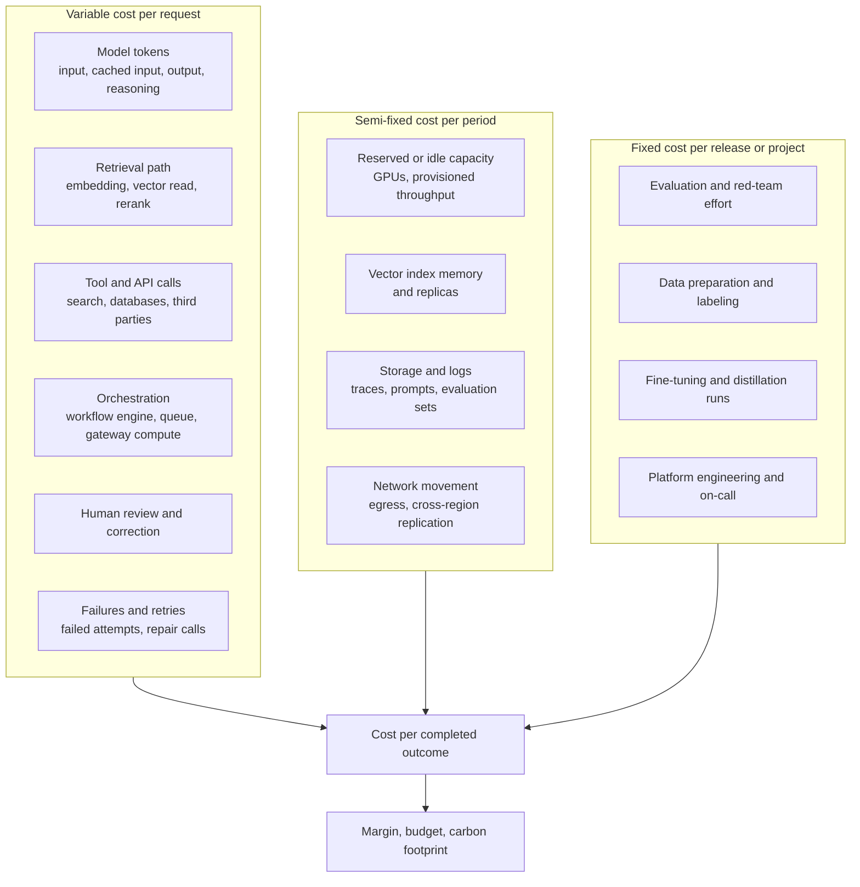

The diagram groups costs by how they behave, because the behaviour determines the right lever. Variable costs respond to prompt design and routing. Semi-fixed costs respond to utilization and commitment decisions. Fixed costs are amortized over volume and decide whether a project is worth starting. A cost review that only looks at the first group will miss the second and third, which often account for most of the spend in a small deployment.

### 2.2 Seven ways AI cost differs from conventional software cost

1. **Cost per request is variable and input-dependent.** Output length, retrieved context, and reasoning effort are decided at run time. Capacity planning by request count alone is wrong. You plan by tokens and by the shape of the token distribution.
2. **Input and output are priced differently.** Output tokens usually cost several times more than input tokens at the time of writing (commonly in the range of three to five times for the same model, verify with your provider), because generation is sequential and memory-bound while input processing is parallel. A design that moves tokens from output to input, or removes output altogether, changes cost more than token totals suggest.
3. **Cost grows with context, not only with requests.** In a chat or an agent, each turn re-sends the transcript. Total input tokens for an N-turn conversation grow with the square of N unless caching or summarization intervenes. Section 3.4 works the numbers.
4. **Quality failures create cost.** A wrong answer is a retry, an escalation, a refund, or a decision that must be undone. In conventional software a wrong response is a bug fixed once. In an AI feature a certain fraction of responses is wrong forever, and each one has a price.
5. **The cheapest unit price is not the cheapest outcome.** A smaller model with lower per-token price but lower success rate can have a higher cost per successful outcome. Section 5 shows a case where a model about five times cheaper per request is 87 percent more expensive per resolved case.
6. **Capacity is lumpy and scarce.** Accelerators are bought in large units, take minutes to start, and may be unavailable in a region at the time you need them. Idle accelerator time is expensive and also draws power, so it is both a financial and a sustainability cost.
7. **Price is outside your control and moves.** Model providers change prices, deprecate models, and revise rate limits. Your unit economics have an external dependency that a conventional database bill does not have to the same degree. A design that survives a price change is a design with a model abstraction layer (see [CH08](CH08_Model_Gateway_Routing_and_Fallback_Architecture.md)) and a calculator that can rerun with new prices.

### 2.3 The four questions a cost review should answer

An architect reviewing an AI feature needs answers to four questions, in this order:

1. **What is the unit?** A resolved ticket, an accepted draft, a classified document, a completed workflow. If nobody can name the unit, the cost conversation will stall at "the bill is too high."
2. **What does one unit cost today, fully loaded?** Include failed attempts, human review, rework, and shared infrastructure. Report the distribution (median, 95th percentile, and the top one percent), not only the mean.
3. **Which three levers would move the unit cost most, and what quality risk does each carry?** Sections 7 and 8 rank them.
4. **What would change the answer?** A price change, usage growth, a quality regression, or a larger context. Sensitivity analysis (section 5.5) and the failure scenarios (section 18) cover this.

The remaining sections answer these questions in turn.

### 2.4 Cost, performance, and sustainability share levers

A useful observation shapes the rest of the chapter. Most levers that reduce cost also reduce latency and energy, because all three are driven by the same quantity: the amount of useful work the hardware does per token, and the amount of useless work it avoids. Sending fewer tokens saves money, finishes sooner, and uses less electricity. Raising accelerator utilization from 30 to 60 percent halves the idle share of cost and of power. Routing a simple request to a small model does all three at once.

The exceptions matter, because they are where trade-offs live. Redundancy for reliability costs money and idle power. Over-provisioning for latency headroom costs money and power. Moving a job to a cleaner grid can add latency. Caching saves everything but adds a staleness risk. A good design review names the exceptions explicitly instead of assuming that all three goals move together.

## 3. Request Cost Decomposition

This section builds the cost model of a request from the bottom up and works three examples. The runnable model is [01_request_cost_model.py](../code/python/ai-cost-sustainability-chapter/01_request_cost_model.py). The prices in it are illustrative and sit in one table you can replace.

### 3.1 The token classes

A model call can bill four classes of token. Know which ones your provider and your own serving stack distinguish, and how each is priced.

- **Fresh input tokens.** The prompt tokens the model must process from scratch. Billed at the input rate.
- **Cached input tokens.** Prompt tokens whose processed state is reused from an earlier request with the same prefix. Billed at a reduced rate at the time of writing, commonly around a tenth of the input rate for a cache read, with some providers charging a premium (for example 1.25 times the input rate for a short-lived cache write) and others charging nothing extra. Check the current documentation of your provider, for example Anthropic's [prompt caching documentation](https://docs.anthropic.com/en/docs/build-with-claude/prompt-caching) and OpenAI's [prompt caching guide](https://platform.openai.com/docs/guides/prompt-caching).
- **Output tokens.** Tokens the model writes. Billed at the output rate.
- **Reasoning tokens.** Tokens a reasoning model generates internally before the visible answer. Most providers bill them at the output rate even when they are not shown to the user. A request that returns 200 visible tokens can bill for 2,000 tokens if the model reasoned at length. Control this with an explicit reasoning-effort or token-budget setting where the provider offers one.

The formula for the model cost of one call, with token counts $n$ and prices $p$ per million tokens, is

$$
C_{\text{model}} = \frac{n_{\text{fresh}}\,p_{\text{in}} + n_{\text{cached}}\,p_{\text{cache}} + (n_{\text{out}} + n_{\text{reason}})\,p_{\text{out}}}{10^{6}}
$$

where $n_{\text{fresh}}$ is the number of fresh input tokens, $n_{\text{cached}}$ the number of cached input tokens, $n_{\text{out}}$ the visible output tokens, $n_{\text{reason}}$ the reasoning tokens, and $p_{\text{in}}$, $p_{\text{cache}}$, $p_{\text{out}}$ the three per-million prices. Cache write premiums, where they exist, add a term for the tokens written.

### 3.2 The non-token costs

A request also consumes services priced in other units:

- **Embedding.** Converting the query to a vector, priced per million tokens and usually negligible per request.
- **Retrieval.** Vector or keyword search reads. Priced per query, per read unit, or folded into a fixed instance cost.
- **Reranking.** A second model reorders retrieved candidates. Priced per query or per thousand documents. Often the largest non-model cost of a RAG request.
- **Tool calls.** External APIs, database queries, code execution. Each has its own price and latency.
- **Orchestration.** Workflow engine steps, queue operations, gateway compute, function invocations.
- **Storage and logging.** Traces, prompts, responses, and evaluation records stored for debugging and audit.
- **Egress.** Data leaving a cloud or region, priced per gigabyte.
- **Human review.** Reviewer minutes multiplied by a loaded hourly rate, weighted by the review rate.

### 3.3 Worked example 1: single-call request

A service summarizes a customer email with one call to a mid-tier model. Illustrative prices: input $1.00 per M, cached input $0.10 per M, output $4.00 per M. The prompt has 1,200 input tokens and the model writes 300 output tokens. Two percent of responses are spot-checked by a reviewer who spends two minutes at a loaded rate of $45 per hour.

Model cost:

- Input: $1{,}200 \times 1.00 / 10^6 = \$0.00120$.
- Output: $300 \times 4.00 / 10^6 = \$0.00120$.

Overhead:

- Orchestration $0.0002 and storage and logs $0.0001.
- Egress for a 20 KB response at $0.09 per GB: $20/10^6 \times 0.09 \approx \$0.0000018$, which rounds to zero.
- Human review: $0.02 \times (2/60) \times 45 = \$0.0300$.

The total is $0.0327. The model tokens cost $0.0024, which is 7 percent of the total. The reviewer cost is 92 percent. This surprises teams the first time they compute it. The model bill is small, and the largest cost line is the human check on 2 percent of outputs. A change that halves the model cost saves 3.7 percent of the total. A change that reduces the review rate from 2 percent to 1 percent saves 46 percent of the total, but only if the quality evidence supports it.

### 3.4 Worked example 2: RAG request

A knowledge assistant embeds the user query (50 tokens), reads the vector index, reranks the candidates, and calls a mid-tier model with 4,000 tokens of retrieved context plus 100 tokens of user message. An 800-token system prompt is served from the prompt cache. Output is 350 tokens. Five percent of answers get a three-minute human review.

| Component | Arithmetic | Cost |
|---|---|---|
| Embedding | $50 \times 0.02/10^6$ | $0.000001 |
| Vector read | per-query estimate | $0.00002 |
| Rerank | per-query estimate | $0.0010 |
| Fresh input | $4{,}100 \times 1.00/10^6$ | $0.0041 |
| Cached input | $800 \times 0.10/10^6$ | $0.00008 |
| Output | $350 \times 4.00/10^6$ | $0.0014 |
| Orchestration, storage | fixed per request | $0.0003 |
| Human review | $0.05 \times (3/60) \times 45$ | $0.1125 |
| **Total** | | **$0.1194** |

Without the human line the technical cost is $0.0069. The largest technical components are the fresh input tokens (59 percent of $0.0069) and output (20 percent). Retrieval and reranking together are 15 percent. Review again dominates the loaded cost at 94 percent. Two lessons follow. First, in a RAG system the retrieved context is the largest token cost, so retrieval tuning (section 8.7) is a primary lever. Second, any cost review that omits the human line will identify the wrong priorities.

### 3.5 Worked example 3: agent request

An agent uses a large-tier model (illustrative $3.00 input, $0.30 cached input, $15.00 output per M) and takes six steps. It starts with a 2,000-token prompt. Each step adds 900 tokens of tool results to the transcript and writes 250 visible tokens plus 400 reasoning tokens. Five tool calls cost $0.0005 each. Ten percent of runs get a four-minute review.

Each step re-sends the full transcript, so input volume grows quickly. Without prompt caching the input tokens per step are the transcript length at that step:

| Step | Transcript tokens (input) |
|---|---|
| 1 | 2,000 |
| 2 | 3,150 |
| 3 | 4,300 |
| 4 | 5,450 |
| 5 | 6,600 |
| 6 | 7,750 |
| Sum | 29,250 |

The transcript grows by $900 + 250 = 1{,}150$ tokens per step: tool results plus the model's own visible output (reasoning tokens are not carried forward in this model). Without caching, input cost is $29{,}250 \times 3.00/10^6 = \$0.08775$ and output cost is $6 \times 650 \times 15.00/10^6 = \$0.0585$ (650 = 250 visible + 400 reasoning), for a model total of $0.14625.

With prefix caching, only step 1 pays the fresh rate on the base prompt. At each later step the previous transcript is a cache read, and only the 900 new tokens of tool results are fresh:

- Fresh input: $2{,}000 + 5 \times 900 = 6{,}500$ tokens, costing $0.0195.
- Cached input: $3{,}150 + 4{,}300 + 5{,}450 + 6{,}600 + 7{,}750 = 27{,}250$ tokens at $0.30$ per M, costing $0.008175.
- Output: $0.0585$.

The cached model total is $0.08618, which is 41 percent lower than the uncached $0.14625. Adding tools ($0.0025), orchestration and storage ($0.0003), and the review line ($0.10 \times 4/60 \times 45 = \$0.30$) gives $0.38898 per run.

The output line ($0.0585) is now the largest model component, and 400 of the 650 output tokens per step are reasoning. A reasoning budget that halved those tokens would cut the output line by 31 percent, a saving of $0.018 per run.

The scaling behaviour is what makes agents risky. The script gives total cost per run as a function of step count, using the same assumptions:

| Steps | Total cost per run (including $0.30 review) |
|---|---|
| 3 | $0.3457 |
| 6 | $0.3890 |
| 12 | $0.4849 |
| 24 | $0.7139 |

Subtract the fixed review line to see the model effect: model and tool cost rise from $0.0457 at 3 steps to $0.0890 at 6 steps, $0.1849 at 12 steps, and $0.4139 at 24 steps. Doubling steps from 12 to 24 multiplies the model cost by 2.2, which is slightly more than double because each step carries a longer cached transcript. Without caching the growth would be steeper, since input volume is quadratic in the step count. A runaway loop is therefore an order of magnitude more expensive than a normal run well before it hits a time limit. Section 18.3 covers the control.

### 3.6 Reading the three breakdowns together

The three examples teach the same ordering of concerns.

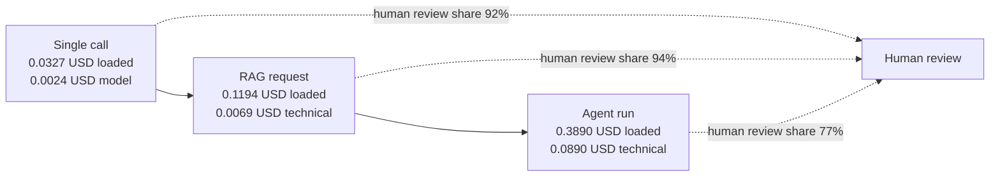

The figure shows loaded cost rising by a factor of twelve from single call to agent, while the technical cost rises by a factor of 33. The technical cost grows faster, so the human share falls (92, 94, 77 percent), but human review remains the largest line in all three. The review rates assumed here (2, 5, and 10 percent with two to four minutes each) are typical for features with human oversight. Your numbers will differ. The principle does not: you cannot optimize a cost line you have not measured, and the human line is the one that most cost reviews leave out.

A second implication concerns what "cheap" means. For the single call, a tenfold cut in token price saves 7 percent of loaded cost. For the agent, caching saves 13 percent of loaded cost ($0.0601 of the $0.4490 it would cost without caching) and 41 percent of the model cost. The decision about where to spend optimization effort depends on which line dominates for your workload, and only the decomposition tells you.

### 3.7 Measuring instead of assuming

The worked examples use assumed token counts. In production, collect these per request: input tokens, cached tokens, output tokens, reasoning tokens (providers return usage fields), retrieval and rerank counts, tool call count, step count, retry count, latency by stage, model and version, tenant, feature, and outcome label. Store them as structured fields on the request trace (see [CH11](CH11_Evaluation_and_Observability_Architecture_for_AI_Systems.md)). The cost model then becomes a query over the trace store, not a spreadsheet of assumptions. Recompute the decomposition monthly. The gap between the assumed and measured token counts is itself a finding: in practice, measured average input tokens are commonly higher than design estimates because of history, tool schemas, and retrieved context that nobody counted.

## 4. Pricing Models and What Each One Rewards

A pricing model is a contract about who carries the risk of unused capacity and who carries the risk of a price change. Choosing one is a decision about utilization, predictability, and flexibility. [Cloud Cost Optimization (Part 09 CH14)](../09_Cloud_Computing/CH14_Cost_Optimization.md) owns the general mechanics of on-demand, reserved, and spot capacity, and the practice of commitments. This section recaps them in AI terms and adds the pricing forms that are specific to model access.

### 4.1 The menu

| Model | You pay for | Risk you carry | Rewards |
|---|---|---|---|
| Per-token on-demand | Tokens actually processed | Price changes, rate limits, bill growth | Zero idle cost, instant start, no commitment |
| Batch (asynchronous) | Tokens, at a discount, with results delivered later | Delay, up to a stated window | Lower unit price for work that can wait |
| Prompt-cache pricing | Reduced rate on repeated prompt prefixes, sometimes with a write premium | Cache misses, expiry, prefix drift | Large saving on long, stable prefixes |
| Provisioned throughput | A fixed capacity unit per hour or month | Idle capacity, wrong sizing | Predictable latency and capacity, lower unit price at high utilization |
| Reserved GPUs | Accelerator-hours for one to three years | Idle hardware, model or hardware obsolescence | Lowest sustained self-hosted price |
| Spot or preemptible GPUs | Spare capacity at a steep discount | Interruption, restart cost | Cheapest compute for interruptible work |
| Per-seat subscription | A fee per user per month | Heavy users (as a seller), shelfware (as a buyer) | Budget predictability |

### 4.2 Per-token on-demand

This is the default, and it is the right default during discovery and for spiky or unpredictable traffic. You pay only for what you use, and you can change models by editing a configuration value. Its weaknesses are that the bill is a pure function of usage, that rate limits can cap throughput during a spike, and that the unit price is set by the provider. Most architectures should start here and move volume to other models only when measurement justifies it.

Two features of per-token pricing deserve attention. First, input and output carry different prices, so the cost per call depends on the input-to-output ratio. A summarization task with a 6,000-token input and a 300-token output costs mostly input. A generation task with a 200-token input and a 2,000-token output costs mostly output. Second, long-context requests may be priced in tiers: some providers charge a higher rate when the prompt exceeds a threshold. Read the pricing page for tier boundaries, because a prompt that crosses one pays more on every token, not only on the excess.

### 4.3 Batch pricing

Several providers offer an asynchronous batch interface at a discount of around half the on-demand price for input and output, with results returned within a stated window such as 24 hours. At the time of writing this is documented by major providers, so verify the discount and window in current documentation before relying on them. The design consequence is that you must separate workloads by deadline. Anything a person is waiting for uses the synchronous path. Anything that can wait (nightly summaries, evaluation runs, bulk classification, embedding refreshes, backfills) uses the batch path.

Batch is the cheapest lever to adopt when work is already asynchronous, because it needs a queue and a result handler but no change to prompts or quality. Worked numbers: a document pipeline that spends $4,600 a month on on-demand tokens would spend about $2,300 on batch, a $2,300 monthly saving for the engineering cost of a queue consumer. Section 8.4 covers the design.

### 4.4 Prompt-cache pricing

A prompt cache stores the processed state of a prompt prefix. When a later request begins with the same prefix, the provider skips recomputing it and charges a reduced rate for those tokens. The structure differs by provider. At the time of writing, one widely used API charges 1.25 times the input rate to write a short-lived cache entry and 0.1 times to read it, with a longer-lived entry costing more to write, while another applies an automatic discount to repeated prefixes without a write charge. Check your provider's documentation for the rate, the time-to-live (TTL), the minimum prefix length, and whether you must mark cache breakpoints explicitly. These details change the break-even hit rate, which section 8.3 derives.

### 4.5 Provisioned throughput

Provisioned throughput (the name varies by provider) sells you a fixed capacity unit, billed by the hour or month regardless of use, usually with a commitment term. The unit price per token is lower than on-demand if the unit is well used, and latency is more predictable because you are not competing with other tenants for capacity.

The decision is a utilization calculation. Take an illustrative unit that costs $9,000 per month and sustains 200,000 tokens per minute of blended input and output. A month has 730 hours, so the unit can process

$$
200{,}000 \times 60 \times 730 = 8.76 \times 10^{9} \text{ tokens}
$$

at 100 percent utilization. If the blended on-demand price is $2.00 per M, the same tokens cost $17,520 on demand. The break-even utilization is

$$
u^{*} = \frac{9{,}000}{17{,}520} = 0.514
$$

so the unit pays off only if it runs above 51 percent of its capacity on average. Real traffic has a peak above its average. If peak traffic is three times the average and you size the unit to the peak, average utilization is 33 percent, the effective price is $9{,}000 / 2{,}920\,\text{M} = \$3.08$ per M, and provisioned capacity costs 54 percent more than on-demand. Provisioning pays when it is sized for the baseline, not the peak.

A hybrid is usually best: provision for the load that is present nearly all the time, and let the gateway ([CH08](CH08_Model_Gateway_Routing_and_Fallback_Architecture.md)) spill the excess to on-demand. If a unit is sized to a baseline that keeps it 90 percent utilized, the effective price is $9{,}000 / 7{,}884\,\text{M} = \$1.14$ per M, 43 percent below on-demand for that slice, and the peaks still get served at the on-demand rate. Provisioned throughput also changes failure behaviour. You can be throttled at your purchased ceiling even when the provider has spare capacity, so the gateway needs a fallback path (see [CH13](CH13_Reliability_and_Resilience_Patterns_for_AI_Workloads.md)).

### 4.6 Reserved and spot accelerators

For self-hosted models, accelerators are billed per hour. Illustrative on-demand price: $4.00 per GPU-hour. A one-year reservation might discount this by about a third ($2.60) and a three-year reservation by more than half ($1.80). Ranges of this size are typical across providers, but verify current terms. A reservation is a bet on utilization over time. If you would otherwise run the accelerator on demand less than 65 percent of the hours in the term ($2.60 / $4.00), the reservation costs more than on-demand.

Spot or preemptible capacity might cost $1.40 per GPU-hour, a 65 percent discount, in return for an interruption notice that may be short. The saving is real only for work that tolerates interruption: batch inference with checkpointed progress, evaluation sweeps, embedding backfills, and training with periodic checkpoints. If 12 percent of compute time is lost to interruptions, restarts, and recomputation, the effective price is $1.40 × 1.12 = $1.57 per GPU-hour, still 61 percent below on-demand. Latency-sensitive online serving rarely fits spot on its own, but a fleet that mixes a reserved baseline with spot burst capacity is a common design, with the fallback behaviour specified in [CH07](CH07_Inference_Serving_and_Model_Placement.md).

### 4.7 Per-seat pricing

Per-seat pricing appears on both sides of a decision. As a **buyer**, a per-seat copilot subscription has a fixed monthly cost per user with usage inside a fair-use envelope. It is attractive when most users are moderate and you value budget predictability, and unattractive when most seats are idle. As a **seller**, a flat per-seat price over a usage-based AI cost is a margin risk, because the heaviest users cost far more than the average. Section 5.3 shows a $30 seat that earns 78 percent margin from an average user and loses $132 a month on a power user. The usual remedies are fair-use limits, credit allowances with overage pricing, tiered plans, or routing heavy users to cheaper models. See [Pricing (Part 02 CH29)](../02_Design_Thinking_and_Product_Management/CH29_Pricing.md) for the commercial side of these choices.

### 4.8 Choosing a pricing model

The choice follows from three properties of the workload: how steady the volume is, how long a request may wait, and whether you host the model.

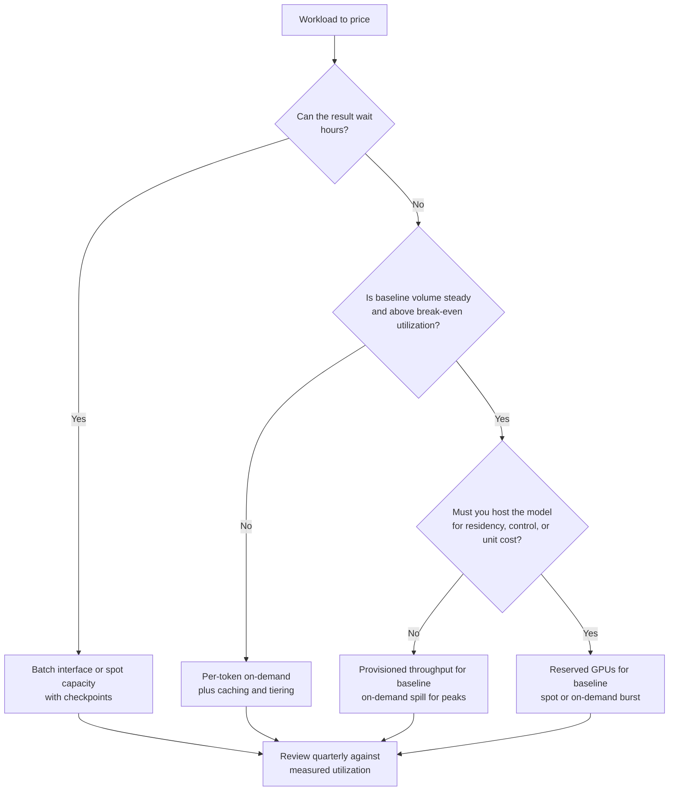

The tree sends deferrable work to the cheapest interruptible options first, because that decision needs no quality trade-off. Steady, latency-sensitive work only reaches the commitment branch if measured utilization clears the break-even threshold, which is why the decision begins with a measurement and ends with a review. A commitment signed on a forecast that did not materialize is the most common source of avoidable AI spend in the first year, so size commitments to what you have observed for at least a quarter, and ratchet them up.

## 5. Unit Economics: Cost per Successful Outcome

### 5.1 Why cost per request misleads

Cost per request is the number the provider's invoice makes easy to compute. It is the wrong denominator for decisions, because a request is not what the business buys. The business wants an outcome: a ticket resolved, a document accepted, a claim triaged correctly. Requests that fail to produce an outcome still cost money, and requests that produce a wrong outcome cost more.

Define the quantities for one case (one unit of work the user cares about):

- $c$: cost of one automated attempt (model, retrieval, tools, overhead), in dollars.
- $r$: retry rate, the fraction of cases that need an extra automated attempt. The expected number of attempts is $a = 1 + r$.
- $\rho$: review rate, the fraction of cases a human spot-checks, each costing $k$ dollars.
- $s$: success rate, the fraction of cases the automated path resolves without a human taking over.
- $e$: escalation cost, the cost of a human handling a case the automated path did not resolve (including the cost of the failed attempt's lost time).

The expected cost of a case is

$$
K = a\,c + \rho\,k + (1 - s)\,e
$$

and the cost per successful outcome is

$$
K_{\text{outcome}} = \frac{K}{s}.
$$

The first two terms are the cost of the automated path. The third term is rework: every unresolved case is paid for twice. Dividing by $s$ spreads the cost of unresolved cases across the resolved ones, giving a fully loaded price for each outcome the automation delivers. To compare against a baseline that resolves every case by hand at cost $e$, compare $K$ with $e$ (cost per case handled), or $K_{\text{outcome}}$ with the cost per resolved case under the old process.

### 5.2 Worked example: a support assistant

Illustrative parameters for a customer support assistant: $c = \$0.021$ per attempt, $r = 0.15$, $\rho = 0.05$ with $k = \$0.60$ (a 48-second review at $45 per hour), $s = 0.70$, and $e = \$4.50$ per escalated case.

- Attempts: $a = 1.15$, so the automated attempt cost is $1.15 \times 0.021 = \$0.02415$.
- Review: $0.05 \times 0.60 = \$0.0300$.
- Automated path total: $0.02415 + 0.0300 = \$0.05415$.
- Rework: $(1 - 0.70) \times 4.50 = \$1.350$.
- Cost per case: $K = 0.05415 + 1.350 = \$1.40415$.
- Cost per successful outcome: $1.40415 / 0.70 = \$2.0059$.

The all-human baseline costs $4.50 per case, so the assistant cuts cost per case by 69 percent. The telling detail is that rework is $1.35 of the $1.40, or 96 percent. The model and retrieval cost, the thing the invoice shows, is 1.7 percent of the economics. The business result is driven by the success rate and the cost of handling failures.

Now test the cheaper-model hypothesis. A model that costs $0.004 per attempt (about five times cheaper) but resolves only 55 percent of cases gives:

- Automated attempt: $1.15 \times 0.004 = \$0.0046$.
- Review: $0.0300$ (unchanged).
- Rework: $0.45 \times 4.50 = \$2.025$.
- Cost per case: $0.0046 + 0.0300 + 2.025 = \$2.0596$.
- Cost per successful outcome: $2.0596 / 0.55 = \$3.7447$.

The cheaper model costs 87 percent more per successful outcome ($3.74 versus $2.01), even though it is five times cheaper per attempt. The reverse reasoning is also useful: a more capable and more expensive model that raises success from 70 to 80 percent, with attempt cost unchanged, cuts the cost per outcome to $1.19 (40 percent lower), which is worth paying for as long as the extra model cost per case stays under the roughly $0.45 per case that the higher success rate saves ($1.404 falls to $0.954).

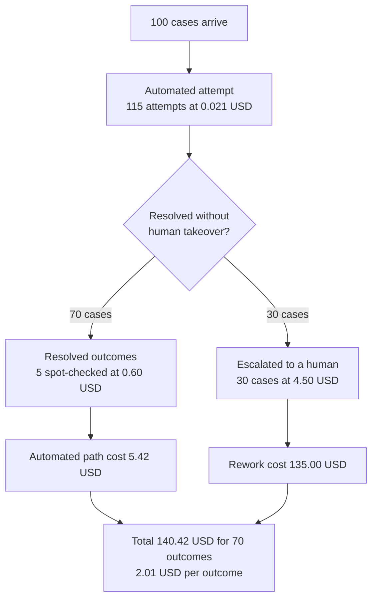

The diagram follows 100 cases through the model. Of $140.42 spent, $135.00 is rework on the 30 escalated cases. Any change that moves the 30 downward is worth far more than a change in the model price. This is the central claim of the unit-economics view, and it explains why this chapter keeps returning to quality budgets and evaluation ([CH11](CH11_Evaluation_and_Observability_Architecture_for_AI_Systems.md)).

### 5.3 Gross margin per feature

For a product that sells the AI feature, margin per customer or per seat depends on the cost of the AI path, not on the human escalation cost that the customer's own staff bears. Using the automated path cost of $0.0542 per case and a $30 seat price, usage matters:

| User type | Cases per month | AI cost | Margin | Margin % |
|---|---|---|---|---|
| Average user | 120 | $6.50 | $23.50 | 78.3% |
| Heavy user | 900 | $48.74 | −$18.74 | −62.5% |
| Power user | 3,000 | $162.45 | −$132.45 | −441.5% |

With a population of 80 percent average, 17 percent heavy, and 3 percent power users, the blended usage is $0.80 \times 120 + 0.17 \times 900 + 0.03 \times 3000 = 339$ cases per seat per month. Blended AI cost is $18.36 and blended margin is 38.8 percent. The average user (120 cases) suggests a 78 percent margin. The blended population delivers half of that. Pricing a seat on the median user rather than the mean is the error that sinks per-seat AI products.

### 5.4 Break-even

The break-even number of cases per seat is the price divided by the cost per case:

$$
n^{*} = \frac{30}{0.0542} \approx 554 \text{ cases per month.}
$$

Beyond 554 cases a month, a seat loses money. In the population above, that threshold sits within the heavy-user band, so the product is profitable on average only because the large middle of the distribution subsidizes the tail. Break-even also gives a design target: reducing the cost per case by half doubles the break-even volume to 1,108 cases, which brings most heavy users back into profit, so the lever is worth an engineering quarter.

Break-even logic applies to build decisions as well as seats. If a feature costs $240,000 to build and run in the first year and each resolved outcome saves $2.49 against the manual baseline ($4.50 − $2.01), the feature breaks even after $240{,}000 / 2.49 = 96{,}386$ resolved outcomes, or about 8,000 per month for a year.

### 5.5 Sensitivity analysis

Sensitivity analysis shows which assumption the answer depends on. Vary one parameter at a time around the base case ($2.0059 per outcome) and record the change:

| Change | Cost per outcome | Change vs base |
|---|---|---|
| Success rate 0.70 → 0.60 | $3.0903 | +54.1% |
| Success rate 0.70 → 0.80 | $1.1927 | −40.5% |
| Escalation cost $4.50 → $6.50 | $2.8631 | +42.7% |
| Review rate 5% → 20% | $2.1345 | +6.4% |
| Model cost +50% | $2.0232 | +0.9% |
| Model cost −50% | $1.9887 | −0.9% |
| Retry rate 15% → 40% | $2.0134 | +0.4% |

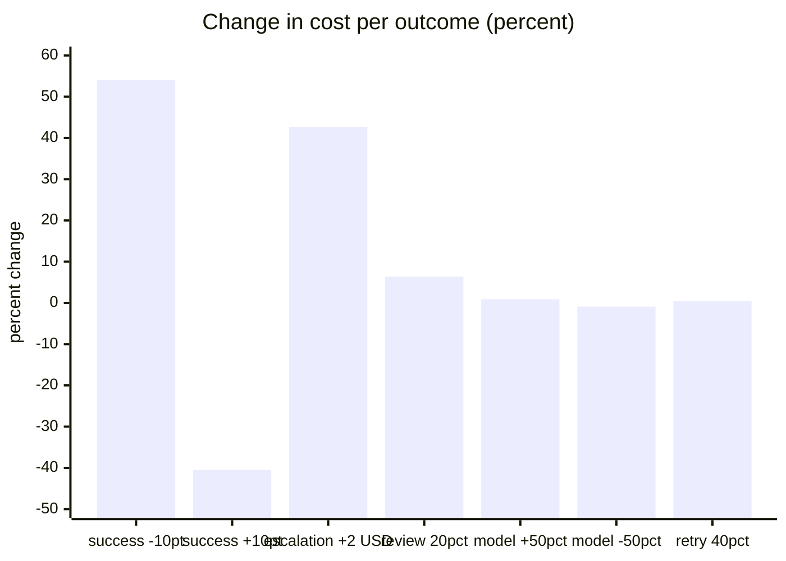

The chart shows what the table implies. The cost per outcome is two orders of magnitude more sensitive to success rate and escalation cost than to the model price. A ten-point success change moves the answer by 40 to 54 percent, while a 50 percent change in the model price moves it by under 1 percent. This is specific to a workload where a human handles the failures and a case costs dollars to handle. For a high-volume workload with no human in the loop, such as bulk classification where an error costs a fraction of a cent, the model price dominates. The point of sensitivity analysis is to find out which regime you are in before spending effort. The runnable version is [02_unit_economics_forecaster.py](../code/python/ai-cost-sustainability-chapter/02_unit_economics_forecaster.py).

### 5.6 What to do with the result

Unit economics should end in action, not in a report. Four patterns follow from the analysis:

1. **Make quality the primary cost lever** when failures are handled by people. Invest in evaluation sets, retrieval quality, and prompt iteration before negotiating token prices.
2. **Bound the tail** when pricing is flat. Add fair-use limits, per-user budgets, or usage-based overage so that the 3 percent of power users who generate a quarter of requests do not erase the margin from the other 97 percent.
3. **Report the metric** on the same dashboard as latency and error rate. When cost per outcome is visible, regressions in quality show up as cost regressions, which is a fast feedback signal.
4. **Recompute when assumptions move.** A price change, a new model, a changed escalation process, or a larger context window changes the answer. Keep the calculator in version control with the price table and rerun it as part of the quarterly review.

## 6. Forecasting Spend from Usage

### 6.1 A driver-based model

A forecast that multiplies last month's bill by a growth rate fails for AI, because the bill depends on several drivers that grow at different rates and interact. A driver-based forecast models each one:

$$
S_t = U_t \times R_t \times C_t
$$

where $S_t$ is spend in month $t$, $U_t$ is the number of active users, $R_t$ is requests per user, and $C_t$ is the cost per request. The cost per request is itself a function of the average input tokens $n_t^{\text{in}}$, output tokens, cache hit rate, and price:

$$
C_t = \frac{n_t^{\text{in}}(1 - h)\,p_{\text{in}} + n_t^{\text{in}}\,h\,p_{\text{cache}} + n^{\text{out}}\,p_{\text{out}}}{10^{6}}
$$

where $h$ is the cache hit rate. Each driver has its own growth model: user growth $U_t = U_0 (1 + g_u)^t$, usage growth $R_t = R_0 (1 + g_r)^t$, and context growth $n_t^{\text{in}} = n_0 (1 + g_c)^t$.

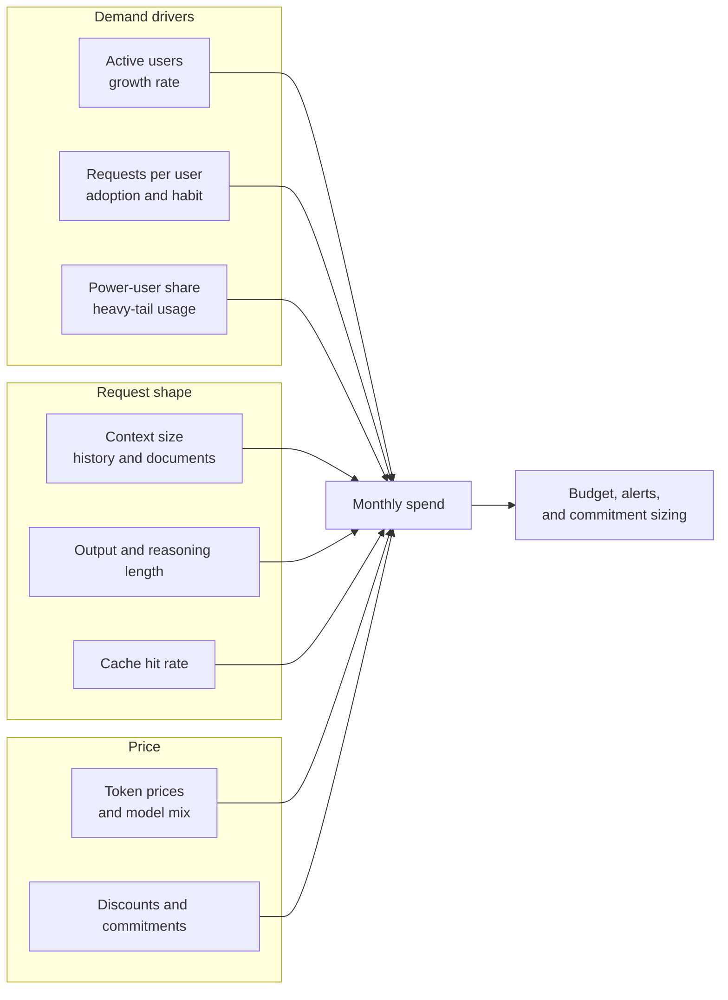

The diagram separates three families of driver because they are controlled by different people. Product and marketing influence demand. Architecture controls request shape. Procurement and the gateway control price. A forecast with these three groups lets each owner see which part of a variance belongs to them.

### 6.2 A worked 12-month forecast

Illustrative baseline: 2,000 active users in month 1, growing 8 percent per month; 60 requests per user per month, growing 2 percent per month as habits form; 3,000 average input tokens, growing 4 percent per month as conversations lengthen and documents get larger; 350 output tokens; mid-tier prices of $1.00 per M input and $4.00 per M output; no caching.

Month 1: $C_1 = (3{,}000 \times 1.00 + 350 \times 4.00) / 10^6 = \$0.0044$ per request. There are $2{,}000 \times 60 = 120{,}000$ requests, so spend is $528.

Month 12 (t = 11): users $= 2{,}000 \times 1.08^{11} = 4{,}663$; requests per user $= 60 \times 1.02^{11} = 74.6$, so requests $\approx 347{,}900$; average input tokens $= 3{,}000 \times 1.04^{11} = 4{,}618$, so $C_{12} = (4{,}618 + 1{,}400) / 10^6 = \$0.00602$; spend is about $2,094.

| Month | Users | Requests | Input tokens | Cost per request | Spend |
|---|---|---|---|---|---|
| 1 | 2,000 | 120,000 | 3,000 | $0.00440 | $528 |
| 3 | 2,333 | 145,623 | 3,245 | $0.00464 | $676 |
| 6 | 2,939 | 194,671 | 3,650 | $0.00505 | $983 |
| 9 | 3,702 | 260,239 | 4,106 | $0.00551 | $1,433 |
| 12 | 4,663 | 347,892 | 4,618 | $0.00602 | $2,094 |

Spend grows by 3.97 times while users grow 2.33 times. The difference between those factors is the compounded effect of requests per user (1.24 times) and cost per request (1.37 times). Context growth alone is responsible for the 1.37. If the context stayed flat at 3,000 tokens, month 12 would cost $1,531, and the twelve-month total would be $11,400 rather than $13,793. Context growth adds 21 percent to the annual bill, and it is a cost that no one asked for: it comes from long histories, larger retrieved documents, and bigger tool schemas.

### 6.3 Power users

Averages hide the distribution. Usage in most products follows a heavy-tailed distribution, where a small group of users generates a large share of requests. A simulation with Pareto-distributed usage (shape 1.4, capped at 20,000 requests per month, 2,000 users, illustrative) gives a mean of 89 requests per user per month and a median of 40. The top 1 percent of users generate 25.0 percent of requests, and the top 10 percent generate 52.8 percent.

The consequences are practical. A forecast based on the mean user underestimates the load that the heavy users impose on rate limits and per-tenant budgets. A product with seat pricing is exposed to the tail (section 5.3). Capacity planning must consider the burst a single power user can produce. And anomaly detection (section 12.5) must distinguish a legitimate power user from a runaway client, usually by comparing a user's usage with their own history rather than with the population average.

### 6.4 Heavy-tail requests

The same shape appears inside requests. A few requests carry very long documents or trigger many tool calls, and they cost far more than the median. A Monte Carlo simulation (100,000 requests, lognormal input tokens with a median of 3,000 and a spread parameter 0.6, plus 1 percent of requests carrying a document 12 times larger, 350 output tokens, illustrative mid-tier prices) gives:

- Naive planning cost, using the median: $0.00440 per request.
- Simulated mean: $0.00538, 22 percent above the naive figure.
- Median: $0.00442. 99th percentile: $0.02012, 4.6 times the median.
- The top 1 percent of requests account for 8.3 percent of spend.

A forecast built from a typical request underestimates the bill by about a fifth, and the error grows with the weight of the tail. This also matters for rate limits (a token-based limit is a better guard than a request-count limit), for latency (the tail drives 99th-percentile latency), and for budgets (a per-request cost cap protects against a single giant request). Collect the actual token histogram from traces and use it as the input distribution.

### 6.5 Scenarios and budget ranges

A single number invites false precision. Present three scenarios with their drivers named:

- **Base:** the driver values above.
- **High:** user growth 12 percent, context growth 6 percent, cache hit rate 30 percent below plan.
- **Low:** user growth 4 percent, context growth 2 percent, a planned cache hit rate achieved.

State the budget as a range and set alerts on the leading indicators that discriminate between scenarios: weekly new users, mean input tokens per request, cache hit rate, and the share of spend from the top ten tenants. Recompute monthly. A commitment (reserved capacity, provisioned throughput) should be sized to the low scenario's baseline, so that if the high scenario materializes the extra volume falls to on-demand and you lose a discount rather than carrying idle capacity.

### 6.6 Price is a driver too

The model above holds price constant. In practice the price of a given capability level has fallen in most periods and sometimes rises for specific models when a provider retires a model or changes tiers. Treat the price table as a time series with a source and a date. Run the forecast twice: with prices flat, and with a plausible change, say a 30 percent decline for the same capability level in a year. Do not bake a hoped-for price decline into a commitment decision. If the decline arrives it is a windfall; if it does not, the budget is intact. Section 18.2 works a price-change scenario in detail.

## 7. Cost Levers: Ranking by Impact and Risk

### 7.1 A taxonomy of levers

Every cost lever does one of five things, and the order below is also the order in which to try them, because each step is usually cheaper, less risky, and more reversible than the next.

1. **Eliminate** work that does not need to happen: fewer tokens, fewer calls, fewer retries, no reasoning where none is needed.
2. **Defer** work that does not need to happen now: batch interfaces, queues, off-peak and low-carbon windows.
3. **Reuse** work already done: prompt caches, response caches, embedding and tool-result caches.
4. **Downgrade** the capability used per request to the cheapest one that meets the quality budget: model tiering, cascades, quantization, distillation.
5. **Pack** and **relocate**: raise utilization of hardware you pay for, choose cheaper capacity classes (spot, reserved), and, last, change who owns the hardware (self-hosting).

The ordering reflects a general property of cost work: eliminating and reusing change the amount of work, so they help every pricing model and every hardware choice, and they also cut latency and energy. Downgrading changes quality, so it needs evidence. Relocating changes your operating model, so it has a large fixed cost and is hard to reverse.

### 7.2 The ranking table

The ranges are typical orders of magnitude for workloads of the shapes used in this chapter. They are illustrative, not guarantees. The saving column is the saving on the cost line that the lever acts on, not on the whole bill.

| Lever | Typical saving on its cost line | Quality risk | Engineering effort | Reversibility |
|---|---|---|---|---|
| Prompt caching for stable prefixes | 20 to 65% of input cost | Low | Low | High |
| Batch and asynchronous deferral | about 50% on deferrable work | Low (latency only) | Medium | High |
| Output and reasoning control | 10 to 40% of output cost | Low to medium (truncation) | Low | High |
| Prompt and context reduction | 20 to 60% of input cost | Medium (lost context) | Medium | High |
| Retrieval tuning | 15 to 40% of RAG cost | Medium (recall) | Medium | High |
| Model tiering and cascades | 30 to 60% of model cost | Medium (router, verifier) | Medium to high | Medium |
| Semantic response caching | 3 to 30% of requests served | Medium to high (wrong hits) | Medium | High |
| Quantization (self-hosted) | 30 to 50% of GPU cost | Low to medium | Medium | High |
| Distillation to a small model | 70 to 90% per request on a narrow task | Medium | High | Medium |
| Spot capacity | 50 to 70% of interruptible compute | Low (interruption) | Medium | High |
| Scale-to-zero and right-sizing | 20 to 70% of idle cost | Low (cold start) | Medium | High |
| Self-hosting an open-weight model | Negative to 80% | Medium | Very high | Low |

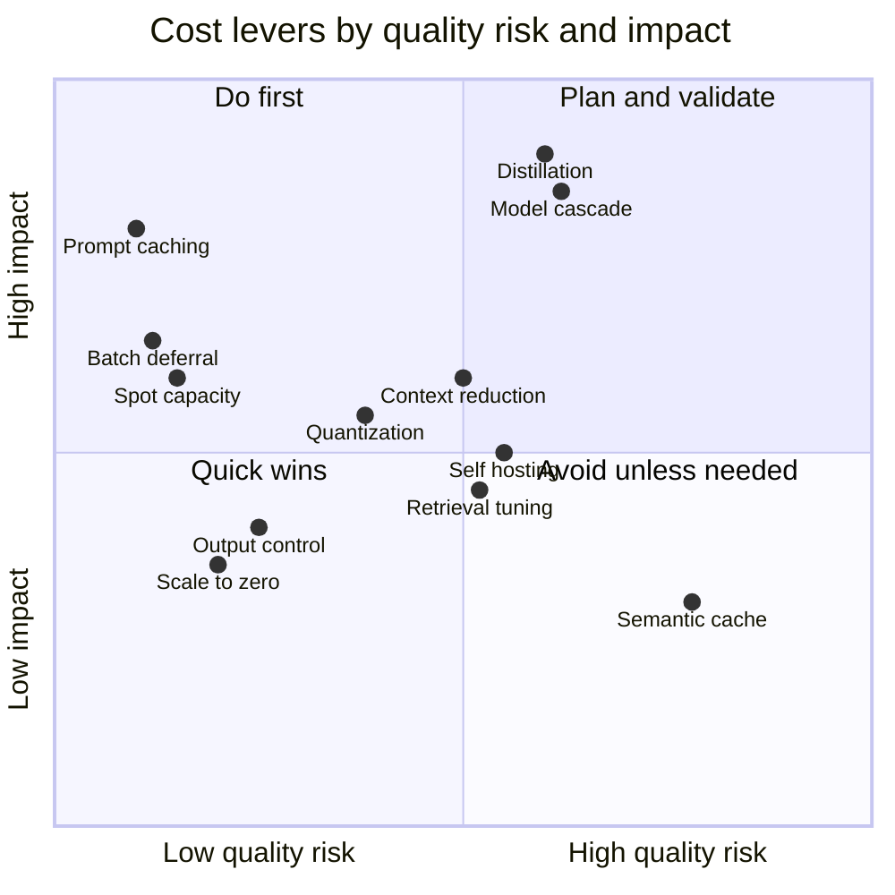

The chart shows two clusters. In the upper left sit levers that save a lot with little quality risk: caching, batching, spot capacity. Start there. The upper right holds the large savings that require quality evidence (cascades and distillation): they are worth the investment, but only with a golden evaluation set and a rollback path. The bottom right holds the levers with the worst risk-to-return ratio, such as aggressive semantic caching on personalized content. Position on the chart depends on the workload, so redraw it with your own measurements.

### 7.3 A method for ranking your own levers

For each candidate lever, compute the expected saving before building anything:

$$
\text{saving} = S_{\text{line}} \times \delta \times f
$$

where $S_{\text{line}}$ is the monthly spend on the cost line the lever acts on (from the decomposition in section 3), $\delta$ is the fractional reduction on that line when the lever applies, and $f$ is the fraction of traffic the lever applies to. Then subtract the build cost amortized over a year and the cost of the quality risk (an increase in $1 - s$ multiplied by the escalation cost $e$ from section 5.1). If the net saving is smaller than the engineering time needed to maintain the lever, skip it.

A worked check: a RAG service spends $60,000 a month, of which 59 percent is fresh input tokens ($35,400). Cutting retrieved context by 40 percent applies to all traffic ($f = 1$) and reduces the input line by about 36 percent, because retrieved context is roughly 90 percent of the input tokens in this service ($\delta \approx 0.4 \times 0.9 = 0.36$). The saving is $35{,}400 \times 0.36 \times 1 = \$12{,}744$ per month. If the recall drop lowers the success rate by one point on 500,000 cases a month, the quality cost is $0.01 \times 500{,}000 \times 4.50 = \$22{,}500$ per month, which exceeds the saving. The lever pays only if recall is preserved, which is exactly what the golden set must show. The calculation surfaced the real question before any code was written.

## 8. The Levers in Depth

### 8.1 Prompt and context reduction

The first step is an audit, not an edit. For a sample of production requests, break the input tokens into components: system instructions, tool and function definitions, conversation history, retrieved documents, and the user message. Teams are routinely surprised. Tool definitions alone can run into thousands of tokens: thirty tools at 150 tokens each is 4,500 tokens on every request, before the user has said anything. A system prompt grown by successive patches may carry instructions that no longer apply.

The main techniques, in order of safety:

- **Remove dead instructions and duplicated examples.** Verify with the evaluation set that quality holds.
- **Load tools on demand.** Offer a small router or tool-search step so the model sees only the tools relevant to the request.
- **Bound history.** Keep the last few turns verbatim and replace older turns with a running summary.
- **Reduce retrieved context.** Lower the number of chunks, shorten chunks, or rerank and keep the best few (section 8.7).
- **Compress.** Strip boilerplate, markup, and repeated headers from retrieved text.

Conversation history deserves a worked example because the cost is quadratic. Suppose each turn adds a 400-token exchange and the input at turn $i$ is the whole history plus the new message, about $400i$ tokens. Over a 20-turn conversation the total input is

$$
\sum_{i=1}^{20} 400\,i = 400 \times 210 = 84{,}000 \text{ tokens.}
$$

Now keep only the last three exchanges verbatim plus a 300-token summary. For turns 1 to 4 the input is unchanged ($400 + 800 + 1{,}200 + 1{,}600 = 4{,}000$). From turn 5 on, the input is $3 \times 400 + 300 + 400 = 1{,}900$ tokens, for 16 turns, a total of 30,400. The windowed conversation uses $4{,}000 + 30{,}400 = 34{,}400$ tokens, 59 percent fewer. The saving grows with conversation length, and the summary call itself is small and can run on a cheaper model.

The risk is lost context. A summary can drop a constraint the user stated in turn two. Mitigate with a structured summary that always preserves named fields (goals, constraints, decisions, open questions), and test with conversations that deliberately refer back to early turns.

### 8.2 Output and reasoning control

Output tokens cost several times more than input tokens, so each output token removed is worth several input tokens removed. A saving of 100 output tokens per request at $4.00 per M is $0.0004, which is $4,000 a month at 10 million requests. The controls:

- **Set a maximum output length** appropriate to the task, and monitor how often responses end because they hit it. A response truncated mid-structure triggers a repair call or a retry that costs more than the saving.
- **Ask for the format the consumer needs.** A classification needs a label, not a paragraph. Structured output with short keys is cheaper than prose, and it is easier to validate.
- **Use stop sequences** where the provider offers them, so the model does not generate beyond the useful part.
- **Control reasoning effort.** A reasoning model that thinks for 2,000 tokens before writing a 200-token answer bills 2,200 output tokens, and the reasoning is 91 percent of that. At $15 per M the reasoning alone costs $0.03 per request. Route tasks that do not need deliberate reasoning (extraction, formatting, simple classification) to a non-reasoning model or to a low reasoning-effort setting, and reserve high effort for tasks where evaluation shows it improves accuracy.

The validation is a comparison on the golden set at each setting: accuracy, output tokens, and truncation rate. Pick the lowest setting that stays within the quality budget. Agents need a separate guard: a cap on reasoning tokens per step and on total steps (section 18.3).

### 8.3 Caching and hit-rate economics

Caching is the highest-return lever because the cheapest request is the one you do not compute. Three caches are used at different layers, and an architecture usually combines them.

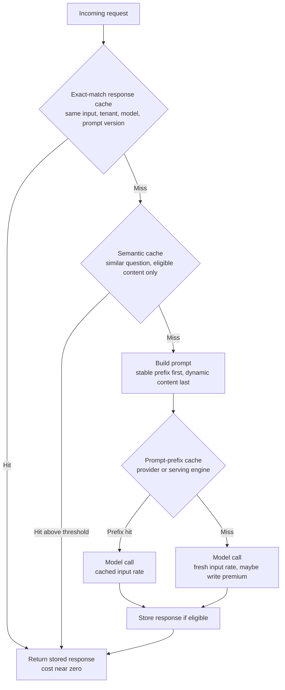

The diagram shows the layers from cheapest and riskiest to safest. Exact-match caching is trivial and safe if the key includes everything that affects the answer: the full prompt, the tenant and permission scope, the model version, and the prompt template version. The semantic cache is the riskiest, because similarity is not equivalence. The prompt-prefix cache is the safest because the model still generates a fresh answer, and it only saves recomputation of tokens it has already seen.

**Prompt-prefix cache economics.** Consider a request with a 6,000-token stable prefix (instructions, tool definitions, reference material), 500 fresh tokens, and 300 output tokens at mid-tier prices ($1.00 input, $4.00 output per M). Assume a cache read costs 0.1 times the input rate and a cache write costs 1.25 times. Per request:

- No caching: $(6{,}000 + 500) \times 1.00 + 300 \times 4.00 = 7{,}700$ micro-dollars, or $0.0077.
- A cache miss writes the prefix: $6{,}000 \times 1.25 + 500 + 1{,}200 = 9{,}200$ micro-dollars, or $0.0092.
- A cache hit reads it: $6{,}000 \times 0.10 + 500 + 1{,}200 = 2{,}300$ micro-dollars, or $0.0023.

With hit rate $h$, the expected cost is $h \times 0.0023 + (1 - h) \times 0.0092$. The break-even hit rate solves $h \cdot 0.0023 + (1-h)\cdot 0.0092 = 0.0077$:

$$
h^{*} = \frac{0.0092 - 0.0077}{0.0092 - 0.0023} = \frac{0.0015}{0.0069} = 0.217.
$$

| Hit rate | Expected cost per request | Change vs no caching |
|---|---|---|
| 0% | $0.00920 | +19.5% |
| 20% | $0.00782 | +1.6% |
| 50% | $0.00575 | −25.3% |
| 80% | $0.00368 | −52.2% |
| 95% | $0.00265 | −65.6% |

Two things follow. Caching with a write premium is a loss below about a 22 percent hit rate, so enabling it on a prefix that is rarely reused costs money. At an 80 percent hit rate it halves the cost of the request. With a provider that charges no write premium the break-even is zero and the decision is trivial, but the hit rate still determines the size of the saving.

The hit rate is an architectural outcome, not a setting. A cached prefix survives only for its time-to-live (for example five minutes), so the prefix must be requested again within that window. A feature with one request every ten minutes per prefix never hits. The levers that raise the hit rate are:

- **Prefix design.** Put everything stable first and everything variable last. A timestamp, a user name, or a request ID in the first line makes every prefix unique. Keep tool definitions in a stable order.
- **Consolidation.** Use one shared prefix across features and tenants where policy allows, rather than a per-user prefix.
- **Routing affinity.** For self-hosted engines, route requests with the same prefix to the same replica so its cache is reused (see [CH07](CH07_Inference_Serving_and_Model_Placement.md)). A gateway that load-balances randomly across replicas divides the hit rate by the replica count.
- **Keep-alive.** Where TTL is short and traffic is low, a periodic cheap request can keep a valuable prefix warm, if the arithmetic shows the keep-alive cost is smaller than the misses it avoids.
- **Measurement.** Log cached tokens per request (providers return them) and alert when the hit rate falls, since a prompt change that breaks the prefix can double the bill silently.

**Semantic cache economics.** A semantic cache embeds the incoming query, searches stored queries, and returns the stored answer when similarity exceeds a threshold. Assume a full call costs $0.0105 and the lookup costs $0.0002. If the hit rate is $h$, expected cost is $0.0002 + (1 - h) \times 0.0105$:

| Hit rate | Expected cost | Saving | Wrong hits if 2% of hits are wrong |
|---|---|---|---|
| 5% | $0.01018 | 3.1% | 0.10% of traffic |
| 15% | $0.00913 | 13.1% | 0.30% of traffic |
| 30% | $0.00755 | 28.1% | 0.60% of traffic |

The savings are modest and the risk is real. A wrong hit returns a confident answer to a different question, such as a policy question for another region or a price for another plan. Restrict semantic caching to content that is public, stable, and impersonal, such as frequently asked questions over a fixed knowledge base. Include the tenant, permission scope, language, and knowledge-base version in the cache key. Set the similarity threshold from a labelled sample, not by intuition, and sample hits for human review. Never serve a cached answer across tenants (see section 17.1).

### 8.4 Batching and asynchronous deferral

Two different mechanisms share the word batching. Providers offer **batch interfaces**: submit many requests, receive results later, pay about half. Serving engines offer **continuous batching**: the engine groups concurrent requests within the same forward pass to raise throughput ([CH28](../16_AI_and_GenAI/CH28_Inference_Optimization_and_Model_Serving.md) owns the mechanism). The system-level decision is the same for both: which work can wait, and how long.

Classify requests by deadline into tiers and give each its own path:

| Tier | Deadline | Examples | Path |
|---|---|---|---|
| Interactive | under 5 seconds | chat, autocomplete, agent steps with a user waiting | Synchronous, low batch wait, headroom |
| Near-line | under 15 minutes | email draft, enrichment after upload | Queue, small batches, normal priority |
| Batch | hours to 24 hours | nightly summaries, evaluation runs, backfills, bulk classification | Provider batch API or spot capacity |

If 40 percent of tokens are deferrable and the batch discount is 50 percent, the saving on the whole model bill is $0.40 \times 0.50 = 20$ percent for little quality risk. On self-hosted infrastructure, batch work fills the troughs of interactive demand. A fleet sized for an interactive peak three times the average runs at about 33 percent average utilization. Adding deferrable work that raises average utilization to 70 percent lowers the cost per token by $1 - 0.33/0.70 = 53$ percent, with the interactive tier protected by priority scheduling and preemption of batch work.

Design details that decide success:

- **Deadline-aware scheduling.** Each job carries a deadline, and the scheduler orders by earliest deadline, not first-in-first-out. Otherwise a long batch job delays an urgent small one.
- **Idempotent, resumable work.** A batch job that fails at 90 percent must resume, not restart. Persist progress per item.
- **Partial-failure handling.** A batch of 100,000 items will contain malformed inputs and refusals. Route failures to a dead-letter queue with the reason, and cap retries.
- **Isolation.** Batch jobs must not starve interactive traffic on shared accelerators. Use separate quotas or priority classes ([CH07](CH07_Inference_Serving_and_Model_Placement.md)).
- **User expectation.** If the product changes from instant to "ready within the hour," say so in the interface and measure whether users accept it.

Batching trades latency for utilization, and the trade needs a number: the batch wait allowance. The longer the system waits to fill a batch, the higher the utilization and the lower the per-request energy, and the worse the time to first token. Set the allowance from the interactive latency budget in section 10, not from the throughput benchmark.

### 8.5 Model tiering and cascades

A single model for every request is almost always too expensive. Requests vary in difficulty, and the cheapest model that meets the quality budget differs by request. Three designs are common.

1. **Static routing by task class.** The application knows that classification, extraction, and summarization of short text go to a small model, and drafting or multi-step analysis goes to a larger one. It is simple, predictable, and testable.
2. **Router model.** A small classifier predicts difficulty from the request and picks a tier. It adds latency and a failure mode (a wrong route), and it needs its own evaluation.
3. **Cascade with a verifier.** Run the cheap model first, check the output with a verifier (a rule, a retrieval-grounding check, a small judge model, or the cheap model's own confidence), and escalate to the strong model only if the check fails. The idea is described for LLM APIs in "FrugalGPT" (Chen, Zaharia, and Zou, 2023), which reports cost reductions at matched quality on some benchmarks. Treat the published figures as evidence the idea can work, and measure on your own tasks.

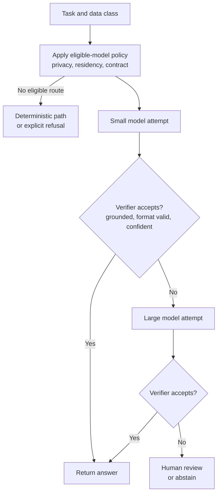

The first box in the diagram matters. The eligible-model policy runs before cost routing, so cost can never pull a request that carries regulated data onto a model that is not approved for it. Routing by cost inside the eligible set is an optimization. Routing around policy for cost is a violation (see [CH12](CH12_AI_Safety_Security_Privacy_and_Governance_Architecture.md)).

**Worked cost-quality arithmetic.** Use these illustrative parameters. The small model costs $0.004 per attempt and produces an acceptable answer on 55 percent of requests. The large model costs $0.021 per attempt and is acceptable on 78 percent. The verifier costs $0.0008 per check. It accepts 90 percent of the small model's good answers (recall) and wrongly accepts 10 percent of its bad answers (false accept rate).

- Good answers accepted: $0.55 \times 0.90 = 0.495$.
- Bad answers wrongly accepted: $0.45 \times 0.10 = 0.045$.
- Total accepted: $0.540$. Precision of accepted answers: $0.495 / 0.540 = 0.917$.
- Escalation rate: $1 - 0.540 = 0.460$.
- Cost: $0.004 + 0.0008 + 0.460 \times 0.021 = \$0.01446$, which is 31 percent below the large-only $0.021.
- Quality: escalated requests are harder than average, so derate the large model's rate to $0.78 \times 0.9 = 0.702$. Overall acceptable rate is $0.54 \times 0.917 + 0.46 \times 0.702 = 0.495 + 0.323 = 0.818$.
- Cost per good answer: large only $0.021 / 0.78 = \$0.0269$; cascade $0.01446 / 0.818 = \$0.0177$, 34 percent lower.

The cascade is cheaper than large-only whenever the accept rate $a$ satisfies

$$
a > \frac{c_{\text{small}} + c_{\text{verifier}}}{c_{\text{large}}} = \frac{0.004 + 0.0008}{0.021} = 0.229.
$$

Here the accept rate is 54 percent, comfortably above the threshold. The result depends on the verifier. Suppose the false accept rate is 40 percent instead of 10 percent, which is more realistic for a weak judge:

- Bad answers accepted: $0.45 \times 0.40 = 0.180$. Accepted total: $0.495 + 0.180 = 0.675$. Precision: $0.495/0.675 = 0.733$.
- Escalation rate 0.325. Cost: $0.0048 + 0.325 \times 0.021 = \$0.01163$.
- Quality: $0.495 + 0.325 \times 0.702 = 0.723$.

Cost falls 45 percent, but quality falls to 0.723, five points below large-only and below a 0.75 quality budget. The cascade saves money by shipping more wrong answers. The verifier's false accept rate is the parameter that decides whether the design works, so measure it on a labelled sample before launch and monitor it afterward. Cascades also add latency for the escalated fraction (two sequential calls), which matters under the budgets in section 10.

Router and cascade drift is a real operational risk: a model update changes the small model's acceptance rate, the escalation share climbs, and cost rises without any code change. Track escalation rate, post-escalation cost, and verifier agreement with human labels as first-class metrics. If a low-cost route fails often and the retried work is repeated, a direct route to the stronger model can be both cheaper and faster, and the metric will show it.

### 8.6 Quantization and distillation

[Inference Optimization and Model Serving (Part 16 CH28)](../16_AI_and_GenAI/CH28_Inference_Optimization_and_Model_Serving.md) owns the mechanics of quantization and distillation. At the system level the question is what each changes about the hardware you need and the quality you ship.

**Quantization** stores weights at lower precision. For a 70-billion-parameter model, weights occupy about 2 bytes per parameter at 16-bit precision (140 GB), 1 byte at 8-bit (70 GB), and about 0.5 bytes at 4-bit (35 GB), before runtime overhead. On 80 GB accelerators the consequences differ sharply:

| Precision | Weights | Accelerators for weights | Memory left per 80 GB device for KV cache |
|---|---|---|---|
| 16-bit | 140 GB | 2 | about 20 GB across the pair |
| 8-bit | 70 GB | 1 | about 10 GB |
| 4-bit | 35 GB | 1 | about 45 GB |

The memory left after weights holds the KV (key-value) cache, which determines how many concurrent requests the replica can serve. Moving from 16-bit to 4-bit can halve the accelerators per replica and increase concurrency, so cost per token can fall by more than the weight reduction suggests. At $4.00 per GPU-hour, one replica drops from $8.00 to $4.00 per hour. The quality risk is task dependent, with small losses on many tasks and larger ones on some reasoning, long-context, and low-resource-language tasks. Evaluate the quantized model on your golden set, including the long-input and rare-language slices, and keep the full-precision model as a rollback.

**Distillation** trains a smaller student model to imitate a larger teacher on a defined task. It converts a per-request cost into a fixed project cost. Suppose a project costs $40,000 (generating teacher labels, training, evaluation, deployment) and the student saves $0.006 per request over the teacher. The break-even volume is

$$
\frac{40{,}000}{0.006} = 6.67 \text{ million requests,}
$$

which is 3.3 months at 2 million requests a month. Distillation pays for stable, high-volume, narrow tasks. It does not pay for a task that changes monthly (the student must be retrained and re-evaluated each time), or for a broad assistant whose request mix is open-ended. Licensing of the teacher's outputs also matters: check that your agreement allows using outputs to train another model. A distilled model also becomes a model you operate, with its own evaluation set, version, and lifecycle ([CH10](CH10_AI_Platform_and_Model_Lifecycle_Architecture.md)).

### 8.7 Retrieval tuning

In a RAG system the retrieved context is often the largest token cost (section 3.4), so retrieval choices are cost choices. [RAG System Architecture (CH05)](CH05_Retrieval_Augmented_Generation_System_Architecture.md) owns the retrieval design. The cost-relevant levers are:

- **Number and size of chunks.** Each 400-token chunk costs $0.0004 per request at $1.00 per M. Cutting from ten chunks to five saves $0.002 per request, $20,000 a month at 10 million requests.
- **Reranking to enable fewer chunks.** A reranker that costs $0.001 per query pays for itself if it lets you remove more than 2.5 chunks at constant quality: dropping from ten to five saves $0.002 and costs $0.001, a net $0.001 per request. If it only improves quality without allowing fewer chunks, it is a quality spend rather than a saving, and the frontier analysis in section 9 decides whether it is worth it.
- **Hybrid search.** Combining keyword and vector search improves precision on identifiers and rare terms, which can allow a lower $k$.
- **Query routing.** Skip retrieval for requests that do not need it (greetings, calculations, requests with enough context already). A cheap classifier in front of retrieval saves the whole retrieval path on those requests.
- **Embedding refresh.** Embedding is rarely a cost problem. Embedding 10 million chunks of 400 tokens (4 billion tokens) at $0.02 per M costs $80. The cost of re-indexing is operational: compute for the index build, a rebuild window, and evaluation. Hash chunk content so unchanged chunks are not re-embedded.
- **Index memory.** Section 13.3 works the memory arithmetic.

Validate retrieval changes with retrieval metrics (recall at $k$, precision) and end-to-end answer quality on the golden set. A change that raises precision while lowering recall can save tokens and still fail the user.

### 8.8 Capacity levers: spot, scale-to-zero, and right-sizing

These levers apply to self-hosted models.

**Spot capacity** (section 4.6) suits batch inference, evaluation runs, and embedding backfills when jobs checkpoint progress. Design for a short interruption notice: checkpoint every few minutes, make work idempotent, and keep a small on-demand floor for latency-sensitive traffic.

**Scale-to-zero** removes idle capacity entirely. An internal assistant used ten hours a day on 22 working days needs capacity for 220 of 730 monthly hours. For two GPUs at $4.00 per hour, always-on costs $5,840 a month, scheduled capacity costs $1,760, and the saving is $4,080 (70 percent). The price is cold start: loading tens of gigabytes of weights takes tens of seconds to minutes. Reduce it with a pre-warmed pool during business hours, weights cached on local disk or a fast shared volume, and a fallback to a hosted API for the first minutes after a cold start. Do not scale to zero a user-facing endpoint with a latency objective that a cold start would violate unless the fallback covers it.

**Right-sizing** chooses the accelerator for the workload. Large models need memory capacity and bandwidth for weights and KV cache, and the cheapest adequate device may be the one with the most memory per dollar, not the fastest. Small models (embedding, reranking, classification) often run well on CPUs or on a fraction of an accelerator through partitioning, and are wasted on a full device. Autoscale on a signal that reflects load for these workloads, such as queue depth, tokens in flight, or KV cache occupancy, not on CPU utilization, which says little about accelerator saturation.

### 8.9 Self-hosting break-even

Self-hosting an open-weight model turns a variable per-token price into a mostly fixed monthly cost. It wins only above a volume and utilization threshold, and it brings an operating burden ([CH07](CH07_Inference_Serving_and_Model_Placement.md) covers the placement trade-offs, and [CH02](CH02_AI_Capability_and_Model_Selection.md) covers whether an open-weight model meets the quality bar).

Illustrative setup: a replica needs 2 GPUs at $4.00 per hour. Two replicas are required for redundancy. Operations (on-call share, security patching, evaluation of new model versions, capacity planning) are charged at $9,000 a month. A replica sustains 2,500 output tokens per second at the target latency.

- Fixed monthly cost: $2 \times 2 \times 4.00 \times 730 + 9{,}000 = 11{,}680 + 9{,}000 = \$20{,}680$.
- At 45 percent average utilization, tokens per month: $2{,}500 \times 2 \times 0.45 \times 3{,}600 \times 730 = 5.91$ billion.
- Effective cost: $20{,}680 / 5{,}913\,\text{M} = \$3.50$ per M tokens.

Against a hosted API at $0.60 per M for a comparable model, the break-even volume is $20{,}680 / 0.60 = 34.5$ billion tokens a month. The pair's maximum capacity at 100 percent utilization is $2{,}500 \times 2 \times 3{,}600 \times 730 = 13.1$ billion, so self-hosting cannot break even at this throughput. Utilization matters as much as volume:

| Average utilization | Self-hosted cost per M tokens |
|---|---|
| 15% | $10.49 |
| 30% | $5.25 |
| 45% | $3.50 |
| 70% | $2.25 |

Where could self-hosting win? Three conditions can each change the answer. First, throughput per accelerator: ignoring operations, parity with a $0.60 API at 50 percent utilization needs $8.00 per hour divided by $0.60 per M, divided by 0.5, or about 7,400 tokens per second per replica, roughly three times the assumed rate. Small models, aggressive batching, and quantization can reach that. Second, the comparison price: against a frontier-class hosted model at several dollars per M, an adequate open-weight model has far more room. Third, non-price constraints: data residency, an air-gapped environment, a latency requirement a remote API cannot meet, or a customization that a hosted model does not allow. Section 15 extends the comparison to a three-year total cost of ownership.

## 9. The Cost, Quality, and Latency Frontier

### 9.1 Why a frontier

A design review that compares two architectures on cost alone, or on quality alone, hides trade-offs. A configuration is **dominated** if another configuration is at least as good on every dimension (cost, quality, latency) and strictly better on one. Dominated configurations should never ship. The remaining non-dominated set is the **Pareto frontier**, and the real decision is a choice along it.

### 9.2 A worked frontier

Eleven configurations of a support assistant, measured on one golden set and one load test (illustrative values). Cost is per request, quality is the fraction of acceptable answers, and latency is the 95th percentile end to end at target concurrency.

| Configuration | Cost | Quality | p95 latency | Status |
|---|---|---|---|---|
| Small model, no retrieval | $0.0030 | 0.48 | 0.9 s | Frontier |
| Small model + RAG | $0.0060 | 0.62 | 1.4 s | Frontier |
| Mid model, no retrieval | $0.0120 | 0.60 | 1.8 s | Dominated by small + RAG |
| Cascade small to mid | $0.0102 | 0.76 | 2.4 s | Frontier |
| Mid + RAG, cheap reranker | $0.0190 | 0.77 | 2.9 s | Frontier |
| Mid + RAG | $0.0210 | 0.78 | 2.6 s | Frontier |
| Mid + RAG + reranker | $0.0230 | 0.82 | 3.0 s | Frontier |
| Mid + RAG + reranker + verify | $0.0340 | 0.80 | 5.5 s | Dominated by mid + RAG + reranker |
| Large, no retrieval | $0.0450 | 0.66 | 3.9 s | Dominated by mid + RAG |
| Large + RAG | $0.0600 | 0.84 | 4.8 s | Frontier |
| Large + RAG + verify | $0.0900 | 0.89 | 7.5 s | Frontier |

Three dominated configurations are removed at once. "Mid model, no retrieval" costs twice as much as "small + RAG" and is worse on quality and latency: the retrieval step matters more than the model size for a knowledge task. "Large, no retrieval" is dominated for the same reason. "Mid + RAG + reranker + verify" adds cost and latency and lowers quality compared with the same design without the verifier, probably because the verifier rejects correct answers and triggers a repair that degrades them. Dominance analysis finds configurations that sound reasonable but are strictly worse.

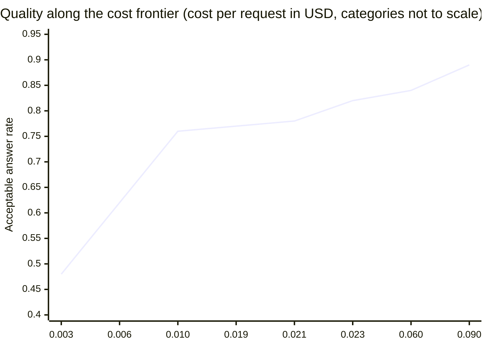

The chart orders the eight frontier configurations by cost and shows diminishing returns. Raising spend from $0.003 to about $0.010 buys 28 points of quality (from 0.48 to 0.76). The next $0.013, to $0.023, buys six more. The final $0.067, to $0.090, buys seven. The x-axis categories are evenly spaced for readability, so the real curve is flatter at the right than the chart appears. The frontier gives a menu, and the next step is to choose from it with a rule.

### 9.3 Quality budgets and the choice rule

A **quality budget** states the minimum acceptable quality (and maximum latency and cost) for a feature, set by product risk, not by what the cheapest model delivers. The budget is a floor. Three rules apply:

1. **Hard floors first.** Remove every configuration that violates a hard floor: quality below the budget, latency above the objective, or a policy rule (data class, residency). For the support assistant, suppose the floors are quality at least 0.75 and p95 latency at most 3.5 seconds. Four configurations survive: the cascade ($0.0102), mid + RAG with the cheap reranker ($0.0190), mid + RAG ($0.0210), and mid + RAG + reranker ($0.0230).
2. **Cheapest is not best.** The cheapest survivor is the cascade, but a floor says what is acceptable, not what is optimal. Compare the marginal cost of quality with its marginal value. In the unit economics of section 5.2, one point of success rate saves $0.01 × $4.50 = $0.045 per case. Moving from the cascade to mid + RAG with the cheap reranker costs $0.0088 for one point: worth it, since $0.0088 is below $0.045. Moving to mid + RAG costs $0.002 for one more point: worth it. Moving to mid + RAG + reranker costs $0.002 for four more points: clearly worth it. Moving to large + RAG costs $0.037 for two more points, $0.0185 per point, which is still below $0.045, but the 4.8-second latency violates the floor.
3. **The binding constraint may not be cost.** Under these value assumptions, the answer is mid + RAG + reranker at $0.0230 and 3.0 seconds, chosen because latency, not cost, rules out the higher-quality option. If a faster large-model path became available, the frontier would change and so would the decision.

This reasoning produces a defensible statement for a design review: "We chose mid + RAG + reranker because it is the highest-quality configuration that meets the 3.5-second latency floor, and each quality point it buys costs $0.002 against $0.045 of value." Compare that with "we chose the cheapest model that passed the test," which usually underinvests in quality when failures are expensive.

### 9.4 Uncertainty in the frontier

Each point on the frontier is a measurement with error. If the golden set has 500 cases and the true acceptable rate is 0.78, the standard error is $\sqrt{0.78 \times 0.22 / 500} = 0.0185$, so the 95 percent interval is about plus or minus 3.6 points. Two configurations at 0.77 and 0.78 are not distinguishable on 500 independent cases. Resolving a one-point difference between independent samples would need roughly $1.96^2 \times 0.78 \times 0.22 / 0.01^2 \approx 6{,}600$ cases. A paired design, in which both configurations answer the same cases and you analyse the disagreements, needs far fewer. Report intervals, use the same cases for every configuration, and avoid choosing between configurations whose difference is inside the noise on the basis of quality; choose on cost and latency instead.

Re-run the frontier when prices, models, or traffic change. A configuration that was dominated last quarter may be on the frontier after a price cut, and the reverse.

## 10. System-Level Performance Engineering

[Inference Optimization and Model Serving (Part 16 CH28)](../16_AI_and_GenAI/CH28_Inference_Optimization_and_Model_Serving.md) owns the techniques inside the model server. This section covers performance as a property of the whole request path: where the time goes, how to budget it, and what each speed-up costs.

### 10.1 What latency means for a generative request

A generative request has several latencies, and users and systems care about different ones.

- **Time to first token (TTFT):** from the user's action to the first visible token. It covers authentication, guardrails, retrieval, reranking, queueing, and the model's prefill (processing the whole prompt). Users judge responsiveness mostly by this number when the response streams.
- **Inter-token latency, or its inverse, tokens per second:** the pace of generation after the first token. It is bounded by the model server's decode speed and by how many requests share the accelerator.
- **Total completion time:** TTFT plus output length divided by tokens per second. A 350-token answer at 70 tokens per second takes 5 seconds to generate.
- **End-to-end task time:** for agents and workflows, the sum over steps, tool calls, and waiting.

Cost and latency interact through the same variables. A longer prompt costs more and lengthens prefill. A longer answer costs more and extends completion time. A bigger model costs more per token and decodes more slowly. So cutting tokens helps all three, as section 2.4 noted.

### 10.2 The latency budget

A latency budget allocates the time objective across the stages of the path, so that each stage has an owner and a number. Consider a TTFT objective of 1.5 seconds at the 95th percentile:

| Stage | Budget | Notes |
|---|---|---|
| Gateway, authentication, rate limit | 50 ms | In-region, no external calls |
| Input guardrails | 100 ms | Small classifier, run in parallel with retrieval |
| Retrieval (hybrid search) | 150 ms | Parallel across sources |
| Reranking | 200 ms | Top 50 candidates to top 5 |
| Queue wait for model capacity | 100 ms | Controlled by headroom (section 10.7) |
| Prefill and first token | 600 ms | About 3,000 input tokens on the chosen model |
| Network to the client | 100 ms | |
| Headroom for variance | 200 ms | |
| **Total** | **1,500 ms** | Sum of rows: 1,300 ms + 200 ms |

For completion time, add generation: 350 tokens at 70 tokens per second is 5.0 seconds, for a total near 6.5 seconds. With streaming, the user sees text after 1.5 seconds and reads while it generates.

Budgets of percentiles do not add exactly. The 95th percentile of a sum is lower than the sum of the 95th percentiles if the stage delays are independent, and it can be higher if they are correlated (for example, load slows retrieval and the model server together). Treat the sum as a conservative planning figure, and verify the end-to-end percentile in a load test (section 11).

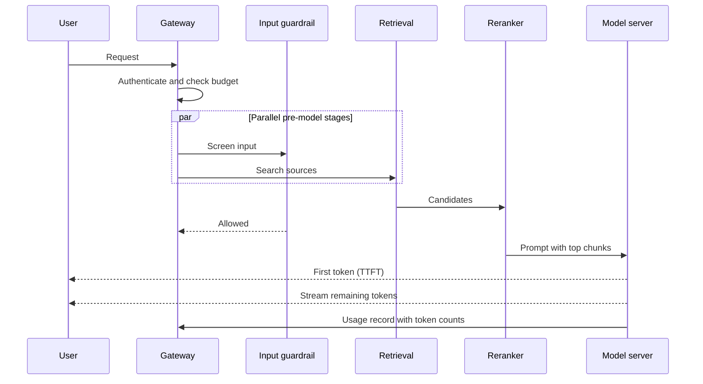

The diagram shows the critical path. Guardrail screening and retrieval run in parallel, so only the slower of the two sits on the path. Reranking must wait for retrieval and the model must wait for reranking, so those stages add. The gateway receives the usage record after streaming completes, which is where cost attribution (section 12) takes its inputs. The implication for design is that every stage on the critical path has a share of the budget, and a stage that can move off the path (guardrail checks that run beside generation, logging that runs asynchronously) should.

### 10.3 Parallelism

Four kinds of parallelism recur, each with a cost side effect.

- **Parallel independent stages.** Run input screening, retrieval from several sources, and intent classification at the same time. The cost is unchanged, only concurrency rises. This is the free lunch of latency work.
- **Parallel tool calls in an agent.** If an agent needs three independent lookups, issue them together. The cost is unchanged, and the step count falls, which also shrinks the repeated-transcript cost of section 3.5.
- **Fan-out and merge.** Split a long document into parts, summarize each in parallel, and merge. Latency falls from the sum to the maximum plus a merge step, but total tokens may rise because of overlap and the merge call. Check the arithmetic: map-reduce summarization of ten 5,000-token parts costs the same input tokens as one 50,000-token call, plus ten outputs and a merge input, while the latency is roughly one part plus the merge.
- **Redundant parallelism (hedging).** Send the same request twice and take the first answer. It cuts tail latency and doubles the cost for hedged requests (section 10.6).

### 10.4 Speculative work

Speculation spends resources on work that may be discarded to save time when it is not.

- **Speculative retrieval.** Start the search while the user is still typing or while the guardrail runs. If 60 percent of speculative searches are used, the waste is 40 percent of the retrieval cost. For a reranker at $0.001 a query, that is $0.0004 per request, which is cheap if it saves 200 ms of TTFT on the 60 percent that are used.
- **Speculative tool calls.** An agent runtime can pre-fetch data it is likely to need. Apply only to idempotent, read-only, cheap calls.
- **Speculative decoding.** The serving engine drafts several tokens with a small model and verifies them with the large one, producing the same output distribution with fewer large-model passes. The original method is described by Leviathan, Kalman, and Matias (2023). The system-level point is that it lowers latency for the same output, with a modest memory cost, and the gain depends on how often the draft is accepted. See [CH28](../16_AI_and_GenAI/CH28_Inference_Optimization_and_Model_Serving.md).

The decision rule for speculation is the same each time: (waste fraction × cost of the speculative work) should be less than (time saved × value of time). If you cannot state a value of time, use the user-experience objective: speculate only on stages that are on the critical path and exceed their budget.

### 10.5 Streaming

Streaming sends tokens to the client as they are generated. It does not reduce cost or total completion time, but it reduces perceived latency to the TTFT, and it often transforms a 6-second wait into an acceptable experience. Its architectural consequences are easy to miss:

- **Output cannot be recalled.** Once tokens are sent, a guardrail failure in the middle of a response cannot unsend them. Run output checks on chunks with a small lag, buffer the first sentences when the risk is high, and define what the interface does when a stream is cut.
- **Errors arrive mid-response.** Retries after the first token have to resume or restart visibly. Specify the behaviour.
- **Cancellation saves money.** If the user closes the page, the server should stop generating. Without cancellation propagation, abandoned requests keep consuming output tokens (the expensive kind) and accelerator time. Measure the share of tokens generated for requests whose client disconnected. In a chat product that share can reach several percent, and cancellation recovers it at no quality cost.
- **Connection cost.** Long-lived streaming connections consume gateway and load balancer resources, so capacity planning must count concurrent streams, not only requests per second (section 11.4).

### 10.6 Tail latency control

Mean latency is not what users complain about. The tail is. Dean and Barroso described the effect in "The Tail at Scale" (2013): when a request fans out to many components, the probability that at least one is slow rises quickly, so rare slow events become common at the request level. AI requests have tails from many sources:

- long prompts and long outputs (the heavy tail of section 6.4),
- queueing when the model server is near saturation,
- cold starts after scale-up,
- rate limiting and retries,
- slow tools in an agent loop,
- noisy neighbours on shared accelerators.

The controls, with their cost:

1. **Hard limits per request.** Maximum input tokens, maximum output tokens, maximum steps, maximum wall-clock time. Free, and the most effective control.
2. **Timeouts with budgets that decrease along the path.** If the user-facing timeout is 10 seconds, no downstream call may use a timeout that exceeds the remaining time ([CH13](CH13_Reliability_and_Resilience_Patterns_for_AI_Workloads.md)).
3. **Separate pools by request class.** Long-context and long-output requests share a pool that does not block short interactive requests.
4. **Hedged requests.** Send a second copy to another replica or provider only after the first has exceeded a high percentile, such as the 95th. This hedges about 5 percent of requests, so the extra cost is about 5 percent of the hedged stage. Hedge only the stages before generation, or cancel the loser promptly, because duplicate generation doubles the expensive output cost.
5. **Load shedding.** Reject or degrade work when queues exceed a threshold, rather than letting all requests slow down.

### 10.7 Headroom versus cost

Running accelerators near saturation looks efficient and produces long queues. Queueing theory shows the shape of the problem. For a single server with random arrivals and service times (an M/M/1 queue), the mean time in system is

$$
W = \frac{1}{\mu\,(1 - \rho)}
$$

where $\mu$ is the service rate and $\rho$ is utilization. If a request takes 1 second of service, the mean time in system is:

| Utilization $\rho$ | Mean time in system |
|---|---|
| 50% | 2.0 s |
| 60% | 2.5 s |
| 70% | 3.3 s |
| 80% | 5.0 s |
| 90% | 10 s |
| 95% | 20 s |

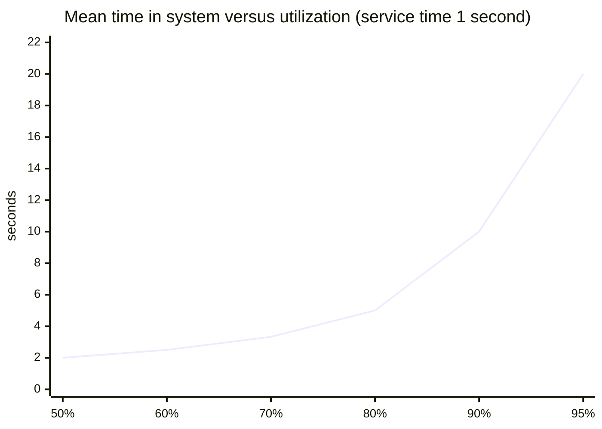

An LLM server with continuous batching is not an M/M/1 queue, so the numbers do not transfer, but the knee does: latency rises slowly until a utilization level, and then rises steeply. Find the knee for your system in a load test, and set the target utilization below it.

Headroom has a price. If you run at 60 percent instead of 85 percent peak utilization, you need $0.85 / 0.60 = 1.42$ times as many accelerators: 42 percent more cost and more idle power. Decide headroom from the objective: an interactive feature with a tight TTFT target carries more headroom, a batch tier carries almost none, and the sensible design runs both on the same fleet with priority scheduling (section 8.4) so that batch work fills the headroom that the interactive tier needs for its peaks. State the target utilization in the design, with its justification, and test that the system holds the objective at that level.

## 11. Load Testing and Capacity Planning

### 11.1 Why AI load tests differ

A conventional load test replays requests of roughly equal cost. AI load tests must reproduce the token distribution, because cost and latency depend on it. A test that sends the same 500-token prompt repeatedly measures a different system from the one in production: it hits the prefix cache every time, it never exercises the long tail, and it fits the batch scheduler's best case.

### 11.2 The method

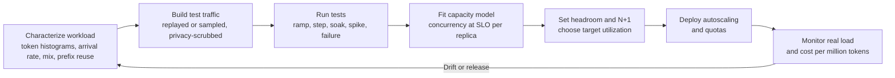

The loop closes because capacity models decay. A prompt change, a new model, a new customer with longer documents, or a cache that stops hitting all change the capacity per replica. Rerun the method on each major change, and at least quarterly.

Test types and what each finds:

- **Baseline:** one request at a time. Gives per-request latency without contention, and the energy and cost floor.
- **Ramp or step:** increase arrival rate in steps until the latency objective breaks. Finds the knee and the maximum sustainable concurrency per replica.
- **Soak:** run at a realistic level for hours. Finds memory growth, cache eviction effects, connection leaks, and gradual slowdown.
- **Spike:** a sudden tenfold step. Finds autoscaling lag, queue behaviour, and whether load shedding works.
- **Failure:** kill a replica or throttle the provider during load. Finds whether the fallback path ([CH13](CH13_Reliability_and_Resilience_Patterns_for_AI_Workloads.md), [CH08](CH08_Model_Gateway_Routing_and_Fallback_Architecture.md)) holds the objective.
- **Cold start:** scale from zero or from the minimum. Measures the time before the first request succeeds, and the latency of the requests that arrive meanwhile.

### 11.3 What to measure

For each run: arrival rate; TTFT and total latency at the 50th, 95th, and 99th percentiles; tokens per second per request and in aggregate; error rate and rate-limit responses (HTTP 429); queue depth and wait; accelerator utilization and memory, including KV cache occupancy for self-hosted engines; cache hit rate; cost per million tokens at that load; and, if available, energy per request (section 16.4). The cost and energy measurements turn the load test into the input for both the budget and the sustainability estimate.

### 11.4 From test results to a capacity plan

Little's law relates concurrency to arrival rate and time in system: $L = \lambda W$, where $L$ is the average number of requests in the system, $\lambda$ is the arrival rate, and $W$ is the average time each spends there. For streaming generation, $W$ is the whole stream duration, not the TTFT.

Worked example. The peak arrival rate is 40 requests per second. The completion time is 6 seconds. The concurrent streams at peak are

$$
L = 40 \times 6 = 240.
$$

The load test shows that one replica sustains 32 concurrent streams at the latency objective. A bare division gives $240 / 32 = 7.5$, so 8 replicas. That leaves no room for variance, so plan for 70 percent of the tested capacity at peak:

$$
\frac{240}{0.70} = 343 \text{ streams}, \quad \frac{343}{32} = 10.7 \rightarrow 11 \text{ replicas.}
$$

Add one replica for failure tolerance (N+1): 12 replicas. At 2 GPUs per replica and $4.00 per GPU-hour, the fleet costs $12 \times 2 \times 4.00 \times 730 = \$70{,}080$ per month if it runs flat out all month.

If average traffic is one third of the peak, the average concurrency is 80, which needs $80 / 0.70 / 32 = 3.6 \rightarrow 4$ replicas plus one spare, or 5. If autoscaling follows the load, the average fleet is closer to 5 or 6 than 12, a monthly cost near $29,000 to $35,000 rather than $70,080, minus the cost of scaling lag and cold starts. The gap between the two figures is the value of an autoscaling design, and it depends on how fast capacity arrives. If cold start takes two minutes and traffic can double in one minute, the autoscaler cannot follow, and you hold a larger floor (section 18.4).

For an API-based system the capacity unit is the provider's rate limit, usually stated in requests per minute and tokens per minute. Apply the same method: convert peak load to tokens per minute using the token distribution (the tail matters because limits count tokens), compare with the quota, request increases well before launch because approvals may take days or weeks, and split the quota across features so one feature cannot exhaust it.

### 11.5 Pitfalls

- **Closed-loop tests** (each virtual user waits for the previous response before sending the next) hide queueing. When the system slows, the test slows its own load. Use open-loop arrival (requests at a fixed rate regardless of responses) to find saturation, and record latency from the intended send time to avoid coordinated omission.
- **Warm caches.** Run both a cold and a representative-warm state.
- **Synthetic prompts.** Sample real prompt lengths. Scrub personal data from replayed traffic ([CH12](CH12_AI_Safety_Security_Privacy_and_Governance_Architecture.md)).
- **Different hardware or model version in test.** Capacity does not transfer across accelerator generations or quantization levels.
- **Ignoring provider limits and cost.** Load tests against a paid API cost real money. Use a sandbox, a mock with realistic latency, or a capped budget.
- **Testing only the model.** Include retrieval, rerank, tools, and the gateway, since the budget in section 10.2 includes them.

## 12. FinOps for AI

Financial operations (FinOps) is the practice of making cloud spend visible, attributable, and accountable to the people who cause it. The FinOps Foundation describes a cycle of informing (visibility and allocation), optimizing, and operating (continuous governance). [Cloud Cost Optimization (Part 09 CH14)](../09_Cloud_Computing/CH14_Cost_Optimization.md) owns the general practice: tagging, budgets, anomaly alerts, rightsizing, and commitments. AI adds three difficulties: the billed unit is a token rather than an instance, a single shared model endpoint serves many tenants and features, and a single prompt can cause a very large charge.

### 12.1 Attribution: who caused this cost

You cannot manage what you cannot attribute. Cost attribution answers "which tenant, feature, model, and environment produced this charge" for every request. Providers bill by account or key, so attribution is yours to build. The reliable pattern is to attach metadata at the gateway ([CH08](CH08_Model_Gateway_Routing_and_Fallback_Architecture.md)) and record a usage event per request.

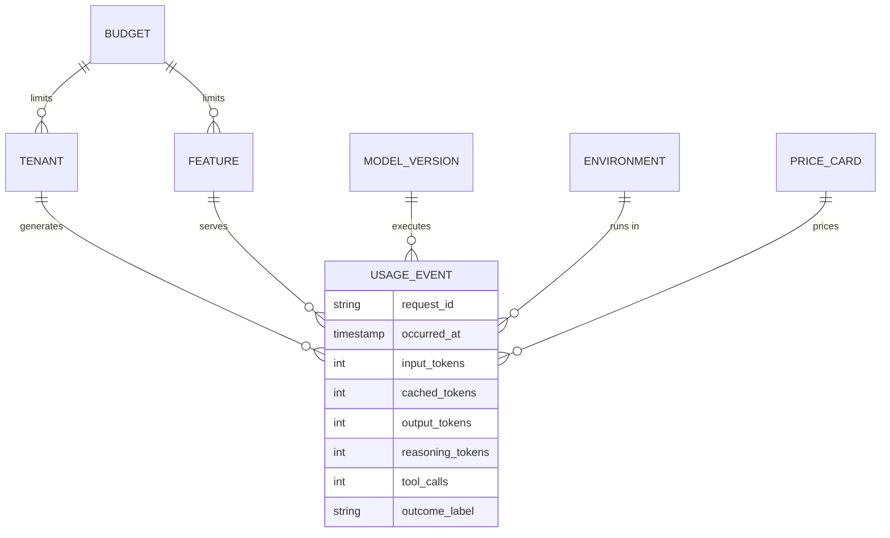

The usage event is the record that joins everything. Each event carries the four attribution dimensions (tenant, feature, model version, environment) and a link to the price card in force at the time, so historical cost can be recomputed correctly after a price change. The outcome label comes from the evaluation or workflow system and allows cost per outcome (section 5) to be computed by feature and tenant. Budgets attach to tenants and features. The implication is that the gateway must refuse to forward a request that lacks the required metadata. Untagged spend is where cost goes to hide.

**Allocating shared costs.** Some costs have no single owner: a shared GPU pool, idle reserved capacity, platform engineering, observability. Three methods are common:

1. **Proportional to usage:** allocate by token share or GPU-seconds. Simple and fair for variable costs.
2. **Proportional to reservation:** allocate committed capacity by each team's reserved share, regardless of use. Creates an incentive to release unused reservations.
3. **Platform charge:** hold shared overhead centrally and recover it with a fixed percentage uplift on the internal price card.

A worked example. A shared self-hosted pool costs $20,680 a month. Tenant A used 60 percent of tokens, B 30 percent, and C 10 percent. At 45 percent utilization, 55 percent of the capacity was idle. Allocating the total by token share gives A $12,408, B $6,204, and C $2,068, which hides the idle cost inside each charge and gives every tenant an inflated unit price. A clearer report separates the lines: the used portion (45 percent of $20,680 = $9,306, split 60/30/10 as $5,584, $2,792, $931) and an idle portion of $11,374 shown as a platform line, to be reduced by raising utilization. Showing idle separately points the right team at the right lever.

### 12.2 Showback and chargeback

**Showback** reports costs to the teams that cause them without billing them. **Chargeback** transfers the cost into their budgets. Start with showback: it builds trust in the data and exposes disputes about allocation before money moves. Move to chargeback when the attribution has been stable for a few cycles and teams control the levers (prompt design, model choice, volume). Publish an internal price card, per million tokens by model tier plus a platform uplift, so that teams can predict their charges, and version it.

### 12.3 Budgets and quotas as guardrails

A budget that alerts after the money is spent is a report. A guardrail acts before. Layer limits from the request outward:

1. **Per-request:** maximum input tokens, output tokens, steps, tool calls, and a maximum cost per request.
2. **Per-user:** rate limits in requests and tokens per minute, plus a daily token or dollar allowance.
3. **Per-tenant:** daily and monthly budgets with warning and hard thresholds.
4. **Per-feature and per-environment:** a lower budget for non-production environments, which should never run up a production-sized bill.
5. **Global:** an account-level budget and a kill switch.

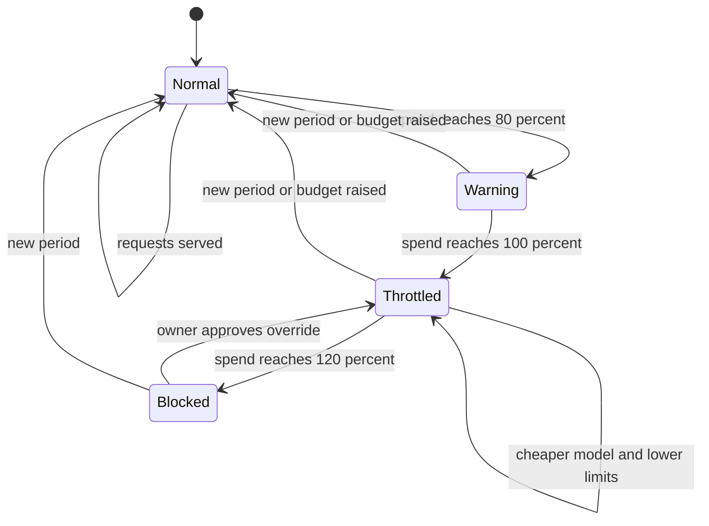

The state machine shows graduated enforcement. At 80 percent the owner is notified and nothing changes. At 100 percent the gateway degrades: it routes to a cheaper model, shortens maximum outputs, and lowers rate limits, so the service continues in a reduced form. At 120 percent it blocks non-essential traffic, and an override requires an accountable owner. The principle is to degrade before refusing, because an abrupt stop of a customer-facing feature is itself a cost. Define which flows are exempt (safety, fraud, and incident response paths) so that a budget never disables a control.

### 12.4 Gateway cost governance

The gateway is the enforcement point ([CH08](CH08_Model_Gateway_Routing_and_Fallback_Architecture.md) owns its design). From a cost standpoint it should:

- require attribution metadata and reject requests without it,
- enforce model allow-lists per feature, so that an experimental key cannot call the most expensive model,
- apply token caps and cost caps per request,
- implement the budget state machine above,
- count retries against a retry budget so that a transient failure does not triple the traffic ([CH13](CH13_Reliability_and_Resilience_Patterns_for_AI_Workloads.md)),
- cache and route by cost within the eligible-model policy,
- emit one usage event per request with the price card version,
- decide, for each limit, whether to fail open or fail closed if the budget service is unavailable. A safe default is to fail open for low-risk interactive paths with a conservative local cap, and fail closed for unauthenticated or bulk paths.

### 12.5 Anomaly detection

Budgets catch slow overspend. Anomaly detection catches fast overspend. The useful signals:

- **Spend velocity:** dollars per minute compared with the same hour of the week over the previous four weeks.
- **Tokens per request:** a shift in the distribution, especially in the tail.
- **Requests per user:** a user or key far above its own history.
- **Retries and error rates:** retry storms that multiply load.
- **Model mix:** sudden use of a model that was rarely used.
- **Cost per outcome:** a rise with stable volume suggests a quality regression.

A simple, robust rule: raise an alert when the five-minute spend velocity exceeds three times the median of the same hour-of-week values from the last four weeks and exceeds an absolute minimum such as $50 per hour. The absolute floor prevents alerts on small baselines.

Worked example. Normal spend is $40 per hour, so the alert threshold is $120 per hour. A buggy agent loop makes one call every two seconds with a 20,000-token prompt on a large-tier model at $3.00 per M. Each call costs $0.06, so one loop spends $0.06 × 30 = $1.80 per minute, or $108 per hour. If 50 loops run at once, spend is $5,400 per hour. The alert fires within about five minutes, by which time $450 has been spent. Without the alert, a weekend of undetected spend would reach $259,200 (48 hours at $5,400). The alert needs an owner and an action: page the feature owner, and let the gateway auto-throttle the offending key after a second confirmation window.

### 12.6 Denial of wallet

Denial of wallet is an attack or accident that drives up your bill rather than taking your service down. Causes include an attacker sending very long prompts, prompts engineered to trigger long reasoning or many tool calls, abuse of free tiers, leaked API keys, and recursive loops between agents. Worked example: an unauthenticated endpoint accepts prompts up to 100,000 tokens, and an attacker sends 10 requests per second to a mid-tier model:

- Per request: input $100{,}000 \times 1.00 / 10^6 = \$0.100$, plus output $350 \times 4.00 / 10^6 = \$0.0014$, for $0.1014.
- Per second: $1.014. Per hour: $3,650. Per day: $87,600.

The controls cut each factor of that product:

- **Input token cap** of 8,000 tokens per request: $0.0080 + 0.0014 = \$0.0094$ per request, 10.8 times lower.
- **Authentication and per-user rate limit** of 20 requests per minute: one account can spend at most $0.0094 × 20 = \$0.188$ per minute, or $11.28 per hour.
- **Cost-based rate limiting**: a token bucket denominated in dollars or tokens, not requests, so one long request counts for what it costs.
- **Free-tier ceilings** that are small in absolute dollars, with a lower-cost model for anonymous use.
- **Key hygiene**: short-lived credentials, no provider keys in client code, per-environment keys with caps, rotation on leak.
- **Alerting** from section 12.5 as the last line.

The security side of this (abuse detection, identity, and threat modelling) is in [CH12](CH12_AI_Safety_Security_Privacy_and_Governance_Architecture.md). The cost side is that every unauthenticated or loosely authenticated path needs a worst-case cost per hour in the design, and the number must be small enough to ignore.

### 12.7 Commitments

A commitment (reserved capacity, savings plan, provisioned throughput, enterprise discount agreement) lowers the unit price in exchange for a promise of usage. The mechanics are in [Part 09 CH14](../09_Cloud_Computing/CH14_Cost_Optimization.md). The AI-specific guidance is: commit to the baseline you have observed for a quarter, not to the forecast; prefer commitments denominated in spend or tokens that can move across models over commitments tied to one model that may be retired; track commitment utilization (target above 90 percent) and coverage; stagger terms so that renewals do not all fall at once; and read the terms for model deprecation, because a commitment on a model that is withdrawn may transfer to a successor at a different price or not at all.

### 12.8 An operating cadence

- **Daily:** anomaly alerts and spend-velocity charts reviewed by the on-call owner.
- **Weekly:** top ten movers by tenant, feature, and model; cache hit rate; escalation rate; cost per outcome.
- **Monthly:** forecast versus actual with driver-level variance (section 6), commitment utilization, showback report, and the lever backlog ranked by net saving.
- **Quarterly:** price card refresh, frontier re-run (section 9), commitment review, and a build versus buy check (section 15).

## 13. Data Movement and Storage Costs

### 13.1 Where data moves, and what it costs

Per request, AI systems move little data compared with tokens. At scale, and for multimodal or bulk workloads, data movement and storage become material. The diagram marks the boundaries at which money and energy are spent.

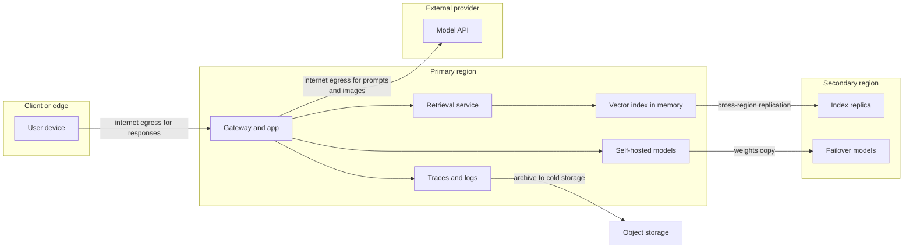

Each arrow that crosses a boundary has a price per gigabyte (internet egress, cross-region transfer) or a power cost (memory residency, replication traffic). The principle that follows is that data gravity should decide placement: put compute where the data is, and avoid moving large data repeatedly. A prompt is small. A 40 TB image archive is not.

### 13.2 Egress and replication in numbers

Illustrative prices: transfer within an availability zone is free, between zones about $0.01 per GB, between regions about $0.02 per GB, and to the internet about $0.09 per GB. Verify your provider's current rates.

- **Per-request text traffic** is negligible. A RAG request that moves 20 KB of retrieved text and a 40 KB response across a region boundary moves 0.00006 GB, which costs $0.0000012 at the cross-region rate.
- **Bulk movement** is where it adds up. Copying a 40 TB dataset out to another cloud at $0.09 per GB costs $3,600. Replicating a 48 GB vector index to two other regions costs about $2 once, plus the storage and update traffic in each region.
- **Multimodal requests** change the picture. If a pipeline sends a 4 MB image to an external model API from your cloud, that is internet egress on your side. At 10 million images a month, that is 40 TB and $3,600 a month, comparable in size to the token charges for small outputs. Resize images before sending, send only the regions that matter, and use a hosted model in the same cloud when volume justifies it.
- **Calling an external API from a private network** may also incur NAT gateway data-processing charges in addition to egress on some clouds. Check your provider's pricing for that component.

### 13.3 Vector index memory

Approximate nearest-neighbour indexes are fast because they live in memory, so index size converts directly into a memory bill. For 10 million chunks with 1,024-dimension vectors stored as 32-bit floats:

$$
10^{7} \times 1{,}024 \times 4 \text{ bytes} = 40.96 \text{ GB.}
$$

A graph-based index adds link structure and each record has metadata. Assume 2 GB of graph overhead and 5 GB of metadata, so the index occupies about 48 GB. Three replicas for availability and throughput need 144 GB of memory. At an illustrative $5 per GB-month for memory-optimized capacity, the index costs about $720 a month.

Compression changes the figure. Storing vectors as 8-bit integers cuts the vector part to 10.24 GB. The index becomes 17.2 GB and three replicas need 51.7 GB, costing about $259 a month, a saving of $461 or 64 percent. Binary quantization (1 bit per dimension) shrinks vectors to 1.28 GB, usually combined with rescoring against higher-precision vectors stored on disk. Truncating embeddings to fewer dimensions, for models trained to support it, gives a further reduction. Every compression step trades recall for memory, so measure recall at the $k$ your application uses before adopting it. [Vector Databases for AI Retrieval (Part 16 CH26)](../16_AI_and_GenAI/CH26_Vector_Databases_for_AI_Retrieval.md) owns the index mechanics.

### 13.4 Trace and log retention

Traces are essential to debugging, evaluation, and attribution ([CH11](CH11_Evaluation_and_Observability_Architecture_for_AI_Systems.md)), and full prompts and responses are large. Assume 36 KB per request (32 KB of prompt, retrieved context, and response text plus 4 KB of metadata). At 10 million requests a month:

- Monthly volume: $10^{7} \times 36$ KB $= 360$ GB.
- Thirteen months in object storage at $0.023 per GB-month: $360 \times 13 = 4{,}680$ GB, costing $107.64 a month.
- Ingestion into a searchable log service at an illustrative $0.50 per GB: $180 a month.

At 1 billion requests a month, the same arithmetic gives 36 TB a month, $10,764 a month for thirteen months of storage once the window fills, and $18,000 a month for ingestion. Ingestion into a searchable index, not storage, is the usual driver. Four controls keep it bounded:

- **Sample by value:** keep 100 percent of errors, low-confidence outputs, escalations, and flagged content, and a few percent of ordinary successes.
- **Tier:** keep a short window in the searchable store and archive the rest to cold object storage, which costs a fraction of hot storage.
- **Redact** personal data before storage and apply retention limits by data class. Stored prompts are a privacy liability ([CH12](CH12_AI_Safety_Security_Privacy_and_Governance_Architecture.md)).
- **Store token counts and hashes** for most requests and the full text only for the sample.

### 13.5 Data movement and energy

Moving a gigabyte across a network consumes energy, but for most AI workloads the energy of computation dwarfs it. The exceptions are bulk transfers and replicated stores that sit in memory continuously. A memory-resident index draws power around the clock whether or not it is queried, which is another reason to compress it and to avoid unnecessary replicas. Section 16 returns to the energy arithmetic.

## 14. The Cost of Humans in the Loop

[Human Oversight and AI-Assisted Workflow Integration (CH09)](CH09_Human_Oversight_and_AI_Assisted_Workflow_Integration.md) owns the design of oversight. This section prices it, because sections 3 and 5 showed that review and escalation often exceed the whole technical bill.

### 14.1 The cost model

Review cost per case is $\rho \times k$, where $\rho$ is the fraction of cases reviewed and $k$ is the cost of one review (reviewer minutes times the loaded hourly rate). Escalation cost is $(1 - s) \times e$. Capacity is the number of reviewer hours the rate implies. For one million cases a month with a 5 percent review rate and three minutes per review:

- Reviews: $1{,}000{,}000 \times 0.05 = 50{,}000$.
- Minutes: $50{,}000 \times 3 = 150{,}000$, which is 2,500 hours.
- Staff: at 160 productive hours per month, 15.6 full-time reviewers.
- Cost at $45 per hour: $112,500 a month.

The model and retrieval bill for the same one million cases, at the RAG request technical cost of $0.0069, is $6,900. The reviewers cost sixteen times as much as the model. That ratio explains why review design is a first-order cost decision.

### 14.2 Review where it pays

Random sampling spends the same effort on easy and hard cases. A better rule reviews a case when the expected harm avoided exceeds the cost of review. Let $p$ be the probability the automated output is wrong, $d$ the probability that a reviewer catches a wrong output, $h$ the harm of an undetected error, and $k$ the review cost. Review is worth it when

$$
p \cdot d \cdot h > k \quad \Longleftrightarrow \quad p > \frac{k}{d \cdot h}.
$$

With $k = \$0.60$, $d = 0.8$, and $h = \$10$, the threshold is $p > 0.075$. Reviewing a random sample where $p = 0.04$ spends $0.60 to avoid $0.32 of expected harm, which is a loss. Reviewing only cases where the system's confidence signal implies $p = 0.30$ spends $0.60 to avoid $2.40, a gain of $1.80 per review. If the harm is $40 (a wrong refund, a compliance error), the threshold falls to $p > 0.019$, and reviewing a larger share is correct.

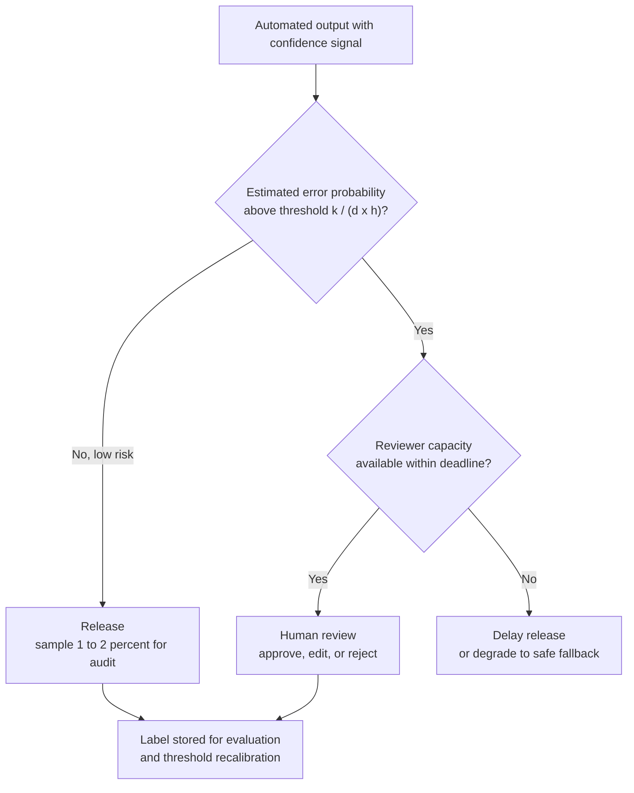

The decision node uses a threshold derived from cost and harm. The confidence signal must be calibrated: a model's stated confidence is often unreliable, so use measured signals such as retrieval support, verifier agreement, or a calibrated classifier, and recalibrate the threshold from the audit sample. The labels from review feed the evaluation set, which is a benefit that offsets part of the cost.

### 14.3 Quality of review

Review has its own failure modes. Reviewers shown mostly correct outputs approve them without reading (automation bias), so detection probability $d$ falls over time. A reviewer who sees a long, fluent answer finds errors less often than one who sees a short one. Measure $d$ by seeding known-bad items into the queue, and include the measured value in the model. If $d$ falls to 0.5, the threshold in the example rises from 7.5 percent to 12 percent, and some of the review spend no longer pays. [CH09](CH09_Human_Oversight_and_AI_Assisted_Workflow_Integration.md) covers interface design that keeps reviewers engaged.

### 14.4 Review as a lever

Cutting review cost is an optimization lever with a risk: it should follow evidence that error rates are low and stable. The levers are risk-based routing (above), faster review interfaces (a diff against the source, highlighted evidence, one-click approve), batch review of similar items, and moving easy reviews to a cheaper model-assisted check that a human samples. The levers that reduce escalation cost, such as better retrieval and prompts, usually have a larger effect than reducing review (section 5.5).

## 15. Build versus Buy: A Three-Year Total Cost of Ownership

### 15.1 The options

An AI capability can be obtained in four broad ways: **buy** a finished product (a per-seat copilot or a vertical application), **build on a managed model API**, **build on a self-hosted open-weight model**, or **combine** them (hosted models for hard requests, self-hosted for high-volume simple ones). The decision involves capability fit ([CH02](CH02_AI_Capability_and_Model_Selection.md)), data and security constraints ([CH12](CH12_AI_Safety_Security_Privacy_and_Governance_Architecture.md)), and the cost trajectory. This section covers the cost.

### 15.2 What belongs in the total cost

A three-year total cost of ownership (TCO) sums every cost line, including those that do not appear on the invoice:

- **One-time:** design, integration, security review, evaluation set creation, platform build, migration, training of staff.
- **Recurring usage:** tokens, seats, GPU-hours, storage, network.
- **Recurring operations:** on-call, patching, model upgrades and re-evaluation, capacity planning, incident handling, compliance evidence.
- **Quality and oversight:** human review and escalation costs (section 14).
- **Vendor and exit:** contract management, price-change exposure, the cost of switching providers, and for self-hosting the cost of hardware lead time and obsolescence.
- **Risk-adjusted items:** the expected cost of an outage, a deprecation, or a security incident, estimated with a probability and an impact.

The comparison is fair only if all options are priced for the same outcome volume, the same quality bar, and the same horizon.

### 15.3 A three-year calculator

The script [03_levers_cascade_tco.py](../code/python/ai-cost-sustainability-chapter/03_levers_cascade_tco.py) compares a managed API with a self-hosted deployment. The assumptions: 4 billion tokens per month in year 1, growing 1.6 times a year; the API at $0.60 per M, with a 10 percent commitment discount from year 2 and an assumed 25 percent yearly price decline (uncertain); $30,000 a year of API-side gateway, evaluation, and monitoring cost; self-hosting at $4.00 per GPU-hour, two GPUs per replica, 2,500 tokens per second per replica at 50 percent planned utilization, reserved pricing at 35 percent off from year 2, $108,000 a year of operations plus $15,000 per replica, and a $120,000 one-time platform build.

| Year | Volume (billion tokens) | Managed API | Self-hosted (replicas) |
|---|---|---|---|
| 1 | 48.0 | $58,800 | $398,160 (2) |
| 2 | 76.8 | $61,104 | $229,104 (2) |
| 3 | 122.9 | $67,325 | $350,208 (4) |
| **3-year TCO** | | **$187,229** | **$977,472** |

The managed API costs one fifth of the self-hosted option. This is not a verdict on self-hosting. It shows what has to be true for self-hosting to win. The same calculation at 10 times the volume (40 billion tokens a month in year 1) gives an API TCO of $1,062,288 and a self-hosted TCO of $4,698,744 at 2,500 tokens per second per replica, $1,959,336 at 7,500, and $1,304,760 at 15,000. Even at six times the assumed throughput, the self-hosted option costs 23 percent more than the API under a price path that declines each year.

Three conclusions follow:

1. **Throughput per accelerator is the biggest lever on self-hosting economics.** Quantization, smaller models, and efficient engines ([CH28](../16_AI_and_GenAI/CH28_Inference_Optimization_and_Model_Serving.md)) move the needle more than the hourly GPU price.
2. **A declining API price path undermines the case.** A self-hosting decision made on today's API price is exposed to price cuts that the self-hoster cannot match without new hardware.
3. **Self-hosting is justified by constraints, not by price alone:** data that cannot leave a boundary, a latency target that requires colocation, a customization (fine-tuned weights) that the provider does not offer, or a regulatory requirement. When those hold, the TCO tells you what the constraint costs, and the decision becomes an explicit price paid for control. Record it as such in the decision record.

### 15.4 Buy versus build for a whole capability

For a finished product (a per-seat copilot), TCO is seat price times seats, plus integration, administration, and change management, minus the cost of the build alternative. Per-seat products win when the use case is generic, usage is moderate, and differentiation is low. Building wins when the capability is core to the product, depends on proprietary data and workflows, or when the per-seat cost multiplied by the user base exceeds the cost of building and running. Check usage data on the bought product: seats that are rarely used are a recurring waste, and licences for the entire workforce rarely match actual use.

### 15.5 Sensitivity and exit cost

Run the TCO with the three assumptions most likely to be wrong: volume growth, price path, and quality (which changes escalation and review cost). Add an exit cost: how much would it cost, in engineering time and re-evaluation, to move to another provider? A model abstraction layer ([CH08](CH08_Model_Gateway_Routing_and_Fallback_Architecture.md)) and a portable evaluation set reduce exit cost and make the API option cheaper in the risk-adjusted sense. Write the result as a decision record (section 19).

## 16. Sustainability: Energy, Carbon, and Water

### 16.1 Why an architect owns this

Sustainability is a quality attribute of the system, like latency or availability, and its main levers are architectural: how much work the system does, where and when it runs, how well it uses the hardware, and which model it uses for which task. Few of those decisions belong to an operations team after launch. They are made in design reviews.

The topic is prone to overclaiming in both directions. Some public statements treat a single AI query as negligible, and others treat AI as an uncontrolled climate problem. The responsible position for an architect is narrower: estimate your system's energy and emissions with a stated method, show the uncertainty, reduce what you can control, and report without inflating the benefit of what you did.

### 16.2 The boundary: whose emissions are these

The Greenhouse Gas (GHG) Protocol, the most widely used accounting framework, sorts an organization's emissions into three scopes. See the [GHG Protocol Corporate Standard](https://ghgprotocol.org/corporate-standard) for the full definitions.

- **Scope 1:** direct emissions from sources the organization owns or controls, such as on-site fuel combustion or backup generators.
- **Scope 2:** indirect emissions from purchased electricity, steam, heating, and cooling. The standard asks for two figures: a *location-based* figure that uses the average grid emission factor where the electricity is used, and a *market-based* figure that reflects the contractual instruments the buyer holds (power purchase agreements, certificates).
- **Scope 3:** all other indirect emissions in the value chain, including purchased goods and services, capital goods, and the use of sold products.

For an organization that runs AI in its own data center, the electricity is Scope 2, and the hardware it buys is Scope 3 (capital goods). For an organization that uses a public cloud or a model API, the provider's data center electricity is the provider's Scope 2, and the customer reports the emissions attributable to its purchased service in Scope 3 (purchased goods and services), usually using data from the provider. Confirm the category with your sustainability team, because the allocation conventions differ.

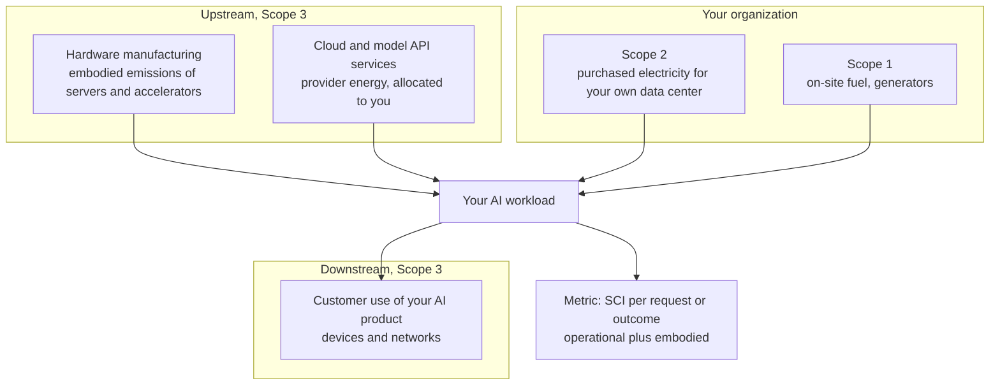

The diagram makes one point that affects the design: the workload sits at the junction of all three scopes, and the emissions that the architecture can influence most sit in the provider's operations (which you reach through region and scheduling choices and through the amount of work you request) and in the hardware's embodied emissions (which you reach through utilization and lifetime). A Scope-2-only view of an AI product misses most of both.

### 16.3 Training versus inference

Training a model is a large, one-time energy event. Inference is smaller per event and continues for as long as the model is used. Which dominates over the model's life depends on the number of requests.

Published data points help to calibrate orders of magnitude. Patterson and colleagues (2021) estimated that training GPT-3 took on the order of 1,300 megawatt-hours and discussed how the data center, hardware, and grid location change the carbon figure by large factors. Luccioni, Jernite, and Strubell ("Power Hungry Processing," 2024) measured inference energy across tasks and models and found that large generative, multi-purpose models used substantially more energy per query than smaller task-specific ones. Google reported in 2025 that the median text prompt to its Gemini Apps service used about 0.24 watt-hours, with 0.03 grams of CO2e on a market-based basis and 0.26 milliliters of water, and described a boundary that includes accelerators, host machines, idle capacity, and data center overhead ([Google Cloud, August 2025](https://cloud.google.com/blog/products/infrastructure/measuring-the-environmental-impact-of-ai-inference); [technical paper](https://arxiv.org/abs/2508.15734)). That figure is for one provider's service and its own median prompt. Treat it as a data point, not as a number for your system, and note that longer prompts, reasoning models, and image or video generation use more.

A worked amortization with illustrative numbers. Suppose a model's training run used 1,200 MWh at a grid intensity of 400 grams CO2e per kWh:

$$
1{,}200{,}000 \text{ kWh} \times 400 \text{ g/kWh} = 480{,}000 \text{ kg} = 480 \text{ t CO2e.}
$$

Suppose inference uses 0.12 Wh per request (section 16.4). The yearly inference emissions at three volumes are:

| Requests per day | Inference energy per day | Inference CO2e per year | Ratio to training |
|---|---|---|---|
| 10 million | 1,200 kWh | 175 t | 0.36 |
| 100 million | 12,000 kWh | 1,752 t | 3.65 |
| 1 billion | 120,000 kWh | 17,520 t | 36.5 |

At ten million requests a day, a year of inference emits about a third of the training run. At a hundred million a day, inference exceeds training within four months. For a model that is trained once and served at scale, inference dominates the life-cycle footprint. For a model that is trained for a niche use and queried a few thousand times, training dominates. For fine-tuning an existing model, the training energy is much smaller than for pretraining, and it is usually small compared with serving.

The consequence for an architect who consumes models and does not train them is that the lever is inference volume and efficiency: how many tokens, on which model, at what utilization. The consequence for one who trains is that the number of training runs, the use of experiments that are cancelled early, and the reuse of pretrained models dominate. [Fine-Tuning, PEFT, and LoRA (Part 16 CH20)](../16_AI_and_GenAI/CH20_Fine_Tuning_PEFT_and_LoRA.md) covers parameter-efficient methods that change this arithmetic.

### 16.4 Energy per request: a model you can compute

An accelerator node draws power that rises with utilization. A linear model is a reasonable first approximation:

$$
P(u) = P_{\text{idle}} + u\,(P_{\text{busy}} - P_{\text{idle}})
$$

where $u$ is utilization between 0 and 1. Throughput scales roughly with utilization, $T(u) = u\,T_{\text{max}}$. The energy per output token in joules is then $P(u) / T(u)$, and the energy per request in watt-hours, including the data center overhead factor, is

$$
E_{\text{req}} = \frac{P(u)}{T(u)} \times \frac{n_{\text{out}}}{3600} \times \text{PUE}
$$

where $n_{\text{out}}$ is the number of output tokens and PUE (Power Usage Effectiveness) is the ratio of total facility energy to IT equipment energy.

Illustrative node: eight accelerators at 120 W idle and 700 W busy, 900 W of host power, a saturated throughput of 9,000 output tokens per second, a PUE of 1.2, and a 350-token response. For 15 percent utilization:

- Node power: $8 \times (120 + 0.15 \times 580) + 900 = 8 \times 207 + 900 = 2{,}556$ W.
- Throughput: $0.15 \times 9{,}000 = 1{,}350$ tokens per second.
- Energy per token: $2{,}556 / 1{,}350 = 1.89$ J.
- Energy per request: $1.89 \times 350 / 3600 \times 1.2 = 0.221$ Wh.

| Utilization | Node power | Energy per token | Energy per request |
|---|---|---|---|
| 15% | 2,556 W | 1.89 J | 0.221 Wh |
| 40% | 3,716 W | 1.03 J | 0.120 Wh |
| 80% | 5,572 W | 0.77 J | 0.090 Wh |

Raising utilization from 15 to 80 percent cuts energy per request by 59 percent. The reason is idle power: at 15 percent utilization most of the node's power is the fixed floor. The same logic explains why batching, consolidation, scale-to-zero, and removing unused replicas reduce energy as well as cost. An idle node at 1,860 W draws 16,294 kWh a year, or 19,552 kWh with a PUE of 1.2, which is 7.8 tonnes of CO2e a year at 400 g/kWh for hardware that does no work.

This model leaves out the prefill phase (compute-bound, with a different power profile per token), network and storage energy, and the variation between model architectures. Treat its output as an order-of-magnitude estimate. To improve it, measure. Accelerator vendors expose power telemetry, and a self-hosted deployment can log node power and tokens served to compute joules per token for the actual model and load. In a public cloud, you usually cannot see the power, so estimate from accelerator-hours and the vendor's thermal design power, or rely on the provider's published figures.

### 16.5 Operational and embodied emissions, and the Software Carbon Intensity

Operational emissions come from the electricity used to run the system. Embodied emissions come from manufacturing, transporting, and disposing of the hardware, and they are incurred before the first request. A full account needs both.

The Software Carbon Intensity (SCI) specification from the Green Software Foundation, standardized as ISO/IEC 21031:2024, defines a rate:

$$
\text{SCI} = \big( (E \times I) + M \big) \text{ per } R
$$

where $E$ is the energy consumed by the software system in kilowatt-hours, $I$ is the carbon intensity of the electricity in grams CO2e per kWh, $M$ is the embodied emissions of the hardware share used by the software, and $R$ is the functional unit, such as one request, one user, or one document ([specification](https://sci.greensoftware.foundation/)). The specification is deliberate about two points: the result is a rate rather than a total, and it does not allow carbon offsets to reduce the score, so that reductions have to come from the system itself. Check the current text of the specification when you adopt it.

Worked example. Take $E = 0.12$ Wh $= 0.00012$ kWh per request (the 40 percent utilization case). For the embodied term, assume a node whose manufacture accounts for 3,000 kg CO2e (illustrative; ask your supplier for a product carbon footprint), a four-year life, and a node serving requests at 40 percent of its saturated rate, which is $0.4 \times 9{,}000 / 350 = 10.3$ requests per second. The node lifetime is $4 \times 365 \times 24 \times 3600 = 126{,}144{,}000$ seconds, which serves $1.30 \times 10^{9}$ requests. Then

$$
M = \frac{3{,}000{,}000 \text{ g}}{1.30 \times 10^{9}} = 0.0023 \text{ g} = 2.3 \text{ mg per request.}
$$

| Grid | Intensity $I$ | $E \times I$ | $M$ | SCI per request | Embodied share |
|---|---|---|---|---|---|
| Low-carbon | 50 g/kWh | 6.0 mg | 2.3 mg | 8.3 mg | 28% |
| Average | 400 g/kWh | 48.0 mg | 2.3 mg | 50.3 mg | 5% |
| Coal-heavy | 700 g/kWh | 84.0 mg | 2.3 mg | 86.3 mg | 3% |

Two findings follow. First, the grid matters more than almost any other variable: the same request differs by a factor of 10 between the cleanest and the dirtiest grid. Second, as the grid decarbonizes, the embodied share rises from 3 to 28 percent, so utilization and hardware lifetime matter more. A node that sits idle spends its embodied emissions on nothing, and a node retired after two years doubles the embodied cost per request. The embodied term is time-allocated: it is the share of the hardware used, over its lifetime. Because the lifetime figure is itself uncertain (hardware may be reused beyond four years), report the assumption.

### 16.6 Power usage effectiveness and grid carbon intensity

PUE is a facility figure: total energy divided by IT equipment energy. A PUE of 1.2 means 20 percent overhead for cooling, power conversion, and lighting. Large cloud facilities report values near 1.1 to 1.2, and older enterprise rooms can exceed 1.6. Going from 1.6 to 1.2 reduces facility energy for the same IT load by 25 percent. A cloud customer cannot choose PUE directly, but can choose a region and a provider, and can ask for the reported figure.

Grid carbon intensity depends on the generation mix and varies by location, season, and hour. A hydro- or nuclear-dominated grid may be near 50 g/kWh, an average mixed grid near 400, and a coal-heavy one above 700. These are illustrative magnitudes. Two distinctions affect the numbers:

- **Average versus marginal intensity.** The average intensity divides total emissions by total generation. The marginal intensity describes the generator that responds to a small change in demand. For deciding whether to shift load, the marginal figure is the more relevant in principle, but it is harder to obtain and forecast. Most published data and tools use averages. State which you used.
- **Location-based versus market-based accounting.** A market-based figure can show low emissions because the provider has matched annual consumption with certificates or contracts, even in hours when the physical grid is carbon-intensive. An hourly, location-matched view is more demanding. Neither is wrong, but they answer different questions, and the SCI calculation should say which intensity it used.

Sources for intensity data include grid operators, commercial and open services that publish hourly and forecast intensity by region, and cloud providers, some of which publish carbon-free energy shares by region. Verify availability and licensing for your regions before designing around a feed.

### 16.7 Carbon-aware scheduling

Deferrable work can move in time (run when the grid is cleaner) or in space (run in a cleaner region), subject to its deadline, data location, and cost. The method follows from the intensity forecast.

Worked example. A nightly job needs six hours of capacity and consumes 1,800 kWh. This is a plausible self-run GPU stage, for example optical character recognition, layout analysis, and embedding for 1.5 million pages at 1.2 Wh per page. Hourly grid intensity on a solar-heavy grid, in g/kWh, over 24 hours starting at midnight:

420, 410, 405, 400, 400, 410, 380, 330, 260, 200, 160, 140, 130, 135, 150, 200, 290, 380, 440, 460, 450, 440, 430, 425.

- Run at midnight (00:00 to 06:00): average $(420 + 410 + 405 + 400 + 400 + 410) / 6 = 407.5$ g/kWh, so $1{,}800 \times 407.5 / 1000 = 733.5$ kg CO2e.
- Run in the best window anywhere in the day (09:00 to 15:00): average 152.5 g/kWh, for 274.5 kg, 62.6 percent lower.
- Constrained by a deadline. Pages arrive until 18:00, and results are due by 14:00 the next day. The window must end by 14:00, so the latest start is 08:00 and the best window is 08:00 to 14:00: average $(260 + 200 + 160 + 140 + 130 + 135)/6 = 170.8$ g/kWh, for 307.5 kg, 58.1 percent lower than running at midnight. The saving is 426 kg per night, 12.8 tonnes per 30 nights, and about 155 tonnes per year.

The deadline cost 4.5 percentage points of the saving (62.6 versus 58.1). That is the price of a business constraint, and it is worth stating when asking the business for slack: each extra hour of deadline can be priced in kilograms.

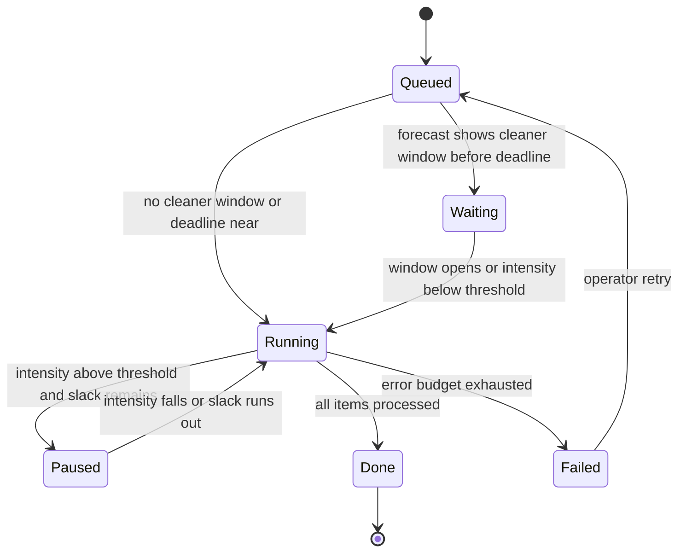

The state machine shows the scheduler's decisions. A job enters the queue with a deadline and an estimated duration, and the scheduler computes its slack. If a cleaner window fits before the deadline, the job waits. While running, it can pause when the intensity rises and slack remains, which requires that work be checkpointed and resumable (the same property needed for spot capacity, section 8.8). When slack runs out, the job runs regardless, because a deadline miss would cost more than the carbon. The implication is that carbon-aware scheduling is a deadline-aware queue with an extra cost function. If you already built the batch tier of section 8.4, adding the intensity signal is a small step.

Caveats that belong in the design review:

- **Forecast error.** Intensity forecasts miss, especially beyond a day. Use conservative slack and re-plan at each hour.
- **Average versus marginal.** Shifting load toward a cheap, clean hour reduces the average intensity of the work, but the grid effect depends on what generator responds. The claim to make is "lower average-intensity emissions attributed to this job," not "the planet emitted less."
- **Herding.** If many workloads move to the same hour, the clean hour becomes busier, and the benefit shrinks. At the scale of a single organization this rarely matters.
- **Price and capacity.** Clean hours may coincide with high or low spot prices and availability. Check the cost side.
- **Data location and egress.** Moving work to another region requires the data to be there, so a spatial move can cost more in egress than it saves (section 13).
- **Managed batch APIs.** When you submit work to a provider's batch interface, the provider decides when to run it, and you cannot choose the hour. Your levers are the region and the choice of provider, and any carbon information the provider publishes.

### 16.8 Model size and reuse choices

The largest sustainability lever for most teams is to use less computation per outcome, which is mostly a model-choice decision:

- **Do not use a generative model when a simpler method works.** Rules, search, and classical machine-learning models cost orders of magnitude less energy than a large model call. A classification task at 100 million items a month illustrates the scale of the choice. If an LLM call uses about 0.05 Wh and a small fine-tuned classifier about 0.0005 Wh (illustrative orders of magnitude, to be measured), the monthly energy is 5,000 kWh versus 50 kWh, which at 400 g/kWh is 2,000 kg versus 20 kg of CO2e. [AI Workload Qualification (CH01)](CH01_AI_Workload_Qualification_and_Architecture_Foundations.md) is the place to ask whether the task needs a generative model at all.
- **Use the smallest adequate model**, verified by the frontier analysis of section 9, and use a cascade to reserve large models for hard cases (section 8.5).
- **Reuse before recompute.** Prompt caches, response caches, and stored embeddings avoid repeating work. A 50 percent prompt-cache hit rate removes about half of the prefill computation.
- **Fine-tune with parameter-efficient methods** rather than retraining a base model, and reuse the adapters.
- **Avoid wasteful experimentation.** Cancel failed training runs early, share experiment results, and keep evaluation sets small enough to run frequently without being unrepresentative.
- **Right-size the output.** Output tokens are the energy-intensive part (decode steps are sequential and memory-bound). The controls of section 8.2 save energy in proportion.

### 16.9 Region selection

Region choice combines carbon, latency, cost, residency, capacity, and water. Illustrative comparison for a workload that consumes 52,000 kWh a month:

| Region | Grid intensity | Emissions per month | Extra round-trip time | Relative price |
|---|---|---|---|---|
| A, near users, average grid | 400 g/kWh | 20.8 t | 20 ms | 1.00 |
| B, distant, low-carbon grid | 60 g/kWh | 3.1 t | 95 ms | 0.97 |
| C, distant, coal-heavy, cheapest | 650 g/kWh | 33.8 t | 140 ms | 0.88 |

Region B cuts emissions by 85 percent against region A and is 3 percent cheaper, at a cost of 75 more milliseconds. For batch work, B is the clear choice. For an interactive feature with a 1.5-second TTFT budget, 75 ms is 5 percent of the budget, and the decision depends on whether the budget has slack. Region C is cheaper by 12 percent and emits 62 percent more than A, so choosing it on price trades carbon for cost, and this should be a recorded decision rather than a default.

Data residency and sovereignty rules can override everything: personal data may have to stay in a jurisdiction regardless of its grid. Capacity also constrains: a low-carbon region may not offer the accelerator type you need. Split the workload when you can, keeping personal-data interactive flows in the compliant region and sending deferrable, non-personal work to the cleaner one.

### 16.10 Water use

Data centers consume water, mostly for cooling, and electricity generation consumes water too. The common metric is Water Usage Effectiveness (WUE), liters of water per kWh of IT energy. Direct on-site use depends on the cooling design and the climate. Air cooling uses less water and more electricity, and evaporative cooling does the opposite, so water and carbon can trade against each other. Water scarcity is local, so the same liter has a different impact in a drought-prone region than in a water-rich one.

Using an illustrative WUE of 1 L/kWh, a request that uses 0.12 Wh consumes about 0.12 mL, and a training run of 1,200 MWh consumes 1,200,000 L, or 1,200 cubic meters. Google's reported 0.26 mL per median text prompt is the same order of magnitude. These are small per request and material in aggregate, and they matter most where the data center sits in a water-stressed area. For a design review, ask the provider for the WUE and the cooling approach of the target region, and weigh water stress alongside carbon in region selection.

### 16.11 Reporting methods and their limits

Choose a method that fits the question.

- **GHG Protocol (organizational).** Required or expected by many reporting regimes. Granularity is annual, at organization or product-line level. It tells you your Scope 3 emissions from cloud services, not which model or feature caused them.
- **Provider carbon tools.** Cloud providers offer dashboards that estimate the emissions attributed to a customer's usage, such as the AWS Customer Carbon Footprint Tool, Google Cloud's Carbon Footprint, and Microsoft's Emissions Impact Dashboard. Tool names, coverage, granularity, and methodology change, so verify the current documentation. Most report by month, service, and region, using allocation rules, which makes them suitable for the organizational inventory but not for attributing carbon to a prompt change.
- **SCI (software level).** Gives a rate per functional unit that you can track across releases. It needs you to estimate energy, intensity, and embodied emissions with stated boundaries.
- **Direct measurement.** For self-hosted systems, node-level power telemetry plus a grid intensity feed gives the most accurate operational figure.

Regulatory reporting obligations (for example, European sustainability reporting rules) differ by jurisdiction and have been changing; confirm with your compliance team what applies to your organization.

**Uncertainty.** A per-request figure is a product of uncertain terms, so state a range. For the average-grid case above, take plausible ranges of 0.5 to 1.5 times the energy estimate, 0.7 to 1.3 times the intensity (annual average versus hourly), and 0.5 to 1.5 times the embodied term. The low case is $0.5 \times 0.7 \times 48 + 0.5 \times 2.3 = 16.8 + 1.2 \approx 18$ mg. The high case is $1.5 \times 1.3 \times 48 + 1.5 \times 2.3 = 93.6 + 3.5 \approx 97$ mg. The central estimate is 50 mg, and the honest statement is "roughly 20 to 100 mg per request," a range of about a factor of five. If someone presents a per-request figure with three significant digits and no range, treat it with suspicion. Decisions rarely need a tighter range: the relative differences between options (a cascade versus a single large model, one region versus another) are more reliable than the absolute figure, because the shared uncertainties cancel.

### 16.12 Greenwashing and rebound effects

**Greenwashing** is a claim that overstates the environmental benefit. Patterns to avoid and to look for in vendor claims:

- **Offsets presented as reductions.** Purchasing offsets does not reduce the energy your system uses. Report the reduction and the offset separately, and note that the SCI excludes offsets.
- **Unstated boundaries.** "Our model uses X per prompt" without saying whether it includes idle capacity, host machines, data center overhead, embodied emissions, or only the accelerator.
- **Market-based figures only.** A figure based on annual certificate matching can be far lower than the physical, hourly grid emissions. Report both where possible.
- **Intensity without totals.** A falling rate with a rising total can still mean rising impact.
- **Cherry-picked comparisons.** Comparing a request to nine seconds of television makes a number feel small without telling you whether the product runs billions of requests.

**Rebound effects.** Efficiency gains lower the cost of use, and use rises. If energy per request falls by 50 percent and volume rises 2.5 times because the feature became cheap enough to embed everywhere, total energy rises by $0.5 \times 2.5 = 1.25$, a 25 percent increase. This is the Jevons paradox applied to inference. It is not a reason to avoid efficiency. It is a reason to track absolute totals next to the rate, and to put a budget on total emissions as well as a target on intensity. The financial rebound is the same: cheaper tokens lead to more tokens, and a team that halves its unit price can still see its bill grow, which is why section 6 forecasts volume independently.

### 16.13 Sustainability as a quality attribute

Treat sustainability like other quality attributes: write scenarios, set measurable targets, and test them.

| Scenario | Stimulus | Response | Measure |
|---|---|---|---|
| Batch carbon shifting | Nightly job submitted with a 20-hour deadline | Scheduler delays start to the lowest-intensity window that meets the deadline | At least 50 percent lower gCO2e than a midnight start, with 100 percent of deadlines met |
| Efficiency regression | A release changes the prompt template | Load test records energy and tokens per request, and the pipeline compares them with the baseline | Release fails if energy per request rises more than 10 percent without an approved exception |
| Idle capacity | Traffic drops overnight | Autoscaler removes replicas | Idle accelerator-hours fall below 10 percent of provisioned hours, and the interactive objective still holds the next morning |
| Region policy | A new non-personal batch workload is deployed | Deployment tool selects from regions that satisfy residency, ranked by carbon and price | Workload placed in a region at or below 150 g/kWh annual average when one is eligible |

Sustainability trades off against other attributes, and the trade-offs should be explicit. Redundancy for availability keeps idle replicas that draw power. Headroom for latency does the same. Carbon-aware delay adds latency to deferrable work. Aggressive caching reduces energy and adds a staleness risk. A design that treats all of them as free will meet none. The decision records in section 19 are the place to write down which attribute won and why.

## 17. Security, Privacy, Governance, and Operations

### 17.1 Security and privacy consequences of cost decisions

Cost optimizations create attack surface and compliance exposure when they are designed without a threat model. [Safety, Security, Privacy, and Governance (CH12)](CH12_AI_Safety_Security_Privacy_and_Governance_Architecture.md) owns the framework. These are the cost-related items to check.

- **Cache isolation.** A response cache or semantic cache that ignores tenant, permission scope, or data classification can return one customer's answer to another. The cache key must include the tenant, the user's entitlement scope, the prompt template version, and the model version. Prompt-prefix caches at a provider are scoped by the provider to your account or organization, and a self-hosted prefix cache shared across tenants can leak timing information (a request that hits the cache is faster, which reveals that someone sent the same prefix). Keep tenant-specific content out of shared prefixes, or partition caches by tenant.
- **Cache poisoning.** If users can influence what is stored, an attacker can plant an incorrect or malicious answer that is served to others. Restrict write access to responses that passed validation, and do not cache outputs derived from untrusted tool results without checks.
- **Routing must not bypass policy.** The cost router operates inside the set of models eligible for the data class (section 8.5). Test it with regulated-data samples, and make the eligibility check part of the gateway, not of the application, so a developer cannot skip it to save money.
- **Cheaper models fail differently.** A smaller or quantized model may be more susceptible to prompt injection, produce more unsafe outputs, or follow instructions less reliably. Safety and security evaluations (red-team sets, injection tests) must run per route, not once for the flagship model.
- **Logs are a liability.** Cost attribution and debugging push teams to store full prompts. Prompts contain personal and confidential data. Store hashes and token counts by default, sample the full text, redact before writing, and apply retention limits (section 13.4).
- **Budget controls are security controls.** Spend limits and rate limits defend against denial of wallet (section 12.6). The budget service becomes a dependency on the request path, so define its failure behaviour and protect its configuration from tampering.
- **Provider terms.** Check whether the provider retains prompts, uses them for training, or logs them, because a cheaper tier or a batch interface may have different data handling terms from the standard API. Cost-driven moves between tiers must be re-reviewed for data terms.
- **Key and credential hygiene.** A leaked provider key is a cost incident. Use per-environment keys with spend caps, rotate on leak, and never ship keys in client code.
- **Cost data is sensitive.** Per-tenant usage reveals customer behaviour. Apply access control to cost dashboards and usage events.

### 17.2 Observability for cost, performance, and carbon

The usage event of section 12.1 and the traces of [CH11](CH11_Evaluation_and_Observability_Architecture_for_AI_Systems.md) supply the data. The metrics that matter are in the table.

| Metric | Why it matters | Alert on |
|---|---|---|
| Cost per successful outcome, by feature and tenant | The unit economics from section 5 | Rise of more than 15 percent week over week |
| Spend velocity (dollars per minute) | Runaway agents, denial of wallet | Over 3 times the same-hour baseline |
| Tokens by class per request (fresh, cached, output, reasoning) | Context growth, cache regressions | Mean input tokens up 20 percent, cache hit rate down 10 points |
| Escalation and retry rates | Cascade drift, quality regressions | Escalation share outside its band |
| Success rate and review disagreement | The dominant cost driver | Success rate below the quality budget |
| TTFT and completion time at p50, p95, p99 | Latency objectives | Budget breach |
| Accelerator utilization, KV cache occupancy, queue depth | Capacity and headroom | Utilization above the knee, or idle hours above target |
| Idle accelerator-hours | Cost and energy waste | More than 10 percent of provisioned hours |
| Energy per request (measured or estimated) and gCO2e per request | Sustainability objective | Rise of more than 10 percent between releases |
| Budget burn rate versus budget | Guardrail state | Projected breach within the period |

Define cost service level objectives next to latency ones. A cost objective takes the form "cost per resolved case stays below $1.40 over a rolling 28 days," with an error budget and a response when it burns too fast. This puts cost regressions in the same incident process as availability regressions.

### 17.3 Testing cost and performance

- **Cost regression tests.** Run the golden set through the candidate build in CI and compare tokens by class and cost per case with the stored baseline. Fail on increases above a threshold unless an exception is recorded. A one-line prompt change that adds 500 tokens to every request costs $0.0005 per request, $5,000 a month at 10 million requests, and is invisible in functional tests.
- **Quality-cost gates.** A cheaper configuration must pass the same quality evaluation as the current one, with paired comparison on the same cases (section 9.4).
- **Shadow and canary.** Run the candidate route on a copy of production traffic and compare outputs, cost, and latency, then release to 5 percent of traffic, then 25, then 100, with rollback triggers on success rate, escalation share, and cost per case.
- **Load and soak tests** at each major change (section 11).
- **Price-change drills.** Rerun the calculator with a 40 percent higher price and with the primary model unavailable, and test the fallback route's quality in advance (section 18.2).
- **Carbon regression check.** Compare measured or estimated energy per request against the baseline in the load test.

## 18. Failure Scenarios

Each scenario uses the quality-attribute form: a stimulus, the response the architecture should produce, and a measure that tells you whether it did.

### 18.1 Context growth doubles cost

**Stimulus.** Over one quarter, average input tokens per request double from 3,000 to 6,000, because conversation histories lengthen, a new customer uploads larger documents, and the retrieval team raised the number of chunks for a quality experiment and left it. Output length is unchanged.

**Effect.** With mid-tier prices, cost per request rises from $0.0044 to $6{,}000 \times 1.00/10^6 + 0.0014 = \$0.0074$, a 68 percent increase, while the request count does not change. At 347,900 requests a month (the month-12 volume of section 6.2), monthly spend rises from $1,531 to $2,574. The product team sees no change in features, and the invoice rises by two thirds. Latency rises as well, because prefill time grows with the prompt.

**Response.** A token-class alert fires when the weekly mean input tokens exceed the baseline by 20 percent. The audit (section 8.1) breaks the prompt into components and finds the culprits. The team caps history with a summary window, restores the retrieval count, and confirms the prefix is still cacheable (a changed prefix would also have lowered the hit rate). A per-request input cap (8,000 tokens) bounds the worst case.

**Measure.** The alert fires within 24 hours of a 20 percent drift. Cost per request returns to within 10 percent of baseline within two sprints. No quality metric on the golden set falls below the budget after the change.

### 18.2 Price change

**Stimulus.** The provider announces a 40 percent price increase for the model in use, effective in 30 days. Variant: the provider retires the model, and the successor costs twice as much per token.

**Effect.** Impact depends on the share of the model line in the loaded cost. For the support assistant of section 5.2, the model cost is 1.7 percent of cost per case, and a 40 percent increase moves cost per case by under 1 percent: the event is minor. For a per-seat product, the effect is larger. The model cost per case is $0.02415. A 40 percent increase adds $0.00966 per case, which on 339 cases per seat per month adds $3.28 and cuts the blended margin from 38.8 percent to 27.9 percent. For a bulk, no-human pipeline, where tokens are most of the cost, spend rises almost 40 percent.

**Response.** Rerun the calculator and the frontier (section 9) with the new price table the day the notice arrives. Shift traffic that sits near a decision boundary to an alternative model that the fallback tests have already validated. Increase cache coverage and tiering. Review contract terms for price protection. For per-seat products, consider changing fair-use limits or plan prices with notice to customers.

**Measure.** Cost impact quantified within one business day. A pre-validated alternative route can take at least 30 percent of traffic within one week with success rate within the quality budget. Margin restored to the target within one quarter, or the shortfall explicitly accepted by the product owner.

### 18.3 Runaway agent

**Stimulus.** An agent calls a tool that starts returning errors. The agent interprets the error as a reason to retry with a modified query and loops. Each iteration re-sends a transcript of about 20,000 tokens to a large-tier model at $3.00 per M.

**Effect.** One loop costs $0.06 per call at one call every two seconds: $1.80 a minute, $108 an hour. Fifty concurrent loops cost $5,400 an hour, and an unattended weekend costs $259,200. The loop also fills the tool provider's rate limits, and its output may trigger side effects.

**Response.** The agent runtime enforces limits that do not depend on the model's judgment: a maximum step count (for example 12), a per-run cost cap (for example $0.50) computed from actual usage, a wall-clock timeout, loop detection (the same tool with the same arguments three times), and a per-tenant concurrency limit. When a limit trips, the run stops with a partial result and an explicit status. The gateway's spend-velocity alert is the backstop.

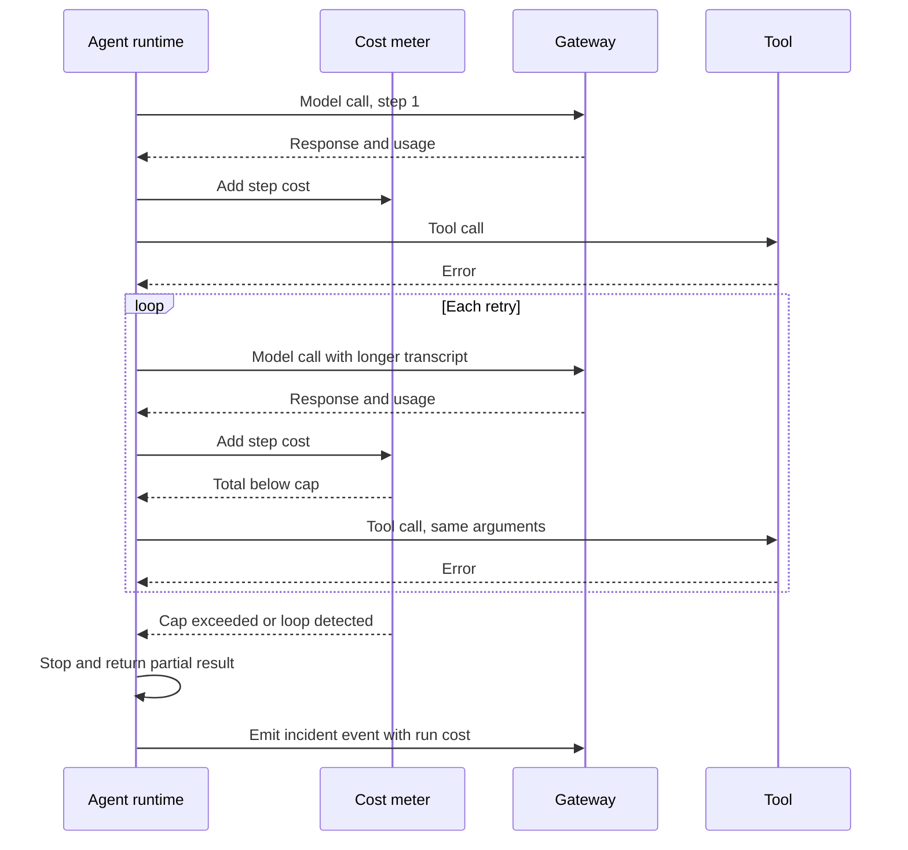

The diagram shows the meter as a component outside the model. The meter adds the cost of each step from the usage the gateway returns and stops the run when the cap is reached or when the repeated-call detector fires. The model is never trusted to stop itself.

**Measure.** The worst-case cost of one run is bounded by the cap ($0.50). The worst-case loss of an incident is the concurrency limit times the cap: with a per-tenant limit of 50 concurrent runs, $25, against $5,400 an hour without the controls. The runtime reports 100 percent of aborted runs with a reason code, and the alert fires within five minutes if a limit fails.

### 18.4 Viral spike

**Stimulus.** A social media post sends traffic to a public feature. Arrivals rise from 4 to 40 requests per second within 30 minutes and stay there for six hours.

**Effect.** At 6 seconds per streamed answer, concurrency rises from 24 to 240 (Little's law, section 11.4). A self-hosted fleet with two replicas at 32 streams each can serve 64. Scale-up takes two minutes per replica to become ready, and capacity may not exist. Queues grow and the p95 TTFT leaves its budget. On a hosted API, rate limits may return 429 responses, and clients that retry immediately amplify the load. On a token-priced API, the spike's six hours cost $0.0044 × 40 × 21,600 = $3,802, against $380 for the same hours at baseline load. Anonymous traffic is the part most likely to be abusive or low value.

**Response.** Layered controls: per-user and per-IP rate limits (cost-denominated for anonymous users); admission control that sheds the lowest-priority traffic first and returns a clear message; a degraded mode that routes to the cheaper model, shortens outputs, and serves cached answers for repeated questions (a spike usually concentrates on a few questions, which makes caching effective); autoscaling with a pre-warmed pool; a provider quota that was requested in advance; retries with jittered backoff and a retry budget; and the hard budget state machine of section 12.3 as the final guardrail.

**Measure.** For admitted traffic, p95 TTFT stays within 3 seconds during the spike. The shed rate stays below 20 percent. Spend during the spike remains below three times the hourly budget. No authenticated enterprise traffic is shed before anonymous traffic.

### 18.5 GPU shortage

**Stimulus.** The cloud region cannot supply accelerators when the autoscaler asks for more, or spot capacity is reclaimed broadly. Demand needs 12 replicas and 8 are available.

**Effect.** The 4-replica shortfall is a third of the capacity. If left unhandled, queues build and the interactive objective fails. For batch work, deadlines slip.

**Response.** Design for it in advance. The gateway ([CH08](CH08_Model_Gateway_Routing_and_Fallback_Architecture.md)) sends overflow to a hosted API. A secondary region or a second instance type with an acceptable model configuration is on the allowed list. A quantized or smaller model can serve a degraded tier. Batch and near-line work yields first: it is deferred, and spot or reserved capacity is reassigned to interactive traffic ([CH07](CH07_Inference_Serving_and_Model_Placement.md), [CH13](CH13_Reliability_and_Resilience_Patterns_for_AI_Workloads.md)). A reserved baseline protects the core load from market shortages.

The fallback is cheap compared with the problem. Four replicas at 2,500 tokens per second produce 10,000 tokens per second, or 36 million tokens an hour. At a hosted price of $0.60 per M, covering the shortfall costs $21.60 an hour. The risk is quality and policy drift: the fallback model must be on the eligible list for the data class and tested on the golden set beforehand.

**Measure.** The interactive objective is restored through fallback within five minutes of a capacity failure. The fallback route's success rate on the golden set is within the quality budget, measured quarterly. Deferred batch work still meets its deadlines, or the business owner is notified with an estimated delay.

## 19. Decision Records

### 19.1 A record format for cost, performance, and sustainability

Decisions in this area are easy to forget and expensive to rediscover. A decision record (also called an architecture decision record, ADR) states what was decided, why, and what would reverse it. A format suited to this chapter:

| Field | Content |
|---|---|
| Title and status | Short name, proposed or accepted, date |
| Context | The workload, volume, constraints, and the metric that matters (for example cost per resolved case) |
| Options considered | Each alternative with its numbers: cost, quality, latency, energy |
| Decision | The choice and the rule that selected it |
| Evidence | Golden-set results with intervals, load test, calculator inputs and version, price table date |
| Consequences | What gets better, what gets worse, what must be monitored |
| Review trigger | The price, volume, quality, or constraint change that reopens the decision |

The review trigger is what separates a record from a justification. Prices and models move, so every cost decision should have a stated condition under which it is wrong.

### 19.2 Three records that apply across systems

**Record 1. Cost per successful outcome is the primary metric.** *Context:* teams track the monthly invoice and cost per request, which rewarded cheaper models that raised rework (section 5.2). *Decision:* report cost per successful outcome, fully loaded, by feature and tenant, and require it in design reviews. *Alternatives:* cost per request (rejected: ignores quality), cost per user (rejected: hides the tail). *Consequences:* teams need outcome labels and escalation cost data. *Review trigger:* the business adopts a different success definition.

**Record 2. Budgets degrade before they block.** *Context:* a hard stop at the budget turns a cost problem into a customer-facing outage, and no limit at all permits a $259,200 weekend (section 12.5). *Decision:* implement the four-state budget guardrail (section 12.3), with the degrade state routing to cheaper models and lower limits, and an exempt list for safety and fraud flows. *Alternatives:* alert only (rejected: after the fact), hard block (rejected: abrupt). *Consequences:* the gateway needs the metadata and the state machine, and each feature needs a defined degraded mode. *Review trigger:* a degraded mode proves unacceptable to a regulator or customer contract.

**Record 3. Self-hosting requires a recorded constraint.** *Context:* the TCO of section 15 shows that self-hosting costs several times more than a managed API at realistic throughput and a falling price path. *Decision:* self-host a model only when a recorded constraint (residency, air gap, latency, customization) requires it, with the premium over the managed option stated in the record and revisited yearly. *Alternatives:* self-host by default for control (rejected: cost and operations), never self-host (rejected: constraints exist). *Consequences:* the platform team maintains a calculator and a yearly review. *Review trigger:* throughput per accelerator rises more than threefold, the hosted price rises sharply, or a constraint disappears.

Section 20 and section 21 contain system-specific records.

## 20. Worked Design A: Support Assistant, from Naive to Tuned

### 20.1 The system and the baseline

A company handles one million customer support cases a month. The all-human process costs $4.50 per case, $4.5 million a month. An AI assistant drafts answers from a knowledge base and account data, and a human agent handles the cases the assistant does not resolve. The first version was built for correctness and speed of delivery:

- a single large-tier model for every request ($3.00 input, $15.00 output per M, illustrative);
- a prompt of 8,000 input tokens: 2,000 for system instructions and tool definitions, 1,500 of raw conversation history, and 4,500 for ten retrieved chunks;
- 600 output tokens, because the prompt does not ask for brevity;
- no prompt caching, no reranking;
- a retry rate of 10 percent from timeouts and malformed responses;
- 8 percent of drafts reviewed by a supervisor for two minutes each;
- a measured success rate (resolved without human takeover) of 0.62.

The golden set contains 1,500 cases labelled by senior agents. The per-case cost uses the section 5.1 model with an escalation cost of $4.50 and a reviewer rate of $45 per hour.

### 20.2 Cost of the naive design

Technical cost per request:

- Model: input $8{,}000 \times 3.00/10^6 = \$0.024$; output $600 \times 15.00/10^6 = \$0.009$; sum $0.033; with 10 percent retries, $0.0363.
- Overhead (orchestration, storage, vector read): $0.00032.
- Total: $0.03662.

Loaded cost per case:

- Review: $0.08 \times (2/60) \times 45 = \$0.120$.
- Escalations: $(1 - 0.62) \times 4.50 = \$1.710$.
- Cost per case: $0.03662 + 0.120 + 1.710 = \$1.8666$.
- Cost per resolved case: $1.8666 / 0.62 = \$3.0107$.

Monthly: technical $36,620; review $120,000; escalations $1,710,000; total $1,866,620. The technical bill is 2 percent of the total. The team's first instinct, to attack the $36,620, would yield little.

### 20.3 The tuning sequence

The team worked in order of the lever taxonomy (section 7.1): eliminate, reuse, downgrade, then fix the quality drivers. Technical cost per request after each step:

| Step | Change | Technical cost per request |
|---|---|---|
| 0 | Naive baseline | $0.03662 |
| 1 | Trim context: history replaced by a short running summary, five reranked chunks of 400 tokens, answers limited to about 350 tokens (input 4,100) | $0.01963 |
| 2 | Prompt caching on the 2,000-token stable prefix, 85 percent hit rate, 25 percent write premium on misses | $0.01482 |
| 3 | Cascade: mid-tier model first, small verifier, 15 percent escalated to the large model; reranker added at $0.001 | $0.00975 |
| 4 | Fix retries: timeouts tuned and structured output validated, retry rate 10 to 4 percent | $0.00929 |

```mermaid
xychart-beta
    title "Technical cost per request by tuning step (thousandths of a dollar)"
    x-axis ["naive", "trim", "cache", "cascade", "retries"]
    y-axis "cost x 1000" 0 --> 40
    bar [36.6, 19.6, 14.8, 9.8, 9.3]
```

The arithmetic behind each step:

- *Step 1:* input $4{,}100 \times 3.00/10^6 = \$0.0123$; output $350 \times 15.00/10^6 = \$0.00525$; sum $0.01755; with retries, $0.019305; plus overhead, $0.019625.
- *Step 2:* expected prefix cost is $0.85 \times 2{,}000 \times 0.30 + 0.15 \times 2{,}000 \times 3.00 \times 1.25 = 510 + 1{,}125 = 1{,}635$ micro-dollars; fresh input $2{,}100 \times 3.00 = 6{,}300$; output $350 \times 15 = 5{,}250$; sum 13,185 micro-dollars, or $0.013185; with retries, $0.0145035; plus overhead, $0.01482.
- *Step 3:* the mid-tier call has a 2,000-token prefix (85 percent hit rate, $1.00 per M, $0.10 cached, 1.25 write), 2,600 fresh tokens, and 300 output tokens: $(545 + 2{,}600 + 1{,}200)/10^6 = \$0.004345$. The small verifier reads 3,000 tokens and writes 20, at $0.15 and $0.60 per M: $0.000462. The large model handles 15 percent of requests with 4,600 input and 350 output tokens: $0.15 \times (0.0138 + 0.00525) = \$0.002858$. The model path sums to $0.007665. With retries at 10 percent, plus the reranker and overhead: $0.0084315 + 0.001 + 0.00032 = \$0.0097515$.
- *Step 4:* retries at 4 percent: $0.007665 \times 1.04 = 0.0079716$; plus $0.001 + 0.00032$ gives $0.0092916$.

The technical cost per request falls by 74.6 percent. The saving at one million requests is $27,329 a month.

### 20.4 What moved the real numbers

The quality work moved the success rate and the review rate, and those carry the cost:

- Reranking and a hybrid search raised retrieval precision. The prompt was revised against failure categories found in the golden set. The large-model fallback handled the hard 15 percent. The success rate rose from 0.62 to 0.74 on the golden set. With 1,500 cases the standard error is $\sqrt{0.74 \times 0.26 / 1500} = 0.0113$, about plus or minus 2.2 points, so a 12-point gain is well outside the noise. The same cases were used for both versions to allow a paired comparison.
- The audit sample showed that confidence signals from the verifier and from retrieval support identified low-risk drafts. Review was changed from a flat 8 percent to risk-based routing (section 14.2), which fell to 4 percent of cases while the audit sample's defect rate stayed within its limit.

Loaded cost per case after tuning:

- Technical: $0.00929.
- Review: $0.04 \times (2/60) \times 45 = \$0.060$.
- Escalations: $(1 - 0.74) \times 4.50 = \$1.170$.
- Cost per case: $1.2393. Cost per resolved case: $1.2393 / 0.74 = \$1.6747$.

| Monthly line (1 million cases) | Naive | Tuned | Change |
|---|---|---|---|
| Technical (model, retrieval, overhead) | $36,620 | $9,291 | −$27,329 |
| Human review | $120,000 | $60,000 | −$60,000 |
| Escalation handling | $1,710,000 | $1,170,000 | −$540,000 |
| **Total** | **$1,866,620** | **$1,239,291** | **−$627,329** |
| Cost per resolved case | $3.0107 | $1.6747 | −44.4% |

Of the $627,329 monthly saving, 4.4 percent came from technical cost, 9.6 percent from review, and 86.1 percent from the escalation rate. The case illustrates the central claim of section 5: for a human-in-the-loop workflow, quality is the cost lever. The technical optimizations were worth doing because they were cheap, safe, and also cut latency, but the largest numbers came from improving the answer. Against the all-human baseline of $4.5 million a month, the tuned system saves 72 percent.

### 20.5 Decision records for this system

**ADR-A1. Cascade from a mid-tier model with a verifier, escalating to the large model.** *Options:* large model only (highest cost, the quality ceiling); small model first (cheapest, but its 0.55 first-pass success rate sent too many cases to the verifier and the large model, and the golden-set success rate fell below the 0.74 target); mid-tier first with escalation (chosen). *Rule:* cheapest configuration that meets a success rate of at least 0.74 and a p95 TTFT of at most 3 seconds. *Evidence (illustrative):* golden-set paired comparison, and a verifier false accept rate of 9 percent measured on 400 labelled outputs (section 8.5). *Review trigger:* escalation share above 25 percent, verifier false accept rate above 15 percent, or a price change that moves the break-even accept rate.

**ADR-A2. Prompt-prefix caching with a stable, tenant-neutral prefix.** *Options:* no caching; semantic response cache (rejected: answers depend on account data, and a wrong hit is a wrong refund); prompt-prefix caching (chosen). *Rule:* traffic at one million cases a month is 0.39 requests per second, one every 2.6 seconds, so the 5-minute cache window is refreshed constantly and the expected hit rate is above the 22 percent break-even by a wide margin. *Consequences:* the prompt template is frozen in the order stable first, variable last, and a CI check fails if a timestamp or user identifier enters the prefix. *Review trigger:* hit rate below 60 percent for a week.

**ADR-A3. Reject self-hosting.** *Evidence:* the tuned workload consumes about 4.9 billion tokens a month (roughly 4,900 tokens per request for one million requests), against a break-even volume of about 34 billion tokens a month (section 8.9). *Rule:* self-host only on a recorded constraint (Record 3 of section 19.2). No such constraint exists for the support content. *Review trigger:* volume grows sevenfold, or a residency requirement appears.

**ADR-A4. Risk-based review in place of flat sampling.** *Options:* flat 8 percent review (the baseline); flat 4 percent (rejected: same effort on easy and hard cases); confidence-gated review with a 2 percent audit sample (chosen). *Rule:* review when estimated error probability exceeds $k/(d \cdot h)$ (section 14.2). *Consequences:* the confidence signal needs calibration against the audit sample every month. *Review trigger:* audit defect rate above its limit.

### 20.6 Validation and rollout

Validation followed section 17.3: a golden-set comparison of each step; two weeks of shadow traffic at 10 percent comparing cost, latency, and answer quality; a canary at 5 percent, then 25 percent, then 100 percent; and rollback triggers on success rate below 0.70, escalation share above 20 percent, cost per case above $1.40, or p95 TTFT above 3 seconds. After launch, the dashboard tracks cost per resolved case, cache hit rate, escalation share, verifier agreement with human labels, and spend velocity (section 17.2). The calculator in [01_request_cost_model.py](../code/python/ai-cost-sustainability-chapter/01_request_cost_model.py) reproduces the table and reruns it when the price table changes.

## 21. Worked Design B: A Batch Document Pipeline with Carbon-Aware Scheduling

### 21.1 The system

A document processing service handles about 45 million pages a month, about 1.5 million a night. Pages arrive during the day, intake closes at 18:00, and results must be available by 14:00 the next day (a 20-hour window). The pipeline has four stages:

1. **Layout and optical character recognition (OCR) with a vision model**, run on the company's own GPU capacity.
2. **Field extraction with a mid-tier LLM**, called through the provider's batch interface (input 2,500 tokens, output 300 tokens per page).
3. **Embedding** of the extracted text, on the same GPU capacity as stage 1.
4. **Validation and load** into the document store, on CPU.

The GPU stages (1 and 3) consume 1,800 kWh a night. That corresponds to about 55 eight-GPU nodes drawing 5.45 kW each for six hours, which is 440 GPUs and 2,640 GPU-hours a night (illustrative).

```mermaid
flowchart LR
    A["Pages arrive<br/>until 6 pm"] --> B["Intake queue<br/>with deadline tag"]
    B --> C["Carbon-aware scheduler<br/>forecast, slack, price"]
    C -->|"window opens"| D["GPU stages on spot nodes<br/>OCR, layout, embedding"]
    D --> E["Batch request file<br/>extraction prompts"]
    E --> F["Provider batch API<br/>mid-tier model, half price"]
    F --> G["Validation and load"]
    G --> H["Results published<br/>by 2 pm"]
    C -.->|"slack under one hour"| I["Run now on on-demand capacity"]
    I --> D
```

The scheduler is the new component. It reads the intensity forecast, the job's deadline, and the spot price, and it starts the GPU stages when the window opens. The extraction stage goes to the provider's batch interface because nothing in the pipeline waits for it, and the provider returns results within its stated window (24 hours at the time of writing; verify). The dotted path is the safety valve: if slack drops below an hour, the job runs immediately on on-demand capacity.

### 21.2 Cost: what the options are worth

The extraction stage per page, at mid-tier prices: input $2{,}500 \times 1.00/10^6 = \$0.0025$ plus output $300 \times 4.00/10^6 = \$0.0012$, which is $0.0037. At 45 million pages: $166,500 a month on demand, $83,250 with the batch discount of 50 percent, saving $83,250.

The GPU stages (illustrative prices): 2,640 GPU-hours a night.

| Option | Price per GPU-hour | Nightly cost | Monthly cost |
|---|---|---|---|
| On-demand | $4.00 | $10,560 | $316,800 |
| Reserved, always on (utilization 25 percent) | $2.60 for 24 h | $27,456 | $823,680 |
| Spot at midnight (12 percent interruption overhead) | $1.568 effective | $4,140 | $124,186 |
| Spot in the clean window (20 percent overhead) | $1.68 effective | $4,435 | $133,056 |

Reserving the capacity for a six-hour job wastes 18 hours a day, so it costs 6.6 times the spot option. Spot capacity is the right class for a checkpointed, deferrable job. The carbon-aware window assumes daytime spot capacity is scarcer: an interruption overhead of 20 percent instead of 12 percent is plausible when other tenants' demand is higher, and is an assumption to be measured. Under it, the clean window costs $295.68 more a night, $8,870 a month.

### 21.3 Carbon: what the window is worth

From section 16.7, the energy of 1,800 kWh a night emits 733.5 kg at the midnight window and 307.5 kg in the best window the deadline permits (08:00 to 14:00), a saving of 426 kg a night, 12.8 tonnes a month, and 155 tonnes a year. Per page, the operational term is $0.0012 \text{ kWh} \times 407.5 = 0.489$ g at midnight and $0.0012 \times 170.8 = 0.205$ g in the clean window (the embodied term is unchanged by the schedule).

```mermaid
timeline
    title Nightly processing window
    6 pm : Intake closes : Scheduler reads forecast and spot prices
    Overnight : Jobs wait in queue : High-intensity hours skipped
    8 am : Window opens : GPU stages start on spot nodes
    2 pm : Deadline : Results published and window closes
```

The timeline shows the 20 hours as three phases: waiting, running in the clean window, and the deadline. The six-hour run fills the last part of the 20 hours. Any delay beyond 8 am eats slack, and the scheduler's rule to run immediately at under one hour of slack makes the deadline safe.

The abatement cost of the cleaner window is the extra spend divided by the tonnes avoided: $8,870 / 12.78 \approx \$694$ per tonne. That is far above the carbon prices typically used for internal accounting, so the decision depends on whether the organization has a carbon target that justifies it. The point of the arithmetic is to make that visible. If the spot price premium in the window is smaller than assumed, the cost falls to nothing, and the decision is easy. If it is larger, the team may choose a partial shift, for example a pause-and-resume policy that runs only in hours below 250 g/kWh, which captures most of the benefit when seven of the 24 hours are below that level.

### 21.4 Decision records for this system

**ADR-B1. Use the provider's batch interface for extraction.** *Options:* synchronous calls at full price; batch (chosen). *Evidence:* no stage consumes the results before the deadline, so the delay is free; the saving is $83,250 a month. *Consequences:* the carbon of the extraction stage is not schedulable by us, so we record the provider, region, and any published carbon data for the Scope 3 inventory. *Review trigger:* the provider's batch discount or turnaround window changes.

**ADR-B2. Run GPU stages in the lowest-intensity window that meets the deadline, on spot capacity.** *Options:* run at midnight; reserve capacity; shift the window (chosen). *Rule:* start at the lowest forecast average intensity that finishes before 14:00, and fall back to on-demand when slack falls below one hour. *Consequences:* the job must checkpoint every five minutes and resume; the forecast feed becomes a dependency with a fallback to a fixed 08:00 start. *Evidence:* a two-week pilot measuring node energy from telemetry, interruption rate in the window, and deadline compliance. *Review trigger:* abatement cost rises above the policy limit, or the grid mix changes so the solar hours shift.

**ADR-B3. Reject moving the pipeline to a low-carbon region.** *Options:* current region; low-carbon region. *Evidence:* a move would cut operational emissions by up to 85 percent (section 16.9), and egress of about 300 GB a night at $0.02 per GB is only $6. *Rule:* region eligibility is decided by data residency first, and the pages contain personal data that must stay in the jurisdiction. *Review trigger:* a non-personal document class is added, in which case it can be routed to the cleaner region.

**ADR-B4. Reject always-on reserved GPUs.** *Evidence:* the table above, 6.6 times the spot cost, and idle power for 18 of 24 hours (an idle node draws 1,860 W, section 16.4). *Review trigger:* the nightly job grows to fill most of the day.

### 21.5 Validation

The pilot compares measured and predicted values: node energy from power telemetry against the 1,800 kWh estimate, the carbon of each run computed from the hourly intensity of the hours actually used, the interruption rate and the overhead it caused, the share of nights that met the deadline (target 100 percent), and the cost against the table. The sustainability report states the method (SCI-style, operational term from measured energy and location-based hourly intensity), the boundary (GPU stages only, with the batch API stage reported separately from provider data), and the uncertainty range (section 16.11). It reports the absolute emissions next to the intensity, so that volume growth is visible.

## 22. Trade-Off Analysis and Common Mistakes

### 22.1 Comparing the ways to obtain capacity

| Option | Cost behaviour | Latency and control | Operations burden | Carbon visibility | Best when |
|---|---|---|---|---|---|
| Managed API, on-demand | Linear in tokens, no idle cost | Provider-controlled, subject to rate limits | Lowest | Low (provider data, coarse) | Spiky or uncertain volume, small teams, fast iteration |
| Managed API, batch | About half of on-demand | Results within hours | Low, needs a queue | Low | Deferrable work with no human waiting |
| Provisioned throughput | Fixed monthly, cheaper per token above break-even | Predictable, capacity guaranteed | Low to medium | Low | Steady baseline above about half of unit capacity |
| Self-hosted, on-demand GPUs | Fixed while running, high per token at low utilization | Full control, colocation possible | High | High (you can meter power) | Constraints that require control and moderate volume |
| Self-hosted, reserved plus spot | Lowest per token at high utilization | Full control | Highest | High | Very high steady volume or hard constraints, and a platform team |
| Per-seat product | Fixed per user, margin risk for seller | Vendor-defined | Low | Low | Generic use case, moderate usage, low differentiation |

### 22.2 How the levers trade against the other attributes

| Lever | Cost | Latency | Quality | Energy and carbon | Reliability and risk |
|---|---|---|---|---|---|
| Prompt and context reduction | Down | Down | Risk of lost context | Down | Low |
| Prompt-prefix caching | Down | Down | Neutral | Down | Cache isolation to check |
| Semantic response cache | Down | Down | Risk of wrong hits | Down | Staleness, leakage |
| Batch deferral | Down | Up for deferred work | Neutral | Down, plus scheduling gains | Deadline management |
| Model cascade | Down | Up on escalated requests | Depends on verifier | Down | Router drift |
| Quantization | Down | Often down | Small loss, task dependent | Down | Rollback needed |
| Distillation | Down per request, project cost | Down | Narrow tasks only | Down | Maintenance of a model |
| Headroom and N+1 | Up | Down at the tail | Neutral | Up (idle power) | Better |
| Hedged requests | Up | Down at the tail | Neutral | Up | Load amplification |
| Carbon-aware delay | Neutral or slightly up | Up for deferred work | Neutral | Down | Forecast dependency |
| Self-hosting | Depends on volume and utilization | Controllable | Model dependent | Measurable | Operational risk |

The tables make one habit explicit: name the attribute that gets worse. A lever without a downside in the table is a lever whose downside has not been found yet.

### 22.3 Common mistakes

1. **Optimizing the invoice instead of the outcome.** *Cause:* the bill is visible and the success rate is not. *Consequence:* a cheaper model raises rework and cost per resolved case by 87 percent (section 5.2). Measure cost per successful outcome.
2. **Leaving the human line out.** *Cause:* review and escalation are in another budget. *Consequence:* the model bill looks like the problem, while review is 77 to 94 percent of loaded cost in the examples of section 3. Price every human step.
3. **Planning on the typical request.** *Cause:* sizing from the median prompt. *Consequence:* the heavy tail makes the real mean 22 percent higher, the 99th percentile 4.6 times the median, and a few requests dominate latency (section 6.4).
4. **Enabling caching without a hit rate.** *Cause:* assuming caching always helps. *Consequence:* with a write premium, a hit rate below 22 percent costs more than no cache, and a timestamp in the prefix drives the hit rate to zero (section 8.3).
5. **Pricing flat seats on the median user.** *Cause:* averaging usage. *Consequence:* a $30 seat loses money above 554 cases a month, and the top 3 percent of users can erase the margin (section 5.3).
6. **Committing to forecast volume.** *Cause:* locking in discounts for volume that has not been observed. *Consequence:* idle provisioned capacity that costs 54 percent more than on-demand at 33 percent utilization (section 4.5).
7. **Unbounded agent loops.** *Cause:* trusting the model to stop. *Consequence:* $108 an hour per loop and $259,200 in an unattended weekend (section 18.3).
8. **No attribution metadata.** *Cause:* shared keys and untagged calls. *Consequence:* nobody owns the spend, and showback is impossible (section 12.1).
9. **Self-hosting for price alone.** *Cause:* comparing the GPU hourly rate to the API price per token without utilization. *Consequence:* a $3.50 per M effective price against a $0.60 API, and an operations burden (section 8.9).
10. **Ignoring the verifier in a cascade.** *Cause:* assuming the cheap model's answers are checked well. *Consequence:* a 40 percent false accept rate cuts cost 45 percent and drops quality five points below the budget (section 8.5).
11. **Headroom set by hope.** *Cause:* running at 90 percent utilization to save money. *Consequence:* queueing delay that grows steeply past the knee (section 10.7) and a missed latency objective.
12. **Treating sustainability as a vendor claim.** *Cause:* copying a per-prompt figure. *Consequence:* an unsupported number with no boundary or range, and exposure to greenwashing claims (section 16.12).
13. **Counting only intensity.** *Cause:* tracking energy per request and ignoring volume. *Consequence:* rebound: halving the energy per request and tripling volume raises the total by 50 percent.
14. **No review trigger on decisions.** *Cause:* writing decisions as permanent. *Consequence:* a model choice, region, or commitment survives a price change or a model retirement that should have reopened it.

## 23. Design Review Checklist

**Unit and measurement**

- The unit of value is named, and cost per successful outcome is computed, fully loaded (model, retrieval, tools, overhead, retries, human review, escalation).
- Token usage is recorded by class (fresh, cached, output, reasoning) per request, with tenant, feature, model, and environment.
- The cost distribution is known: median, 95th and 99th percentile, and the share of spend from the top 1 percent of requests and users.
- A calculator exists in version control, reads a dated price table, and reproduces the current bill within a few percent.

**Pricing and commitments**

- Each workload has a deadline class (interactive, near-line, batch), and deferrable work uses a batch interface or spot capacity.
- Any commitment is sized to observed baseline usage, with break-even utilization computed and a fallback for peaks.
- Price-change exposure is quantified (what happens at plus 40 percent), and a validated alternative route exists.

**Levers and quality**

- Prompts are audited by component; tool definitions, history, and retrieval are bounded.
- Output length and reasoning effort are controlled per task class, and truncation rate is monitored.
- Caches have isolation keys, a hit rate target, and a break-even computed from the provider's write and read prices.
- Any cascade or router has a measured verifier false accept rate, an escalation-rate alert, and an eligible-model policy that runs first.
- The frontier of cost, quality, and latency has been computed on one golden set with intervals, and a quality budget is stated.

**Performance and capacity**

- A latency budget exists per stage, with the critical path identified and independent stages parallelized.
- Cancellation propagates to generation so abandoned requests stop billing.
- Load tests use real token distributions with open-loop arrivals, and the knee and per-replica concurrency are known.
- Headroom, N+1, and autoscaling lag are specified, and scale-up time is shorter than the fastest plausible ramp, or a fallback covers the gap.

**FinOps and governance**

- Budgets exist per request, user, tenant, feature, and environment, with a graduated state machine and an exempt list for safety flows.
- Spend-velocity anomaly detection has an owner and an action.
- Unauthenticated or loosely authenticated paths have a computed worst-case cost per hour that is small.
- Showback exists, idle capacity is shown separately, and commitments are tracked for utilization.

**Data, storage, and humans**

- Egress, replication, index memory, and trace retention are estimated, and retention and sampling policies exist.
- Review rates follow a risk-based rule with measured reviewer detection, not a flat percentage.

**Sustainability**

- Energy per request is measured or estimated with a stated method, boundary, and uncertainty range.
- Operational and embodied terms are both considered, and the grid intensity source is named (location-based or market-based, average or marginal).
- Deferrable work is scheduled with a carbon signal where the deadline allows, and region choice records carbon, latency, price, and residency.
- Absolute emissions are reported next to intensity, and offsets are reported separately from reductions.

**Decisions**

- Each major choice has a decision record with options, evidence, consequences, and a review trigger.
- Failure scenarios (context growth, price change, runaway agent, viral spike, accelerator shortage) have responses and measures.

## 24. Exercises

**1. Loaded cost.** A single-call feature sends 2,000 input tokens and receives 500 output tokens on a model priced at $1.00 per M input and $4.00 per M output. Overhead is $0.0003 per request. Three percent of responses get a 1.5-minute review at $45 an hour. Compute the loaded cost per request and the model's share of it. What does this imply about where to optimize?

*Answer outline.* Model: $2{,}000 \times 1/10^6 = \$0.002$ plus $500 \times 4/10^6 = \$0.002$, total $0.004. Review: $0.03 \times (1.5/60) \times 45 = \$0.03375$. Overhead $0.0003. Total $0.03805. The model is 10.5 percent. A 50 percent model price cut saves 5 percent of the loaded cost, and halving the review rate saves 44 percent, so effort belongs in review design and quality, provided the evidence allows it.

**2. Cache break-even.** A prompt has a 4,000-token stable prefix, 400 fresh tokens, and 200 output tokens, at $2.00 per M input and $8.00 per M output. A cache read costs 0.1 times the input rate, and the one-hour cache write costs 2.0 times. Find the break-even hit rate.

*Answer outline.* No cache: $(4{,}400 \times 2 + 200 \times 8) = 10{,}400$ micro-dollars. Miss: $4{,}000 \times 2 \times 2 + 400 \times 2 + 1{,}600 = 18{,}400$. Hit: $4{,}000 \times 2 \times 0.1 + 800 + 1{,}600 = 3{,}200$. Break-even $h^{*} = (18{,}400 - 10{,}400)/(18{,}400 - 3{,}200) = 0.526$. With a write premium of 2.0 the prefix must be reused on more than half of requests within the time-to-live. A short-lived entry with a 1.25 premium has a break-even near 22 percent, so match the cache lifetime to the traffic pattern.

**3. Cheaper is not cheaper.** A workflow has attempt cost $c = \$0.05$, retry rate 0.2, review rate 0.1 at $k = \$1.00$, success rate 0.8, and escalation cost $6. A candidate model has $c = \$0.01$ and success rate 0.7. Compare cost per successful outcome.

*Answer outline.* Current: $1.2 \times 0.05 = 0.06$, plus $0.10$, plus $0.2 \times 6 = 1.20$, so $K = 1.36$ and $K/s = 1.70$. Candidate: $1.2 \times 0.01 = 0.012$, plus $0.10$, plus $0.3 \times 6 = 1.80$, so $K = 1.912$ and $K/s = 2.73$. The candidate is 61 percent more expensive per outcome even though attempts cost a fifth as much. Break-even success rate for the candidate is where $K/s$ equals 1.70, which is near 0.79.

**4. Provisioned throughput.** A provisioned unit costs $12,000 a month and sustains 250,000 tokens a minute. The blended on-demand price is $2.50 per M. (a) What is the break-even utilization? (b) Peak traffic is 2.5 times the average, and you size one unit to the peak. What is the effective price per M?

*Answer outline.* Monthly capacity is $250{,}000 \times 60 \times 730 = 10.95$ billion tokens, worth $27,375 on demand at full use. (a) Break-even is $12{,}000 / 27{,}375 = 43.8$ percent. (b) Average utilization is $1/2.5 = 40$ percent, which serves 4.38 billion tokens, so the effective price is $12{,}000 / 4{,}380 = \$2.74$ per M, 9.6 percent above on-demand. The better design provisions for the baseline and spills the peak.

**5. Capacity plan.** Peak arrival is 25 requests per second, a streamed answer lasts 8 seconds, one replica sustains 20 concurrent streams at the objective, the target is 75 percent of tested capacity at peak, and one spare replica is required. Each replica uses 4 GPUs at $3.00 per GPU-hour. How many replicas, and what is the monthly cost if the fleet is always on?

*Answer outline.* $L = 25 \times 8 = 200$. Planned concurrency $200 / 0.75 = 266.7$. Replicas $266.7 / 20 = 13.3 \rightarrow 14$. Add one: 15. Cost $15 \times 4 \times 3.00 \times 730 = \$131{,}400$. Discuss how autoscaling lowers the average and what the scale-up time implies for the floor.

**6. Cascade design.** A small model costs $0.003 per attempt, a verifier costs $0.0005, and a large model costs $0.02. What is the minimum accept rate for the cascade to be cheaper than large-only? Suppose the small model is right 60 percent of the time, the verifier accepts 85 percent of good answers and 20 percent of bad ones. Compute the accept rate, the precision of accepted answers, and the cost.

*Answer outline.* Threshold $(0.003 + 0.0005)/0.02 = 0.175$. Good accepted $0.6 \times 0.85 = 0.51$, bad accepted $0.4 \times 0.2 = 0.08$, accept rate 0.59, precision $0.51/0.59 = 0.864$. Cost $0.0035 + 0.41 \times 0.02 = \$0.0117$, 41.5 percent below large-only. The remaining question is whether 0.864 precision meets the quality budget, and what the escalated 41 percent achieve.

**7. Risk-based review.** Reviewing a draft costs $0.80, a reviewer catches 70 percent of errors, and an undetected error costs $25. At what error probability does review pay? Which of these segments should be reviewed: error probability 3 percent, 10 percent? What happens if reviewer detection falls to 0.4?

*Answer outline.* $p^{*} = 0.80 / (0.7 \times 25) = 0.0457$. The 3 percent segment is not worth reviewing individually (use a small audit sample), and the 10 percent segment is. With $d = 0.4$ the threshold rises to $0.80/(0.4 \times 25) = 0.08$, and the 10 percent segment still pays, but the margin is smaller, so measuring detection with seeded errors matters.

**8. Carbon-aware window.** A 4-hour, 900 kWh job can start in any of five slots with hourly intensities (g/kWh) 500, 480, 300, 250, 240, 260, 420, 510 for hours 0 to 7. Find the best start and the saving against starting at hour 0.

*Answer outline.* Window averages for starts 0 to 4 are 382.5, 317.5, 262.5, 292.5, and 357.5. The best is start 2 at 262.5 g/kWh, or 236.25 kg, against 344.25 kg at start 0. The saving is 108 kg, 31.4 percent. State the assumptions: average intensity, forecast accuracy, and deadline.

**9. SCI and rebound.** A request uses 0.2 Wh on a grid at 300 g/kWh, with an embodied term of 3 mg. Compute the SCI per request. An optimization halves the energy per request, and volume triples. What happens to the total emissions?

*Answer outline.* $E \times I = 0.0002 \times 300 = 0.06$ g $= 60$ mg, plus 3 mg gives 63 mg. After the optimization the operational term is 30 mg and the SCI is 33 mg (a 48 percent fall), but total emissions change by $0.5 \times 3 = 1.5$ times for the operational part, a 50 percent increase. Report absolute emissions next to the rate.

**10. Denial of wallet.** An authenticated endpoint allows each user 30 requests a minute, with an input cap of 6,000 tokens and an output cap of 500 tokens, on a mid-tier model at $1.00 and $4.00 per M. What is the worst-case hourly cost per account? What if an attacker creates 1,000 accounts?

*Answer outline.* Per request $0.006 + 0.002 = \$0.008$. Per minute $0.24, per hour $14.40. For 1,000 accounts, $14,400 an hour. Per-account limits alone do not bound the total, so add account-creation controls, a global and per-tenant spend cap with the degrade state of section 12.3, and spend-velocity alerts.

## 25. Summary and Code Examples

### 25.1 Summary

AI cost is a property of the whole workload. The price of a token is one input, and the architecture decides how many tokens a request needs, how often it must be repeated, how much human time it consumes, how well the hardware is used, and what the failures cost. The chapter's main ideas can be stated briefly:

- **Decompose before optimizing.** Break each request into model tokens by class, retrieval, tools, orchestration, storage, egress, and human review. In the examples, human review is 77 to 94 percent of loaded cost and the model is a small share.
- **Use cost per successful outcome.** It includes retries and rework, exposes the effect of quality, and shows that a cheaper model can be more expensive (87 percent more in the worked case). Success rate and escalation cost move it far more than token price.
- **Forecast from drivers.** Users, usage per user, context size, cache hit rate, and price compound. Context growth alone added 21 percent to an annual bill, and the tail of requests and users adds more.
- **Pick levers in order:** eliminate, defer, reuse, downgrade, pack and relocate. Prompt caching, batching, output control, and spot capacity come first. Cascades and distillation pay when they are validated by a golden set and a verifier with a known false accept rate. Self-hosting rarely wins on price alone.
- **Choose along the frontier.** Remove dominated designs, set a quality budget and a latency floor, then compare the marginal cost of quality with its value.
- **Engineer the whole path for latency.** Budget the stages, parallelize independent work, stream, cancel abandoned requests, control the tail, and set headroom from the queueing knee found in a load test.
- **Govern spend like a safety property.** Attribute every request, enforce layered budgets that degrade before they block, detect anomalies in minutes, and compute worst-case cost for exposed endpoints.
- **Price the humans and the data.** Review cost can be sixteen times the model bill. Index memory, trace ingestion, and bulk egress are real lines at scale.
- **Treat sustainability as a measured quality attribute.** Energy per request depends on utilization, the grid, and the facility. Embodied emissions rise in share as grids clean up. Deferrable work can move to cleaner hours at a computed cost. Report ranges, boundaries, and absolute totals, keep offsets separate, and expect rebound.
- **Record decisions with review triggers.** Prices, models, and constraints change, and each decision should say what reopens it.

### 25.2 Code examples

All scripts use the Python standard library only, print the results quoted in this chapter, and were run with Python 3.14 when this chapter was written. All prices and rates are illustrative inputs to replace with your own.

- [01_request_cost_model.py](../code/python/ai-cost-sustainability-chapter/01_request_cost_model.py): request cost decomposition for single-call, RAG, and agent requests, the agent step-count scaling, and the support assistant's naive-to-tuned sequence.
- [02_unit_economics_forecaster.py](../code/python/ai-cost-sustainability-chapter/02_unit_economics_forecaster.py): cost per successful outcome, gross margin per seat, break-even, one-factor sensitivity, the 12-month driver-based forecast, the heavy-tail request simulation, and power-user concentration.
- [03_levers_cascade_tco.py](../code/python/ai-cost-sustainability-chapter/03_levers_cascade_tco.py): prompt-cache and semantic-cache economics, the two-tier cascade, the Pareto frontier, self-hosting break-even, and the three-year total cost of ownership calculator.
- [04_carbon_energy_model.py](../code/python/ai-cost-sustainability-chapter/04_carbon_energy_model.py): energy per request versus utilization, SCI-style rates by grid, carbon-aware scheduling with and without a deadline, training amortization, and region comparison.

### 25.3 References and sources to verify

Verify prices, rate structures, and tool names against current provider documentation before use. Sources cited in this chapter:

- Anthropic, [prompt caching documentation](https://docs.anthropic.com/en/docs/build-with-claude/prompt-caching), and OpenAI, [prompt caching guide](https://platform.openai.com/docs/guides/prompt-caching), for cache pricing structure.
- Chen, L., Zaharia, M., and Zou, J. (2023). FrugalGPT: How to Use Large Language Models While Reducing Cost and Improving Performance. [arXiv:2305.05176](https://arxiv.org/abs/2305.05176).
- Leviathan, Y., Kalman, M., and Matias, Y. (2023). Fast Inference from Transformers via Speculative Decoding. [arXiv:2211.17192](https://arxiv.org/abs/2211.17192).
- Dean, J., and Barroso, L. A. (2013). The Tail at Scale. Communications of the ACM 56(2).
- Patterson, D., et al. (2021). Carbon Emissions and Large Neural Network Training. [arXiv:2104.10350](https://arxiv.org/abs/2104.10350).
- Luccioni, A. S., Jernite, Y., and Strubell, E. (2024). Power Hungry Processing: Watts Driving the Cost of AI Deployment? [arXiv:2311.16863](https://arxiv.org/abs/2311.16863).
- Google (2025). Measuring the environmental impact of delivering AI at Google Scale. [arXiv:2508.15734](https://arxiv.org/abs/2508.15734), and the accompanying [Google Cloud blog post](https://cloud.google.com/blog/products/infrastructure/measuring-the-environmental-impact-of-ai-inference).
- Green Software Foundation, [Software Carbon Intensity specification](https://sci.greensoftware.foundation/), standardized as [ISO/IEC 21031:2024](https://www.iso.org/standard/86612.html).
- World Resources Institute and World Business Council for Sustainable Development, [GHG Protocol Corporate Standard](https://ghgprotocol.org/corporate-standard).
- FinOps Foundation, [FinOps framework](https://www.finops.org/), for the inform, optimize, and operate cycle.

Facts that could not be fully verified for this chapter: the exact batch discount and turnaround window of each provider (secondary sources report a 50 percent discount and a 24-hour window), the current names and coverage of cloud provider carbon tools, and the embodied emissions of a specific accelerator server (the 3,000 kg figure is an assumption).
