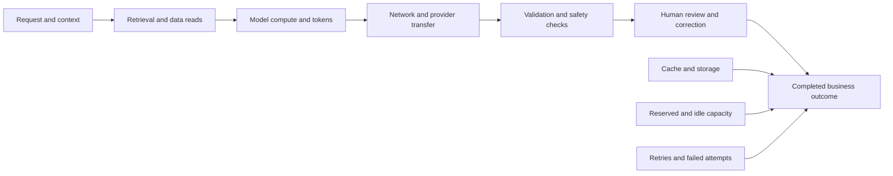
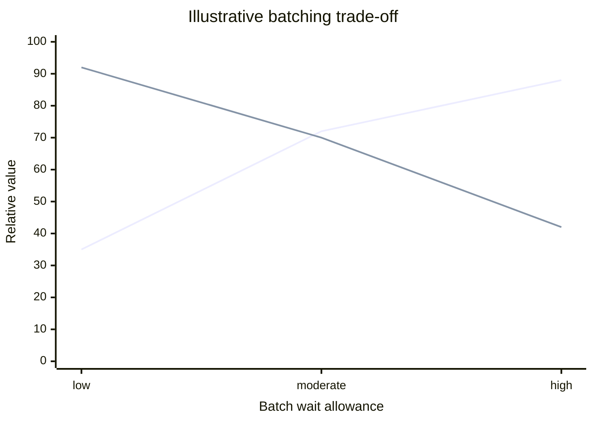
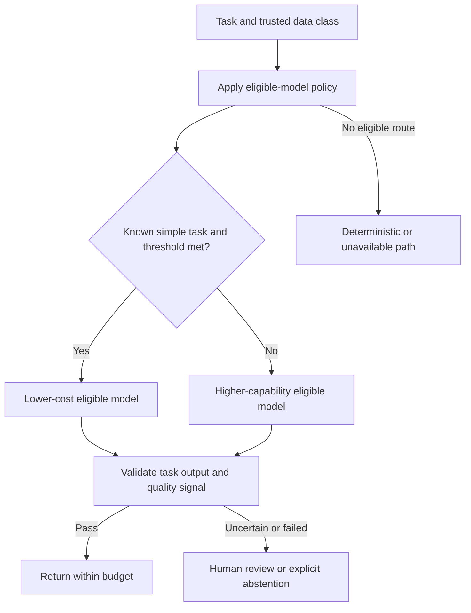
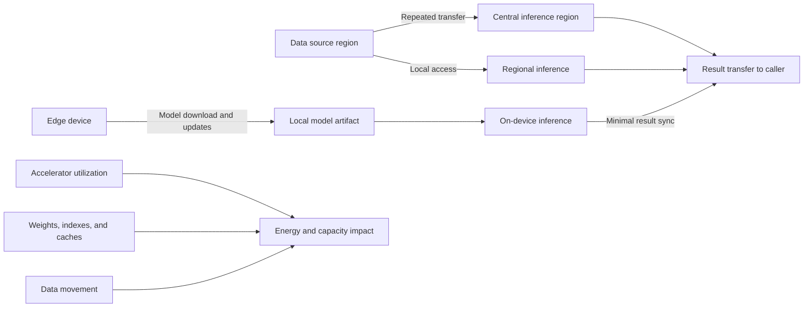
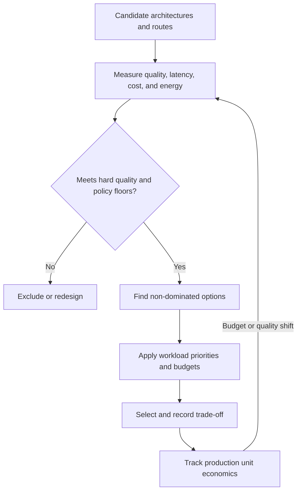

# AI Cost, Performance, and Sustainability Decisions

Part: [17 — AI Architecture](PART_OVERVIEW.md)

AI cost is a workload property, not just a model price. Request shape, retries, retrieval, data movement, idle capacity, human correction, and quality failures all contribute to the cost of a completed outcome. Performance and sustainability decisions should use the same end-to-end boundary so that an optimization does not merely move cost or impact elsewhere.

Part 16 CH28 owns inference optimization mechanics and CH29 owns operational practices. This chapter connects those mechanisms to system-level budgets, placement, and decision criteria.

## Measure Cost per Completed Outcome

Define the unit before comparing architectures: a resolved support case, accepted document, valid prediction, or completed workflow. Count failed and abandoned requests, human correction, support incidents, and downstream side effects. Per-request model price can fall while cost per successful outcome rises if quality declines or review workload increases.

Allocate shared costs with a transparent method and record assumptions such as utilization, cache hit rate, output length, retry frequency, and reviewer time. Compare cost distributions by task and tenant rather than a single monthly average. Include the cost of poor outcomes, such as rework or a false decision, when material.

## Balance Batching, Latency, and Utilization

Batching can improve accelerator utilization by serving several requests together, but waiting to form a batch increases latency and can reduce fairness. Continuous batching changes admission and scheduling behavior; it does not remove the need for per-request deadlines and isolation. Choose batch limits using real traffic shape, tail latency, cancellation, and tenant mix.

The two curves represent utilization benefit and latency suitability, not measured values. Benchmark the actual model, hardware, prompt distribution, and concurrency. If requests have different deadlines, avoid a batch policy where long-context or low-priority work delays urgent tasks. Consider separate pools or deadline-aware scheduling.

## Route by Quality Budget

Model tiers can reduce spend when a cheaper candidate satisfies a defined task-quality threshold. Routing should consider task category, sensitivity, deadline, and the expected cost of error. Escalate difficult or uncertain cases to a stronger model or human review, but verify that the router itself is validated and cannot use quality tier as a reason to bypass privacy policy.

Use calibrated quality evidence for each route and monitor routing drift. Measure escalation rate and total cost after escalation, not only initial model spend. If a low-cost route frequently fails and repeats the same work, direct routing to a capable option may be cheaper and faster overall.

## Account for Data Movement and Energy

Large source corpora, model weights, repeated retrieval, and cross-region calls consume storage, network, and compute. Moving data to centralized inference may increase transfer cost and exposure; moving compute near data may increase idle capacity or complicate operations. Edge placement can reduce network dependence but may require frequent device updates and duplicate artifacts. Sustainability estimates should state the boundary, utilization assumptions, hardware lifetime, energy mix where available, and uncertainty.

Choose the right comparison boundary. A regional deployment may lower transfer while increasing idle compute; batching may improve utilization while delaying work; caching may reduce repeated inference while retaining sensitive data longer. Review these coupled effects with privacy, freshness, availability, and operational complexity rather than optimizing a single energy metric.

## Compare the Cost-Quality Frontier

Architecture alternatives should be compared at an agreed quality floor. A lower-cost system that misses the floor is not a feasible option; above the floor, teams can compare marginal quality gain to latency and cost. Include tail latency and subgroup quality. Use confidence intervals or repeated runs when the difference is small relative to measurement noise.

An option is dominated when another meets or improves every relevant metric and is strictly better in at least one, under comparable assumptions. The frontier can change as usage, provider prices, hardware, and task mix change; revisit decisions with evidence rather than assuming the original winner remains optimal.

## Worked Case: Meeting-Note Summaries

An internal product summarizes recorded meetings. The team defines the unit as a summary accepted without material correction, with a minimum coverage threshold and a strict deletion schedule for audio. It measures transcription, inference, storage, network, and reviewer correction costs. Short internal meetings may use a lower-cost model; long or technical meetings route to a stronger eligible option. Uncertain action items are marked for user review rather than emitted as confirmed commitments.

The team compares centralized hosted inference with regional processing under the same privacy and quality gates. Batching improves utilization during scheduled processing, while interactive previews use a bounded streaming path. Repeated summaries are cached only when the meeting version and access policy match, and cache expiry follows the deletion rule. A monthly review compares cost per accepted summary, correction time, latency, and energy assumptions; if the quality floor is missed, cost optimization is suspended.

## Review Questions

1. What is the correct unit of completed value for this workload?
2. Which costs are invisible in a per-token or per-request price?
3. How does batching affect both utilization and deadline behavior?
4. What evidence justifies routing a task to a cheaper tier?
5. What assumptions define the sustainability boundary?

Cost and sustainability decisions are credible only when tied to a completed outcome and a quality floor. Measure the full path, expose assumptions, and revisit the cost-quality frontier as traffic and constraints change.
