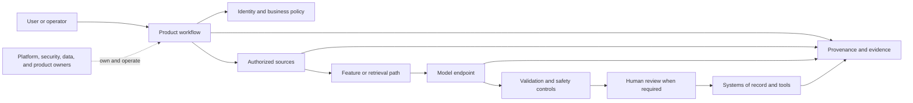
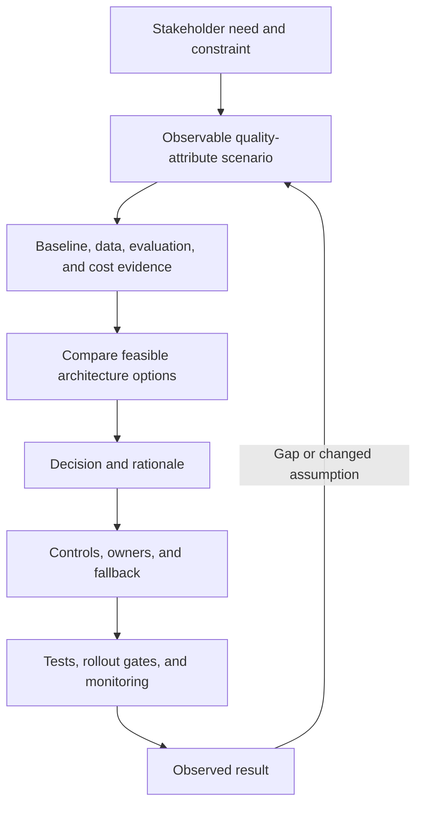
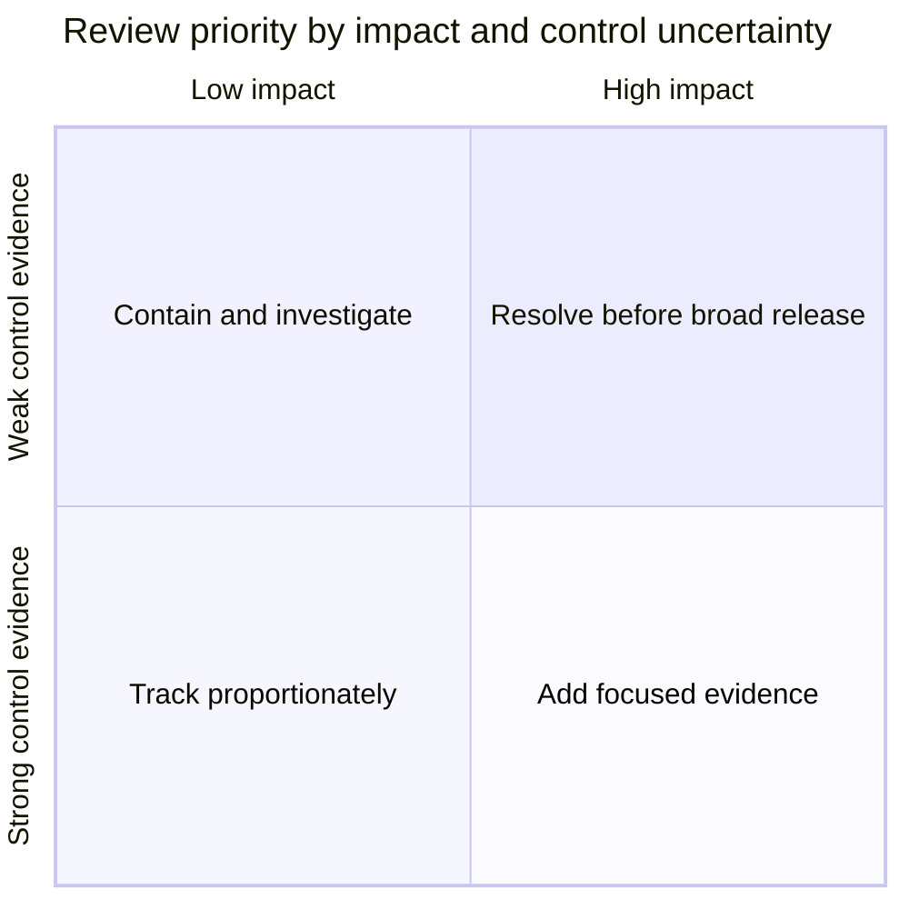
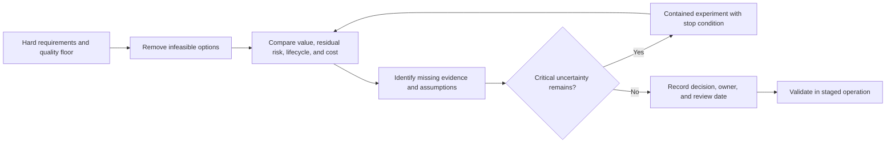
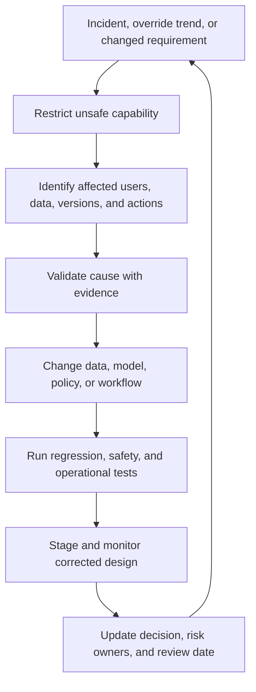

# End-to-End AI Architecture Reviews and Case Studies

Part: [17 — AI Architecture](PART_OVERVIEW.md)

An end-to-end AI architecture review asks whether the proposed system produces a measurable outcome under acceptable risk, data, latency, reliability, operating, and cost constraints. It reviews evidence and ownership across the whole workflow rather than scoring a model in isolation. Part 16 owns model and evaluation details; Part 15 owns security foundations; this chapter connects their evidence into architecture decisions.

## Review the System Context

Begin with the user, business decision, existing process, and strongest non-AI baseline. Identify sources, data rights, model or provider, retrieval, tools, reviewers, systems of record, and operational owners. Mark trust boundaries, state-changing actions, and dependencies outside the team's control. A component missing from the context is often an unowned risk.

The review should state where the model is advisory and where a deterministic service is authoritative. Include fallback and emergency restriction in the context, not only in an operations appendix. Define which party owns provider incidents, data corrections, quality regressions, and user communication.

## Trace Evidence to Architecture Decisions

For each major decision, connect the requirement to evidence, candidate alternatives, selected structure, and validation. Distinguish assumptions from measured facts. A missing benchmark, unclear data right, or untested failure mode should appear as an open risk with an owner and resolution gate, not disappear into a narrative conclusion.

Make quality scenarios concrete. Example: “When the primary model provider is unavailable for 10 minutes during peak traffic, 95% of eligible requests receive either a permitted deterministic result within 2 seconds or a clear deferred status; no unauthorized data is sent to a secondary provider.” This scenario can be tested in a failure exercise and tied to an owner.

## Assign Risk and Ownership

List material risks across data rights, privacy, security, quality, human impact, availability, cost, and change management. Assign one accountable owner and identify the control and evidence for each. A shared responsibility label is not ownership; one named role should coordinate closure even when several teams implement controls.

The matrix prioritizes review effort, not risk acceptance. High impact with weak evidence blocks broad release until controls or evidence improve. Record residual risk, affected stakeholders, decision authority, expiry or review date, and a stop condition for any exception.

## Compare Alternatives and Record the Decision

A useful review compares alternatives that include doing nothing, improving deterministic workflow, human augmentation, predictive models, retrieval, generative assistance, and bounded automation. Evaluate candidates against the same hard constraints and representative evidence. Explain why rejected options fail or cost more; “the chosen model scored highest” is not enough when deployment, policy, or lifecycle constraints dominate.

| Option | Outcome potential | Main cost or risk | Evidence needed |
|---|---|---|---|
| Deterministic workflow | Predictable on structured, stable rules | Brittle when inputs or policy are ambiguous | Rule coverage and exception rate |
| Human-only process | Flexible judgment and accountability | Queue delay, labor cost, and inconsistency | Throughput, quality, and error analysis |
| Predictive model | Ranking or classification at scale | Data shift, label bias, and calibration | Representative validation and monitoring plan |
| Retrieval plus generation | Grounded language interface over changing sources | Access leakage, stale evidence, unsupported claims | Authorization, citation, and abstention tests |
| Bounded agent workflow | Multi-step tool orchestration | Side effects, loops, and uncertain recovery | Tool authorization, idempotency, budget, and approval tests |

Use an experiment when it can reduce a consequential uncertainty at bounded cost and risk. Define its population, baseline, metric, duration, stop conditions, and decision owner before collecting results. Do not allow a pilot to become production by inertia.

## Case Study: Internal Policy Assistant

An enterprise wants employees to query current travel and benefits policies. The architecture uses identity-bound retrieval, versioned documents, and generated answers with citations. It abstains when evidence is missing or conflicting and routes policy interpretation to a specialist. The review focuses on group-level access leakage, source freshness, citation validity, provider retention, tail latency, and cost per resolved question.

The design uses deterministic authorization and policy checks outside the model. A failure exercise revokes a document while an old index is active; the system must block the withdrawn source and preserve a trace of the index version. The release gate includes cross-tenant tests, stale-index behavior, unsupported-answer review, and a human-support fallback.

## Case Study: Equipment Maintenance Prioritization

A manufacturer wants to prioritize maintenance from sensor readings and work orders. A predictive model ranks equipment risk, but technicians and existing safety procedures retain decision authority. The architecture separates scheduled batch scoring from online alerting, records feature and model versions, and routes out-of-distribution equipment to manual inspection. The review examines label completeness, false-negative consequences, sensor outages, regional connectivity, and the operational cost of unnecessary inspections.

The team stages the ranking in shadow mode against current maintenance decisions, then pilots with a subset of equipment after a safety review. A missing sensor stream triggers a declared data-quality state rather than a confident low-risk score. The system does not automatically suppress an inspection mandated by policy.

## Case Study: Invoice Exception Preparation

An accounts-payable team wants to reduce clerical effort on invoices with mismatched fields. Deterministic checks handle arithmetic, supplier identity, and approval limits. Retrieval supplies authorized purchase-order and policy evidence; generation drafts an explanation; a person approves payment exceptions. The review focuses on duplicate submissions, supplier-data changes, evidence provenance, prompt injection in attachments, human queue capacity, and idempotent downstream updates.

The release starts with read-only recommendations. Only after measured correction rates and security controls meet thresholds does the team automate low-risk case routing. Payment remains within the existing approval system. The review names owners for data rights, model quality, payment policy, provider operations, and incident response.

## Production Incident to Architecture Change

An architecture review is not finished at launch. When incidents or user feedback reveal a gap, preserve the affected release manifest, scope impact, contain unsafe behavior, and decide whether the change belongs in data, model, policy, workflow, or operations. Convert a verified failure into a regression test or a documented non-actionable signal, then update the decision record and owners.

## Review Questions

1. What non-AI alternative provides the strongest baseline?
2. Which architecture choices have unresolved assumptions or missing evidence?
3. Who owns each high-impact risk and can restrict the system?
4. Which tests demonstrate safe fallback and data authorization?
5. What incident or change would trigger a new architecture review?

An end-to-end review is complete when requirements, evidence, alternatives, controls, owners, and validation are traceable. Keep residual risks visible, stage uncertain capabilities, and feed production outcomes back into the architecture decision rather than treating approval as permanent.
