# End-to-End AI Architecture Reviews and Case Studies

Part: [17 — AI Architecture](PART_OVERVIEW.md) · Status: Revised (in-depth rewrite)

## 1. Introduction

An AI architecture review is a structured examination of a complete AI-enabled solution before, during, and after it carries real work. It asks whether the design produces a measurable outcome under acceptable risk, and whether the evidence for that claim is strong enough for the decision being made. The review covers the business case, the data, the model, the inference path, the controls around the model, the people who operate it, and the money it consumes. It does not score a model in isolation. A model with a good benchmark result can sit inside a system that leaks data, fails silently, costs three times its budget, or has no person who can switch it off.

This chapter is the capstone of Part 17. Chapters 1 to 14 each teach one architectural concern. This chapter teaches how to combine them into one judgment, how to run the conversation that produces that judgment, and how to learn from systems that did not go as planned. Five full case studies are written as complete reviews, each with a context diagram, requirements, options, a chosen architecture, decisions, risks, a validation plan, a rollout, and an honest account of what went wrong after launch.

### 1.1 Reader outcomes

After this chapter you should be able to:

- Decide which kind of review a project needs and when, and what the review must produce.
- Run a review with an evidence request list, an assumption register, quality-attribute scenarios, option analysis, a risk register with owners, decision records, and a validation plan.
- Apply fourteen review lenses, each with probing questions, expected evidence, and red flags.
- Score a design with weighted lens scores and hard gates, and map the score to approve, approve with conditions, defer, or reject.
- Write conditions that another person can verify without asking you what you meant.
- Facilitate a review conversation that survives optimism bias, vendor claims, and impressive demos.
- Recognize common anti-patterns by their symptoms, and convert production incidents into architecture changes.
- Assess an organization's AI-architecture maturity and set governance cadence and re-review triggers.

### 1.2 Why this matters to a solution architect

A solution architect is usually the person asked "is this ready?" Product wants a date, security wants a control list, finance wants a number, and the team wants approval. The architect's answer carries weight only if it rests on evidence that others can inspect. AI systems make this harder than conventional systems for three reasons.

First, behavior is probabilistic and data-dependent. A conventional service that passes its tests keeps passing them until someone changes the code. An AI system can degrade because the input distribution moved, the provider updated a model, a document was added to the corpus, or users found a new way to phrase requests. Reviews must therefore ask for evidence about change, not only about a snapshot.

Second, the failure surface crosses disciplines. A single incident, such as a support assistant quoting another customer's contract, involves retrieval design, cache design, identity propagation, evaluation, and incident response. No single specialist sees all of it. The review is where those views meet.

Third, demos are persuasive and unrepresentative. A language model can produce a fluent answer to the five questions the team rehearsed. The review exists to ask about the five hundred they did not.

### 1.3 Scope and ownership

This chapter connects topics owned elsewhere. It recaps them in a sentence or two and links to the owner. It teaches the review method, the lens checklist, the scoring and outcome mechanics, the case studies, and the learning loop.

| Topic | Owner | Treatment here |
| --- | --- | --- |
| Workload qualification, non-AI baseline, readiness | [Part 17 CH01](CH01_AI_Workload_Qualification_and_Architecture_Foundations.md) | Review lens with questions and evidence |
| Capability and model selection | [Part 17 CH02](CH02_AI_Capability_and_Model_Selection.md) | Review lens |
| Reference architectures for predictive, generative, agentic systems | [Part 17 CH03](CH03_Reference_Architectures_for_Predictive_Generative_and_Agentic_Systems.md) | Review lens on composition |
| AI data architecture and preparation boundaries | [Part 17 CH04](CH04_AI_Data_Architecture_and_Preparation_Boundaries.md) | Review lens |
| Retrieval-augmented generation (RAG) system architecture | [Part 17 CH05](CH05_Retrieval_Augmented_Generation_System_Architecture.md) | Used in cases 1 and 4 |
| Agentic systems and tool boundaries | [Part 17 CH06](CH06_Agentic_System_Architecture_and_Tool_Boundaries.md) | Used in case 3 |
| Inference serving and model placement | [Part 17 CH07](CH07_Inference_Serving_and_Model_Placement.md) | Review lens |
| Model gateway, routing, fallback | [Part 17 CH08](CH08_Model_Gateway_Routing_and_Fallback_Architecture.md) | Review lens; used in case 5 |
| Human oversight and workflow integration | [Part 17 CH09](CH09_Human_Oversight_and_AI_Assisted_Workflow_Integration.md) | Review lens; used in cases 2 and 4 |
| AI platform and model lifecycle | [Part 17 CH10](CH10_AI_Platform_and_Model_Lifecycle_Architecture.md) | Review lens |
| Evaluation and observability architecture | [Part 17 CH11](CH11_Evaluation_and_Observability_Architecture_for_AI_Systems.md) | Review lens |
| Safety, security, privacy, governance architecture | [Part 17 CH12](CH12_AI_Safety_Security_Privacy_and_Governance_Architecture.md) | Review lens |
| Reliability and resilience | [Part 17 CH13](CH13_Reliability_and_Resilience_Patterns_for_AI_Workloads.md) | Review lens |
| Cost, performance, sustainability | [Part 17 CH14](CH14_AI_Cost_Performance_and_Sustainability_Decisions.md) | Review lens; worked numbers |
| Model evaluation and validation methods | [Part 16 CH06](../16_AI_and_GenAI/CH06_Model_Evaluation_Validation_and_Selection.md) and [Part 16 CH24](../16_AI_and_GenAI/CH24_Generative_AI_Evaluation_Guardrails_and_Hallucinations.md) | Cited as evidence sources |
| MLOps and LLMOps | [Part 16 CH29](../16_AI_and_GenAI/CH29_MLOps_and_LLMOps.md) | Cited as evidence sources |
| Data governance, privacy, provenance | [Part 16 CH30](../16_AI_and_GenAI/CH30_AI_Data_Governance_Privacy_and_Provenance.md) | Cited as evidence sources |
| Responsible AI governance | [Part 16 CH31](../16_AI_and_GenAI/CH31_Responsible_AI_and_Safety_Governance.md) | Cited as evidence sources |
| General architecture review practice and documentation (C4, architecture decision records) | [Part 21 CH11](../21_Architecture_Documentation/CH11_Architecture_Reviews.md), [CH01](../21_Architecture_Documentation/CH01_C4_Model.md), [CH03](../21_Architecture_Documentation/CH03_ADR_Architecture_Decision_Record.md) | Recap only; this chapter adds what is specific to AI |
| Evidence, assumptions, uncertainty, pre-mortems, reconsideration triggers | [Part 22 CH04](../22_Architectural_Thinking_and_Decision_Practice/CH04_Evidence_Assumptions_and_Uncertainty.md), [CH08](../22_Architectural_Thinking_and_Decision_Practice/CH08_Architecture_Pre_Mortems_and_Challenge_Reviews.md), [CH09](../22_Architectural_Thinking_and_Decision_Practice/CH09_Measuring_Decision_Outcomes_and_Reconsideration_Triggers.md) | Recap and AI-specific application |
| Threat modeling | [Part 15 CH12](../15_Security/CH12_Threat_Modeling.md) | Referenced in the security lens |
| Facilitation and stakeholder skills | [Part 23 CH02](../23_Soft_Skills/CH02_Architecture_Reviews.md) | Recap; AI-specific traps added |

A note on terms. "Review panel" means the people who judge the design. "Team" means the people who built or propose it. "Lens" means one concern examined with a fixed set of questions. "Evidence" means an artifact a third party can inspect: a measurement, a log, a test result, a signed data agreement, a runbook that was exercised. A claim in a slide is not evidence.

## 2. What an AI Architecture Review Is

### 2.1 The review in one sentence

A review compares what the team claims about a system with what the evidence supports, records the gap, and turns the gap into decisions, conditions, and follow-up with named owners.

That sentence has three parts that each deserve attention. The comparison is between claim and evidence, not between design and an ideal. No design is ideal. The gap is recorded, not argued away, so that a later reader can see what was known at the time. And the output is action with owners, because a review that ends in a score and no assigned work changes nothing.

### 2.2 What a review is not

A review is not an audit of compliance with a template. Compliance checks are useful inputs, and the governance lens uses them, but passing a checklist does not show the architecture suits its purpose. A review is not a design session, although a good review often suggests options. It is not a model leaderboard, because the model is one component. It is not an approval ritual in which the panel signs off on slides. When a team arrives with the conclusion fixed and asks only for a signature, the review has already failed, and the panel should say so.

### 2.3 Five review points in a system's life

Reviews serve different decisions at different times. A single "architecture review board" meeting that does everything produces shallow results, so name the point and tailor the depth.

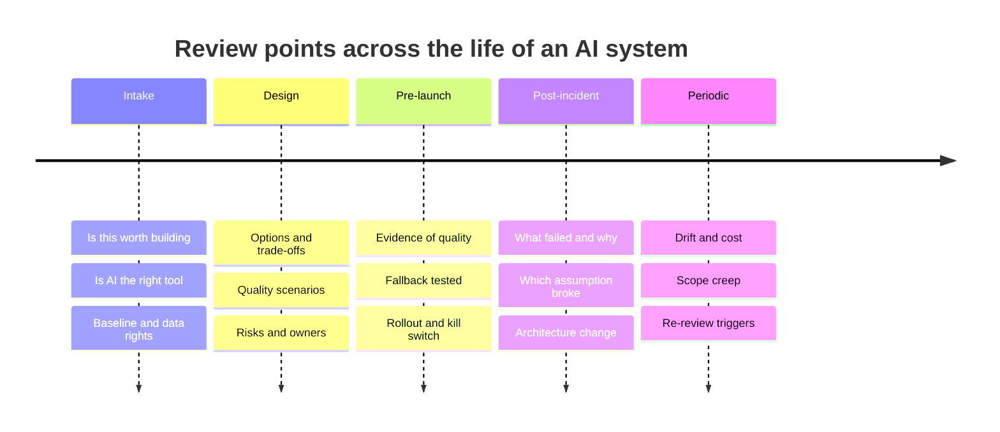

The timeline shows five points. Each has a different question, a different evidence standard, and a different cost of being wrong.

| Review point | Decision it supports | Typical depth | Main output |
| --- | --- | --- | --- |
| Intake | Fund, defer, or stop exploration | Half a day; mostly the value, baseline, data, and workload lenses | Go or no-go for design, with named unknowns |
| Design | Commit to an architecture | One to three days over a week; all lenses at design level | Chosen option, decision records, risk register, validation plan |
| Pre-launch | Allow real users and real data | Two to five days; all lenses at evidence level | Outcome (approve, conditions, defer, reject), rollout plan, conditions |
| Post-incident | Decide what to change | Blameless; as long as needed after stabilization | Timeline, causal analysis, architecture changes with owners |
| Periodic | Continue, change, or retire | Half a day to two days per quarter or half year | Drift and cost findings, updated risk register, re-review triggers |

### 2.4 Intake review

An intake review happens before design effort is committed. The panel asks whether the problem is worth solving, whether AI is the right tool, whether a simpler baseline already meets most of the need, and whether the data rights and data quality exist at all. Part 17 CH01 teaches workload qualification. The intake review applies it and checks the answers.

The most valuable intake output is often a refusal. Suppose a team proposes an AI assistant to classify 400 incoming emails a day into six queues. A rule-based router using sender domain and subject keywords already gets 91 percent of them right, and the remaining emails are cheap to triage by hand because the volume is small. At 400 emails a day, a person spending 20 seconds per mis-routed email on 9 percent of them is 36 emails and 12 minutes a day. The AI project would cost more in build, evaluation, and operations than a year of that manual effort. The honest intake outcome is "do not build; revisit if volume grows tenfold."

### 2.5 Design review

A design review chooses among options. The team presents requirements, quality-attribute scenarios, at least two feasible alternatives with real differences, and a recommended architecture. The panel tests the reasoning. The design review is where inexpensive changes happen: moving a tenant boundary, removing an autonomous action, choosing a smaller model, or deciding that a human decides. A design flaw found here costs hours. The same flaw found after launch costs an incident.

### 2.6 Pre-launch review

A pre-launch review decides whether the system may meet real users or real data. The evidence standard is highest here. The panel wants measured quality on a representative evaluation set, a tested fallback, load and failure test results, a security test report, a runbook that someone has exercised, a rollout plan with stop criteria, and a working kill switch. Claims that were acceptable at design time are no longer acceptable. "We will add monitoring" becomes "here is the dashboard, here is the alert, here is the on-call rotation, and here is the page it produced during the game day."

### 2.7 Post-incident review

A post-incident review is a review of the architecture in light of a failure. It follows the incident response and stabilization, and it asks which architectural assumption was false, which control did not exist or did not work, and what to change. Section 16 gives a template. The key discipline is to separate the proximate cause (a misconfigured filter) from the architectural cause (nothing verified the filter independently of the component that applied it).

### 2.8 Periodic review

Systems drift after launch. Periodic reviews examine drift in quality, cost, usage, data, and scope. They check whether the assumptions recorded at launch still hold and whether any re-review trigger has fired. Section 17 gives the cadence and triggers. A periodic review is short when the system is healthy, which is the point of keeping the evidence current.

### 2.9 When not to run a full review

A full review has a cost: the panel's time and the team's preparation. Match the effort to the risk. A useful rule is to size the review by two factors: the impact of a wrong output, and the autonomy of the system. A spelling-suggestion feature in an internal tool with a user who accepts or rejects each suggestion needs a lightweight check. A system that sends messages to customers, moves money, changes infrastructure, or influences decisions about people needs the full treatment. A lightweight check still covers data rights, the baseline, and ownership, because those fail cheaply and invisibly.

| Impact of a wrong output | Autonomy low (human decides every action) | Autonomy high (system acts) |
| --- | --- | --- |
| Low (inconvenience, easily reversed) | Lightweight checklist, one hour | Design review, one day |
| Medium (financial or reputational harm to one party) | Design review plus pre-launch evidence | Full review, all lenses at evidence level |
| High (legal, safety, or financial harm at scale; decisions about people) | Full review plus independent validation | Full review, independent validation, staged rollout with external sign-off |

The table is a starting point. A panel may move a system up a row when it handles regulated data or touches vulnerable users.

## 3. The Review Method

The method has nine steps. They repeat at each review point with different depth. The steps are scope and context, evidence request, assumption register, quality-attribute scenarios, option analysis, risk register, decision records, validation plan, and follow-up.

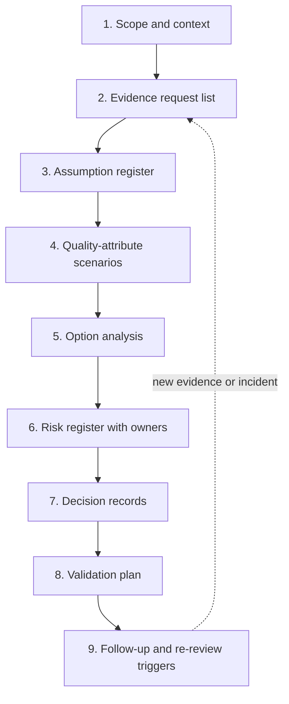

The loop at the end matters. A review is not a one-time gate. New evidence, an incident, or a trigger sends the work back to the evidence request.

### 3.1 Step 1: scope and context

Scope answers three questions. What is under review (the whole workflow or one component)? What decision does the review support? What is out of scope, stated explicitly, so omissions are visible?

Then draw the context. The context diagram shows the user, the business decision, the existing process, the data sources, the model or provider, retrieval, tools, reviewers, systems of record, and operational owners. It marks trust boundaries, state-changing actions, and dependencies the team does not control. Use the C4 context level that [Part 21 CH01](../21_Architecture_Documentation/CH01_C4_Model.md) teaches; this chapter adds the AI-specific marks below.

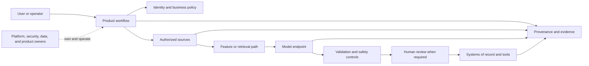

The diagram is the reference context for any AI-enabled workflow. Every box needs an owner. Every arrow that crosses a trust boundary needs an authorization decision. The AI-specific marks to add are:

- Where the model is advisory and where a deterministic service is authoritative.
- Which components store or log user content, and for how long.
- Which components are run by a third party, and under what contract.
- Which arrows can change state in a system of record.
- Where fallback and emergency restriction live, drawn into the context rather than relegated to an appendix.

A component that is missing from the context is often an unowned risk. When a reviewer asks "what logs the prompts?" and nobody knows, the diagram has found a gap.

### 3.2 Step 2: evidence request list

The review panel sends an evidence request list at least a week before the session. Each item names the artifact, the lens it serves, and the owner who supplies it. The list protects time: the session discusses findings, not first reading.

A standard request list for a pre-launch review:

| Lens | Evidence requested |
| --- | --- |
| Value and baseline | Baseline measurement (current process or rule-based approach), success metric definition, pilot or shadow-mode results |
| Workload qualification | Task decomposition, error cost analysis, non-AI alternatives considered |
| Data | Data inventory, rights and consent records, lineage diagram, quality checks, freshness measurements |
| Model and capability | Model comparison on the team's own evaluation set, version pinning policy, license or terms review |
| Composition | Architecture diagram at component level, pattern justification, tool and permission inventory |
| Inference and serving | Load test results, latency percentiles, capacity plan, placement rationale |
| Gateway, routing, fallback | Routing rules, fallback chain, results of provider failure tests |
| Human oversight | Review workflow, reviewer capacity, override and escalation rates from pilot |
| Platform and lifecycle | Release process, model and prompt versioning, rollback test, change log |
| Evaluation and observability | Evaluation suite, golden set provenance, dashboards, alert definitions, tracing sample |
| Safety, security, privacy, governance | Threat model, red-team report, privacy impact assessment, access reviews, audit trail sample |
| Reliability | Failure mode analysis, game-day results, dependency map, degradation ladder |
| Cost, performance, sustainability | Cost model with unit economics, measured token and compute use, budget alerts |
| Operability and ownership | Runbooks, on-call rota, escalation paths, incident exercise record, ownership matrix |

The request list should be proportionate. A design review asks for plans and drafts, and a pre-launch review asks for executed results. If the team cannot supply an item, that fact is itself a finding, and the review records it as "not available" rather than silently skipping the item.

### 3.3 Step 3: assumption register

Every design rests on assumptions. Teams rarely list them, and the unlisted ones do the damage. The assumption register records each assumption with four fields: the statement, how it is known (measured, estimated, asserted, or unknown), what breaks if it is false, and the test or date that will settle it.

Distinguish three grades of knowledge:

- Measured: observed on representative data or traffic, with the method recorded.
- Estimated: derived from a model or from a different system; the derivation is shown.
- Asserted: stated by a person or vendor with no supporting artifact.

Assumptions graded "asserted" or "unknown" and carrying high impact are the review's priority list. [Part 22 CH04](../22_Architectural_Thinking_and_Decision_Practice/CH04_Evidence_Assumptions_and_Uncertainty.md) teaches the general method; this is how it looks for an AI system.

| ID | Assumption | Grade | Impact if false | Settled by |
| --- | --- | --- | --- | --- |
| A1 | Support questions are answerable from the approved knowledge base for at least 85 percent of tickets | Estimated from 200 sampled tickets | Escalation load doubles; value case fails | Shadow mode on 2,000 tickets, week 3 |
| A2 | The vendor will not train on our prompts | Asserted | Data-protection breach | Contract clause and data processing agreement review before launch |
| A3 | Documents are refreshed within 24 hours of source change | Unknown | Stale answers; policy errors | Freshness probe added to ingestion, report in week 2 |
| A4 | Peak load is 40 requests per second | Estimated from ticket volume | Latency and cost misjudged | Load test at 80 requests per second |
| A5 | Reviewers will catch wrong drafts | Asserted | Errors reach customers | Seeded-error test during pilot |

Notice that A2 and A5 are the dangerous ones. A2 can be settled by reading a contract. A5 can be tested cheaply. Both are skipped by many teams because they feel obvious.

### 3.4 Step 4: quality-attribute scenarios

A quality-attribute scenario turns a vague wish ("the system must be reliable") into a testable statement with six parts: source of stimulus, stimulus, artifact, environment, response, and response measure. This is a standard technique from architecture evaluation practice; the Software Engineering Institute's Architecture Tradeoff Analysis Method popularized it. For AI systems add scenarios about quality drift, data change, and adversarial input, not only load and failure.

| Quality | Scenario (stimulus, response, measure) |
| --- | --- |
| Accuracy | Given a production-like query set, when the assistant answers, then at least 92 percent of answers are rated correct and grounded by two reviewers, and at most 1 percent contain an unsupported factual claim |
| Latency | Given 40 concurrent users at peak, when a user submits a question, then the first token appears within 1.5 seconds at the 95th percentile |
| Availability | When the primary model provider is unreachable, then the system serves the fallback within 10 seconds and the success rate stays at or above 95 percent of requests |
| Isolation | When a user in tenant A issues any query, then no retrieved chunk, cache entry, or log line from tenant B is returned, verified by canary probes at least hourly |
| Drift | When the weekly golden-set score falls by 3 points or more against the launch baseline, then an alert pages the owner and rollout of model changes freezes within 1 hour |
| Cost | When monthly usage grows 50 percent, then cost grows at most 35 percent, because caching and tier routing absorb the increase |
| Safety | When a user or document injects instructions, then the agent never invokes a state-changing tool without human approval, verified by a monthly red-team suite of 300 cases |
| Recoverability | When a bad prompt or model version ships, then rollback completes within 15 minutes with no data loss |

Scenarios are the bridge between lenses and tests. Each scenario should map to a test, a monitor, or both. A scenario that nobody can test is a wish, and the review should say so.

### 3.5 Step 5: option analysis

The team must show feasible alternatives, including a non-AI baseline and a simpler AI option. Reviewers look for real differences along the axes that matter: quality, risk, latency, cost, data exposure, operational burden, reversibility, and time to value. [Part 22 CH05](../22_Architectural_Thinking_and_Decision_Practice/CH05_Reversibility_Optionality_and_Decision_Timing.md) covers reversibility and optionality in general.

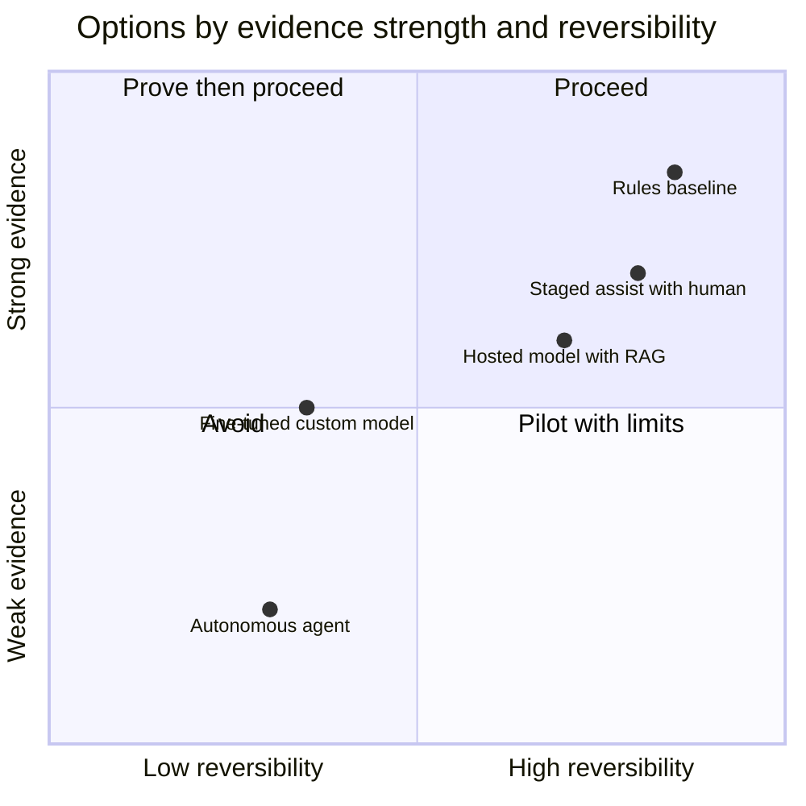

The quadrant shows a method for placing options. Options with strong evidence and high reversibility are easy to approve. Options with weak evidence and low reversibility, such as an autonomous agent that changes records, need the most proof before anything ships. The placements here are illustrative; the panel places each option by its own evidence.

A short option table makes the trade-offs explicit.

| Option | Quality | Risk | Cost to run | Reversibility | Verdict |
| --- | --- | --- | --- | --- | --- |
| A. Rules and templates | Medium | Low | Low | High | Baseline; keep as fallback |
| B. Hosted model with retrieval, human approves | High | Medium | Medium | High | Recommended |
| C. Fine-tuned model, autonomous send | High (uncertain) | High | High | Low | Reject for now; revisit with evidence |

The recommendation names the rejected options and the reason. When a team cannot say why option A was rejected, they did not evaluate it.

### 3.6 Step 6: risk register with owners

A risk register entry has a statement of cause and consequence, likelihood, impact, an owner (a named person or role, never a team alias with no accountable lead), a mitigation, a gate by which the mitigation must be in place, and a status. Score with likelihood from 1 to 5 and impact from 1 to 5, multiply, and band the result: 1 to 5 low, 6 to 11 medium, 12 to 19 high, 20 to 25 critical. The scale is a shared language, not a measurement. Its purpose is ranking and ownership.

The script [`02_risk_matrix.py`](../code/python/ai-architecture-review-chapter/02_risk_matrix.py) sorts a register, flags entries with no owner or gate, and prints a five-by-five matrix. Its sample output:

```text
id  score band      owner            gate             title
R6     16 high      product-owner    pre-launch       Reviewers rubber-stamp suggestions
R1     15 high      platform-lead    pre-launch       Cross-tenant chunk returned from shared cache
R2     12 high      data-owner       pre-launch       Retrieval corpus contains documents without usage rights
R3     12 high      sre-lead         pre-launch       Provider outage with no tested fallback
R4     12 high      ml-lead          post-launch 30d  Silent quality drift after a provider model update
R5      9 medium    finance-partner  post-launch 30d  Cost grows faster than usage
R7      9 medium    -                -                Runbook for AI incidents does not exist  <-- UNOWNED OR NO GATE

impact ->   1       2       3       4       5
L=5      .       .       .       .       .
L=4      .       .       R3+R4   R6      .
L=3      .       .       R5+R7   R2      R1
L=2      .       .       .       .       .
L=1      .       .       .       .       .

Total exposure points: 85
Open critical/high risks: 5
```

Row R1 scores 15 because likelihood 3 times impact 5 equals 15. R6 scores 16 (4 times 4). The matrix is only a picture of the same data. The important line is the flag on R7: a risk with no owner and no gate stays open forever. The review must assign both before it closes.

The risk and ownership matrix below shows how the same register looks when organized by owner instead of score. This view helps the panel check that no single owner carries an impossible load and that every high risk has a gate before launch.

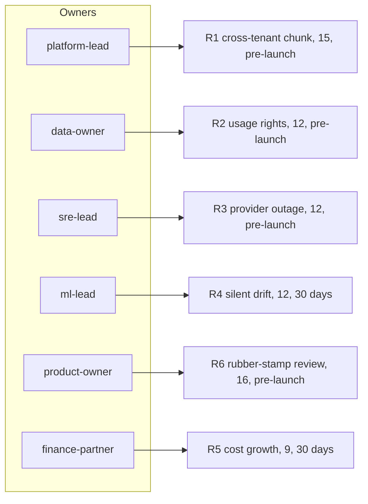

Each owner holds one or two risks, and every high risk has a gate. A real register often shows one overloaded owner, usually the platform lead. When the matrix shows that, the review treats owner overload as its own finding.

### 3.7 Step 7: decision records

Each significant decision gets a short architecture decision record (ADR): context, decision, alternatives considered, consequences, and the evidence it rests on. [Part 21 CH03](../21_Architecture_Documentation/CH03_ADR_Architecture_Decision_Record.md) teaches the format. The AI-specific addition is a "reconsider when" line that names the trigger: a model deprecation, an evaluation score below a threshold, a cost ceiling, a regulatory change, or a change of scope. Without that line, decisions made under today's evidence stay in force after the evidence has gone.

A compact ADR looks like this:

```text
ADR-004: Tenant-scoped retrieval with per-tenant index partitions
Status: accepted (design review 2026-03-12)
Context: Shared vector index with metadata filter was proposed. Filter is applied after
  top-k retrieval, so a filter bug can expose another tenant's chunks.
Decision: One index partition per tenant; the partition is chosen from the verified
  identity token, never from request parameters.
Alternatives: shared index with post-filter (rejected: single point of failure for
  isolation); shared index with pre-filter (deferred: depends on vendor guarantees
  not yet verified).
Consequences: more indexes to operate; cost +8 percent; isolation is structural.
Evidence: vendor test report; canary probe design in validation plan section 4.
Reconsider when: tenant count exceeds 2,000, or the vendor documents verified
  pre-filter isolation.
```

### 3.8 Step 8: validation plan

The validation plan lists what will be measured before and after launch, with thresholds and owners. It converts the quality scenarios into tests and monitors. It specifies the evaluation set and its provenance, the red-team suite, the load and failure tests, the shadow or pilot design, and the stop criteria for rollout. [Part 17 CH11](CH11_Evaluation_and_Observability_Architecture_for_AI_Systems.md) teaches the evaluation architecture.

A validation plan has five parts:

1. Pre-launch tests: offline evaluation, red team, load, failure injection.
2. Pilot or shadow design: traffic share, duration, sample size, success criteria.
3. Launch gates: numeric thresholds that must hold to advance each rollout stage.
4. Production monitors: metrics, alert thresholds, owners.
5. Stop criteria: the conditions that halt or roll back, and who may decide.

A worked sample-size calculation shows why numbers matter. If the target accuracy is 92 percent and the panel wants to know whether the true accuracy is at least 88 percent with a 95 percent confidence interval of plus or minus 3 points, the normal approximation gives a required sample of about n = 1.96 squared times 0.92 times 0.08 divided by 0.03 squared. That is 3.8416 times 0.0736 divided by 0.0009, which is 0.2828 divided by 0.0009, or about 314 labeled examples. A team that evaluated 40 examples cannot support the claim, and the review should say so. The estimate assumes independent examples; clustered data, such as many questions from one document, needs more.

### 3.9 Step 9: follow-up and re-review triggers

The review ends with a written outcome, a list of conditions with owners and due dates, the updated risk register, and a set of re-review triggers. A tracker records condition status, and someone is named to confirm closure. Follow-up that depends on goodwill fails. Put condition closure on a calendar, and tell the team what happens if a condition is late: the launch date moves, a feature is disabled, or the panel reconvenes.

Triggers are events that require a fresh look: a model or provider version change, a change to the data sources or their rights, a new tool or higher autonomy, a new user population, a cost or quality alarm, or an incident. Section 17 expands them.

### 3.10 The evidence-to-architecture review map

The method above connects evidence to architecture decisions. The map below is the single picture to keep in mind during a review. Reading it from top to bottom, each stakeholder need becomes a scenario, each scenario is supported or refuted by evidence, evidence informs option comparison, and the decision produces controls with owners.

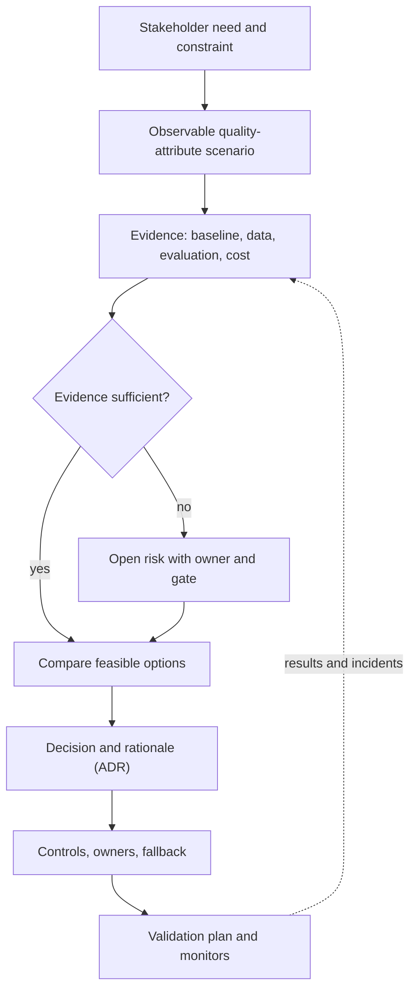

The decision node has two branches. Insufficient evidence does not stop the process. It becomes an open risk with an owner and a gate, so the design can progress while the unknown is tracked. This keeps the review honest without making it a blocker for every unknown. A review should block only when an unknown is serious enough to hit a hard gate, which Section 5 defines.

Three consequences follow from the map. First, a decision without a linked scenario is arbitrary; ask which need it serves. Second, a scenario without evidence is a wish; ask for the test. Third, a control without an owner will decay; ask who gets paged. These three questions find most of the weaknesses in most designs.

## 4. Review Lenses

A lens is one concern examined with a fixed set of probing questions, a defined set of expected evidence, and a list of red flags. Fourteen lenses cover an AI-enabled solution end to end. Using the same lenses every time makes reviews comparable, prevents the panel from spending the whole session on whichever topic its members find most interesting, and exposes lenses that no one on the team owns.

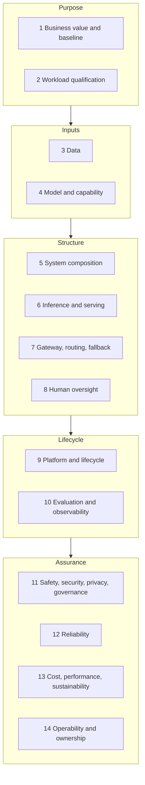

The grouping suggests an order. Purpose comes first because everything else is wasted if the value is not real. Inputs come next because data and model set the ceiling on quality. Structure shows how the pieces connect. Lifecycle shows how the system is changed and measured. Assurance asks whether it can be trusted and run. A panel can split lenses among members and then compare findings.

For each lens below, the questions are the ones the panel asks aloud, the evidence is what the team should be able to show, and the red flags are patterns that should raise the panel's concern. Red flags are not automatic failures. They are prompts to ask for more.

### 4.1 Lens 1: business value and baseline

Part 17 CH01 owns qualification. The review applies it.

Probing questions:

- What decision or task improves, for whom, and by how much? Which number moves?
- What does the current process cost and achieve today, measured, not estimated?
- What is the strongest non-AI baseline, and how close does it get?
- What is the cost of a wrong output, in money, time, harm, and trust?
- Who pays for operation after launch, and is that cost in the business case?

Expected evidence: a measured baseline for the success metric; a defined success metric with a threshold; a pilot or shadow result against the baseline; a unit-economics model that includes review labor, evaluation, and operations, not just model fees.

Red flags: success defined as "users like it" or "adoption"; a business case that counts only license savings; no baseline measurement; the baseline is a straw man (such as a rule set nobody tuned); the value claim depends on removing a human whom the design actually keeps.

Worked check. A support assistant claims to save 4 minutes on each of 30,000 tickets a month, which is 2,000 hours. The pilot measured agent handling time falling from 11.0 to 8.6 minutes, a saving of 2.4 minutes, because agents spend about 1.6 minutes reading and correcting drafts. The honest estimate is 30,000 times 2.4 divided by 60, or 1,200 hours. The business case should use 1,200, and the review should ask whether the review-and-correct time falls as agents gain experience.

### 4.2 Lens 2: workload qualification

Probing questions:

- Is the task a prediction, generation, retrieval, transformation, or decision? Which of those does AI add?
- What is the error tolerance, and is it asymmetric (a false negative costs more than a false positive)?
- Is the task stable enough that last quarter's evaluation still means something?
- Does the task need explanations, deterministic repeatability, or audit of each decision?
- What happens at the boundary: unusual inputs, languages, edge cases, adversarial users?

Expected evidence: a task decomposition separating deterministic steps from model steps; an error-cost table; a sample of real inputs, including difficult ones, with their distribution; a statement of which regulations or policies constrain automated decisions.

Red flags: AI used for steps with exact answers (arithmetic, lookups, policy tables); one model call doing a bundle of unrelated jobs; no handling of out-of-scope inputs; reliance on the model to know when it is wrong.

### 4.3 Lens 3: data (rights, quality, lineage, freshness)

Part 17 CH04 owns the data architecture; Part 16 CH30 owns governance, privacy, and provenance. In most real reviews, the data lens finds more problems than any other.

Probing questions:

- Rights: Do we have the legal and contractual right to use each source for this purpose, including retrieval, fine-tuning, evaluation, and logging? Who confirmed it, and when?
- Quality: What fraction of records are complete, correct, and current? How was it measured?
- Lineage: Can we trace any model output back to the sources that influenced it, and any source forward to every place it is used?
- Freshness: How long between a source change and its effect on answers? What happens when a document is deleted or its permissions change?
- Separation: Are training, evaluation, and production data kept apart? Is any evaluation data leaked into prompts or training?
- Retention: What do we store from prompts and outputs, for how long, and who can read it?

Expected evidence: a data inventory with owners and legal basis per source; quality metrics with sampling method; a lineage diagram; measured ingestion-to-availability lag; a deletion test showing that a removed document stops appearing; a data-processing agreement for each third party that sees data.

Red flags: "we scraped the intranet" with no rights review; permissions not propagated into the index; no way to delete; evaluation set drawn from the same pool as the prompt examples; personal data in logs by default; freshness unknown.

Worked check. A knowledge base has 18,000 articles. A sample of 300 found 21 outdated and 9 contradicting another article. The outdated rate is 21/300 = 7.0 percent, with a 95 percent interval of roughly plus or minus 2.9 points (1.96 times the square root of 0.07 times 0.93 divided by 300 is 0.0289). Extrapolated, about 1,260 articles are outdated. If answers cite articles uniformly, about 7 percent of answers rest on outdated text. That number goes into the quality scenario and the risk register.

### 4.4 Lens 4: model and capability selection

Part 17 CH02 owns selection.

Probing questions:

- What capability does the task need, and how was it measured on the team's own data?
- What alternatives were compared (size, vendor, open weights, task-specific model, non-neural method)?
- How is the model version pinned, and what happens when the provider retires it?
- What are the context, latency, and throughput limits, and are they met with margin?
- What do the license and terms permit and forbid (training on inputs, retention, output ownership, region)?

Expected evidence: a comparison on a task-specific evaluation set with confidence intervals; a version policy; a deprecation plan; a terms review; a cost and latency measurement for each candidate.

Red flags: model chosen from a public leaderboard without a task test; evaluation done only on the winning model; reliance on an alias that silently changes; no exit path from a single provider; a fine-tuned model without a documented reason a prompt-only approach failed.

### 4.5 Lens 5: system composition and reference style

Part 17 CH03, CH05, and CH06 own the reference architectures.

Probing questions:

- Is this a predictive, generative, retrieval-augmented, or agentic system, or a composition? Does the chosen style match the task?
- Which steps are deterministic code, which are model calls, and which are human steps?
- What is the simplest architecture that meets the scenarios, and why is this one more complex?
- Where does state live, and which component is the system of record?
- For agents: what tools exist, what can each do, what permissions does each carry, and which are state-changing?

Expected evidence: a component diagram; a tool and permission inventory; a decision table showing why each model call exists; a statement of autonomy level.

Red flags: an agent where a workflow would do; a loop with no step or budget limit; tool permissions inherited from a service account with broad rights; multiple models in a chain with no evaluation of the chain; vector store treated as a system of record.

### 4.6 Lens 6: inference placement and serving

Part 17 CH07 owns serving and placement.

Probing questions:

- Where does inference run (provider API, private endpoint, own cluster, edge), and why?
- What are the latency percentiles and throughput at peak, measured, with the real prompt lengths?
- How does capacity scale, how fast, and what is the cold-start behavior?
- What data leaves which boundary, and is that acceptable under the data lens?
- What is the quota or rate limit, and what happens at the limit?

Expected evidence: load test with real token-length distributions; capacity plan with headroom; quota and rate-limit documentation; a data-flow diagram showing boundaries.

Red flags: latency measured on short demo prompts; no queueing model; quotas unknown or shared with other teams; reliance on a single region; throughput numbers taken from a vendor slide.

### 4.7 Lens 7: gateway, routing, and fallback

Part 17 CH08 owns gateway design.

Probing questions:

- Is there a single point where model calls are authenticated, logged, limited, and routed?
- What is the fallback chain, and has each link been exercised under failure?
- How does routing choose a model, and how is the routing rule evaluated?
- What do timeouts, retries, and circuit breakers do under a slow provider, as opposed to a failed one?
- Does the fallback model meet the same safety and quality bar, or a documented lower one?

Expected evidence: gateway configuration; fallback test results; a routing evaluation; retry-budget settings.

Red flags: applications call providers directly with embedded keys; the fallback has never run; a fallback that sends data to a provider not approved for it; retries that multiply load during an outage; routing rules that nobody evaluates.

### 4.8 Lens 8: human oversight

Part 17 CH09 owns workflow integration.

Probing questions:

- Where does a human decide, review, or only get informed? Is that choice deliberate?
- Is reviewer capacity sized to volume, and what happens when the queue backs up?
- Can reviewers see the evidence behind a suggestion, or only the suggestion?
- What is the measured override rate, and is it falling because the model improved or because reviewers stopped looking?
- Can a human stop the system, and how fast?

Expected evidence: workflow diagram with decision points; reviewer capacity model; override, escalation, and time-per-review data from the pilot; seeded-error test results; an emergency-stop procedure with a measured time to effect.

Red flags: "human in the loop" as a phrase with no process behind it; review time of a few seconds per item; no seeded errors; override rate near zero; reviewers measured on throughput; no way for reviewers to report systematic problems.

Worked check. A review queue receives 600 items a day. Each careful review takes 90 seconds. That needs 600 times 90 divided by 3,600, or 15 hours a day. With 5 reviewers working 6 productive hours each (30 hours), utilization is 50 percent, which leaves room for peaks. If volume doubles to 1,200 items, utilization becomes 100 percent and the queue grows without bound at any further increase. The plan must say what happens then: add reviewers, reduce scope, or let low-risk items skip review.

### 4.9 Lens 9: platform and lifecycle

Part 17 CH10 owns the platform; Part 16 CH29 owns MLOps and LLMOps.

Probing questions:

- How do prompts, models, retrieval settings, and policies get versioned and released together?
- Can we reproduce an answer from three weeks ago, including the model version, the prompt, the retrieved context, and the configuration?
- What gates a release, and who can override the gate?
- How fast can we roll back, and has it been tested?
- How are provider-side model changes detected?

Expected evidence: a release pipeline with evaluation gates; a rollback test record; a change log; a registry of prompt and model versions; reproducibility test on a past request.

Red flags: prompts edited in production consoles; no version on retrieval configuration; model alias used; release gates that are advisory; no rollback test; evaluation run manually before major releases only.

### 4.10 Lens 10: evaluation and observability

Part 17 CH11 owns the architecture; Part 16 CH06 and CH24 own the methods.

Probing questions:

- What is the evaluation set, where did it come from, and who labeled it? How representative is it of production?
- Which metrics are tracked offline, and which online? Are they connected to the business outcome?
- Can we detect quality drift, data drift, and cost drift, and how quickly?
- What do traces capture, and are they safe to store?
- Where do labels come from after launch, and how biased is that source?

Expected evidence: evaluation set documentation with sample size and confidence intervals; dashboards; alert definitions with thresholds and owners; a trace sample; a drift detection design; a plan for obtaining post-launch labels.

Red flags: evaluation set built by the developers from their own examples; a single aggregate score hiding segment failures; no online quality signal; feedback labels only from the cases the system flagged; evaluation using the same model as judge without calibration against humans.

### 4.11 Lens 11: safety, security, privacy, and governance

Part 17 CH12 owns the architecture; Part 15 owns security foundations; Part 16 CH31 owns responsible AI governance.

Probing questions:

- What is the threat model? Which attacks were considered: prompt injection, data exfiltration, cross-tenant access, tool abuse, model denial of service, supply chain?
- Where is identity verified, and how does it reach retrieval, caches, and tools?
- What is the privacy impact, and what personal data enters prompts, logs, and caches?
- What content or action policies exist, and are they enforced in code outside the model?
- What regulatory duties apply (for example transparency, record keeping, human oversight, impact assessment), and who owns them? Check current text and dates with legal counsel; obligations differ by jurisdiction and change over time.
- What red-team testing has been done, by whom, and what was found?

Expected evidence: a threat model; a red-team report with findings and fixes; an access-control design showing identity propagation; a privacy impact assessment; log redaction tests; policy enforcement tests; a governance record (risk classification, approvals).

Red flags: security controls expressed as prompt instructions only; shared caches and indexes without tenant keys; tool credentials broader than the user's own; the model's output rendered or executed without validation; no red-team; personal data in logs and traces by default; governance sign-off without evidence.

### 4.12 Lens 12: reliability

Part 17 CH13 owns reliability patterns.

Probing questions:

- What are the dependencies, and what does each failure do to users?
- What is the degradation ladder, from full capability to safe minimum?
- Which retries, timeouts, and breakers exist, and have they been exercised?
- What are the recovery objectives and have they been tested?
- What happens when the model is available but wrong, slow, or partial?

Expected evidence: dependency map; failure mode and effects analysis; game-day record; load test with injected faults; recovery test result.

Red flags: availability treated as a provider attribute only; no definition of "degraded"; infinite or unbudgeted retries; no test of provider failure; silent quality failure not considered a reliability concern.

### 4.13 Lens 13: cost, performance, sustainability

Part 17 CH14 owns cost decisions.

Probing questions:

- What is the unit cost per request and per successful outcome, broken down by model tokens, retrieval, review labor, and infrastructure?
- How does cost scale with usage, context length, and retries?
- What controls cap cost: budgets, rate limits, caching, tier routing?
- What are the energy and carbon implications at the expected scale, and are lower-cost options considered?
- What is the cost of the evaluation and monitoring itself?

Expected evidence: a cost model with measured inputs; per-tenant or per-feature cost attribution; budget alerts; a sensitivity analysis.

Red flags: cost estimated from the happy path; no accounting for retries, long contexts, or reprocessing; no cap on agent loops; evaluation cost ignored; the model tier chosen once and never revisited.

### 4.14 Lens 14: operability and ownership

Probing questions:

- Who owns each component, and who is on call? Who owns the model's behavior, the data, and the user experience?
- What are the runbooks for AI-specific incidents: harmful output, leakage, drift, provider outage, runaway cost?
- When did the team last exercise one?
- How do users report a problem, and where does the report go?
- Who communicates with users and regulators if there is an incident?

Expected evidence: ownership matrix; runbooks; on-call schedule; incident exercise record; a user feedback path with measured response time.

Red flags: ownership split between data science and engineering with no one accountable for production behavior; no runbook for "the model is wrong"; incidents discovered by users; contact addresses that are personal mailboxes.

Operability and ownership carries the second-highest weight in the scoring rubric of Section 5, after safety, because a defect in any other lens becomes survivable when someone owns it, can see it, and can stop it.

## 5. The Scoring Rubric

Qualitative findings need a way to be compared across reviews. A rubric does not replace judgment. It records the panel's judgment in a form that can be tracked over time and challenged.

### 5.1 The scale

Each lens is scored 0 to 4 from evidence.

| Score | Meaning |
| --- | --- |
| 0 | No evidence, or the lens was ignored |
| 1 | Claims only; no artifacts |
| 2 | Partial evidence; significant gaps |
| 3 | Adequate evidence; remaining gaps tracked with owners |
| 4 | Strong evidence, tested, owned, and monitored |

A score of 4 is rare and should be earned by a test result, not by confidence. A score of 3 is the normal target for launch.

### 5.2 Weights

Weights reflect how much a lens influences the risk of harm and the chance of success, and they sum to 100. The weights in the sample scorer are illustrative defaults; an organization should tune them and keep them stable between reviews so scores can be compared.

| Lens | Weight |
| --- | --- |
| Business value and baseline | 8 |
| Workload qualification | 5 |
| Data | 9 |
| Model and capability | 5 |
| System composition | 5 |
| Inference and serving | 5 |
| Gateway, routing, fallback | 6 |
| Human oversight | 8 |
| Platform and lifecycle | 5 |
| Evaluation and observability | 9 |
| Safety, security, privacy, governance | 12 |
| Reliability | 6 |
| Cost, performance, sustainability | 7 |
| Operability and ownership | 10 |

The weighted score is the sum of weight times score divided by 4, which maps to 0 to 100. A design that scores 3 on every lens gets 75.

### 5.3 Hard gates

A weighted average can hide a fatal flaw. A design may score 4 on cost, serving, and platform and still leak customer data. Hard gates fix this. A hard gate sets a minimum score for a lens. Failing any gate caps the outcome no matter how high the total.

| Gate | Minimum | Reason |
| --- | --- | --- |
| Data | 2 | Rights and quality failures invalidate everything downstream |
| Human oversight | 2 | Some failures are acceptable only if a person can catch them |
| Evaluation and observability | 2 | Without measurement the team cannot know if the system works |
| Safety, security, privacy, governance | 3 | Harm here is hard to reverse |
| Operability and ownership | 2 | Without an owner no problem gets fixed |

### 5.4 From score to outcome

The scorer applies these rules in order:

1. If any lens scored 0, defer: there is no evidence to judge.
2. If a hard gate failed and the total is below 50, reject.
3. If a hard gate failed, defer.
4. If the total is at least 80, approve.
5. If the total is at least 65, approve with conditions.
6. If the total is at least 50, defer.
7. Otherwise reject.

The script [`01_review_scorer.py`](../code/python/ai-architecture-review-chapter/01_review_scorer.py) implements this. Its output for the three sample reviews:

```text
support_rag_first_review: score=63.2 outcome=defer (hard gate failed)
  GATE FAILED: safety_security_privacy < 3 (got 2)
support_rag_after_redesign: score=79.2 outcome=approve with conditions
demo_driven_agent: score=32.2 outcome=reject
  GATE FAILED: human_oversight < 2 (got 1)
  GATE FAILED: eval_observability < 2 (got 1)
  GATE FAILED: safety_security_privacy < 3 (got 1)
  GATE FAILED: operability_ownership < 2 (got 1)
```

Check the first line by hand. The first review scored 2 on data, gateway, platform, evaluation, safety, and reliability, and 3 on the other eight lenses. The weighted sum is: value 8 times 3 over 4 is 6.0; workload 5 times 3 over 4 is 3.75; data 9 times 2 over 4 is 4.5; model 3.75; composition 3.75; serving 3.75; gateway 6 times 2 over 4 is 3.0; oversight 8 times 3 over 4 is 6.0; platform 5 times 2 over 4 is 2.5; eval 9 times 2 over 4 is 4.5; safety 12 times 2 over 4 is 6.0; reliability 6 times 2 over 4 is 3.0; cost 7 times 3 over 4 is 5.25; operability 10 times 3 over 4 is 7.5. The total is 6.0 + 3.75 + 4.5 + 3.75 + 3.75 + 3.75 + 3.0 + 6.0 + 2.5 + 4.5 + 6.0 + 3.0 + 5.25 + 7.5 = 63.25, printed as 63.2 by the formatter (round-half-even on a binary float). The total sits in the 50 to 65 band, so without the gate failure the result would still have been defer. The gate failure makes the reason explicit: safety scored 2 against a minimum of 3.

The third line shows the other pattern. A demo-driven agent has no single catastrophic score but low scores everywhere. Four gates fail and the total is 32.2, so the outcome is reject.

### 5.5 Calibration and misuse

Scores are subjective, and teams game them. Three practices keep the rubric honest.

- Score from evidence, with the evidence cited next to each score. A score without a citation is not accepted.
- Have two panel members score independently, then reconcile. Differences of two or more points on a lens identify a disagreement about evidence worth discussing.
- Track scores over time. A system whose scores rise because evidence improves is healthy. One whose scores rise because the panel changed is not.

Do not publish a single number as if it were a measurement. The outcome and the conditions are the product. The number supports ranking and trend analysis.

### 5.6 Scoring a portfolio

The same rubric supports portfolio views. An organization with twenty AI systems can plot score against exposure (impact times autonomy) and focus attention on the systems with high exposure and low score. This is the use case where weights matter, because the ranking must be stable across reviewers.

## 6. Review Outcomes and Conditions

### 6.1 Four outcomes

| Outcome | Meaning | Typical use |
| --- | --- | --- |
| Approve | Proceed as proposed; normal follow-up | Evidence adequate across lenses; no open high risk without a gate |
| Approve with conditions | Proceed if listed conditions are met by stated dates | Gaps are known, bounded, and fixable; some conditions gate launch, others gate scale |
| Defer | Do not proceed to this stage until evidence improves; return for a repeat review | A gate failed or key evidence is missing, but the idea is sound |
| Reject | Do not proceed with this design | Fundamental mismatch of value, risk, or feasibility; or repeated deferral without progress |

Defer and reject differ in what comes next. A deferral lists what the team must bring back. A rejection says the approach should change materially, or the project should stop. Using "defer" to avoid saying "reject" wastes the team's time.

### 6.2 Writing verifiable conditions

A condition is a promise with a check. A condition the panel cannot verify without asking the author what they meant is not a condition. A good condition has an object, a measure, a threshold, an owner, a date, and a way of verifying.

Weak condition: "Improve tenant isolation."

Verifiable condition: "C1. Tenant isolation is enforced structurally. Owner: platform lead. Due: before pilot. Verification: the cache key and index partition are derived from the verified identity token; a canary test of 2,000 cross-tenant probes returns zero cross-tenant results; the test runs hourly in production and pages on any hit."

Weak condition: "Add monitoring."

Verifiable condition: "C2. Quality drift is detected within one day. Owner: ML lead. Due: before 25 percent traffic. Verification: a golden set of 400 items scored daily; alert fires when the 7-day mean falls 3 points below the launch baseline; alert tested by injecting a degraded prompt version in staging."

Types of conditions help sorting:

- Launch gates: must be met before real users or data (isolation test, fallback test, kill-switch drill).
- Scale gates: must be met before traffic or autonomy increases (reviewer capacity, cost per outcome).
- Follow-up conditions: must be met within a set period after launch (post-launch label pipeline, quarterly access review).

Each condition records its type. A condition that is a launch gate in substance but written as follow-up is how risk gets launched.

### 6.3 Limits on conditions

A review should resist conditional approval with too many conditions. If there are more than about eight, or if several are launch gates that need design change, the honest outcome is defer. Conditions are for bounded work, not for hiding that the design is unfinished.

Also, conditions need a closure authority. Someone outside the delivery team confirms each launch-gate condition with evidence. Otherwise the team grades its own homework.

### 6.4 Recording the outcome

The written outcome has seven parts: scope reviewed, evidence examined, scores with citations, outcome, conditions with owners and dates, accepted residual risks with the person accepting each, and re-review triggers. The "accepted by" line is important. Residual risk accepted by an anonymous committee is risk no one owns.

## 7. The Review Conversation

The method produces artifacts. The conversation produces honesty. Section 7 collects the facilitation practices that matter for AI reviews. [Part 23 CH02](../23_Soft_Skills/CH02_Architecture_Reviews.md) covers general facilitation, and [Part 22 CH06](../22_Architectural_Thinking_and_Decision_Practice/CH06_Facilitating_Architecture_Tradeoff_Workshops.md) covers trade-off workshops.

### 7.1 Set the frame

Start by stating the decision the review supports, the time available, the evidence standard, and the ground rules: criticism targets the design and the evidence, not the person; a "not available" answer is fine and gets recorded; and disagreement is recorded, not smoothed over.

Ask the team to present the problem and baseline before the solution. A team that jumps to model choice is skipping the question the review most needs answered.

### 7.2 Optimism bias

Teams that have worked for months on a system believe in it. They are not lying. They underestimate rare failure, overestimate the representativeness of their test data, and assume users will behave as intended. Counter this with specific tactics:

- Ask for the worst example in the evaluation set, not the best. A team that cannot show a failure has not looked for one.
- Ask what proportion of production inputs the evaluation set resembles, and how that was measured.
- Run a short pre-mortem during the session: "It is six months after launch and this system caused a front-page incident. What happened?" Section 18 gives the template.
- Ask about the last time the team changed their mind because of evidence.
- Compare the plan to reference classes: how long did similar projects take, and what fraction slipped?

### 7.3 Vendor claims

Providers and vendors make claims about accuracy, safety, privacy, and availability. Treat them as assertions until backed by an artifact the team can inspect. Useful questions:

- Which of these claims are contractual commitments, and which are marketing statements?
- On what data was the benchmark measured, and does it resemble ours?
- What does the service-level agreement actually promise, and what are the remedies? Does availability exclude the model quality dimension we care about?
- What happens to our data: retention, training use, subprocessors, region?
- What notice do we get before a model is changed or retired?

Record the answers in the assumption register with the grade "asserted" until verified. Pricing, model names, context windows, and features drift quickly. At the time of writing, no figure in this chapter's cost examples should be taken as a current price; look up the provider's published pricing page when you do the calculation.

### 7.4 Challenging demos

A live demo shows that the system can produce a good output, not how often. The review should ask for the demo's selection process: how many tries, what inputs were avoided, and what the failures looked like. Then ask to run the panel's inputs.

Useful challenges:

- Give an input the team has not seen, drawn from real tickets, documents, or logs, and watch the response.
- Give a boundary input: an empty field, a very long document, another language, a typo-laden message, contradictory sources.
- Give an adversarial input: an instruction hidden in a document, a request for another user's data, a request to ignore policy.
- Ask the team to show the trace of the demo request: what was retrieved, which prompt ran, what the validators did, how long each step took.

The trace often shows the demo relied on a manual step or a hard-coded path.

### 7.5 Asking for failure evidence

The most diagnostic question in an AI review is "show me where it fails." Teams who have tested seriously can answer immediately with a failure taxonomy, counts, and examples. Teams who have not tested give vague reassurance. Ask for:

- A failure taxonomy with counts from evaluation and from pilot.
- The five worst production-like failures and what was done about each.
- The fraction of failures a reviewer or validator caught.
- Segments (language, product line, tenant, document type) where quality is lowest.
- Results from the red-team or adversarial exercises.
- Incidents and near-misses from similar systems the organization or vendor runs.

The absence of failure evidence is a finding. Score the evaluation lens accordingly.

### 7.6 Handling disagreement and pressure

Deadlines create pressure to approve. The panel should state schedule consequences openly instead of letting them seep into scores. If a launch date forces a deferral, say so and offer the shortest path: which conditions, if met, would allow a limited launch (smaller scope, fewer tenants, a human approving every action).

When panel members disagree, record both positions with their evidence. An escalation path to an accountable executive makes the disagreement visible; hiding it makes the decision brittle.

### 7.7 Questions that work

A short list a facilitator can keep at hand:

- What would make you stop this project?
- What is the most expensive wrong answer this system can give?
- Who is hurt if it is wrong, and how will we know?
- What changed in the last month that we have not re-tested?
- If the vendor changes the model tomorrow, what do we see and when?
- Who can turn it off, and how long does that take?
- What did you decide not to do, and why?

## 8. Anti-Pattern Catalog

Anti-patterns recur across projects. Naming them lets a panel recognize one in the first ten minutes. For each, the catalog gives the symptoms visible in a review, the consequence in production, and the question or remedy.

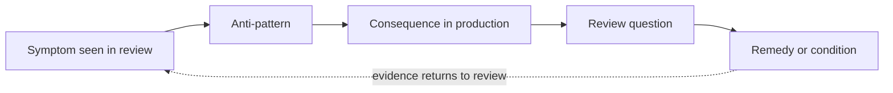

The catalog is a diagnostic path: observe a symptom, name the pattern, predict the consequence, ask the question that tests it, and write the remedy as a condition.

### 8.1 Demo-driven architecture

Symptoms: the presentation is a live demo; inputs are the ones the team chose; no evaluation set; the team cannot say how many attempts the best output took. Consequence: quality in production is far lower than in the demo, and the first real users report it. Question: "Run it on these twenty inputs we drew from last week's tickets." Remedy: a representative evaluation set before any further architecture work.

### 8.2 Model-first design

Symptoms: the first slide names a model; the problem statement appears later or not at all; no non-AI baseline. Consequence: the architecture optimizes for the model's strengths rather than the user's need, and cheaper solutions are never compared. Question: "What does the best non-AI approach achieve?" Remedy: baseline measurement and option analysis before model selection.

### 8.3 The unowned system

Symptoms: data science built the model, engineering built the service, product owns the feature, and nobody owns production behavior. Consequence: when quality drops, each group points elsewhere; incidents stretch from hours to days. Question: "Who gets paged when answers get worse, not just when the service is down?" Remedy: a single accountable owner for end-to-end behavior and an ownership matrix.

### 8.4 Prompt-as-policy

Symptoms: security and safety rules appear as sentences in the system prompt ("never reveal other customers' data"); no enforcement outside the model. Consequence: a crafted input, a retrieved document containing instructions, or an ordinary model error bypasses the rule. Question: "Which control still works if the model ignores its instructions?" Remedy: enforce authorization, filtering, and action limits in code outside the model; use the prompt for guidance only.

### 8.5 Shared everything

Symptoms: one vector index, one cache, one log store, and one service account for all tenants or all use cases; tenant filtering applied in application code after retrieval. Consequence: a single filter bug becomes a cross-tenant disclosure. Question: "What structure, not code discipline, prevents tenant A seeing tenant B?" Remedy: structural isolation (separate partitions, tenant-keyed caches, per-tenant credentials) plus continuous canary probes.

### 8.6 Rubber-stamp oversight

Symptoms: "human in the loop" is the main safety claim; review takes seconds; override rate near zero; reviewers measured on throughput; no seeded errors. Consequence: the human becomes a delay, not a control; errors pass through with the appearance of review. Question: "How do you know reviewers are catching errors? Show the seeded-error results." Remedy: seeded-error tests, workload sizing, evidence displayed to the reviewer, and override-rate monitoring with floor and ceiling alarms.

### 8.7 Silent degradation blindness

Symptoms: monitoring covers uptime, latency, and error codes only; no quality metric online; labels arrive late or from a biased subset. Consequence: quality falls for weeks with every dashboard green. Question: "If accuracy dropped five points today, which alarm fires and when?" Remedy: golden-set canaries, drift monitoring on outputs and not only inputs, and a plan for unbiased labels.

### 8.8 Self-reinforcing feedback loop

Symptoms: the model's own decisions determine which cases get labels, and those labels train the next model. Consequence: the model sees only what it already flags; blind spots widen and metrics look better while real performance worsens. Question: "How do we obtain labels for cases the model did not flag?" Remedy: exploration sampling with known probabilities, holdout groups, and delayed-label audits.

### 8.9 Unbounded agent

Symptoms: an agent loops until it decides it is done; tools include write or delete actions; credentials are broad; no budget for steps, tokens, time, or concurrency. Consequence: runaway cost, repeated actions, and unsafe changes at machine speed. Question: "What is the maximum damage one run can do, and where is that number enforced?" Remedy: step, token, time, and blast-radius limits enforced outside the model; approval for state-changing actions; idempotent tools.

### 8.10 Happy-path cost model

Symptoms: cost is average tokens times price times volume; no retries, long contexts, reprocessing, or review labor. Consequence: actual cost is a multiple of the estimate when the first hard cases arrive. Question: "What is cost at the 95th percentile input and at double the retry rate?" Remedy: sensitivity analysis and cost attribution per feature, with budget alarms.

### 8.11 Untested fallback

Symptoms: a fallback is drawn on the diagram; it has never been run in production-like conditions; its quality bar is undefined. Consequence: during the first provider outage the fallback fails, produces unacceptable output, or sends data somewhere unapproved. Question: "When did the fallback last serve real traffic?" Remedy: scheduled game days and a periodic live fraction of traffic served by the fallback.

### 8.12 The alias dependency

Symptoms: the code calls "latest" or an unversioned model name; prompts are tuned to one model's quirks; no change notice. Consequence: provider updates change behavior without a release on your side. Question: "How would you know the model changed under you?" Remedy: pinned versions, golden-set canaries on a schedule, and a migration plan for retirement dates.

### 8.13 Evaluation by the author

Symptoms: the people who tuned the prompt wrote the test cases; the same examples appear in prompts and tests; a language model judges its own output uncalibrated. Consequence: optimistic scores that do not transfer. Question: "Who labeled the evaluation set, and did they see the prompts?" Remedy: independent evaluation data, judge calibration against human labels, and held-out sets.

### 8.14 Scope creep by configuration

Symptoms: new document sources, tools, or user groups are added through configuration with no review; the system's purpose drifts. Consequence: the risk profile at month six differs from the one the review approved. Question: "What changes require a new review?" Remedy: re-review triggers tied to the configuration registry.

| Pattern | Lens most affected | Typical hard-gate failure |
| --- | --- | --- |
| Demo-driven architecture | Evaluation, value | Evaluation |
| Model-first design | Value, workload | None, but weakens every lens |
| The unowned system | Operability | Operability |
| Prompt-as-policy | Safety, security | Safety |
| Shared everything | Safety, data | Safety |
| Rubber-stamp oversight | Human oversight | Oversight |
| Silent degradation blindness | Evaluation | Evaluation |
| Self-reinforcing feedback loop | Evaluation, data | Evaluation |
| Unbounded agent | Composition, safety | Safety |
| Happy-path cost model | Cost | None, but breaks business case |
| Untested fallback | Gateway, reliability | None, but invalidates availability claim |
| The alias dependency | Platform, model | None directly |
| Evaluation by the author | Evaluation | Evaluation |
| Scope creep by configuration | Governance | Safety |

The five case studies that follow each contain at least one of these patterns, and the cross-case synthesis in Section 14 maps them.

## 9. Case Study 1: Customer-Support RAG Assistant for a Regulated Enterprise

This case is written as a complete review. The scenario is illustrative; numbers are invented to be internally consistent and are marked as such. Prices are placeholders for the arithmetic. Check current provider pricing before reusing the numbers.

### 9.1 Context

A software provider sells a claims-management platform to 40 enterprise customers (tenants) in financial services. Each customer's staff raise support tickets about configuration, integrations, and regulatory reports. The provider's 60 support agents answer about 30,000 tickets a month. Agents search a knowledge base (18,000 articles), past tickets, and per-tenant configuration notes. Some documents are shared by all tenants (product documentation). Others are tenant-specific (integration notes, contract terms, customer-specific workarounds) and must never be visible to other tenants.

The proposal: an assistant that retrieves relevant material and drafts a reply for the agent to edit and send. The agent remains the sender. The sponsor wants first-response time reduced and agents' handling time reduced.

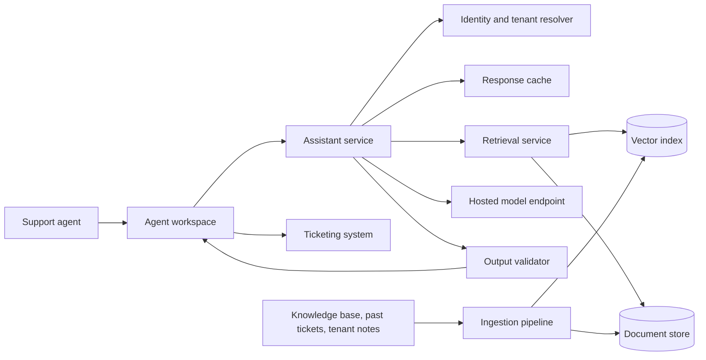

The context diagram shows two paths into the index: the read path through retrieval and the write path through ingestion. The first review focused on the read path. As the post-incident section shows, the write path was the one that failed.

### 9.2 Requirements and quality scenarios

Business requirements: reduce average handling time by at least 15 percent (baseline 11.0 minutes); keep customer-visible error rate at or below the current agent-only rate of 1.8 percent of replies needing a correction; maintain regulatory duties on data segregation and record keeping under customer contracts.

| ID | Scenario | Measure |
| --- | --- | --- |
| Q1 Isolation | An agent working a tenant A ticket issues any query | Zero chunks, cache entries, or trace lines from tenant B appear; hourly canary of 2,000 probes returns zero hits |
| Q2 Quality | Production-like query set of 500 tickets | At least 90 percent of drafts rated acceptable after at most minor edits; at most 1 percent contain an unsupported claim |
| Q3 Latency | Peak 25 concurrent agents | Draft starts streaming within 2 seconds at the 95th percentile |
| Q4 Availability | Provider unreachable | Agent sees search-only mode within 5 seconds; ticket handling continues |
| Q5 Freshness | A knowledge article is updated or retired | The change is reflected in answers within 4 hours; retired articles are not retrieved |
| Q6 Cost | 120,000 queries a month | At most $2,000 a month in model and retrieval charges |
| Q7 Audit | Any draft | The sources, prompt version, and model version can be reconstructed for 18 months |

### 9.3 Options considered

| Option | Description | Assessment |
| --- | --- | --- |
| A | Better search only (keyword plus filters plus ranking improvements) | Lowest risk; saves perhaps 0.8 minutes per ticket in the pilot; no drafting |
| B | Hosted model with retrieval, agent edits and sends | Recommended; saves 2.4 minutes in the pilot |
| C | Fully automated reply for a class of simple tickets | Rejected for now; error cost and contract duties; revisit after six months of data |
| D | Fine-tuned model on historical tickets | Deferred; tenant data in training raises rights questions; retrieval gives freshness |

Option A is the baseline. Its 0.8-minute gain over 30,000 tickets is 400 hours a month. Option B's 2.4-minute gain is 1,200 hours a month. The difference of 800 hours is the value that the extra risk and cost of Option B must buy.

### 9.4 First design and first review

The first design used one vector index for all tenants with a `tenant_id` metadata field. Retrieval fetched the top 8 chunks, then dropped any chunk whose tenant did not match the agent's tenant or the shared pool. A semantic cache stored recent query-answer pairs, keyed by the query embedding, and returned a stored answer when cosine similarity to a new query was at least 0.92. The model was a hosted endpoint, and drafts were validated for length and format.

The design review scored the system as in the first-review row of the scorer sample: 63.2, outcome defer, with a failed hard gate on safety, security, privacy, and governance (2 against a minimum of 3). The panel's findings:

- The post-retrieval filter meant isolation depended on a single conditional. If a metadata value was missing or mis-set, a chunk could pass. After filtering, fewer than 8 chunks might remain, which also reduced quality for small tenants.
- The semantic cache did not include the tenant in its key. Two tenants asking a similar question could receive each other's answers.
- No isolation test existed. The team said the filter "obviously works."
- Logging stored full prompts and retrieved chunks in one shared store readable by the whole engineering group.

The panel deferred. The team's task was to return with evidence and a structural design.

### 9.5 Evidence found during the deferral

The team built a canary harness: for each of 40 tenants it generated probe queries designed to match another tenant's content and recorded any result containing a foreign identifier. The first run of 2,000 probes found 3 leaks. All three returned through the semantic cache. A second finding was a tenant alias bug: two tenants whose identifiers shared a prefix were handled by a prefix match in one code path.

Numbers. The canary leak rate was 3 out of 2,000, which is 0.15 percent. Applied to the 22 percent of the 120,000 monthly queries expected to hit the cache (26,400 hits), a 0.15 percent cross-tenant share gives 26,400 times 0.0015 = 39.6, or about 40 exposures a month in the cache path. At a pessimistic 0.3 percent share the figure is 79. Both numbers were small relative to volume, which is why unit tests had never caught the problem, and large relative to the contractual duty, which allows none.

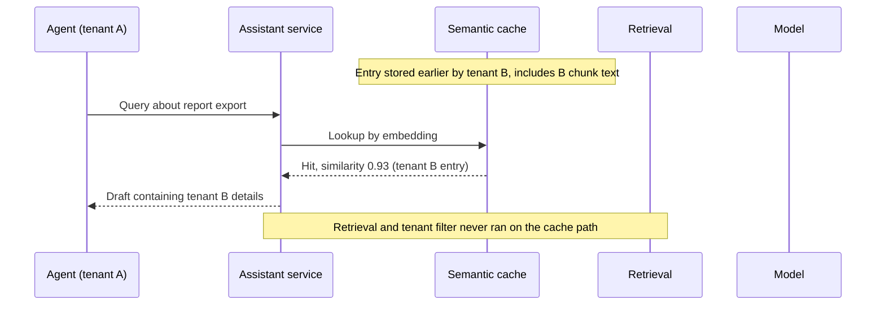

The sequence diagram shows why the filter did not help. The cache sat before retrieval. A hit bypassed the filter completely. The test the team never wrote was the one that sent a query from tenant A after tenant B had asked a similar one.

### 9.6 Chosen architecture (version 2)

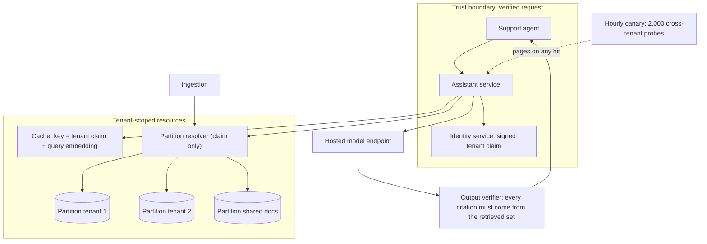

Key changes:

- Partition resolver. Each tenant has its own index partition. The partition is derived from the signed tenant claim in the identity token, never from a request parameter. A shared partition holds product documentation. Retrieval queries the tenant partition and the shared partition, then merges.
- Tenant-keyed cache. The cache key includes the tenant claim. The measured cache hit rate fell from 22 to 14 percent, which is the cost of isolation.
- Output verifier. Every cited source in a draft must be in the retrieved set for this request. A draft with an uncited claim of a customer name or identifier is blocked.
- Log segregation. Prompts and chunks are logged to per-tenant stores with access restricted to the on-call platform group and audited.
- Canary. Hourly probes run in production and page on any hit.

### 9.7 Decision records

| ADR | Decision | Alternatives | Reconsider when |
| --- | --- | --- | --- |
| ADR-001 | Draft-for-agent, not auto-send | Auto-send for simple tickets | Six months of data show less than 0.5 percent correction rate on a defined ticket class |
| ADR-002 | Hosted model, pinned version, gateway in front | Self-hosted open-weights model | Provider terms change or monthly cost exceeds $6,000 |
| ADR-003 | Tenant partitions on read and write path | Shared index with pre-filter | Vendor documents verified pre-filter isolation and canary passes for 6 months |
| ADR-004 | Tenant-keyed cache | No cache | Cache hit rate below 8 percent, when its complexity is not worth the saving |
| ADR-005 | Cited-source verifier | Prompt instruction only | Never relaxed without panel review |

### 9.8 Cost with worked numbers

Illustrative token profile: 3,500 input tokens and 350 output tokens per query. Illustrative prices: $3 per million input tokens and $15 per million output tokens. Cost per query is 3,500 divided by 1,000,000 times 3, which is $0.0105, plus 350 divided by 1,000,000 times 15, which is $0.00525, for $0.01575.

Version 1 with a 22 percent cache hit rate: 120,000 times 0.78 uncached queries is 93,600 queries, times $0.01575 is $1,474. Version 2 with a 14 percent hit rate: 120,000 times 0.86 is 103,200 queries, times $0.01575 is $1,625. Isolation costs $151 a month in model charges. Partition overhead added about 8 percent to a $600 vector-store bill, which is $48. The total of $1,625 plus infrastructure stays under the $2,000 scenario Q6. The cost of the structural fix is about 10 percent of the model bill, and it removes a contractual-breach risk.

### 9.9 Risks

| ID | Risk | L | I | Score | Owner | Gate |
| --- | --- | --- | --- | --- | --- | --- |
| R1 | Cross-tenant disclosure via any shared path | 3 | 5 | 15 | Platform lead | Before pilot |
| R2 | Reviewers rubber-stamp drafts | 4 | 4 | 16 | Support operations lead | Before pilot |
| R3 | Stale or retired articles retrieved | 3 | 3 | 9 | Knowledge manager | Before 25 percent traffic |
| R4 | Provider outage | 3 | 3 | 9 | SRE lead | Before pilot |
| R5 | Silent quality drift after model update | 3 | 3 | 9 | ML lead | 30 days |
| R6 | Prompt injection via ticket text or attachments | 3 | 4 | 12 | Security lead | Before pilot |

### 9.10 Validation plan and rollout

Pre-pilot: offline evaluation on 500 labeled tickets (with at least 314 required for plus or minus 3 points at 92 percent, so 500 gives margin); the 2,000-probe canary at zero hits for 14 consecutive days in staging; a red-team exercise of 300 injection and extraction cases; a provider-failure game day; a seeded-error test in which 5 percent of drafts contain a planted error and reviewers must catch at least 80 percent.

Rollout stages: shadow mode (draft generated, not shown) for 2 weeks on 2,000 tickets; pilot with 8 agents for 3 weeks; 25 percent of agents; 100 percent. Advance only if: the correction rate is at or below 1.8 percent, the canary is clean, p95 time to first token is within 2 seconds, and the seeded-error catch rate is at least 80 percent.

The score for the redesigned system was 79.2 (second sample row), outcome approve with conditions. The conditions were: C1 write-path tenancy checks (see below, added after the incident), C2 drift canary with golden set, C3 quarterly access review, and C4 a runbook exercised once before 25 percent traffic.

### 9.11 What went wrong afterwards

Five weeks into the pilot, a customer was acquired by another customer, and the two tenants were merged. Operations followed a runbook that updated the tenant mapping in the identity service. A back-fill job then reloaded the acquired tenant's documents. The job ran under a service account that wrote directly to a partition by name, bypassing the partition resolver. It wrote the acquired tenant's configuration notes into the surviving tenant's partition, and also, because of a stale mapping file, wrote a third tenant's notes into the same partition for 41 minutes.

The hourly canary, which probed only the read path, did not trigger because the probe queries did not match the misplaced documents. An agent noticed a draft that cited an unfamiliar customer name and reported it. The agent's action was the only control that worked. In the 41-minute window about 114 queries were processed (120,000 a month is about 167 an hour, times 41/60). Three drafts contained chunks from the wrong tenant. All three were seen by an agent and none reached a customer.

Causes, in order of depth:

1. Proximate: a back-fill job wrote to a partition by name using a privileged account.
2. Contributing: the canary tested reads and not writes; the stale mapping file was not validated.
3. Architectural: isolation was enforced at read time only. The write path was not in the threat model, and tenant lifecycle events (merge, rename, off-boarding) were not treated as security-relevant changes.

### 9.12 Post-incident redesign

Changes made:

- Write-path enforcement. Ingestion no longer writes by partition name. It requests a write ticket from the resolver using a signed claim that names the source tenant and the document's tenant label. The index rejects a write whose document label does not match the partition's owner record.
- Partition ownership registry. A table records which tenant owns each partition. Tenant merges require a reviewed migration plan rather than a runbook step.
- Content labeling check. Each chunk carries a signed tenant label. At retrieval time, the verifier compares the label to the caller's claim before the chunk is allowed into the prompt, which is a second independent check.
- Canary extended. The canary now includes write-path probes: it ingests a marked document for a synthetic tenant and verifies that no other tenant can retrieve it, then deletes it.
- Re-review trigger added: any tenant lifecycle event, any new ingestion source, and any service account with write access to the index.

Lessons: isolation has to be checked at every boundary a datum crosses, including the ones nobody thought of as a user-facing path. A control that relies on one component being correct is a single point of failure. The incident cost no customer data because a human noticed, which is chance, and the review recorded it as a near-miss with the same weight as a breach for the purpose of the architecture change.

### 9.13 Review summary for case 1

| Lens | Initial score | Final score | Evidence that moved it |
| --- | --- | --- | --- |
| Data | 2 | 3 | Rights register, freshness probe, write-path checks |
| Safety, security, privacy | 2 | 4 | Partition design, verifier, canary, red team |
| Evaluation and observability | 2 | 3 | Golden set, drift canary, tenant-sliced dashboards |
| Operability | 3 | 3 | Runbook exercised, tenant lifecycle runbook rewritten |
| Cost | 3 | 3 | Sensitivity analysis after cache change |

## 10. Case Study 2: Fraud Detection with Predictive ML and LLM Case Summarization

### 10.1 Context

A payments company processes 2,000,000 card transactions a day. The fraud rate is about 0.2 percent, which is 4,000 fraudulent transactions a day. A predictive model scores each transaction in real time. Transactions scoring above a threshold are held or sent to a case queue for investigators. A new proposal adds a language model that summarizes each case for the investigator: recent transaction history, linked accounts, device signals, and previous contacts. The summary is advisory.

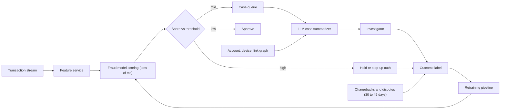

The diagram contains the loop that caused the later incident: investigator outcomes and chargebacks flow back into training. It also shows the two label sources: fast ones only for flagged cases, and slow ones for the rest.

### 10.2 Requirements and quality scenarios

| ID | Scenario | Measure |
| --- | --- | --- |
| Q1 Latency | Real-time scoring at 300 transactions per second peak | p99 under 60 ms including features |
| Q2 Detection | Production traffic | Recall at fixed review capacity at least 78 percent of fraud value, measured with unbiased labels |
| Q3 Review load | Case queue at the fixed threshold | No more than 7,500 cases a day, matching investigator capacity |
| Q4 Drift | Fraud tactics change | Recall drop of 5 points or more detected within 10 days |
| Q5 Summary fidelity | Any case summary | Every factual statement traceable to a structured fact; fewer than 0.5 percent of summaries contain an unsupported claim |
| Q6 Explainability | Regulatory or dispute request | Reason codes retrievable for any decision for 7 years |
| Q7 Fairness | Decline and hold rates | No segment's hold rate exceeds its fraud-rate-adjusted expectation by more than a defined tolerance |

### 10.3 Options considered

| Option | Description | Assessment |
| --- | --- | --- |
| A | Rules engine only | Existing baseline; recall 61 percent at this review capacity |
| B | Gradient-boosted trees on engineered features plus rules | Recommended for the scoring path |
| C | Large language model scoring each transaction | Rejected: latency, cost, and no advantage on tabular data |
| D | LLM summary of cases for investigators | Recommended as advisory; investigators decide |
| E | LLM decides case outcome | Rejected: high-impact decision about customers, explanation duties |

The split is the central design decision. The predictive model owns the real-time decision. The language model owns the narrative that helps a human. The language model never alters the score or the outcome. [Part 17 CH03](CH03_Reference_Architectures_for_Predictive_Generative_and_Agentic_Systems.md) covers the composition pattern.

### 10.4 Chosen architecture and decisions

Scoring path: a feature service computes velocity and device features from a store with a 24-hour window; the model returns a score and reason codes; thresholds are set so about 7,500 cases a day reach the queue. The summarization path reads structured facts and writes a summary with each statement tagged to the field it came from. The summary appears beside the facts, never in place of them.

Cost of summarization. 7,500 cases a day at 2,500 input tokens and 250 output tokens, with illustrative prices of $1 per million input and $4 per million output, costs 2,500/1,000,000 times 1 = $0.0025 plus 250/1,000,000 times 4 = $0.001, which is $0.0035 per case. That is 7,500 times $0.0035 = $26.25 a day, about $788 for 30 days. Investigators save about 3 minutes per case in the pilot (11 down to 8). That is 7,500 times 3 divided by 60 = 375 hours a day. The model charge is small beside the labor effect, so cost does not drive the design. Accuracy of the summary does.

| ADR | Decision | Reconsider when |
| --- | --- | --- |
| ADR-001 | Predictive model owns decisions; LLM advisory only | Regulatory guidance or evidence changes; never by default |
| ADR-002 | Summaries cite structured fact ids; validator rejects uncited claims | Citation validator false-block rate above 5 percent |
| ADR-003 | Retrain monthly on labels with age-adjusted weighting | Label delay distribution changes |
| ADR-004 | Shadow challenger model scored on all traffic | Challenger beats champion on unbiased labels for 3 consecutive weeks |

### 10.5 Risks and validation plan

| ID | Risk | L | I | Score | Owner |
| --- | --- | --- | --- | --- | --- |
| R1 | Concept drift: fraud tactics shift while input features look stable | 4 | 5 | 20 | Head of fraud analytics |
| R2 | Feedback loop: labels exist mainly for flagged cases | 4 | 4 | 16 | ML lead |
| R3 | Summary asserts a false link between accounts | 3 | 3 | 9 | Product owner |
| R4 | Review queue exceeds capacity; stale cases | 4 | 3 | 12 | Fraud operations lead |
| R5 | Feature store outage causes missing features and score shifts | 2 | 4 | 8 | SRE lead |

Validation plan: offline time-based split evaluation (train on months 1 to 9, test on months 10 to 12, never a random split because fraud tactics are time-dependent); shadow scoring for 4 weeks; investigator study comparing time per case and decision accuracy with and without summaries; summary fidelity audit of 400 summaries against structured facts; alert on input feature distribution drift using population stability index.

The launch review scored the system as acceptable with conditions. Evaluation and observability scored 3, mainly on the strength of input-drift monitoring and offline time-split results. That score proved too generous, as the incident showed.

### 10.6 What went wrong afterwards: silent drift and the feedback loop

Four months after launch, a loss reconciliation by finance showed fraud losses up more than the transaction growth explained. The model's dashboards were green. Population stability index on the top 20 features was under the alert threshold, and investigator override rates were stable.

The cause was concept drift without covariate drift. Fraudsters had learned the behavior that avoided the old patterns and shaped transactions to look ordinary on the monitored features. The relationship between features and fraud changed, but the distribution of the features did not. The input drift monitor was therefore blind.

Numbers. Recall fell from 0.80 to 0.68 over six weeks. Fraud per day is 2,000,000 times 0.002 = 4,000. The extra missed fraud is 4,000 times (0.80 minus 0.68) = 480 transactions a day. At an average loss of $140 each, the extra loss is $67,200 a day. The company found it only at the reconciliation, 30 days after the start of the visible decline in chargebacks, so the cumulative extra loss was about $67,200 times 30 = $2,016,000.

Why labels did not warn earlier. Labels come from three sources:

1. Investigator outcomes on flagged cases. These are fast but cover only what the model already flags.
2. Held-transaction outcomes. Also flagged cases.
3. Chargebacks and customer disputes. These cover missed fraud but arrive 30 to 45 days later.

Because the only fast labels came from flagged cases, the monthly retraining used data that over-represented what the model already knew. Missed fraud entered the training set 30 to 45 days late and was underweighted. Each retraining pulled the model closer to its own prior decisions. This is the self-reinforcing feedback loop from the anti-pattern catalog.

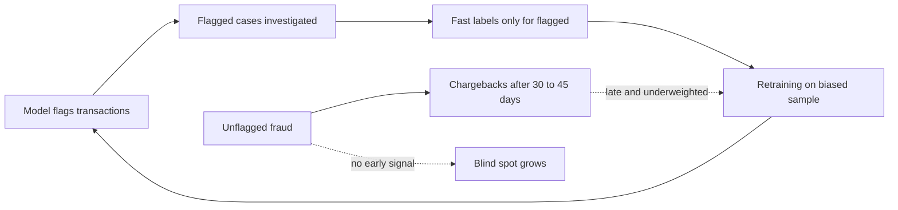

The loop shows that the model's output determines its own training labels. The late path from chargebacks is the only correction, and it is slow.

A second finding concerned capacity. The case queue received about 9,000 alerts a day after threshold drift against a capacity of 7,500, a backlog growth of 1,500 a day. Investigators worked the queue in score order, so mid-score fraud waited longest, and investigators were seeing summaries of cases that were days old. The review had flagged queue capacity as risk R4, but the mitigation (dynamic threshold) was not implemented before launch.

A smaller finding: the summarizer asserted "no linked accounts" for a case where the link-graph query had timed out and returned empty. The summary was fluent and wrong, and the validator accepted it because there was no cited fact to contradict it. An absent fact is not a cited fact.

### 10.7 Post-incident redesign

1. Unbiased label stream. Route a small sample of transactions below the threshold to review, stratified by score band, with known sampling probabilities. Use inverse-probability weights to estimate recall without bias. At 600 transactions a day, with the near-threshold band holding a fraud rate of about 1.5 percent, the sample yields about 9 fraud cases a day. The cost is 600 cases at 4 minutes, or 40 investigator hours a day, which the company judged cheaper than the $67,200 daily loss at the drift.
2. Outcome-based drift monitoring. Track estimated recall from the weighted sample weekly, and track cohort chargeback rates by transaction age, so the 30-to-45-day lag is modeled rather than ignored. Alert on a drop of 5 points in the estimated recall.
3. Challenger models. A challenger trained with different recency weighting scores all traffic in shadow. Divergence between champion and challenger on the sample is an early signal.
4. Retraining with correction. Weight unflagged-fraud labels by the inverse of their inclusion probability so the training set reflects the traffic, not the model's choices.
5. Summarizer fixes. The validator requires a positive statement of "no data" with an explicit status field: `link_graph: ok` or `link_graph: unavailable`. An unavailable status forces the summary to say "link data unavailable". Timeouts do not return empty sets.
6. Queue control. A dynamic threshold keeps the queue at or below capacity, with a defined fallback of higher auto-hold for high scores when capacity is exceeded, and a daily report of the age of the oldest case.
7. Re-review triggers: any retrain with a change of feature set, a tactic alert from threat intelligence, a change in dispute or chargeback process, and a recall estimate drop.

### 10.8 Lessons from case 2

Monitoring inputs does not detect concept drift. Monitoring labels does, but only if labels are unbiased and available soon enough. The review's evaluation lens should have asked, "Where do labels come from for cases the model does not flag, and how late are they?" That one question, asked at design time, would have revealed the loop and the delay. The architectural change was small (a sampling stream and a weighting step). The incident cost an estimated $2,016,000. The panel recorded that both assumption A3 ("labels are representative") and A4 ("input drift implies output drift") were graded "asserted" in the original register and were not on the pre-launch gate list.

## 11. Case Study 3: Internal IT-Operations Agent with Tool Access

### 11.1 Context

A platform team operates a customer-facing application on 40 identical nodes behind a load balancer. Peak demand is 15,000 requests per second, and each node handles about 500 requests per second, so 30 nodes are needed at peak and 40 give 33 percent headroom. The on-call load is heavy: roughly 60 alerts a day, most of which resolve with a known remedy such as clearing a queue, restarting a service, rotating a worker, or scaling a pool.

The proposal is an operations agent. It receives an alert, reads metrics and logs, forms a diagnosis, and acts through tools: query metrics, read logs, restart a service on a node, scale a pool, and open a ticket. The sponsor wants to reduce mean time to repair (MTTR) and on-call interruptions at night. The agent is a tool-using system as defined in [Part 17 CH06](CH06_Agentic_System_Architecture_and_Tool_Boundaries.md).

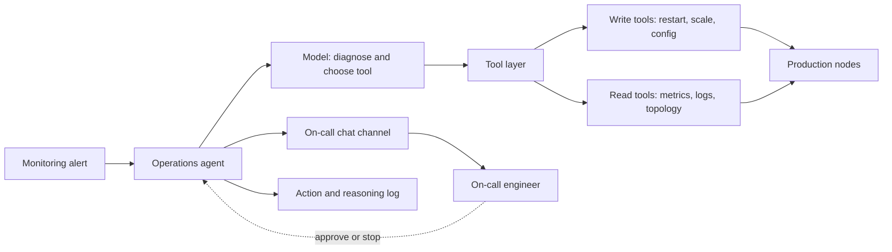

The context diagram shows the boundary that matters: write tools reach production. The review's job is to understand what limits what the agent can do with them, and where.

### 11.2 Requirements and quality scenarios

| ID | Scenario | Measure |
| --- | --- | --- |
| Q1 Safety | Any agent run on production | No more than 10 percent of nodes in a pool affected at once; no state-changing action outside the allow-list |
| Q2 Boundedness | Any single run | At most 25 model iterations and 300,000 tokens; at most 15 minutes of wall-clock time before human handoff |
| Q3 Effectiveness | Alerts in the known-remedy class | At least 70 percent resolved without a human, with MTTR below 10 minutes |
| Q4 Oversight | A state-changing action outside pre-approved patterns | Human approves in chat before execution |
| Q5 Stop | On-call engineer issues stop command | All pending actions cancelled within 5 seconds |
| Q6 Audit | Any action | Who or what requested it, the reasoning summary, inputs, outputs, and approval are retrievable |
| Q7 Cost | Month | At most $500 in model charges |

### 11.3 Options considered

| Option | Description | Assessment |
| --- | --- | --- |
| A | Runbook automation: scripted remedies triggered by alert type | Deterministic, auditable; handles known cases only |
| B | Agent that diagnoses and proposes actions; humans execute | Lowest risk; saves diagnosis time |
| C | Agent diagnoses and executes pre-approved, scoped remedies; approval for everything else | Recommended target |
| D | Agent with free-form shell access | Rejected: unbounded action space |

The team proposed C but implemented a version close to D's flexibility in practice: the restart tool accepted a list of nodes, and the policy for "low-risk" actions was a static allow-list by action type ("restart" counted as low risk).

### 11.4 The design as reviewed

The design review scored lens by lens. The scores were not low enough to fail a gate, which is the instructive part. The panel gave composition 3 because there was a tool inventory. It gave human oversight 3 because a "high-risk actions need approval" rule existed. It gave safety 3 because credentials were scoped to the operations environment. The weakness was in what these scores did not check:

- Risk classification was by action type, not by action target and scale. Restarting one node and restarting fourteen were both "restart".
- The loop had a soft limit expressed in the prompt ("stop after a few attempts"). Nothing enforced it outside the model.
- The run had a broad credential to restart any service in the production account.
- No test had exercised an alert where the true cause was outside the agent's reach.

The panel approved with conditions: a load test for cost, a sandbox replay of 40 historical alerts, and a runbook. None of the conditions addressed blast radius, which is a lesson in how a rubric can give comfort while a specific hazard goes unexamined. The scorer's weights reward breadth. A panel must still ask the specific question for each tool: "What is the worst thing this call can do?"

### 11.5 What went wrong afterwards: a runaway loop and an unsafe action

Eleven weeks after launch, an upstream dependency (a shared authentication service owned by another team) began returning slow responses. The application's latency alert fired. The agent read the metrics, saw high latency and elevated timeouts on application nodes, and diagnosed "service degraded on application nodes". The remedy list contained "restart service on affected nodes".

The sequence:

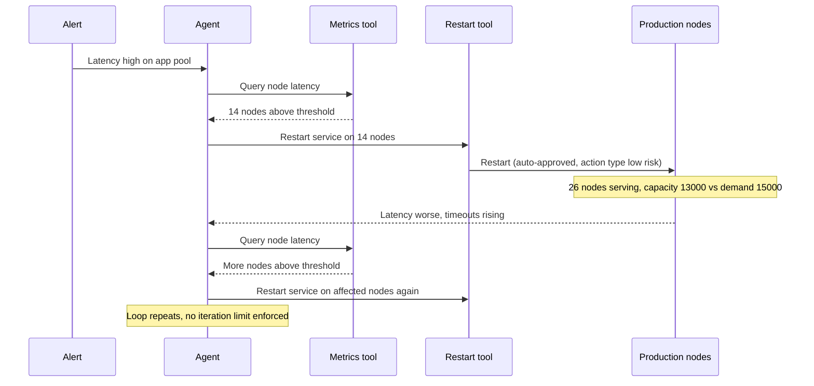

Two failures stacked. First, the unsafe action: the agent restarted 14 of 40 nodes at once. Each restart took about 6 minutes to rejoin the pool. During that period 26 nodes remained. Capacity was 26 times 500 = 13,000 requests per second against demand of 15,000, which is 86.7 percent of demand. The shortfall created queueing, timeouts, and retries from clients, which made the metrics worse, which confirmed the agent's diagnosis. A remedy that cannot fix the cause (the dependency) while reducing capacity is a positive feedback loop.

Second, the runaway loop: the agent kept re-diagnosing. Over about four hours it completed 3,000 iterations before an engineer noticed the chat noise and stopped it. Each iteration carried about 9,000 input tokens (logs and metrics grew with each step) and 400 output tokens. With illustrative prices of $3 per million input and $15 per million output, one iteration costs 9,000/1,000,000 times 3 = $0.027 plus 400/1,000,000 times 15 = $0.006, which is $0.033. Three thousand iterations cost 3,000 times $0.033 = $99. The money was the smallest consequence. The customer-visible outage lasted 22 minutes in its worst form. The agent's later waves of restarts kept pool capacity below demand until a human froze it.

Why existing controls did not stop it:

1. The approval rule keyed on action type, so the restart skipped the human.
2. The "few attempts" instruction was in the prompt, and the model, seeing continued symptoms, kept trying. Instructions are not enforcement.
3. The metrics tool returned only the current state. It did not tell the agent that its previous action had made things worse, so the diagnosis had no feedback about its own effect.
4. There was no system-level view of the dependency graph, so the agent could not distinguish "my nodes are slow" from "my nodes are waiting on someone else".

### 11.6 Post-incident review and redesign

The post-incident review separated causes by depth.

| Level | Cause |
| --- | --- |
| Proximate | A restart tool accepted 14 targets, auto-approved |
| Contributing | Prompt-based loop limit; static risk classification; metrics without trend or action history |
| Architectural | The authority to act was defined by what the model chose, not by a policy evaluated outside the model against the current state of the system |

Redesign:

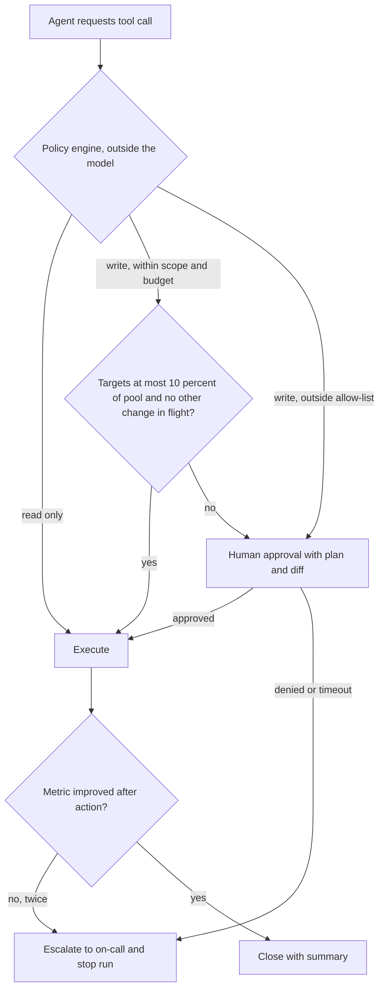

The policy engine evaluates every write call against the live state, not against a static label. Specific changes:

- Blast-radius limit enforced in the tool layer: a restart call that targets more than 10 percent of a pool (4 of 40 nodes) is rejected regardless of what the model asks. With 36 nodes serving, capacity is 36 times 500 = 18,000 requests per second against 15,000 demand, still above demand.
- Rolling restarts: at most 4 nodes at a time, waiting for health checks before the next batch.
- Run budget: 25 iterations and 300,000 tokens per run, enforced by the orchestrator. At the observed 9,400 tokens per iteration, 25 iterations use 235,000 tokens, and at $0.033 per iteration the maximum run cost is 25 times $0.033 = $0.825. A run over the cap hands off to a human.
- Effect check: after a write action, a deterministic check compares the target metric. If the metric does not improve after two actions of the same type, the agent must stop and escalate. The check lives in the orchestrator, not in the prompt.
- Dependency awareness: the topology tool includes upstream dependencies and their health. A rule excludes "restart" as a remedy when an upstream dependency is unhealthy and the app nodes' CPU and memory are normal.
- Scoped credentials: each run receives a short-lived credential limited to the affected service and environment, and a different credential for read tools.
- Kill switch: a single command in the chat channel cancels pending actions and revokes the run's credential, tested monthly.
- Idempotency: tool calls carry keys so a repeated call within the same run does not repeat the effect.

### 11.7 Validation and rollout after redesign

Validation: a sandbox replay of 60 historical alerts, including 12 where the true cause was upstream; a fault-injection test that makes the dependency slow and checks the agent escalates within 15 minutes and without restarting more than 4 nodes at a time; a loop test where the metric never improves and the agent must stop at 25 iterations; and a kill-switch drill with time to effect measured under 5 seconds.

Rollout: read-only diagnosis in production for 4 weeks (agent proposes, humans execute); then pre-approved narrow remedies on a staging pool; then production with the policy engine for two services; then expansion by service as evidence accumulates. Autonomy is raised per service and per action, with a review of the incident record each time.

### 11.8 Review summary and lessons

| Lens | Score at first review | Score after redesign | What changed the score |
| --- | --- | --- | --- |
| Composition | 3 | 4 | Policy engine, run budget, effect check |
| Human oversight | 3 | 4 | Approval keyed on scope and state, not action name |
| Safety | 3 | 4 | Scoped credentials, kill switch, blast limit |
| Evaluation | 2 | 3 | Sandbox replays, fault injection tests |
| Reliability | 2 | 3 | Dependency awareness, rolling restarts |

Lessons. A rubric score is evidence about breadth, not about a specific hazard. For any system that acts, the review should list each write tool and ask for its maximum damage in one call and over one run, and where that maximum is enforced. If the answer is "the model knows better," the control does not exist. Autonomy should be earned in steps with evidence, as [Part 17 CH09](CH09_Human_Oversight_and_AI_Assisted_Workflow_Integration.md) describes for oversight design.

## 12. Case Study 4: Claims Document-Processing Pipeline

### 12.1 Context

An insurer receives 30,000 claims a month. Each claim has on average 12 pages: forms, invoices, medical or repair reports, photos with captions, and correspondence. Today clerks key data into the claims system by hand. The proposal is a batch pipeline: scan intake, optical character recognition (OCR), document classification, field extraction with a language model, validation against business rules, and human review for uncertain cases. The output is structured claim data loaded to the claims system. Claims have a service level: initial data capture within two business days.

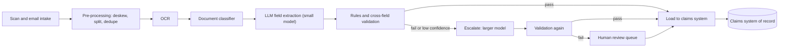

The diagram shows two escalation tiers before a human sees anything. This tiered approach is common and sound, but each tier has its own cost, and the thresholds that route work between tiers are the levers a review must examine.

### 12.2 Requirements and quality scenarios

| ID | Scenario | Measure |
| --- | --- | --- |
| Q1 Accuracy | Critical fields (claimant, policy number, amount, date of loss) | At least 99 percent field-level accuracy after validation and review; at most 0.1 percent wrong values loaded without review |
| Q2 Throughput | Month-end peak of 2,500 claims in one day | Processed within the 2-business-day SLA |
| Q3 Cost | Month | At most $4,000 for OCR and model charges at planned volume |
| Q4 Review capacity | Month | Human review at most 75 percent of 480 available hours |
| Q5 Traceability | Any loaded field | Source page, bounding box, extractor version, and reviewer (if any) retrievable |
| Q6 Privacy | Personal and health information | Data stays in the approved region; documents and extracted text not retained by providers beyond processing; access logged |
| Q7 Reprocessing | Model or rules change | Any batch can be reprocessed idempotently without duplicate loads |

### 12.3 Options considered

| Option | Description | Assessment |
| --- | --- | --- |
| A | Template-based extraction per form type | Accurate for standard forms; brittle for invoices and free text |
| B | OCR plus language-model extraction with validation and review | Recommended |
| C | End-to-end vision-language model on page images | Considered; higher cost per page at the time of review; revisit as costs and accuracy change |
| D | Outsource keying to a vendor | Baseline cost known; slow to scale |

The panel asked for the unit economics under both the planned and a stressed case. The team supplied the planned case only.

### 12.4 Worked cost model (illustrative prices)

Pages per month: 30,000 times 12 = 360,000. OCR at an illustrative $1.50 per 1,000 pages: 360,000 divided by 1,000 times 1.50 = $540. First-pass extraction with a small model at an illustrative $1 per million input tokens and $4 per million output tokens, using 3,000 input tokens and 500 output tokens per page: 3,000/1,000,000 times 1 = $0.003 plus 500/1,000,000 times 4 = $0.002, so $0.005 per page, or 360,000 times $0.005 = $1,800. A larger model at 10 times the price costs $0.05 per page. With 8 percent of pages escalated: 360,000 times 0.08 = 28,800 pages, times $0.05 = $1,440. Planned total: $540 + $1,800 + $1,440 = $3,780. This is under the $4,000 budget in scenario Q3, with a 5.5 percent margin: (4,000 minus 3,780) divided by 4,000.

Human review: 12 percent of claims reach a person, which is 3,600 claims at 6 minutes each, or 3,600 times 6 divided by 60 = 360 hours. With four reviewers at 6 productive hours a day for 20 days, capacity is 480 hours, so utilization is 360 divided by 480 = 75 percent, exactly at the Q4 limit.

The margin is thin on both axes. The panel noted this but accepted it because the pilot showed 8 percent escalation and 12 percent review. This is where an estimate based on a pilot sample has a hidden assumption: that the production document mix matches the pilot's.

### 12.5 Chosen architecture and decisions

Pipeline stages are separate, each reading and writing durable batch state, which allows reprocessing. Each stage output carries a content hash, a stage version, and a model version, so re-running a stage with the same inputs and versions is skipped, and a changed version produces a new output next to the old one. The loader uses an idempotency key made from the claim identifier, field name, and source hash.

Confidence routing: the extraction prompt asks the model to return a confidence for each field, and fields below 0.80 trigger escalation of the page to the larger model. The review queue receives claims whose critical fields fail validation after escalation.

| ADR | Decision | Reconsider when |
| --- | --- | --- |
| ADR-001 | Stage-wise batch pipeline with durable state | Real-time claims intake becomes a requirement |
| ADR-002 | Two-tier extraction (small then large) | Single-model cost per page falls below 1.5 times the small model, or a vision model matches accuracy at the same price |
| ADR-003 | Escalate on model-reported confidence below 0.80 | Confidence calibration check fails (see below) |
| ADR-004 | Validation rules from claims policy: sums reconcile, dates ordered, policy number format | Rules change; rule engine is owned by claims |
| ADR-005 | Human review for critical fields failing validation after escalation | Review capacity utilization above 85 percent |

The decision ADR-003 later proved the weak point. The panel recorded it as an "estimated" assumption, not measured: model-reported confidence correlates with correctness. The pilot had measured only 400 claims from one product line.

### 12.6 Risks

| ID | Risk | L | I | Score | Owner |
| --- | --- | --- | --- | --- | --- |
| R1 | Document mix differs from pilot; escalation rate rises | 4 | 3 | 12 | Pipeline lead |
| R2 | Model-reported confidence is poorly calibrated | 4 | 3 | 12 | ML lead |
| R3 | Wrong critical field loaded without review | 2 | 5 | 10 | Claims operations lead |
| R4 | Retries reprocess entire documents on transient failure | 3 | 3 | 9 | Platform lead |
| R5 | Review backlog breaches SLA | 3 | 4 | 12 | Claims operations lead |
| R6 | Personal data retained by a vendor | 2 | 5 | 10 | Privacy officer |

### 12.7 Validation plan and rollout

Validation: a labeled set of 1,200 claims across all product lines (the pilot used 400 from one line); a field-level accuracy report with confidence intervals; a calibration plot of reported confidence against correctness; a cost simulation at escalation rates of 8, 20, and 35 percent; a load test at 2,500 claims in a day; a privacy review of vendor terms; reprocessing tests. Rollout: parallel run for four weeks where clerks key as usual and the pipeline output is compared; then pipeline-first with clerk review of a 20 percent sample; then reduced sampling.

The panel asked for the 20 and 35 percent cost simulation. The team ran it only after launch, when the second number became real.

### 12.8 What went wrong afterwards: cost overrun and a review backlog

In month three, a large new client joined, with many scanned handwritten forms and fax-quality copies. The document mix moved. Two effects compounded.

1. Escalation rate. Reported confidence for handwritten fields clustered below 0.80, so 35 percent of pages escalated to the larger model, not 8 percent. Worse, a transient timeout in the escalation tier made the retry logic re-run the whole document, not the failed page, which inflated volume further.
2. Review load. More claims failed validation after escalation, so the review share rose from 12 to 20 percent.

The cost arithmetic: the escalated pages cost 360,000 times 0.35 = 126,000 pages, times $0.05 = $6,300. Add OCR $540 and first-pass $1,800 for a total of $8,640. The ratio to the planned $3,780 is 8,640 divided by 3,780 = 2.29. The budget of $4,000 was exceeded by $4,640. Retries added further charges that finance saw only on the invoice.

The review arithmetic: 20 percent of 30,000 is 6,000 claims at 6 minutes, which is 600 hours against capacity of 480. Utilization is 600 divided by 480 = 125 percent. The backlog grows by 120 hours a month, which is 1,200 claims at 6 minutes each (120 divided by 0.1). The two-day SLA was breached on roughly 4 percent of claims in the first month with the backlog growing, and the review queue was first-in first-out, so high-value claims waited behind trivial ones.

Why it was not caught earlier:

- The dashboards showed throughput and error rate. They did not show escalation rate or cost per claim by document class.
- Budget alerts existed at account level on a monthly basis, so the overrun became visible after the month closed.
- Confidence calibration had not been checked across document classes.
- The intake process allowed a new client's documents into the bulk path without a sample check.

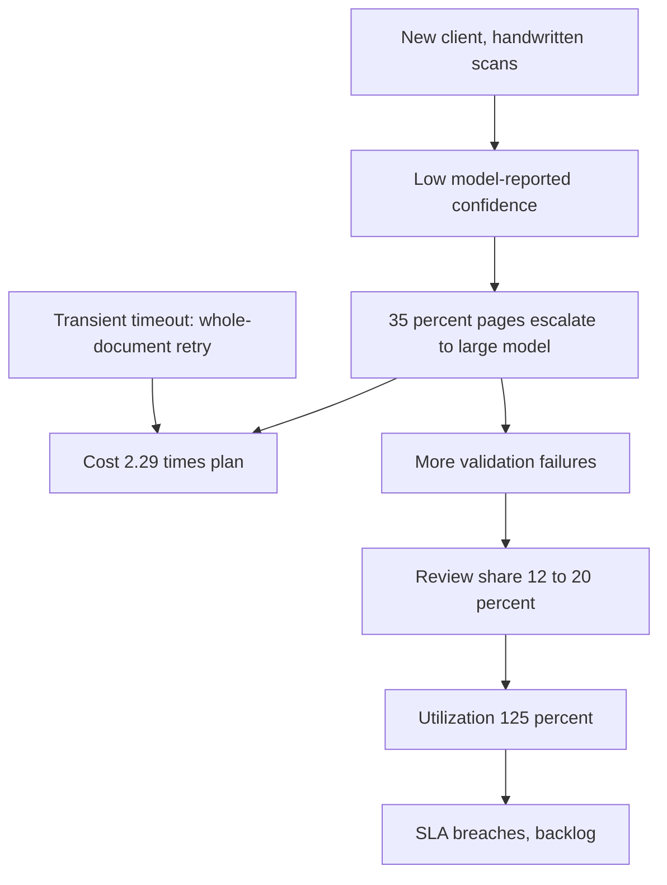

The diagram shows one root cause (a changed document mix) with two consequences (cost and capacity) that reinforce each other because the thresholds were set from a pilot.

### 12.9 Post-incident redesign

1. Field-level escalation and retry. Only fields that failed validation or fell below threshold are re-extracted, using the page region and surrounding text. Assume this uses about 20 percent of a page's tokens, so an escalated field-level call costs about 0.20 times $0.05 = $0.010 per page. Retries repeat only the failed unit of work.
2. Calibration by class. Reported confidence is replaced by a calibrated score per document class, fitted on a labeled sample using the validation outcome and field correctness. Escalation thresholds are set per class by cost-benefit rather than by one global 0.80.
3. Cross-field validation as primary routing signal. Sum and date checks, policy lookups, and format checks catch more errors than self-reported confidence. Routing starts from validation failure; confidence plays a secondary role.
4. Intake gate. A new client or document class enters a "new class" queue. A sample of 200 documents is processed, reviewed, and priced before bulk processing, with a projected cost per claim and review minutes.
5. Cost guardrails per batch. Each batch has a budget based on its document class mix. If projected spend exceeds 1.5 times the budget, the pipeline pauses and notifies the owner. Daily cost per claim by class is on the dashboard.
6. Review queue prioritization. Claims are ordered by SLA age and value, not arrival. A fast lane handles single-field fixes at 2 minutes each.
7. Capacity planning. Utilization target 75 percent; at 85 percent the owner is paged to add reviewers or reduce scope.

Redesigned cost at the same mix: with 15 percent of pages needing escalation at the field level, escalation cost is 360,000 times 0.15 = 54,000 pages times $0.010 = $540. The total is $540 + $1,800 + $540 = $2,880, which is 24 percent below the planned $3,780 (2,880 divided by 3,780 = 0.762) and 67 percent below the incident's $8,640 (2,880 divided by 8,640 = 0.333). Review share falls to 14 percent: 4,200 claims at 6 minutes is 420 hours, which is 87.5 percent of 480. That is above the 75 percent target. The honest conclusion was to add one reviewer: with five reviewers, capacity is 600 hours and utilization is 70 percent. The cost of that reviewer is real and belongs in the business case.

### 12.10 Lessons from case 4

Pilot-derived thresholds rest on the pilot's document mix. A review should ask for the stressed case and make the team run it before launch. Unit costs in a tiered design hinge on the escalation rate, which is a property of the data and not of the architecture, so the architecture must make that rate visible and controllable. Human review capacity is a hard constraint that interacts with cost: a cheaper pipeline that fills the queue is not cheaper. [Part 17 CH14](CH14_AI_Cost_Performance_and_Sustainability_Decisions.md) covers cost modeling; the review adds the question of what happens when inputs shift.

## 13. Case Study 5: Contact-Center Voice Assistant

### 13.1 Context

A retail bank's contact center receives about 250,000 calls a month. Peak load is 1,800 calls an hour. The average call lasts 4.5 minutes. A third of calls are routine: balance and transaction queries, card activation, branch hours, and dispute status. The proposal is a voice assistant that answers these calls, authenticates the caller, calls internal services for account data, and hands over to a human agent when it cannot help or when the caller asks.

Voice changes the architecture because time is audible. A web assistant that takes 3 seconds to respond is slow. A voice assistant that takes 3 seconds feels broken, and callers talk over it, repeat themselves, or hang up. Privacy is also different: callers speak card numbers, dates of birth, and addresses aloud, and the audio itself is personal data.

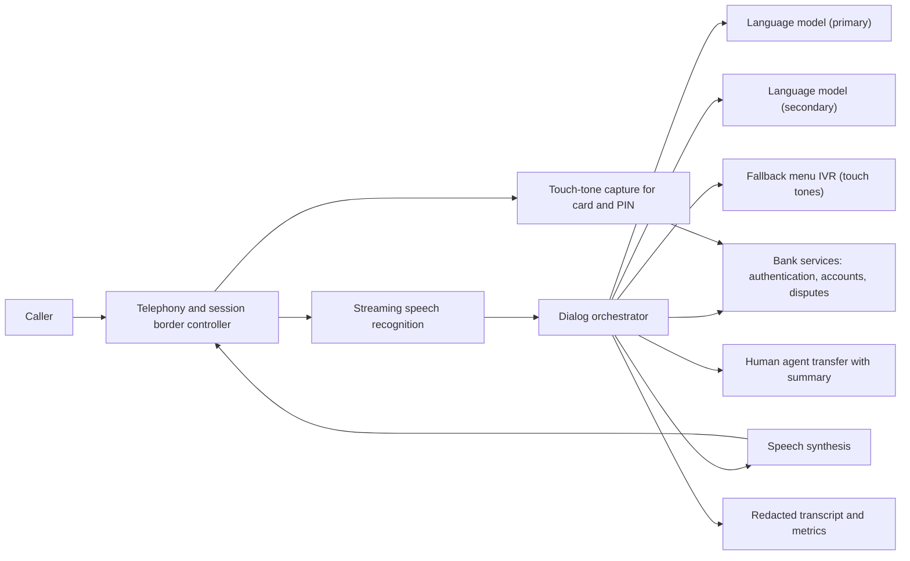

The context diagram contains two features the first design lacked. The DTMF (dual-tone multi-frequency, the tones from keypad presses) capture path lets sensitive numbers bypass speech recognition, the language model, and the transcript. The fallback menu provides a path that does not depend on any model provider.

### 13.2 Requirements and quality scenarios

| ID | Scenario | Measure |
| --- | --- | --- |
| Q1 Turn latency | Caller finishes a sentence | Assistant's first audio begins within 1,200 ms at the 95th percentile |
| Q2 Containment | Routine call classes | At least 35 percent of calls resolved without an agent, counting hang-ups as not contained |
| Q3 Privacy | Card numbers and PINs | Never reach the speech model, language model, or logs; captured by DTMF only |
| Q4 Authentication | Account access | Authenticated by a deterministic service; the model never decides identity |
| Q5 Availability | Model provider unreachable | Caller reaches menu IVR or an agent within 5 seconds of the failure being detected; no silent dead air longer than 3 seconds |
| Q6 Transfer quality | Handover to agent | Agent sees a summary and verified status; caller does not repeat identity |
| Q7 Disclosure and consent | Start of call | Caller is told they are speaking with an automated assistant and that the call is recorded; applicable rules should be confirmed with counsel per jurisdiction |
| Q8 Cost | Per call | Total below $0.20 |

### 13.3 Options considered

| Option | Description | Assessment |
| --- | --- | --- |
| A | Touch-tone menu IVR only | Existing baseline; low cost; poor experience; 18 percent of callers abandon in the menu |
| B | Intent classifier plus scripted dialogs plus text-to-speech | Predictable; limited to defined intents; modest build cost |
| C | Cascaded pipeline: streaming speech recognition, language model, speech synthesis | Recommended; each component replaceable and observable |
| D | End-to-end speech-to-speech model | Lower latency potential; less controllable; harder to redact, log, and fail over; revisit as it matures |

The cascaded choice trades some latency for control: text in the middle lets the system redact, validate, enforce policy, and swap providers. This is a design-time decision that should appear in an ADR with a reconsider-when line tied to evidence of speech-to-speech model controllability.

### 13.4 The latency budget

The turn-latency target is 1,200 ms at p95. The first design budgeted the following component latencies, taken from vendor data and informal tests, as typical values:

| Component | Typical (ms) |
| --- | --- |
| End-of-speech detection (endpointing) | 250 |
| Speech recognition final result | 150 |
| Language model first token | 450 |
| Speech synthesis first audio | 200 |
| Network and telephony | 100 |
| Sum | 1,150 |

The sum is 1,150 ms, leaving 50 ms of headroom against the target of 1,200. The panel noticed what the table does not show: it adds typical values, but the requirement is a percentile. Percentiles do not add. If one component has a long tail and the rest are tight, the turn p95 is close to the sum of the other components' medians plus the p95 of the long-tailed one. Suppose the language model's first-token latency has a median of 450 ms and a p95 of 900 ms (the vendor's own measure under shared load). The other four components have medians totaling 250 + 150 + 200 + 100 = 700 ms. The approximate turn p95 is 700 + 900 = 1,600 ms, which misses the target by 400 ms. The approximation overstates slightly when tails are independent, but a long tail on the dominant component is exactly the case that matters. The review asked for a measured end-to-end distribution under load, and the load test showed a p95 of 1,540 ms, consistent with the estimate.

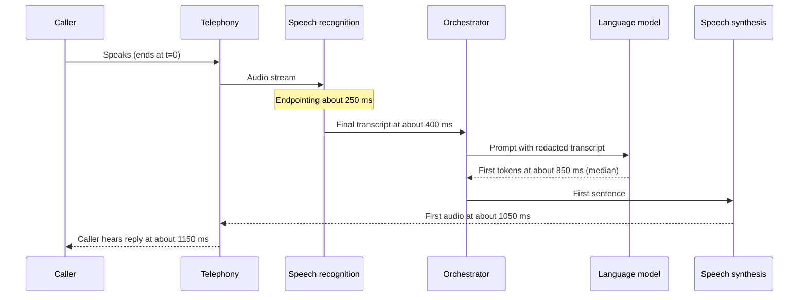

The sequence diagram shows the cumulative time to the first audio. Everything before the language model's first token is a fixed tax, and the model's share is the one the architecture can change.

Remedies in the revised design:

- Tune endpointing from 250 to 200 ms, accepting a slightly higher chance of cutting off a slow speaker; measure the interruption rate.
- Route routine intents (balance, hours, card activation) to a smaller, faster model whose measured first-token p95 is 520 ms, and keep the larger model for complex requests. The revised approximate p95 is the other components' medians (200 + 150 + 200 + 100 = 650) plus 520 = 1,170 ms, inside the target with 30 ms of headroom.
- Stream the model output sentence by sentence into synthesis, so synthesis starts on the first sentence.
- When a tool call (account lookup) will take more than 400 ms, play a short acknowledgement phrase while it runs, so the caller hears activity. This masks latency but must not be a substitute for a real budget.
- Cache the greeting and common phrases as pre-synthesized audio.

### 13.5 Chosen architecture and decisions

| ADR | Decision | Reconsider when |
| --- | --- | --- |
| ADR-001 | Cascaded pipeline with text in the middle | Speech-to-speech models allow redaction, logging, policy enforcement, and failover with equal control |
| ADR-002 | Sensitive numbers captured by touch tone, bypassing all speech and model components | Never relaxed without privacy officer approval |
| ADR-003 | Deterministic authentication service; model has no authority over identity | Never relaxed |
| ADR-004 | Two-tier model routing by intent complexity | Single model meets the p95 target at acceptable cost |
| ADR-005 | Fallback chain: secondary model, then menu IVR, then agent queue | Provider mix changes |
| ADR-006 | Transcripts redacted before storage; retained 30 days; audio retained per regulator rules in a separate store | Retention guidance changes |

Unit economics (illustrative prices). Per call: speech recognition for 4.5 minutes at $0.01 a minute is $0.045. Speech synthesis for about 2 minutes of assistant speech at $0.02 a minute is $0.04. Language model usage of 12 turns at 2,000 input and 80 output tokens, with illustrative prices of $0.50 per million input and $2 per million output, is 24,000/1,000,000 times 0.50 = $0.012 plus 960/1,000,000 times 2 = $0.00192, so $0.01392. Telephony at $0.008 a minute for 4.5 minutes is $0.036. The total is $0.045 + $0.04 + $0.01392 + $0.036 = $0.13492, about $0.135, under the $0.20 limit. At 250,000 calls a month, the cost is 250,000 times $0.13492 = $33,730. If a human-handled call costs $0.75 a minute loaded, a 4.5-minute call costs 4.5 times 0.75 = $3.375. With 35 percent containment, 87,500 calls avoid an agent, saving 87,500 times $3.375 = $295,312.50. Net monthly saving is $295,312.50 minus $33,730 = $261,582.50, before build and operations. The sensitivity is to containment: at 20 percent, 50,000 calls saved is $168,750, a net of $135,020. A hang-up is not containment, and a design that increases hang-ups increases apparent containment if it is measured as "calls without agent transfer". The Q2 definition counts hang-ups as not contained, which the panel insisted on.

### 13.6 Risks

| ID | Risk | L | I | Score | Owner |
| --- | --- | --- | --- | --- | --- |
| R1 | p95 latency misses target at peak load | 4 | 4 | 16 | Voice platform lead |
| R2 | Card or account numbers captured in transcripts or traces | 3 | 5 | 15 | Privacy officer |
| R3 | Provider outage leaves callers in dead air | 3 | 4 | 12 | SRE lead |
| R4 | Language model misleads caller about money or policy | 3 | 4 | 12 | Product owner |
| R5 | Speech recognition errors for accents, noise, and names | 4 | 3 | 12 | ML lead |
| R6 | Transfer overloads agent capacity | 3 | 3 | 9 | Contact-center operations lead |

### 13.7 Validation plan and rollout

Validation: a corpus of 600 recorded call segments (with consent and redaction) spanning accents, noise, and ages for recognition accuracy by segment; scripted adversarial calls (caller attempts to extract another customer's balance, asks the assistant to ignore rules, reads out digits); a load test at 1,800 calls an hour measuring end-to-end latency distributions, not component averages; a privacy test that places card numbers in speech and DTMF and searches every store for them; a failover game day.

Rollout: internal staff calls for two weeks; 2 percent of live traffic in a single routine class (card activation); 10 percent across three classes; then expansion with a daily review of hang-up rate, containment, repeat-call rate within 24 hours (a sign the first call failed), and transfer reasons. Stop criteria: hang-up rate more than 3 points above the baseline IVR, any card number found outside the DTMF path, or p95 latency above 1,500 ms for 15 minutes.

### 13.8 What went wrong afterwards

Three problems appeared, in sequence.

First, latency at peak. Production latency matched the load test on average. At the lunchtime peak, the primary provider's first-token p95 rose from 900 to about 1,300 ms because capacity was shared. Callers heard silences, talked over the assistant, and repeated themselves. Repeats doubled the tokens used in those calls and raised the hang-up rate from 6 to 9 percent in the peak hour. The dashboard showed mean latency (green) and not turn p95.

Second, a privacy finding. In week four a privacy audit searched the trace store and found card numbers in 3.1 percent of sampled traces. The cause: callers spoke their card number even when the assistant had prompted for touch tones, and the speech recognition transcript went to the trace store before redaction. Redaction happened at the transcript store but not at the trace exporter, a separate path owned by another team. The exposure was internal and no external disclosure occurred, but it violated scenario Q3.

Third, the provider outage. A 47-minute outage hit the primary model provider on a weekday afternoon. The design had a fallback chain, but its configuration used an 8-second timeout with 2 retries, inherited from the text assistant. A caller could wait up to 8 times 3 = 24 seconds in silence before the chain moved on. The circuit breaker opened only after 10 failures within 30 seconds, which at the afternoon call rate took about 90 seconds. The secondary model had never carried live traffic. Its first-token latency was about 900 ms at the median, so even when it worked the turn p95 exceeded 1,700 ms. The system then fell to the menu IVR.

Numbers. At the afternoon call rate of 1,800 an hour, 47 minutes of outage touched 1,800 times 47/60 = 1,410 calls. Of these, 60 percent, which is 846 calls, completed in the menu IVR. The remaining 40 percent, 564 calls, hung up or asked for an agent. The agents' queue, staffed for the usual transfer rate, reached a 14-minute wait. The transfers also arrived without summaries, because the summary was produced by the model that was down.

```mermaid
stateDiagram-v2
    [*] --> Full
    Full: Primary model, full capability
    Reduced: Secondary or smaller model, limited intents
    Menu: Touch-tone menu IVR
    Agent: Human agent queue
    Full --> Reduced: p95 TTFT over 1500 ms for 2 min or error rate over 20 percent
    Reduced --> Menu: secondary also failing
    Menu --> Agent: caller presses 0 or menu fails
    Reduced --> Full: primary healthy for 5 min
    Menu --> Reduced: model healthy for 5 min
    Agent --> [*]
```

The state diagram is the degradation ladder the redesign introduced, with explicit transition conditions measured in seconds rather than retries.

### 13.9 Post-incident redesign

Latency: per-turn timeouts matched to the budget. First-token timeout is 1.5 seconds; one hedged attempt on the secondary model starts at 800 ms if the primary has not produced a token; no more than two attempts; no turn waits more than 2.5 seconds before the acknowledgement phrase and then the fallback path. The circuit breaker opens when more than 20 percent of turns in a 30-second window exceed 1.5 seconds, and it half-opens after 60 seconds. The result is detection in about 30 seconds, not 90.

Capacity: reserved capacity or committed throughput with the primary provider for the peak hour, and a measured live share (5 percent of traffic) on the secondary model at all times, so that it is warm and tuned. Dashboards now show turn p95 and p99 by hour, hang-up rate by hour, and repeat-utterance rate.

Privacy: redaction moved to the earliest point, at the orchestrator, applied to the transcript before it goes anywhere (traces, logs, model prompts), with a detection pattern for card-number-like digit sequences and checksum validation. Both the transcript store and the trace exporter consume only the redacted stream. A weekly automated scan searches all stores for card-number patterns and pages the privacy officer on a hit. The assistant also detects spoken digits and says "please use your keypad," interrupting any further digit capture.

Transfers: a deterministic summary of verified status and call reason is produced by the orchestrator from structured session state, not by a model, so it survives an outage.

Outage rehearsal: a monthly game day cuts the primary provider for 5 minutes at off-peak and checks time to detection (under 30 seconds), time to first fallback audio (under 3 seconds), and agent queue effects.

### 13.10 Lessons from case 5

Averages and percentiles measure different things, and a latency requirement stated as a percentile must be tested as one. Redaction placed at one store protects only that store, so it belongs at the source. A fallback that has never served traffic is a hypothesis. Timeouts inherited from another channel can break an experience where time is audible. The panel's pre-launch scores for reliability and gateway were 2 and 2, and the review had approved with conditions that included all three redesign items as launch gates. The team had treated the condition on fallback testing as a follow-up item. This case shows why the type of a condition (launch gate versus follow-up) must be agreed in the review.

## 14. Cross-Case Synthesis

The five cases differ in domain, architecture style, and failure. The reviews nonetheless find the same families of weakness. Reading across them gives a short list of questions that would have changed each outcome.

### 14.1 What each case shows

| Case | Architecture style | Failure | Root pattern | The question that would have caught it |
| --- | --- | --- | --- | --- |
| 1. Support RAG | Retrieval-augmented, agent approves | Cross-tenant near-miss via write path | Shared everything; isolation checked on one path | "Show isolation at every path where data enters, moves, and leaves." |
| 2. Fraud | Predictive plus advisory LLM | Silent concept drift and feedback loop | Self-reinforcing loop; input-only monitoring | "Where do labels come from for cases the model does not flag, and how late?" |
| 3. IT agent | Agentic with write tools | Runaway loop; 14 nodes restarted | Unbounded agent; risk by action type | "What is the maximum damage of one call and one run, and where is it enforced?" |
| 4. Claims | Batch pipeline with tiers | Cost 2.29 times plan; review at 125 percent | Happy-path cost model; pilot mix | "What happens to cost and review load if the mix shifts, and who sees it first?" |
| 5. Voice | Cascaded real-time | Latency tail; card numbers in traces; untested fallback | Untested fallback; percentile treated as average | "Show the percentile under peak load, and the fallback serving real traffic." |

### 14.2 Common threads

Five threads recur.

1. A control lived in the wrong place. In case 1 isolation lived in a filter. In case 3 the loop limit lived in a prompt. In case 5 redaction lived in one store. Each control worked where it was applied and nowhere else. The fix in each case moved the control to the earliest point where it could be enforced outside the model, and added a second independent check.

2. The review examined the main path and not the edges. Ingestion and tenant lifecycle events (case 1), downstream dependencies (case 3), new document classes (case 4), and the exporter (case 5) were off the main diagram. Edges are where unowned risk collects. The context diagram of Section 3.1 is meant to expose them.

3. A metric measured something easier than the goal. Mean latency was green while the percentile failed (case 5). Input drift was green while concept drift hurt (case 2). Throughput was green while cost per claim doubled (case 4). The goal metric needs an owner and an alarm; the proxy metrics need an explanation of what they do not cover.

4. Pilot conditions were treated as production conditions. Pilot document mix (case 4), a quiet cache (case 1), off-peak provider capacity (case 5), and a stable dependency (case 3) did not persist. The validation plan should include the stressed case, not only the expected one.

5. Fallbacks and human controls existed on paper. The reviewers in case 1 caught the cross-tenant drafts by luck, the reviewers in case 2 saw summaries of stale cases, the fallback in case 5 had never run, and the approval in case 3 was bypassed by classification. A control counts only when a test shows it working.

### 14.3 What the scoring rubric caught and missed

The rubric flagged case 1 at design time (hard gate on safety) and case 5 at pre-launch time (low gateway and reliability scores). It gave comfort in case 3 (scores of 3 on composition, oversight, and safety, because an inventory, an approval rule, and scoped credentials existed). In case 2 the evaluation lens received a generous 3 because input monitoring was present. Two lessons follow. First, a lens score depends on the question the panel asked, so the probing questions in Section 4 matter more than the number. Second, a high score on breadth must be paired with an explicit "worst case" question for every capability that acts, learns, or spends.

### 14.4 Failure domain map

```mermaid
flowchart TB
    subgraph Data["Data and labels"]
        C1["Case 1: write path"]
        C2["Case 2: biased labels"]
    end
    subgraph Control["Control placement"]
        C3["Case 3: prompt limit, action-type policy"]
        C5a["Case 5: redaction at one store"]
    end
    subgraph Economics["Economics and capacity"]
        C4["Case 4: escalation rate, review capacity"]
    end
    subgraph Operations["Operations and fallback"]
        C5b["Case 5: untested fallback, timeouts"]
        C3b["Case 3: no dependency view"]
    end
    Data --> Fix1["Test every data path and unbiased labels"]
    Control --> Fix2["Enforce outside the model, add second check"]
    Economics --> Fix3["Stress the mix, budget by class"]
    Operations --> Fix4["Rehearse failures, define degraded modes"]
```

The map groups failures by the kind of fix they need, which helps a panel decide where to spend scarce review time on a new system: data paths and labels, control placement, economics and capacity, and operations and fallback.

### 14.5 Scores before and after

Only case 1 has scorer inputs in the code folder, so only its numbers are quoted: 63.2 and a deferral at the first review (safety gate failed), 79.2 and approval with conditions after the redesign. For the other four cases the useful observation is qualitative. Each was approved with conditions at its pre-launch review, and each failure sat in a condition that was treated as follow-up work instead of a launch gate (case 5), in a lens scored on the wrong question (cases 2 and 3), or in a stressed case that was requested and not run (case 4). Approval with conditions that has no enforced launch gate is little better than approval.

## 15. Organizational AI-Architecture Maturity Assessment

Reviewing one system tells you about that system. Reviewing how an organization builds, releases, and operates AI systems tells you what to expect from the next ten. A maturity assessment looks at capabilities that sit above individual projects. It is useful to the chief architect planning investment, the platform team deciding what to build next, and the review panel adjusting how deeply to inspect a team's claims.

### 15.1 Levels

| Level | Name | Description |
| --- | --- | --- |
| 1 | Ad hoc | Success depends on individuals. No shared method; evidence is informal; incidents are handled as surprises. |
| 2 | Repeatable | Some practices exist and are reused by the teams that know them. Coverage is uneven. |
| 3 | Defined | Practices are documented, expected, and applied across teams. Reviews follow a standard method. |
| 4 | Measured | Practices are measured. Teams know their evaluation scores, incident rates, review outcomes, and costs, and use them to decide. |
| 5 | Improving | Measurement drives change. Incidents and near-misses feed architecture standards. Practices are retired when evidence shows they do not help. |

Levels describe organizations, not systems. A mature organization may still ship a weak system, and an immature one may ship a good one by luck. Maturity changes the odds and the speed of recovery.

### 15.2 Capabilities

The assessment rates eight capabilities. Four are foundations: if one is weak, the others cannot compensate.

| Capability | Foundation | What level 1 looks like | What level 3 looks like | What level 5 looks like |
| --- | --- | --- | --- | --- |
| Intake and qualification | No | Projects start from enthusiasm | Standard intake review with baseline and data-rights checks | Intake outcomes tracked against realized value; criteria adjusted |
| Data rights and lineage | Yes | Data used as found | Inventory with owners and legal basis; lineage for production systems | Automated rights checks at ingestion; deletion verified end to end |
| Evaluation and observability | Yes | Manual spot checks | Golden sets, dashboards, drift alerts per system | Shared evaluation platform; label bias corrected; evaluation cost optimized |
| Release and rollback | No | Changes in production consoles | Versioned prompts and models with gated releases and tested rollback | Progressive delivery with automatic quality-based halt |
| Security and privacy controls | Yes | Prompt instructions as policy | Threat models, structural isolation, red-team before launch | Continuous adversarial testing; control effectiveness measured |
| Human oversight design | No | "Human in the loop" as a phrase | Workflow-level design with capacity and seeded-error tests | Override and reviewer quality monitored; autonomy raised on evidence |
| Incident response and learning | Yes | Incidents handled by whoever notices | AI-specific runbooks; blameless reviews with architecture changes | Near-misses reviewed; changes tracked to closure and effect |
| Cost and capacity management | No | Invoices reviewed after the month closes | Unit-cost models and budgets per feature | Sensitivity analysis and automated guardrails; cost per outcome optimized |

### 15.3 Scoring and the foundation cap

Each capability is rated 1 to 5 from evidence, not from policy documents. The overall level is the smaller of two numbers: the rounded mean of all eight ratings, and one more than the lowest foundation rating. The cap encodes a practical observation: an organization with excellent evaluation and no incident learning is not at level 4, because it will repeat its failures.

The script [`03_maturity_self_assessment.py`](../code/python/ai-architecture-review-chapter/03_maturity_self_assessment.py) implements the rule. Its output:

```text
team_alpha: mean=2.38 foundation_min=1 overall_level=2
  weakest: incident_response_and_learning=1, data_rights_and_lineage=2, security_and_privacy_controls=2
team_beta: mean=3.75 foundation_min=4 overall_level=4
  weakest: human_oversight_design=3, cost_and_capacity_management=3, intake_and_qualification=4
```

Check team alpha by hand. The ratings are 3, 2, 3, 3, 2, 3, 1, 2, which sum to 19, so the mean is 19 divided by 8 = 2.375 and rounds to 2. The foundation capabilities are data rights (2), evaluation (3), security (2), and incident learning (1); the minimum is 1, so the cap is 1 + 1 = 2. The overall level is min(2, 2) = 2. Team beta's ratings sum to 30, so the mean is 3.75 and rounds to 4; the foundation minimum is 4, giving a cap of 5; the level is 4.

### 15.4 Using the result

Read the weakest three capabilities, not the overall number. Team alpha's priority is incident learning, which also explains why its other gaps persist: nothing feeds failures back into practice. A sensible plan for team alpha runs for a quarter and has three parts: write AI-specific runbooks and run one game day; adopt the post-incident template of Section 16 for every near-miss; and add a data-rights inventory for production systems. Re-assess after the quarter with evidence for each rating.

```mermaid
flowchart LR
    L1["Level 1: ad hoc"] --> L2["Level 2: repeatable"]
    L2 --> L3["Level 3: defined"]
    L3 --> L4["Level 4: measured"]
    L4 --> L5["Level 5: improving"]
    F["Foundation capabilities cap the level"] -. "limits" .-> L3
    I["Incident learning feeds all capabilities"] -. "drives" .-> L5
```

The diagram reminds the reader that levels are climbed through foundation capabilities and sustained by incident learning.

Common assessment errors include rating from policy rather than practice ("we have a data policy" is not level 3 without an inventory), rating the best team rather than the median, and treating the assessment as a ranking of teams. Use it as a planning tool. A panel can also adapt review depth: for a team at level 4 with clean history, evidence requests can be lighter, whereas a team at level 1 gets the full request list and a pre-launch review with an independent validator.

## 16. Post-Incident Review and Turning Incidents into Architecture Changes

### 16.1 Purpose and principles

A post-incident review explains what happened, why the system allowed it, and what will change. It is blameless: it looks for conditions that made the failure possible, because people act sensibly on the information in front of them. It treats near-misses as seriously as outages, because the difference between a near-miss and a breach is often luck, as the case 1 write-path event showed.

AI incidents have features that conventional incident templates miss. The system may have behaved as designed and still harmed someone. The failure may be gradual (drift) with no moment of breakage. The evidence may be probabilistic: a sample of outputs, not a stack trace. And the cause may lie in data, prompts, retrieval configuration, a provider change, or a human workflow, and not in code.

### 16.2 Template

| Section | Content |
| --- | --- |
| Summary | One paragraph: what happened, who was affected, how it was found, current status |
| Impact | Quantified: users, requests, money, data, duration; severity classification; whether any data or decision reached an external party |
| Detection | How it was found, how long after onset, which control detected it, which controls did not |
| Timeline | Timestamped events from onset to resolution, including the system's own actions (model calls, tool calls, version changes) |
| System state | Model and prompt versions, retrieval configuration, data versions, feature flags, recent changes in the preceding 30 days |
| Evidence | Traces, logs, evaluation results, and samples of outputs with identifiers; retention of this evidence |
| Causal analysis | Proximate cause, contributing causes, architectural cause; the false assumption; which lens should have caught it |
| What went well | Controls that worked, including luck, which is recorded as luck |
| Corrective actions | Architecture changes, each with owner, due date, and verification |
| Re-review triggers | New triggers added or modified |
| Open questions | What remains unknown |

### 16.3 Causal depth

The causal analysis should reach the architectural cause. A useful discipline is to write three sentences for every incident.

1. The proximate cause: what directly produced the harm.
2. The contributing causes: conditions that allowed it, such as missing tests or alerts.
3. The architectural cause: the design assumption or missing structure that made the failure possible, stated as something that can be changed.

Applying this to the five cases:

| Case | Proximate cause | Architectural cause |
| --- | --- | --- |
| 1 | Back-fill job wrote to a partition by name using a privileged account | Isolation enforced on read only; tenant lifecycle changes not treated as security-relevant |
| 2 | Recall fell as fraud tactics changed | Label stream biased toward flagged cases; monitoring on inputs only |
| 3 | Restart tool accepted 14 targets; loop continued | Authority defined by action label and prompt, not by policy over live state and budgets |
| 4 | New document mix pushed escalation to 35 percent | Thresholds from a pilot; no cost or review visibility by document class; no intake gate |
| 5 | Provider outage with long timeouts; card numbers in traces | Untested fallback; redaction at store level instead of at the source |

### 16.4 Control hierarchy for corrective actions

Not all fixes are equal. A hierarchy helps the team choose the strongest practical one. It follows the ordering used in safety engineering: remove the hazard, then design it out structurally, then detect it, then rely on procedure, then rely on training.

```mermaid
flowchart TD
    A["1. Eliminate the hazard<br/>(remove the tool, the data, or the autonomy)"] --> B["2. Structural control<br/>(partition, scoped credential, hard limit in code)"]
    B --> C["3. Automated detection<br/>(canary, alert, kill switch)"]
    C --> D["4. Procedure<br/>(approval, runbook, review)"]
    D --> E["5. Training and awareness"]
    Nt["Prefer higher items. Combine at least two levels for severe hazards."]
    E --- Nt
```

Case 3 shows the ladder in action. The runaway risk was addressed with a hard limit in code (level 2), an effect check (level 3), a human approval for out-of-scope writes (level 4), and a runbook (level 4). Removing the write tool altogether (level 1) was considered and rejected because the use case needed it. A post-incident action list made only of level 4 and 5 items, such as "remind engineers to be careful", is a sign that the review stopped too early.

### 16.5 The incident feedback loop

```mermaid
flowchart LR
    Inc["Incident or near-miss"] --> PIR["Post-incident review"]
    PIR --> Cause["Architectural cause and false assumption"]
    Cause --> Change["Architecture change and ADR"]
    Change --> Test["New test, canary, or monitor"]
    Test --> Trig["New or updated re-review trigger"]
    Trig --> Std["Standard, lens question, or checklist item"]
    Std --> Review["Future reviews ask the new question"]
    Review -. "prevents or detects earlier" .-> Inc
```

The loop closes when the lesson reaches the review checklist. The write-path lesson from case 1 should become a probing question in the data and security lenses ("what writes to the index, with what credential, checked by what?"). The label-bias lesson from case 2 became a question in the evaluation lens. Without this last step each incident is learned by one team.

### 16.6 Worked example: converting case 5 into changes

| Finding | Change | Control level | Owner | Verification |
| --- | --- | --- | --- | --- |
| Card numbers in traces | Redact at orchestrator before any store; weekly pattern scan | 2 and 3 | Privacy officer | Scan returns zero for 4 consecutive weeks; test suite plants numbers |
| 8 s timeout, 2 retries | Per-turn 1.5 s first-token timeout, one hedged attempt at 800 ms | 2 | Voice platform lead | Fault injection: dead air under 3 s |
| Secondary model never ran live | 5 percent live share on secondary | 3 | SRE lead | Dashboard shows share and latency; alert if share is 0 |
| Summary needed the model for transfer | Deterministic summary from session state | 2 | Contact-center engineering lead | Outage drill: transfers carry summaries |
| Mean latency dashboard | Percentile dashboards by hour; alert on p95 above 1,500 ms for 15 min | 3 | Voice platform lead | Alert fired in synthetic test |

Each row has an owner and a verification that another person can check, which turns a lesson into a condition.

### 16.7 Measuring whether the changes worked

Three months after the actions, check three measures: recurrence (has the same class of incident happened), detection time (is it shorter), and blast radius (is it smaller). If the same class recurs, the change was probably at the wrong level of the control hierarchy. [Part 22 CH09](../22_Architectural_Thinking_and_Decision_Practice/CH09_Measuring_Decision_Outcomes_and_Reconsideration_Triggers.md) teaches decision outcome measurement.

## 17. Governance Cadence and Re-Review Triggers

### 17.1 Why systems need recurring review

An approved system is approved as it was reviewed. AI systems change without code releases: providers update models, users bring new inputs, data sources grow, and teams add features by configuration. A governance cadence sets a rhythm of checks, and triggers force a review when a specific change happens, whatever the calendar says.

### 17.2 Cadence

| Frequency | Activity | Owner | Output |
| --- | --- | --- | --- |
| Continuous | Canaries (isolation, golden set), cost alarms, safety monitors | System owner | Alerts to on-call |
| Weekly | Quality and cost dashboard review; override and escalation rates | System owner and product owner | Action list |
| Monthly | Incident and near-miss review; access review for tools and data; fallback live-share check | Platform and security leads | Updated risk register |
| Quarterly | Periodic architecture review at light depth; re-score; check assumption register; game day | Review panel with system owner | Scores, condition status, trigger list |
| Semiannual | Maturity self-assessment; standard and checklist updates from incidents | Chief architect | Plan and checklist revisions |
| Annual | Portfolio review: retire, consolidate, or re-invest; vendor and model strategy | Architecture board and finance | Portfolio decisions |

For a low-risk, low-autonomy system, drop the quarterly review to annually. For a high-impact system, keep quarterly and require an independent member on the panel.

### 17.3 Re-review triggers

A trigger is a specific, observable event with a defined response. Triggers are written at approval time, recorded in the decision log, and checked by automation where possible.

| Trigger class | Examples | Response |
| --- | --- | --- |
| Model change | Provider model version change or retirement notice; switching model family; fine-tune update; prompt template change affecting more than one intent | Run the regression suite; if any scenario measure misses its threshold or the golden-set score moves by more than 3 points, repeat the affected lenses |
| Data change | New data source; change in data rights or consent; corpus growth over 20 percent; change in label process; schema change | Data lens re-review; re-run canaries; confirm lineage |
| Scope change | New tool or higher autonomy; new user group, tenant type, or jurisdiction; new language; new use case on same endpoint | Full design-level review of the changed area |
| Operational | Cost per outcome up more than 25 percent against plan for two weeks; latency p95 breach for three days; override rate outside defined band | Panel check-in within a week |
| Incident | Any severity-1 or severity-2 incident; any near-miss in the security or privacy category | Post-incident review and re-score |
| External | New regulation or standard affecting the use case; vendor security incident; contract change | Governance lens re-review with legal and security |
| Organizational | Owner leaves; team reorganization | Confirm ownership matrix and on-call |

Scope creep deserves special attention because it enters through configuration, requests from a sponsor, and "small" additions. Put the configuration registry (tools, sources, tenants, intents) under change control that reads the trigger table. A change that matches a trigger creates a review ticket automatically.

### 17.4 The lifecycle as a state machine

```mermaid
stateDiagram-v2
    [*] --> Proposed
    Proposed --> Reviewed: intake and design review
    Reviewed --> Approved: approve or approve with conditions
    Reviewed --> Deferred: defer
    Reviewed --> Rejected: reject
    Deferred --> Reviewed: evidence returned
    Approved --> Watch: trigger fired
    Watch --> Approved: re-review passed
    Watch --> Restricted: re-review failed
    Restricted --> Approved: conditions met
    Restricted --> Retired: not recoverable
    Approved --> Retired: periodic review decision
    Retired --> [*]
    Rejected --> [*]
```

The state machine shows that approval is not terminal. "Watch" is the state of a system whose trigger has fired and whose re-review is pending. "Restricted" means reduced scope, autonomy, or traffic while conditions are met. Defining these states before a crisis lets the on-call engineer apply a restriction without a meeting.

### 17.5 Decision log

Each review outcome and each re-review is recorded in a decision log with the date, the evidence examined, the outcome, and the triggers set. [Part 21 CH11](../21_Architecture_Documentation/CH11_Architecture_Reviews.md) and [Part 21 CH03](../21_Architecture_Documentation/CH03_ADR_Architecture_Decision_Record.md) cover the documentation form. The AI-specific addition is a link from each log entry to the versions of the model, prompts, retrieval configuration, and evaluation set in force at that time, so a future reader can see what was approved.

## 18. Pre-Mortem Exercise Template

A pre-mortem imagines that the project has already failed and asks the group to explain how. It works because it gives people permission to voice concerns that would sound disloyal in a normal review, and because describing a specific failed future produces richer causes than listing generic risks. [Part 22 CH08](../22_Architectural_Thinking_and_Decision_Practice/CH08_Architecture_Pre_Mortems_and_Challenge_Reviews.md) teaches the method; this section is the AI-specific template.

### 18.1 Logistics

- Time: 45 to 60 minutes.
- Participants: the team, a security representative, a data owner, an operations representative, a product or business representative, and someone who has not worked on the project.
- Inputs: the context diagram, the quality scenarios, the draft risk register.
- Facilitator: someone outside the delivery chain, to protect candor.

### 18.2 Steps

1. Frame (5 minutes). State: "It is six months after launch. The system caused a serious incident that reached senior leadership. Write down what happened."
2. Silent writing (10 minutes). Each person writes three to five failure stories alone, on separate notes, each as a short narrative with cause and consequence.
3. Prompts. Offer category prompts if the room stalls: data and rights; wrong answers with confident tone; provider change or outage; abuse and injection; tools and autonomy; reviewers and workflow; cost surprise; drift; privacy; organizational neglect after the launch team moved on.
4. Share and cluster (15 minutes). Each person reads one story. The facilitator clusters duplicates.
5. Vote (5 minutes). Each person places votes on the stories they consider most likely, and separately on the most damaging.
6. Convert (10 minutes). For the top clusters, write a risk register entry, a scenario that would test it, an owner, and a gate.
7. Review (5 minutes). Read back the new gates and decide which change the launch plan.

### 18.3 Output table

| Failure story | Votes likely | Votes damaging | Root assumption | Test or monitor | Owner | Gate |
| --- | --- | --- | --- | --- | --- | --- |
| A vendor model update changes tone and answers; nobody notices for three weeks | 8 | 5 | Behavior is stable between versions | Daily golden-set canary with alert | ML lead | Pre-launch |
| A reviewer approves a draft quoting another customer | 4 | 9 | Reviewers will notice | Seeded-error test; cited-source verifier | Product owner | Pre-launch |
| Cost triples after a marketing campaign doubles use and doubles retries | 6 | 6 | Cost scales linearly | Per-tenant budgets; load test at 3 times | Finance partner | 30 days |
| The only engineer who understands the retrieval pipeline leaves | 5 | 4 | Knowledge is shared | Runbook exercised by second engineer | Engineering manager | 30 days |

### 18.4 Using results

Treat the output as an input to the risk register, the assumption register, and the validation plan. Carry forward the root assumptions: they are often the same across projects and inform the checklist. Run the exercise again at the periodic review of a mature system with the prompt "it is one year from now."

## 19. Review Exercises

Work the exercises before reading the answer outlines.

**Exercise 1.** A team proposes a chat assistant for employees that answers HR policy questions from a document set of 900 files. They show a demo of six questions. List the first five evidence items you request and the lens each serves.

**Exercise 2.** A review scores a system as follows: value 3, workload 3, data 3, model 3, composition 3, serving 3, gateway 3, oversight 3, platform 3, evaluation 3, safety 2, reliability 3, cost 3, operability 3. Using the weights in Section 5.2, compute the total and the outcome. What would you write as the condition?

**Exercise 3.** A pilot evaluation has 120 labeled examples and shows 94 percent accuracy. The scenario requires a claim of at least 90 percent with a plus or minus 3 point confidence interval. Is the evidence enough? What sample size is needed if true accuracy is 94 percent?

**Exercise 4.** A review queue gets 800 items a day. Each careful review takes 75 seconds. There are 6 reviewers with 5 productive hours a day each. Compute utilization. Volume is expected to grow 40 percent. What do you recommend?

**Exercise 5.** An agent has tools: `read_logs`, `restart_service(nodes)`, `scale_pool(n)`, `delete_snapshot(id)`. Rank them by worst-case damage and propose a policy for each.

**Exercise 6.** A claims-style pipeline plans 300,000 pages a month with a first-pass cost of $0.004 a page, an escalation tier at $0.04 a page, and a planned escalation rate of 10 percent. OCR costs $1.20 per 1,000 pages. Compute the planned monthly cost, then the cost if escalation reaches 30 percent.

**Exercise 7.** A fraud-like model shows steady input distributions and rising losses. Name two hypotheses and a monitoring design that distinguishes them.

**Exercise 8.** A voice assistant has median component latencies of 200, 150, 400, 180, and 90 ms, and the language model component has a p95 of 800 ms. Estimate the turn p95 and say whether it meets a 1,200 ms target.

**Exercise 9.** A reviewer proposes seven conditions, three of which are launch gates requiring design changes. What outcome do you recommend and why?

**Exercise 10.** Write a verifiable condition for "improve monitoring" on a retrieval-augmented assistant.

### 19.1 Answer outlines

**Answer 1.** (1) Baseline: current time-to-answer and error rate for HR queries, from the help desk (value lens). (2) Evaluation set: at least 300 real questions with labeled answers, including ones the documents do not answer (evaluation lens). (3) Data inventory: document owners, last review dates, which policies are region-specific, and permissions for restricted documents such as executive compensation (data lens). (4) A threat model and the identity design showing how access follows the user (security lens). (5) The escalation path to a human and a statement of what the assistant must refuse, such as legal advice (oversight and governance lenses). A good sixth item is the freshness process for policy changes.

**Answer 2.** Weighted sum: value 8x3/4 = 6.0; workload 3.75; data 6.75; model 3.75; composition 3.75; serving 3.75; gateway 4.5; oversight 6.0; platform 3.75; evaluation 6.75; safety 12x2/4 = 6.0; reliability 4.5; cost 5.25; operability 7.5. All fourteen lenses at 3 give 75.0, so lowering safety from 3 to 2 removes 12 x 1/4 = 3.0 and the total is 72.0. The safety hard gate needs 3, so it fails. With a total between 50 and 100 and a failed gate, the rule order yields defer, although 72 alone would be approve with conditions. The condition for a later review would be evidence that raises the safety score to 3, for example a red-team report and a completed threat model with fixes.

**Answer 3.** Not enough as stated. With 120 examples at 94 percent, the interval half-width is 1.96 x sqrt(0.94 x 0.06 / 120) = 1.96 x sqrt(0.00047) = 1.96 x 0.02168 = 0.0425, about plus or minus 4.2 points, so the interval is 89.8 to 98.2 percent and the lower bound is just under 90. For plus or minus 3 points: n = 1.96 squared x 0.94 x 0.06 / 0.03 squared = 3.8416 x 0.0564 / 0.0009 = 240.7, so about 241 examples. The examples should be independent and representative.

**Answer 4.** Hours needed: 800 x 75 / 3,600 = 16.67 hours a day. Capacity: 6 x 5 = 30 hours. Utilization is 16.67 / 30 = 55.6 percent. With 40 percent growth: 1,120 items need 23.3 hours, utilization 77.8 percent. That is near the 75 to 85 percent warning band. Recommend planning a seventh reviewer or a defined low-risk fast lane before volume reaches 1,000 items a day (20.8 hours, 69 percent) and setting an alert at 85 percent utilization (25.5 hours, about 1,224 items). Also confirm that 75 seconds per item is measured on careful reviews and not on glances.

**Answer 5.** From least to most damaging: `read_logs` (information exposure only; control access and redaction); `scale_pool(n)` (cost and capacity; bound n between a floor and a ceiling, rate-limit changes); `restart_service(nodes)` (availability; cap at 10 percent of pool, rolling, health-gated, effect check); `delete_snapshot(id)` (irreversible data loss; remove from the agent or require human approval with a retention check and a soft-delete period). The principle is that irreversibility and blast radius set the control, not the verb.

**Answer 6.** Pages 300,000. OCR: 300 x 1.20 = $360. First pass: 300,000 x 0.004 = $1,200. Planned escalation: 30,000 pages x 0.04 = $1,200. Total planned $2,760. At 30 percent: 90,000 x 0.04 = $3,600; total $360 + $1,200 + $3,600 = $5,160, which is 1.87 times the plan (5,160 / 2,760 = 1.87). Also check review load.

**Answer 7.** Hypotheses: concept drift (the relationship between features and fraud changed while the feature distributions did not) and label or process change (a change in how losses are recorded or investigated). A design: weighted unbiased sample reviewed regularly; cohort-based chargeback tracking modeled by age; champion-challenger divergence; monitor recall estimates and not only input drift.

**Answer 8.** Others' medians: 200 + 150 + 180 + 90 = 620 ms. Add the LM p95 of 800: about 1,420 ms. This misses the 1,200 ms target by about 220 ms. Options: smaller model for routine intents, shorter endpointing, streaming sentence-by-sentence, and measuring real distributions under load.

**Answer 9.** Defer. More than about eight conditions or several launch gates that require design change indicate the design is unfinished. Conditional approval would let the team launch with the gates treated as follow-up. Return with evidence for the three gates, then reconsider.

**Answer 10.** "C5. Retrieval quality drift is detected within one business day. Owner: ML lead. Due: before 25 percent traffic. Verification: a golden set of 300 labeled queries is scored daily for retrieval recall at 5 and answer groundedness; an alert pages when either metric falls 3 points below the launch baseline for two consecutive days; the alert is tested by degrading the index in staging. A dashboard shows the metrics by tenant."

## 20. Final Review Checklist

Use this list at the end of a pre-launch review. A "no" is not automatically a failure, but it must have an owner, a gate, and a date.

### 20.1 Purpose and scope

- The decision supported by this review, scope, and exclusions are written down.
- A measured baseline and a defined success metric exist.
- A non-AI alternative and a simpler AI alternative were compared.
- Impact of a wrong output and the autonomy level are stated.

### 20.2 Data

- Every source has an owner, a legal basis for this use, and a deletion path that was tested.
- Quality and freshness were measured with a stated sampling method.
- Lineage reaches from output to sources and from sources to every use.
- Prompts, outputs, and traces are redacted at the source and retained for a stated period.

### 20.3 Model and composition

- Models were compared on the team's own evaluation set with confidence intervals.
- Versions are pinned, with a retirement plan.
- Deterministic code owns exact tasks, identity, and authorization.
- Every tool has a maximum-damage statement per call and per run, enforced outside the model.

### 20.4 Serving, routing, reliability

- Latency is measured as percentiles under peak-like load with real input sizes.
- Quotas and capacity are known and have headroom.
- The fallback chain has served real or simulated traffic within the last month.
- Timeouts, retries, and breakers match the user experience budget.
- A degradation ladder with measurable transitions exists.

### 20.5 Human oversight

- Reviewer capacity is sized with a stated utilization target.
- Seeded-error tests show reviewers catch errors at the target rate.
- Reviewers see evidence, not only suggestions.
- A stop mechanism exists with measured time to effect.

### 20.6 Evaluation and observability

- The evaluation set is independent of prompt development and representative of production.
- An online quality signal exists, with unbiased labels or a plan to get them.
- Drift is detected on outputs and outcomes, not only inputs.
- Dashboards show percentiles, per-segment quality, and cost per outcome.

### 20.7 Safety, security, privacy, governance

- A threat model covers read paths, write paths, tools, and tenant lifecycle events.
- Isolation is structural and checked by continuous canaries.
- Policy is enforced in code outside the model.
- A red-team exercise was run and findings were closed or accepted by a named person.
- Regulatory duties were identified with legal advice and have owners.

### 20.8 Cost

- The cost model includes retries, long contexts, reprocessing, review labor, and evaluation.
- A stressed case (double the mix, double the retries) was calculated.
- Budgets and alarms operate at the feature or tenant level.

### 20.9 Operations and ownership

- One accountable owner exists for end-to-end behavior.
- Runbooks for harmful output, leakage, drift, outage, and cost runaway were exercised.
- Users have a feedback path and the team has a response time.
- Re-review triggers are written and wired to change control.

### 20.10 Review outputs

- Scores are recorded with evidence citations.
- Conditions are verifiable and typed as launch gate, scale gate, or follow-up.
- Accepted residual risks name the person who accepted them.
- A date for the next periodic review is set.

## 21. One-Page Review Template

Copy this template into the review record. Keep each answer short and cite evidence by link.

```text
AI ARCHITECTURE REVIEW - ONE PAGE
System: ______________  Version/date: ________  Review point: intake | design | pre-launch | post-incident | periodic
Decision supported: ________________________________________________
Panel: ______________  Team contacts: ______________  Accountable owner: ______________

1. VALUE
   Outcome metric: ______  Baseline (measured): ______  Target: ______
   Strongest non-AI alternative and result: ______________________
2. SCOPE AND CONTEXT
   In scope: ______  Out of scope: ______
   Autonomy level: advisory | human approves | system acts   Impact of wrong output: low | medium | high
   Trust boundaries and state-changing actions: ______________________
3. TOP ASSUMPTIONS (grade: measured | estimated | asserted | unknown)
   A1 ______ [grade] settled by ______ on ______
   A2 ______ [grade] settled by ______ on ______
   A3 ______ [grade] settled by ______ on ______
4. QUALITY SCENARIOS (stimulus, response, measure, test)
   Q1 ______   Q2 ______   Q3 ______   Q4 ______
5. OPTIONS AND DECISION
   Options compared: A ______ B ______ C ______
   Chosen: ______  Why: ______  Reconsider when: ______  ADR ids: ______
6. LENS SCORES (0-4, evidence cited)
   Value __ Workload __ Data __ Model __ Composition __ Serving __ Gateway __
   Oversight __ Platform __ Eval/Obs __ Safety/Sec/Priv __ Reliability __ Cost __ Ownership __
   Weighted total: ___ / 100   Hard gates failed: ______
7. OUTCOME: approve | approve with conditions | defer | reject
8. CONDITIONS (type: launch gate | scale gate | follow-up)
   C1 ______  owner ______  due ______  verified by ______
   C2 ______  owner ______  due ______  verified by ______
9. TOP RISKS (L x I, owner, gate)
   R1 ______  R2 ______  R3 ______
   Residual risk accepted by (name): ______
10. VALIDATION AND ROLLOUT
   Pre-launch tests: ______  Rollout stages and stop criteria: ______
   Kill switch tested on: ______  Fallback last exercised: ______
11. RE-REVIEW TRIGGERS: model change | data change | scope change | cost or quality alarm | incident
   Next periodic review: ______
```

## 22. Summary

An AI architecture review compares what a team claims with what the evidence supports, records the gap, and turns it into decisions with owners. It runs at five points in a system's life: intake, design, pre-launch, post-incident, and periodic. Depth follows the impact of a wrong output and the autonomy of the system.

The method has nine steps: scope and context, evidence request, assumption register, quality-attribute scenarios, option analysis, risk register with owners, decision records, validation plan, and follow-up with re-review triggers. Fourteen lenses give the review a fixed set of probing questions, expected evidence, and red flags. A weighted score summarizes the evidence, and hard gates stop a good average from hiding a fatal flaw. Outcomes are approve, approve with conditions, defer, and reject, with conditions written so another person can verify them and typed as launch gates, scale gates, or follow-up.

The review conversation is part of the method. Ask for the worst example, for failure evidence, for the worst case of each tool, and for the percentile under load. Treat vendor claims as asserted until backed by artifacts.

The five case studies show the same families of weakness: controls placed where the model or a single store enforced them, main paths reviewed while edges were ignored, proxy metrics reported in place of goal metrics, pilot conditions mistaken for production conditions, and fallbacks that existed on paper. Each failure led to an architecture change at a stronger level of the control hierarchy and to a new question in the review checklist.

Organizations improve by assessing maturity, learning from near-misses as well as outages, setting a governance cadence, and wiring re-review triggers to change control, because AI systems change without code releases.

## 23. Code Examples

All scripts use only the Python standard library and print the output quoted in this chapter. Run each with `python <file>`.

- [`01_review_scorer.py`](../code/python/ai-architecture-review-chapter/01_review_scorer.py) computes the weighted lens score, applies the hard gates, and maps the result to an outcome for three sample reviews.
- [`02_risk_matrix.py`](../code/python/ai-architecture-review-chapter/02_risk_matrix.py) scores a risk register, flags risks with no owner or gate, and prints a five-by-five matrix.
- [`03_maturity_self_assessment.py`](../code/python/ai-architecture-review-chapter/03_maturity_self_assessment.py) rates eight capabilities, applies the foundation cap, and prints the weakest three.
- [`04_case_study_numbers.py`](../code/python/ai-architecture-review-chapter/04_case_study_numbers.py) reproduces the worked arithmetic for the five case studies, using placeholder prices.
