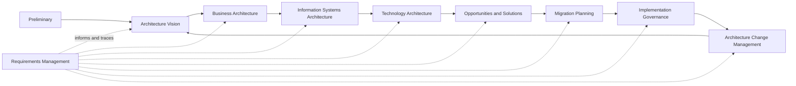
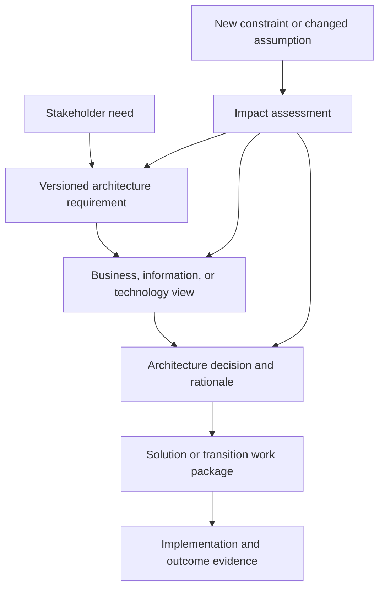
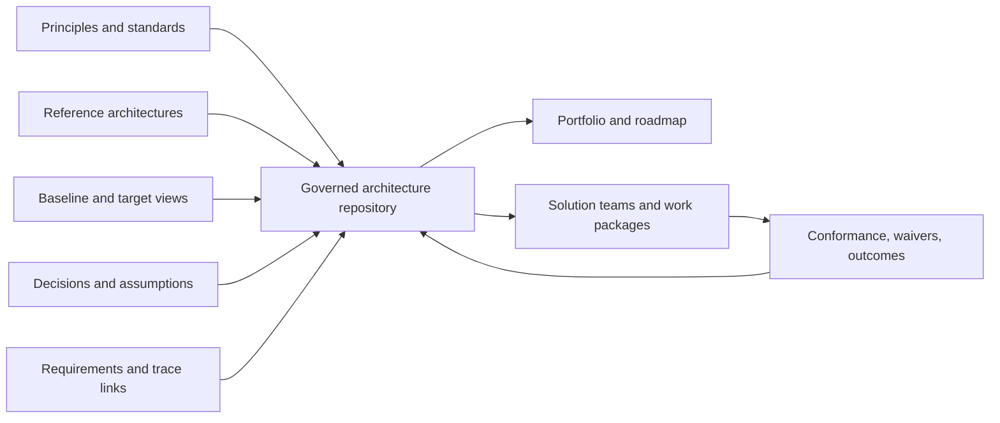
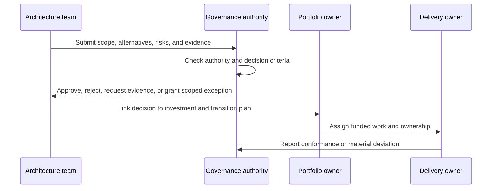
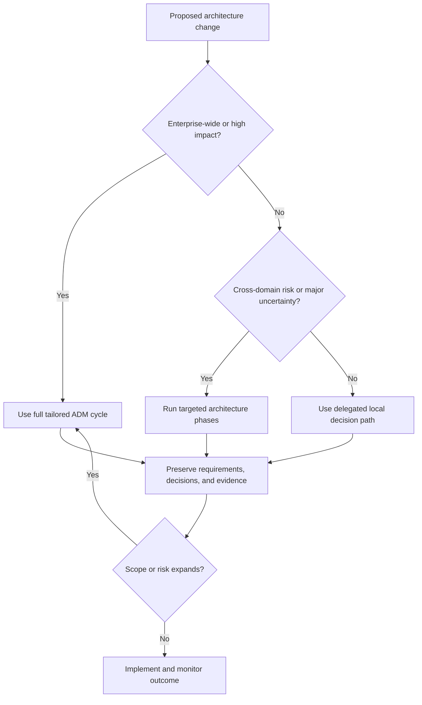

# TOGAF: The Open Group Architecture Framework

Part: [18 — Enterprise Architecture](PART_OVERVIEW.md)

The Open Group Architecture Framework (TOGAF) is a framework for organizing architecture work and change across an enterprise. Its Architecture Development Method (ADM) provides an iterative cycle for shaping an architecture, planning change, governing implementation, and responding to new requirements. TOGAF is not a guarantee of good decisions or a reason to create every prescribed artifact. Use it where its structure improves traceability, stakeholder alignment, and change control.

Part 18 owns enterprise-framework use. Part 07 owns solution High-Level Design (HLD), and Part 21 owns architecture-description notation. This chapter applies TOGAF concepts without duplicating those topics.

## The ADM as an Iterative Cycle

The ADM begins with preliminary work that establishes the architecture capability, principles, governance, and tailoring. The Architecture Vision frames scope and stakeholder outcomes. Business, information-systems, and technology architecture phases develop the target views; opportunities and solutions identify implementation groupings; migration planning sequences them; implementation governance checks conformance and handles deviations; architecture change management assesses later changes. Requirements management operates across the cycle.

The phases are a reasoning structure, not a one-pass waterfall. A merger, regulation, or technology constraint can send work back to scope, requirements, or a prior architecture decision. Tailoring should preserve decision traceability while omitting work that adds no useful evidence.

## Trace Requirements and Change Impact

Architecture requirements include business outcomes, constraints, quality needs, and obligations. Assign each requirement an owner, source, measure, and affected architecture element. When an assumption changes, identify which views, options, work packages, and governance decisions must be revisited. Requirements management supplies this trace across ADM phases; it does not mean all requirements are frozen at the start.

For each important requirement, define how a reviewer can observe satisfaction. “Highly available” is incomplete without a failure condition and recovery expectation. This discipline helps distinguish a framework artifact from the evidence it is meant to organize.

## Use the Repository as an Operating Memory

TOGAF describes architecture content and a repository that can include principles, standards, reference material, models, decisions, and transition descriptions. The repository should be discoverable, versioned, owned, and linked to active work. A document archive with no lifecycle or relationship to decisions is not an effective architecture repository.

Store a useful minimum: current baseline and target, decision records, requirements, dependencies, standards, owners, and review dates. Define access boundaries for sensitive enterprise information and retention for superseded views. Part 01 CH03 owns the Architecture Decision Record (ADR) practice; TOGAF can reference such records without replacing their decision content.

## Place Governance at Decision Boundaries

Governance should occur where a decision can still change direction: scope approval, target-architecture acceptance, investment sequencing, procurement, implementation exception, or material change. The checkpoint should identify the decision authority, evidence packet, permitted outcomes, escalation route, and conditions for revisiting the decision. Avoid turning ADM phase completion into an artifact-count gate.

The governance model should be proportionate to risk and decision reversibility. Delegated teams can make local decisions within standards; enterprise review focuses on cross-domain impacts, major investments, shared platforms, and exceptions. Part 18 CH08 and CH09 cover governance and review boards in depth.

## Tailor the Method to the Change

Use a full ADM cycle when the change spans domains, portfolios, or substantial uncertainty. A bounded change can use a subset of phases, provided requirements, alternatives, ownership, risks, and implementation evidence remain connected. Tailoring should state what is omitted, why it is unnecessary, and what event would trigger a fuller review.

Tailoring is not a permission to skip governance without record. The decision should identify a responsible architect, affected stakeholders, boundaries, and review trigger. A pattern that works for one team may fail for a merger or regulated data change.

## Worked Case: Regional Platform Consolidation

An organization plans to consolidate several regional customer platforms. The architecture vision names service continuity, data-residency requirements, and a target reduction in duplicated capabilities. Business architecture maps affected services and owners; information-systems views expose customer, billing, and identity dependencies; technology views compare shared and regional deployment options. Transition work is sequenced around data migration readiness and contractual constraints.

The ADM is tailored: the team reuses current capability and technology baselines, but performs deeper requirements and governance work for residency and customer identity. A steering authority approves the target and investment sequence; delivery teams own solution designs and report material deviations. A regional regulation change reopens the impacted views and transition package instead of invalidating the entire architecture.

## Review Questions

1. Which ADM phases are most relevant to a bounded change, and what traceability must remain?
2. How does requirements management connect a business need to transition evidence?
3. What makes an architecture repository useful rather than archival?
4. At what decision point should governance intervene, and what evidence does it need?
5. Which change would invalidate the current tailoring choice?

TOGAF is valuable when its cycle, content, and governance help an organization coordinate change. Tailor the method to risk and scope, keep requirements traceable, use the repository as operating memory, and judge progress by decisions and outcomes rather than completed artifacts.
