# TOGAF: The Open Group Architecture Framework

Part: [18 — Enterprise Architecture](PART_OVERVIEW.md) · Status: Drafted

## 1. Introduction

TOGAF (The Open Group Architecture Framework) is a framework for organizing architecture work across an enterprise. It is published by The Open Group, a vendor-neutral industry consortium, and it combines a process (the Architecture Development Method, or ADM), a way of classifying architecture content, a model of the organization needed to run architecture work, and guidance for adapting all of this to a given situation. It is a framework in the literal sense: a scaffold of concepts, vocabulary, and suggested activities that an organization is expected to tailor, not a recipe that produces a correct architecture when followed.

Most engineers meet architecture at the scale of a system: a service boundary, a database choice, a failure mode. An enterprise is different in kind, not only in size. Many systems, owned by many teams and funded through different budgets, must collectively support strategy, comply with regulation, and change together when the business changes. Nobody owns the whole, and decisions that are sensible for one system can be harmful in aggregate: three teams each buy a different identity product, two regions build incompatible customer records, a platform migration is funded without anyone sequencing its dependencies. TOGAF exists to give a named, repeatable way to ask the cross-cutting questions: what is the organization trying to achieve, what exists today, what should exist, what is the path between them, and who decides when reality diverges from the plan.

That matters to a solution architect for two reasons. First, solution work does not happen in a vacuum; a design is reviewed against enterprise principles, funded through a portfolio, and constrained by standards that someone derived through a process like this. Knowing the vocabulary and the mechanism lets you argue with it productively instead of treating it as bureaucracy. Second, the framework's failure mode is well known: it can be applied as ceremony, producing artifacts that nobody reads. An architect who understands why each part exists can tailor it down to what adds evidence and drop the rest.

This chapter owns TOGAF as a process and content framework: its purpose, structure, the ADM phases, and the reasoning behind its main constructs. The boundaries with neighbouring material are deliberate:

- Solution-level High-Level Design (HLD) belongs to [High-Level Design](../07_System_Design_and_Distributed_Systems/CH03_High_Level_Design.md). This chapter stops where one solution's design starts.
- The Architecture Decision Record (ADR) practice belongs to [Architecture Thinking](../01_Architecture_Mindset/CH03_Architecture_Thinking.md); here ADRs appear only as one kind of recorded decision.
- Diagram and documentation notation belongs to [Part 21 — Architecture Documentation](../21_Architecture_Documentation/PART_OVERVIEW.md). TOGAF describes what content to produce, not how to draw it.
- The Zachman classification schema belongs to [Zachman Framework](CH02_Zachman_Framework.md), and the ArchiMate modelling language to [ArchiMate](CH03_ArchiMate.md).
- Domain depth belongs to [Business Architecture](CH04_Business_Architecture.md), [Application Architecture](CH05_Application_Architecture.md), [Data Architecture](CH06_Data_Architecture.md), and [Technology Architecture](CH07_Technology_Architecture.md).
- Governance bodies and review mechanics belong to [Architecture Governance](CH08_Architecture_Governance.md) and [Architecture Review Boards](CH09_Architecture_Review_Boards.md); capability mapping belongs to [Capability Mapping](CH11_Capability_Mapping.md).

After studying this chapter, a reader should be able to:

1. Explain what problem enterprise-level architecture work solves and why a process framework is one answer to it.
2. Distinguish the components of TOGAF (method, content, repository, capability, guidance) and state what each is for.
3. Walk through the ADM phases, naming for each its purpose, typical inputs, and typical outputs.
4. Explain why the cycle is iterative and how a phase can legitimately send work backwards.
5. Recognize the conditions under which the framework helps and the conditions under which it becomes ceremony.
6. Apply the early phases to a concrete, hypothetical scenario and decide what evidence to produce.

## 2. Background and History

TOGAF began in the mid-1990s inside The Open Group, drawing on an earlier technical architecture framework developed for the United States Department of Defense (the Technical Architecture Framework for Information Management, TAFIM). The first TOGAF release appeared in 1995. Later editions broadened the scope from technical architecture towards the whole enterprise, and the ADM became the centre of the framework. The milestones below are limited to ones that are well established; consult the current publication for exact version contents.

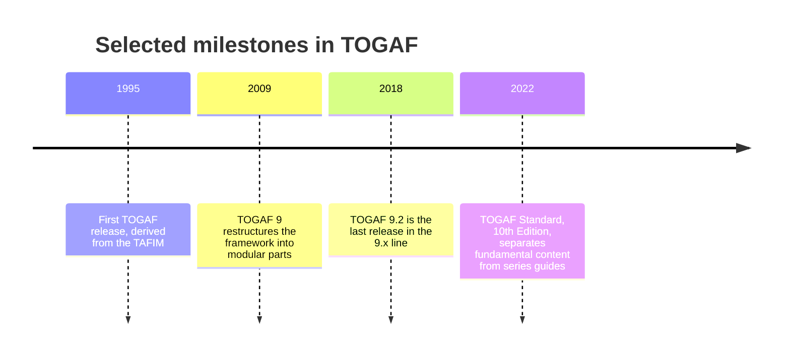

The practical implication is that "TOGAF" names a family of editions, and an organization's internal documents may cite any of them. The phase names and the overall cycle have been stable enough that the concepts in this chapter apply across editions, but artifact lists and terminology differ in detail. When you adopt TOGAF, record which edition your internal method is based on, and treat later editions as a source of ideas rather than a mandatory upgrade.

## 3. The Problem TOGAF Addresses

Consider what goes wrong without any shared enterprise method. Each failure below is a general pattern, not a reported incident.

| Failure pattern | Mechanism | What the framework contributes |
| --- | --- | --- |
| Local optimization | Teams choose tools and designs that suit their system but multiply integration and support cost across the enterprise | Architecture principles and standards that apply across projects |
| Strategy and delivery disconnect | Investment is approved from business goals with no traced path to the systems that must change | A vision phase and a traced chain from goal to work package |
| Unsequenced change | Dependencies between initiatives are discovered during delivery, after commitments are made | Gap analysis, opportunities and solutions, and migration planning |
| Undetected drift | Delivered systems diverge from the intended design and nobody records why | Governance checkpoints, conformance review, and recorded exceptions |
| Lost rationale | After staff turnover, nobody knows why a constraint exists, so it is neither respected nor removed | A repository holding decisions, assumptions, and baselines |

Alternatives exist. An organization can rely on strong individual architects, on lightweight team-level decision records, on a platform team that offers paved paths, or on another framework with a different emphasis. TOGAF is chosen when the dominant difficulty is coordination across many owners over a long horizon, when regulation or audit demands traceability, or when a common vocabulary is needed between business and technology units. It is a poor choice when a single product team owns the whole system and can decide quickly; there the overhead exceeds the coordination benefit. The decision criteria are therefore the number of independent owners, the cost of late discovery of conflicts, the audit and traceability burden, and the organization's capacity to run the process rather than perform it.

## 4. What TOGAF Contains

TOGAF is easiest to understand as five cooperating parts, because organizations often adopt one and ignore the others, with predictable results.

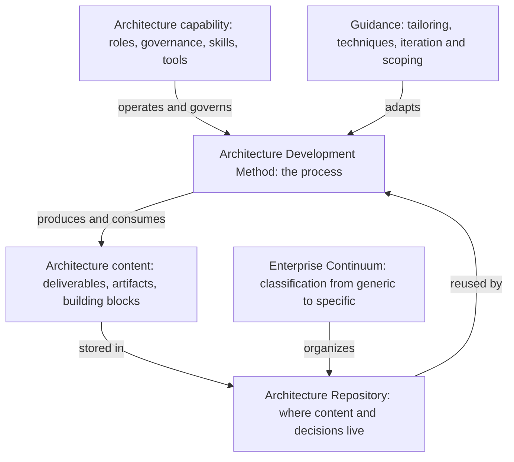

The diagram shows that the method is not self-sufficient. It produces content, the content needs a home that is classified so it can be reused, and the whole loop needs people, authority, and tooling to run. Adopting only the cycle yields a sequence of workshops with no memory; adopting only the repository yields an archive with no process that feeds it.

- **Architecture Development Method (ADM).** The iterative cycle of phases covered in detail in the sections below.
- **Architecture content.** A structured way to describe what architecture work produces. Commonly this is split into deliverables (formal work products that are reviewed and agreed, such as an Architecture Definition Document), artifacts (more granular catalogs, matrices, and diagrams that populate deliverables), and building blocks. Architecture Building Blocks describe required capabilities in implementation-neutral terms; Solution Building Blocks describe the concrete products or components that realize them. The separation lets you agree on what is needed before arguing about which product supplies it.
- **Enterprise Continuum.** A classification idea that arranges architecture assets from generic (foundational patterns and common models) through industry-specific to organization-specific, and parallel solution assets from generic products to deployed systems. Its value is reuse: before inventing an architecture, look for a more generic asset to adapt.
- **Architecture Repository.** The store for the baseline, target, standards, reference material, decisions, and governance records. Its internal structure is covered later in this chapter.
- **Architecture capability and guidance.** The organization, roles, skills, and governance needed to run architecture work, plus guidance on adapting the method (for example, applying it iteratively, at different levels of scope, or alongside agile delivery).

Two terms recur throughout. A **baseline** is the current state of an architecture description; a **target** is the intended future state; the difference is a **gap**. A **transition architecture** is an intermediate state that is deliberately delivered on the way to the target, with its own value, so that the program does not depend on a single big-bang cutover.

### 4.1 Architecture Domains

TOGAF organizes the architecture description into four domains that the ADM addresses in turn:

| Domain | Concern | Typical content |
| --- | --- | --- |
| Business | Strategy, organization, capabilities, processes, and governance of the business | Capability and value-stream views, organization and role catalogs |
| Data | Logical and physical data assets and how they are managed | Data entities, ownership, lifecycle, and flow |
| Application | Applications and their interactions and responsibilities | Application portfolio, interface catalogs, application-to-capability maps |
| Technology | Infrastructure, platforms, and networks required to host the applications | Technology standards, platform and hosting views, network topology |

Data and application architecture are often grouped as "information systems architecture". The order matters: business need is meant to drive information systems, which are meant to drive technology choices, so that a platform decision is justified by a need rather than the reverse. In practice organizations frequently start from a technology constraint, for example an end-of-life platform. The framework accommodates this because the phases are revisited, but you should record explicitly that the sequence was inverted and what business assumptions were therefore never validated.

## 5. The ADM as an Iterative Cycle

The ADM begins with preliminary work that establishes the architecture capability, principles, governance, and tailoring. The Architecture Vision (Phase A) frames scope and stakeholder outcomes. Business (Phase B), information systems (Phase C, covering data and application), and technology (Phase D) architecture phases develop the target views. Opportunities and Solutions (Phase E) identifies implementation groupings; Migration Planning (Phase F) sequences them; Implementation Governance (Phase G) checks conformance and handles deviations; Architecture Change Management (Phase H) assesses later changes. Requirements Management operates across the whole cycle.

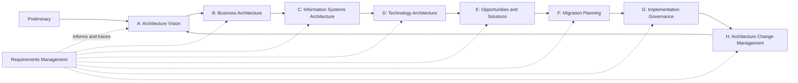

The phases are a reasoning structure, not a one-pass waterfall. A merger, regulation, or technology constraint can send work back to scope, requirements, or a prior architecture decision. Three kinds of iteration are worth distinguishing, since each has a different cost.

- **Iteration of the whole cycle.** After Phase H the next change request begins a new pass, typically starting again at the vision. This is the normal life of an architecture.
- **Iteration between phases.** Finding in Phase D that a target platform cannot meet a Phase B requirement sends the work back to adjust either the requirement or the choice. This is expected, and the recorded reason is itself valuable evidence.
- **Iteration within a phase.** Developing a phase's output in progressively more detail, for example a coarse baseline first and detail only where gaps appear.

The failure mode of the cycle is not iteration but the absence of a stopping rule. Without agreed scope and time boxes, the baseline phases can absorb the entire budget documenting what exists in detail that no decision requires. A useful rule: describe the baseline only to the depth at which a gap or decision can be identified.

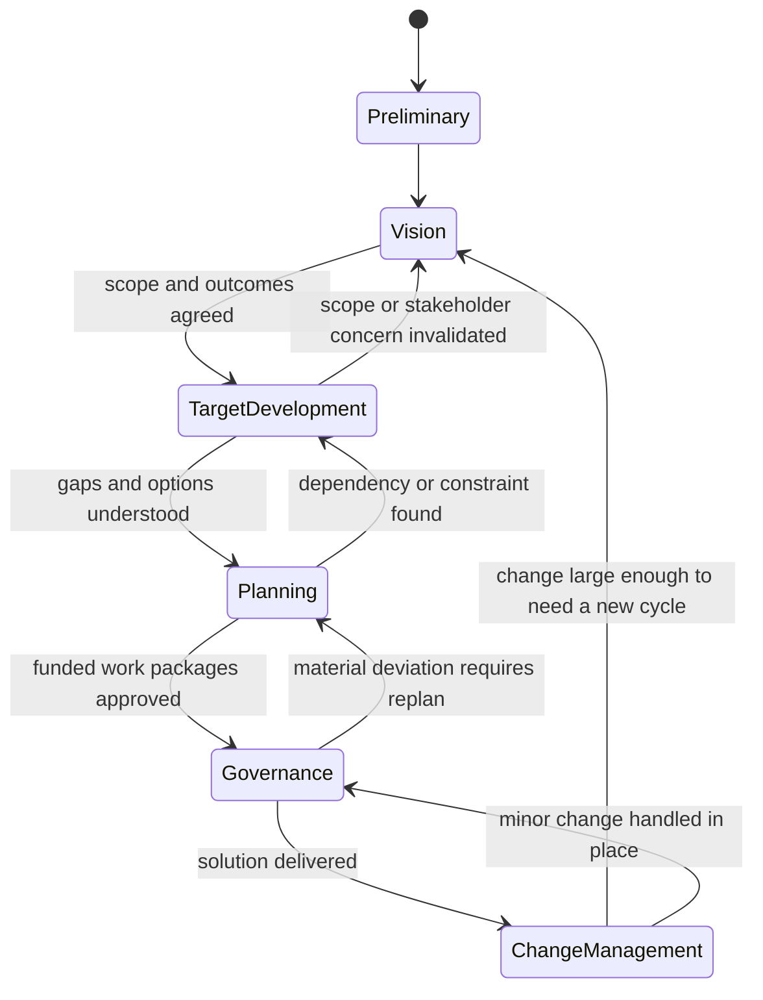

The state view collapses the phases into five stages to show the allowed backward transitions. Each backward arrow is a point where the organization decides whether a discovery changes the plan or only the implementation. Architects add value at these points by deciding quickly which it is, and by recording the reason so the same debate is not repeated.

## 6. The Early Phases in Depth

### 6.1 Preliminary Phase

The preliminary phase prepares the organization to do architecture work at all. Its outputs are the practical preconditions: an agreed statement of how architecture is done here, the principles that constrain decisions, the roles and authority of architects and boards, the tools and repository, and the tailored version of the ADM. It also identifies the framework and method relationships, for example how architecture work connects to portfolio management, project delivery, and operations.

Architecture principles deserve particular care. A principle is a durable, general rule that guides decisions, and a useful one has a statement, a rationale, and implications. A principle without implications cannot be applied. A principle such as "data is managed as a shared asset" is only helpful when its implications are explicit, for example that each domain entity has a named steward and that systems access shared data through agreed interfaces instead of private copies. The common failure is a list of aspirational slogans that no decision can be checked against.

```markdown
**Principle:** Data has a single accountable owner.
**Rationale:** Conflicting copies of customer data raise error and regulatory risk.
**Implications:**
- Each shared data entity has a named steward in the repository.
- New systems read shared entities through the owning domain's interface.
- Exceptions need a recorded waiver with an expiry date.
```

### 6.2 Phase A: Architecture Vision

The vision phase establishes the scope, stakeholders, concerns, and expected outcomes of a piece of architecture work, and decides whether it should proceed. It typically produces a high-level description of baseline and target, a statement of the work to be done and its acceptance, and the stakeholder map. Commonly named outputs include the Architecture Vision itself, and a Statement of Architecture Work agreed with the sponsor; the work usually starts from a Request for Architecture Work submitted by whoever needs the change.

The mechanism that makes this phase useful is the pairing of **stakeholder concerns** with **viewpoints**. A stakeholder is someone with an interest in the outcome; a concern is a specific thing they need to be satisfied, such as cost of ownership or regulatory exposure; a view is a representation that answers a concern. If you identify concerns first, you can choose the minimum set of views that addresses them, which is how the framework resists over-production. If you start from a list of standard artifacts, you produce documents and then search for readers.

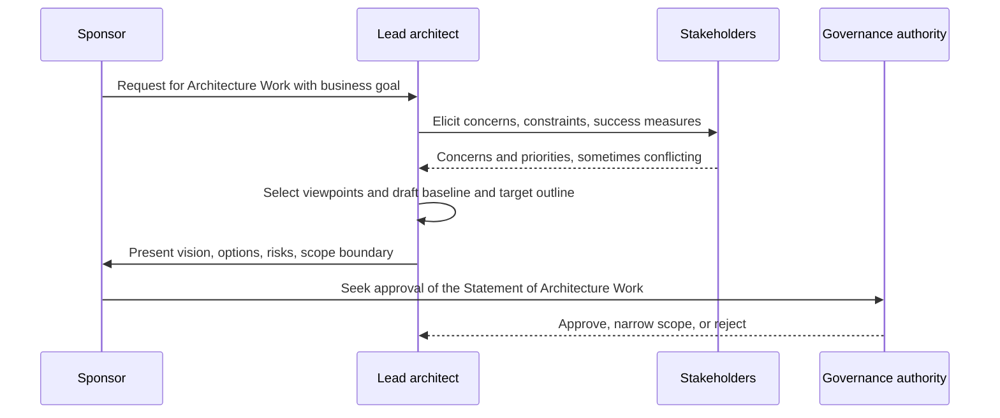

The sequence shows that approval comes after concerns are surfaced and an outline exists, not before. The point where conflicting stakeholder priorities appear is the real work of the phase: the lead architect cannot resolve a conflict between, say, cost and resilience alone, so the conflict is escalated to whoever has decision authority, with options and consequences. A vision that hides such conflicts is common and expensive, because the conflict reappears in Phase D as a "technical" disagreement.

### 6.3 Phases B, C, and D: Developing the Target Domains

Each of these phases follows the same pattern, which is the part worth learning. First, select the viewpoints needed to address the concerns identified in the vision. Second, describe the **baseline**, only to the level needed. Third, describe the **target**. Fourth, perform **gap analysis**: for each element, record whether it is retained, changed, added, or retired. Fifth, define candidate **roadmap components**, which later phases turn into work packages. Finally, resolve cross-domain impacts, such as a business capability that requires an application that does not yet exist.

Gap analysis is a simple but powerful technique. A matrix lists baseline elements down one axis and target elements across the other; an element in the target without a baseline counterpart is a new build or purchase, and a baseline element without a target counterpart is a retirement candidate.

| Capability | Baseline application | Target application | Gap |
| --- | --- | --- | --- |
| Customer onboarding | Regional form system (three variants) | Single onboarding service | Consolidate and retire two variants |
| Identity verification | Manual review | Automated verification service | New |
| Statement printing | Legacy batch system | None, move to digital delivery | Retire |

The matrix is illustrative. Its value lies in the retired and new rows: they become the funding and risk conversation, whereas elements unchanged between baseline and target need no architecture effort.

The three phases differ in what they emphasize. Phase B concentrates on what the business does and who is accountable. Phase C splits into data and application architecture, and is where entity ownership, integration, and application responsibilities are made explicit. Phase D selects platforms and infrastructure and checks that quality requirements such as availability and security can be met. The domain chapters listed in the Introduction treat each domain in depth; this chapter only establishes how they connect through the cycle.

A frequent edge case is a target that depends on a technology not yet proven in the organization. The framework does not prohibit the choice; it asks that the dependency be recorded as a risk with an owner, and that a transition architecture or proof of value precede commitment.

## 7. Worked Scenario: Early Phases for a Hypothetical Retailer

This scenario is illustrative and does not describe a real organization. A mid-sized retailer sells through stores and a website and has grown by acquisition. The executive sponsor wants a single customer view to support loyalty offers, but each acquired brand runs its own customer database, and the sponsor has asked for a plan within a quarter.

**Preliminary.** The architecture team has no formal board, so the first step is to agree who decides: a small steering group chaired by the sponsor, with delegated authority for local decisions within published principles. The team adopts three principles, one being the single accountable data owner shown earlier. They decide the ADM will be tailored: baseline detail only for customer and consent data, and no deep technology survey yet.

**Phase A.** Stakeholder interviews surface conflicting concerns: marketing wants speed, the privacy officer wants consent handled per jurisdiction, and the store operations lead worries about point-of-sale outages during migration. The vision states the outcome (one customer identity across brands), the scope (customer, consent, and loyalty data; not inventory), and the measure (share of transactions linked to a single identity). Scope boundary and the privacy constraint are put to the steering group, which accepts them.

**Phases B to D.** Business architecture maps who owns customer relationships per brand. Information systems work finds that two brands hold the same customer under different identifiers, and that consent records are stored inconsistently, which is the dominant gap. Technology architecture concludes the store systems need local caching to survive outages, so any central identity service must tolerate disconnection. Gap analysis yields one new service, two retirements, and a risk on consent migration.

The key architectural judgment is the sequencing implied by the findings: consent consolidation must precede loyalty offers, because offers built on inconsistent consent would create regulatory exposure. That conclusion comes from traced requirements and gap analysis rather than from a standard artifact, which is the evidence the phases are meant to supply. Planning that sequence into work packages is the subject of the later phases.

## 8. Requirements Management and Change Impact

Requirements Management is the one ADM activity that is not a phase. It sits across the cycle because every phase both consumes requirements and discovers new ones. Its job is not to freeze requirements; it is to keep them **identifiable, owned, and traceable** so that when something changes, the organization can find what the change touches.

### 8.1 What a traceable requirement carries

Architecture requirements include business outcomes, constraints, quality needs, and obligations such as regulation or contract terms. A requirement that cannot be traced is only a sentence. A minimal record has these fields:

| Field | Purpose | Example (illustrative) |
| --- | --- | --- |
| Identifier and version | Lets other records point at exactly this statement | REQ-014 v2 |
| Statement | One testable sentence | Consent state is queryable from every channel |
| Source and owner | Who asked, and who can change or retire it | Privacy officer |
| Measure of satisfaction | How a reviewer observes that it is met | Consent lookup succeeds during a store disconnection test |
| Affected elements | Views, decisions, and work packages that depend on it | Consent service, store cache, work package WP-3 |
| Status | Proposed, accepted, changed, or retired, with reason | Accepted |

"Highly available" is incomplete without a failure condition and a recovery expectation; "queryable during a store disconnection" can be tested. The discipline separates a framework artifact from the evidence it is meant to organize.

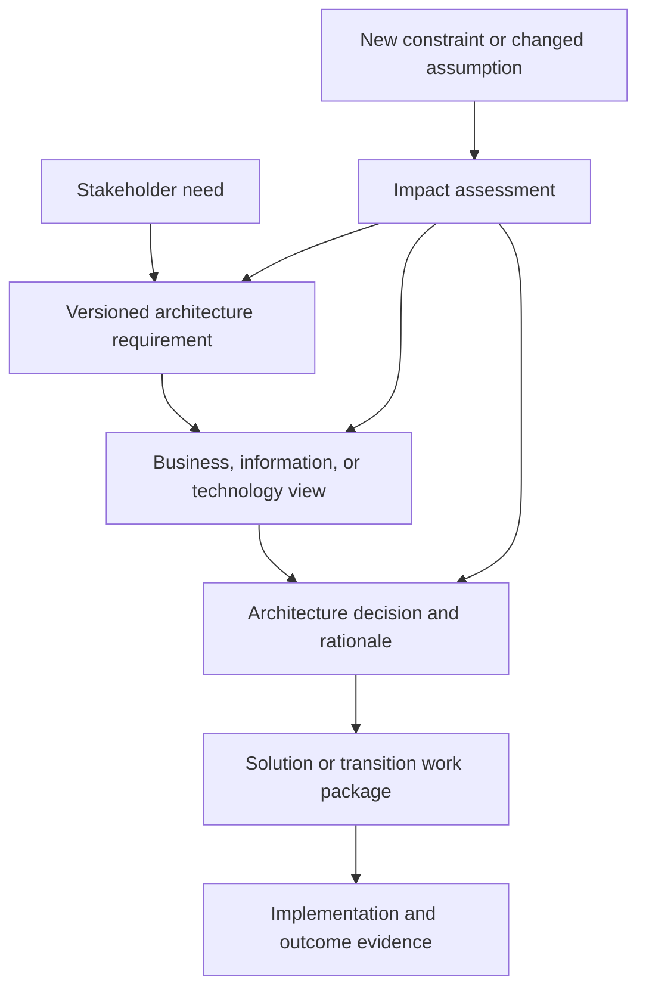

The diagram shows two flows. The downward chain is how a need becomes evidence; the impact loop is why the chain is worth keeping. When an assumption changes, the assessment walks the links to list which views, options, work packages, and governance decisions must be revisited, instead of relying on someone's memory of the original discussion.

### 8.2 Decision criteria and failure modes

Trace at the granularity at which a change would cause a different decision. Tracing every sentence of every document is expensive and is abandoned within months; tracing only the dozen requirements that shape scope, sequencing, and investment is sustainable. Three failure modes recur:

- **Orphan requirements.** A requirement with no owner survives after its source has left, and constrains designs for reasons nobody can state.
- **Frozen baseline.** Requirements are signed off in the vision and never reopened, so Phase D discoveries are handled as exceptions instead of as legitimate input.
- **Trace without meaning.** Links exist but carry no rationale, so an impact assessment returns a long list that nobody can prioritize.

An edge case is a requirement that conflicts with another. Record the conflict, the decision authority who resolved it, and the option rejected; the rejected option is what a future change will revisit first.

## 9. Phases E and F: From Gaps to a Sequenced Plan

Phases B to D end with gaps and candidate roadmap components. Phases E and F convert them into something an organization can fund and schedule. They are where architecture either connects to the portfolio or becomes a shelf document.

### 9.1 Phase E: Opportunities and Solutions

Phase E groups the gaps into **work packages**: units of change that can be planned, owned, and delivered together. The grouping is a judgment about cohesion, not arithmetic. Typical criteria are shared dependency (two gaps need the same data migration), shared ownership (one team can deliver both), and shared risk (both depend on an unproven platform). The phase also decides, for each building block, whether the sourcing approach is build, buy, reuse, or retire, which is where Architecture Building Blocks meet concrete Solution Building Blocks.

A key output is the set of **transition architectures**: intermediate states that each deliver value and remain operable. The test is whether the organization could stop at that state for a year and still run the business. If it could not, it is a milestone in a big-bang cutover, not a transition architecture.

### 9.2 Phase F: Migration Planning

Phase F sequences the work packages. Inputs are dependencies, costs, benefits, risks, and capacity. The common technique is a **dependency-then-value ordering**: first place packages that others depend on, then order the rest by value and risk reduction. The plan is expressed as a roadmap with explicit assumptions, and it is expected to be reviewed as those assumptions change.

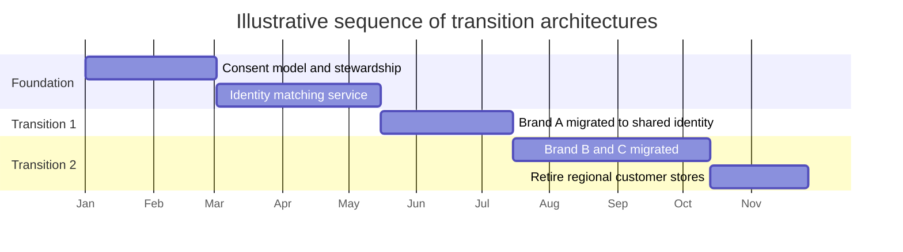

The dates are placeholders. What matters is the shape: foundation items that others depend on come first, and each later block leaves the enterprise in a stable state. Because the ordering is derived from recorded dependencies, a change to one dependency lets the planner see which later blocks move.

| Sequencing criterion | Favours | Risk if used alone |
| --- | --- | --- |
| Dependency order | Early foundation work | Long wait before any visible benefit |
| Highest value first | Early benefit | Rework when a hidden dependency appears |
| Lowest risk first | Early confidence | Hard items deferred until the deadline |
| Contract or regulatory date | Compliance | Distorts an otherwise sensible order |

In practice a plan blends these, and the architect's contribution is to state which criterion dominated each choice. A failure mode is a roadmap presented as a commitment: the further out the package, the less reliable its date, and the plan should say so. Roadmap format and communication mechanics belong to [Roadmaps](../02_Design_Thinking_and_Product_Management/CH21_Roadmaps.md); this chapter owns only how architecture supplies the dependencies a roadmap must respect.

## 10. The Repository as Operating Memory

Section 4 introduced the Architecture Repository as one of five parts. Its practical value is as **operating memory**: the place where a later team learns what was decided, why, and what it depended on. TOGAF describes a repository that can hold principles, standards, reference material, models, decisions, and transition descriptions. A document archive with no lifecycle and no link to decisions does not qualify.

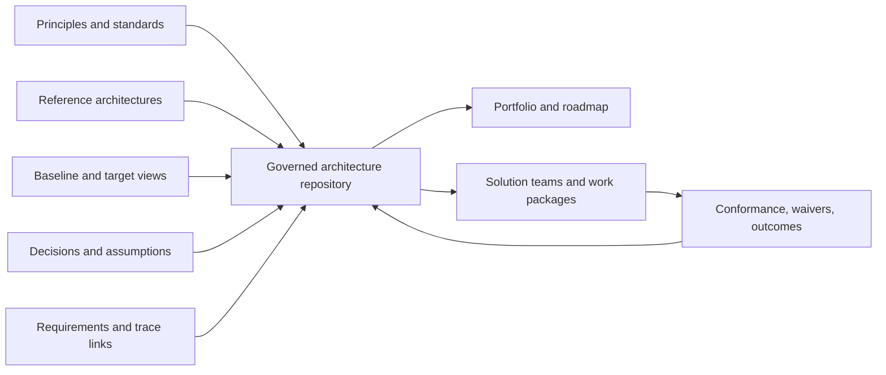

The loop on the right is the point: delivery returns evidence, such as conformance results and waivers, to the repository, so the next planning pass starts from what actually happened rather than from what was intended.

### 10.1 A useful minimum and its upkeep

| Content | Owner | Review trigger |
| --- | --- | --- |
| Current baseline and target views | Domain architect | A funded change touches the area |
| Decision records with rationale and assumptions | Decision maker | An assumption is marked invalid |
| Requirements and trace links | Requirement owner | Section 8 impact assessment |
| Standards and principles | Architecture authority | Scheduled review date |
| Waivers and exceptions | Governance authority | Expiry date |

Each row needs an owner and a review trigger; content without them decays silently, and stale content is worse than none because it is trusted. Define access boundaries for sensitive enterprise information, and retention for superseded views, so that history is available to explain past decisions without being mistaken for the current state.

Part 01 [Architecture Thinking](../01_Architecture_Mindset/CH03_Architecture_Thinking.md) owns the ADR practice; the repository can hold such records and reference them without replacing their content. The mechanics of notation and documentation structure belong to [Part 21](../21_Architecture_Documentation/PART_OVERVIEW.md).

The main trade-off is effort against freshness. A heavyweight modelling repository gives rich queries but requires dedicated curation; a lightweight set of linked documents is cheaper but relies on discipline. Choose by asking how often someone will query the content to answer a question that matters, and weigh that against who will keep it current.

## 11. Phases G and H: Governance at Decision Boundaries

Phase G governs implementation against the architecture; Phase H governs the architecture against change. Both rely on the same idea: **place review where a decision can still change direction**. Natural boundaries are scope approval, target acceptance, investment sequencing, procurement, implementation exception, and material change. A checkpoint should name the decision authority, the evidence packet, the permitted outcomes, the escalation route, and the condition for revisiting the decision. Turning phase completion into an artifact-count gate defeats the purpose, because documents are counted instead of risks being examined.

In Phase G, TOGAF commonly describes an architecture contract between the architecture function and the delivery owner, recording what the implementation is expected to conform to. Treat it as an agreement on obligations and permitted deviations, not as a legal instrument unless your organization makes it one.

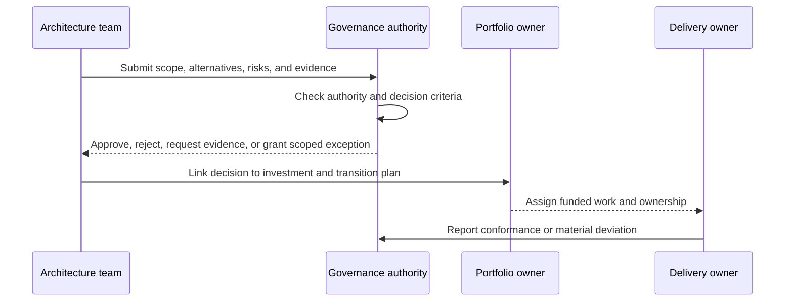

The sequence shows that governance has a return path: delivery reports conformance or deviation back to the authority, so the checkpoint is a conversation across the life of the work, not a single gate before it. A request for evidence is a legitimate outcome and is often the most useful one.

### 11.1 Proportionality and deviation handling

Governance should be proportionate to risk and to how reversible the decision is. Delegated teams can decide locally within standards; enterprise review focuses on cross-domain impacts, major investments, shared platforms, and exceptions.

| Situation | Suggested response | Evidence expected |
| --- | --- | --- |
| Change within published standards | Delegated approval, recorded | Decision record |
| Deviation from a standard with a local cause | Time-limited waiver | Reason, owner, expiry date |
| Deviation affecting another domain | Enterprise review | Impact assessment, options |
| Deviation showing the target is wrong | Return to Phase D or A | Evidence that the assumption failed |

Two failure modes dominate. Permanent waivers turn the standard into fiction, so every waiver needs an expiry and an owner. Conversely, treating every deviation as a violation teaches delivery teams to hide them. The last row matters most: a recurring deviation is data about the architecture, not about the team.

### 11.2 Phase H: Architecture Change Management

Phase H assesses changes to the architecture after delivery, such as a new regulation, a merger, or a platform end-of-life. The central judgment is classification: is this a **simplification** handled in place, an **incremental change** needing targeted work, or a **re-architecture** needing a new cycle (see the state view in Section 5)? Set the thresholds in advance, for example by affected domains, budget, or risk class, so classification is not negotiated case by case.

Governance bodies, charters, and review mechanics are owned by [Architecture Governance](CH08_Architecture_Governance.md) and [Architecture Review Boards](CH09_Architecture_Review_Boards.md); this chapter only places the checkpoints within the cycle.

## 12. Tailoring the Method to the Change

Use a full ADM cycle when the change spans domains, portfolios, or substantial uncertainty. A bounded change can use a subset of phases, provided requirements, alternatives, ownership, risks, and implementation evidence remain connected. Tailoring should state what is omitted, why it is unnecessary, and what event would trigger a fuller review.

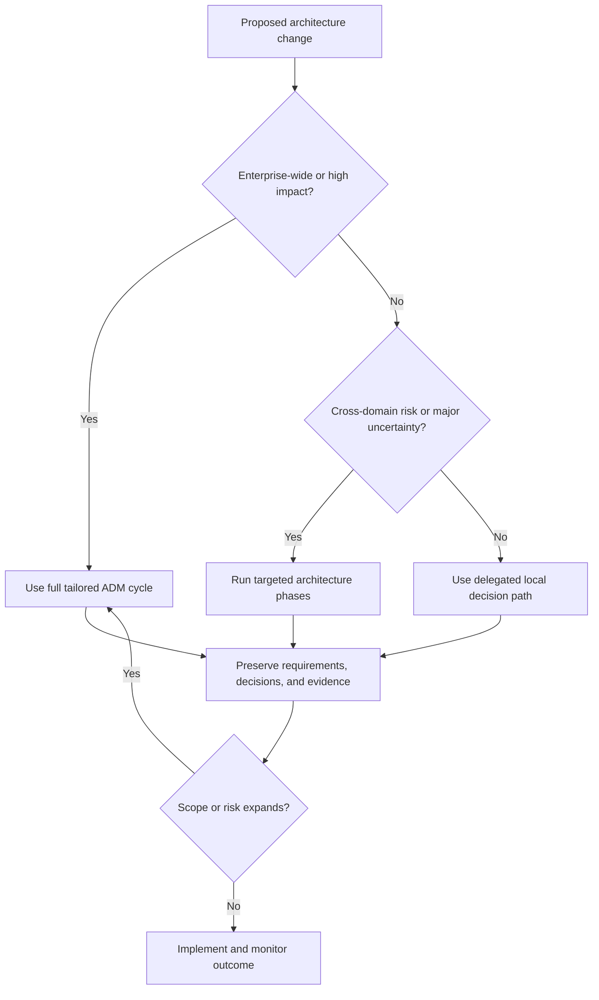

Tailoring is not a permission to skip governance without record. The decision should identify a responsible architect, affected stakeholders, boundaries, and review trigger. A pattern that works for one team may fail for a merger or regulated data change.

| Tailoring lever | Options | Question to ask |
| --- | --- | --- |
| Phases used | Full cycle, targeted subset | Which phases would change a decision? |
| Baseline depth | Coarse, detailed only at gaps | Is detail needed to identify a gap? |
| Artifacts | Minimum set per concern | Who reads this, and what do they decide? |
| Governance weight | Delegated, light review, enterprise review | What is the cost of a wrong, hard-to-reverse call? |
| Cadence | One pass, iterative increments | How soon will assumptions change? |

Record each choice as a short tailoring note: what is omitted, why that is safe, and the event that triggers a fuller review. Alongside agile delivery, the usual arrangement is that enterprise architecture sets direction and constraints at the level of capabilities and standards, while teams make solution-level decisions inside those constraints and feed evidence back. Where that feedback does not exist, tailoring has quietly become bypassing.

## 13. Worked Scenario Continued: Planning and Governing the Retailer's Customer Platform

This continues the hypothetical retailer from Section 7 and remains illustrative. Section 7 ended with a gap analysis: one new identity service, two retirements, and a risk on consent migration. The later phases turn that into a plan.

**Phase E.** The team groups gaps into three work packages: a consent model with named data stewardship, an identity matching service, and brand-by-brand migration. Sourcing differs: consent stewardship is organizational change, matching is a buy-or-build decision, and migration is delivery work. Two candidates for matching are compared on how they tolerate disconnected stores (the technology constraint found in Phase D); the cheaper candidate fails that test and is rejected with the reason recorded.

**Phase F.** Dependency order places consent first, then matching, then migration, as in the Gantt view in Section 9. Transition 1 migrates one brand and keeps the other two on their existing stores, which is a stable state the business can live in. The roadmap marks later packages as lower confidence.

**Phase G.** Each package has a delivery owner and a short conformance statement: for example, new systems read customer identity through the matching service and consent through the owning domain's interface. During delivery, one brand requests a waiver to keep a private consent copy for a marketing tool. The steering group grants it for one quarter with an owner and an expiry, and records the risk.

**Phase H.** A change in a jurisdiction's consent rules arrives. Classification places it as an incremental change: the consent model is revisited, the matching service is not. Traced requirements show that only two views and one work package are affected, so the plan is adjusted instead of restarted.

The scenario shows one coherent chain: gap, work package, sequencing, conformance, and change impact, with each link supported by a recorded reason. The same pattern applies to other consolidations, for example where regional platforms must be merged under data-residency constraints; the differences are in the requirements that dominate, not in the method.

## 14. Failure Scenarios and Common Mistakes

The catalogue below lists general failure patterns, not reported incidents.

| Failure | Symptom | Detection | Mitigation |
| --- | --- | --- | --- |
| Framework as ceremony | Many deliverables, no decision cites them | Ask which decision each artifact changed | Tie each artifact to a named concern and reader |
| Baseline over-documentation | Budget spent describing the current state | Baseline effort exceeds target and planning effort | Describe only to the depth where a gap appears |
| Vision hides stakeholder conflict | "Technical" disputes in Phase D | Same disagreement recurs under different names | Surface conflicts in Phase A and escalate with options |
| Orphan principles | Principles cited but never applied | No review decision references a principle | Give each principle implications and test it on a real decision |
| Dead repository | Content out of date, teams avoid it | Review dates passed, no owners | Owners and review triggers; link to active work |
| Unsequenced roadmap | Late discovery of dependencies | Work packages blocked by unstarted packages | Dependency-then-value ordering |
| Permanent waivers | Standards ignored without consequence | Waivers lacking expiry dates | Expiry, owner, and periodic review |
| Gate-only governance | Review after the design is fixed | Reviews rarely change an outcome | Place checkpoints at decision boundaries |
| Big-bang disguised as transition | No stable intermediate state | Cannot stop at a milestone and operate | Define transitions that deliver standalone value |
| Tailoring as bypass | Skipped phases with no record | No tailoring note exists | Require omission rationale and review trigger |

### 14.1 Anti-patterns

- **Artifact count as progress.** Completion is judged by documents produced, not by decisions informed or risks reduced.
- **Architecture as a separate tribe.** Enterprise architects produce views for each other while delivery teams never see them; feedback from delivery never arrives.
- **Framework purism.** Every phase and artifact is applied regardless of the change; small changes wait for the full cycle.
- **Technology-first inversion left unrecorded.** A platform decision is made first and the business justification written afterwards, so unvalidated assumptions stay hidden.
- **Tool-led adoption.** A modelling tool's metamodel is allowed to define the method, and the organization models what the tool can represent.

A shared root cause runs through most entries: the cycle is run for its own sake, not to inform a decision. The remedy is usually to shrink, not to add.

## 15. Trade-off Analysis and Decision Framework

TOGAF is one option among several ways to coordinate cross-owner change. Compare by the dominant difficulty.

| Option | Strength | Weakness | Fits when |
| --- | --- | --- | --- |
| Full tailored TOGAF cycle | Traceability and shared vocabulary across many owners | Process overhead, risk of ceremony | Many independent owners, long horizon, audit burden |
| TOGAF subset (selected phases and content) | Keeps the useful parts at lower cost | Needs explicit tailoring discipline | Bounded change with cross-domain risk |
| Lightweight decision records and principles | Fast, team-owned | Weak cross-team visibility and sequencing | Few teams, strong shared culture |
| Platform team with paved paths | Standards enforced through tooling | Covers only what the platform offers | Technology fragmentation is the main problem |
| Another framework or ontology (for example [Zachman](CH02_Zachman_Framework.md)) | Different emphasis, such as classification | Not a process for change | Classification and completeness are the question |

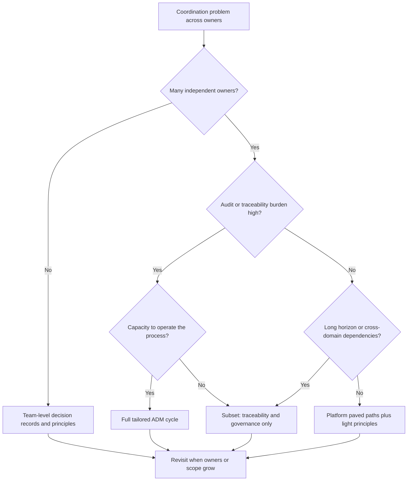

The flowchart is a starting heuristic, not a rule. Its last step matters: the choice is revisited as the number of owners or the scope grows, since an approach that suited three teams rarely suits thirty. The capacity question guards against adopting a process the organization can only perform, which is the main path to ceremony.

## 16. Illustrative Composite Case Study: Retiring a Regional Platform Under Residency Constraints

This case is hypothetical and composite; it describes no real organization. A services company runs three regional customer platforms inherited from separate business units. Leadership wants to consolidate to reduce duplicated capability, but each region has data-residency obligations, and one region's contract forbids moving customer records during a defined period.

**Context and tailoring.** The architecture team has a current capability map and a technology inventory, so it reuses them and spends its effort on requirements and governance for residency and identity. It writes a tailoring note: full treatment of Phases A, B, C, E, F, G; technology phase limited to comparing shared and regional deployment; review trigger is any new residency rule.

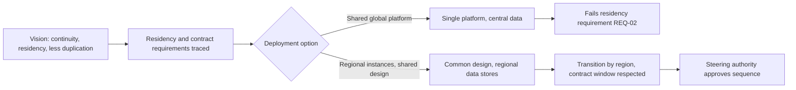

**Decision.** The shared-platform option is rejected because traced residency requirements cannot be met with centrally held data. The team chooses a common application design deployed per region, with regional data stores. The cost is continued duplication of infrastructure; the benefit is that duplicated capability, not duplicated deployment, is removed.

**Sequencing.** The region under the contract window migrates last. The first region becomes Transition 1 and is operable indefinitely if later work is delayed.

**Change.** A residency rule changes in the second region. Trace links identify the affected views and one work package; the plan is adjusted in place. The decision record explains why a shared platform was rejected, which prevents the option from being reintroduced without new evidence.

The implications: the value came from recorded requirements and rejected options, not from any single artifact, and the decision that looked like a compromise was the only one the traced constraints allowed.

## 17. Architect Review Checklist

Use this list when reviewing enterprise architecture work that claims to follow TOGAF.

- [ ] The problem is stated as a cross-owner coordination problem, and the choice of framework is justified against alternatives.
- [ ] The edition or internal method version is recorded, and the tailoring note states what is omitted and why.
- [ ] Stakeholders and concerns are listed before viewpoints and artifacts are chosen.
- [ ] Conflicting stakeholder priorities are recorded with a named decision authority.
- [ ] Principles have rationale and implications and have been applied to a real decision.
- [ ] Baseline detail is limited to what is needed to identify gaps.
- [ ] Gap analysis distinguishes new, changed, retained, and retired elements.
- [ ] Key requirements have an owner, a measure, and trace links to views and work packages.
- [ ] Rejected options and their reasons are recorded.
- [ ] Work packages have sequencing rationale and dependencies, and transition architectures can run stably.
- [ ] Roadmap confidence is stated and decreases with distance.
- [ ] Governance checkpoints sit at decision boundaries with evidence packets and permitted outcomes.
- [ ] Every waiver has an owner and an expiry date.
- [ ] The repository holds baseline, target, decisions, and standards, each with an owner and review trigger.
- [ ] Change classification thresholds are defined, and recurring deviations are treated as signals about the architecture.
- [ ] Outcome measures exist so progress is judged by results, not artifact counts.

## 18. Interview Questions

1. **What problem does TOGAF address, and when would you not use it?** It addresses coordination of change across many owners over a long horizon, with traceability from goals to work. It is a poor fit when one team owns the whole system and can decide quickly, because the overhead exceeds the coordination benefit.
2. **Name the main parts of TOGAF.** The ADM (process), architecture content, the Enterprise Continuum, the Architecture Repository, and architecture capability and guidance. Adopting only one part gives predictable gaps, such as workshops with no memory.
3. **Walk through the ADM.** Preliminary, A Vision, B Business, C Information Systems, D Technology, E Opportunities and Solutions, F Migration Planning, G Implementation Governance, H Change Management, with Requirements Management across all.
4. **Why is the ADM iterative?** Discoveries in later phases, such as a platform that cannot meet a business requirement, legitimately send work back. The skill is deciding quickly whether a discovery changes the plan or only the implementation, and recording why.
5. **What is a transition architecture and how do you test one?** An intermediate state delivered on the way to the target. Test: could the organization stop there for a year and still operate? If not, it is a milestone in a big-bang cutover.
6. **How do you stop the baseline phase consuming the budget?** Agree scope and time boxes, and describe the baseline only to the depth at which a gap or decision can be identified.
7. **How should governance work with agile delivery?** Enterprise architecture sets direction and constraints; teams decide inside them and return evidence. Checkpoints sit at decision boundaries, proportionate to risk and reversibility.
8. **How do you recognize that TOGAF is being applied as ceremony?** Artifacts that no decision cites, reviews that never change an outcome, permanent waivers, and progress measured by document counts.

## 19. Hands-on Exercises

1. **Principle with implications.** Write three architecture principles for an organization you know, each with statement, rationale, and at least two implications. Then take a recent real decision and check whether each principle would have changed the outcome. Revise any principle that could not be applied.
2. **Gap analysis matrix.** Pick a business capability and list its current applications and a plausible target. Build a baseline-versus-target matrix marking each element as new, changed, retained, or retired. Identify the two rows that most affect funding and risk, and explain why.
3. **Requirement trace.** Take five architecture requirements for a system. For each, write an owner, a measure of satisfaction, and the views and work packages it affects. Then invent an assumption change and use your trace to list what must be revisited.
4. **Tailoring note and sequence.** Choose a bounded change and write a tailoring note stating phases used, baseline depth, governance weight, and review trigger. Then sketch three work packages with dependencies and justify your ordering criterion.

## 20. Design and Architecture Review Questions

1. **A sponsor asks for a full ADM cycle for a single product team's database upgrade. How do you respond?** Outline: assess owners, cross-domain risk, and reversibility; likely propose a delegated local decision with a decision record; state what event would trigger fuller review, such as a dependency on shared data; record the tailoring decision so the choice is visible.
2. **Phase D reveals the target platform cannot meet a Phase B quality requirement. What happens next?** Outline: use the recorded trace to identify the requirement owner and affected elements; present options, either relaxing the requirement or changing the platform, with consequences; the decision authority chooses; record the reason; adjust the views and any downstream work packages.
3. **A delivery team repeatedly requests waivers for the same standard. How should governance respond?** Outline: treat repetition as data; check whether the standard fits reality; if it does, keep waivers time-limited with owners; if it does not, revisit the standard or the target through Phase H classification; avoid both permanent waivers and punishing the team.
4. **Your repository exists but nobody uses it. Diagnose and fix.** Outline: check ownership, review triggers, and links to active work; find which questions people actually need answered; shrink to a useful minimum; connect delivery evidence back into it; retire content with no owner.
5. **A roadmap's third-year items are being quoted as commitments. What do you change?** Outline: attach explicit confidence levels to packages that decrease with horizon; separate dependency facts from date estimates; record assumptions with each package; agree that distant items are reviewed when assumptions change; see [Roadmaps](../02_Design_Thinking_and_Product_Management/CH21_Roadmaps.md) for communication formats.

## 21. Summary

TOGAF supplies a named, repeatable way to coordinate architecture across many owners. Its five parts, the ADM, content, Enterprise Continuum, repository, and capability with guidance, only work together; adopting one alone yields predictable gaps. The ADM is an iterative cycle in which backward movement is normal and valuable when the reason is recorded, and its early phases pair stakeholder concerns with the minimum viable views, then use gap analysis to identify new, changed, and retired elements.

Mapped to the outcomes in the Introduction: the problem is cross-owner coordination (outcome 1); the components are method, content, continuum, repository, and capability (outcome 2); the phases run from Preliminary to Change Management, with Requirements Management throughout (outcome 3); iteration occurs across, between, and within phases, with governance at decision boundaries (outcome 4); the framework helps when owners are many and traceability matters, and becomes ceremony when artifacts outrun decisions (outcome 5); and the retailer and platform scenarios show how traced requirements, gap analysis, sequencing, and governance produce evidence for real decisions (outcome 6).

Tailor to risk and scope, keep requirements traceable, treat the repository as operating memory, and judge progress by decisions and outcomes rather than completed artifacts. Continue with [Zachman Framework](CH02_Zachman_Framework.md) for a contrasting classification approach.
