# Zachman Framework

Part: [18 — Enterprise Architecture](PART_OVERVIEW.md) · Status: Drafted

## 1. Introduction

The Zachman Framework is an ontology, a structured vocabulary of the kinds of things that can be described, for classifying architecture descriptions by two dimensions: the perspective of the stakeholder who needs the description, and the fundamental question the description answers. Laid out as a grid, it lets an enterprise ask a disciplined question: for the thing we are about to change, which viewpoints and which questions have we actually described, and which have we assumed?

For a solution architect the framework matters less as a deliverable and more as a diagnostic lens. Large organizations fail in a recurring way: the business describes a process in one vocabulary, the application team implements it in another, and the infrastructure team deploys it against assumptions nobody wrote down. Each group holds a partial description, and the disagreement stays invisible until integration, audit, or an incident exposes it. A classification schema makes the partitioning of descriptions explicit, so that a missing or contradictory view can be named and assigned instead of discovered late.

The framework is also frequently misread. It is not a development method, a project sequence, a governance process, a notation, or a template library. It says what kinds of descriptions exist; it says nothing about how to create them, in what order, or how to approve them. Keeping that boundary clear is the main reason this chapter exists next to the chapters on methods and notations.

### 1.1 Scope and ownership boundaries

This chapter teaches the structure, reading rules, and practical use of the Zachman classification. Related topics are owned elsewhere and are recapped here only as far as needed:

- The Open Group Architecture Framework (TOGAF) and its Architecture Development Method (ADM), the process that sequences architecture work and governance: [TOGAF](CH01_TOGAF.md).
- ArchiMate, a modeling language with defined elements and relationships: [ArchiMate](CH03_ArchiMate.md).
- Business, data, application, and technology architecture as domain practices: [Business Architecture](CH04_Business_Architecture.md), [Data Architecture](CH06_Data_Architecture.md), [Application Architecture](CH05_Application_Architecture.md), and [Technology Architecture](CH07_Technology_Architecture.md).
- Capability maps as a business-scope view: [Capability Mapping](CH11_Capability_Mapping.md).
- Architecture governance and review boards: [Architecture Governance](CH08_Architecture_Governance.md) and [Architecture Review Boards](CH09_Architecture_Review_Boards.md).
- General architecture-description notations such as the C4 model: [C4 Model](../21_Architecture_Documentation/CH01_C4_Model.md).
- Stakeholder and view framing in software architecture generally: [What is Software Architecture?](../01_Architecture_Mindset/CH01_What_is_Software_Architecture.md).

### 1.2 Reader outcomes

After this chapter you should be able to:

1. Explain what the six interrogatives and six perspectives are and why each exists.
2. Read a cell of the matrix as a statement about a kind of description, not as a required document.
3. Trace one business concept through every perspective and locate translation gaps between rows.
4. Distinguish a classification schema from a process framework, a notation, and a governance mechanism, and say which job each does.
5. Judge when the Zachman lens is the right tool for a problem and when a different tool is cheaper.
6. Identify the common failure modes of applying it, such as populating every cell for its own sake.

## 2. Background

The framework is associated with John Zachman, who published "A Framework for Information Systems Architecture" in the International Business Machines (IBM) Systems Journal in 1987. The motivation, as the paper presents it, was the growing complexity of information systems and the need for a logical construct to organize the many representations produced by different participants. The analogy Zachman drew is to established engineering and manufacturing disciplines, where a building or an aircraft is described through distinct representations (for example, an owner's concept, an architect's plans, and a builder's detailed drawings) rather than through one all-purpose diagram.

Two facts about its evolution are commonly cited and worth knowing. First, the earliest presentation emphasized the first three questions (what, how, where); the remaining three (who, when, why) were added in later publications to complete the set of interrogatives. Second, the framework has been republished and renamed across editions, and recent editions describe it as an enterprise ontology; the details of artifact naming and cell wording vary between editions, so treat the grid in this chapter as a representative interpretation, not as a verbatim reproduction of any one edition.

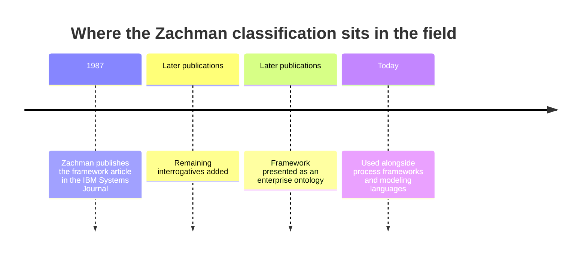

The timeline is deliberately sparse because the chapter asserts only what is well established. The implication is that the framework predates most current delivery practices; its value is therefore conceptual rather than procedural, and it should be combined with contemporary methods instead of being treated as one.

## 3. The Problem It Solves

Consider how many separate descriptions exist for any non-trivial enterprise change: a strategy statement, a process map, a conceptual data model, a service catalog, a network diagram, an access-control matrix, a release schedule, a rules repository. They are produced by different teams at different levels of abstraction using different vocabularies. Three problems follow.

- **Invisible gaps.** Without a map of description kinds, nobody can tell whether the absence of, say, an event model means "not needed" or "nobody thought of it."
- **Abstraction mixing.** A physical database schema is presented as the business's definition of "customer," or a deployment diagram is offered as the process description. Readers at different levels talk past each other.
- **Unowned views.** A description exists but has no owner, source, or review audience, so it drifts out of date silently.

A classification schema addresses these by giving every description a coordinate: who it is for and what question it answers. Alternatives exist. A free-form document inventory is cheap but offers no completeness test. A viewpoint catalogue defined per project fits the project but fragments across projects. A process framework gives sequence but classifies artifacts by phase, not by question. The Zachman grid is chosen when the need is enterprise-wide, notation-independent coverage reasoning; it is a poor choice when the need is a delivery plan.

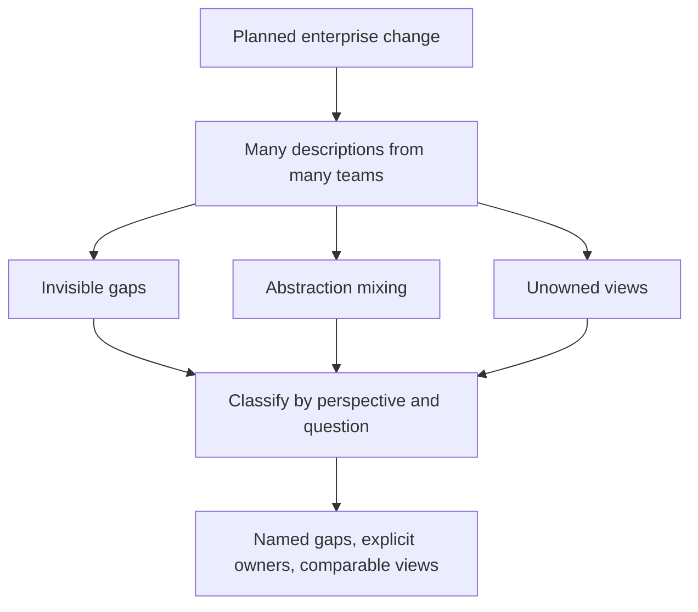

The diagram shows that the schema does not remove the underlying descriptions or the effort to produce them. It adds a coordinate system, and the benefit arrives only when someone acts on what the coordinates reveal.

## 4. Anatomy of the Matrix

### 4.1 The six interrogatives (columns)

The columns are the fundamental questions that can be asked about anything: What, How, Where, Who, When, and Why. Each isolates one aspect of a thing so it can be described without being tangled with the others.

| Interrogative | Aspect described | Typical concern |
|---|---|---|
| What | Data, things | Which entities exist and how they relate |
| How | Function, transformation | How inputs become outputs |
| Where | Location, distribution | Where things sit and how they connect |
| Who | People, organizations | Who acts, who is accountable |
| When | Time, events | What triggers change and in what cadence |
| Why | Motivation, ends | Goals, rules, and the reasons behind them |

The separation is the point. A common failure is a single diagram answering several questions at once, for example a box-and-arrow drawing that mixes data stores (what), services (how), and network zones (where). Such diagrams are easy to draw and hard to verify, because no reader can tell which question a given line answers.

### 4.2 The six perspectives (rows)

The rows are perspectives: the viewpoint of a participant who needs the description for a particular purpose. They are commonly labelled Planner (scope or contextual), Owner (business concepts), Designer (system logic), Builder (technology physics), Implementer (detailed representation), and Worker (the functioning enterprise). Each row is a transformation of the one above toward concreteness: business terms become logical structures, then technology-specific designs, then detailed definitions, and finally the running reality.

Two properties matter for architects. Each row has its own legitimate vocabulary; the owner's "customer" and the builder's "customer table" are not competing definitions but descriptions at different abstraction levels, and the discipline is in keeping them traceable. And each row has a distinct audience: asking the planner to review a detailed schema, or asking an implementer to validate strategy, wastes both.

### 4.3 Reading the grid

Combining the two dimensions yields thirty-six cells. Each cell names a kind of description for one perspective and one question.

| Perspective | What | How | Where | Who | When | Why |
|---|---|---|---|---|---|---|
| Planner / scope | Inventory of things | List of processes | Distribution scope | Stakeholder groups | Event schedule | Business goals |
| Owner / business model | Business entities | Business processes | Business locations | Organization roles | Business events | Business strategies |
| Designer / system model | Logical data model | Application or process design | System locations | Interface and role model | Event and state model | Business rules |
| Builder / technology model | Physical data design | Technology components | Network topology | Access mechanisms | Processing schedule | Technical constraints |
| Implementer / detailed representation | Data definitions | Program or configuration detail | Address and route detail | Identity and permissions | Timing and schedules | Rule implementation |
| Worker / functioning enterprise | Actual data | Executing functions | Operating locations | Active participants | Observed events | Realized motivation |

The table is a practical interpretation of the interrogatives, not a claim that every cell must contain one document or artifact; cell wording differs across editions. A cell can be empty because the question is irrelevant, because the view is not yet developed, or because evidence is missing. Record which interpretation applies; an unexplained blank cannot distinguish deliberate exclusion from a coverage gap.

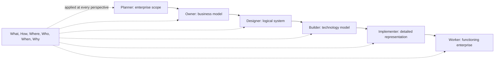

The rows describe increasing realization, not mandatory chronology. Real programs move between perspectives as new constraints or evidence emerge. The six questions apply at each row; they are not six sequential phases.

## 5. Rules for Using the Grid Correctly

### 5.1 Classification, not sequence

A classification schema answers "what kind of description is this?" A process answers "what do we do next?" Reading the rows top to bottom as a waterfall is the most common misuse. A team may discover a physical constraint (Builder) that invalidates a business assumption (Owner) and must go back; the grid has no objection, because it prescribes no order. The state diagram below shows how a single description's status can move independently of its row.

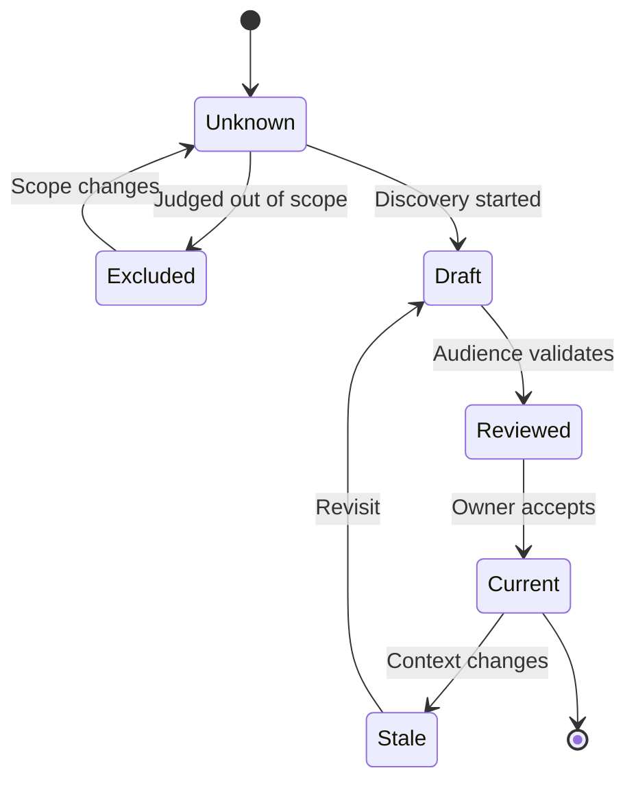

The implication is that each cell needs a status, an owner, and a review audience; the matrix position alone tells you the kind of description, not whether it can be trusted.

### 5.2 Primitives versus composites

A cell is intended to hold descriptions that are primitive, meaning they answer only that cell's question at that row's abstraction. A composite description answers several cells at once; most real diagrams are composites. Composites are legitimate and useful for communication, for example a deployment diagram, but they should be understood as built from primitives, and a review should be able to say which cells a composite draws on. The practical test: if a reviewer cannot say which question a line in a diagram answers, the diagram is mixing questions.

### 5.3 Decision criteria: when to reach for the grid

| Situation | Zachman lens useful? | Reason |
|---|---|---|
| Merger, divestiture, or platform consolidation | Yes | Differing vocabularies and unowned views are the main risk |
| Audit or regulatory coverage question | Often | Needs a defensible statement of what is and is not described |
| Single-team feature delivery | Rarely | A lightweight viewpoint set is cheaper |
| Selecting a delivery process | No | The grid does not sequence work |
| Choosing a diagramming notation | No | It is notation-independent |

## 6. One Concept Across Perspectives: A Worked Illustration

The following scenario is hypothetical. Consider a customer refund. Reading down the What column, the Planner identifies refund-related things at the scope level (orders, claims, payments). The Owner defines business entities and their meaning (a refund is a reversal of value owed to a customer, linked to an order). The Designer produces a logical data model with keys and relationships. The Builder chooses a concrete data design for a specific store. The Implementer writes the detailed definitions, and the Worker view is the actual data in production.

Reading across one row shows a different cut. At the Owner row, the same refund concept appears as business entities (What), a process of validate, approve and settle (How), business locations (Where), roles such as customer, support agent and finance approver (Who), business events such as request and settlement (When), and strategies such as reducing unresolved cases (Why).

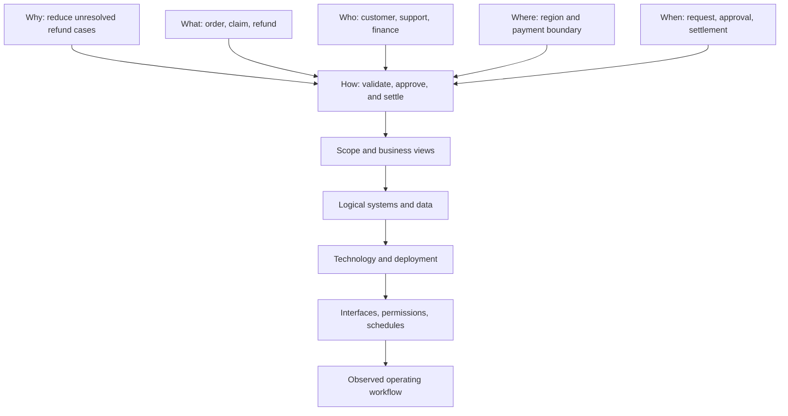

Comparing rows exposes translation gaps. Suppose the business rule says refunds above a threshold need a second approver. If the logical design has no approval state, the rule is either manual or unimplemented. If an application exposes a "bulk refund" function and no business role owns it, the function is orphaned. In both cases the finding comes from asking, for one concept, whether each row's description of the same question agrees with its neighbours.

A sequence of such checks can be made explicit as a review conversation:

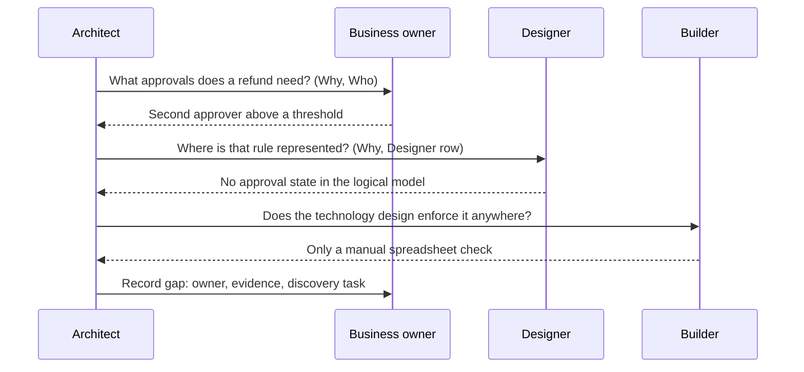

The sequence demonstrates that the grid prompts questions but does not answer them. Domain experts must validate whether a description is accurate and useful, and the architect's contribution is to ask the same question at adjacent rows and record where the answers diverge.

## 7. Testing Completeness Without Filling Every Cell

Completeness is purpose-relative. A grid with thirty-six populated cells is not "complete" in any useful sense if the decision at hand needed only nine of them and the populated ones are stale. The working definition used in this chapter is: a set of descriptions is complete for a decision when every cell the decision depends on is either current and trusted, or explicitly excluded with a recorded reason.

### 7.1 A procedure for a coverage review

1. State the decision or change in one sentence (for example, "consolidate two customer identity stores").
2. Identify the affected stakeholders and the perspectives (rows) at which they need descriptions.
3. Select the interrogatives (columns) the decision is sensitive to. A decision about data ownership leans on What, Who, and Why; a decision about cutover leans on When and Where.
4. For each selected cell, inspect the existing descriptions and classify the cell as complete, irrelevant, or missing.
5. For complete cells, record the source, owner, and last review. For irrelevant cells, record the reason. For missing cells, assign an owner and a discovery task.
6. Re-run the review when scope changes, because exclusions are conditional on scope.

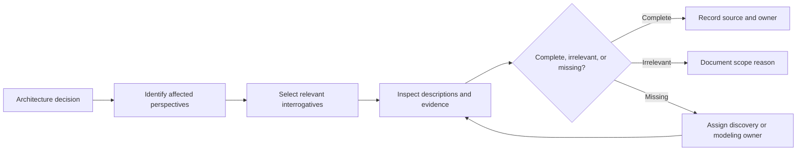

The loop on the missing branch is the important part: a gap is not closed by writing any document, only by producing evidence that the review then re-inspects.

### 7.2 Keeping a gap register

Status, owner, source, and confidence need a home. A lightweight register, kept in whatever tool the organization already uses, is enough. The structure below is illustrative.

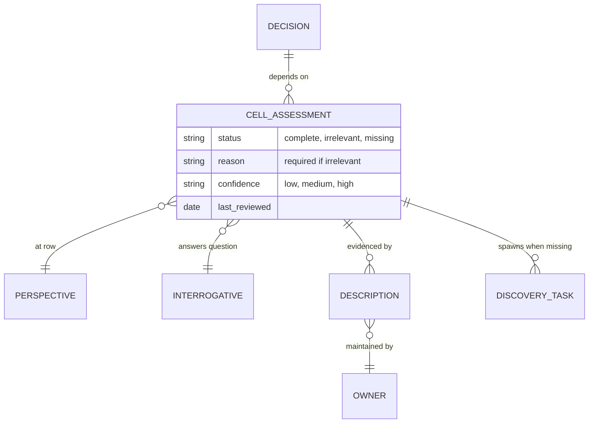

The register separates the thing being described (the cell) from the evidence for it (the description). That separation is what lets one description serve several cells, and lets a stale description invalidate every assessment that relied on it. It also makes the cost of a gap visible: a decision with many low-confidence dependencies is a risk statement, not a documentation to-do.

A completeness review should also look for mismatched abstractions: business meaning presented as a physical schema, a technology diagram used as a process description, or a strategy goal with no owner or measure. The matrix helps locate the mismatch; it does not itself judge quality, consistency, feasibility, or fitness for purpose.

### 7.3 Confidence and evidence grades

Confidence should come from how the description was produced, not from how polished it looks. A simple three-level scale works:

| Confidence | Typical evidence | Appropriate use |
|---|---|---|
| High | Reviewed by the described audience within the current scope; traceable to a source system or authority | Basis for commitments and contracts |
| Medium | Produced by a knowledgeable team but not independently validated | Basis for planning; validate before commitment |
| Low | Inferred, recalled, or inherited from an older description | Hypothesis; schedule discovery |

Edge cases deserve explicit handling. A description that is accurate but owned by a team being dissolved should be re-owned, not just re-dated. A cell that is irrelevant today but becomes relevant under a likely scope change should be marked "excluded, revisit on trigger" with the trigger named.

## 8. Connecting Stakeholders to Questions

Different stakeholders care about different columns and rows. Executives may focus on motivation, capability scope, and investment; operations on events, locations, people, and actual system behavior; engineers on logical and physical structure. Avoid assigning one row to one job title too rigidly: a stakeholder may need several views, and one view may serve multiple audiences.

### 8.1 Mapping stakeholders to cells

The diagram below shows a typical, illustrative mapping. It is a starting point for negotiation, not a fixed assignment.

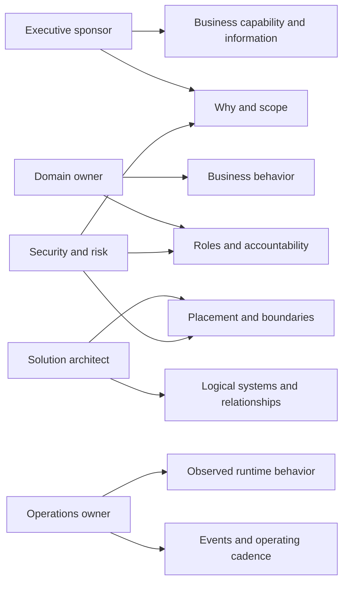

Use the mapping to negotiate review evidence, not to silence stakeholders whose concerns fall outside an assumed role. Record audience, question, abstraction level, and intended decision with each view.

### 8.2 A view-specification template

Each view that a stakeholder is expected to review should state what it is for. The template below is a minimal sketch.

```yaml
view:
  name: Refund approval rules
  cell: { perspective: Designer, interrogative: Why }
  audience: [business owner, solution architect]
  decision_supported: Whether second-approver rule is enforced in the new platform
  abstraction: logical (no product or schema names)
  owner: Refund domain team
  last_reviewed: 2026-09-30
  confidence: medium
```

Stating the audience and decision is what prevents the abstraction-mixing problem from Section 3: if the view needs product names to make sense, it belongs in a different row.

### 8.3 Trade-offs and edge cases

- **Too few audiences.** A view reviewed only by its author is a draft regardless of how it is labelled.
- **Too many audiences.** A view that every stakeholder must approve becomes a negotiation artefact and tends to dilute into vague language. Prefer one accountable reviewer per cell plus consulted parties.
- **Shifting roles.** After a reorganization, the cell-to-owner mapping is the first thing to break. Review ownership whenever the organization chart changes.
- **Cross-cutting concerns.** Security and compliance touch Who, Where, and Why at several rows. Treat them as reviewers across cells rather than owners of a separate column.

## 9. Combining Classification with a Process

Zachman can complement a development method or governance process. For example, TOGAF phases can organize when architecture work occurs, while Zachman can help inspect which perspectives and questions the resulting descriptions cover. Keep the process model and classification schema separate: one describes work progression, the other organizes kinds of description. Sequencing and governance themselves are owned by [TOGAF](CH01_TOGAF.md) and [Architecture Governance](CH08_Architecture_Governance.md).

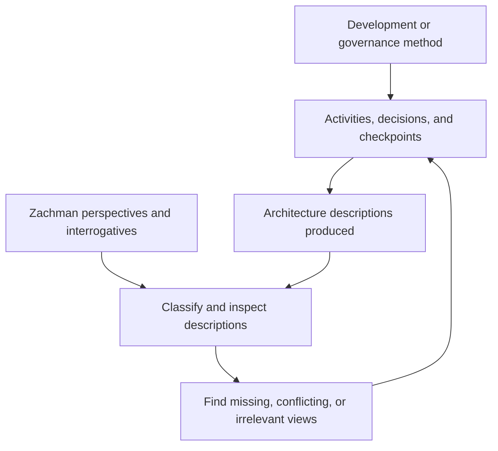

The feedback arrow is the design intent: the coverage review feeds work items back into the process, so findings become planned tasks and not shelf documents.

### 9.1 Where the lens plugs into a process

| Process checkpoint (generic) | Question the Zachman lens helps answer | Output |
|---|---|---|
| Scoping and initiation | Which perspectives and interrogatives does this change touch? | Scoped coverage list with exclusions and reasons |
| Design review | Do adjacent rows agree on the same question for the same concept? | Translation-gap findings |
| Release or cutover readiness | Are When and Who descriptions current for the operating model? | Updated gap register |
| Post-implementation review | Did the Worker-row reality match the descriptions? | Corrections to stale views |

### 9.2 Alternatives to combining

A team can instead pair the classification with a modeling language (see [ArchiMate](CH03_ArchiMate.md)) so that each cell's content is a typed model, or use a per-project viewpoint set (see [C4 Model](../21_Architecture_Documentation/CH01_C4_Model.md)) when enterprise-wide reasoning is unnecessary. Pairing with a modeling language gives consistency checking but adds tooling cost; a viewpoint set is cheap but does not support cross-project coverage claims.

This combination is useful when a team needs both a repeatable process and a coverage lens. It becomes counterproductive when teams treat the matrix as a document checklist or attempt to populate all thirty-six cells regardless of scope.

## 10. Failure Scenarios and Common Mistakes

### 10.1 Failure catalogue

| Failure | Symptom | Detection | Mitigation |
|---|---|---|---|
| Populate-everything mandate | Large volume of low-value documents; reviewers skim | Many cells marked current but with no reviewer or decision linked | Tie each cell to a decision; allow explicit exclusion |
| Reading rows as phases | Teams refuse to revisit upper rows after technology constraints appear | Change requests blocked as "already approved at Owner row" | Restate that the grid classifies; use the process framework for sequence |
| Mixed-question diagrams | Reviewers disagree about what a diagram claims | Cannot say which interrogative a line answers | Split into primitives; keep composites but cite source cells |
| Abstraction leakage | Physical names appear in business definitions | Business glossary contains table or product names | Review at the proper row; add traceability instead of merging |
| Orphaned views | Descriptions with no owner become stale | No owner or review date in register | Assign owner at creation; expire or archive unowned views |
| Gap blindness | Blank cell treated as "not needed" | Blank cells lack status and reason | Require status and reason for every in-scope cell |
| Framework as governance | Approvals gated on matrix completion | Review checklists name cells instead of risks | Keep governance in its own mechanism (see Section 9) |
| Vocabulary imposition | Teams rename work to match grid wording | Duplicate glossaries | Map local terms to cells; do not force renaming |
| Stale Worker row | Documented operation differs from observed behavior | Incident reviews reveal undocumented steps | Periodically sample real behavior against views |

### 10.2 Anti-patterns

- **The wallpaper matrix.** A colored grid on a wall that reports percent complete. It measures effort, not understanding.
- **The tool-first rollout.** Buying a repository and then deciding what goes in it, so cells are filled to justify the tool.
- **The single-author grid.** One architect fills the whole grid from assumptions; no cell has an independent reviewer.
- **Row = job title.** Fixing "Owner" to executives and "Builder" to engineers, which excludes stakeholders who span rows.

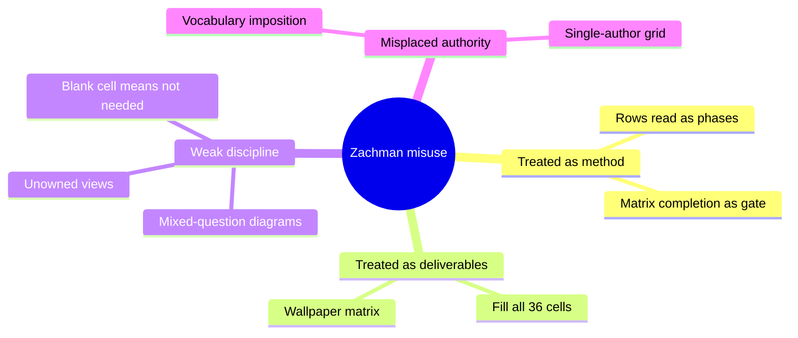

The mind map groups the failures by root cause. The implication is that most mitigations are about role clarity (what the grid is for), not about the grid's content.

## 11. Trade-off Analysis and Decision Framework

### 11.1 Comparing approaches to describing an enterprise change

| Approach | Strength | Weakness | Best fit |
|---|---|---|---|
| Zachman classification | Notation-independent coverage reasoning across the enterprise | No method, no notation; needs discipline to avoid becoming a checklist | Mergers, audits, enterprise-wide gap analysis |
| Process framework (e.g., TOGAF ADM) | Sequenced work and governance | Classifies by phase, so coverage by question is implicit | Recurring architecture programs needing repeatable process |
| Modeling language (e.g., ArchiMate) | Typed elements, consistency and impact analysis | Modeling cost; model can lag reality | Portfolios needing traceable relationships |
| Per-project viewpoint set (e.g., C4) | Cheap, close to delivery teams | Fragments across projects; no cross-project coverage | Single-team or single-system delivery |
| Free-form document inventory | Lowest cost | No completeness test | Very small scope, short-lived change |

These are generalizations; real choices depend on organization size, existing tooling, and audit obligations.

### 11.2 Decision flowchart

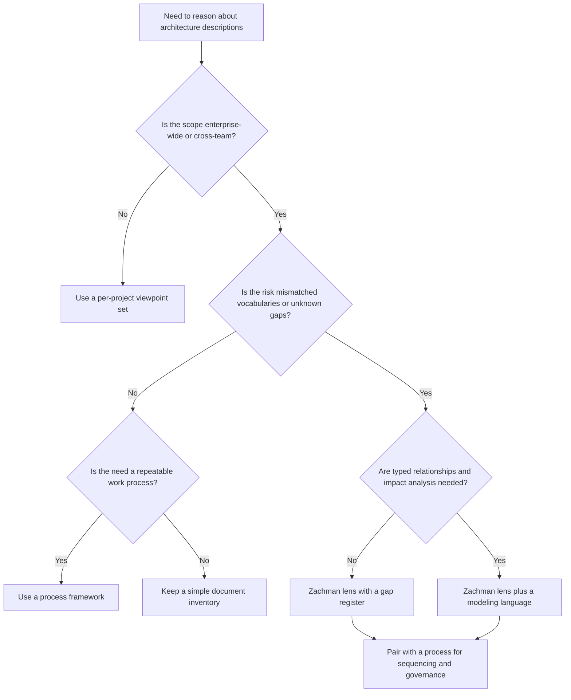

The flowchart shows that the grid is rarely the whole answer: even when it is chosen, it is paired with a process. The decision is cheap to revisit when scope grows, so start with the lightest option that satisfies the highest-risk question.

## 12. Illustrative Composite Case Study

The following case is hypothetical and does not describe any real organization. Two organizations merge and use different customer identities and account structures. The architecture team uses the matrix to compare business definitions, application mappings, regional technology boundaries, role models, migration events, and strategic goals.

### 12.1 Situation and approach

The decision is to consolidate customer identity stores. The team selects What, Who, When, and Why at the Owner and Designer rows as required, adds Where at the Builder row for regional data placement, and records unrelated cells as excluded with reasons. A separate migration method schedules discovery and cutover work; the Zachman schema is used only to inspect coverage.

```mermaid
sequenceDiagram
    participant T as Architecture team
    participant A as Organization A owners
    participant B as Organization B owners
    participant R as Gap register
    T->>A: Define "account owner" (What, Who at Owner row)
    A-->>T: Person legally responsible for the account
    T->>B: Define "account owner" (What, Who at Owner row)
    B-->>T: Person with login access to the account
    T->>R: Record conflicting definitions with both owners
    T->>A: Who resolves sync conflicts? (Who, Designer row)
    A-->>T: Undefined
    T->>R: Record missing authority; assign stewardship discovery
    T->>R: Mark cutover timing (When) as missing evidence
```

### 12.2 Findings and implications

- Both organizations describe "account owner" differently, so a single field cannot carry both meanings without a mapping decision.
- The planned synchronization process has no agreed authority for conflict resolution (a missing Who description at the Designer row).
- Data stewardship and event timing descriptions are missing and become discovery tasks.
- Regulatory and customer-service views are marked required; other cell areas are excluded with recorded reasons.

The schema exposes the information gap. It does not choose the merge strategy, resolve the ownership definition, or sequence the project; those remain decisions for the business owners and the migration method.

### 12.3 Architect Review Checklist

- [ ] The decision or change is stated and the affected stakeholders are listed.
- [ ] Relevant perspectives and interrogatives are selected, with reasons.
- [ ] Every in-scope cell has a status, owner, source, and confidence.
- [ ] Every excluded cell has a recorded reason and a revisit trigger.
- [ ] Adjacent rows were compared for the same concept and question; translation gaps are recorded.
- [ ] Composite diagrams cite the cells they draw on.
- [ ] No business definition contains physical names, and no technology view stands in for a process description.
- [ ] The grid is not being used as a work sequence or an approval gate.
- [ ] A separate process and governance mechanism exists for creating and approving descriptions.
- [ ] Sampling of real behavior (Worker row) is scheduled to catch stale views.

## 13. Interview Questions

1. **What does the Zachman Framework classify?** It classifies kinds of architecture descriptions by perspective (rows) and interrogative (columns); it is an ontology, not a method.
2. **Is it a methodology?** No. It prescribes no order, notation, or approval; pair it with a process such as the one in [TOGAF](CH01_TOGAF.md).
3. **Name the six interrogatives.** What, How, Where, Who, When, Why.
4. **Does an empty cell mean a gap?** Not necessarily. It may be out of scope, undeveloped, or unevidenced; the status and reason distinguish them.
5. **Why separate the questions?** A diagram that mixes data, function, and location is hard to verify because no one can tell which question each line answers.
6. **What is a composite description?** One that answers several cells at once, such as a deployment diagram. It is legitimate if the cells it draws on are identifiable.
7. **When would you not use the grid?** For single-team feature delivery, process selection, or notation choice; cheaper tools fit better.
8. **How do you avoid the grid becoming a checklist?** Tie every cell to a decision, allow explicit exclusions, and measure understanding and resolved gaps rather than percent populated.

## 14. Hands-on Exercises

1. **Trace a concept.** Pick a concept from your organization (for example, "order") and write its What description at each of the six rows. Mark where vocabulary changes and where a translation is undocumented.
2. **Classify diagrams.** Collect five existing architecture diagrams. For each, state the cells it draws on and whether it is primitive or composite. Split one composite into primitives.
3. **Build a gap register.** For a planned change, create a register with the fields from Section 7.2. Populate at least ten in-scope cells with status, owner, and confidence, and exclude five with reasons.
4. **Pair with a process.** Take a delivery process your team uses and mark three checkpoints where the coverage review from Section 9.1 would run. State the output of each.

## 15. Design and Architecture Review Questions

1. **A program lead asks for all thirty-six cells to be populated before approval. How do you respond?** Explain that completeness is purpose-relative; propose selecting cells by decision, recording exclusions with reasons, and gating on risk rather than population percent. Offer the gap register as the evidence of coverage. Note that approval belongs to governance, not to the grid.
2. **Business and engineering disagree on the definition of "customer." What does the lens suggest?** Place each definition at its row (Owner versus Builder) and check whether they are descriptions at different abstraction levels or genuine conflicts. If different levels, add traceability between them. If conflicting, escalate to the business owner as a Why and What decision.
3. **A deployment diagram is presented as the process description. What is wrong?** It mixes Where and How at the Builder row and omits the Owner-row process. Request a separate How description at the business row and keep the deployment diagram as a composite citing its cells.
4. **A review finds a rule documented at the Owner row but absent at the Designer row. What next?** Record it as a translation gap, identify whether it is enforced manually or not at all, and assign an owner for the Designer-row description. Do not mark the rule as implemented on the basis of the business statement.
5. **Leadership wants a single framework for architecture governance. Is Zachman appropriate?** It can support the coverage lens but is not a governance mechanism. Recommend a process and review mechanism (see [Architecture Governance](CH08_Architecture_Governance.md) and [Architecture Review Boards](CH09_Architecture_Review_Boards.md)) with the grid used to inspect evidence.

## 16. Summary

The Zachman Framework is a classification schema, an ontology of the kinds of descriptions that can exist, organized by six perspectives and six interrogatives. It answers "what kind of description is this?" and not "what do we do next?", which is why it must be kept distinct from process frameworks, modeling languages, and governance mechanisms (Introduction outcome 4).

Reading a cell as a kind of description, not a required document, lets you judge completeness against a decision (outcomes 1 and 2). Tracing one concept across rows, as in the refund illustration, surfaces translation gaps that no single row reveals (outcome 3). The criteria and decision flowchart in Section 11 help you decide when the lens is worth its cost and when a per-project viewpoint set, a process, or a modeling language is cheaper (outcome 5).

The principal risks are mandating all thirty-six cells, reading rows as phases, mixing questions in one diagram, and leaving views unowned; the failure catalogue gives symptoms, detection, and mitigations (outcome 6). Used well, the schema makes gaps nameable and assignable. Pair it with a separate method for creating and governing change, and revisit it when scope changes.
