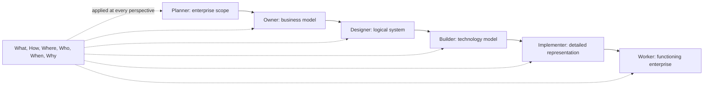
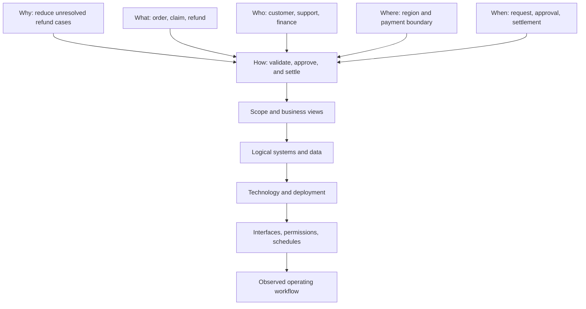
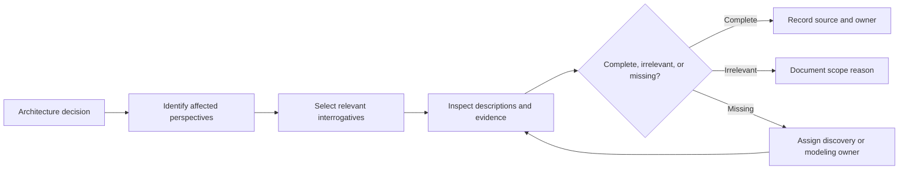
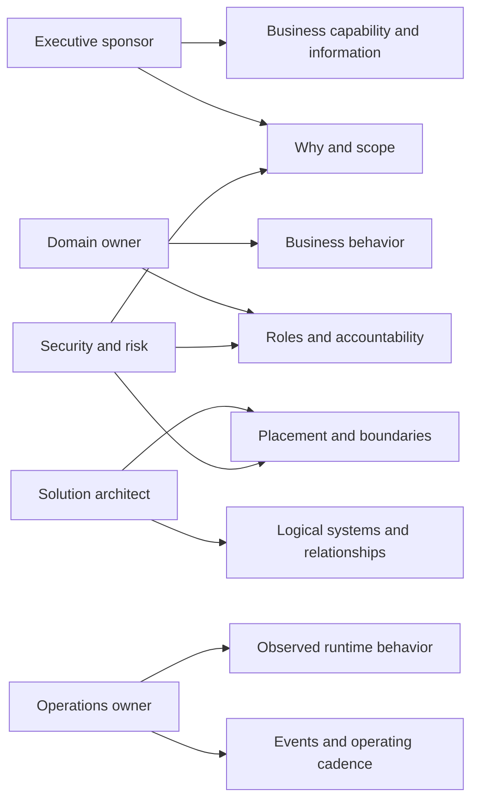
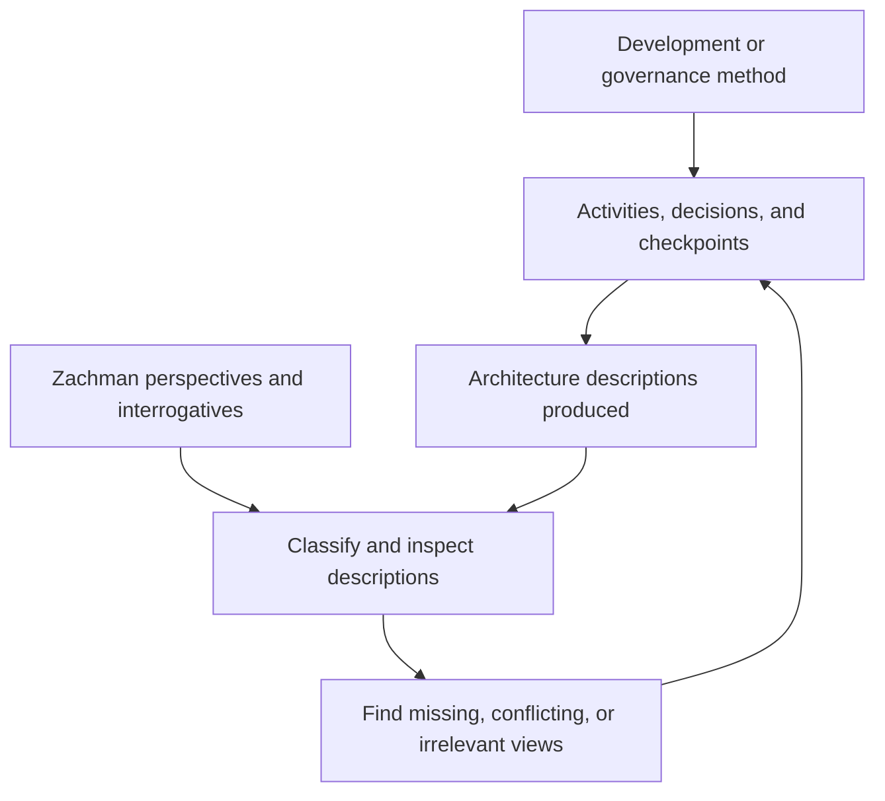

# Zachman Framework

Part: [18 — Enterprise Architecture](PART_OVERVIEW.md)

The Zachman Framework is an ontology for classifying architecture descriptions by perspective and interrogative. Its matrix helps an enterprise ask whether important viewpoints and questions have been represented. It does not prescribe a project sequence, governance process, or method for creating the cells. Part 18 CH01 covers TOGAF's development and governance method; Part 21 owns general architecture-description notations.

## Read the Matrix Correctly

The columns ask What, How, Where, Who, When, and Why: data, function, location, people, time, and motivation. The rows move from contextual scope through business concepts, system logic, technology choices, detailed representations, and the functioning enterprise. The row perspectives are commonly expressed as Planner, Owner, Designer, Builder, Implementer, and Worker. Each cell is a distinct kind of description for a stakeholder perspective and question.

| Perspective | What | How | Where | Who | When | Why |
|---|---|---|---|---|---|---|
| Planner / scope | Inventory of things | List of processes | Distribution scope | Stakeholder groups | Event schedule | Business goals |
| Owner / business model | Business entities | Business processes | Business locations | Organization roles | Business events | Business strategies |
| Designer / system model | Logical data model | Application or process design | System locations | Interface and role model | Event and state model | Business rules |
| Builder / technology model | Physical data design | Technology components | Network topology | Access mechanisms | Processing schedule | Technical constraints |
| Implementer / detailed representation | Data definitions | Program or configuration detail | Address and route detail | Identity and permissions | Timing and schedules | Rule implementation |
| Worker / functioning enterprise | Actual data | Executing functions | Operating locations | Active participants | Observed events | Realized motivation |

The table is a practical interpretation of the interrogatives, not a claim that every cell must contain one document or artifact. A cell can be empty because the question is irrelevant, because the view is not yet developed, or because evidence is missing. Record which interpretation applies; an unexplained blank cannot distinguish deliberate exclusion from a coverage gap.

The rows describe increasing realization, not mandatory chronology. Real programs move between perspectives as new constraints or evidence emerge. The six questions apply at each row; they are not six sequential phases.

## Follow One Concept Across Perspectives

Consider a customer refund. At scope, the enterprise identifies refunds as a business function, affected regions, participating groups, event periods, and goals. At the business perspective, it defines refund entities, approval rules, roles, and operational events. The system perspective describes logical data and application interactions. Later perspectives describe technology placement, detailed interfaces and permissions, and the actual operational process.

Comparing rows exposes translation gaps. A business rule with no system representation may be manual or unimplemented; an application flow with no business owner can be orphaned. The matrix prompts questions, but domain experts still validate whether a description is accurate and useful.

## Test Completeness Without Filling Every Cell

Completeness is purpose-relative. Start with the decision or change, identify affected stakeholders, select relevant rows and questions, and trace the evidence needed for that decision. Some cells are intentionally out of scope. Others may be unknown and require discovery. Use explicit status, owner, source, and confidence instead of filling blanks with low-value documents.

A completeness review should look for mismatched abstractions: business meaning presented as a physical schema, a technology diagram used as a process description, or a strategy goal with no owner or measure. The matrix helps locate the mismatch; it does not itself judge quality, consistency, feasibility, or fitness for purpose.

## Connect Stakeholders to Questions

Different stakeholders care about different columns and rows. Executives may focus on motivation, capability scope, and investment; operations on events, locations, people, and actual system behavior; engineers on logical and physical structure. Avoid assigning one row to one job title too rigidly: a stakeholder may need several views, and one view may serve multiple audiences.

Use the mapping to negotiate review evidence, not to silence stakeholders whose concerns fall outside an assumed role. Record audience, question, abstraction level, and intended decision with each view.

## Combine Classification With a Process

Zachman can complement a development method or governance process. For example, TOGAF phases can organize when architecture work occurs, while Zachman can help inspect which perspectives and questions the resulting descriptions cover. Keep the process model and classification schema separate: one describes work progression, the other organizes kinds of description.

This combination is useful when a team needs both a repeatable process and a coverage lens. It becomes counterproductive when teams treat the matrix as a document checklist or attempt to populate all thirty-six cells regardless of scope.

## Worked Case: Merger Identity Consolidation

During a merger, two organizations use different customer identities and account structures. The architecture team uses the matrix to compare business definitions, application mappings, regional technology boundaries, role models, migration events, and strategic goals. The review reveals that both organizations describe “account owner” differently and that a planned synchronization process has no agreed authority for conflict resolution.

The team marks regulatory and customer-service views as required for the decision, identifies missing data stewardship and event timing descriptions, and records unrelated cell areas as out of scope. A separate migration method schedules discovery and cutover work. The Zachman schema exposes the information gap; it does not choose the merge strategy or sequence the project.

## Review Questions

1. What do the six interrogatives help an architect inspect?
2. Why is the matrix not a lifecycle or implementation method?
3. When is an empty cell a valid scope choice, and what should be recorded?
4. How does a description change meaning across perspective rows?
5. How can Zachman complement a development method without replacing it?

Use Zachman to classify and inspect architecture descriptions, not to manufacture artifacts. Select relevant perspectives and questions from the decision context, make gaps explicit, and pair the schema with a separate method for creating and governing change.
