# ArchiMate

Part: [18 — Enterprise Architecture](PART_OVERVIEW.md) · Status: Drafted

## 1. Introduction

ArchiMate is a modeling language for enterprise architecture. It gives an organization a fixed, typed vocabulary of elements (such as business process, application component, and node) and a fixed set of relationships (such as serving, realization, and assignment) so that the business, the software, and the infrastructure can be described in one connected model rather than in unrelated slide decks. The language is maintained by The Open Group and is deliberately aligned with The Open Group Architecture Framework (TOGAF), although it can be used without it.

For a solution architect, the value of ArchiMate is not the notation; it is the discipline of a shared meta-model. Engineers moving into architecture are used to precise artifacts: a type system, a schema, an interface definition. Enterprise diagrams usually lack that precision. A box labelled "Customer Platform" may be a team, a product, a deployed system, or a capability, and an arrow may mean data flow, ownership, call dependency, or "is related to". A diagram like that cannot be queried, cannot be checked for consistency, and cannot answer the question an executive actually asks: "if we replace this system, which business services and which regulatory commitments are affected?". A typed model can answer that question by traversing relationships, provided the model was built with enough care that the traversal is trustworthy.

ArchiMate is a language, not a process. It does not tell you which stakeholders to interview, how to run an architecture review, or when an architecture is good enough. It also does not replace detailed software notations. The chapter therefore stays within a clear boundary:

- The architecture development process, phases, and deliverables that a model supports belong to [TOGAF](CH01_TOGAF.md); this chapter recaps that relationship only where it affects modeling choices.
- The classification-schema approach to describing an enterprise from several perspectives belongs to [Zachman Framework](CH02_Zachman_Framework.md). ArchiMate is a notation with relationship semantics, which is a different kind of artifact from a classification grid.
- Business capability maps, value streams, and strategy-to-capability reasoning as business disciplines belong to [Business Architecture](CH04_Business_Architecture.md), and capability-map construction mechanics belong to [Capability Mapping](CH11_Capability_Mapping.md). This chapter covers how those concepts are represented and connected in ArchiMate.
- Detailed application, data, and technology design belong to [Application Architecture](CH05_Application_Architecture.md), [Data Architecture](CH06_Data_Architecture.md), and [Technology Architecture](CH07_Technology_Architecture.md).
- General-purpose software documentation notations belong to Part 21: [C4 Model](../21_Architecture_Documentation/CH01_C4_Model.md) and [Unified Modeling Language (UML)](../21_Architecture_Documentation/CH02_UML.md). Decision records belong to [ADR (Architecture Decision Record)](../21_Architecture_Documentation/CH03_ADR_Architecture_Decision_Record.md).
- Governance of model content and review authority belongs to [Architecture Governance](CH08_Architecture_Governance.md).

After studying this chapter, a reader should be able to:

1. Explain what problem a typed enterprise modeling language solves and when it is worth its cost compared with lighter notations.
2. Describe the layers and aspects of the language and place any real-world thing in the correct element type.
3. Choose the correct relationship between two elements and explain why a wrong choice produces misleading analysis.
4. Distinguish a model, a view, and a viewpoint, and design views that answer a named stakeholder question.
5. Trace the impact of a change from technology up to business outcomes, and the reverse, using relationships.
6. Recognize the common failure modes of enterprise models, including arrow soup, stale content, and models nobody queries.

## 2. Background and History

ArchiMate originated in the Netherlands in the early 2000s, from a research and industry collaboration that included the Telematica Instituut. The motivating problem was that organizations described business processes, applications, and infrastructure in different notations, with no agreed way to relate them. The Open Group took over stewardship of the language in 2008, and it has since been published as an Open Group standard in several versions. The milestones below are the ones this chapter relies on; consult the current specification for exact clause-level detail.

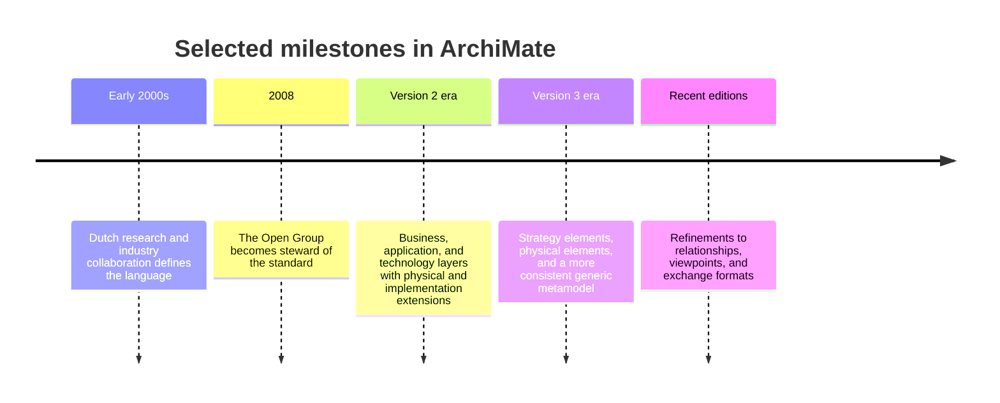

Two design decisions from this history shape the rest of the chapter. First, the language is layered, with the same pattern of structure and behavior repeated at each layer, so that cross-layer relationships such as "application serves business" are first-class rather than informal. Second, the language is intentionally small. It does not try to model class hierarchies, database schemas, or message formats; those belong to UML or to data modeling tools. The smallness is what makes enterprise-wide models feasible, and it is also why teams are tempted to stretch the language beyond its purpose.

Because the standard has been revised several times, element names and some relationship rules differ between editions. When adopting ArchiMate, fix the edition used by your modeling tool and record it in the model's conventions, so that exchanged models and training material agree.

## 3. The Problem ArchiMate Solves

Consider how an enterprise typically documents itself. The business analysts draw process flows in one tool. Solution architects draw application diagrams in another. Infrastructure teams keep deployment drawings and a configuration database. Strategy lives in presentations. Each artifact is locally correct, but no one can follow a line from a strategic goal down to the server that supports it, because the artifacts do not share identifiers or a common meaning for their lines.

This produces three recurring failures.

**Untraceable change.** When a vendor announces end of support for a runtime, nobody can say which business services depend on it. The answer exists only in the heads of a few people. The cost of a wrong answer is either an outage (a dependency was missed) or wasted effort (everything was assumed to be affected).

**Inconsistent vocabulary.** "Service" means a business offering to a customer in one document, a deployable microservice in another, and a support contract in a third. Decisions made across those documents inherit the ambiguity. ArchiMate separates these meanings by giving them different element types: business service, application service, and technology service.

**Diagrams that cannot be checked.** A free-form boxes-and-arrows drawing has no rules, so it cannot be validated. A typed model can reject nonsense, such as a business actor directly "realizing" a server, and can be queried, such as "list every application component that has no business service it serves".

Why choose ArchiMate over alternatives? The table compares the realistic options for an enterprise-wide description.

| Option | Strength | Weakness | Choose when |
|---|---|---|---|
| Free-form drawing tool | Fast, no learning cost | No semantics, no queries, inconsistent meaning | Short-lived communication, one audience |
| UML or C4 | Precise for software structure and interaction | Weak for business, strategy, and migration concepts; scales poorly across an enterprise | Documenting one system or a family of systems |
| Spreadsheet or inventory | Easy to govern, easy to filter | Relationships are second-class; hard to visualize | Simple application or capability inventories |
| ArchiMate | Typed concepts across business, application, technology, strategy, and change; queryable relationships | Learning curve; modeling effort; needs a tool and curation | Cross-layer impact analysis and portfolio decisions across many teams |

The deciding criterion is whether cross-layer questions recur. If the organization has a handful of systems and one team, the cost of a typed model exceeds its value, and C4 plus a few decision records is usually enough. If dozens of teams, regulatory obligations, and an application portfolio interact, the ability to ask "what does this change touch?" repays the curation cost. A second criterion is stewardship: a model without an owner decays, so adoption requires a named group that keeps it current. Failing to commit to that is the most common reason adoption fails, a theme developed further under governance.

## 4. Layers, Aspects, and the Generic Structure

ArchiMate organizes elements along two axes. The vertical axis is the **layer**: the business layer describes what the organization does, the application layer describes the software that supports it, and the technology layer describes the platforms and infrastructure that run the software. Additional element groups sit alongside these: strategy elements (for example capability, resource, value stream, and course of action), motivation elements (for example stakeholder, driver, goal, requirement, and constraint), physical elements for equipment and facilities, and implementation and migration elements (for example work package, deliverable, plateau, and gap).

The horizontal axis is the **aspect**. Each layer repeats the same three aspects, which is what makes the language learnable: learn the pattern once and it applies three times.

| Aspect | Meaning | Business layer example | Application layer example | Technology layer example |
|---|---|---|---|---|
| Active structure | Who or what performs behavior | Business actor, business role | Application component | Node, device |
| Behavior | What is performed | Business process, business function | Application function, application process | Technology function, technology process |
| Passive structure | What behavior acts on | Business object | Data object | Artifact |

Two additional ideas complete the pattern.

**Internal versus external behavior.** A process or function is internal behavior: it describes how work is done. A service is external behavior: it describes the outcome made available to a consumer, independent of how it is produced. An interface is the access point through which a service is offered. Separating the two lets the model say "onboarding is available as a service" without committing to the process that produces it, and lets the implementation change without altering what consumers see. This is the same principle as separating an interface from its implementation in software design, applied at enterprise scale.

**Serving across layers.** The vertical links are mostly serving relationships: technology services serve application components, and application services serve business processes. The relationship between a business service and the behavior inside the business layer is realization. This yields a recognizable chain from infrastructure up to customer-visible outcomes.

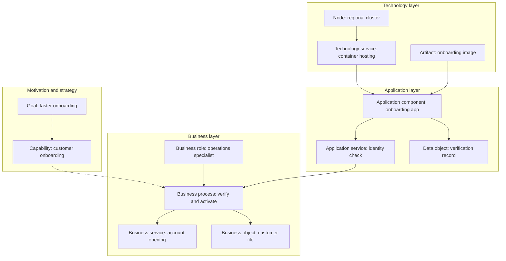

Read the diagram bottom-up as a dependency chain and top-down as a justification chain. Bottom-up, the cluster provides hosting that the application component consumes, the component exposes an identity check that the business process uses, and the process produces the account-opening service customers see. Top-down, the goal motivates the capability, and the capability is realized by the process. The key implication is that the model separates three questions that are often tangled: who is served, what realizes the service, and what runs it. When a team asks "does this change affect the business?", the answer is a traversal of the serving and realization links, not a debate.

**Worked scenario (illustrative).** A hypothetical insurer models claims intake. The business role "claims handler" is assigned to the process "register claim". The process uses the application service "document capture", offered by the application component "intake portal", which is deployed as an artifact on a node in a managed container platform. Now a security team proposes retiring a shared runtime image. Following serving links upward from the platform finds the intake portal, then the document capture service, then the "register claim" process, then the capability "claims handling". The model reports an affected capability in seconds, and the architect can then ask the capability's owner about tolerance for downtime. Note what the model does not say: it does not say how long the migration takes or whether the portal can be rebuilt on another image. Those are solution design questions.

**Failure modes.** The most common layer error is placing a software system in the business layer because users think of it as "the claims process". Test each element by asking what kind of thing it is: if it executes code, it is an application component; if people or roles perform it, it is business behavior. A second error is modeling a service as a process, which hides what consumers receive. A third is promoting every database table to a data object; model passive structure only where a decision depends on it.

## 5. Relationships: Choosing the Right Line

Elements describe things; relationships carry the meaning that makes a model queryable. The language groups its relationships into families, and the choice among them is the main skill of modeling.

| Family | Relationship | Reads as | Typical use |
|---|---|---|---|
| Structural | Composition | A is made of B, and B cannot exist without A | A node composed of its system software |
| Structural | Aggregation | A groups B, and B can exist independently | A product grouping business services |
| Structural | Assignment | A performs or is responsible for B | A role assigned to a process; a component assigned to its function |
| Structural | Realization | A implements or fulfils B | A process realizes a business service; an artifact realizes a component |
| Dependency | Serving | A provides functionality that B uses | An application service serves a business process |
| Dependency | Access | A reads or writes passive structure B | A process reads a business object |
| Dependency | Influence | A affects the achievement of motivation element B | A driver influences a goal |
| Dependency | Association | A and B are related in an unspecified way | Last resort |
| Dynamic | Triggering | A causes B to start, in a temporal or causal order | One process step starts the next |
| Dynamic | Flow | Something is passed from A to B | Information transferred between processes |
| Other | Specialization | A is a kind of B | A specific role specializes a generic role |

The distinctions that cause the most confusion are worth stating precisely.

**Serving versus flow versus triggering.** Serving is about dependence on capability: B needs what A provides in order to do its job. Flow is about transfer of something, such as information or goods. Triggering is about ordering. Two processes can be connected by all three: the first triggers the second, passes an application form to it, and the second may also use a service the first does not. Drawing a single arrow and calling it "depends on" collapses three different questions, namely what breaks if A fails, what must be transferred, and what must happen first.

**Assignment versus realization.** Assignment links active structure to behavior: who performs it. Realization links an implementation to the thing it fulfils: what produces the outcome. A role is assigned to a process; the process realizes a business service. Confusing them makes it impossible to ask "who is accountable for this service?" separately from "what delivers this service?".

**Composition versus aggregation.** Composition implies a lifecycle dependency; aggregation does not. Use composition sparingly, since it asserts that deleting the whole deletes the parts.

**Access direction.** Access carries a mode: read, write, read and write, or unspecified. Specify it where data ownership matters, such as when deciding which application is the system of record for a business object. Do not draw access arrows to every data object by default.

The following decision flow selects a relationship between two elements.

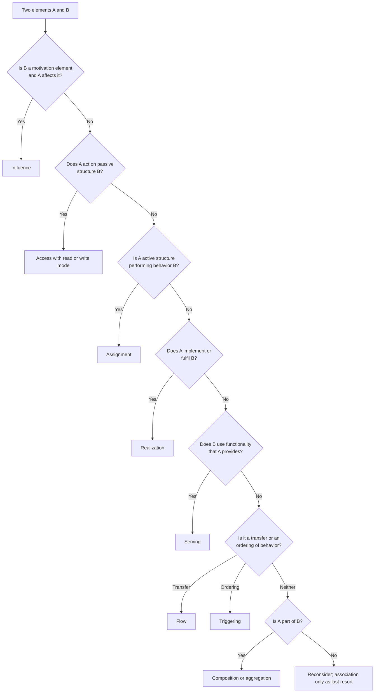

The practical implication is that the decision is driven by the question the line must answer, not by what looks natural on a slide. If you cannot pick a relationship, the usual cause is that one of the elements is mistyped, for example a "service" that is really a process. Fixing the type is better than falling back on association, because association carries no meaning for traversal.

Two further mechanisms affect how much a model can say. First, the language defines **derivation**: some chains of relationships imply a direct relationship. If a technology service serves an application component that realizes an application service which serves a business process, a derived dependency exists between the technology service and the process. Tools use derivation to answer transitive questions without every link being drawn, but derived relationships can overstate dependency, because some intermediate links are optional or loosely coupled. Treat a derived result as a candidate to verify, not as proof. Second, **junctions** combine several relationships of the same type with and or or logic, for example when a process needs either of two alternative services. Junctions express redundancy, and omitting them makes a redundant dependency look like a single point of failure.

**Worked scenario (illustrative).** A hypothetical retailer models its order process. The first draft connects the order process, a pricing application, and a pricing database with plain arrows labelled "uses". Reviewing with the relationship table, the team splits those lines: the pricing application serves the order process (serving), the order process reads the price list (access, read), the order entry step triggers the fulfilment step (triggering), and the order confirmation is passed to the customer notification process (flow). When the pricing application is later considered for retirement, the serving link, not the access or flow links, identifies the process affected, and the access link identifies a data object whose ownership must be reassigned. The original "uses" arrows could not have distinguished these.

**Failure modes.** Arrow soup: every pair of related elements is joined, so no view is readable and no path is meaningful. Association overuse: the model looks connected but cannot be traversed with confidence. Over-precision: modeling every call as a flow makes the model as detailed as the code and just as expensive to keep current. A useful test is to ask who will maintain a relationship and which decision it supports; if the answer is nobody and none, omit it.

## 6. Tracing Impact Through a Model

The payoff of typed relationships is traversal. Impact analysis starts at one element, follows relationships in a chosen direction, and collects the elements reached. The direction matters. To find what a change breaks, follow serving and realization links upward, from provider to consumer. To find what justifies or constrains a thing, follow them downward and across the motivation elements. Triggering and flow links answer a different question, namely what receives the work or information next.

The sequence below shows an architect handling a change request against a model repository. The repository is the single source from which views are rendered.

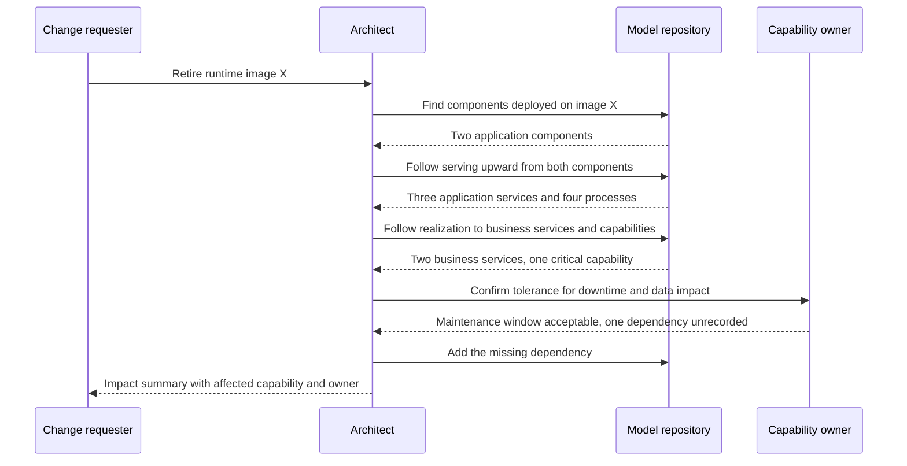

Two lessons follow from the exchange. First, the model narrows the conversation: instead of broadcasting the change to every team, the architect consults one owner and gets targeted feedback. Second, the owner revealed an unrecorded dependency. A model never captures all reality; a good process treats each such discovery as a correction to the model rather than a reason to distrust it. If those corrections are not fed back, the model loses credibility and people stop querying it, which is the quiet failure mode that ends most enterprise modeling programs.

**Edge cases.** Optional dependencies: a process may use a service only for exceptions. Record this with a qualifier or a junction, or the traversal will classify a rarely used path as critical. Shadow dependencies: spreadsheets and manual workarounds appear in no repository, so an application's apparent isolation may be false. Cross-model identity: when two teams model the same system with different names, traversal fails silently, which is why stable identifiers and naming rules matter before the model grows.

**Worked scenario (illustrative).** A hypothetical logistics firm considers consolidating two route-planning applications. Traversal from each component shows that one serves a dispatch process used by all regions, while the other serves only a pilot process in one region. The first is therefore the consolidation target and the second a candidate for retirement. The architect also finds that both components access a shared "delivery schedule" data object, with one marked as writer and the other as reader. That identifies a data ownership decision that must precede consolidation, something a simple application inventory would not have shown.

## 7. Connecting Capabilities to Their Realization

A capability describes what an organization must be able to do, relatively independent of its current organization chart or application portfolio. Capability discovery and map construction belong to [Capability Mapping](CH11_Capability_Mapping.md) and the business discipline to [Business Architecture](CH04_Business_Architecture.md); here the question is how a capability is attached to the rest of the model so that it can be traversed.

In ArchiMate the capability is a strategy-layer element. It is realized by the behavior and structure that deliver it: business processes and functions, the roles assigned to them, the information they use, and the applications and technology that serve them. A capability is not a process, because it says nothing about how the work is done, and it is not an application, because several applications may contribute to it and one application may contribute to several capabilities. Mapping realization makes two things visible that an inventory cannot show: **concentration risk**, where a critical capability depends on one fragile element, and **redundancy**, where several elements realize the same capability.

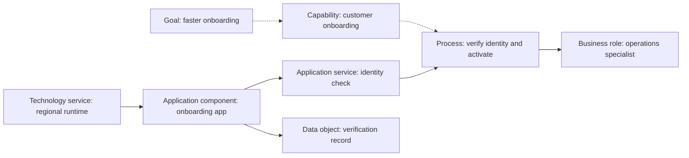

The trace is not a claim that every realization is direct or one-to-one. Whether a given process fully or only partly realizes a capability is a modeling judgment, and the model should record it as an attribute rather than leave it implied. The implication for portfolio decisions is that realization alone does not rank investment. To support a decision, each capability and each realizing element needs at least an owner and a criticality rating on a scale defined in the model conventions.

| Pattern in the model | What it suggests | Follow-up question |
|---|---|---|
| Critical capability, one realizing application, no alternative | Concentration risk | Is there a tested recovery or substitution path? |
| Capability realized by many overlapping applications | Possible duplication | Are the differences deliberate (regions, products) or accidental? |
| Capability with no realizing process | Aspiration or model gap | Is the capability real, or is the model incomplete? |
| Application serving no process | Orphan or missing links | Is it retired, shadow-used, or simply unmodeled? |

These queries only mean something if completeness is known. A model that covers half the applications will report false orphans. Record coverage explicitly, for example "applications in scope: those in the portfolio register as of the last review", so readers know whether an empty result is evidence or silence.

**Worked scenario (illustrative).** A hypothetical bank wants to invest in "customer onboarding". The model shows one process realizing the capability, served by three application services. Two come from components used elsewhere, and one comes from a component that serves only onboarding and has no recorded alternative. The architect marks that component as a concentration point and proposes that investment first target a tested fallback rather than new features. The model did not decide this; it located the question and the owner to ask.

## 8. Relating Value Streams, Services, and Outcomes

A value stream describes the stages through which a stakeholder receives value, from a trigger such as a customer need to a result such as an active account. In ArchiMate a value stream is a strategy-layer element composed of ordered stages, and each stage can be connected to the capabilities that enable it. Business services expose outcomes to internal or external consumers; processes and roles realize those services. The value stream therefore connects the outside-in view (what the stakeholder experiences) with the inside-out view (what the organization is able to do).

Stage-to-capability links are the useful part. They show which capabilities a stage depends on and which capabilities are shared across many stages. Value-stream mapping as a business and product method belongs to [Business Architecture](CH04_Business_Architecture.md) and to the Part 02 chapters on product discovery and journey mapping; this section covers only representation.

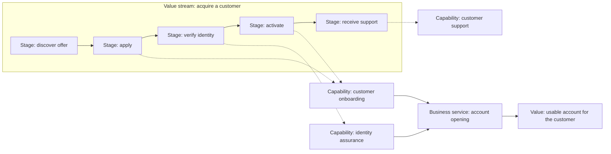

The implication is that a capability appearing in several stages, such as onboarding here, has a wide blast radius: weakness in it harms more than one stage of the stakeholder's experience. Conversely, a stage with no capability mapped to it signals either a manual activity or a model gap, and both deserve an owner.

| Question | Elements to traverse | Result |
|---|---|---|
| Which stage suffers if capability X degrades? | Capability to value-stream stages | A list of stages and their outcomes |
| Which services does a stage ultimately rely on? | Stage to capability to process to application service | A dependency list for support and resilience planning |
| Where do handoffs occur? | Roles assigned to consecutive stages | Candidates for delay or duplicated checks |
| Which outcome is not produced by any stage? | Value to stages | A missing stage or a mislabelled outcome |

Keep the value-stream model at a useful level of abstraction, typically five to ten stages. It complements process modeling and does not replace workflow, interface, or deployment design. Over-decomposing stages into steps recreates a process model that nobody will maintain, and mixing customer-facing stages with internal back-office stages in one stream blurs whose value is being described.

**Edge cases.** A service may serve several value streams with different expectations, for example a payment service used by both purchase and refund. Do not create a separate element per stream; connect the one service to each stage and capture the differing expectations as stage-specific requirements or Service Level Agreement (SLA) targets. A stage may also be performed by an external partner. Model the partner as a business actor and the stage's service as an external business service, so that the dependency is visible even though the implementation is not owned.

## 9. Modeling Implementation and Migration

Implementation and migration elements describe how the architecture changes over time. A **plateau** is a relatively stable, coherent state of the architecture at a point in a transition. A **gap** records what differs between two plateaus. A **work package** is a bounded piece of work that closes a gap, and a **deliverable** is a result it produces. An implementation event can mark a point such as a cutover. Connecting work packages to the capabilities and components they affect lets the model answer sequencing questions that a target-only diagram cannot.

Plateaus are architectural states, not calendar periods. A plateau is defined by which elements exist and are in service, for example "old and new case systems both live, identity migrated". Schedules, budgets, and release trains belong to delivery and portfolio practices; the architecture model should hold the structural facts that constrain them.

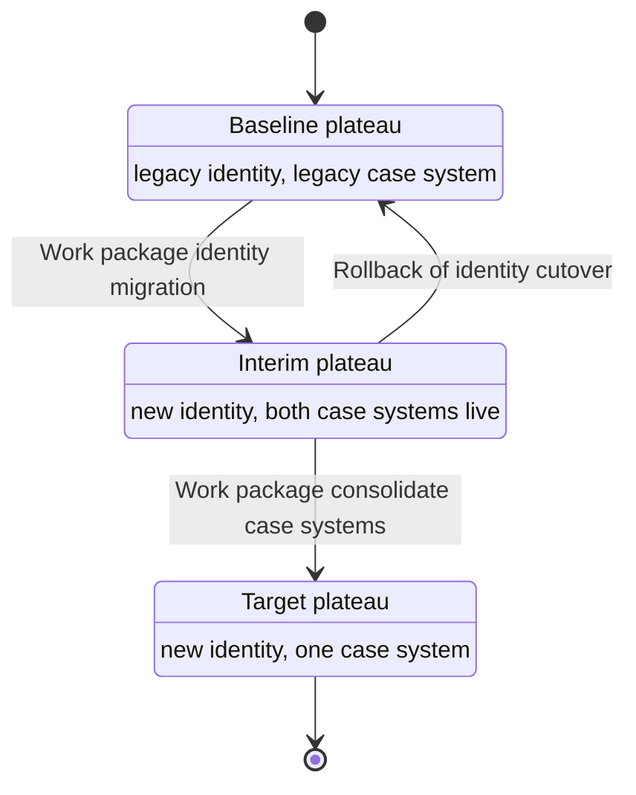

The diagram shows two properties a target-only picture hides. First, the interim plateau is a real operating state with its own risks: two case systems must coexist, data must be synchronized, and ownership of records is ambiguous. Second, rollback is a transition in its own right. If the identity cutover can be reversed only by restoring a backup, the model should say so, because that changes how the work package is approved.

| Element | What to record | Why it matters |
|---|---|---|
| Plateau | Elements in service, owner, entry condition | Defines the operating state teams must support |
| Gap | Elements added, removed, or changed between plateaus | Becomes the scope statement for work packages |
| Work package | Affected capabilities and components, dependencies, risks | Supports sequencing and impact review |
| Constraint or requirement | Deadline, regulation, or policy that bounds a work package | Explains why the order is not free |
| Coexistence note | Systems both live, data synchronization direction, record ownership | Prevents hidden dual-write and reconciliation problems |

**Alternatives and trade-offs.** A team can model only baseline and target, or it can model every intermediate step. Baseline and target alone are cheap and adequate for early funding conversations, but they conceal coexistence. Modeling every step recreates a project plan and ages quickly. A workable compromise is one plateau per independently deployable, operationally meaningful state, usually fewer than five, and no more detail until a work package is imminent.

**Failure modes.** A big-bang target with no plateaus makes cutover look like a single event. Plateaus defined by dates rather than states cannot be checked against the model. A gap that lists only added elements forgets decommissioning, so retired systems linger in run costs and in dependency queries.

**Worked scenario (illustrative).** A hypothetical insurer plans to replace a policy administration system. The first plan has two plateaus. When the architect adds the coexistence view, the interim state reveals that a billing process reads policies from both systems and that no element owns the reconciliation. A new work package "reconcile policy records" is added before the cutover work package, and the ordering constraint is recorded as a dependency. Detailed data migration design stays with [Data Architecture](CH06_Data_Architecture.md) and delivery planning with the project team.

## 10. Viewpoints, Views, and Model Governance

Three terms are often used interchangeably and should not be. The **model** is the repository of elements and relationships: the single set of facts. A **viewpoint** is a reusable specification of which concepts, relationships, and conventions are used to address a class of stakeholder concerns. A **view** is the rendering of part of the model according to a viewpoint, for a particular audience and question. The standard includes a catalogue of example viewpoints, and organizations commonly define their own; consult the current specification for the catalogue rather than assuming a fixed list.

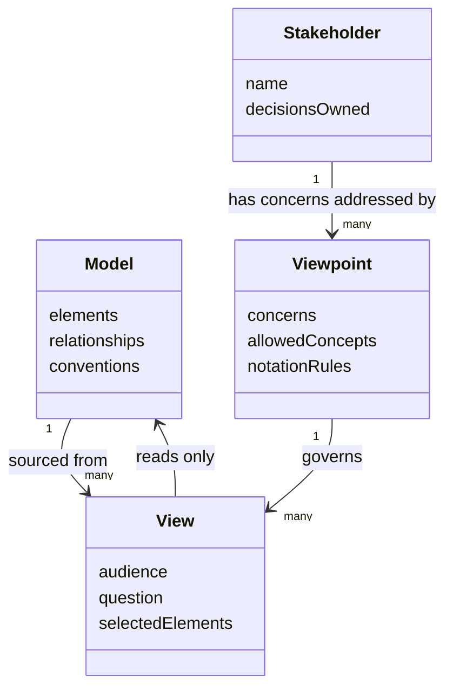

The implication is the direction of the arrows: views read from the model and never hold facts of their own. If someone edits a diagram so that it differs from the repository, the diagram becomes the new source of truth by accident and the model silently forks. Tools that keep views as projections prevent this; ad hoc drawings exported to slides do not.

Viewpoints are chosen by concern. An executive typically needs outcomes, capabilities, and investment gaps. An application owner needs interfaces and dependencies. An operator needs deployment, responsibility, and failure boundaries. A security reviewer needs data location and trust boundaries.

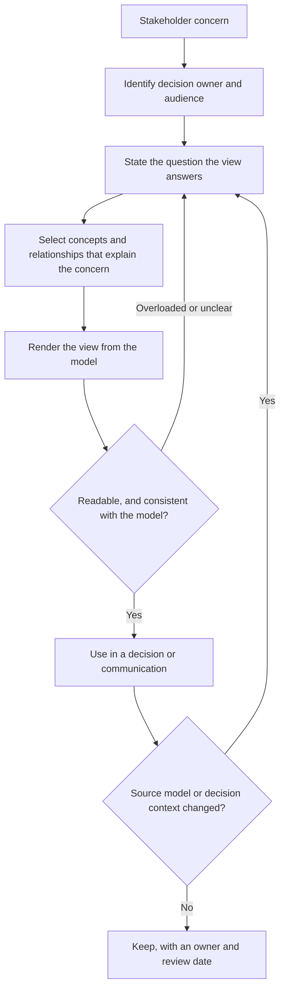

A practical readability limit is the amount a reviewer can hold in mind, often cited informally as a few dozen elements per view; treat that as a rule of thumb, not a standard. When a view exceeds it, split by concern or by layer rather than shrinking fonts.

**Model governance.** A shared model needs explicit conventions, recorded in the model itself:

- **Edition and tool:** the language edition and the modeling tool in use, so exchanged files and training agree.
- **Naming rules:** one name per real thing, with a pattern per element type (for example, business services named as outcomes, application components named as the deployable unit).
- **Ownership:** a named owner per domain of the model, with authority to accept changes. Review authority and escalation belong to [Architecture Governance](CH08_Architecture_Governance.md) and [Architecture Review Boards](CH09_Architecture_Review_Boards.md).
- **Source of record:** which facts are imported from other systems, such as an application portfolio register, and which are authored in the model. Do not author the same fact in two places.
- **Review cadence and retirement:** how often views are checked and when stale views are removed.

There is a tension between central control and local agility. A single gatekeeper for every change makes the model accurate and slow, so teams stop updating it. Full self-service makes it fast and inconsistent. A common compromise is local ownership of detailed content inside agreed naming and relationship conventions, with central review limited to cross-domain elements such as capabilities and shared services.

**Worked scenario (illustrative).** A hypothetical manufacturer has three teams modeling plants. Each uses a different name for the same scheduling system, so queries return three components. The architects define a naming rule, merge the duplicates under one identifier, and keep plant-specific detail in local views. Queries then return one component, serving three plant processes, and the owner of that component can be asked a single question.

## 11. Failure Scenarios and Common Mistakes

Most failures of enterprise modeling are organizational rather than notational. The language is rarely what breaks; the stewardship around it is. The catalogue below lists failures with their observable symptoms, how to detect them, and how to mitigate them.

| Failure | Symptom | Detection | Mitigation |
|---|---|---|---|
| Arrow soup | Views with dense, unlabeled-looking lines; nobody can read a path | Relationship-per-element ratio rises; reviewers ask for a legend | Apply the question test from Section 5; split views by concern |
| Association overuse | Model looks connected but traversal gives vague results | Query for association share; sample paths manually | Retype elements and replace association with a meaningful relationship |
| Stale model | Impact answers contradict what teams know | Spot-check against recent releases; compare with portfolio register | Tie updates to the change process; set owner and review date |
| Nobody queries the model | Views exist; decisions cite slides instead | Track which decisions used the model | Start from a recurring question and deliver its answer from the model |
| Layer misplacement | Systems typed as business processes, or the reverse | Review by asking what kind of thing each element is | Naming rules; training with typed examples |
| Duplicate elements | One system appears under several names | Search for near-duplicate names; compare to register identifiers | Stable identifiers; merge under one owner |
| Derived dependency treated as fact | Overstated blast radius, unnecessary freezes | Compare derived results with owner knowledge | Verify derived paths; use junctions for alternatives |
| Target-only modeling | Cutover plans omit coexistence | Ask what runs between baseline and target | Add plateaus and coexistence notes (Section 9) |
| Over-detail | Model mirrors code and ages in weeks | Update lag per element; maintainers complain | Model only what supports a named decision; push detail to UML or C4 |
| Tool-driven modeling | Elements chosen because the tool offers them | Elements with no stakeholder question | Start from the question, then pick concepts |
| Central bottleneck | Teams wait for approval, then bypass the model | Change request backlog | Local ownership inside shared conventions (Section 10) |

Several anti-patterns deserve a name because they recur:

- **The wall poster.** One enormous diagram printed to impress. It answers no specific question and is outdated at printing. Replace it with views tied to decisions.
- **The ivory tower model.** An architecture team models alone, without consulting the owners of the things modeled. Content is plausible but wrong in the details that matter. Interview owners and make them reviewers.
- **Notation worship.** Debating which relationship is technically correct for hours when no decision depends on the choice. Timebox, and prefer a consistent convention to a perfect one.
- **Completeness before use.** Waiting until the whole enterprise is modeled before answering anything. Model one decision area, deliver value, then extend.
- **Model as compliance artifact.** Producing diagrams only to pass a review. The model decays after the review, which teaches everyone that it does not matter.

**Edge cases in detection.** Staleness is hard to see because a stale model looks identical to a current one. Useful indicators are the age of the last change per domain, the proportion of elements with an owner, and the number of corrections raised during impact analysis, as in the sequence in Section 6. A rising count of corrections is a healthy sign that people query the model; a count of zero over a long period more often means nobody is looking.

## 12. Trade-off Analysis and Decision Framework

The central decision is not "which relationship" but "how much modeling, in which notation, for which question". The options below sit on a spectrum of effort and precision.

| Approach | Cross-layer traceability | Curation cost | Audience fit | Main risk |
|---|---|---|---|---|
| Inventory only (spreadsheet or register) | Low: lists without typed links | Low | Portfolio owners | Cannot answer impact questions |
| C4 plus decision records | Medium within software systems | Low to medium | Engineering teams | Weak on business and strategy concepts |
| ArchiMate for a bounded domain | High within the domain | Medium | Architects, domain owners | Domain boundary leaks; partial coverage misread as complete |
| ArchiMate enterprise-wide | High across layers | High, needs dedicated stewardship | Executives, portfolio governance | Decay when stewardship lapses |
| ArchiMate plus automated imports from registers | High, with fresher facts | High initially, lower to maintain | Large organizations | Import mapping errors propagate widely |

Criteria that should drive the choice:

- **Recurrence of cross-layer questions.** If the same kind of impact question arises repeatedly, a typed model pays back. If questions are one-off, a drawing is cheaper.
- **Number of independent teams.** More teams mean more need for a shared vocabulary.
- **Regulatory or contractual traceability.** Obligations that must be traced to systems favor a queryable model.
- **Stewardship capacity.** A named owner with time to maintain the model is a precondition, not an option.
- **Tooling and data sources.** If portfolio facts already live in a register, import rather than re-author.

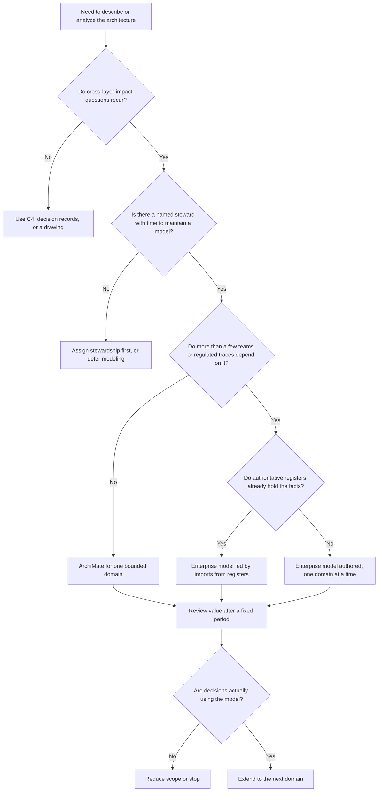

The flowchart ends in a review loop deliberately. A modeling program should be able to shrink or stop if nobody queries it. The fact that the question "are decisions using the model?" can be answered with evidence is itself a design requirement, so instrument the model: record which decisions and reviews cite which views.

Two trade-offs deserve emphasis. **Precision versus maintainability:** each added relationship raises the information content and the maintenance burden. Add relationships when a stakeholder decision depends on them. **Central consistency versus local speed:** strong central control gives uniform quality and slow change; light control gives speed and drift. Section 10 describes a compromise, and the right balance depends on how much cross-team traversal the organization needs.

## 13. Illustrative Composite Case Study and Architect Review Checklist

**This case is hypothetical.** It is a composite constructed to exercise the chapter's techniques; the organization, numbers, and sequence are invented for teaching and do not describe any real company.

A hypothetical retail bank wants to shorten customer onboarding while keeping its identity and fraud controls. The architecture team proposes to replace an external identity verification provider and consolidate two case-management systems. Four groups care about different parts of the change: executives (outcome and risk), the onboarding domain owner (processes and services), operations (deployment and recovery), and security (data location).

**Step 1: Motivation and capability.** The team records a goal ("reduce time to open an account") and a constraint ("verification data stays in approved regions"). Both are linked by influence to the capability "customer onboarding" and to the sub-capability "identity assurance".

**Step 2: Realization trace.** Following Section 7, the team finds that identity assurance is realized by one process, served by one application service from the external provider's integration component. The model shows no alternative, so the team records a concentration risk and asks the owner about fallback options.

**Step 3: Value-stream check.** Following Section 8, identity assurance is used at the "verify identity" stage and again in "receive support" when customers change their details. A provider change therefore affects two stages, which the executives' view highlights.

**Step 4: Plateaus.** Following Section 9, the team defines three plateaus: baseline, interim (new provider live, both case systems operating), and target (one case system). Modeling the interim state reveals that the fraud-review process reads cases from both systems and that no element owns record reconciliation. A work package for reconciliation is added before consolidation.

**Step 5: Views and ownership.** Following Section 10, four views are rendered from one model: an executive capability and gap view, a domain view of processes and services, an operations deployment view, and a security data-location view. Each has a named owner and a review date. Detailed provider security assessment and solution design are explicitly left to their owning processes and recorded in [ADR (Architecture Decision Record)](../21_Architecture_Documentation/CH03_ADR_Architecture_Decision_Record.md) entries rather than in the model.

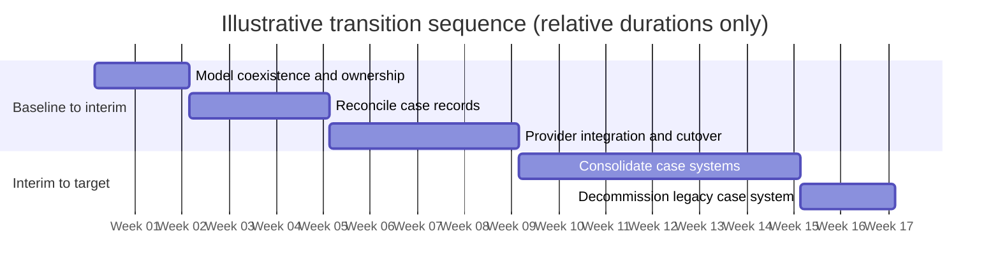

The sequence is justified by the model, not by the dates, which are placeholders. Reconciliation precedes cutover because the interim plateau showed an unowned dependency, and decommissioning is its own work package so that retired systems do not linger in dependency queries. What the case does not show is equally instructive: the model does not decide the provider, estimate the effort, or replace the security assessment. It makes the dependencies, owners, and coexistence risks explicit so that those decisions are better informed.

**Architect review checklist.** Before relying on or publishing a model or view, check each item:

- [ ] The view states the question it answers and the stakeholder who owns the decision.
- [ ] Every element has the correct type, confirmed by asking what kind of thing it is.
- [ ] Relationships are the most specific available; association is absent or justified.
- [ ] Derived relationships used in an analysis were verified with an owner.
- [ ] Redundant paths are shown with junctions, so alternatives are not mistaken for single points of failure.
- [ ] Capabilities have owners and criticality, and realizing elements are linked.
- [ ] The scope and coverage of the model are stated, so empty results are interpretable.
- [ ] Transition plateaus, coexistence, and decommissioning are modeled for any migration.
- [ ] Names follow the convention, and duplicates are merged under one identifier.
- [ ] Facts have one source of record; imported and authored content are distinguished.
- [ ] The language edition and tool are recorded in the model conventions.
- [ ] Each view has an owner and a review or retirement date.
- [ ] Detailed design, security assessment, and delivery planning are referenced rather than duplicated.

## 14. Interview Questions

1. **What problem does ArchiMate solve that a free-form diagram does not?** It gives elements and relationships fixed types and meanings across business, application, and technology layers, so the model can be validated and queried, for example to trace which business services a technology change affects.
2. **How do a business process and a business service differ?** A process is internal behavior describing how work is done; a service is external behavior describing the outcome offered to a consumer. Separating them lets implementation change without changing what consumers see.
3. **When would you use serving, flow, and triggering between two processes?** Serving when one depends on capability the other provides, flow when something such as information is transferred, and triggering when one starts the other. A single "depends on" arrow conflates these.
4. **What is the difference between a model, a view, and a viewpoint?** The model holds the facts, a viewpoint specifies concepts and conventions for a class of concerns, and a view renders part of the model for an audience and question. Views must not hold facts of their own.
5. **Why can derived relationships mislead?** Derivation infers a direct dependency from a chain of relationships, but intermediate links may be optional or loosely coupled, so the blast radius can be overstated. Treat derived results as candidates to verify with owners.
6. **What does a transition plateau reveal that a target-only diagram hides?** The interim operating state, including coexisting systems, data synchronization, and unowned dependencies such as reconciliation, plus whether rollback is possible.
7. **When would you not adopt ArchiMate?** When cross-layer questions are rare, there are few teams, or no one can steward the model. C4 and decision records, or a simple register, cost less and suffice.
8. **How do you detect that a model has gone stale?** Check update age per domain, owner coverage, and the number of corrections raised during impact analysis; compare spot samples with recent releases and the portfolio register. A long period with zero corrections suggests nobody is using it.

## 15. Hands-on Exercises

1. **Type and connect.** Take a system you know (for example an order-entry flow). List ten things involved and assign each an ArchiMate element type. Connect them using the decision flow in Section 5, writing one sentence per relationship that says what question it answers. Identify at least one element you first mistyped and explain the correction.
2. **Impact trace.** Using a small model (a spreadsheet of elements and relationships is enough), choose one technology element and trace upward to capabilities. Record the path, mark which links are derived, and verify each derived link with someone who knows the system. Report one dependency the model missed.
3. **Plateau design.** Pick a planned or imagined replacement of one application. Define a baseline, an interim, and a target plateau by listing which elements are in service in each. Identify coexistence risks and any unowned dependency in the interim state, and add a work package for each.
4. **View from a question.** Choose a stakeholder and a decision they own. Write the question, select concepts and relationships, and sketch the view with no more than about twenty elements. Then write the maintenance rule: who owns it, what source supplies each fact, and when it is retired.

## 16. Design and Architecture Review Questions

1. **A team presents one large diagram of the whole platform with plain arrows. How do you review it?** Ask what question and stakeholder it serves, then check element types and replace plain arrows with specific relationships. Split it into views by concern and layer. Verify that the diagram is rendered from a shared model and not drawn separately. The outcome is a small set of owned views, each tied to a decision.
2. **An impact analysis says retiring a service affects fifteen business processes, and the owners disagree.** Check whether the result depends on derived relationships and whether optional or alternative paths were modeled with junctions. Walk the path with the owners, correct the model where they are right, and record the corrections. Report both the verified and the unverified portions of the result.
3. **Leadership wants the whole enterprise modeled before any analysis is delivered.** Recommend starting from one recurring decision area, delivering its answers, and extending by domain. State coverage explicitly so readers can interpret empty results. Name a steward and a review point at which scope can shrink or stop if the model is not used.
4. **A migration plan shows only baseline and target. What would you add?** Add interim plateaus, coexistence notes, data synchronization direction, record ownership, rollback, and decommissioning work packages. Record constraints such as deadlines as motivation elements bounding the work. Leave detailed data migration design and scheduling to their owning disciplines.
5. **Two teams model the same system under different names, and a query returns both.** Merge under a single identifier and owner, and define naming conventions in the model's governance. Decide the source of record so that facts are not authored twice. Keep team-specific detail in local views within shared conventions, and have governance review only cross-domain elements.

## 17. Summary

ArchiMate is a small, typed language for describing business, application, technology, strategy, and change elements in one connected model. Its value for a solution architect comes from the shared meta-model: the same structure repeats across layers, services separate what is offered from how it is produced, and relationships carry meaning that can be traversed. This chapter has mapped to the outcomes stated in the Introduction.

The problem it solves is untraceable change and inconsistent vocabulary, and it is worth its cost when cross-layer questions recur and a steward exists (Sections 1 and 3). Layers and aspects place any real thing in an element type (Section 4). Choosing the most specific relationship, rather than an arrow or an association, is the main modeling skill, and derived relationships and junctions need care (Section 5). The model, viewpoints, and views have distinct roles, and views should answer a named stakeholder question (Section 10). Impact is traced upward from technology to capabilities and downward to motivation, and capabilities, value streams, and migration plateaus extend the trace to strategy and change (Sections 6 to 9). The failure modes, including arrow soup, stale content, and unqueried models, are mostly stewardship failures, and the decision framework includes a review loop that lets a program shrink or stop (Sections 11 and 12). Related process, classification, and design topics remain with their owning chapters.
