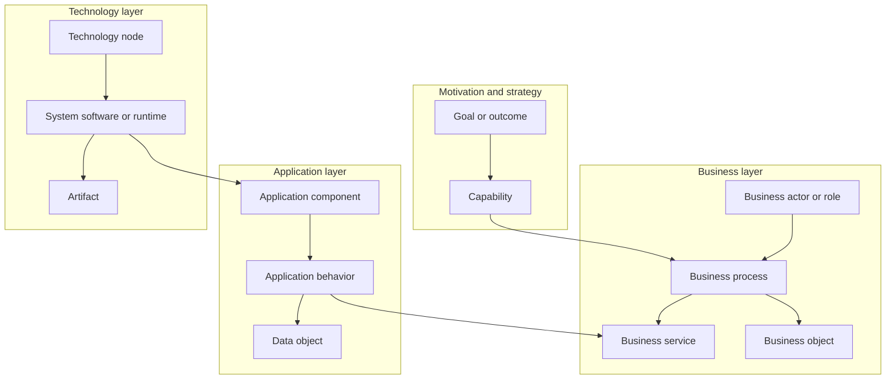
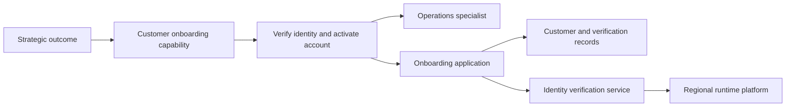
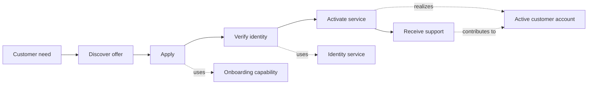
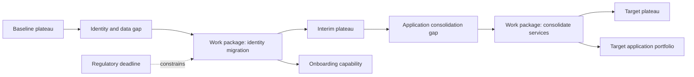
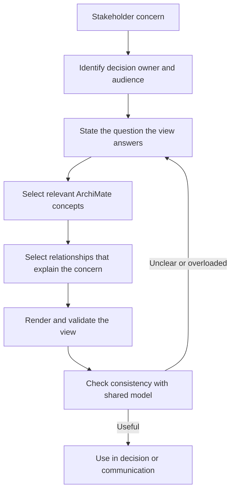

# ArchiMate

Part: [18 — Enterprise Architecture](PART_OVERVIEW.md)

ArchiMate is an enterprise architecture modeling language for describing relationships among business, application, technology, motivation, strategy, and implementation concepts. Its value comes from a consistent vocabulary and relationship model that lets stakeholders inspect how a capability is realized and how change moves through an organization. It is not a development method or governance process. Part 18 CH01 covers TOGAF; Part 21 owns broader architecture-description notation practices.

## Model Elements, Relationships, and Views

An ArchiMate model contains typed elements and relationships. Elements represent active structure, behavior, passive structure, motivation, strategy, or implementation concepts. Relationships express assignment, realization, serving, access, composition, flow, influence, triggering, or specialization. Select a viewpoint for a stakeholder concern, then render a view from the underlying model. A diagram is one view, not the entire architecture.

Use the language's typed relationships rather than drawing arbitrary arrows. A view should state what its shapes and relationships mean and what question it answers. Part 21 CH03 owns the general practice of choosing and documenting architecture views; ArchiMate supplies an enterprise vocabulary for those views.

## Connect Capability to Realization

A capability describes what an organization must be able to do, relatively independent of its current organization chart or application portfolio. It can be realized by business processes, roles, information, applications, and technology. Mapping realization makes dependencies and gaps visible: a critical capability with one fragile application dependency has a different investment profile from a capability supported by several replaceable services.

The diagram is a trace, not a claim that all realizations are direct or one-to-one. A capability may span multiple value streams and applications. Record ownership and criticality so that the model can support portfolio decisions rather than just describe relationships.

## Relate Value Streams, Services, and Outcomes

Value streams describe stages through which stakeholders receive value. Business services expose outcomes or behavior to internal or external consumers; processes and roles realize those services. Connect each stage to the capabilities and information it needs. This helps identify handoff delays, duplicated support, and points where a technology change affects user experience.

Keep the value-stream model at a useful level of abstraction. It complements process modeling but does not replace detailed workflow, interface, or deployment design. Part 02 owns product discovery and customer journey methods; this chapter uses value relationships for enterprise architecture decisions.

## Model Implementation and Migration

Implementation and migration elements describe work packages, deliverables, plateaus, and gaps between architecture states. A plateau is a coherent state of the architecture at a point in a transition; a gap identifies what changes between states. Connect work packages to the capabilities and components they affect, and include dependencies and transition risks.

Modeling a target without transition states can hide operational coexistence. Show which systems remain active during migration, where data is synchronized, and when ownership changes. Detailed release planning remains with delivery and portfolio practices; the architecture model identifies structural dependencies and decision points.

## Choose Viewpoints by Stakeholder Concern

Do not put every element into one diagram. A viewpoint defines conventions for addressing a stakeholder concern; a view selects the relevant model elements and relationships. An executive may need outcomes, capabilities, and investment gaps. An application owner may need interfaces and dependencies. An operator may need deployment, responsibility, and failure boundaries.

Views should be consistent with one shared model, but the model should not become a central bottleneck for every local change. Define element ownership, naming, versioning, and review expectations. Retire stale views when their source model or decision context changes.

## Worked Case: Customer Onboarding Redesign

A bank wants to reduce onboarding time while preserving identity and fraud controls. The motivation view relates the target completion time and risk limit to onboarding capabilities. A business view shows identity verification and exception handling. An application view maps those behaviors to customer, identity, and case services. A technology view locates sensitive verification data in approved regions. An implementation view identifies an interim state where old and new case systems coexist.

The architecture team selects separate viewpoints for executives, domain owners, and operations. Shared identifiers link capability, service, application, and work-package views. A new verification provider changes the service dependency and data boundary; the model helps trace affected capabilities and transition work, while detailed security assessment and solution design remain in their owning processes.

## Review Questions

1. How do model, view, and viewpoint differ?
2. Which relationships explain that an application supports a business service?
3. Why should a capability map include realization and ownership?
4. What does a transition plateau reveal that a target-only diagram hides?
5. How can several stakeholder views stay consistent without becoming overloaded?

ArchiMate is useful when typed enterprise concepts and relationships make a decision or change traceable. Model only what supports stakeholder questions, keep views consistent with their source model, and use migration relationships to expose the work between baseline and target.
