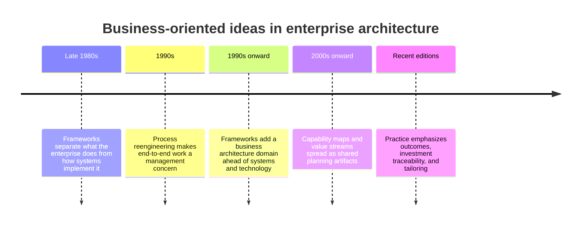
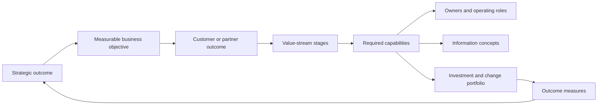
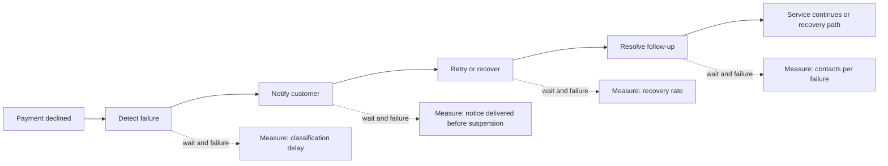
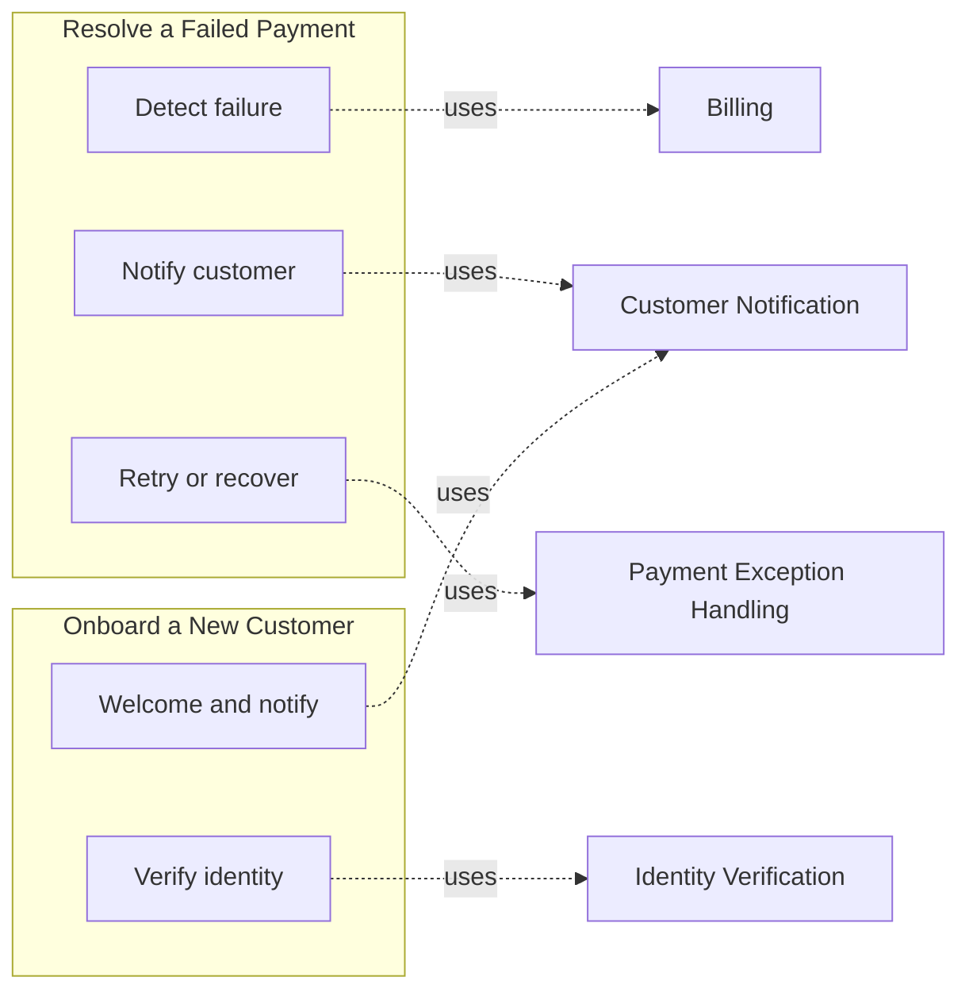
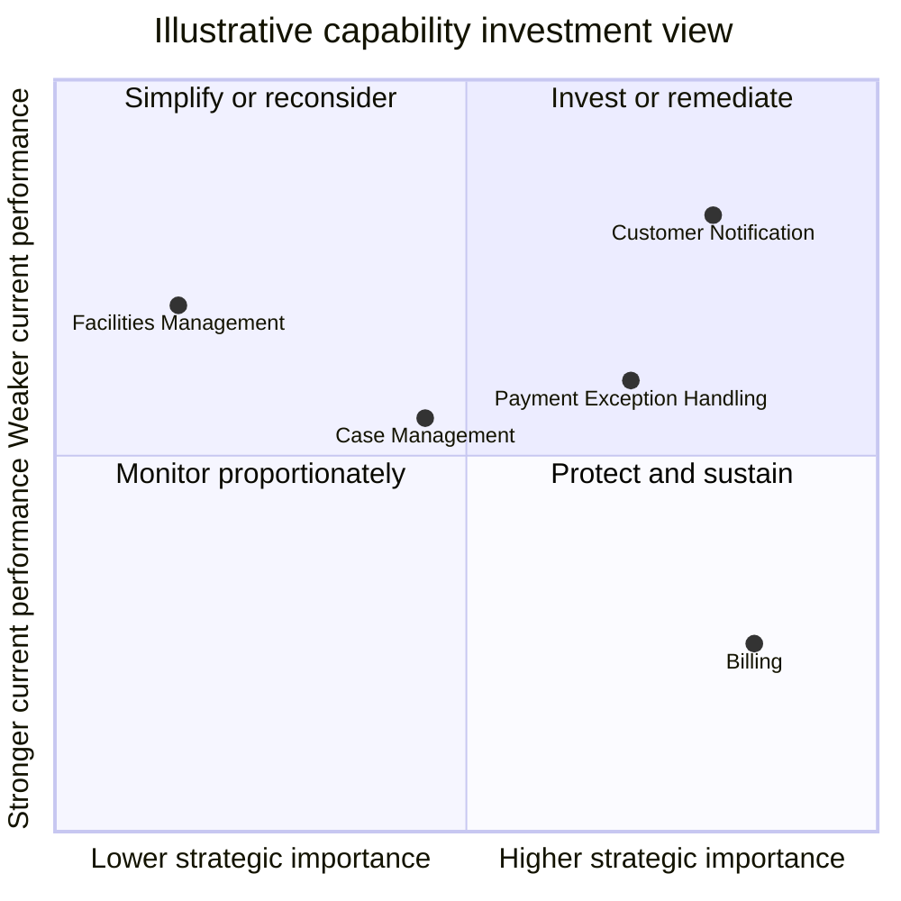
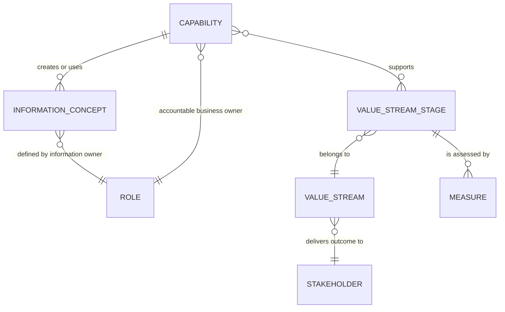
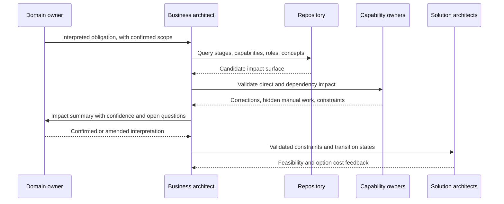
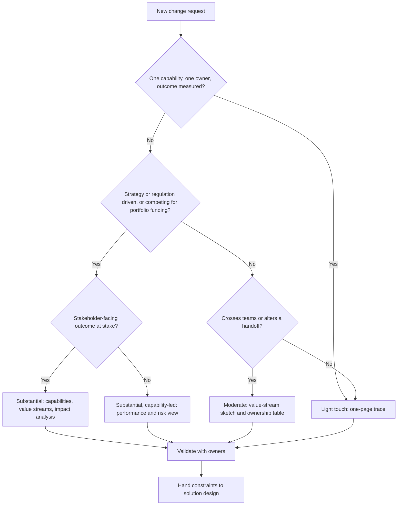
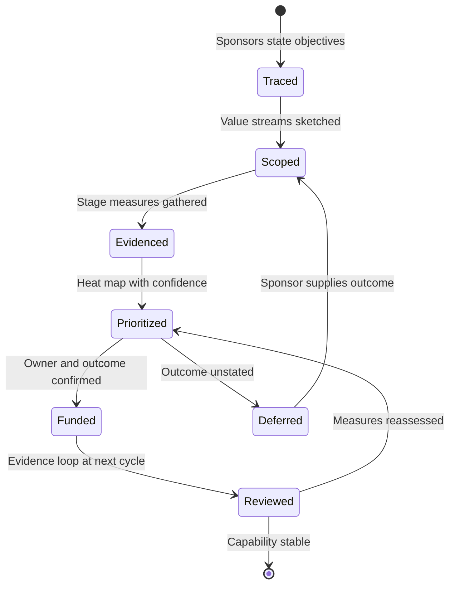

# Business Architecture

Part: [18 — Enterprise Architecture](PART_OVERVIEW.md) · Status: Drafted

## 1. Introduction

Business architecture describes how an enterprise creates value and which capabilities, value streams, information, organizational roles, and investments are needed to deliver it. It sits above applications and technology: it answers "what does the enterprise do, for whom, with what outcome, and who is accountable?" before anyone asks "which system should do it?"

### 1.1 Why it matters to an architect

Solution architects usually receive a request that has already been shaped into a project: "build a retention dashboard", "replace the billing engine". Business architecture is the discipline that tests whether that request is the right change. It gives an architect four practical powers:

- **Trace.** Follow a funded initiative back to a strategic outcome, or discover that no such outcome exists.
- **Scope.** Draw the boundary of a change around a capability or a value stream rather than around whichever system happens to be mentioned in the request.
- **Locate accountability.** Find who owns a capability, a decision, and a piece of information, so that a design is not blocked later by an unanswered question about ownership.
- **Estimate impact.** Predict which teams, roles, and processes are affected by a strategic or regulatory change before estimating application work.

Without these, architects optimize systems that should not exist, or integrate systems around organizational seams that nobody is responsible for.

### 1.2 Scope and ownership boundaries

This chapter teaches the core business-architecture model: how strategy is translated into capabilities and value streams, how the two relate, and how organization, information, and change impact connect to them. It deliberately stops short of material owned elsewhere. Where a boundary is crossed, this chapter recaps and links rather than re-teaches.

- Capability-map construction, taxonomy, decomposition, and maturity scoring: [Capability Mapping](CH11_Capability_Mapping.md).
- Framework context for the business architecture phase and artifacts: [TOGAF](CH01_TOGAF.md) and [Zachman Framework](CH02_Zachman_Framework.md).
- Modeling business elements with a standard notation: [ArchiMate](CH03_ArchiMate.md).
- Application inventories and their mapping to capabilities: [Application Architecture](CH05_Application_Architecture.md).
- Data domains, stewardship, and lineage: [Data Architecture](CH06_Data_Architecture.md).
- Decision rights, principles, and review: [Architecture Governance](CH08_Architecture_Governance.md).
- Product strategy, market analysis, and discovery: [Product Strategy](../02_Design_Thinking_and_Product_Management/CH15_Product_Strategy.md) and [Product Discovery](../02_Design_Thinking_and_Product_Management/CH14_Product_Discovery.md).
- Customer-journey research: [Journey Mapping](../02_Design_Thinking_and_Product_Management/CH05_Journey_Mapping.md).

### 1.3 Reader outcomes

After this chapter you should be able to:

1. Explain what business architecture is and is not, and why it is technology-neutral by design.
2. Translate a vague strategic statement into measurable objectives, capabilities, and an investment question.
3. Distinguish a capability from a value stream, a process, and an organizational unit, and choose the right one for a given question.
4. Build a value stream with stages, entry and exit criteria, stakeholders, and outcome measures.
5. Use the many-to-many relationship between capabilities and value-stream stages to find shared bottlenecks and estimate impact.
6. Recognize the common failure modes of business-architecture work and apply decision criteria for how much of it a given change needs.

## 2. Background

Several facts about the field's lineage are well established, and the rest of this chapter does not depend on more than these.

- Enterprise-architecture frameworks such as the [Zachman Framework](CH02_Zachman_Framework.md) (published in the late 1980s) already separated the questions of what an enterprise does and why from how systems implement it. Business-oriented perspectives have been part of enterprise architecture from the start.
- [TOGAF](CH01_TOGAF.md) treats business architecture as one of the architecture domains developed in its Architecture Development Method, ahead of the information-systems and technology domains, and describes strategy, organization, capability, and process as business-architecture concerns.
- Business Process Reengineering (BPR) in the early 1990s made end-to-end processes a management concern, and its mixed record is one reason later practice distinguishes stable capabilities from changeable processes.
- A practitioner community, including the Business Architecture Guild and its Business Architecture Body of Knowledge (BIZBOK Guide), has promoted capability maps and value streams as the core business-architecture artifacts. Treat its terminology as one vocabulary among several, and check the edition you are using, because definitions are refined between editions.

The lasting idea is separation of concerns across time: what the enterprise does (capabilities) changes slowly; how it does it (processes, applications, organization) changes faster. A model anchored to the slow-changing layer remains useful through reorganizations and technology replacements.



The timeline is deliberately coarse. Its implication is that business architecture is a convergence of strategy, process, and framework work, not a single invention, so teams should expect different parts of their organization to already use overlapping vocabulary (process, service, product, capability) with different meanings.

## 3. The Problem Business Architecture Solves

Large organizations accumulate change faster than they accumulate shared understanding. Four recurring symptoms indicate the need for business architecture.

1. **Initiative sprawl.** Many projects are funded, none traceable to an outcome. Two teams build overlapping solutions because neither knows the other works on the same capability.
2. **System-shaped thinking.** Discussions are framed by the application inventory ("the CRM team", "the billing platform"). Because applications mirror past organization, planning around them reproduces past structure.
3. **Orphaned work.** A handoff between teams belongs to nobody, so cross-team delays and failures have no owner. Local metrics all look green while the customer waits.
4. **Slow impact assessment.** When a regulation or strategy changes, nobody can quickly say which roles, information, and processes are affected. Impact is rediscovered by project discovery meetings.

Business architecture answers these with a small set of shared, technology-neutral models: capabilities (what the enterprise can do), value streams (how value reaches a stakeholder), organization and ownership (who is accountable), and information concepts (what the business needs to know). These deliberately avoid implementation detail so that a planning conversation remains possible when the implementation is undecided.

### 3.1 Why not just use process models or the application inventory

| Alternative | Strength | Why it is insufficient alone |
| --- | --- | --- |
| Process models | Detailed, executable, testable | Too granular and volatile for portfolio planning; describe how, not whether the work is needed |
| Application inventory | Concrete and measurable | Reflects implementation history; hides capabilities spread across several applications or done manually |
| Organization chart | Shows reporting lines | Does not show decision rights, service ownership, or cross-team value delivery |
| Customer-journey maps | Capture the experience | Describe one persona's view; not a stable enterprise structure and not tied to investment |
| Strategy documents | State intent | Rarely measurable or decomposable to the level at which teams act |

Business architecture does not replace any of these. It provides the connective layer that relates them, and it is justified when that connection is the missing ingredient. It is not justified for a change confined to one team and one system, where the overhead exceeds the value.

### 3.2 Decision criteria: how much business architecture a change needs

- **Light touch** (a conversation and a one-page trace): the change affects one capability with one clear owner, and the outcome is already measured.
- **Moderate** (a value-stream sketch and ownership table): the change crosses two or three teams or alters a handoff.
- **Substantial** (capability and value-stream modeling, impact analysis, investment comparison): the change is driven by strategy or regulation, spans many capabilities, or competes for portfolio funding.

A common failure is applying the substantial approach to every request, producing models nobody reads, and then abandoning the discipline. Match effort to the cost of being wrong.

## 4. Connecting Strategy to Operational Change

### 4.1 The translation problem

A strategic statement such as "improve customer retention" is not yet an architecture requirement. It does not say which customers, by how much, by when, or through which changes in service, information, or operations. Business architecture performs the translation in explicit steps so that each can be challenged.



Each arrow is a claim, not a fact. "Faster payment recovery improves renewal" is a hypothesis about customer behavior that the evidence loop at the end should test. The chain exposes two kinds of defect: an initiative with no upstream link (disconnected from strategy) and a capability with no owner or measure (hard to change and impossible to evaluate).

### 4.2 Worked scenario: from "reduce churn" to an investment question

Illustrative and hypothetical. A subscription business states the strategy "reduce churn". The architect works down the chain.

| Step | Statement | Evidence needed |
| --- | --- | --- |
| Objective | Reduce involuntary churn (lapses caused by failed payment, not customer choice) from an observed baseline to a target within a fiscal year | Baseline split of voluntary versus involuntary churn |
| Customer outcome | A customer with a failed payment keeps service continuity without surprise | Support contacts and complaints tagged to payment failure |
| Value-stream stages | Payment due, payment attempt, failure notice, retry, recovery or suspension | Stage timing and drop-off at each stage |
| Capabilities | Billing, payment exception handling, customer notification, support | Which are owned, measured, and constrained |
| Investment question | Is the constraint retry logic, communication, or support context? | Stage-level evidence, not opinion |

The result is not "build a retry service". It is a narrower, testable investment question. If stage evidence shows customers receive no notice before suspension, the highest-value change may be a communication capability and an ownership decision, with little application work. A system-first framing would have funded the retry engine.

### 4.3 Objectives, measures, and the causal-claim trap

Write each objective with a measure, a population, a baseline, a target, and an owner. Distinguish three measure types:

- **Outcome measures** describe the result for a stakeholder (renewal rate, time to resolution).
- **Output measures** count what the enterprise produced (notices sent, cases closed).
- **Health measures** show whether the capability can sustain delivery (backlog age, failure rate).

Outputs are easy to count and easy to game; an enterprise can send more notices and retain no more customers. A Key Performance Indicator (KPI) should name its owner, the population it covers, its calculation, and the decision it informs. If no decision would change under any value of the measure, it is decoration. Product-level experiment design and metric frameworks belong to Part 02; here the architectural obligation is to keep each measure attached to a capability or value-stream stage so that ownership is clear.

### 4.4 Failure modes

- **Strategy as slogan.** The chain stops at "improve experience", and every project claims to support it. Remedy: require a measure and a baseline for each objective.
- **Untested causality.** The chain asserts that capability X drives outcome Y without evidence. Remedy: record the assumption, then design the first investment so that it tests it.
- **One-way translation.** Strategy flows down but evidence never flows back. Remedy: schedule the evidence review as part of portfolio governance (see [Architecture Governance](CH08_Architecture_Governance.md)).
- **Over-precision.** Pseudo-exact scoring of strategic alignment hides guesses. Remedy: state confidence alongside each rating.

## 5. Capabilities and Value Streams

### 5.1 Definitions

A **capability** is what an enterprise can do, expressed as a noun phrase independent of who does it or how: "Payment Exception Handling", "Customer Notification". It is stable, has an owner, and can be assessed for performance, risk, and investment. A **value stream** is the end-to-end sequence of stages through which a stakeholder receives a result, named from the stakeholder's perspective: "Resolve a Failed Payment". Each stage has an entry trigger, an exit criterion, and a stakeholder outcome.

They answer different questions:

| Question | Use |
| --- | --- |
| What must we be good at, and who owns it? | Capability |
| How does the stakeholder get the result, and where does it stall? | Value stream |
| What are the exact steps, rules, and systems? | Process model (detailed work, not owned here) |
| Who reports to whom? | Organizational unit |

Confusing them is the most common modeling error. Naming a capability with a verb-and-object phrase that describes one process ("Process Refund Requests") ties it to a procedure that may change. Naming a value stage after a department ("Finance Review") ties it to an organization that may change.

### 5.2 Value-stream structure

A usable value stream names its stakeholder, trigger, stages, and result. Each stage records what must be true to enter and leave, so that measures and handoffs are unambiguous. A simple template:

```yaml
value_stream: Resolve a Failed Payment
stakeholder: Subscribing customer
trigger: Payment attempt declined
outcome: Service continues, or customer informed of suspension with a recovery path
stages:
  - name: Detect failure
    exit_criterion: Failure reason classified
    capabilities: [Billing]
  - name: Notify customer
    exit_criterion: Customer informed through a preferred channel
    capabilities: [Customer Notification]
  - name: Retry or recover
    exit_criterion: Payment succeeded or recovery path offered
    capabilities: [Payment Exception Handling, Billing]
  - name: Resolve follow-up
    exit_criterion: Support case closed or no contact needed
    capabilities: [Case Management, Payment Exception Handling]
measures: [time_to_recovery, false_suspension_rate, customer_effort]
```

The value is in the exit criteria and the measures. Without them, a stage is only a label.



Attaching a measure to each stage lets a team find where time or value is lost. An end-to-end figure such as "average days to recovery" cannot tell whether the delay lives in detection, notification, or follow-up.

### 5.3 The many-to-many relationship

A capability supports many value streams; a value-stream stage depends on many capabilities. This is why capabilities are a better unit of investment than stages: improving Customer Notification once benefits every value stream that uses it.



Two consequences follow. First, a capability used by many streams is a shared bottleneck candidate and a high-value investment target, but it is also a high-blast-radius change. Second, a stage that relies on many capabilities has many handoffs and therefore many places for ownership gaps. Counting the capabilities per stage and the streams per capability gives an inexpensive first-pass impact estimate before any application analysis. Construction, decomposition levels, and scoring are covered in [Capability Mapping](CH11_Capability_Mapping.md).

### 5.4 Worked scenario: the unowned handoff

Illustrative and hypothetical. In the failed-payment stream above, a team measures retry success and reports 90 percent of retries complete within the policy window. Yet customers report surprise suspensions. Stage-level modeling shows the Notify customer stage depends on Customer Notification, which has no owner and no measure: billing emits events, a messaging service sends templated mail, and neither team tracks whether the notice reaches the customer before suspension. The local metric is green; the stakeholder outcome is not.

The architectural response is not a new system. It is: assign a business owner to the capability, define a stage measure ("notice delivered before suspension"), and agree a handoff contract between billing and messaging. Application changes, if any, follow from the measured gap.

### 5.5 Failure modes and edge cases

- **Capability as org chart.** Capabilities named after teams change with every reorganization. Test: would the name survive a merger of two departments?
- **Value streams as process maps.** Fifty-step diagrams are not value streams. Keep stages few, outcome-oriented, and stakeholder-named.
- **Shared capability with no steward.** A capability used by many streams but owned by one stream's team tends to be optimized for that team. Name an explicit cross-stream owner.
- **Capabilities delivered manually.** A capability may exist with no application at all. Excluding it because it has no system makes the model blind to manual work, which is often where the cost and risk live.
- **Outsourced or partner-delivered stages.** The enterprise still owns the outcome. Record the partner, the contract, and the measure so accountability does not disappear at the boundary.
- **Optional stages and loops.** Real streams contain rework loops and exceptions. Model the main path and note the common exceptions rather than drawing every branch.

### 5.6 When value streams are the wrong tool

Value streams suit customer-facing or stakeholder-facing delivery. For internal, steady-state functions such as treasury operations, a capability view with performance and risk is often enough, and forcing a stream may produce an artificial stakeholder. For work that is one-off (an acquisition integration), a project plan may serve better than a stream. State this choice in the engagement so stakeholders do not mistake omission for oversight.

## 6. Capability Heat Maps

A capability heat map overlays one or more assessments on a capability map so that planners can compare capabilities at a glance. Building the map and its scoring scales is the subject of [Capability Mapping](CH11_Capability_Mapping.md); this section covers how to use a heat map as decision evidence without misleading yourself.

### 6.1 Separate the dimensions

A single red/amber/green (RAG) colour per capability compresses several different questions into one unexplained signal. Keep these dimensions apart and show at most two at a time:

| Dimension | Question it answers | Typical evidence |
| --- | --- | --- |
| Strategic importance | How much does a strategic objective depend on this capability? | Link from the objective chain in Section 4 |
| Current performance | Does the capability deliver its stage measures today? | Stage measures, backlog age, failure rate |
| Risk | What is the exposure if it fails or is audited? | Incident history, control testing, regulatory mapping |
| Cost | What does it cost to run and change? | Finance data, allocated at capability level |
| Change readiness | Can the owning teams absorb change now? | Open initiatives, staffing, dependency load |

A low-performing capability may be strategically unimportant, in which case the right answer is often to leave it alone. A high-performing capability with rising strategic importance may deserve protection. Only the combination supports a decision.

### 6.2 Reading the investment view



The positions are invented for illustration. The quadrants suggest questions, not automatic investment decisions: a capability in the upper right prompts "what specific outcome would improve, and by what mechanism?", while one in the upper left prompts "can we reduce its cost or retire it?" Cost, risk, dependencies, regulatory obligations, and change capacity can all override the quadrant. Record the source and a confidence level for each rating, and define how an investment should change an observable measure so that the next review can test the claim.

### 6.3 Evidence, perception, and bias

- **Perception versus data.** Workshop ratings reflect the loudest recent incident. Where operational data exists, show it beside the opinion and note disagreement rather than averaging it away.
- **Rater bias.** Owners tend to rate their own capability generously or, when seeking funding, harshly. Use more than one rater and record who rated.
- **Scale drift.** Different workshops interpret "level 3" differently. Publish short anchored descriptions for every level, and re-baseline when the scale changes.
- **False precision.** A weighted score to two decimal places implies certainty that the inputs do not have. Prefer coarse bands with stated confidence.
- **Staleness.** A heat map is a dated snapshot. Show the assessment date and an expiry, because a map used a year later silently drives decisions on old facts.

### 6.4 Failure modes

- **Heat map as roadmap.** Red capabilities are queued for funding with no link to a stakeholder outcome. Remedy: require an outcome and measure per investment.
- **Everything is strategic.** When all capabilities are rated high importance, the map cannot discriminate. Remedy: force-rank within a limited number of top slots.
- **Colour without owner.** A red cell with no named owner becomes a permanent finding. Remedy: every non-green rating carries an owner and a next decision date.

## 7. Organization, Ownership, and Information

Capabilities and value streams are only actionable when someone is accountable for them. This section connects the model to people and to the information the business works with. Data domains, stewardship mechanics, and lineage are owned by [Data Architecture](CH06_Data_Architecture.md), and decision rights and review forums by [Architecture Governance](CH08_Architecture_Governance.md); here we cover what the business-architecture model must record so that those chapters have something to attach to.

### 7.1 Ownership roles

An organization chart shows reporting lines. It does not show who decides what a capability should be able to do, who runs it day to day, or who must be consulted before it changes. Record, for each important capability and information concept:

| Role | Responsibility | Typical failure when missing |
| --- | --- | --- |
| Business owner | Accountable for outcomes, investment, and priorities of the capability | Improvements compete with no one able to rank them |
| Operational owner | Runs the capability day to day and reports its health measures | Incidents are escalated to whoever is nearest |
| Information owner | Decides the meaning, quality bar, and permitted use of a business concept | Definitions diverge across teams |
| Consumers | Streams and capabilities that depend on it | Changes break dependents without warning |
| Escalation path | Who resolves a dispute between owners | Cross-team issues stall |

One person may hold several roles in a small enterprise. What matters is that each role is named, not that each is a different individual. Use a responsibility matrix such as RACI (Responsible, Accountable, Consulted, Informed) only where it clarifies a handoff; a matrix for every capability is rarely maintained.

### 7.2 Information concepts

Business architecture describes information at the level of concepts the business talks about, not tables or message schemas. A concept such as "Customer", "Subscription", or "Payment Failure" is related to capabilities that create, use, or retire it, and to an owner who settles its definition.



This is a metamodel: it shows the kinds of things the business-architecture repository relates, not instances. Its implication is that most useful questions are joins across it: "which capabilities create concepts that have no information owner?" or "which stages have no measure?" Teams that can answer such questions from a lightweight repository, even a spreadsheet, get most of the value. A notation for modeling these elements formally is covered in [ArchiMate](CH03_ArchiMate.md).

### 7.3 Handoff contracts

Where a stage passes work to a capability owned by a different team, record a handoff contract: what triggers it, what information must accompany it, the expected response, and the measure that shows it working. A minimal template:

```yaml
handoff: Billing to Customer Notification
trigger: Payment failure classified
must_include: [customer reference, failure category, suspension date, preferred channel]
expected_response: Notice delivered before suspension date
measure: notice_delivered_before_suspension
owner_of_measure: Customer Notification business owner
escalation: Portfolio investment owner
```

The contract is business-level. Interface specifications, event schemas, and service-level objectives derive from it in application and technology work; see [Application Architecture](CH05_Application_Architecture.md).

### 7.4 Edge cases and failure modes

- **Concept with two owners.** Two departments each claim "Customer" and define it differently. Do not average the definitions; split into distinct concepts ("Account holder", "Service user") or escalate for a single decision.
- **Capability with no information it owns.** It may be a pure coordination role. Check whether it is a real capability or an organizational convenience.
- **Owner by title, not by person.** When the named role is vacant, ownership lapses silently. Review the register at each reorganization.
- **Shadow ownership.** A technical team acts as de facto owner because it controls the system. Surface this and decide explicitly whether the business should take the role.
- **Shared service without consumers listed.** A shared capability whose consumers are unknown cannot be changed safely.

## 8. Assessing Business Change Impact

When strategy or regulation changes, the first architectural question is "what does this touch?" Business architecture answers it faster than project discovery because the links already exist: change to stage to capability to role, information, and investment.

### 8.1 The impact trace

1. **Restate the change as a business obligation or objective**, in the words of the domain owner, not the architect.
2. **Find affected stages** in the value streams that the obligation touches.
3. **Find affected capabilities** through the stage-to-capability relationship (Section 5.3).
4. **Find affected roles and decision rights**, including who must approve changes to the capability.
5. **Find affected information concepts** and their owners.
6. **Find affected initiatives and applications**, then hand the confirmed list to downstream work.
7. **Describe the transition**: what operating state exists between today and the target.

Distinguish three kinds of impact. *Direct* impact changes what a capability must do. *Dependency* impact arises because a neighbouring stage or capability relies on the changed one. *Transitional* impact exists only during the move, such as parallel running or interim manual work. Transitional impact is the most often omitted and the most often the source of customer harm.

### 8.2 Sequence of an impact assessment



The implication is that the architect never owns the interpretation of the obligation. Business architecture identifies the impact surface; it does not replace legal interpretation, detailed process analysis, or solution design. The loop between owners and the architect is where hidden manual work is found, and the final feedback step lets solution cost reshape the business option rather than being discovered after commitment.

### 8.3 Worked scenario: a notification obligation on the renewal stream

Illustrative and hypothetical. This continues the subscription scenario from Sections 4.2 and 5.4 rather than introducing a new one. After the team assigns an owner to Customer Notification and funds a shared renewal capability with a revised support handoff, a new payment-related obligation arrives. Suppose the domain owner, having taken legal advice, states two obligations: customers must receive notice of certain payment events within a defined time, and some payment-related data may be kept only for a limited period. The architect does not interpret the law; the exact wording and timings come from the domain owner.

| Layer | Direct impact | Dependency or transition impact |
| --- | --- | --- |
| Value-stream stages | Notify customer gains a time-bound exit criterion | Retry or recover must not delay the notice |
| Capabilities | Customer Notification, Billing | Case Management needs the same notice record |
| Roles | Notification business owner gains accountability for timeliness | Support leads need updated scripts and training |
| Information | "Payment Failure" and "Notice" concepts need retention rules | Information owner must decide the retention basis for support notes |
| Initiatives | Shared renewal capability scope grows | Existing retry roadmap item may be re-sequenced |
| Transition | Interim period where some notices are sent manually | Parallel running of old and new templates; clear cutover owner |

The result is a short list of confirmed constraints for the application and data teams, a transition plan owned by a named person, and a measure ("notices delivered within the obligation window") added to the stage. Application options are chosen only after this list exists.

### 8.4 Quantifying without false precision

Estimates of affected populations, volumes, and training needs are useful, but give ranges and sources. Useful inputs are the count of affected stages and capabilities, the number of roles whose decision rights change, and the number of information concepts with a changed rule. Combine them into a size band (small, medium, large) with a stated confidence rather than a cost figure that will be quoted out of context.

### 8.5 Failure modes

- **Interpretation drift.** The architect paraphrases the obligation and the paraphrase becomes the requirement. Remedy: quote the domain owner's confirmed wording in the trace.
- **Application-first impact.** Only systems are listed, so training, decision rights, and manual work are missed. Remedy: complete roles and information before applications.
- **Missing transition.** The target state is documented and the move is not. Remedy: always state the interim operating state and its owner.
- **Stale repository.** The trace returns an outdated picture. Remedy: treat repository results as hypotheses to be validated with owners, as the sequence above does.

## 9. Failure Scenarios and Common Mistakes

### 9.1 Failure catalogue

| Failure | Symptom | Detection | Mitigation |
| --- | --- | --- | --- |
| Capability map as org chart | Map reshuffles after each reorganization | Rename test: would the name survive a merger of two departments? | Name capabilities by ability, not by team; re-baseline once |
| Value stream as process map | Dozens of steps, no stakeholder outcome | Stages lack exit criteria or measures | Cut to a few stakeholder-named stages; push detail to process models |
| Unowned handoff | Local metrics green, stakeholder outcome poor | Stage measure missing or owned by no one | Assign owner, define stage measure and handoff contract (Section 7.3) |
| Strategy as slogan | Every project claims to support the same vague goal | Objective has no baseline, target, or owner | Require measure, population, baseline, and target (Section 4.3) |
| Heat map as roadmap | Red cells funded without an outcome | Investment lacks a measurable stakeholder result | Require outcome link and confidence per rating (Section 6) |
| Stale model | Impact traces contradict what owners report | Assessment date old; owners dispute entries | Dated snapshots, review at reorganization, validate with owners |
| Ivory-tower modeling | Models nobody uses in funding or design decisions | No decision cites the artifacts | Tie each artifact to a named decision and retire the rest |
| Impact assessed on applications only | Training, decision rights, and manual work missed | Late surprises from operations | Trace roles and information before applications (Section 8.1) |
| Missing transition state | Customers harmed during cutover | No interim owner or parallel-run plan | Document interim operating state with a named owner |
| Over-scoped engagement | Heavy modeling for a one-team change | Effort exceeds cost of being wrong | Apply the criteria in Section 3.2 |

### 9.2 Anti-patterns

- **Modeling for its own sake.** Completeness is treated as the goal. The corrective test is whether a specific decision would change if the artifact were absent.
- **Technology leakage.** Capabilities named after products ("CRM Management"). The model then cannot survive a platform replacement and cannot be discussed with business leaders.
- **One-time mapping.** A large workshop produces a model that is never updated. Treat the model as a maintained asset with an owner, or accept that it is a dated snapshot.
- **Scoring theatre.** Weighted scores that nobody can reproduce. Use coarse bands and evidence.
- **Architect as translator of law or policy.** The architect paraphrases obligations. Confirmed interpretation belongs to the domain owner.
- **Causal overreach.** Claiming that a capability change will move an outcome without testing the link (Section 4.3).

### 9.3 Edge cases to plan for

Regulated or contractually constrained stages cannot be redesigned freely; record the constraint on the stage. Partner-delivered stages require measures obtained by contract. Small organizations may have a single person holding every ownership role, and a lightweight register is then sufficient. Highly experimental products may not have stable capabilities yet; use hypothesis-style objectives and revisit the model when the offer stabilizes.

## 10. Trade-off Analysis and Decision Framework

### 10.1 Choosing the primary artifact for a question

| Option | Best when | Strengths | Weaknesses | Cost to maintain |
| --- | --- | --- | --- | --- |
| Capability view | Planning investment and ownership across the portfolio | Stable, neutral, many-to-many reuse | Does not show end-to-end timing | Low to moderate |
| Value-stream view | Finding where a stakeholder outcome stalls | Outcome-oriented, exposes handoffs | Wrong for steady internal functions | Moderate |
| Process model | Designing or automating specific work | Precise and testable | Volatile; too granular for portfolio decisions | High |
| Organization-based view | Reporting and cost allocation | Familiar to management | Reflects structure, not value | Low |
| Conversation and one-page trace | Small, single-owner change | Fast, little overhead | Not repeatable or auditable | Very low |

No option dominates. A common combination is a capability view for investment, value streams for the few outcomes that matter most, and process models only where work is being designed.

### 10.2 Decision flowchart



The flowchart routes on the cost of being wrong, not on the importance of the requester. Its implication is that most changes should exit through the lighter branches; if the substantial branch becomes the default, the discipline will be abandoned. Re-enter the flow when the scope grows, for example when a light-touch change turns out to cross a team boundary.

### 10.3 Key trade-offs

- **Fidelity versus freshness.** More detailed models decay faster. Prefer shallow models that are kept current.
- **Central versus federated ownership.** A central team gives consistency but becomes a bottleneck; federated owners are closer to the work but diverge in naming. A common compromise is central standards with owner-maintained content; see [Architecture Governance](CH08_Architecture_Governance.md).
- **Neutral model versus tool-specific model.** Notation tools help consistency but can pull modeling toward what the tool supports.
- **Outcome measures versus output measures.** Outcomes reflect value but lag and are noisy; outputs are available now but can be gamed. Use both and label them.
- **Capability investment versus stream optimization.** Improving a shared capability helps many streams but has a larger blast radius; optimizing one stream is safer but may duplicate effort.

## 11. Illustrative Composite Case Study and Architect Review Checklist

### 11.1 Composite case: a regional services group (hypothetical)

This composite is invented for teaching and describes no real organization. A services group sells recurring plans through several regional units. Leadership states an aim to "grow recurring revenue while protecting service quality". Three initiatives are in flight: a retention dashboard, a billing-engine replacement, and a customer-portal redesign. A business architect is asked to review the portfolio before the next funding cycle.

**Step 1: trace.** The architect asks each sponsor for the objective, baseline, and owner. The dashboard and portal link to a retention objective with a baseline; the billing replacement links only to "modernization". The finding is recorded as a question, not a verdict: what outcome does the replacement serve?

**Step 2: scope by value stream.** Working with the three regional units, the architect sketches two streams: "Keep Service Running Through a Payment Problem" and "Move to a Different Plan". Stage-level evidence is thin, so measures are marked as proposed.

**Step 3: find shared capabilities.** Billing, Customer Notification, and Case Management appear in both streams. Notification has a different local owner in each region and no cross-region steward.

**Step 4: heat map with confidence.** Notification shows high strategic importance and weak performance, with low confidence because the evidence is workshop opinion. Billing is rated adequate on performance but risky on change readiness.

**Step 5: recommend.** The architect recommends: name a cross-region owner for Notification; gather stage measures for four weeks; hold the billing replacement's business case until it states an outcome, while noting that this does not remove any technical reason the engineers may have for replacement; keep the dashboard but tie it to the proposed stage measures.



The state diagram shows that "deferred" is an explicit, reversible state with a defined exit, not a rejection. The implication for the architect's relationships with sponsors is that the review is framed as "supply the missing link" rather than "justify yourself". It also shows the evidence loop: funded work returns to prioritization once measures exist.

**What the case does not claim.** It does not claim that the recommendations produced any particular result. It illustrates the sequence and the framing of findings as questions and hypotheses.

### 11.2 Architect review checklist

Use the list below as a prompt at funding or design review. An unanswered item is a question to resolve, not automatically a failure.

- [ ] The change traces to a stated strategic outcome, with a baseline, target, and owner.
- [ ] Each objective's measures are labelled as outcome, output, or health measures.
- [ ] The change is scoped to a capability or value stream, not only to a named system.
- [ ] Value-stream stages have entry and exit criteria and at least one measure each.
- [ ] Every affected capability has a business owner and an operational owner.
- [ ] Capabilities are named by ability, not by team, product, or procedure.
- [ ] Shared capabilities list their consumers and have a cross-stream steward.
- [ ] Handoffs between teams have a contract and a shared outcome measure.
- [ ] Affected information concepts have an information owner and a stated definition.
- [ ] Heat-map ratings show evidence, source, date, and confidence.
- [ ] Partner-delivered and manual stages are included in the model.
- [ ] Regulatory or legal interpretation is confirmed by the domain owner, not paraphrased by the architect.
- [ ] Impact covers roles, training, decision rights, and information, not only applications.
- [ ] The transition state, its owner, and the evidence review date are defined.
- [ ] The effort of business-architecture work is proportionate to the change (Section 3.2).

## 12. Interview Questions

1. **What is business architecture, and why is it technology-neutral?** It describes how the enterprise creates value: capabilities, value streams, organization, information, and the investments that change them. It is neutral so that planning can proceed before implementation is chosen and so that the model survives platform replacement.
2. **How do a capability and a value stream differ?** A capability is what the enterprise can do, stable and owned. A value stream is the end-to-end sequence by which a stakeholder gets a result. Capabilities are the unit of investment; streams are the unit for finding where outcomes stall.
3. **Why is the capability-to-stage relationship many-to-many, and what does that imply?** One capability supports several streams and one stage needs several capabilities. Shared capabilities are high-value but high-blast-radius, and stages with many capabilities have many handoffs where ownership gaps arise.
4. **How would you turn "improve retention" into an investment question?** Define the measurable objective with baseline and population, identify the stakeholder outcome, map the stages, find capabilities and their owners, and use stage-level evidence to ask which constraint is binding. State causal assumptions so the first investment tests them.
5. **A team's local metrics are green but customers complain. What do you check?** Look for an unowned handoff or a missing stage measure. Compare local outputs against the stakeholder outcome, then assign an owner and a handoff contract before proposing new systems.
6. **How do you use a capability heat map responsibly?** Keep dimensions separate, record evidence, date, and confidence, distinguish opinion from data, and treat quadrants as questions. Require an outcome for each investment.
7. **How do you assess the impact of a new regulation?** The domain owner confirms the obligation; trace it to stages, capabilities, roles, information, and initiatives; separate direct, dependency, and transitional impact; validate with owners; then hand constraints to solution design.
8. **How do you decide how much business architecture a change needs?** Match effort to the cost of being wrong: a one-page trace for a single-owner change, a stream sketch for cross-team changes, and full modeling for strategy- or regulation-driven portfolio decisions.

## 13. Hands-on Exercises

1. **Translate a slogan.** Pick a strategic statement from your own organization or from a public mission statement. Write one objective with measure, population, baseline (marked unknown if so), target, and owner. List three assumptions in the causal chain and one way to test each.
2. **Build a value stream.** Choose a stakeholder result that you understand, such as resolving a billing dispute. Write the stream in the YAML template from Section 5.2 with four to six stages, exit criteria, supporting capabilities, and measures. Identify one stage with no measure and propose one.
3. **Find the shared bottleneck.** Sketch two value streams that share at least one capability. Count capabilities per stage and streams per capability, then name the capability with the greatest blast radius and the owner who should steward it across streams.
4. **Run an impact trace.** Invent a regulatory-style obligation (label it hypothetical). Using the steps in Section 8.1, produce a table like the one in Section 8.3 with direct, dependency, and transition impacts, and list the questions you would put to the domain owner.

## 14. Design and Architecture Review Questions

1. **A sponsor requests a retention dashboard, but no one can say which decision it will change. How do you respond?** Ask which decision, owner, and capability the dashboard serves. If none exists, propose tying it to a stage measure or deferring it. The outline: trace to objective, test whether the measure informs a decision, and avoid funding decoration.
2. **Two regions each own a "Customer Notification" capability with different definitions of a notice. What do you recommend?** Decide whether these are one capability or two. If one, name a cross-region steward and a single information owner for "Notice". If two, rename them to reflect the difference. Record consumers and a handoff contract either way.
3. **Leadership wants a full enterprise capability map before any funding decision. What do you advise?** Question the scope. Propose modeling only the capabilities and streams relevant to the pending decisions, with refinement later. Effort should match the cost of being wrong (Section 3.2) and the map should have an owner and a review date.
4. **A new obligation requires faster customer notice, and the vendor proposes a new messaging platform. How do you review it?** Confirm the obligation with the domain owner, trace direct, dependency, and transition impact, and check ownership and measures for the stage. Only then compare options, including process or ownership changes that may need no platform.
5. **A heat map shows a capability in red, and the owner asks for funding. What evidence do you require?** Ask for the dimension rated red, its source and date, the stakeholder outcome affected, the proposed mechanism of improvement, and the measure that will show change. Consider whether the capability is strategically important at all before agreeing it needs investment.

## 15. Summary

Business architecture connects strategy to the work that delivers it. After this chapter you should be able to explain what it is, why it stays technology-neutral, and when it earns its overhead (reader outcome 1, Sections 1 and 3). You can translate a slogan into a measurable objective, capabilities, and an investment question while treating each link as a testable claim (outcome 2, Section 4). You can distinguish capabilities from value streams, processes, and organizational units, and build a value stream with stages, exit criteria, stakeholders, and measures (outcomes 3 and 4, Section 5). The many-to-many relationship between capabilities and stages reveals shared bottlenecks and gives a first-pass impact estimate (outcome 5, Sections 5.3 and 8). Heat maps, ownership records, and impact traces make the model usable, provided ratings carry evidence and confidence (Sections 6 to 8). The catalogue of failures and the decision framework help you recognize common failure modes and size the work to the change (outcome 6, Sections 9 and 10). Hand confirmed requirements and constraints to the detailed architecture, data, and governance work described in the related chapters.

