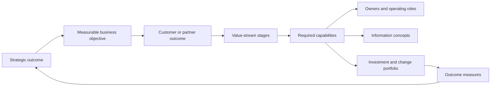
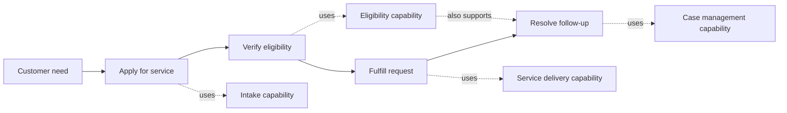
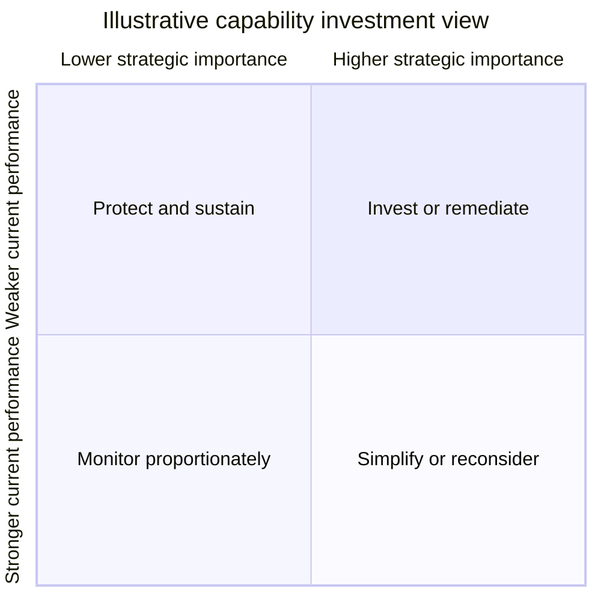
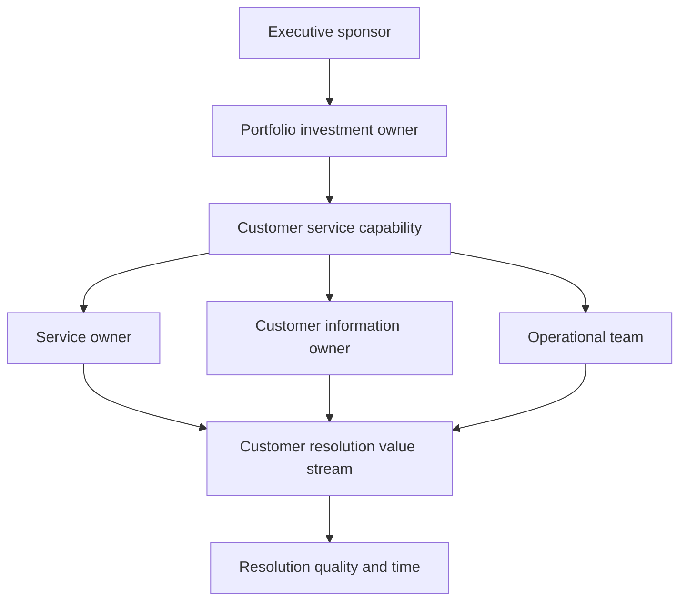
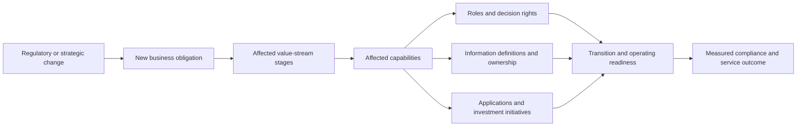

# Business Architecture

Part: [18 — Enterprise Architecture](PART_OVERVIEW.md)

Business architecture describes how an enterprise creates value and organizes the capabilities, value streams, information, and responsibilities needed to deliver it. It connects strategic intent to operational change without assuming a particular application or technology design. Part 02 owns product strategy and discovery; Part 18 CH11 owns capability-map construction in depth.

## Connect Strategy to Operational Change

Translate strategic outcomes into measurable business objectives, affected stakeholder groups, capabilities, value streams, and investment choices. A strategic statement such as “improve customer retention” is not yet an architecture requirement. Identify which customer outcomes, service stages, operating roles, information, and measures must change.

This chain exposes missing links. A portfolio initiative with no capability or outcome trace may be disconnected from strategy; a capability with no owner may be difficult to change. Assign owners and measures at the appropriate level, and make assumptions explicit rather than presenting a causal relationship that has not been validated.

## Relate Capabilities to Value Streams

A capability is an organizational ability; a value stream describes stages through which stakeholders receive value. A capability can support several value streams, and one stage can depend on several capabilities. This many-to-many relationship helps estimate change impact and identify shared bottlenecks. Detailed capability decomposition and heat-map technique belongs to CH11.

Use value-stream stages to discuss outcomes and handoffs. They complement, but do not substitute for, process models and customer-journey research. Measure stage completion, wait, failure, and experience where relevant. A Key Performance Indicator (KPI) should have a defined owner, population, calculation, and decision use; a dashboard count alone does not prove value.

## Use a Capability Heat Map Carefully

Heat maps help compare capabilities by strategic importance, current performance, risk, cost, or change readiness. Separate the dimensions instead of collapsing them into one unexplained red/amber/green score. A low-performing capability may be strategically unimportant, or it may be a critical bottleneck. Validate ratings with evidence and distinguish perception from operational data.

The quadrants suggest questions, not automatic investment decisions. Cost, risk, dependencies, regulatory obligations, and change capacity can alter priority. Record the source and confidence of each rating, then define how the investment should change an observable outcome.

## Connect Organization, Ownership, and Information

Business architecture should make accountability visible across capabilities and value streams. Organization charts show reporting lines, but they do not necessarily identify decision rights or service ownership. Record the business owner, operational owner, consumers, and escalation path for important capabilities and information concepts.

This map helps identify where a change crosses organizational boundaries. Adjacent-stage owners need an explicit handoff contract. They also need a shared outcome. If no role owns an information concept, data ownership and quality decisions can become implicit or contested.

## Assess Business Change Impact

When strategy or regulation changes, trace effects through value streams, capabilities, roles, information, and investments. Distinguish direct impact from dependency impact and identify transitional operating states. Estimate affected populations, service obligations, training needs, and decision rights alongside application and technology changes.

Business architecture identifies the impact surface; it does not replace legal interpretation, detailed process analysis, or solution design. Assign domain owners to validate interpretation and feed confirmed constraints into downstream architecture work.

## Worked Case: Subscription Renewal

A subscription company wants to reduce involuntary churn. Business architecture maps the renewal value stream from payment notice through payment retry, customer communication, support, and account recovery. Capabilities include billing, identity, notification, payment exception handling, and customer support. The team finds that payment retry is measured, but customer communication has no owner and support receives incomplete payment context.

The proposed investment funds a shared renewal capability and a revised support handoff. Metrics distinguish successful renewal, customer effort, false suspension, and support resolution time. A new payment regulation changes data-retention and notification obligations; impact analysis traces those changes to information ownership, operating roles, and affected stages before application teams select implementation options.

## Review Questions

1. How does a business outcome become a capability and investment decision?
2. How do capabilities differ from value-stream stages and organizational units?
3. What evidence supports a capability heat-map rating?
4. Which business owners validate a change impact before solution design?
5. How are outcomes measured across a multi-team handoff?

Business architecture makes strategy, value creation, ownership, information, and change impact traceable. Use it to surface missing capability and accountability links, then hand validated requirements and constraints to the detailed architecture and investment processes.
