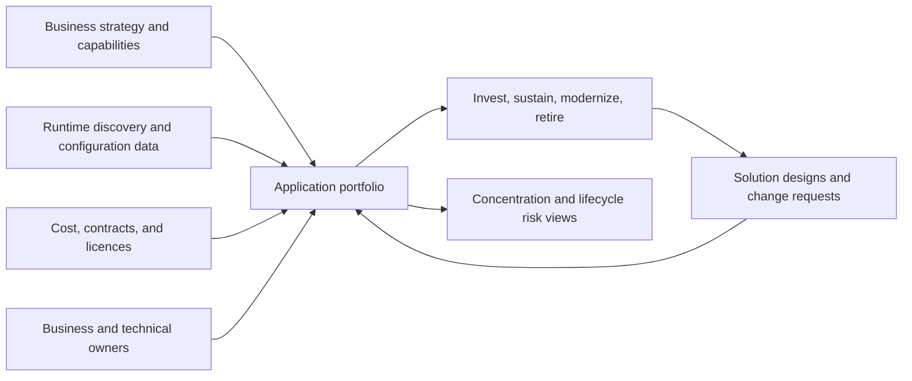
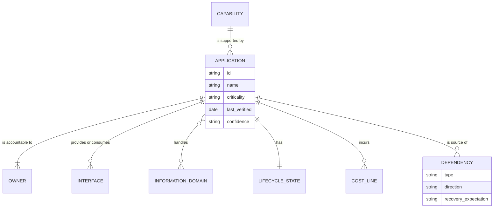
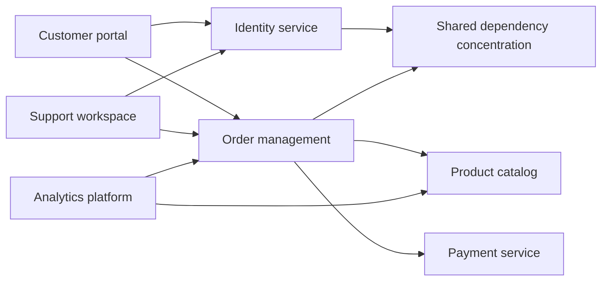
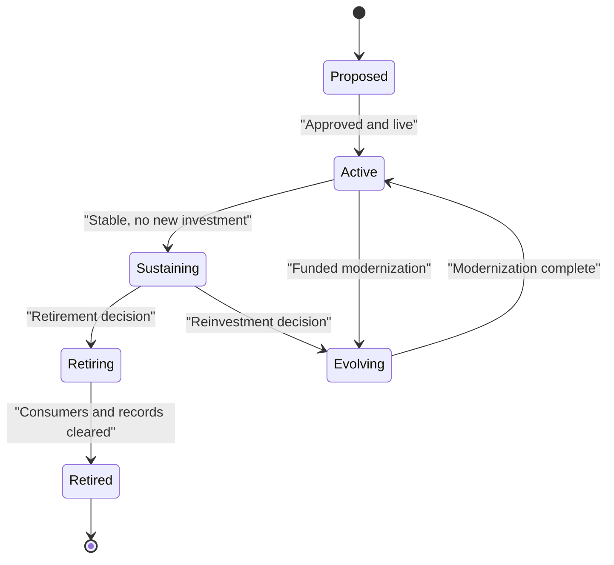
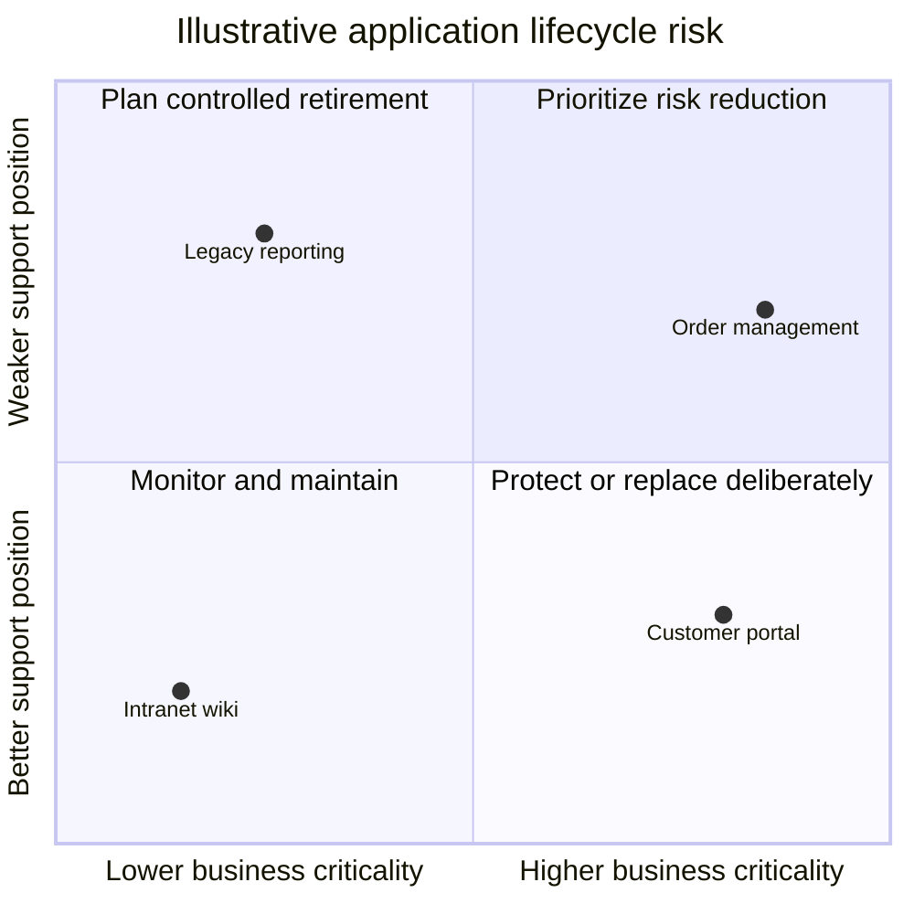
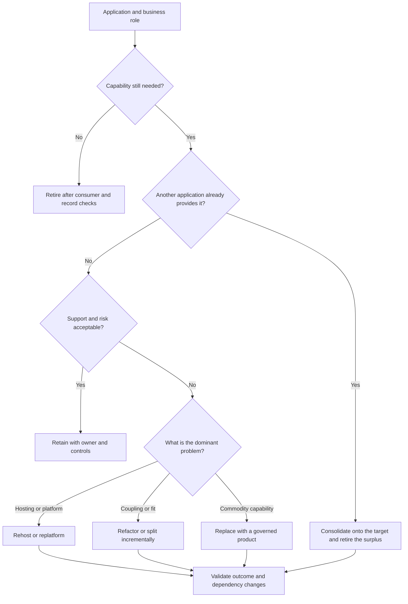
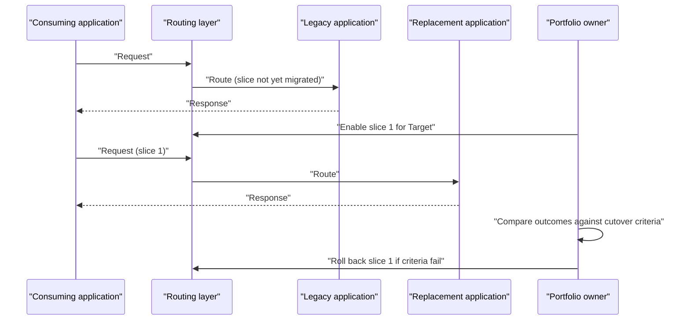
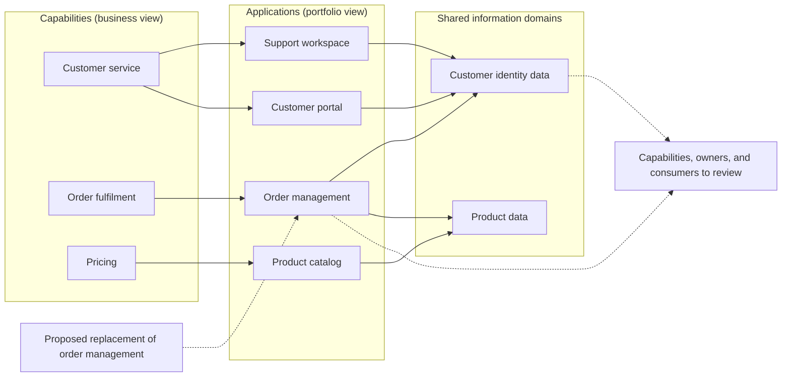
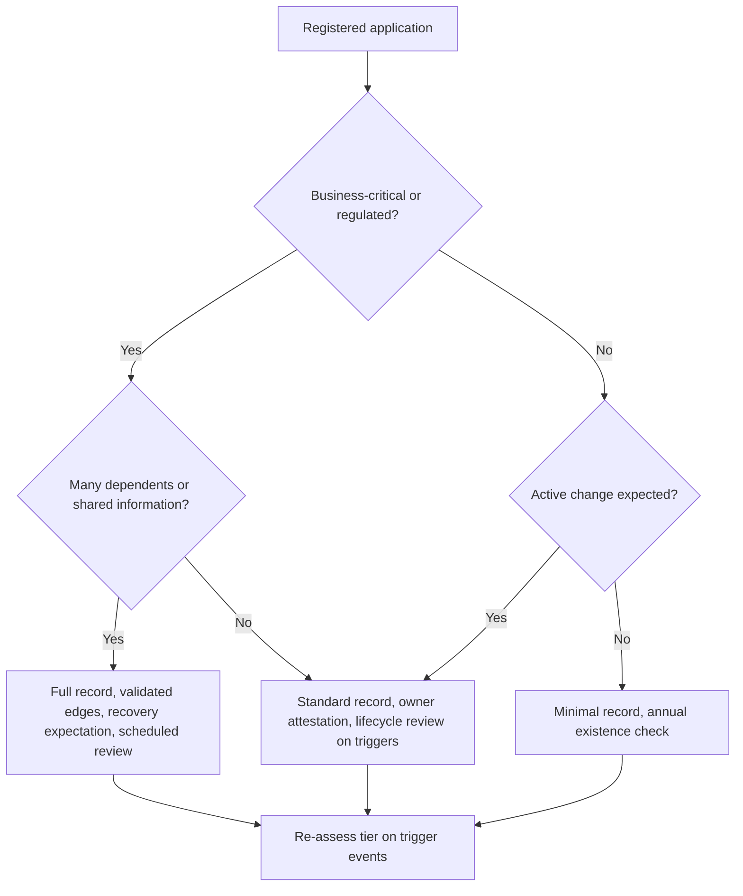
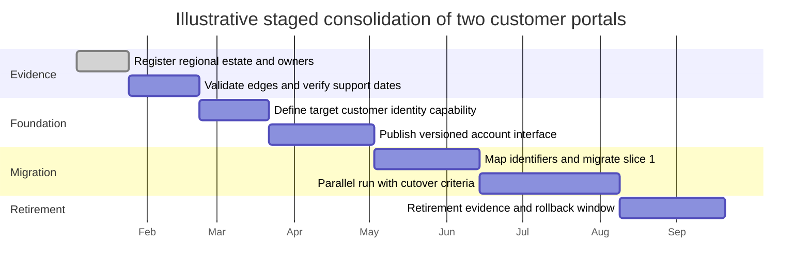

# Application Architecture

Part: [18 — Enterprise Architecture](PART_OVERVIEW.md) · Status: Drafted

## 1. Introduction

Enterprise application architecture is the discipline of knowing, describing, and deliberately shaping the set of applications an organization runs: what each one is for, who is accountable for it, what it talks to, what information it holds, how long it will remain supportable, and which business capabilities depend on it. Where a solution architect designs the inside of one system, an enterprise application architect designs and governs the portfolio of systems as a whole, so that investment, modernization, risk reduction, and retirement decisions are made on evidence instead of on whoever argues loudest.

For an engineer moving into architecture, this is a change of unit of analysis. You are no longer asking "is this service well factored?" but "which of our two hundred applications should we spend money on next, which can we switch off, and what breaks if we change this one?" The answers depend on facts that no single team holds: ownership that crosses departments, dependencies that cross vendors, and obligations (records retention, recovery, audit) that outlive any one project. The enterprise application architect's main product is therefore a trustworthy, maintained model of the application estate, plus the decision logic that uses it.

This matters to a solution architect in practical ways. Your design is reviewed against the portfolio: does a similar application already exist, who else consumes the interface you are changing, is the platform you chose on a path to retirement? Knowing how the portfolio is modelled lets you supply the right facts early and challenge decisions that rest on stale ones.

This chapter owns the enterprise-level view of applications: the portfolio and its inventory, dependency and concentration analysis, lifecycle and technology risk, modernization dispositions, and the trace from applications to capabilities. The boundaries with neighbouring material are deliberate:

- Solution-level component, deployment, and runtime design belongs to [High-Level Design](../07_System_Design_and_Distributed_Systems/CH03_High_Level_Design.md); this chapter treats an application as a unit in a portfolio, not as a design problem.
- General structural and style patterns belong to [Microservices](../20_Architecture_Patterns/CH05_Microservices.md) and the other chapters of Part 20; this chapter only uses them as disposition targets.
- Cloud migration execution, provider products, and provider architecture belong to [Cloud Migration](../09_Cloud_Computing/CH16_Cloud_Migration.md) and [Cloud Migration and Modernization Architecture](../10_Cloud_Architecture/CH14_Cloud_Migration_and_Modernization_Architecture.md); this chapter owns the portfolio decision about whether and how to modernize, not the migration mechanics.
- Routing mechanics used in incremental cutover belong to [Reverse Proxy](../05_Networking_and_OS/CH11_Reverse_Proxy.md).
- The framework context belongs to [TOGAF](CH01_TOGAF.md), the modelling notation to [ArchiMate](CH03_ArchiMate.md), the business view to [Business Architecture](CH04_Business_Architecture.md) and [Capability Mapping](CH11_Capability_Mapping.md), and information ownership to [Data Architecture](CH06_Data_Architecture.md).
- Review authority and decision records belong to [Architecture Governance](CH08_Architecture_Governance.md) and [Architecture Review Boards](CH09_Architecture_Review_Boards.md).

After studying this chapter, a reader should be able to:

1. Explain what an application portfolio is, why it needs governed ownership, and how it differs from a procurement list or a configuration management database.
2. Specify the minimum fields that make an application record actionable, and design how that data stays trustworthy.
3. Model dependencies by type and direction, and use graph reasoning to find blast radius and concentration risk.
4. Distinguish centrality as a risk signal from centrality as a decision.
5. Recognize the common ways inventories decay, and design incentives and checks that counter them.
6. Apply inventory and dependency analysis to a concrete, hypothetical estate and decide what evidence to gather next.

## 2. Background and History

Organizations have catalogued their software for as long as they have had enough of it to lose track. Early inventories were typically asset registers kept by finance or operations, which recorded what was bought and where it ran but not what business purpose it served. The configuration management database (CMDB), a concept popularized by the IT Infrastructure Library (ITIL) service management practice, recorded technical configuration items and their relationships to support change and incident work. Enterprise architecture frameworks such as [TOGAF](CH01_TOGAF.md) later made the application layer an explicit architecture domain, with its own baseline and target descriptions.

Analyst firms and cloud providers have each published portfolio-rationalization vocabularies: short lists of dispositions such as retain, rehost, replatform, refactor, replace, and retire. These are widely used but not standardized, and different sources define and count them differently. This chapter uses them as working labels and requires you to define each one locally. The practical implication is that the portfolio vocabulary of your organization is a local contract; write down what each term means before using it in a funding decision.

## 3. The Problem the Portfolio View Solves

A single application is rarely the issue. The problem is aggregate behaviour that no individual owner sees. The patterns below are general, not reported incidents.

| Failure pattern | Mechanism | What portfolio architecture contributes |
| --- | --- | --- |
| Invisible duplication | Acquisitions, regional autonomy, and project-by-project buying produce several applications serving one capability | A capability-to-application trace that exposes overlap |
| Orphaned applications | The sponsoring team is reorganized and nobody is accountable for patching, support, or contract renewal | Named business and technical owners with periodic attestation |
| Hidden coupling | A change to one application breaks consumers nobody knew existed (a scheduled file, a vendor feed, a spreadsheet macro) | Dependency modelling by type, validated with teams |
| Concentrated failure | Many critical applications rely on one identity service or one database, so a single fault is enterprise-wide | Concentration analysis and recovery expectations per dependency |
| Unfunded decay | Support expiry and skill loss are noticed only when a security issue forces action | Lifecycle position recorded with evidence and review dates |
| Unsequenced modernization | Replacing an application strands consumers or records because dependencies were never listed | Disposition decisions gated on consumer and record checks |

Alternatives to a governed portfolio exist: leave each team to manage its own application list, rely on the configuration management database populated by discovery tools, or depend on the memory of long-serving staff. Team-level lists are cheap but cannot see across teams. Discovery tooling sees runtime reality but not business purpose, ownership, or planned change. Individual memory is fast until the person leaves. A governed portfolio is chosen when the cost of cross-team surprises exceeds the cost of maintaining a shared model; that is the decision criterion, and it grows with the number of independent owners, the regulatory burden, and the rate of change.



The diagram shows the portfolio as a join point, not a source of truth in itself: it fuses business intent, runtime reality, and financial facts, and it feeds both decisions and the next round of solution work. The implication is that its quality depends on the weakest feed. A portfolio built only from discovery will be accurate about what runs and silent about why; one built only from interviews will be rich in intent and wrong about what is actually connected.

## 4. Building a Governed Application Inventory

### 4.1 What an application record contains

An application record is the smallest unit of the portfolio. It should identify business purpose, accountable business owner, accountable technical owner, user population, business criticality, lifecycle state, provided and consumed interfaces, information domains handled, hosting boundary, support status, run and change cost, and planned change. Give each record a stable identifier that survives renaming, vendor changes, and reorganization; names are labels, identifiers are keys.



The model makes three design choices visible. Ownership is a relationship with at least two parties, because business and technical accountability diverge. Dependencies are first-class records with their own attributes instead of a free-text field, which is what makes later graph analysis possible. And confidence and last-verified date sit on the application itself, so a reader can tell a verified fact from an inherited guess.

### 4.2 Application, component, and service: choosing the unit

The portfolio needs one agreed definition of "application". A practical test: an application is the smallest deployable and fundable unit that has a distinct owner and a distinct lifecycle. A microservice that is released and operated by the same team as its siblings is usually a component of one application, not a portfolio entry; a commercial product with its own contract, upgrade cycle, and support status is an entry even if it is small. Too fine a unit produces thousands of records that nobody can maintain; too coarse a unit hides separate owners and risks inside one row. Hybrid cases, such as a platform hosting many tenant applications, are best recorded as one platform record plus child records for tenants that have independent owners or lifecycles.

### 4.3 Sources, reconciliation, and trust

No single source is sufficient. Procurement and finance records show what was paid for. The configuration management database and discovery tools show what is deployed. Identity and access systems show who uses what. Interviews and attestations show purpose and intent. Reconcile them against the stable identifier and treat disagreement as information: an application paying a licence fee but absent from discovery may be unused or may be a vendor-hosted service; a discovered system with no owner is a priority gap.

| Source | Strong at | Typically misses |
| --- | --- | --- |
| Procurement and finance | Contracts, cost, renewal dates | Internally built software, shadow purchases, business purpose |
| Configuration management database | Technical configuration items and their links | Business ownership, manual processes, vendor-hosted services |
| Runtime discovery | Actual network and process behaviour | Intent, criticality, batch or seasonal flows outside the observation window |
| Identity and access records | Real user population | Machine-to-machine consumers |
| Owner attestation | Purpose, criticality, planned change | Anything the owner is unaware of |

The table implies a rule: use each source for what it is strong at, and mark each field with its origin. Records whose only evidence is attestation are weaker than records corroborated by discovery, and the confidence field should say so.

### 4.4 Keeping the inventory alive

Inventories decay by default. Give owners a reason to maintain the data that they already care about: budget requests that require a record, access recertification that reads the owner field, incident response that uses the criticality field, and contract renewal that checks the lifecycle field. Add lightweight controls: a quarterly or semi-annual attestation, an automatic flag when last-verified exceeds a threshold, and a gate in the solution review that rejects a design referencing an unregistered application. Avoid heavy, annual, form-based censuses; they produce uniformly plausible but unverified data.

### 4.5 Worked scenario: reconciling a small estate (illustrative)

Suppose a hypothetical retailer lists twelve applications in its portfolio spreadsheet. Discovery finds fifteen, and procurement records show fourteen contracts. Reconciling by identifier gives this picture.

| Finding | Likely explanation | Action |
| --- | --- | --- |
| Two discovered systems absent from the spreadsheet | Built by a regional team and never registered | Assign owners, register, assess criticality |
| Three contracts with no matching discovered system | Vendor-hosted software, or applications already switched off | Confirm usage with the contract owner; either register or cancel |
| One spreadsheet entry with no contract and no discovery | Decommissioned or renamed | Check whether it was retired; close the record with evidence |
| Two records with the same purpose and different owners | Duplicate capability from an acquisition | Flag for capability-level review |

The outcome is a smaller number of unresolved items, each with a named person and a next step, not a perfect inventory. The architectural point is that reconciliation produces questions that must be asked, and the portfolio is mature when the question list shrinks and the confidence field improves, not when the spreadsheet looks complete.

## 5. Analyzing Dependencies and Concentration

### 5.1 Dependency types and direction

An application dependency exists when one application cannot do its job, or cannot be safely changed, without another. Record the type, because types behave differently in failure and in change.

| Type | Example | Failure behaviour | Change coupling |
| --- | --- | --- | --- |
| Runtime call | Synchronous request to a pricing service | Caller degrades or fails at once | Interface changes break callers |
| Data exchange | Event stream or replicated table | Staleness accumulates; failures may be silent | Schema changes break consumers |
| Batch file | Nightly export consumed by finance | Failure noticed at the next run | Format changes break silently |
| Shared identity | Single sign-on provider | Broad, immediate outage | Federation changes affect all relying parties |
| Shared platform | Common database cluster or message broker | Correlated failure across tenants | Upgrades require coordination |
| Business process reliance | A manual step that reads another system's screen | Invisible until someone is absent | Interface changes are not announced |

Direction matters: "A depends on B" means B's failure can harm A, and B's change can break A. Impact analysis follows edges in reverse from the changing application to its dependents; resilience analysis follows them forward from a failing application to those that rely on it.

### 5.2 Modelling the graph

Treat applications as nodes and typed, directed dependencies as edges. A modest graph already reveals structure that tables hide.



Reading the diagram: the identity service and order management are each reached from several applications, so they are the places where a single fault or a single change spreads. This is a hypothetical illustration, not a recommended topology. The implication is that the next question is not "should we replace these?" but "what recovery expectation and change protocol does each of these owe its dependents?"

### 5.3 Blast radius and sequencing with graph reasoning

Two simple measures are useful. Fan-in is the number of distinct applications that depend on a node; it approximates the blast radius if that node fails or changes incompatibly. Fan-out is the number of things a node depends on; it approximates its exposure to others' failures. Transitive reach, the set of nodes reachable by following dependencies, extends both. A short procedure for impact analysis is to start at the changing application, follow dependents transitively, tag each with criticality and recovery expectation, and review the highest-criticality ones with their owners.

```python
from collections import defaultdict, deque

def dependents(edges, start):
    """Return every application that transitively depends on `start`."""
    reverse = defaultdict(list)
    for source, target in edges:          # source depends on target
        reverse[target].append(source)
    seen, queue = set(), deque([start])
    while queue:
        node = queue.popleft()
        for dependent in reverse[node]:
            if dependent not in seen:
                seen.add(dependent)
                queue.append(dependent)
    return seen
```

For migration sequencing, the same graph gives an order: change leaf applications with few dependents first where possible, and put compatibility shims or parallel interfaces in front of high fan-in nodes before changing them. Cycles complicate ordering; a cycle is a signal to treat its members as one change unit or to break it with an explicit contract.

### 5.4 Centrality: signal, not verdict

A highly connected application can be a hazard, an essential shared service, or both. High fan-in on an identity service is intended design; high fan-in on a legacy order database that others read directly is accidental coupling. Distinguish by asking whether dependents use a deliberate, versioned interface or reach into internals, whether the node has an owner with a funded recovery plan, and whether its change process notifies dependents. Concentration is acceptable when it is intentional, owned, and resilient; it is a finding when it is accidental, unowned, or untested.

| Observation | Possible reading | Evidence to gather |
| --- | --- | --- |
| High fan-in, versioned interface, named owner | Deliberate shared service | Recovery test results, change notification process |
| High fan-in, consumers read the database directly | Accidental coupling | Access logs, schema change history |
| High fan-out, many vendor links | Integration hub or fragile aggregator | Per-link criticality and fallback behaviour |
| Isolated node, low criticality | Safe to retire or leave alone | Record and consumer checks |

### 5.5 Validating the edges

A graph built from source-code imports, network flows, or configuration data misses scheduled feeds, manual work, vendor integrations, and seasonal jobs. Validate discovered edges with application teams, and add the missing ones deliberately with a source and verified date. Annotate each edge with owner, criticality, recovery expectation, and the data contract that governs it. Failure modes to watch for include stale edges after a decommission, edges that are logical but not physical (an application reads a shared file share), and edges that exist only during a monthly or annual cycle.

### 5.6 Worked scenario: sequencing a change (illustrative)

In the hypothetical estate above, suppose the business wants to replace the product catalog. Following reverse edges shows order management and the analytics platform depend on it directly, and the customer portal and support workspace depend on it transitively through order management. The analytics team confirms a nightly extract that is not in the graph, adding an edge. The order team reveals that its catalog interface is consumed with an undocumented field, so its owner proposes a compatibility layer. The resulting plan: register the extract, publish a versioned catalog interface, move order management and analytics to it, and only then switch the backing product. The dependency analysis did not choose the target; it produced the consumer list, the missing edge, and the sequence.

## 6. Assessing Lifecycle and Technology Risk

### 6.1 Facts versus judgments

Lifecycle risk is the chance that an application stops meeting business needs safely and affordably, combined with the cost of that happening. Two kinds of input feed it, and they must be recorded separately.

- Lifecycle facts are things a vendor, contract, or platform owner can state: the date on which support for a product version ends, the contract expiry, the supported operating system or runtime versions, whether security fixes are still published. Record the source and the date you checked it. Never infer a support date from memory; look it up in the vendor's current published policy, and treat unverifiable dates as unknown.
- Local risk judgments are things your organization decides: how exposed the application is, how scarce the skills are, how hard replacement would be, how critical the business capability is. These are opinions with owners, and they should carry a rationale and a review date.

Mixing the two produces records that look authoritative but cannot be challenged. A support end date is either right or wrong; a risk rating is arguable and should be argued.

### 6.2 Dimensions of technology risk

| Dimension | Question | Typical evidence | Common trap |
| --- | --- | --- | --- |
| Supportability | Will fixes and help remain available? | Vendor policy, contract, internal team roster | Treating "still runs" as "still supported" |
| Security exposure | Can known weaknesses be mitigated while it runs? | Scan findings, network placement, compensating controls | Rating by age alone instead of exposure |
| Skills | Can we still staff change and incidents? | Named engineers, hiring difficulty, bus factor | Counting a single retiring expert as coverage |
| Vendor and ecosystem | Is the supplier or community viable? | Contract terms, release cadence, adoption in your estate | Assuming a popular product stays maintained |
| Fit | Does it still support the capability as the business now operates? | Workarounds, manual steps, change backlog | Confusing technical age with business misfit |
| Exit difficulty | How hard is it to leave? | Data formats, consumer count, proprietary features | Ignoring exit until the contract is expiring |

A supported technology can be strategically misaligned, and an old component can be low risk when isolated, well understood, and replaceable. This is why age is a poor sole indicator.

### 6.3 Lifecycle states

A small, explicit state model keeps the vocabulary consistent. Define each state locally, together with what it permits (for example, whether new consumers may be added).



The diagram shows two points where architecture earns its keep. The transition into retiring is a decision with evidence requirements (Section 7.5), not a drift. And sustaining is a legitimate resting state, not a failure: it says "keep running, do not extend", which lets the organization stop spending on applications that are good enough while still forbidding new dependencies on them.

### 6.4 Combining criticality and support position

Plotting business criticality against support position helps decide where to look first. The positions below are invented for illustration.



Use the view to prioritize assessment, not to replace every application in the upper half. High criticality with a weak support position is a candidate for urgent investigation; the response might be a replacement, a contained platform upgrade, or compensating controls with a dated exit plan. Low criticality with a weak position is usually cheaper to retire than to protect, provided the consumer and record checks pass.

### 6.5 Technical debt as portfolio information

Technical debt in a portfolio is a decision input, not a moral category. Record the debt that changes a decision: an unsupported runtime, a missing automated test capability that makes change risky, a proprietary format that raises exit cost. Estimate its effect in terms the portfolio understands (extra effort per change, extra recovery time, constraint on moving hosting), and avoid unmeasured claims such as "the code is bad". Debt that does not affect cost, risk, or flexibility within the planning horizon can stay unpaid.

### 6.6 Review cadence and edge cases

Re-assess when a trigger occurs, not only on a calendar: a vendor announcement, a contract renewal approaching, a security finding, an ownership change, or a new dependent. Edge cases to handle explicitly:

- Vendor-hosted software: you cannot see the infrastructure, so record the evidence you do have (contractual commitments, audit reports) and the exit path.
- Applications supporting regulated records: lifecycle decisions must include retention and access obligations; the owning chapters are [Data Architecture](CH06_Data_Architecture.md) and, for platform standards, [Technology Architecture](CH07_Technology_Architecture.md).
- Embedded or end-user-built tools (a macro-driven spreadsheet that feeds a critical process): register them if the business depends on them, with the lowest-cost tier of governance.

## 7. Selecting a Modernization Disposition

### 7.1 Dispositions as local definitions

A disposition is the portfolio-level decision about what to do with an application. As noted in Section 2, the vocabulary is not standardized, so the working definitions below are this chapter's, and your organization should write its own.

| Disposition | Working definition | Best when | Main risk |
| --- | --- | --- | --- |
| Retain | Keep as is, with owner and controls | Fit and support are acceptable | Silent decay if reviews lapse |
| Rehost | Move to different infrastructure with minimal change | The problem is the hosting, not the software | Carrying old problems to a new place |
| Replatform | Change the runtime or database layer, keep the design | A platform is going out of support but the design is sound | Underestimated compatibility work |
| Refactor | Restructure the application, possibly splitting it | Coupling or capability fit is the problem | Long programmes with no interim value |
| Replace | Substitute a product or another internal application | A commodity or surplus capability exists | Data migration and consumer re-integration cost |
| Retire | Switch off with records and consumers resolved | The capability is no longer needed or is duplicated | Lost records, broken hidden consumers |

Execution mechanics for hosting moves belong to [Cloud Migration](../09_Cloud_Computing/CH16_Cloud_Migration.md) and [Cloud Migration and Modernization Architecture](../10_Cloud_Architecture/CH14_Cloud_Migration_and_Modernization_Architecture.md); structural targets such as [Microservices](../20_Architecture_Patterns/CH05_Microservices.md) are one possible destination of a refactor, not a default.

### 7.2 A decision procedure

The flowchart sequences the questions that actually discriminate between options. It starts with need, then risk, then the nature of the problem.



Notice that duplication is checked before risk. A duplicated application with moderate risk is often better consolidated than patched, because the cost of sustaining it is paid to no additional benefit. Notice also that the procedure produces a disposition, not a project: funding, sequencing, and design remain separate steps.

### 7.3 Why not rewrite by default

A full rewrite is attractive because it promises to discard accumulated problems, but it also discards accumulated behaviour, much of which is undocumented and relied upon by consumers. A rewrite is justified when the existing design blocks the required capability and cannot be incrementally reshaped. It is not justified by dislike of the technology alone. A contained platform upgrade can eliminate the support risk at a fraction of the effort, and a refactor can proceed in slices that each deliver value. Compare options on outcome, dependency coupling, data migration, security, support, cost, and how many steps can be reversed.

### 7.4 Incremental cutover

For applications with many consumers, an incremental strangler-style approach routes selected traffic to the new implementation while the old one continues to serve the rest; the routing mechanism itself is covered in [Reverse Proxy](../05_Networking_and_OS/CH11_Reverse_Proxy.md). The portfolio-level concerns are the coexistence period, who owns which data during it, and what evidence ends it.



The sequence emphasizes that the owner, not the router, makes the call: each slice moves only when pre-agreed cutover criteria are satisfied and can move back when they are not. The cost of this approach is a period of running two systems, with duplicated operations and a data synchronization problem; use it only where that cost is smaller than the risk of a single large cutover, and fund the coexistence explicitly.

### 7.5 Evidence required before retirement

An application enters retirement only when the following can be shown, each with a named verifier.

| Check | Evidence | Why it is needed |
| --- | --- | --- |
| Consumers resolved | Reverse-edge review with every dependent owner, including batch and manual consumers | Hidden consumers fail silently |
| Records handled | Retention rules identified; data archived, migrated, or deliberately deleted | Legal and audit obligations outlast the system |
| Access and credentials removed | Accounts, keys, and network paths closed | Dormant access is a security exposure |
| Contracts and costs ended | Termination dates and notice periods tracked | Paying for a retired system |
| Recovery obligations updated | Dependents no longer cite it in recovery plans | Plans that reference nothing |
| Rollback window defined | A period during which the system can be reinstated | Late-discovered consumers |

### 7.6 Failure modes and edge cases

- A disposition decided on technology fashion rather than outcome produces expensive change with no measurable benefit.
- Retirement of a system that is the sole record of a business event strands legal obligations; resolve record ownership first.
- A split that leaves two applications sharing one database has created coupling, not modularity.
- Vendor-hosted applications may restrict export formats; test an export before committing to a replacement or a retirement date.

## 8. Tracing Applications to Capabilities and Change

### 8.1 Why the trace matters

A portfolio organized only by technology answers "what do we run?" The trace from capabilities to applications answers "what do we run it for, and where are we paying twice or not at all?" The capability model itself is owned by [Business Architecture](CH04_Business_Architecture.md) and [Capability Mapping](CH11_Capability_Mapping.md); this chapter consumes it. The trace is many-to-many: one capability may be realized by several applications (for regional, regulatory, or historical reasons), and one application may support several capabilities and handle shared information domains.



The dotted path shows how a proposed change is traced outwards: from the application to the capabilities it realizes, the information domains it shares, and therefore the owners and consumers who must be consulted. The implication is that a change to one application is rarely a one-owner conversation. Information ownership questions raised here are resolved in [Data Architecture](CH06_Data_Architecture.md), not by the portfolio.

### 8.2 Reading the trace

| Pattern in the trace | Interpretation | Possible response |
| --- | --- | --- |
| One capability, several applications | Deliberate regional variation or accidental duplication | Compare purpose, users, and obligations before consolidating |
| Capability with no application | Manual process or an unregistered tool | Register the dependence; assess risk |
| Application with no capability | Orphaned, or capability model gap | Verify with owner; retire or map |
| Application spanning many capabilities | Possible monolith or genuine platform | Review boundaries and change coupling |
| Shared information domain across applications | Contract or master-data question | Raise with data owners |

### 8.3 Decision criteria for consolidation

Duplicate applications are not automatically wasteful. Consolidate when the capability is materially the same, the data and process variation is not required by regulation or local operations, and the cost of migration is below the sustained cost of running both. Keep separate when legal boundaries, latency or residency constraints, or distinct customer experiences justify it. Record the reason for keeping duplicates so the next reviewer does not rediscover and re-litigate it.

### 8.4 Failure modes

- The capability model is too coarse, so every application maps to one or two boxes and the trace shows nothing.
- The mapping is done once by a central team and never maintained; assign each capability owner the duty to confirm it.
- Mappings are done by application name, while applications are renamed; use identifiers (Section 4.1).
- Treating the trace as a replacement for interface contracts. It identifies who to talk to, not what the interface does.

## 9. Failure Scenarios and Common Mistakes

### 9.1 Failure catalogue

The failures below are general patterns, described as mechanisms rather than as reports of real events.

| Failure | Symptom | Detection | Mitigation |
| --- | --- | --- | --- |
| Inventory decays after a census | Records show owners who have left; last-verified dates are old | Staleness report on last-verified; owner checked against the people directory | Tie the owner field to budget, access recertification, and contract renewal; flag automatically |
| Unit of "application" drifts | Some teams register every service, others register whole platforms | Record counts per team far from each other; reviewers cannot compare records | One written definition (Section 4.2) and a sampling review |
| Hidden consumer breaks on change | An unexpected failure follows a planned interface or schema change | Post-change incident review finds an edge absent from the graph | Validate edges with teams; publish versioned contracts; deprecation notice period |
| Accidental concentration | One database or service underlies many critical applications | Fan-in report; consumers reading internals in access logs | Introduce an owned interface; set recovery expectations; test recovery |
| Support lapse noticed late | A security finding forces an emergency upgrade | Lifecycle facts with verified dates; upcoming-expiry report | Review triggers (Section 6.6); fund planned work before expiry |
| Premature retirement | A batch job, report, or manual step fails after switch-off | Missing consumer discovered after cutover | Retirement evidence (Section 7.5) and rollback window |
| Duplicate consolidated wrongly | A regional requirement is lost in the surviving application | Complaints from the region; compliance gap | Record reasons for duplication; compare obligations before merging |
| Capability trace stale | Reviews miss affected owners | Owners surprised by changes | Capability owners attest mappings on a schedule |
| Governance theatre | Records are complete but unused in decisions | No funding or review decision cites the portfolio | Make the portfolio the required input to investment and design reviews |
| Over-modelling | Edges and attributes grow faster than anyone can maintain | Rising unverified-field ratio | Prune to fields that change a decision |

### 9.2 Anti-patterns

- The annual census: a once-a-year form drive produces uniformly plausible, unverifiable data.
- The tool-first portfolio: buying a repository before agreeing on the unit, owner model, and decision use, then populating it with whatever discovery returns.
- Centrality as verdict: replacing the most connected application because it is most connected (Section 5.4).
- Disposition by label: assigning a disposition from a spreadsheet column without checking consumers, records, or economics.
- The permanent exception: a duplicate or unsupported application accepted "for now" with no review date; see [Architecture Governance](CH08_Architecture_Governance.md) for exception handling.
- The owner of convenience: a named owner who has no budget or authority to act.

### 9.3 Edge cases worth rehearsing

- An application whose only business owner is a team being dissolved: assign an interim owner at reorganization time, not after the next incident.
- A vendor-hosted service that changes its interface on its own schedule: record the vendor notification channel as part of the edge.
- Applications that exist only for a seasonal or annual process: check the dependency graph against the calendar, not only against current traffic.
- Acquired estates with different naming and identifier schemes: map to stable identifiers before comparing anything.

## 10. Trade-off Analysis and Decision Framework

### 10.1 The central trade-offs

Portfolio work is a series of trade-offs between completeness, cost, and speed. No setting is correct in general; each is correct for an estate with particular owners, risks, and rates of change.

| Decision | Option A | Option B | Favour A when | Favour B when |
| --- | --- | --- | --- | --- |
| Inventory depth | Few mandatory fields for all applications | Rich records for critical applications only | The estate is small or maintenance capacity is low | Criticality varies widely and risk work needs detail |
| Data source | Discovery-led | Attestation-led | Estate is mostly self-hosted and instrumented | Estate is mostly vendor-hosted or manual |
| Application unit | Coarse (platforms, products) | Fine (services) | Owners and lifecycles are shared across services | Services have independent owners and contracts |
| Duplicates | Consolidate | Tolerate with recorded reason | Capability is materially the same | Regulation, residency, or experience differs |
| Modernization | Incremental slices | Single cutover | Many consumers; reversible steps available | Few consumers; coexistence cost is prohibitive |
| Shared services | Concentrate deliberately | Replicate per domain | Economies and consistency outweigh blast radius | Isolation matters more than efficiency |
| Control style | Central review of every change | Guardrails plus sampling | Risk is high and volume low | Volume is high and risks are well understood |

### 10.2 Decision framework

A practical way to apply the table is to choose the governance weight per application from two facts: how critical it is and how much change it expects. The flowchart gives a starting position that an owner can argue against with evidence.



The framework keeps the heavy effort where a mistake is expensive and prevents low-value applications from consuming review capacity. The implication for the reader: a tier is a hypothesis; promote an application when a trigger (new dependents, regulatory scope, support lapse) arrives, and demote only with evidence.

### 10.3 Applying the framework to a disagreement

When two parties disagree, for example a business owner who wants to retain a duplicate and a portfolio owner who wants to consolidate, state the criterion each is optimizing (obligation, cost, risk, experience), name the evidence that would change each mind, and record the decision with a review date. The goal is a decision that can be revisited cheaply, not a victory.

## 11. Illustrative Composite Case Study and Architect Review Checklist

### 11.1 Composite case study: absorbing a regional business (hypothetical)

This case is invented for teaching and does not describe a real organization. It extends the retailer from Sections 4.5 and 5.6. The retailer acquires a regional business that runs its own customer portal, account database, and local service desk. The estate now has two portals serving overlapping capabilities.

Facts gathered in the first review:

- Both portals support the customer service capability; the regional portal handles identity rules specific to the region and is staffed by a local service desk.
- Order management and the support workspace both consume customer identifiers, and discovery shows they accept identifiers from both portals' account databases.
- A regional finance team consumes a nightly file from the regional account database, which no register mentions.
- The regional portal's platform has an unverified support position; the owner states a date, but no source is recorded.



The timeline is illustrative, not a recommendation of durations. Its shape is the lesson: evidence precedes design, the interface precedes migration, and retirement is the last stage, gated on proof.

Decision. The enterprise does not retire either portal on arrival. It defines a target customer identity capability, assigns data owners (information ownership being worked out with [Data Architecture](CH06_Data_Architecture.md)), and plans a staged replacement with identifier mapping, a period of parallel operation, and a rollback condition. The nightly regional finance file is registered as an edge and either preserved or replaced by agreement with its consumers. The regional identity requirements and service desk model are retained as constraints on the target, not discarded as duplicates.

What would change the decision: a verified support lapse on the regional platform would move the sequence forward; evidence that regional regulation requires separate processing might make the preferred end state two portals sharing one identity interface instead of one. Review and approval of the plan would pass through the forum described in [Architecture Review Boards](CH09_Architecture_Review_Boards.md).

### 11.2 Architect review checklist

Use this checklist when reviewing a design, a funding request, or a portfolio change.

- [ ] Is every application involved registered, with a stable identifier and a named business and technical owner?
- [ ] Are the lifecycle facts sourced and dated, and are local risk judgments separate and argued?
- [ ] Have dependencies been listed by type and direction, including batch, vendor, and manual dependencies?
- [ ] Have fan-in and transitive dependents been reviewed with the dependents' owners?
- [ ] If an application is highly connected, is that concentration intentional, owned, and recovery-tested?
- [ ] Does the capability trace show duplication, and is any retained duplication justified and recorded?
- [ ] Is the chosen disposition compared with at least one alternative on outcome, risk, cost, and reversibility?
- [ ] For retirement: have consumers, records, access, contracts, recovery plans, and a rollback window been covered?
- [ ] Are cutover criteria and the coexistence cost defined before migration begins?
- [ ] Has the record's confidence and last-verified date been updated as a result of this review?
- [ ] Have exceptions been given an owner and a review date?

## 12. Interview Questions

1. **What is an application portfolio, and how does it differ from a configuration management database?** The portfolio models applications as business-relevant, owned, fundable units with lifecycle and capability context. The database records technical configuration items and their relationships to support change and incident work. They overlap but answer different questions, and each can feed the other.
2. **What minimum fields make an application record actionable?** Purpose, business and technical owner, criticality, lifecycle state with source and date, interfaces and dependencies, information domains, hosting boundary, cost, planned change, and a confidence and last-verified marker.
3. **How do you decide what counts as an application?** The smallest deployable and fundable unit with a distinct owner and lifecycle. Services run and released together by one team are components; separately contracted products are entries. Platforms with independent tenants get child records.
4. **How would you find the blast radius of changing an application?** Model typed directed dependencies, follow edges in reverse transitively, tag dependents by criticality and recovery expectation, then validate with owners, adding scheduled and manual edges discovery misses.
5. **Is a highly connected application a problem?** Not necessarily. It is a signal. Deliberate, versioned, owned, recovery-tested concentration is acceptable; accidental concentration, such as consumers reading a database directly, is a finding.
6. **Why not simply rewrite an old application?** A rewrite discards undocumented behaviour that consumers rely on and delays value. Prefer the smallest change that resolves the dominant problem (hosting, coupling, fit), and use incremental cutover with criteria and rollback when many consumers exist.
7. **What must be true before retiring an application?** Consumers resolved, records handled, access removed, contracts ended, recovery plans updated, and a rollback window, each with a named verifier.
8. **How do you keep an inventory accurate?** Make it a required input to decisions owners care about (budget, access recertification, incident prioritization, design review), automate staleness flags, use sources for their strengths, and avoid annual census exercises.

## 13. Hands-on Exercises

1. **Reconcile three sources.** Create three small lists for a fictional estate of ten applications (finance contracts, discovery output, owner attestations), deliberately introducing four discrepancies. Reconcile them by stable identifier, produce a table of questions with named next steps, and mark a confidence value on each record.
2. **Compute blast radius.** Using the function in Section 5.3, define a graph of at least twelve edges, including one cycle and one batch dependency. Compute transitive dependents for three nodes, then explain how the cycle affects your proposed change order.
3. **Write a disposition note.** Choose a fictional application with an unsupported platform and four consumers. Compare two dispositions on outcome, consumer impact, data migration, cost, and reversibility, then record your decision with a review date and the evidence that would change it.
4. **Retirement dry run.** For a fictional application slated for retirement, complete the checklist in Section 7.5 as a table, naming a verifier for each row, and list three hidden-consumer discovery techniques you would use before the rollback window closes.

## 14. Design and Architecture Review Questions

1. **A team proposes a new customer-notification application while another team has a similar one. How do you review it?** Look up the capability trace for existing applications serving the capability, compare purpose, users, data, and obligations, and ask what the new one adds that extension of the existing one cannot. If duplication is justified, record the reason and review date; if not, redirect to extension or consolidation.
2. **Discovery shows that eight applications read one legacy database directly. What do you do?** Classify it as accidental concentration. Identify an owner for the database, establish a versioned interface for the common reads, set a recovery expectation, and plan consumers' migration to the interface. Do not immediately replace the database, since the consumers' coupling, not the technology, is the main risk.
3. **An owner says a retired-in-practice application can be switched off tomorrow. How do you respond?** Request the retirement evidence: consumers from reverse-edge review including batch and manual users, record retention decisions, access and contract status, and a rollback window. If the evidence is missing, schedule the checks and set a provisional date instead of refusing.
4. **Leadership wants every application modernized to a single target pattern. What is your assessment?** Dispositions should follow the dominant problem per application. Some should be retained, some retired, and only some refactored. Present the portfolio's disposition distribution with cost and risk evidence, and propose the target pattern as a default for new work, not a mandate for existing systems.
5. **The portfolio data is complete but nobody uses it. How do you fix it?** Treat it as governance theatre. Identify the decisions the data should inform (funding, design review, incident prioritization), make the portfolio a required input to them, drop fields no decision uses, and measure usage and staleness in place of record count.

## 15. Summary

Enterprise application architecture treats the application estate as a governed portfolio rather than a pile of systems. A reader who has worked through this chapter can explain what that portfolio is and how it differs from a procurement list or a configuration management database (Sections 1 to 3), specify the minimum record fields and the sources and incentives that keep them trustworthy (Section 4), and model dependencies by type and direction to find blast radius, sequencing, and concentration while treating centrality as a signal rather than a verdict (Section 5). The chapter extends that foundation to lifecycle and technology risk, separating verifiable support facts from argued local judgments (Section 6); to dispositions chosen by the dominant problem, with incremental cutover and evidence-gated retirement (Section 7); and to the trace from capabilities to applications that exposes duplication and affected owners (Section 8). The failure catalogue, trade-off framework, composite case, and review checklist (Sections 9 to 11) turn the ideas into reviewable practice, and the questions and exercises (Sections 12 to 14) test it. The unifying habit is to record what is known, who knows it, and when it was last checked, then let the portfolio, not the loudest voice, direct investment, modernization, and retirement.
