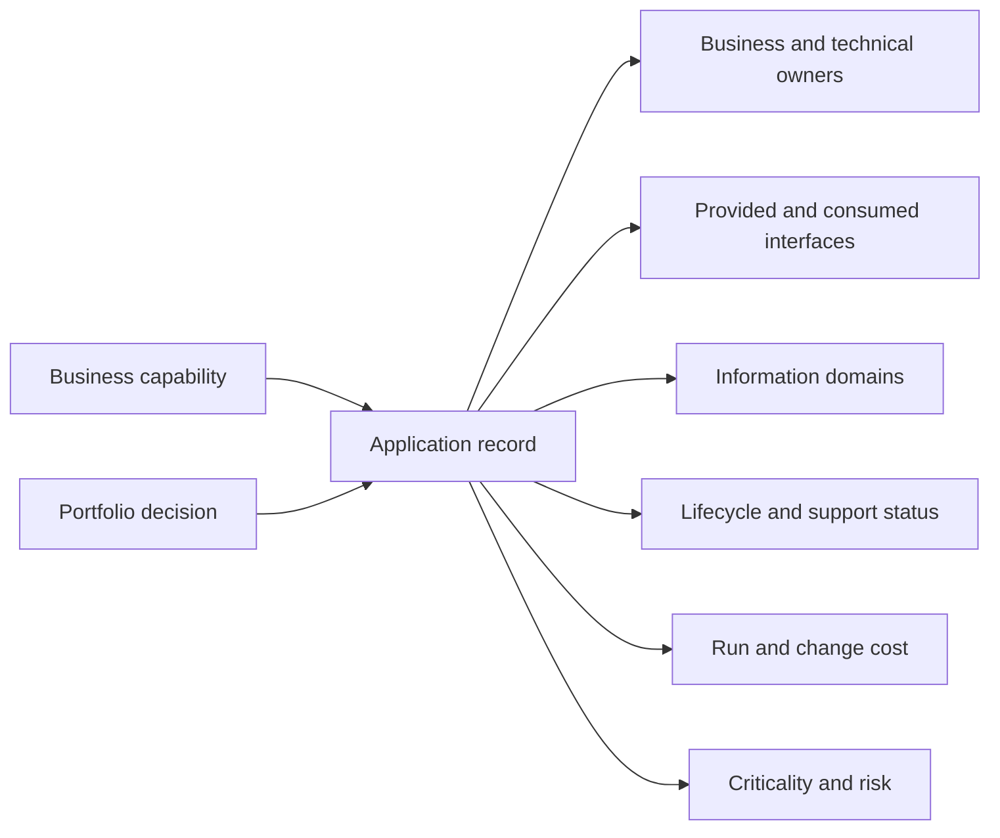
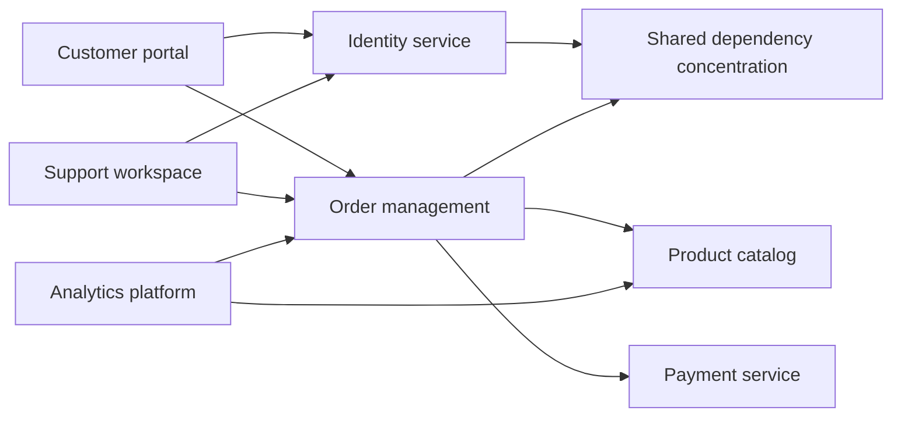
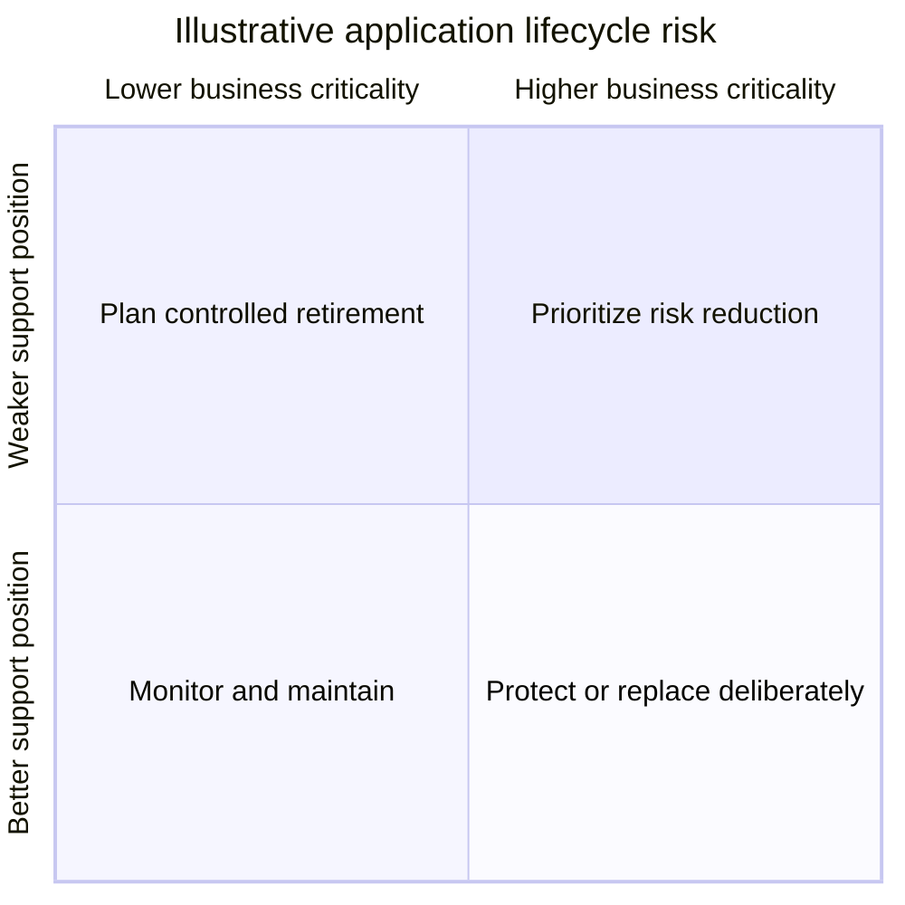
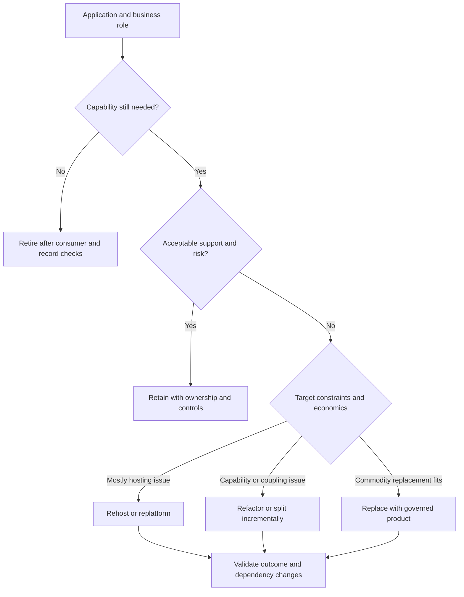
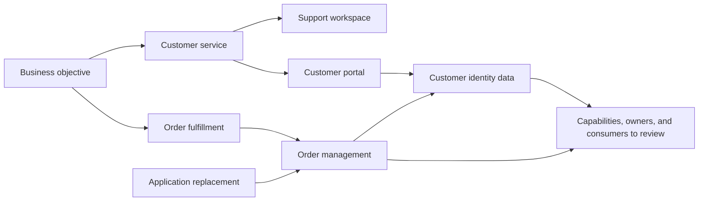

# Application Architecture

Part: [18 — Enterprise Architecture](PART_OVERVIEW.md)

Enterprise application architecture describes the portfolio of applications, their owners, interfaces, lifecycle, and relationship to business capabilities and information. It supports investment and modernization decisions across domains. Part 07 owns solution-level component and deployment design, Part 20 owns general architecture patterns, and Parts 09–10 own cloud products and provider architecture.

## Build a Governed Application Inventory

An application inventory should identify business purpose, accountable owner, users, criticality, lifecycle state, interfaces, data handled, hosting boundary, support status, cost, and planned change. Establish a stable identifier and a review cadence. Avoid treating procurement records or CMDB (Configuration Management Database) entries as a complete portfolio model; reconcile them with business ownership and operational reality.

Inventory quality is an operating concern. Give each application owner a reason to maintain it, such as investment planning, access recertification, incident response, or contract renewal. Record confidence and last-verified date so missing or stale information is not mistaken for certainty.

## Analyze Dependencies and Concentration

Application dependencies can create failure concentration, change coupling, and migration constraints. Model direction and type: runtime call, data exchange, shared identity, batch file, or business process reliance. A highly connected application may be a modernization priority or an essential shared service; centrality is a risk signal to investigate, not a disposition by itself.

Annotate dependencies with owner, criticality, recovery expectation, and data contract. Validate discovered edges with application teams; source-code imports alone miss scheduled feeds, manual work, and vendor integrations. Use graph analysis to identify blast radius and sequence change, then confirm the relationships operationally.

## Assess Lifecycle and Technology Risk

Lifecycle risk combines business criticality with supportability, security exposure, skills, vendor viability, and replacement options. A supported technology can still be strategically misaligned; an old component may be low risk when isolated and replaceable. Separate product lifecycle facts from local risk judgment and record the evidence source.

Use the view to prioritize assessment, not to automatically replace every application in the upper half. Include migration complexity, data retention, contract exit, user impact, and operational capacity. Update lifecycle position when vendor support, exposure, or business dependency changes.

## Select a Modernization Disposition

Common options include retain, rehost, replatform, refactor, replace, retire, or split. The labels are heuristics; compare the business outcome, dependency coupling, data migration, security, support, cost, and reversible steps. A rewrite is not inherently better than a contained platform upgrade. Retire an application only after its consumers, records, and recovery obligations are addressed.

Make the disposition reversible where practical. Use a strangler migration or parallel run only when it reduces a measurable risk and the coexistence cost is funded. Record data ownership and cutover criteria before implementation begins.

## Trace Applications to Capabilities and Change

Mapping applications to capabilities shows duplication, missing support, and affected owners. One capability may be realized by multiple applications because of regional, regulatory, or historical constraints. An application may support several capabilities and shared information domains; change impact should include all of them.

This map supports portfolio and architecture reviews; it is not a substitute for detailed interface contracts or data architecture. Validate capability names and application ownership with business and technical stakeholders. Part 18 CH06 covers cross-enterprise data domains and stewardship.

## Worked Case: Duplicate Customer Portals

A company acquired a regional business with a separate customer portal and account database. Portfolio analysis finds both portals serve overlapping capabilities, but one supports regional identity requirements and a locally operated service desk. Dependency mapping also reveals that order management and support tools depend on both account identifiers.

The enterprise does not immediately retire one portal. It defines a target customer identity capability, assigns data owners, and chooses a staged replacement with identifier mapping and a period of parallel operation. The decision includes consumer inventory, record retention, support migration, cutover evidence, and a rollback condition. Only after dependent teams verify their integration and customer access does the legacy portal enter retirement.

## Review Questions

1. Which inventory fields make an application actionable for portfolio decisions?
2. Why is dependency centrality a signal rather than an automatic replacement rule?
3. How do business criticality and technology supportability interact?
4. What evidence is required before retiring an application?
5. Which capability owners and data consumers are affected by a replacement?

Application architecture gives the enterprise a current view of software assets with clear owners and relationships. Use that view to guide modernization, expose concentration and lifecycle risks, and verify business, data, and consumer impact before changing or retiring an application.
