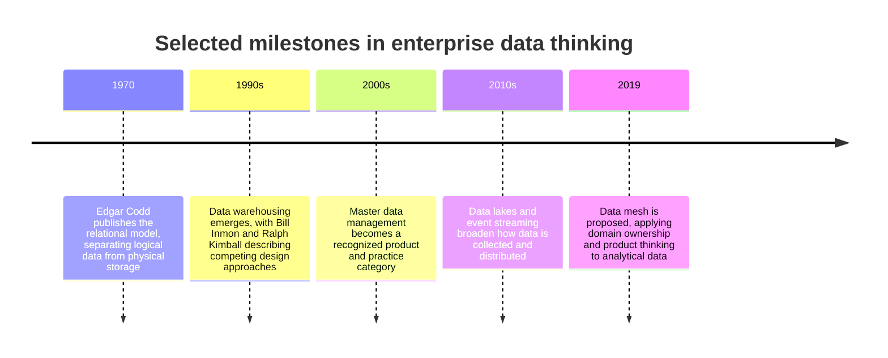
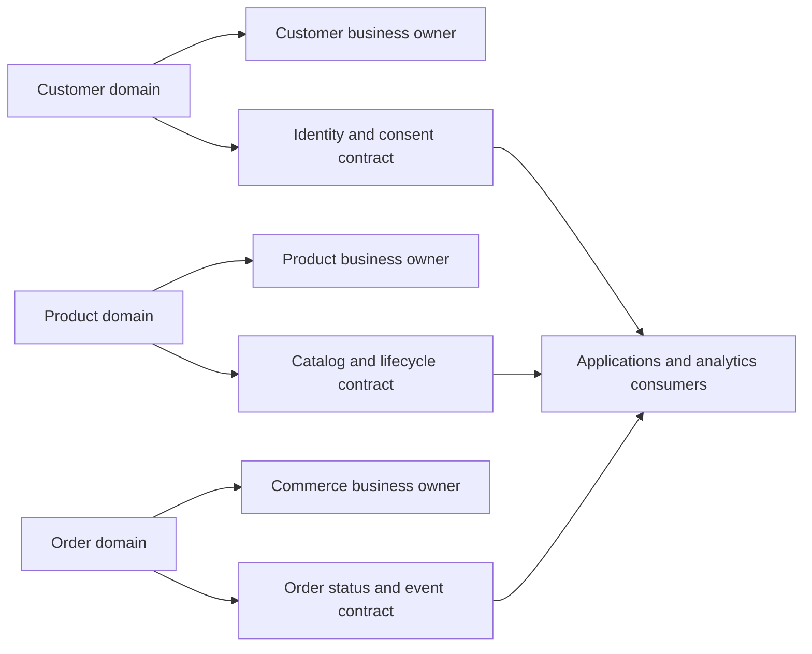
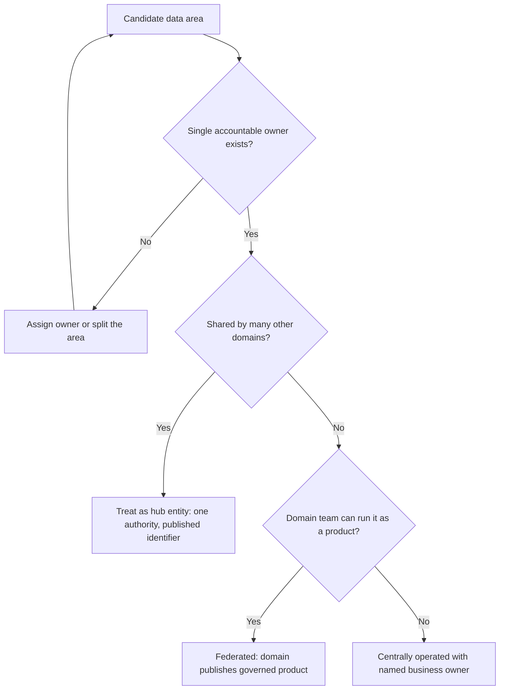
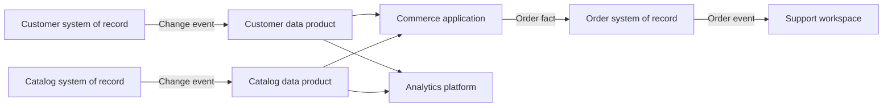
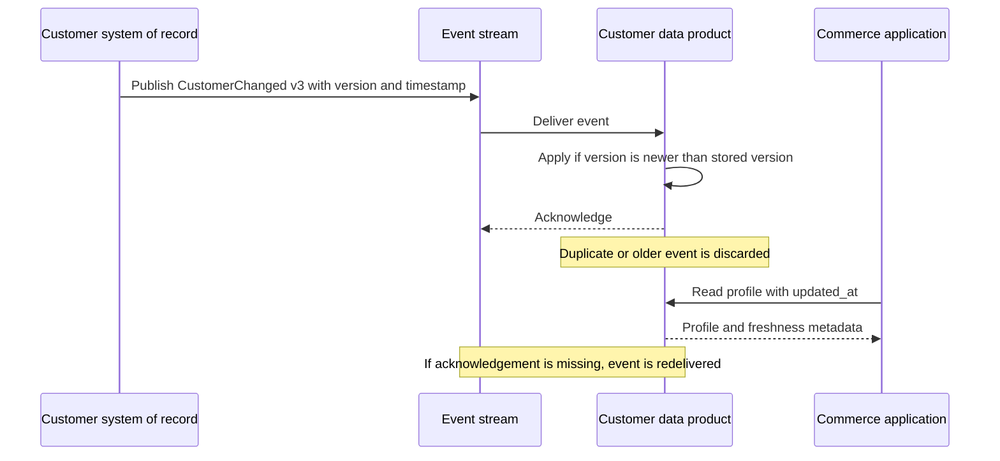
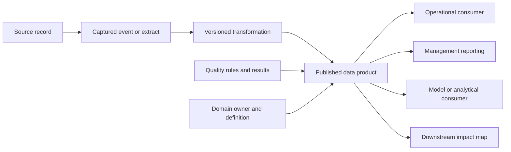
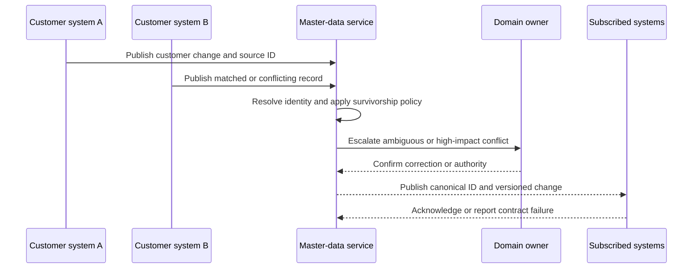
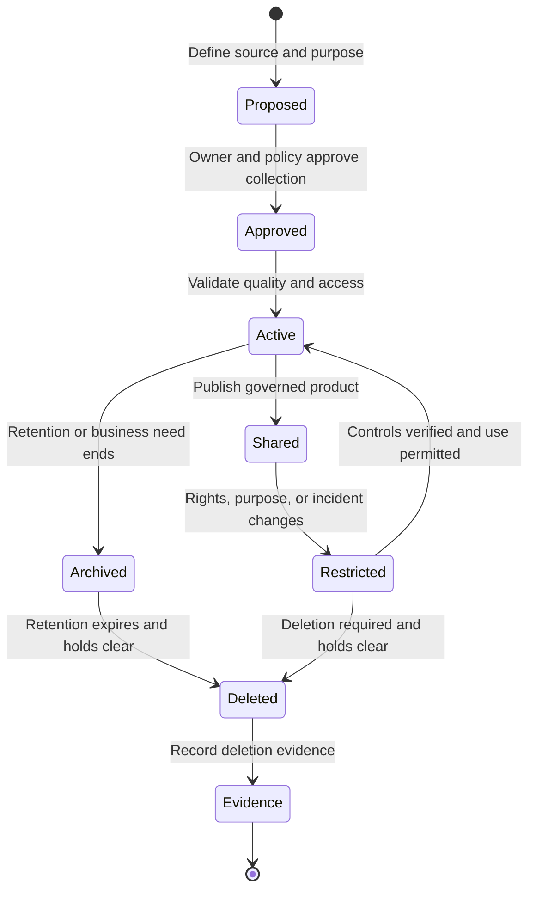
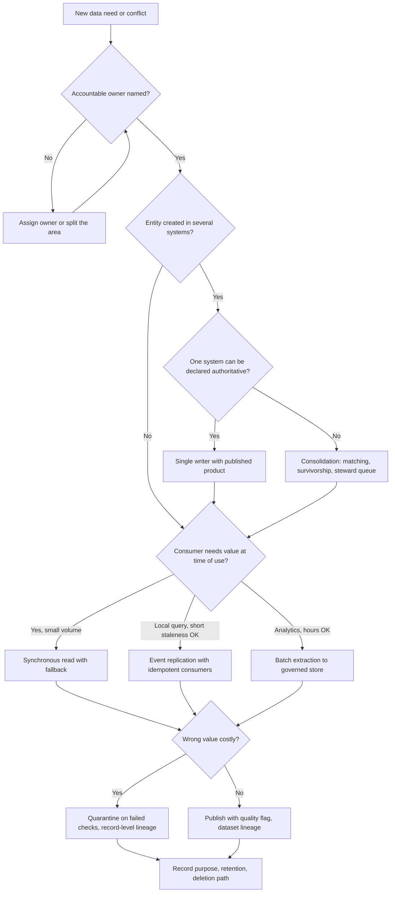
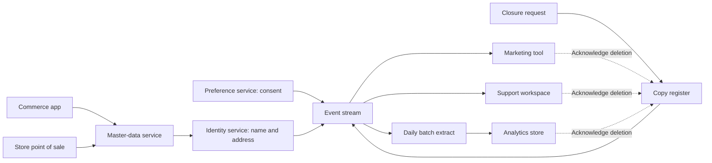

# Data Architecture

Part: [18 — Enterprise Architecture](PART_OVERVIEW.md) · Status: Drafted

## 1. Introduction

Enterprise data architecture is the discipline of deciding what data an organization has, what it means, who is accountable for it, where the authoritative version lives, how it moves between systems, and under what rules it may be used and eventually removed. It operates above any single database. Where a database design answers "how do we store and query this efficiently?", enterprise data architecture answers "which of the five places this fact exists do we believe, who may change it, and who finds out when it changes?"

An engineer designing one system can usually treat data as that system's private concern: a schema, a store, a set of queries. At enterprise scale that stops working. The same customer exists in the commerce platform, the support tool, the billing system, and the analytics warehouse. Each copy was created for a good local reason, each drifts from the others, and each is consumed by people who assume it is current. The cost does not appear as a crash. It appears as two reports with different revenue totals, a marketing message sent to someone who withdrew consent, an audit request that takes weeks to answer, or a model trained on records nobody can trace.

This matters to a solution architect for three reasons. First, every solution design makes data claims (this service owns orders, that feed is the source for prices), and those claims are only safe if they are consistent with enterprise-level decisions. Second, data outlives applications: systems are replaced in years, but customer, product, and financial records persist for decades, so data decisions are among the least reversible an architect makes. Third, regulation and risk increasingly attach to data rather than to systems, so an architect who cannot say where a data subject's records live cannot credibly say whether a design is compliant.

This chapter teaches the enterprise view: domains and ownership, authority and copies, data products, and the integration choices that connect them. It then continues into lineage, quality, master and reference data, and access and lifecycle. The boundaries with neighbouring material are deliberate:

- Database and storage mechanics (schemas, indexes, replication, sharding, transactions) belong to [Part 06 — Databases and Storage](../06_Databases_and_Storage/CH01_Normalization.md), with [Replication](../06_Databases_and_Storage/CH07_Replication.md) and [Transactions](../06_Databases_and_Storage/CH08_Transactions.md) covering the mechanics this chapter relies on.
- Security and privacy controls (authentication, authorization, encryption) belong to [Part 15 — Security](../15_Security/CH03_Authorization.md); this chapter defines ownership and lifecycle, not the control implementations.
- AI-specific data techniques belong to [AI Data Governance, Privacy, and Provenance](../16_AI_and_GenAI/CH30_AI_Data_Governance_Privacy_and_Provenance.md), and AI data composition for solutions to [AI Data Architecture and Preparation Boundaries](../17_AI_Architecture/CH04_AI_Data_Architecture_and_Preparation_Boundaries.md).
- Solution-level design of services and their interfaces belongs to [Application Architecture](CH05_Application_Architecture.md); platform and infrastructure choices belong to [Technology Architecture](CH07_Technology_Architecture.md).
- The framework that positions data architecture among the other architecture domains is covered in [TOGAF](CH01_TOGAF.md); decision rights over standards belong to [Architecture Governance](CH08_Architecture_Governance.md).

After studying this chapter, a reader should be able to:

1. Explain what enterprise data architecture is for and how its concerns differ from database design.
2. Partition an enterprise into data domains with named owners and defensible boundaries.
3. Distinguish a system of record from copies, caches, and derived data, and state authority at the right granularity.
4. Specify a data product, including its contract, freshness, and failure behavior.
5. Choose between synchronous access, event-driven replication, batch extraction, and virtualization for moving data between owners, and justify the choice.
6. Work a concrete, hypothetical scenario from conflicting copies to a documented ownership and integration decision.

## 2. Background and History

The ideas in this chapter accumulated over several decades, and the vocabulary reflects that layering. The milestones below are limited to ones that are well established.



Each step answered a limit of the previous one. The relational model made it possible to describe data independently of an application's storage layout, which is the precondition for treating data as an enterprise asset at all. Warehousing arose because operational systems were poor places to run enterprise-wide reporting, so data was copied into a purpose-built store. Master data management responded to the duplication that copying and independent applications created. Lakes and streaming responded to the cost and rigidity of fitting every new data source into a curated schema first. Data mesh is a reaction to a different problem: a central data team that becomes the bottleneck and lacks the domain knowledge to judge what the data means.

The practical implication is that these are not sequential replacements. A mature enterprise typically runs several of these patterns at once, and a data architect's task is to say which pattern governs which data and why. Be cautious about treating any single named approach as the answer; each fits a particular distribution of ownership, scale, and change.

## 3. The Problem Data Architecture Solves

Data problems at enterprise scale share a root cause: data is created in one place, needed in many, and owned by nobody in particular once it leaves its origin. Each failure below is a general pattern, not a reported incident.

| Failure pattern | Mechanism | What data architecture contributes |
| --- | --- | --- |
| Conflicting truths | Two systems hold the same attribute and both accept edits, so values diverge and no rule says which wins | Named authority per entity or attribute, and a precedence rule |
| Semantic drift | The word "customer" means a paying account in finance and a registered visitor in marketing, and a report combines them | Domain-scoped definitions with explicit translation at boundaries |
| Orphaned data | A dataset is consumed widely but its producing team has disbanded, so nobody can fix or explain it | Named accountable owners and a lifecycle for retiring products |
| Silent breakage | A source team renames a field and downstream reports quietly produce wrong numbers | Published contracts and change notice |
| Uncontrolled copies | Extracts proliferate in spreadsheets and ad hoc stores, escaping access control and deletion | Governed distribution paths and a register of authoritative sources |
| Central bottleneck | One team must interpret and integrate every request, so delivery queues and meaning is lost | Distribution of ownership to domains with shared platform capabilities |

Alternatives exist for each. A small organization can rely on one shared database as the single source and accept the coupling. A mid-sized one can centralize integration in a warehouse team. A large federated one can distribute ownership to domains. The decision criteria are the number of independent teams producing and consuming data, how often meaning changes, how costly an inconsistency is (an incorrect marketing segment versus an incorrect regulatory filing), and whether the organization can fund the stewardship work that any option requires. Every option costs people time; the architect's task is to place that cost where it buys the most reduction in risk.

## 4. Organize Data Around Domains and Ownership

### 4.1 What a data domain is

A data domain is a bounded area of business meaning for which one party is accountable: the entities, attributes, rules, and vocabulary that belong together because they change together and are understood by the same people. Customer, product, order, workforce, and finance are common examples. A domain is a unit of ownership, not a database, a system, or a reporting department. One domain may be implemented by several systems, and one system may hold data from several domains; the mapping is a fact to be recorded, not an assumption.

The mechanism that makes domains useful is accountability. For each domain, record at least:

- a business owner, who decides what the data means and who may use it;
- a data producer, the team that captures or creates it;
- a steward or quality lead, who monitors and corrects it;
- the authoritative source (covered below) and the known copies;
- a classification, such as public, internal, confidential, or regulated;
- permitted uses and the consumers that depend on it.

Without these, a data problem has no address. With them, a question such as "why does the revenue figure differ?" becomes "which owner defines revenue recognition, and which source do the two reports read?"

### 4.2 Finding domain boundaries

Boundaries should follow ownership and rate of change, not the org chart of the moment and not the table layout of an application. Three tests help.

1. **Meaning test.** Do people in the candidate area use the same definition for the key terms? If finance and sales each define "active customer" differently and both definitions are legitimate, they are separate concepts that happen to share a word, and forcing one definition destroys information.
2. **Change test.** Do the attributes change for the same reasons and at the same pace? Product description text changes with marketing campaigns; product tax classification changes with regulation. They may belong to different owners even if stored together.
3. **Authority test.** Can one party credibly decide disputes about the data? If two parties each hold authority over the same attribute, the boundary is in the wrong place or a precedence rule is missing.

This is the same reasoning as bounded contexts in domain-driven design: a term has a precise meaning inside a boundary, and translation happens at the edge. The difference is scale. A bounded context in one solution is bounded by a team and a codebase; an enterprise domain may span many solutions and needs explicit stewardship because no single codebase enforces it.



The diagram shows that each domain has a distinct owner and publishes a contract that consumers depend on, rather than consumers reaching into the producing system's tables. The implication is that the contract, not the storage, is the enterprise-facing interface: the owning team may restructure its database freely as long as the contract holds. It also shows what is missing from a purely technical view. Platform teams may operate the storage, but the accountability for meaning, access decisions, quality expectations, and change notice stays with the domain owner.

### 4.3 Shared concepts and disputes

Some concepts cross domains: a "customer" appears in order, support, and billing. Two failure modes are common. The first is a single enterprise dictionary that imposes one definition everywhere; it fails when legal entities or product lines legitimately differ, and the definition becomes so generic that it informs nobody. The second is no shared vocabulary at all, so every integration reinvents mapping. A workable middle path is a small set of shared identifiers and reference points (a customer identifier, a product code) owned by one domain, with each other domain free to hold its own attributes and definitions about the entity, and a documented translation where they meet. Define an escalation path for disputes: who arbitrates when two domain owners disagree, how quickly, and where the outcome is recorded.

### 4.4 Choosing an operating model

Domain ownership can be organized in different ways. The choice is a decision about where accountability and effort sit.

| Model | How it works | Strengths | Weaknesses | Fits when |
| --- | --- | --- | --- | --- |
| Centralized | One data team integrates, models, and serves all enterprise data | Consistent standards, efficient shared skills | Becomes a queue; lacks domain knowledge; single point of delay | Few domains, small organization, high regulatory uniformity |
| Federated | Domains own their data; a central group sets standards and runs shared tooling | Domain knowledge close to data; scalable ownership | Requires standard-setting and enforcement discipline; uneven domain maturity | Many domains with distinct experts and a capable platform team |
| Hub and spoke | Central hub holds shared entities (for example customer); spokes manage local data | Clear authority for shared entities; local freedom elsewhere | Hub can become a bottleneck; boundary disputes about what is shared | A few entities are used everywhere and the rest are local |

The data mesh proposal sits at the federated end: domains publish data products under common platform and governance rules. It is a way to organize accountability, not a technology, and it assumes domain teams that have the capacity and incentive to run data as a product. Where those teams do not exist, adopting the vocabulary without the capacity produces unowned datasets under a new name.



The decision path starts with ownership because every later choice depends on it. A shared entity gets a hub treatment so that its identifier and authority are unambiguous. Where the domain team lacks capacity, central operation with a named business owner is a legitimate, honest outcome; the failure is pretending a domain owns something it cannot maintain.

### 4.5 Failure modes and edge cases

- **Owner by title only.** A name is recorded but the person has no authority or time. Test: can the owner approve a definition change this month?
- **Boundaries drawn around applications.** The domain list becomes the system inventory, so ownership follows vendor contracts instead of meaning.
- **Over-fine domains.** Dozens of tiny domains multiply contracts and meetings. Start coarser and split when the three tests above show a real seam.
- **Mergers and reorganizations.** Ownership silently lapses when teams move. Tie owner records to roles that are reviewed on a schedule, not to individuals alone.
- **Regulated subdomains.** A single domain may contain data with different legal treatment (for example contact details versus payment details). Classification should apply per attribute group where the rules differ, even when ownership is shared.

## 5. Systems of Record, Copies, and Data Products

### 5.1 Authority is not exclusivity

A system of record is the system whose value for a defined data subject wins when copies disagree. It is authoritative for a specific scope and lifecycle: for example, the customer system for legal name and identity, the billing system for invoice amounts. It is not necessarily the only place the data exists. Almost every useful architecture holds copies, because queries across systems are slow, fragile, or impossible, and because consumers need the data in their own shape.

Three categories of non-authoritative data should be distinguished, because they have different risk:

- **Replica or cache.** A copy intended to equal the source, with some lag. Its correctness is defined relative to the source, and it should be rebuildable from it.
- **Derived data.** Data computed from sources, such as a lifetime-value figure or a risk score. It has its own definition and owner, because the calculation is a decision someone made.
- **Uncontrolled extract.** A copy taken outside governed paths, such as a spreadsheet. It has no refresh, no access control, and no deletion; it is the category data architecture exists to shrink.

State authority at the granularity where it differs. "The customer system is the system of record for customers" is too coarse if postal address is mastered by a logistics system and consent is mastered by a preference service. Field-group-level authority, recorded in a register, prevents two systems each believing they own an attribute.



The flow shows two properties. Authority flows outward from each system of record through a published product, and consumers read the product rather than the source's tables. And information can flow back: the commerce application creates an order fact, but the order system of record, not commerce's local state, is what the rest of the enterprise treats as authoritative once it accepts it. The implication is that every arrow is a place where staleness, loss, or reordering can occur, so each needs a stated behavior.

### 5.2 Data products and contracts

A data product is a dataset or interface published by a domain for others to consume, with a stated contract and an accountable owner. The idea borrows from product thinking: it has consumers, a quality bar, a lifecycle, and a team that answers for it. It differs from a raw table export in that someone promises what it contains and how it will change.

A useful contract states, at minimum:

- schema and field definitions, with the business meaning of each field;
- the authoritative source and the rule used to produce the product;
- freshness: how stale it may be, and how consumers can see its last update;
- quality expectations and how violations are reported;
- classification, permitted purposes, and access method;
- versioning and deprecation policy, including notice period;
- the owner and a support or escalation route.

A short contract template, kept in version control beside the product, makes these promises reviewable:

```yaml
product: customer-profile
owner: customer-domain-team
source_of_record: customer-identity-service
schema_version: 3
freshness:
  target_seconds: 300
  last_updated_field: updated_at
classification: confidential
permitted_purposes: [order-fulfilment, service-support, approved-analytics]
quality_checks:
  - id_not_null
  - email_format_valid
change_policy:
  breaking_change_notice_days: 60
  deprecation_overlap_versions: 2
```

Why a contract rather than informal agreement? Without it, a producer cannot know who depends on a field, so a harmless-looking rename becomes silent breakage downstream. The contract turns an implicit dependency into an explicit one that tooling can check, for example by failing a producer's build when a change would violate the published schema. The cost is real: someone must write, version, and honor the contract, and an over-specified contract slows legitimate change. Match rigor to the number and criticality of consumers.

### 5.3 Conflict handling and update authority

When two systems can edit the same authoritative attribute, the architecture has a latent conflict. Options, in order of preference:

1. **Single writer.** Only the system of record accepts edits; others request changes through it. This removes conflicts at the cost of coupling every editor to that system's availability.
2. **Precedence rule.** Multiple writers are allowed, and a deterministic rule decides the winner, such as "the most recent edit from a trusted source wins" or "source A beats source B for this field". Simple, but "most recent" is fragile when clocks or delivery order differ.
3. **Reconciliation process.** Conflicts that rules cannot settle are queued for a steward. Necessary for ambiguous identity matches and high-impact attributes, but it adds a human cost and delay.

A copy that feeds a decision should expose its source and last-updated time where staleness changes the decision. Showing a support agent a customer address with its age and origin lets them judge whether to confirm it; hiding that metadata invites confident error.

## 6. Moving Data Between Owners

### 6.1 The integration choice

Domains must exchange data, and the way they do so determines coupling, freshness, and failure behavior. Four patterns cover most cases.

| Pattern | Mechanism | Freshness | Coupling | Main risk | Fits when |
| --- | --- | --- | --- | --- | --- |
| Synchronous Application Programming Interface (API) read | Consumer calls the owner's interface at time of need | Current | Runtime availability of the owner | Cascading failure and latency | Small payloads, need for current value, low call volume |
| Event-driven replication | Owner publishes change events; consumers maintain local copies | Seconds to minutes | Contract on events; ordering and replay | Lost or reordered events, divergent copies | Many consumers, need for local query, tolerance of short staleness |
| Batch extraction | Scheduled bulk copy, often transform then load | Hours to a day | Schedule and schema | Staleness, large failed loads | Analytics, reporting, heavy transformations |
| Virtualization or federated query | A layer queries sources on demand without copying | Current | Source performance under analytic load | Slow queries, source overload | Exploration, low-volume cross-source questions |

No pattern dominates. Event-driven replication is often recommended for operational consumers because it decouples runtime availability, but it moves the problem to keeping a copy consistent: the consumer must handle duplicates, out-of-order delivery, and reprocessing. A synchronous read avoids that but ties the consumer's availability to the owner's. Chosen carelessly, either one distributes failure instead of removing it. Mechanics of replication and delivery guarantees are covered in [Replication](../06_Databases_and_Storage/CH07_Replication.md); the architectural question here is which owner must be able to trust which copy.



The sequence shows the minimum a consumer must do to hold a trustworthy copy. It applies an event only if its version is newer than what it stores, so duplicate and out-of-order deliveries cannot regress the state. It acknowledges only after applying, so a crash leads to redelivery rather than loss. And it exposes freshness so readers can judge staleness. The implication for the architect is that "publish events" is not a complete integration decision; the consumer's idempotent handling and the owner's versioning discipline are part of the design and should appear in the data product contract.

### 6.2 Failure modes

- **Dual writes.** An application updates its own store and separately publishes an event; if one step fails, the copy and the source diverge. Prefer publishing from the committed change itself, for example through change data capture or an outbox written in the same transaction.
- **Replay without idempotence.** Reprocessing history duplicates side effects when handlers are not safe to repeat.
- **Schema change without notice.** A producer adds, removes, or repurposes a field and consumers fail or silently misinterpret.
- **Hidden fan-out.** Consumers of consumers form chains nobody mapped, so a source change has an unknown blast radius. The lineage discussion later in this chapter addresses how to discover these.
- **Copies treated as authority.** A consumer's local table becomes the de facto source because it is easier to read, and edits there never flow back.

### 6.3 Worked scenario (hypothetical): conflicting customer addresses

An illustrative retailer has three systems holding a customer postal address: online commerce, store point of sale, and support. A delivery fails because commerce holds an address edited in support six months earlier. Investigation shows that all three accept edits and none propagate them.

The data architect proceeds in steps. First, apply the domain tests: address belongs to the customer domain, and the customer business owner can decide disputes, so authority is placeable. Second, choose authority by attribute: the customer identity service becomes the system of record for postal address; the other three stop editing locally and call its update interface. Third, choose integration: commerce and support need local query speed and can tolerate a few minutes of staleness, so they receive change events into a customer data product; the point of sale reads synchronously because store connectivity is intermittent and a stale local cache would be more harmful there than a brief lookup, with a cached fallback marked with its age. Fourth, record the decision: the contract lists address as authoritative from the identity service, freshness five minutes, version-guarded updates.

The trade-offs are visible. Single-writer authority makes the identity service a dependency for address edits, so its availability matters to support. Event replication adds an operational surface (stream, handlers, replay). Both costs were accepted because the alternative, three diverging addresses, caused a recurring customer-facing failure. If the volume of edits were tiny and only one consumer existed, a plain synchronous read might have been the simpler right answer.

## 7. Preserve Lineage and Quality Evidence

### 7.1 What lineage is for

Lineage records where data originated, how it was transformed, and which consumers depend on it. It exists to answer four kinds of question, and the design of the lineage capability should start from which of them the enterprise actually asks:

- **Impact analysis (forward).** If the owner changes or retires this field, which products, reports, and processes are affected?
- **Root-cause analysis (backward).** This number looks wrong; which sources and transformations produced it?
- **Audit and evidence.** For this decision or report, which inputs, rules, and versions were used?
- **Rights and lifecycle.** Which copies and derived outputs contain data about a given subject or purpose (needed again in Section 9)?

Lineage does not prove data is accurate. It proves where data came from and what was done to it. A perfectly traced wrong value is still wrong, which is why lineage is paired with quality evidence rather than substituted for it.

### 7.2 Granularity and capture

Lineage can be recorded at several levels, and the cost rises steeply with precision.

| Granularity | Answers | Typical capture | Cost and limit |
| --- | --- | --- | --- |
| System level | Which systems feed which | Architecture inventory, manual register | Cheap; too coarse for impact on a single field |
| Dataset or table level | Which products depend on which | Pipeline metadata, scheduler or catalog | Moderate; hides which columns matter |
| Column or field level | Which fields derive from which | Parsing transformation code or query plans | Higher; fragile for dynamic or opaque code |
| Record level (provenance) | Which inputs produced this specific value | Stored source identifiers and rule versions per record | Highest; storage and design burden |

Choose the coarsest level that answers the real question. Portfolio-level planning is served by dataset lineage. A regulated decision that must be reproduced for an individual may need record-level provenance for that one product only. Applying record-level provenance everywhere is a common over-investment.

Capture can be declared (teams register dependencies in the product contract from Section 5.2), harvested automatically (from pipeline definitions, query logs, or event subscriptions), or both. Declared lineage is cheap and incomplete; harvested lineage is more complete but misses logic hidden in application code or in spreadsheets. A reasonable design declares the dependencies that matter, harvests where tooling exists, and treats the gap between them as a measured quality metric.



The diagram shows lineage and quality evidence attaching to the same published product. The implication is that a consumer should be able to see, together, where the product came from, which transformation version produced it, whether its checks passed, and who is accountable. Two items deserve emphasis: the transformation is versioned, so a past result can be explained with the rule that applied at the time; and the impact map is derived from the consumers, so retiring a field starts from a list rather than a guess.

### 7.3 Quality as evidence

Quality dimensions should be chosen for the use case rather than adopted wholesale. Common dimensions are validity (values conform to format and domain), completeness (required values are present), timeliness (fresh enough for the decision), consistency (agreeing across copies), and uniqueness (no unintended duplicates). A fulfilment feed may care most about validity and timeliness of an address; a revenue report cares about consistency and completeness.

Quality rules belong where they are cheapest to act on. Checks at the producer prevent bad data from entering; checks at the product boundary stop it from spreading; checks at the consumer protect a specific decision. Each has a different owner, and the contract should say which rules the producer promises and which the consumer must apply itself. The result of each check should be stored with the product, because a pass that nobody can later retrieve is not evidence.

When a check fails, the architecture must decide the behavior in advance: quarantine the batch and keep serving the previous good version, publish with a visible quality flag, or halt dependent processing. Quarantine favors correctness and risks staleness; publish-with-flag favors availability and risks consumers ignoring the flag. The right choice depends on what a wrong value costs the consumer.

### 7.4 Failure modes

- **Stale lineage.** The register describes last year's pipelines. Mitigate by harvesting from running definitions and failing a release when declared dependencies are missing.
- **Lineage without owners.** A beautiful graph shows a broken node and nobody to call. Tie each node to an accountable owner.
- **Alert fatigue.** Hundreds of quality rules with no priority are ignored. Rank rules by the decisions they protect.
- **Sensitive metadata.** Lineage can reveal business relationships and sensitive processing paths, so it needs access control like any other governed data.

## 8. Govern Master and Reference Data

### 8.1 Definitions and the consolidation question

Master data describes the shared business entities that many processes refer to, such as customers, products, suppliers, or legal entities. Reference data standardizes classifications that give those records consistent values, such as country codes, currencies, or status lists. They differ in behavior: master data is large, changes continuously, and suffers from duplicates; reference data is small, changes rarely, and suffers from version mismatch (two systems using different editions of the same list).

Master data management (MDM) is the set of practices, and often a service, that creates and maintains consistent shared records. The first decision is whether consolidation is needed at all. If one system already holds the entity authoritatively and others merely reference its identifier, the hub treatment from Section 4.4 and the authority rules from Section 5.3 may be enough. An MDM capability earns its cost when the same real-world entity is created independently in several systems and no single one can be declared the source.

### 8.2 Implementation styles

| Style | Mechanism | Strengths | Weaknesses | Fits when |
| --- | --- | --- | --- | --- |
| Registry | Hub stores only cross-reference identifiers and matches; data stays in sources | Low disruption; sources keep authority | Consumers still read several sources; no single consolidated view | Sources must stay authoritative and consumers can join |
| Consolidation | Hub gathers and merges records for read, mostly analytical use | Unified view without changing source writes | Hub is not authoritative; corrections must be made at sources | Reporting needs one view of the entity |
| Coexistence | Hub holds a consolidated record and propagates changes back to sources | Single enriched record, sources stay in use | Two-way sync is complex; conflict handling needed | Several systems must keep editing |
| Centralized | Hub is the system of record and sources consume from it | Clear authority, strong consistency | Largest change to source systems; hub availability matters | Greenfield, or when sources can be retrofitted |

The progression runs from least to most invasive. The architect should pick the least invasive style that satisfies the real requirement, because each step up transfers authority and adds a dependency. The authority principle itself is unchanged: state which system wins, per attribute group, as set out in [Section 5](#5-systems-of-record-copies-and-data-products).

### 8.3 Matching, survivorship, and the consolidated record

Consolidation depends on two mechanisms. **Matching** decides whether two records describe the same entity, using deterministic rules (identical tax identifier), probabilistic scoring across fields, or a combination. It produces three outcomes: confident match, confident non-match, and an uncertain band that needs human review. The thresholds trade false merges against missed duplicates. A false merge (two different people combined) is usually far more harmful than a missed duplicate, because it can expose one person's data to another and is hard to reverse; most designs therefore bias toward under-merging and route ambiguity to a steward.

**Survivorship** decides which source value is retained when matched records disagree: trust ranking per source, most recent verified update, most complete value, or a field-specific rule. Survivorship rules are business decisions with an owner, not implementation details.

A consolidated record, sometimes called a golden record, is a best-judgement view built for stated purposes, not an automatically correct or universally authoritative one. Define its purpose and consumers, keep the source identifiers and provenance of each surviving value, and keep the rule version that produced it, so a correction can be traced and unwound.



The sequence shows that automation handles the clear cases and humans handle the ambiguous ones, with the outcome flowing back as a versioned change. The implication is operational: the steward queue is a real workload that must be staffed, and its backlog is a leading indicator of master-data health. Consumers acknowledge changes, so a consumer that fails to apply one is visible rather than silently diverging.

### 8.4 Merges, splits, and identifiers

When two records merge, one canonical identifier survives and the other becomes an alias. Consumers holding the retired identifier must be able to resolve it, so the service should keep a redirect map and publish the merge as an event. Splits (a wrongly merged record being separated) are harder: downstream facts such as orders already attached to the merged identity must be reassigned, and consumers need a published rule for doing so. Treat unmerge as a designed capability from the start; retrofitting it after a false merge is expensive.

### 8.5 Reference data practice

Reference data is governed by versioning and publication discipline.

- Keep one owner per list and publish it as a versioned product.
- Record effective dates, so historical records can be interpreted under the list that applied at the time.
- Map external standards to internal codes explicitly, and never reuse a retired code for a different meaning.
- Announce changes that affect downstream validation or reporting with the notice period defined in the contract.

A short mapping record illustrates the pattern (values are illustrative):

```yaml
list: order-status
version: 4
effective_from: 2026-01-01
values:
  - code: PLACED
    meaning: Order accepted by the order system
  - code: FULFILLED
    meaning: All lines delivered
  - code: CANCELLED
    meaning: Order withdrawn before fulfilment
retired:
  - code: PENDING
    replaced_by: PLACED
```

### 8.6 Failure modes

- **Consolidation without an owner for rules.** Survivorship is left to whoever configured the tool, and rules silently reflect one team's preference.
- **Hub as unexamined single point of failure.** Operational processes block on the hub; define degraded behavior and caching.
- **Matching tuned once.** Data shifts over time; review match quality on a schedule using sampled stewardship outcomes.
- **Reference-list drift.** Systems keep local copies of lists that diverge; publish and subscribe instead.

## 9. Manage Access and Lifecycle

### 9.1 Scope and ownership boundary

Data governance at the enterprise level covers collection, use, sharing, retention, archival, and deletion. This chapter establishes who decides and what must be recorded; the controls that enforce those decisions (authentication, authorization models, encryption, key handling) are owned by [Part 15 — Security](../15_Security/CH03_Authorization.md) and its neighbouring chapters, and [Role-Based Access Control](../15_Security/CH04_RBAC.md) and [Attribute-Based Access Control](../15_Security/CH05_ABAC.md) describe the access models used to implement the policy decided here. AI-specific provenance and privacy techniques are in [AI Data Governance, Privacy, and Provenance](../16_AI_and_GenAI/CH30_AI_Data_Governance_Privacy_and_Provenance.md). Law differs by jurisdiction and changes; any statement in this section about legal duties is a design prompt to be confirmed with legal counsel, not legal advice.

### 9.2 The policy record

For each data product, record the decisions that later controls will implement:

| Decision | Question answered | Example (illustrative) |
| --- | --- | --- |
| Classification | How sensitive is it? | Confidential, with a regulated attribute group |
| Purpose | What may it be used for? | Order fulfilment and service support, not marketing |
| Basis and consent | What permission supports the use, where one is required? | Consent flag held by the preference service |
| Access roles | Which roles or attributes may read or change it? | Support agents read; only the customer domain changes |
| Retention | How long is it needed? | Defined per purpose, with a trigger event |
| Deletion evidence | What proves removal? | Request identifier, systems cleared, completion time |

Purpose is the most neglected field and the most useful. If a consumer requests a dataset for a purpose not in the record, the answer is a review rather than silent access. Purpose also governs derived data: an analytics dataset built from operational records inherits restrictions unless the transformation (for example genuine aggregation) justifies a different classification, a judgement the domain owner and privacy function should make explicitly.

### 9.3 Lifecycle states



The state model makes two points. Restriction is a distinct, reversible state placed before deletion, so use can be stopped quickly while an investigation or remediation proceeds, without destroying data that may still be needed. And deletion is not the end: recording evidence is a step in the lifecycle, because "we deleted it" without proof cannot be demonstrated later. The implication is that the lifecycle needs an owner for each transition, and the transitions should be driven by events (retention timer, rights request, incident declaration) rather than by someone remembering.

### 9.4 Propagating restriction and deletion

Propagation is the hard part, because copies exist in many forms. A request must reach:

- operational copies and replicas held by consuming systems;
- derived datasets, features, and extracts built from the data;
- caches, search indexes, and message-stream retention;
- backups, where full removal on demand may be impractical.

The practical design is a register of copies (maintained from the lineage in Section 7 and the product contracts in Section 5.2) and a deletion or restriction event that subscribed consumers must act on and acknowledge. Consumers that fail to acknowledge are surfaced, and the owner can restrict their access, echoing the acknowledgement pattern in Section 8.3. Backups are usually handled by documented retention and by ensuring a restored backup replays outstanding deletions before it returns to service; confirm what is achievable with the platform and legal advice rather than assuming immediate erasure.

Constraints complicate deletion. Legal holds or record-keeping duties can require retention despite a request; an audit trail may need to prove that a record existed without keeping its content; a derived aggregate may no longer identify a person. Record which of these applies, who decided, and when it will be revisited.

### 9.5 Decision criteria and alternatives

| Choice | Option A | Option B | Prefer A when | Prefer B when |
| --- | --- | --- | --- | --- |
| Where access is decided | Central policy service | Each product enforces its own | Policies are uniform and audited together | Domains have distinct rules and mature teams |
| Deletion method | Physical erase | Irreversible de-identification | Data has no continuing value | Aggregate value remains and identification is no longer possible |
| Consumer notification | Events with acknowledgement | Periodic reconciliation scan | Many consumers, short deadlines | Few consumers or no event path |

De-identification deserves care: whether data is truly non-identifying depends on what other data can be linked to it, so treat it as a risk assessment, not a flag.

### 9.6 Failure modes

- **Policy on paper only.** Retention is defined but no job enforces it. Detect by sampling for data older than its retention.
- **Derived data forgotten.** Features and extracts keep personal data after the source is deleted. Include derived products in the copy register.
- **Purpose creep.** A dataset collected for one use is reused for another without review.
- **Access granted, never revoked.** Reviews are scheduled but not performed; make revocation on role change automatic where possible.

## 10. Failure Scenarios and Common Mistakes

### 10.1 Failure catalogue

Each row is a general pattern drawn from the mechanisms in this chapter, not a reported incident. Detection is as important as mitigation: most of these failures are silent.

| Failure | Symptom | Detection | Mitigation |
| --- | --- | --- | --- |
| Two writers on one attribute | Values differ between systems; support and billing disagree | Periodic comparison of authoritative and copied values on a sample | Single writer or precedence rule per attribute group (Section 5.3) |
| Unannounced schema change | Downstream jobs fail, or worse, load wrong values | Contract tests in the producer build; schema-drift alerts | Versioned contracts and notice period (Section 5.2) |
| Dual write divergence | Copy missing recent changes after a partial failure | Reconciliation counts between source and copy | Publish from the committed change, using an outbox or change data capture (Section 6.2) |
| Replay duplicates side effects | Double notifications or duplicate ledger entries after reprocessing | Duplicate-key and idempotency-miss metrics | Idempotent handlers; version-guarded apply (Section 6.1) |
| False identity merge | One person sees another's data; orders attached to wrong identity | Steward complaints; spike in unmerge requests | Bias matching toward under-merging; designed unmerge (Section 8.4) |
| Silent staleness | Decisions made on old values with confidence | Freshness metric versus contract target | Expose `updated_at`; alert on breach; define degraded behavior |
| Orphaned product | Widely used dataset, no responsive owner | Ownership review finds departed or unreachable owner | Role-based owner records; retirement lifecycle (Section 4.5) |
| Uncontrolled extract | Spreadsheet copy outlives deletion and access change | Scan of shared locations; access-log review | Governed distribution paths; copy register (Section 9.4) |
| Deletion incomplete | Data subject's records found in derived store after closure | Deletion test using a seeded record traced end to end | Copy register; acknowledged deletion events; evidence step |
| Quality check ignored | Flagged data still feeds reports | Share of consumers reading flagged versions | Quarantine for high-impact products; visible flags |

### 10.2 Anti-patterns

- **The universal data model.** One enterprise schema is imposed on all domains. It becomes either too generic to help or too rigid to change. Prefer domain-scoped definitions and a small set of shared identifiers (Section 4.3).
- **Catalogue as a goal.** A tool is bought and populated, yet no one owns definitions or acts on them. The catalogue records accountability; it cannot create it.
- **Central team as perpetual translator.** All requests queue through one group that lacks domain context, the bottleneck described in Section 3.
- **Mesh in name only.** Domains are told to "own their data products" without capacity, platform support, or incentive, producing unowned datasets (Section 4.4).
- **Golden record as authority claim.** A consolidated view is treated as correct for every purpose and no longer reconciled with sources (Section 8.3).
- **Lineage after the fact.** Provenance is reconstructed during an audit rather than captured when pipelines run.
- **Governance as a gate only.** Reviews happen at project start, never revisited as data and uses change.

### 10.3 Edge cases to plan for

- Mergers bring a second authoritative system for the same domain; plan a coexistence period with explicit precedence instead of an immediate cutover.
- Time-dependent truth: an address correct on the order date may differ from the current address. Distinguish current-state attributes from historical facts that must not be overwritten.
- Cross-jurisdiction data: the same domain may carry different handling rules by region. Classify at the attribute-group and context level and confirm rules with legal advice.
- Outage of the system of record: define whether consumers serve cached values, degrade, or refuse, per decision type.

## 11. Trade-off Analysis and Decision Framework

### 11.1 The decisions that recur

Data architecture reduces to a small set of recurring decisions, each trading consistency, autonomy, cost, and risk. The table compares the main alternatives for each. "Reversibility" matters because data decisions are among the hardest to undo.

| Decision | Alternative | Consistency | Team autonomy | Operating cost | Reversibility | Main risk |
| --- | --- | --- | --- | --- | --- | --- |
| Ownership model | Centralized | High | Low | Concentrated in one team | Moderate | Bottleneck, lost meaning |
| | Federated | Medium; depends on standards | High | Spread across domains | Moderate | Uneven maturity |
| | Hub and spoke | High for hub entities | Medium | Hub team load | Low once hub is relied on | Hub bottleneck |
| Movement | Synchronous read | Current | Low | Low build, high runtime coupling | High | Cascading failure |
| | Event replication | Eventual | High | Stream and handler operations | Moderate | Divergent copies |
| | Batch | Stale by schedule | Medium | Low | High | Staleness, large reloads |
| | Virtualization | Current | Medium | Query load on sources | High | Source overload |
| Master data | Registry | Cross-references only | High | Low | High | No consolidated view |
| | Coexistence | Reconciled | Medium | High | Low | Two-way sync conflicts |
| | Centralized | Highest | Low | High change cost | Lowest | Hub dependency |
| Quality failure | Quarantine | Correctness first | n/a | Staleness handling | High | Consumers starve |
| | Publish with flag | Availability first | n/a | Low | High | Flag ignored |

No row is a recommendation by itself. The criteria that select an option are: how many independent teams produce and consume the data; how costly a wrong value is to the consuming decision; how fast meaning changes; whether the owning team can run a product; and how much stewardship effort the organization can fund. Weigh them per data area, not once for the whole enterprise: customer identity and a clickstream archive deserve different answers.

### 11.2 Decision flowchart



The flowchart orders the decisions by dependency: ownership first, then authority, then movement, then quality behavior, and finally lifecycle policy. The implication is that integration technology is chosen late. Teams that start from the pipeline tool and work backward typically discover afterwards that two authorities existed. The final step is not optional: a design that moves data without a recorded purpose and deletion path has transferred risk to whoever inherits it.

### 11.3 Applying the framework

Record the outcome of each pass as a short architecture decision: the data area, owner, authority, movement pattern, quality behavior, rejected alternatives, and the conditions under which the decision should be revisited (for example "if consumers exceed five independent teams, reconsider batch"). Decisions made explicitly can be revisited cheaply; decisions made implicitly through a pipeline become the architecture by default. The decision-rights process for who may approve exceptions belongs to [Architecture Governance](CH08_Architecture_Governance.md) and the review forum to [Architecture Review Boards](CH09_Architecture_Review_Boards.md).

## 12. Illustrative Composite Case Study and Architect Review Checklist

### 12.1 Case study (hypothetical composite)

This case continues the illustrative retailer from Section 6.3. It is invented to exercise the chapter's mechanisms and does not describe any real organization. Having fixed postal address authority, the retailer now faces three further problems: the same shopper appears as several customers across commerce, stores, and support; a marketing consent withdrawal reached support but not the marketing tool; and a closure request must remove a shopper from analytics.

**Step 1: authority and ownership.** The customer domain owner records authority by attribute group: the identity service for legal name and postal address (already decided), a preference service for contact consent, and the loyalty system for loyalty status. This applies the attribute-level authority of Section 5.1; the earlier address decision is reused, not repeated.

**Step 2: master-data style.** Customers are created independently in commerce and stores, and neither can be declared the source, so the architect selects coexistence-lite: a master-data service matches records, assigns a canonical customer identifier, and keeps source identifiers, while each source system remains authoritative for its own local attributes. Matching is deterministic on verified email or loyalty number, with an uncertain band routed to two stewards. The thresholds favour under-merging, because a false merge would expose one shopper's orders to another. An unmerge procedure is specified before go-live.

**Step 3: movement.** Consent changes are high impact, so they are published as versioned events with acknowledgement; marketing and support subscribe. Analytics receives a daily batch because hour-level freshness is not needed. In-store point of sale reads consent synchronously with a short cached fallback that expires.

**Step 4: quality and lineage.** Consent events are validated for required fields and version; failures are quarantined, and the previous consent state remains in force, with the safer default being to withhold marketing. Dataset-level lineage covers the whole domain, with record-level provenance kept only for consent history, where the retailer must demonstrate what was in force when.

**Step 5: lifecycle.** Each product's contract carries purpose, retention trigger, and deletion path. A closure request raises a deletion event; the copy register lists commerce, support, marketing, and the analytics store, and the analytics derived tables. Consumers acknowledge; one that does not is flagged and restricted. Completion evidence is recorded.



The diagram shows the end state: identity and consent have separate authorities; a single stream carries changes; and the copy register turns a closure request into acknowledgements from every consumer, including the analytics store. The implication is that deletion and consent propagation use the same distribution path as ordinary change, so there is no separate, less reliable channel for the requests with the strictest deadlines.

**Trade-offs accepted.** The master-data service and event stream add operating cost and a steward queue. Consent authority in one service makes it a dependency for stores, mitigated by the expiring cache. Daily analytics batch means a closure takes effect there with delay, which the policy record must state. **Revisit conditions:** if match-review volume exceeds steward capacity, tighten rules or add staff; if consumers multiply, move analytics to event replication.

### 12.2 Architect review checklist

Use these questions in a design or architecture review. A reviewer should be able to point to a document for each answer.

**Ownership and domains**

- Is there a named business owner, producer, and steward for every domain touched, and can the owner approve a definition change this month?
- Are domain boundaries justified by the meaning, change, and authority tests (Section 4.2)?
- Is there an escalation path and recorded outcome for cross-domain disputes?

**Authority and products**

- Is the system of record stated per attribute group, with a rule for conflicting writes?
- Does each data product have a contract covering schema, freshness, quality, classification, versioning, and owner?
- Do consumers read products rather than the producer's internal tables?

**Movement**

- Is the movement pattern justified against alternatives, with failure and staleness behavior stated?
- Are consumers idempotent, version-guarded, and able to replay safely? Is dual write avoided?
- Is degraded behavior defined for an outage of the source?

**Master and reference data**

- Is the least invasive consolidation style chosen, and are matching thresholds and survivorship rules owned and reviewed?
- Is unmerge designed, and are canonical identifiers and aliases published?
- Are reference lists versioned with effective dates?

**Lineage and quality**

- Does lineage granularity match the questions being asked, with owners attached to nodes?
- Are quality results stored, and is the behavior on failure (quarantine, flag, halt) chosen per consumer risk?

**Access and lifecycle**

- Are classification, purpose, retention, and deletion path recorded for every product, including derived data?
- Is there a copy register, and does a deletion or restriction event reach every consumer with acknowledgement?
- Are legal and privacy decisions confirmed by the relevant functions rather than assumed by the architect?

## 13. Interview Questions

**1. How does enterprise data architecture differ from database design?**
Database design optimizes storage and queries for a system. Enterprise data architecture decides meaning, ownership, authority, movement, and lifecycle across systems. It answers which copy to believe and who must be told when it changes.

**2. What is a system of record, and why is it not the same as the only copy?**
It is the system whose value wins when copies disagree for a defined scope. Copies, caches, and derived data are expected, because consumers need local shape and speed. Authority is stated per attribute group, and copies must be rebuildable from it.

**3. What belongs in a data product contract?**
Schema and field meanings, the source and production rule, freshness, quality checks, classification and permitted purposes, versioning and deprecation policy, and an owner. It turns an implicit dependency into one that tooling can check.

**4. When would you choose event replication over a synchronous API read?**
When many consumers need local queries and can tolerate seconds to minutes of staleness, and runtime decoupling matters. Synchronous reads suit small volumes needing the current value. Event replication requires idempotent, version-guarded consumers and replay handling.

**5. Why avoid dual writes, and what is the alternative?**
Updating a store and publishing an event as two steps can fail between them, leaving copies diverged. Publish from the committed change itself, using an outbox written in the same transaction or change data capture.

**6. Is a golden record the truth?**
No. It is a best-judgement consolidated view built for stated purposes using matching and survivorship rules. Keep source identifiers and provenance, and keep reconciling with sources.

**7. How do you choose lineage granularity?**
Start from the question: portfolio planning needs dataset lineage; field-level impact needs column lineage; reproducing a regulated decision may need record-level provenance for that product only. Pick the coarsest level that answers it.

**8. How should deletion be handled across many copies?**
Keep a copy register, raise a deletion event, require acknowledgement from each consumer including derived data, handle backups and legal holds by documented policy, and record completion evidence. Confirm obligations with legal counsel.

## 14. Hands-on Exercises

**Exercise 1: Authority register.** Choose a domain you know (for example product or supplier). List every system holding it and every attribute group. For each group name the system of record, the writers, and the precedence rule for conflicts. Identify two attributes where you cannot decide and state what information would settle them.

**Exercise 2: Write a contract.** Using the template in Section 5.2, write a contract for a data product you consume. Include freshness, three quality checks, classification, and a breaking-change policy. Then list which consumers you would notify for a field rename and how you found them.

**Exercise 3: Idempotent consumer.** Write pseudocode or a small program that applies change events to a local table using a version guard, then feed it a duplicate, an out-of-order event, and a replayed batch. Show that the final state is correct, and describe what you would log when an event is discarded.

**Exercise 4: Deletion trace.** Draw the copies of one customer's data across a system you know: operational stores, caches, search indexes, extracts, analytics, derived features, and backups. For each, state the owner, the method of removal, the evidence, and any reason removal might be delayed. Identify the copy you are least able to find.

## 15. Design and Architecture Review Questions

**Question 1.** Two teams each claim authority over product price, and downstream reports disagree. How do you resolve it?
*Reference outline:* Apply the meaning, change, and authority tests; the prices may be different concepts (list price versus negotiated price). If they are one concept, name one authority per price type and publish through a product. Use a precedence rule only if both must write, and queue unresolved conflicts to a steward. Record the decision and revisit conditions, and notify consumers with the contract's change notice.

**Question 2.** A proposal wants a new central data lake to "fix data quality." What do you ask before approving?
*Reference outline:* Ask who owns definitions and quality, since a lake only stores data. Ask which decisions fail today because of quality and which dimensions matter. Check whether domains can publish products into it and who staffs stewardship. Insist on contracts, lineage, and quality evidence as acceptance criteria. If ownership is unresolved, fix that first.

**Question 3.** A consumer wants real-time access to another domain's data by querying its database directly. Respond.
*Reference outline:* Direct table access couples the consumer to internal structure and bypasses the contract. Establish whether current-value reads or short staleness suffice, then offer a synchronous interface or event replication accordingly. Describe availability and load consequences. If an exception is granted, record it with an expiry and owner.

**Question 4.** Match review shows rising false merges after an acquisition. What do you do?
*Reference outline:* Contain first: tighten thresholds or pause automatic merges, and use the unmerge procedure for affected records. Analyze why acquired data differs (formats, shared identifiers). Retune with sampled steward outcomes and add acquisition-specific rules. Notify consumers of identifier changes and record the rule versions involved.

**Question 5.** A closure request is completed, but a model trained earlier still contains the subject's data. How should the architecture have prevented this?
*Reference outline:* Derived products should have been in the copy register with owners and a deletion path. Lineage from source to features and training sets would identify affected artifacts. The policy record must state whether retraining or removal is required, subject to legal advice. AI-specific techniques are in the AI data governance chapter; the enterprise duty is knowing the dependency exists.

## 16. Summary

Enterprise data architecture decides what data means, who is accountable, which copy is authoritative, how it moves, and how it is retired, across systems no single design controls. The reader should now be able to explain how this differs from database design; partition the enterprise into domains with named owners using the meaning, change, and authority tests; distinguish systems of record from replicas, derived data, and uncontrolled extracts and state authority per attribute group; and specify a data product with its contract, freshness, and failure behavior.

The chapter also compared synchronous reads, event replication, batch extraction, and virtualization, and showed that each moves failure rather than removing it, so consumers must be idempotent and sources versioned. Beyond that, it covered lineage matched to real questions, quality evidence with a chosen failure behavior, master-data styles with careful matching and designed unmerge, and a lifecycle in which restriction, deletion, and evidence propagate to every copy. The two worked scenarios show the method from conflicting copies to documented decisions. The decision framework orders choices by dependency: ownership, authority, movement, quality, then lifecycle policy. Treat technology as the last choice, not the first.
