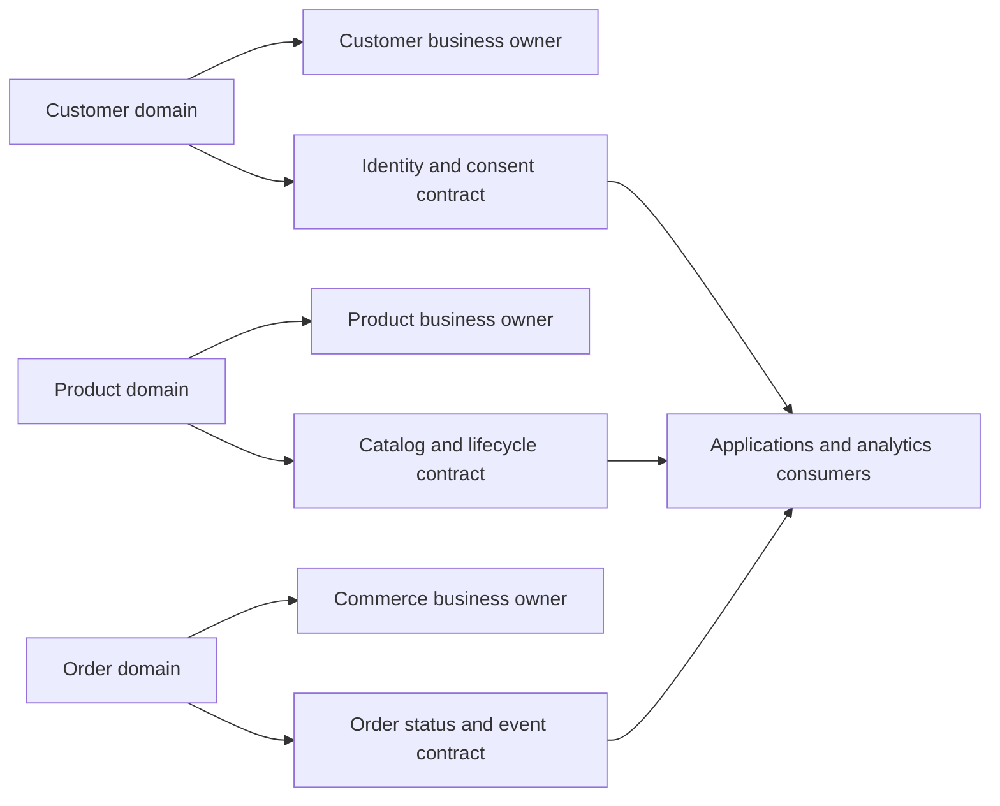
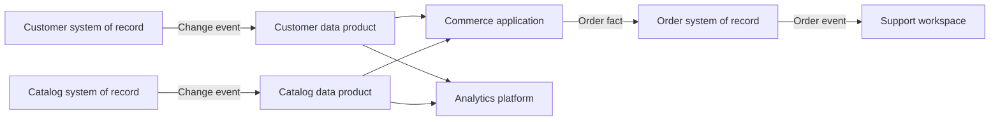
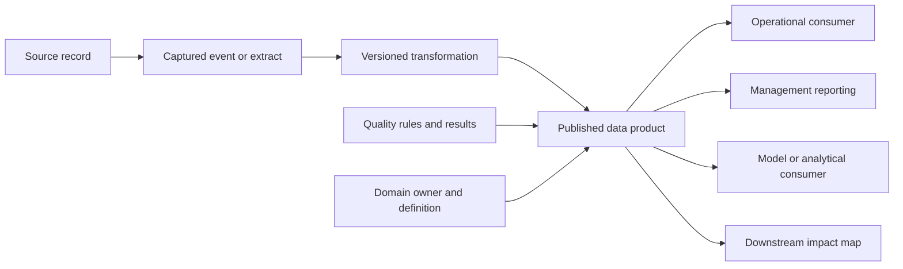
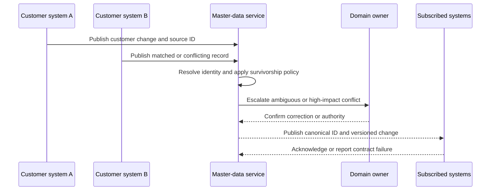
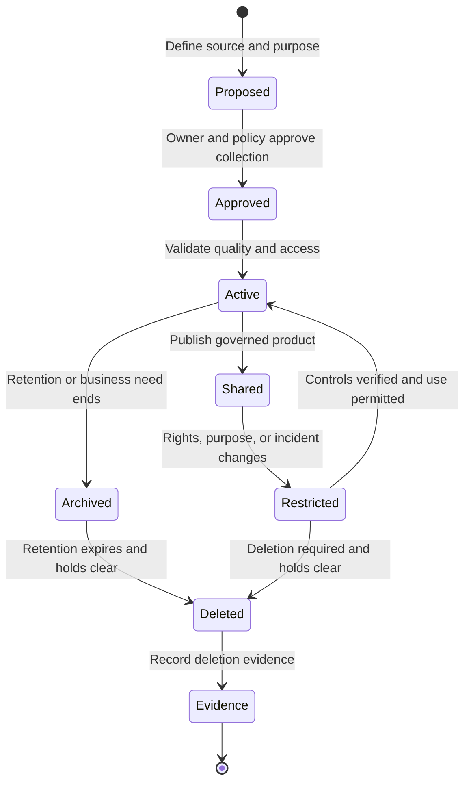

# Data Architecture

Part: [18 — Enterprise Architecture](PART_OVERVIEW.md)

Enterprise data architecture governs meaning, ownership, movement, quality, access, and lifecycle across applications and business domains. It distinguishes authoritative records from copies and derived products, and connects data use to accountable owners. Part 06 owns database and storage mechanics; Part 16 owns AI data techniques; Part 17 owns AI solution composition.

## Organize Data Around Domains and Ownership

Identify information domains such as customer, product, order, workforce, and finance. For each, name a business owner, data producer, data owner or quality lead, authoritative source, consumers, classification, and permitted uses. Domains should reflect meaningful ownership and change boundaries rather than simply mirror applications or reporting departments.

The domain owner is accountable for meaning, access, quality expectations, and change notice, even if platform teams operate storage. Define escalation when two domains disagree about a shared concept. Avoid a single enterprise dictionary that imposes one meaning where legal entities or product lines legitimately differ.

## Identify Systems of Record and Data Products

A system of record is authoritative for a defined data subject and lifecycle, not necessarily the only place a copy exists. Name authority at field or entity level where needed. Data products and replicated views can serve consumers, but their freshness, transformation, access, and failure behavior must be explicit.

Document conflict handling and update authority. When two systems can edit the same authoritative attribute, choose a precedence rule. Define a separate reconciliation process for unresolved conflicts. A copy that feeds a decision should expose source and last-updated information where staleness affects use.

## Preserve Lineage and Quality Evidence

Lineage records where data originated, how it changed, and which consumers depend on it. Track source, transformation, business definition, quality checks, owner, and downstream use. This supports impact analysis, audit, incident response, and change planning; it does not prove that data is accurate. Quality dimensions should be selected for the use case, such as validity, completeness, timeliness, consistency, and uniqueness.

Choose lineage granularity to answer concrete questions. Table-level lineage may be sufficient for a portfolio view; record-level provenance may be required for regulated decisions. Protect lineage metadata because it can reveal business relationships and sensitive processing paths.

## Govern Master and Reference Data

Master data describes shared business entities such as customers, products, or legal entities. Reference data standardizes classifications such as country, currency, or status. Consolidation requires identity matching, survivorship rules, quality ownership, and a process for corrections. A “golden record” is not automatically correct or universally authoritative; define the purpose and consumers.

Keep source identifiers and provenance so that a correction can be traced back. Consumers need stable canonical identifiers and migration rules when records merge or split. Reference-data changes should be versioned and announced when they affect downstream validation or reporting.

## Manage Access and Lifecycle

Data governance covers collection, use, sharing, retention, archival, and deletion. Classify data and define purpose, lawful basis where applicable, consent, access roles, retention period, and deletion evidence. Analytics and derived datasets need the same attention as operational stores. Part 15 owns security and privacy controls; this chapter establishes the enterprise ownership and lifecycle model.

Deletion can be constrained by legal holds, backups, derived artifacts, or distributed consumers. Define how a request propagates and what evidence closes it. Restriction may need to precede physical deletion so the data is not used while remediation proceeds.

## Worked Case: Customer Identity Domain

A retailer has customer records in online commerce, stores, and support. The enterprise names the customer domain owner and documents which system is authoritative for identity, contact preferences, and loyalty status. A master-data service resolves duplicate identities while retaining source identifiers. Each consumer receives a versioned customer data product with consent and freshness metadata.

A contact-preference correction triggers updates to marketing and support. If one consumer fails to acknowledge the change, the data product flags stale access and the domain owner can restrict noncompliant use. Analytics retains only the fields and period needed for approved reporting; a deletion request is traced across operational copies and derived outputs under the applicable retention policy.

## Review Questions

1. What makes a system authoritative for a domain or attribute?
2. Who owns meaning and quality when platform operations are centralized?
3. Which lineage granularity supports the actual audit or impact question?
4. How are ambiguous master-data conflicts resolved and propagated?
5. How do restrictions, retention holds, and deletion interact?

Enterprise data architecture aligns data meaning and lifecycle with business ownership. Identify authoritative sources, govern shared products and master data, preserve useful lineage, and make access and deletion responsibilities explicit across consumers.
