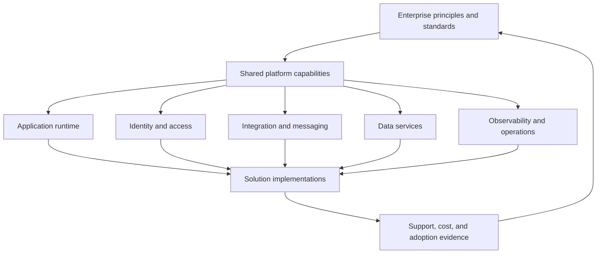
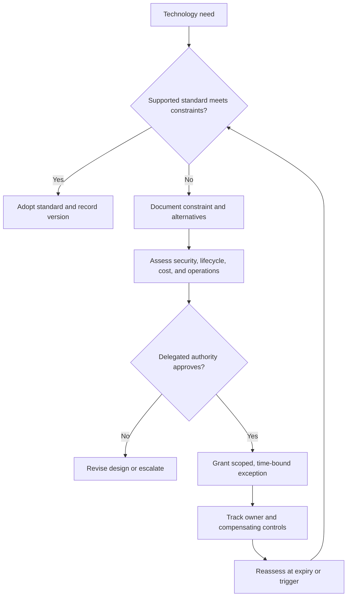
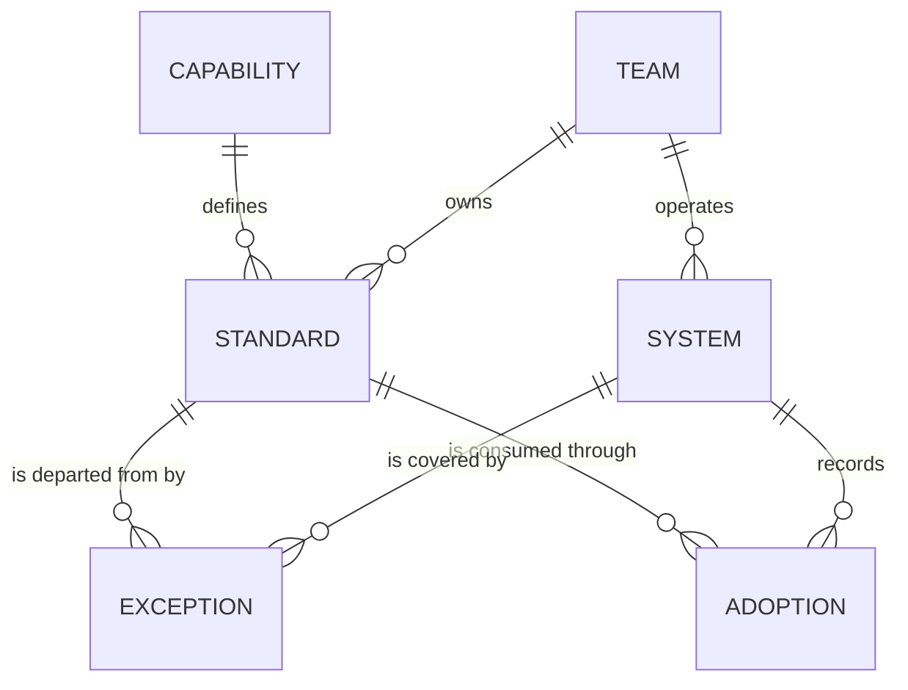
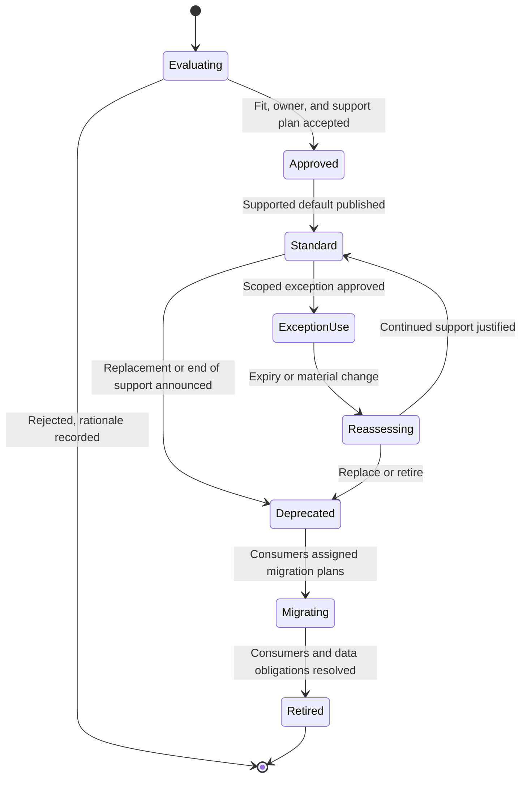
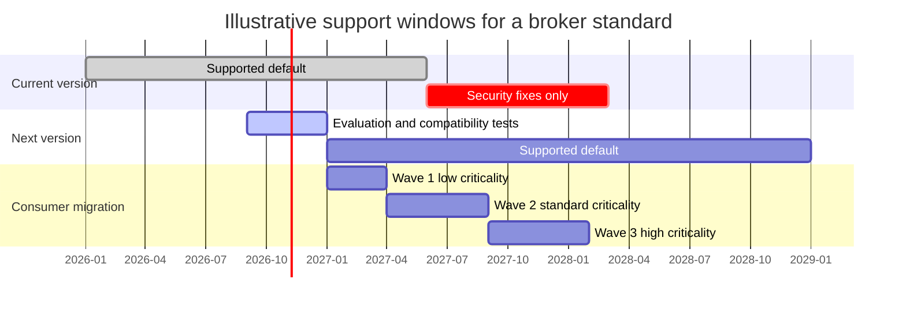
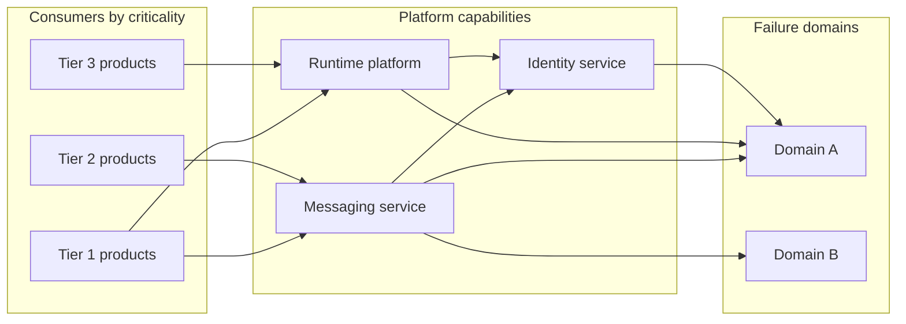
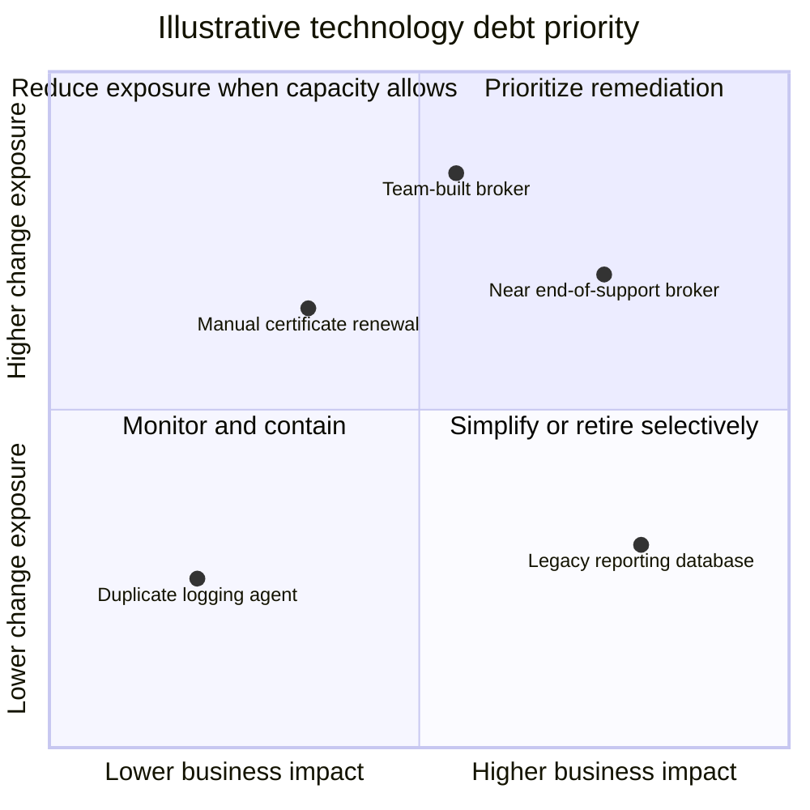
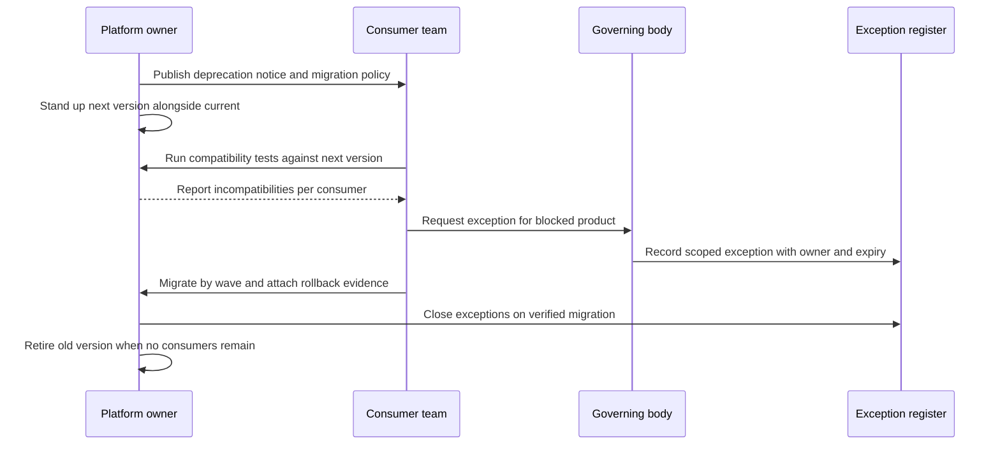
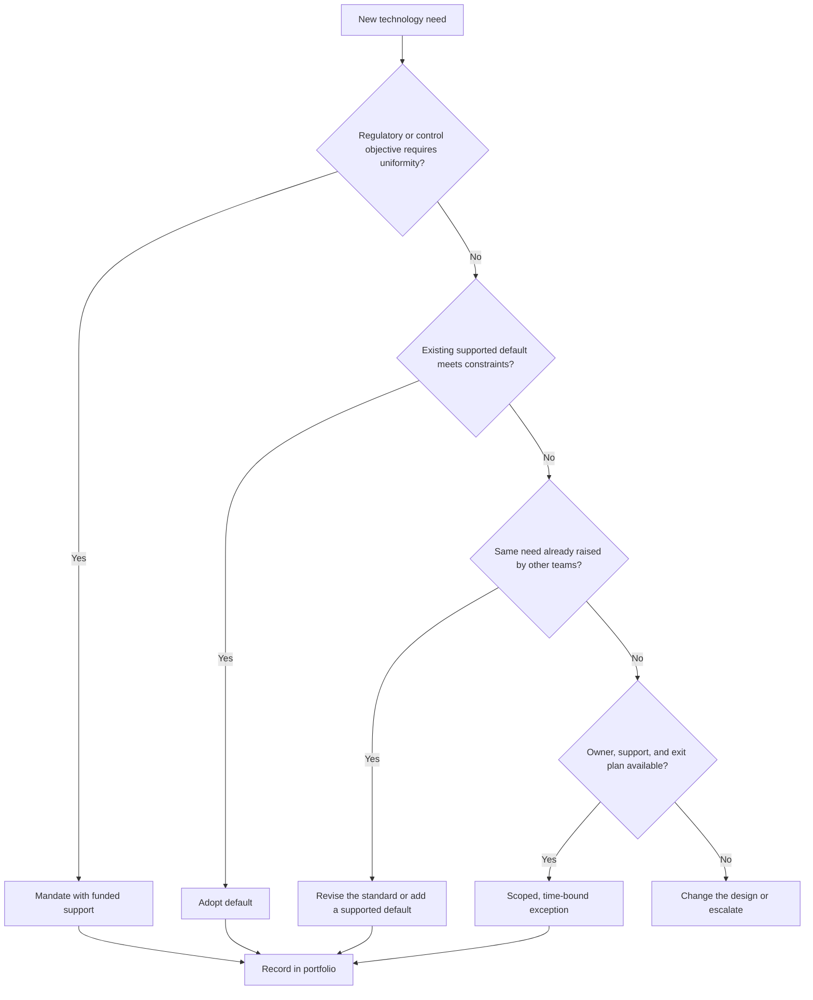
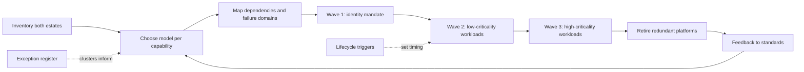

# Technology Architecture

Part: [18 — Enterprise Architecture](PART_OVERVIEW.md) · Status: Drafted

## 1. Introduction

Technology architecture is the part of enterprise architecture that describes the technology an organization runs on and the rules that govern its use: runtime platforms, data stores, networks, identity services, messaging, observability tooling, and the standards, owners, and lifecycles attached to them. Where application architecture asks which systems the business needs, technology architecture asks which supported building blocks those systems may be built from, who operates them, and how they change over time. Its characteristic output is not a diagram of one system but a set of supported defaults, a record of deliberate departures from them, and an evidence-based view of what the organization is committed to supporting.

For an engineer moving into architecture, this is where the scale of the problem changes. Inside one team, a technology choice is reversible and its costs are visible. Across an enterprise, each additional database engine, message broker, or runtime has a standing cost: someone must patch it, staff it, secure it, budget for it, and eventually retire it. Twenty teams that each choose a reasonable tool can produce twenty tools, and the organization pays for the total even though no single decision looked wrong. Technology architecture exists to make that aggregate cost visible and to decide, deliberately, where variety is worth paying for and where it is not.

It matters to a solution architect in practical ways. Your design will be checked against the supported technology landscape; the platform you assume may be a shared service with its own roadmap and support limits; and a departure from a standard needs a case that a governing body can evaluate. Knowing how standards are made, why they carry support obligations, and what a good exception looks like lets you propose designs that are approved quickly or challenge a standard with evidence instead of frustration.

This chapter owns the enterprise-level treatment of technology: how to organize a technology portfolio, how to define and govern standards, and how exceptions work. The boundaries with neighbouring material are deliberate:

- Cloud provider products and services belong to [Part 09 — Cloud Computing](../09_Cloud_Computing/PART_OVERVIEW.md); the account, subscription, and guardrail foundation belongs to [Landing Zones](../09_Cloud_Computing/CH15_Landing_Zones.md). This chapter treats a cloud service only as one entry in the portfolio.
- Delivery tooling and pipelines belong to [Part 13 — DevOps](../13_DevOps/PART_OVERVIEW.md).
- Performance engineering belongs to [Part 19 — Performance Engineering](../19_Performance_Engineering/PART_OVERVIEW.md).
- Service-level vocabulary (service-level agreement, objective, and indicator) is owned by [Non-Functional Requirements](../07_System_Design_and_Distributed_Systems/CH02_Non_Functional_Requirements.md); operational practice is covered in [Part 14 — Observability](../14_Observability/PART_OVERVIEW.md). This chapter only uses those terms to describe what a platform promises.
- The concept of technical debt, including its deliberate and accidental forms, is introduced in [What is Software Architecture?](../01_Architecture_Mindset/CH01_What_is_Software_Architecture.md).
- The enclosing method and neighbouring domains are in [TOGAF](CH01_TOGAF.md), [ArchiMate](CH03_ArchiMate.md), [Application Architecture](CH05_Application_Architecture.md), and [Data Architecture](CH06_Data_Architecture.md); governance bodies and review mechanics are in [Architecture Governance](CH08_Architecture_Governance.md) and [Architecture Review Boards](CH09_Architecture_Review_Boards.md).

After studying this chapter, a reader should be able to:

1. Explain what technology architecture decides, and why variety in technology carries a standing cost that no single project sees.
2. Organize a technology portfolio by capability and lifecycle, and record the attributes that make an entry actionable.
3. Distinguish a supported standard from a recommendation or a mandate, and state what support obligations a standard creates.
4. Write a standard and a scoped, time-bound exception request containing evidence a governing body can evaluate.
5. Decide whether a given need should be met by a standard, an exception, or a revision of the standard, using stated criteria.
6. Apply these ideas to a concrete, hypothetical scenario and identify the failure modes of each choice.

## 2. Background and History

Technology architecture as a named discipline grew out of two earlier concerns: managing computing infrastructure as it spread across organizations, and standardizing interfaces so that systems from different suppliers could work together. The following points are well established and deliberately limited.

- The Open Group's TOGAF (The Open Group Architecture Framework) treats technology architecture as one of the architecture domains developed in its method, alongside business, data, and application architecture. The method has a phase that describes baseline and target technology architectures and the gap between them; see [TOGAF](CH01_TOGAF.md) for the phase structure.
- The ArchiMate modelling language, also from The Open Group, provides a technology layer for describing nodes, system software, networks, and the artifacts deployed on them; see [ArchiMate](CH03_ArchiMate.md).
- The shift to shared cloud and platform services changed the unit of analysis. Earlier technology architecture often catalogued products and hardware; present-day practice increasingly catalogues services with owners and service levels, because a team consumes a capability rather than installing a product.

The practical consequence is that technology architecture today is as much about operating commitments as about selection. The catalogue of technologies matters less than the answer to a harder question: for each entry, who has committed to run it, patch it, and answer when it fails?

## 3. The Problem Technology Architecture Addresses

Without enterprise-level technology decisions, several general patterns recur. These are patterns, not reports of particular incidents.

| Failure pattern | Mechanism | What technology architecture contributes |
| --- | --- | --- |
| Sprawl | Each team picks a locally optimal tool; the number of distinct technologies grows faster than the capacity to support them | A supported set of defaults and a cost-aware route for adding to it |
| Orphaned technology | A tool is adopted, the champion leaves, and no team can respond to an upgrade or incident | An explicit owner and support level recorded for every standard |
| Inconsistent security posture | Controls such as identity, encryption, and patching are applied differently per team | Shared capabilities that embed controls once |
| Hidden concentration | A shared service is relied on by many products without anyone mapping the blast radius of its failure | Dependency mapping and service commitments from platform owners |
| Unplanned obsolescence | End of vendor support is discovered during an outage or audit rather than planned for | Lifecycle tracking with named triggers |
| Standards nobody can follow | A standard is published with no funding, tooling, or support, so teams route around it | The rule that a standard is a supported default, not a declaration |

Alternatives to enterprise-wide standards exist, and each is right somewhere. A fully federated model lets teams choose freely and accepts the cost of variety; it suits small organizations or genuinely independent business units. A paved-path model offers a well-supported platform that is easy to use and lets teams leave it if they accept the support burden. A strict mandate model forbids deviation; it suits narrow areas where uniformity is the point, such as a regulated control. Technology architecture chooses between these per capability, not once for the whole organization. The decision criteria are how costly variety is to support, how reversible the choice is, how much risk it concentrates, and how well teams can exit the standard if it fails them.

## 4. Organize the Technology Portfolio

The technology portfolio is the inventory of technologies the organization uses or intends to use, organized so that decisions can be made about it. Organizing by vendor or department produces a list; organizing by capability and lifecycle produces something you can govern.

### 4.1 Layers and capabilities

Group entries into capability categories: runtime platforms, data platforms, integration and messaging, identity and access management, network and connectivity, observability, developer tooling, endpoint services, and security controls. Each category is a capability the business consumes, and each may have several implementations over time. Separating the capability from its current implementation lets you replace the implementation without redefining what consumers expect.



The diagram shows two things that are easy to miss. First, solutions consume shared capabilities rather than raw products, so the platform owner, not each consuming team, carries operational responsibility for the capability. Second, evidence flows back: support load, cost, and adoption are the inputs that should change principles and standards. A portfolio without that feedback arrow becomes a static catalogue that drifts from reality.

### 4.2 What to record for each entry

An entry is actionable only if a reader can decide something from it. A workable minimum is below; tailor it to the organization.

| Attribute | Question it answers | Failure if missing |
| --- | --- | --- |
| Capability and intended use | What is this for, and what is it not for? | Misuse outside its design envelope |
| Owner | Which team is accountable? | Orphaned technology |
| Support level | What response and change commitments exist? | False expectation of support |
| Approved versions | Which versions may be deployed? | Unpatched or incompatible estates |
| Dependencies | What does it rely on and what relies on it? | Surprise blast radius |
| Lifecycle state and dates | Is it adopted, deprecated, or retiring, and when? | Obsolescence discovered late |
| Exception route | How does a team depart from it? | Silent workarounds |
| Retirement trigger | What event ends its standard status? | Technology that is never removed |

### 4.3 Shared technology needs a product owner

Shared technology should be run like an internal product: a named owner, service objectives, funding, a published change process, and a roadmap. A standard that has none of these promises support it cannot deliver. Local implementations remain justified when a shared platform cannot meet a hard requirement, but the gap and the lifecycle responsibility for the local choice must be explicit, otherwise the organization carries an unrecorded liability.

### 4.4 Worked scenario: classifying an estate (illustrative)

Suppose a hypothetical organization inventories its messaging technologies and finds three brokers in production, used by eleven products. Organizing by vendor shows three product lines and no decision. Organizing by capability shows one capability, asynchronous messaging, with three implementations of different ages. Adding lifecycle shows one broker with vendor support ending within the planning horizon, one standard broker with an active owner, and one team-built broker maintained by a single engineer.

The portfolio view now supports decisions: designate the owned broker as the supported default, plan migration for consumers of the near-end-of-support broker, and treat the team-built broker as a risk with a named reassessment trigger. No decision was possible from the vendor list. The failure mode to watch is a portfolio refreshed once a year, so that its dates and owners are stale by the time anyone consults it.

## 5. Define and Govern Standards

### 5.1 What a standard is

A standard is a decision aid and a supported default, not an irreversible mandate. It tells a team which technology the organization will help them succeed with. Three levels are worth distinguishing, because conflating them is a common source of friction.

| Level | Meaning | Support obligation | Typical use |
| --- | --- | --- | --- |
| Mandate | Departure is not permitted without senior approval | Platform owner must provide a workable solution | Narrow areas such as a regulatory control |
| Supported default | Preferred choice with owner, support, and tooling | Platform owner supports consumers | Most platform capabilities |
| Recommendation | Guidance without support commitments | None | Emerging technology and good practice |

Choosing the level is a decision in its own right. A mandate without matching support is the pattern that produces standards nobody can follow. A recommendation labelled as a standard misleads teams about the help they will get.

### 5.2 Content of a standard

A usable standard states its scope, rationale, the risk it addresses, compatibility rules, owner and support level, and a review date. The rationale matters most: when a team's need collides with the standard, the rationale lets the team judge whether the collision is real. A template follows; adapt it to local conventions.

```yaml
standard:
  id: STD-MSG-001            # illustrative identifier
  capability: asynchronous messaging
  statement: >
    Use the designated message broker service for asynchronous
    communication between products.
  scope: all new products; existing products on lifecycle migration
  rationale:
    - shared operations and on-call coverage
    - consistent encryption and access control
  risk_addressed: unsupported brokers and inconsistent security controls
  owner: messaging platform team
  support_level: business-hours support, 24x7 incident response
  compatibility: approved versions listed in the portfolio entry
  exception_route: exception request with expiry
  review_date: 2027-03-31
```

### 5.3 Exceptions: a decision path

An exception request is how the organization learns whether a standard fits reality. It should name the affected system, the unmet requirement, the alternatives considered, the compensating controls, an owner, an expiry, and the trigger that causes reassessment.



The decisive features are the two loops. A denied request returns to design or escalation rather than ending in a silent workaround, and an approved exception returns to the standard at expiry rather than becoming permanent. Without expiry, an exception is simply a second standard with no owner.

### 5.4 Standards as a data model

Treating standards, exceptions, and consumers as linked records is what lets an organization answer questions such as which systems depend on a deprecated standard, or which exceptions expire next quarter.



The model shows that an exception belongs to both a standard and a system, so the same record answers a platform owner's question (who is off my standard) and a system owner's question (what is my compensating control and when does it expire). It also shows why ownership is a first-class relationship: a standard with no owning team cannot be reviewed.

### 5.5 Worked scenario: an exception that reveals a gap (illustrative)

A hypothetical team building a low-latency ingestion service finds that the standard broker cannot meet its ordering requirement at the volume it needs. The team files a request naming the requirement, the measurements it relied on, two alternatives considered, a compensating control (the alternative runs under the platform team's monitoring and patching baseline), an owner, and a twelve-month expiry. The governing body grants the exception. Over the year two more teams file similar requests. The aggregated themes show the standard's scope is wrong for a class of workload, and the platform owner proposes a second supported default for ordered, high-volume streams. The exceptions are then retired by migration into the new standard.

The sequence is the intended behaviour: exceptions are evidence. Failure modes include approving without expiry, approving without compensating controls, and treating repeated requests as repeated team failures instead of a signal about the standard.

### 5.6 Decision criteria: standard, exception, or revise the standard

| Situation | Indicator | Appropriate response |
| --- | --- | --- |
| One-off need with a hard constraint | Single system, unique requirement | Scoped, time-bound exception |
| Need recurs across teams | Several exceptions with the same theme | Revise the standard or add a supported default |
| Standard unsupported in practice | Teams avoid it because help is unavailable | Fund the support, or demote it to a recommendation |
| Compliance control | Uniformity is the objective | Retain as a mandate and invest in making it workable |

Edge cases deserve explicit rules: how a standard applies to existing systems (usually migrate on lifecycle events, not immediately), what happens when two standards conflict, and who may grant an exception where the risk crosses organizational boundaries. State each rule in the standard so that it does not have to be re-argued case by case.

## 6. Manage Technology Lifecycle and Support

A standard is not a permanent status. Every technology moves through adoption, supported operation, upgrade, deprecation, and retirement, and the architecture function's job is to make each transition a planned event with an owner instead of a surprise. Lifecycle management differs from the portfolio record in Section 4: the portfolio says where an entry is now, while lifecycle management says what must happen, by when, and who must act for it to move.

### 6.1 Lifecycle states and what triggers each transition



The diagram makes three rules explicit. First, rejection is a recorded outcome, so the next team that proposes the same technology can read the reasoning instead of repeating the evaluation. Second, `Deprecated` is distinct from `Retired`: deprecation is an announcement with a plan, and retirement is the verified end of all consumption. Treating the two as one is why deprecated technology lingers for years. Third, the exception path rejoins the main flow through reassessment, which keeps exception use from becoming a parallel lifecycle that nobody reviews.

### 6.2 What to track, and why each item matters

| Lifecycle input | Why it matters | Typical source of evidence |
| --- | --- | --- |
| Vendor or upstream support dates | Defines the latest safe date for migration | Vendor lifecycle statements, verified at the time of review |
| Security patch cadence | Determines how quickly known weaknesses can be closed | Patch history for the specific product, not assumptions |
| Internal expertise | A supported product is unsustainable if no one can operate it | Skills inventory, on-call rota composition |
| Compatibility constraints | Upgrades can break consumers or neighbouring platforms | Consumer inventory and compatibility test results |
| Contract and licence obligations | Renewal dates and exit terms constrain timing | Procurement records |
| Replacement dependencies | A retirement may be blocked by something that cannot move yet | Dependency map (Section 7) |

A technology can be formally supported by its vendor and still be operationally unsustainable, because the vendor's support does not answer an internal incident at three in the morning. Record both views: external support state and internal ability to respond.

### 6.3 Compatibility and migration policy

Publish, as part of each standard, a policy that answers the questions teams otherwise ask repeatedly.

- How many versions behind may a consumer run, and for how long?
- How are urgent security fixes applied, and who is expected to act within what window?
- What evidence is required before a consumer is marked migrated, and before the technology is marked retired?
- Who pays for migration: the consumer, the platform owner, or a central fund? Unfunded migration mandates are the most common reason deprecations stall.

Distinguish technology end of life from application retirement. When a technology reaches end of support, an application that is itself scheduled for retirement soon may justify a time-limited exception with compensating controls rather than a migration. When the application will live longer than the technology, the migration is unavoidable and should be scheduled against the application's own change calendar. Both decisions are cheaper when the application's expected remaining life is recorded in the portfolio; see [Application Architecture](CH05_Application_Architecture.md) for how application lifecycle is classified.

### 6.4 Illustrative support-window planning

The chart below is illustrative: it shows how a platform owner might lay out overlapping support windows for a hypothetical broker standard so that no consumer faces a cliff.



The implication is that the overlap between versions is the planning asset. The next version is a supported default before the current one moves to security fixes only, so migration waves have slack before the last date. If the overlap shrinks to zero, every consumer migrates at the same moment and the organization has recreated the cliff. The dates are invented for illustration; real windows come from verified support statements.

## 7. Map Dependencies and Failure Domains

Reuse and concentration are the same property seen from two sides. Every team that adopts a shared capability avoids building it, and every team that adopts it also inherits the capability's failure behaviour. Section 4.3 argued that shared technology needs a product owner; this section covers how to reason about what happens when that owner's service is degraded, changes, or goes away.

### 7.1 Dependency mapping: what to capture

A dependency map for a platform answers questions a diagram of boxes cannot. For each capability, record the consumers (by criticality tier), the capabilities it depends on, the failure domains it spans (regions, accounts, clusters, or data centres, according to the environment), the identity and network paths it needs, the recovery model, and the change windows. Direct dependencies are easy to collect; the valuable finding is usually an indirect one, such as a platform whose own control plane relies on a service that its consumers assumed was independent.



Reading the map, the identity service appears beneath both the messaging and runtime capabilities and is placed in a single failure domain. Tier 1 products that appear to have two independent platforms therefore share one hidden upstream. This is the typical output of the exercise: not a count of arrows but the discovery of a shared ancestor that defeats an assumed redundancy. The finding supports concrete actions: extend the identity service to a second domain, document a degraded mode, or accept the risk explicitly with the owner named.

### 7.2 Assessing blast radius

Blast radius is the set of consumers affected by a platform fault or a breaking change, weighted by their criticality. Assess it for two distinct events, because mitigations differ.

| Event | Question | Typical mitigation |
| --- | --- | --- |
| Platform outage | Which consumers stop, degrade, or lose data? | Independent capacity, tested recovery, consumer degraded modes |
| Breaking platform change | Which consumers fail on upgrade? | Compatibility tests against representative consumers, staged rollout, parallel versions |
| Support withdrawal | Which consumers lose a response path? | Lifecycle notices, exit routes, ownership transfer plan |
| Shared secret or credential rotation | Which consumers depend on the old credential? | Overlap windows, automated rotation, inventory of dependants |

A central service is not automatically a single point of failure: independent capacity, tested recovery, and consumers that tolerate its absence all reduce concentration. The condition is evidence. An assertion that a platform is resilient, without a recovery test and an owner who can show the result, should be treated as a hypothesis. Resilience design itself is covered in [Part 07 — System Design and Distributed Systems](../07_System_Design_and_Distributed_Systems/PART_OVERVIEW.md); here the architect's role is to ensure the evidence exists and is attached to the portfolio entry.

### 7.3 What consumers are owed

A consumer relying on a platform should be able to find, without asking, the service commitments in terms of the vocabulary defined in [Non-Functional Requirements](../07_System_Design_and_Distributed_Systems/CH02_Non_Functional_Requirements.md); notice periods for changes that affect them; the support contact and escalation path; and the exit or degraded-mode strategy. Without the last, a consumer's only reaction to a platform problem is to wait. Platform changes should be tested against representative consumers, not only the platform team's own workloads, because the platform team's workloads are by definition the ones that already work.

### 7.4 Alternatives and trade-offs

| Approach | Strength | Cost or risk |
| --- | --- | --- |
| Single shared instance | Lowest operating cost, uniform controls | Largest blast radius; every change affects everyone |
| Shared platform with per-tier isolation | Critical consumers insulated from noisy ones | Higher cost; isolation boundaries must be maintained |
| Per-product instances on a shared standard | Smallest blast radius per instance | More operations to patch and monitor in total |
| Product-owned technology outside the standard | Full control | Support burden moves to the product team; recorded as an exception |

No row is universally best. Criticality, reversibility, and the cost of operations decide. A typical outcome is isolation by tier: critical consumers get dedicated capacity on the same standard, while low-criticality consumers share an instance.

## 8. Prioritize Technology Debt and Risk

The general concept of technical debt, including its deliberate and accidental forms, is introduced in [What is Software Architecture?](../01_Architecture_Mindset/CH01_What_is_Software_Architecture.md). At the enterprise level it takes particular forms that live in the technology portfolio rather than in any one codebase.

### 8.1 Forms of technology debt

| Form | Example (illustrative) | Why it accrues interest |
| --- | --- | --- |
| Unsupported dependency | A runtime past its support window | Unfixed weaknesses; rising effort to patch around |
| Duplicated platform | Two brokers doing one capability | Two sets of operations, skills, and patching |
| Manual operation | Hand-run deployments or certificate renewals | Error rate and key-person dependency |
| Scarce skills | One engineer who understands a team-built tool | A resignation becomes an incident |
| Weak observability | A platform without health signals | Slow diagnosis; hidden degradation |
| Lock-in without an exit | A proprietary interface used widely with no abstraction or exit plan | Rising cost of any future change |

Not all lock-in is debt. Accepting a dependency in return for lower cost or faster delivery is a legitimate decision, provided the exit cost and trigger are recorded. It becomes debt when nobody can say what leaving would cost.

### 8.2 A prioritization method

Age is a poor proxy for risk: an old, stable, well-understood component may be safer than a recent, poorly owned one. Rank on five factors and record the result with its reasoning.

1. Exposure: how likely is harm, given known weaknesses, support state, and operating condition?
2. Business criticality: what depends on it, and what does failure cost?
3. Remediation cost: effort, cross-team coordination, and downtime needed.
4. Dependency reach: how many consumers are affected, directly or indirectly (Section 7)?
5. Reversibility: can the remediation be rolled back, and can the delay be reversed?

Record the cost of delay and the trigger for action, such as a support end date or a rise in incidents, rather than a vague intent to address the item later. A scoring model is a communication aid: use it to make assumptions visible, then check the ranking with the people who operate the technology.



The positions are invented for the hypothetical estate used in Section 4.4. The team-built broker and the near end-of-support broker land in or near the top-right, so they head the remediation list; the legacy reporting database is important but stable, so it is contained and scheduled. The quadrant guides investigation and is not an automatic replacement list. A highly exposed dependency may be addressed by containment, support renewal, or a migration plan, and a low-exposure but costly technology may be retired during planned modernization instead of as an emergency.

### 8.3 Turning priority into funded work

A ranked list changes nothing until it is attached to funding and an owner. Three routes are common: a platform roadmap item funded centrally, a migration owed by each consuming product within its own budget, or a risk acceptance signed by a named owner with an expiry. Each route has a failure mode. Central funding without consumer commitment leaves migrations idle; consumer funding without central support causes teams to defer; risk acceptance without expiry is an exception that never ends. Review the list at a set cadence, and retire items by evidence of removal rather than by declaration.

The cross-chapter link to note is with architecture governance: who may accept a risk of a given size, and how it is recorded, is owned by [Architecture Governance](CH08_Architecture_Governance.md). Here the architect's contribution is the evidence that makes the acceptance decision informed.

## 9. Worked Scenario: Retiring a Broker Version (illustrative)

This scenario continues the hypothetical organization from Sections 4.4 and 5.5: eleven products, three brokers, one designated standard broker, and one ordered-stream ingestion service running under a twelve-month exception. Everything below is invented for teaching.

### 9.1 The trigger

The platform owner's lifecycle review (Section 6) shows that the version of the standard broker in use will move to security-fixes-only in about eighteen months. Consumers span three criticality tiers. A payment-notification product in the top tier uses a client library that the next broker version no longer supports, and the ingestion service under exception relies on a configuration that the next version changes.

### 9.2 Decision: migrate, stay, or substitute

| Option | Effect | Judgement |
| --- | --- | --- |
| Upgrade all consumers together | Shortest overlap | Rejected: the top-tier product has an unresolved library incompatibility and no rollback plan |
| Remain on the current version beyond support | No migration cost now | Rejected for the general estate: security fixes stop; acceptable only as a per-product exception with compensating controls |
| Run both versions in parallel and migrate by tier | Longer overlap, higher operating cost | Chosen: overlap is the cost of de-risking the top tier |
| Replace the broker product altogether | Resolves library problem permanently | Deferred: larger decision with wider effects; revisit if compatibility failures recur |

### 9.3 Execution sequence



The sequence places verification before closure at both ends. The exception is recorded before the blocked product keeps running on the old version, and it is closed only when the migration is evidenced, not when the team says it is done. The platform owner retires the old version only when the register shows no remaining consumers, which is the condition that distinguishes retirement from deprecation (Section 6.1).

### 9.4 Results and signals to track

The migration proceeds by tier: low-criticality products first, to find defects cheaply; the top-tier product last, once its library is updated and its rollback has been exercised. Each team validates performance, security patching, rollback, and operational dashboards before moving production. The ingestion service's exception is folded into the revised standard that Section 5.5 anticipated, so one exception closes without a separate migration.

Track adoption by wave, open exceptions and their expiry dates, and the number of compatibility failures per release. If the same class of failure recurs, change the platform roadmap, for example by publishing a compatibility test suite or narrowing the supported client versions, rather than granting repeated local workarounds. Failure modes to anticipate: the overlap period is cut for cost reasons, consumers are not funded to migrate, and the old version is "retired" while a forgotten consumer still depends on it.

## 10. Failure Scenarios and Common Mistakes

### 10.1 Failure catalogue

| Failure | Symptom | Detection | Mitigation |
| --- | --- | --- | --- |
| Exception without expiry | Register contains entries with no end date; "temporary" workarounds are years old | Query for exceptions lacking expiry or past expiry | Require expiry and trigger at approval; report overdue exceptions at each review |
| Standard without support | Teams avoid the standard; help requests go unanswered | Low adoption alongside high exception rate; platform team's queue age | Fund support or demote the standard to a recommendation |
| Stale portfolio | Owners have left; dates are wrong | Sample entries against reality; count entries with unreachable owners | Tie updates to lifecycle events; assign owner re-confirmation on a cadence |
| Deprecation without migration funding | Deprecated technology still in production long after announcement | Consumers remaining versus plan dates | Attach funding or an explicit risk acceptance to each deprecation |
| Hidden shared ancestor | A fault in one service stops supposedly independent platforms | Dependency map review; failure-injection exercise | Add independent capacity, degraded modes, or record accepted risk |
| Premature retirement | A forgotten consumer fails when a technology is removed | Consumer discovery from runtime evidence, not only from registers | Retire only when observed traffic is zero for a defined period |
| Mandate used where a default suffices | Teams comply nominally and bypass in practice | Divergence between declared and observed technology | Reclassify as a supported default; keep mandate for genuine controls |
| Exception approval without compensating controls | Approved departures run unpatched or unmonitored | Review exceptions for named controls and evidence | Make controls a required field; sample for evidence |
| Repeated exceptions treated as team failure | Same request filed again and again | Cluster exceptions by theme | Treat clusters as a signal; revise the standard |
| Catalogue treated as the deliverable | A long list exists but no decision references it | Count decisions that cite the portfolio | Frame each entry around a decision it supports |

### 10.2 Anti-patterns

- Technology of the quarter: adopting each new tool without retiring an old one, so total operating cost only grows. The counter is a rule that adding a supported default names what it replaces or why it coexists.
- Standard by committee without an owner: agreement is reached, but no team is accountable for operating or reviewing it.
- Governance as a gate only: review occurs at the end of design, when changing the technology is costly. Standards should be consulted early; see [Architecture Review Boards](CH09_Architecture_Review_Boards.md) for review timing.
- Diagram-only architecture: the technology view is a picture with no linkage to owners, dates, or consumers, so it cannot answer a question about who is affected by a change.
- Premature abstraction: wrapping every product in an in-house interface to avoid lock-in, which adds a platform to maintain and rarely preserves real portability.
- Retiring by decree: a retirement date announced with no consumer inventory, migration funding, or verification.

### 10.3 Edge cases worth deciding in advance

When two standards conflict, name which one prevails and who resolves it. When a standard applies to an acquired organization's estate, define a transition path and a period in which exceptions are expected. When the risk of an exception crosses organizational boundaries, define who may grant it. When a standard is withdrawn but contracts continue, record the obligation separately from the technology's lifecycle state.

## 11. Trade-off Analysis and Decision Framework

### 11.1 Comparing governance models per capability

Section 3 named three models: federated, paved path, and mandate. The table below compares them on the criteria that decide which suits a given capability. Ratings are qualitative and depend on the organization.

| Criterion | Federated | Paved path | Mandate |
| --- | --- | --- | --- |
| Team autonomy | Highest | High, with a supported route | Lowest |
| Aggregate operating cost | Tends to rise with variety | Moderate | Lowest when uniformity is achievable |
| Consistency of security controls | Weak unless enforced elsewhere | Good for those who use the path | Strongest |
| Cost of a wrong standard | Low; teams route around | Moderate; exceptions absorb it | High; everyone bears it |
| Platform support burden | None | Substantial | Substantial and must be sufficient |
| Fit | Independent units, low-risk tools | Most shared capabilities | Regulatory controls, narrow interfaces |

The cost of a wrong standard row is the one often missed. Mandates are cheap to operate when correct and expensive when wrong, so they need a faster revision loop than a paved path.

### 11.2 Criteria for choosing

1. Cost of variety: what does each additional technology cost to patch, staff, and secure?
2. Reversibility: how hard is it to change later, for one team and for the enterprise?
3. Risk concentration: how many critical consumers would a failure affect?
4. Exit ability: can a team leave the standard if it fails them, and at what price?
5. Ability to support: has the owner got funding, skills, and tooling to meet the promised level?
6. Regulatory or contractual constraint: is uniformity itself the requirement?

### 11.3 Decision flow



The flow tests uniformity first because it is the only condition that removes team discretion, and tests recurrence before granting a one-off exception because recurrence is evidence about the standard. The final test, owner, support, and exit plan, prevents an exception from creating an unowned liability. Every outcome ends in a portfolio record, which keeps the decision usable later. The flow is a guide to the questions to ask, not an algorithm; judgement applies at each branch.

## 12. Illustrative Composite Case Study and Review Checklist

### 12.1 Case study: consolidating two estates after a merger (hypothetical)

This composite is invented and not drawn from any real organization. Two mid-sized firms merge. Firm P runs its products on a container platform with a central platform team; Firm Q runs most products on virtual machines, with each product team managing its own database and monitoring tools. Leadership asks the architecture team for a single technology standard within a year.

**Step 1: inventory by capability and lifecycle.** The team applies Section 4: runtime, data, messaging, identity, and observability are the categories. The inventory shows five data store engines in Firm Q, two in Firm P, and a monitoring tool in Q whose contract ends within the planning horizon. Owners are named for Firm P's entries; many of Q's entries have none.

**Step 2: choose a model per capability.** Identity is made a mandate, because uniform access control is the objective. Runtime and data become paved paths: a container platform and two supported data engines are designated defaults, with the platform team funded to support Q's migration. Monitoring is treated as a lifecycle event: Q's contract end is the trigger to move to the designated tool.

**Step 3: handle exceptions as evidence.** Q's team operating a specialized time-series store files an exception, with measurements, alternatives, an owner, and a twelve-month expiry. A second Q team files a similar request. The architecture team clusters them and proposes a third supported data default instead of two exceptions.

**Step 4: sequence migration by dependency and criticality.** A dependency map shows both firms' products sharing a legacy directory service for identity. Migration begins with identity, since many other moves depend on it, then low-criticality workloads, with high-criticality products last.



The diagram shows migration as a loop, not a line. Exception clusters feed back into the model choice, lifecycle triggers set timing, and retirement results feed the standards. A line-shaped plan would assume the first set of standards is right.

**What went wrong, and what the team learned.** In this hypothetical, the team set a single date for all monitoring moves and found that two high-criticality products had unmigrated alert rules. The cut-over was extended for them under a scoped exception. The lesson matches Section 10: retirement requires evidence of zero remaining use, and the exception mechanism absorbed the surprise without abandoning the plan.

**Trade-offs accepted.** Consolidating onto fewer defaults cut aggregate variety but reduced team autonomy in Q, where teams had previously chosen freely. The team accepted that cost for the mandate and paved-path areas and kept a documented exception route to preserve a way out.

### 12.2 Architect review checklist

Use this checklist when reviewing a design or a standard. Questions are phrased so that a "no" requires an explanation.

- Does the design use a supported default, and is the version one the portfolio allows?
- If it departs, is there a scoped exception with an owner, compensating controls, an expiry, and a reassessment trigger?
- Does each technology in the design have a named owning team and a stated support level?
- Are lifecycle dates for each component known, and does the design remain supported across its expected life?
- Are dependencies on shared platforms mapped, including indirect ones, with a degraded mode where criticality warrants?
- Has the design been tested against platform upgrade and credential rotation events?
- Is lock-in recorded with an exit cost and trigger rather than avoided by assumption?
- Are known technology debt items tied to a trigger, an owner, and a funding route?
- Does the standard in play state its level (mandate, supported default, or recommendation) and match support provided?
- Is the decision recorded in the portfolio so that a later reader can retrieve the rationale?
- For cloud services, have platform foundations been left to [Landing Zones](../09_Cloud_Computing/CH15_Landing_Zones.md), with this design consuming them rather than redefining them?
- Do the data aspects of the technology choice (retention, residency, ownership) defer to [Data Architecture](CH06_Data_Architecture.md)?

## 13. Interview Questions

1. **What does technology architecture decide that a single team's design does not?** It decides which technologies the whole organization will support, with what owners, versions, and lifecycles. A team sees the benefit of its own choice; the enterprise carries the combined operating cost, so the discipline makes that aggregate visible.
2. **What is the difference between a mandate, a supported default, and a recommendation?** A mandate forbids departure without senior approval and needs matching support. A supported default is the preferred choice with an owner and tooling. A recommendation carries no support commitment.
3. **What belongs in an exception request?** The system affected, the unmet requirement, alternatives considered, compensating controls, an owner, an expiry, and a reassessment trigger. Without expiry and owner it becomes a second, unreviewed standard.
4. **How would you decide whether repeated exceptions mean the standard is wrong?** Cluster the exceptions by theme. If several teams hit the same constraint, the scope or content of the standard is probably wrong, and the response is to revise it or add a supported default.
5. **How do deprecation and retirement differ?** Deprecation is an announcement with a plan and a migration policy; retirement is the verified end of all use. Retiring requires evidence, such as observed consumption at zero.
6. **How do you assess the risk of a shared platform?** Map consumers by criticality, its own dependencies, failure domains, recovery model, and change windows. Look for shared ancestors that defeat assumed redundancy, and ask for recovery test evidence.
7. **How do you prioritize technology debt?** Rank by exposure, business criticality, remediation cost, dependency reach, and reversibility, and record the trigger and the cost of delay. Age alone is a poor proxy.
8. **When would you choose a federated model over a paved path?** When variety is cheap to support, consequences of a bad choice are small, and teams are genuinely independent. For capabilities where operations, security, or concentration matter, a paved path or mandate is usually better.

## 14. Hands-on Exercises

1. **Classify an estate.** Take ten technologies from a system you know (or invent them). Group them by capability, assign owner, support level, and lifecycle state, and list which attributes you could not fill in. Reflect on what the gaps imply.
2. **Write a standard and an exception.** Using the template in Section 5.2, write a standard for one capability. Then write an exception request for a team whose need conflicts with it, including compensating controls, an expiry, and a trigger.
3. **Map a dependency graph.** Draw a Mermaid diagram of three platforms and six consumers in two criticality tiers. Identify one shared ancestor, state the blast radius of its failure, and propose one mitigation and one accepted risk.
4. **Plan a retirement.** Choose a technology with an assumed end-of-support date twelve months out. Produce migration waves, a funding route, an exception policy for blocked consumers, and the evidence you would require before declaring it retired.

## 15. Design and Architecture Review Questions

1. **A team proposes a new database engine not in the portfolio. How do you review it?** Ask for the unmet requirement and measurements, test whether an existing default meets it, and check for an owner, support level, and exit plan. If the need is genuine and isolated, propose a scoped exception with an expiry; if it appears elsewhere, consider revising the standard. Record the decision in the portfolio either way.
2. **A platform owner announces a breaking change with two weeks' notice. What do you assess?** Review the notice period against the commitments the platform has published, and map affected consumers by criticality. Ask for compatibility tests against representative consumers and a staged rollout with a parallel version. If the platform owner cannot provide these, raise the gap with the governing body as a service weakness.
3. **A top-tier product relies on a shared service whose recovery has never been tested. What do you do?** Treat the resilience claim as a hypothesis. Request a recovery exercise, a dependency review for shared ancestors, and a degraded-mode design. If the exercise cannot be run soon, record an explicit risk acceptance with an owner and an expiry.
4. **The register shows forty exceptions, half past expiry. What is your response?** Treat it as a governance defect. Cluster the exceptions by theme to find standards that need revision, close those with no current justification, and renew the rest with evidence. Add overdue reporting to each review so the situation does not recur.
5. **Leadership asks to ban all deviation from the standard to cut cost. How do you respond?** Explain that mandates suit narrow control objectives and are costly when the standard is wrong. Propose a paved path with exceptions and a funded support plan, and show how exception clusters feed revisions. Offer a mandate only where uniformity is itself the requirement.

## 16. Summary

Technology architecture is the discipline of deciding which technology an organization will support, who owns it, and how it changes (Introduction, outcomes 1 and 2). The portfolio is organized by capability and lifecycle, with owner, support level, versions, dependencies, and retirement triggers recorded for each entry (Section 4). A standard is a supported default with a stated level and obligations, written with a rationale and a review date (Section 5; outcome 3), and an exception is a scoped, time-bound, evidence-bearing record that returns to the standard at expiry (outcome 4).

Lifecycle management makes deprecation and retirement planned events with funded migration (Section 6). Dependency mapping exposes shared ancestors and blast radius, and debt prioritization ranks risk by exposure, criticality, cost, reach, and reversibility (Sections 7 and 8). The decision framework in Section 11 helps choose between a standard, an exception, and a revision of the standard (outcome 5), and the worked scenario and composite case study show those decisions applied to concrete, hypothetical situations, with their failure modes catalogued in Section 10 (outcome 6). Carry forward three habits: treat exceptions as evidence, retire technology only on evidence of zero use, and attach every standard to an owner who can honour its support promise. Governance bodies and review mechanics continue in [Architecture Governance](CH08_Architecture_Governance.md) and [Architecture Review Boards](CH09_Architecture_Review_Boards.md).
