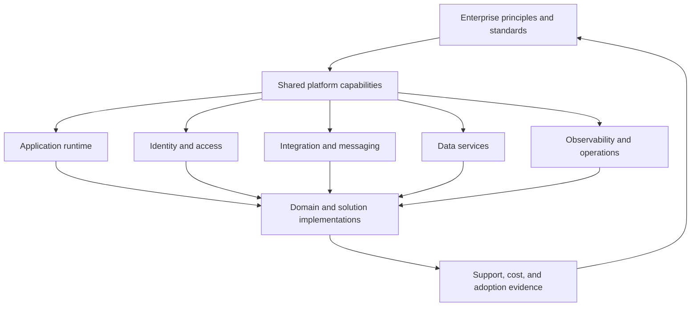
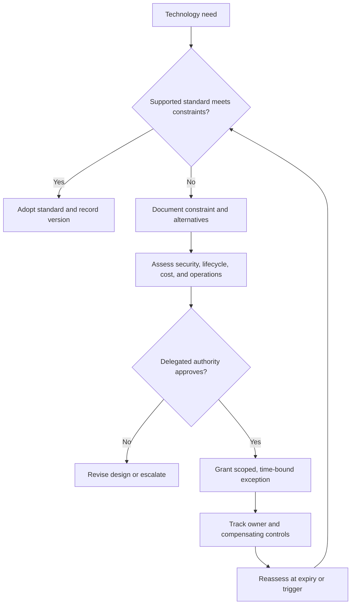
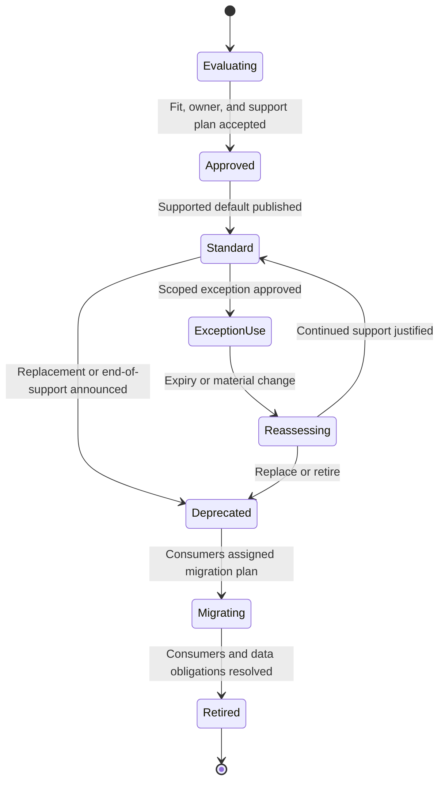
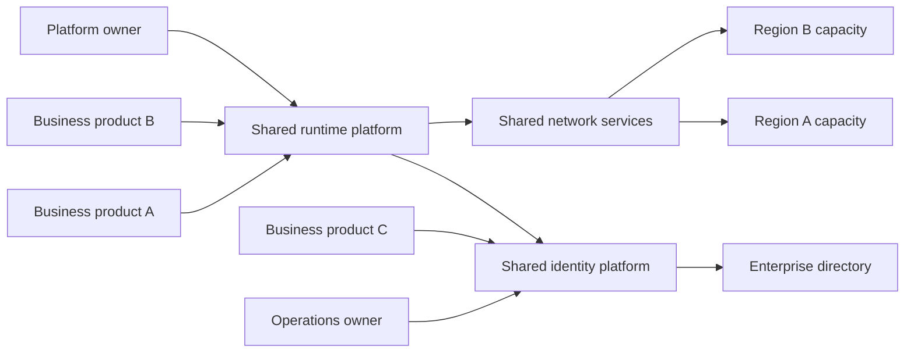
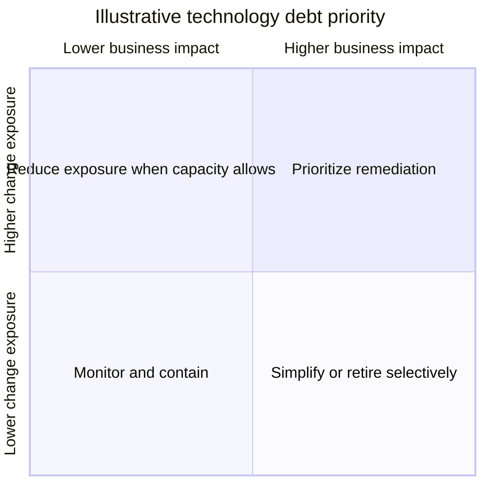

# Technology Architecture

Part: [18 — Enterprise Architecture](PART_OVERVIEW.md)

Enterprise technology architecture governs platforms, infrastructure capabilities, standards, lifecycle, sourcing, and operational responsibilities across business domains. It balances reuse and supportability against local constraints and innovation. Part 09 owns cloud services, Part 13 owns delivery tooling, and Part 19 owns performance engineering; this chapter focuses on enterprise-wide technology choices and controls.

## Organize the Technology Portfolio

Group technologies by capability and lifecycle rather than by vendor or department. Useful categories include runtime platforms, identity, integration, data platforms, observability, developer tooling, endpoint services, and security controls. For each standard, record intended use, owner, support level, approved versions, dependencies, exception route, and retirement trigger.

Shared technology should have a product owner, service objectives, funding, and a published change process. “Standard” without support capacity creates a false expectation. Local implementations may be justified when a shared platform cannot meet a hard requirement, but the gap and lifecycle responsibility must be explicit.

## Govern Standards and Exceptions

A standard is a decision aid and a supported default, not an irreversible mandate. Define scope, rationale, risk addressed, compatibility rules, and review date. An exception request should name the affected system, unmet requirement, alternatives, compensating controls, owner, expiry, and migration or reassessment trigger.

Exceptions should be measurable and reviewable. A recurring exception may indicate a gap in the standard or platform rather than repeated local failure. Aggregate exception themes and feed them into platform investment and standard revision.

## Manage Technology Lifecycle and Support

Technology lifecycle includes adoption, supported operation, upgrade, deprecation, and retirement. Track vendor support dates, security patch cadence, internal expertise, compatibility, contract obligations, and replacement dependencies. A technology can be technically supported but operationally unsustainable if no team can respond to incidents or upgrades.

Publish a compatibility and migration policy. A standard should specify whether teams may remain on an older supported version, how urgent security fixes are applied, and what evidence is required for retirement. Distinguish technology end-of-life from application retirement; consumers may need an interim platform migration.

## Understand Shared-Platform Dependencies

Shared platforms create reuse but also concentration. Map which services depend on each platform, its support teams, regions, identity, recovery model, and change windows. Assess the blast radius of a platform outage or breaking upgrade. A central service is not automatically a single point of failure if it has independent capacity and tested recovery, but diagram the evidence.

Document service boundaries and failure ownership. Consumers need service-level expectations, dependency-change notice, support contacts, and an exit or degraded-mode strategy. Platform changes should be tested against representative consumers, not only the platform team's own workloads.

## Prioritize Technology Debt and Risk

Technical debt is not only old code. It includes unsupported dependencies, duplicated platforms, manual operations, scarce skills, weak observability, and lock-in that constrains change. Rank debt by exposure, business criticality, remediation cost, dependency reach, and reversibility. Record the cost of delay and the trigger for action rather than using age as a proxy for risk.

The view guides investigation, not automatic replacement. A highly exposed dependency may be addressed with containment, support renewal, or a migration plan. A low-exposure but costly technology may be retired during a planned modernization rather than as an emergency.

## Worked Case: Shared Runtime Upgrade

An enterprise's standard runtime reaches end of support in eighteen months. The platform team inventories consumers, versions, criticality, extension points, and deployment regions. A new version breaks one library used by a high-volume payment service. The organization sets compatibility tests, provides a parallel runtime, funds platform-team support, and grants a temporary exception with an owner and expiry for that service.

The migration proceeds by workload tier. Each team validates performance, security patches, rollback, and operational dashboards before moving production. The platform team measures adoption and exceptions; repeated compatibility failures trigger a change to the shared runtime roadmap rather than indefinite local workarounds.

## Review Questions

1. What makes a technology standard supportable and actionable?
2. Which evidence belongs in a time-bound exception?
3. How do lifecycle state and application retirement differ?
4. What dependency map reveals shared-platform concentration?
5. How should debt priority account for exposure and business impact?

Technology architecture creates supported defaults and managed evolution across the enterprise. Govern standards with explicit support, exceptions with expiry and evidence, and shared platforms with visible ownership and dependency risk.
