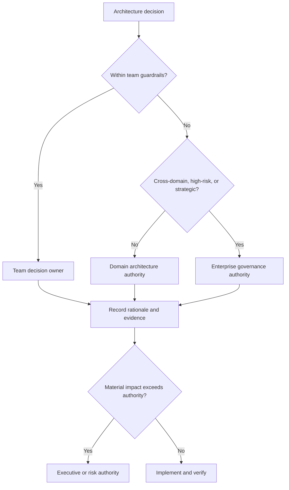
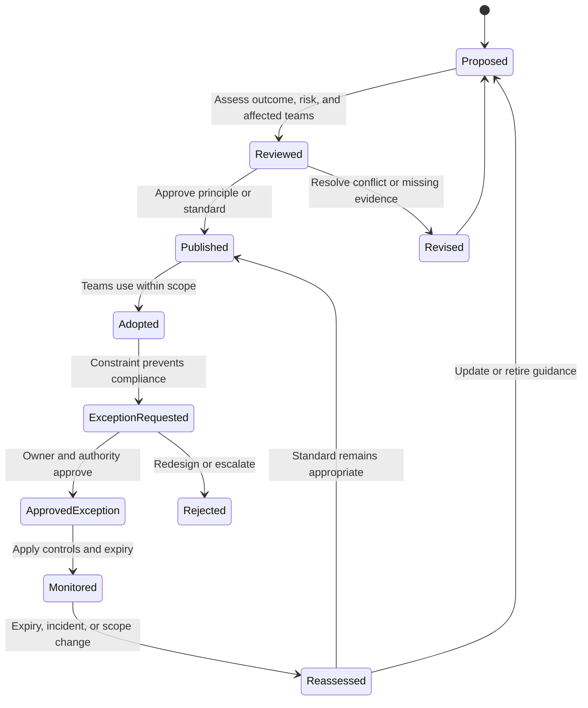
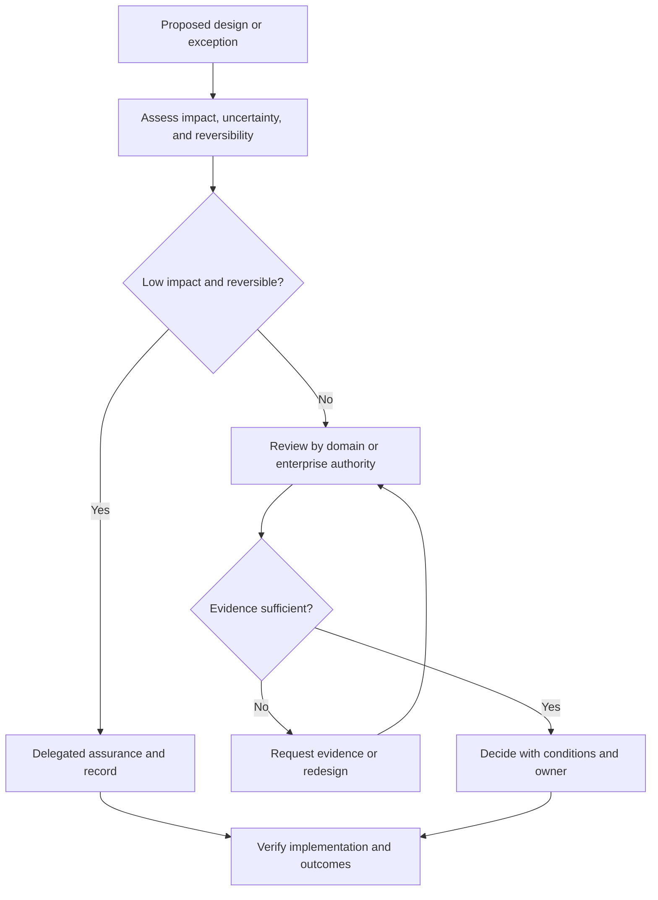
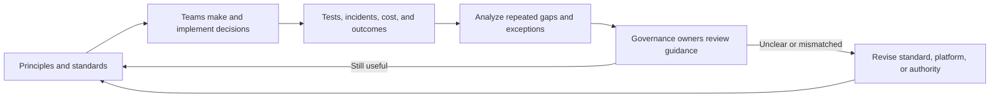

# Architecture Governance

Part: [18 — Enterprise Architecture](PART_OVERVIEW.md)

Architecture governance defines decision rights, constraints, assurance, and escalation across an enterprise. Its purpose is to improve outcomes and manage cross-team risk; document production and centralized approval are not goals. Part 01 CH03 owns architecture decision records and trade-off facilitation; Part 18 CH09 owns Architecture Review Board (ARB) operation.

## Allocate Decision Rights

Set decision authority at the lowest level that can account for the impact. Teams can decide within published principles and standards. Cross-domain decisions, shared platforms, major investment, regulatory interpretation, and exceptions may require broader authority. Assign one accountable decision owner even when implementation and consultation are distributed.

Decision rights should be published with scope, thresholds, consultation needs, and appeal path. Governance can be centralized, federated, or delegated; the structure should match organizational scale and risk. A board that reviews every local technology choice becomes a bottleneck and weakens accountability.

## Govern Principles, Standards, and Exceptions

Principles express enduring decision guidance; standards define supported choices and constraints; patterns and reference architectures show reusable structures. Each needs an owner, rationale, applicability, evidence, and review date. Exceptions should be scoped, time-bound, and connected to compensating controls and an expiry or reassessment trigger.

If many teams request the same exception, investigate whether the standard or shared platform is wrong for the actual workload. Do not allow an exception to become a permanent undocumented standard. Publish status and rationale so teams can make consistent local decisions.

## Create an Evidence Path

Assurance should be proportional to consequence and uncertainty. Ask teams for the evidence needed to decide: requirements, alternatives, risk, controls, dependency impacts, validation, and ownership. Reuse existing test, security, operational, and delivery evidence instead of requiring duplicate documents. Record the decision and any conditions with an owner and due date.

Evidence should be linked to the exact decision and design version. A passing test does not prove that the requirement is meaningful, while a complete document does not prove that a system conforms. Governance combines evidence with accountable judgment and defines how to revisit it.

## Apply Risk-Based Assurance

Scale review depth by impact, irreversibility, uncertainty, regulatory exposure, and cross-domain reach. A low-risk, reversible choice within a standard may need only local recording. A high-impact change to identity, data residency, or shared infrastructure warrants earlier and broader review. Make the trigger observable so teams know when to escalate.

Do not equate assurance with approval of every implementation detail. Review the architectural constraints and consequential decisions, then leave teams accountable for detailed design and delivery. Define what changes require re-review, such as a new data use, expanded user population, or changed failure mode.

## Learn From Delivery

Governance should change when evidence shows that standards are unclear, expensive, or ineffective. Track decision time, exception frequency, repeated findings, conformance, outcomes, and delivery rework. Use the measures to identify friction and risk, not to reward teams for minimizing exceptions at any cost.

Keep governance measures focused on decision quality and cycle time. A low exception count may mean the standard fits, or it may mean teams stopped reporting deviations. Pair quantitative measures with interviews and incident review.

## Worked Case: Data Residency Standard Exception

A product team needs to use a shared analytics platform, but a new market requires selected records to remain in-region. The team documents affected data classes, consumers, alternatives, retention needs, and measurable latency and compliance constraints. A domain authority approves a time-bound exception for a regional processing path with explicit identity controls, monitoring, and deletion evidence.

The enterprise governance owner tracks the exception expiry and funds a platform capability assessment. Several similar exceptions reveal that the shared standard does not cover regional workloads. The standard is revised with supported variants; existing teams migrate under a published window rather than renewing exceptions indefinitely.

## Review Questions

1. Which decisions can remain delegated, and what guardrails make that safe?
2. How do principles, standards, reference architectures, and exceptions differ?
3. What evidence is necessary for a particular decision rather than merely customary?
4. Which triggers require re-review after approval?
5. What evidence shows governance is reducing risk without creating avoidable delay?

Effective architecture governance makes authority, evidence, and escalation clear while leaving implementation ownership with delivery teams. Scale assurance to risk, time-bound exceptions, and use delivery evidence to improve standards and shared platforms.
