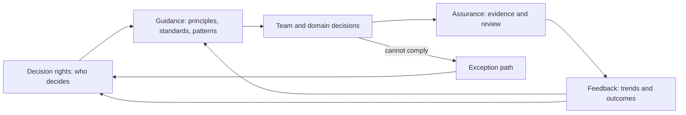
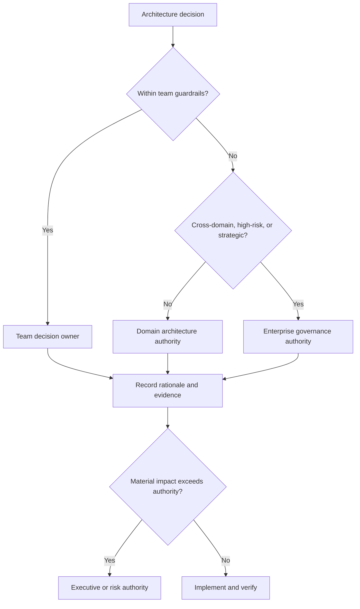
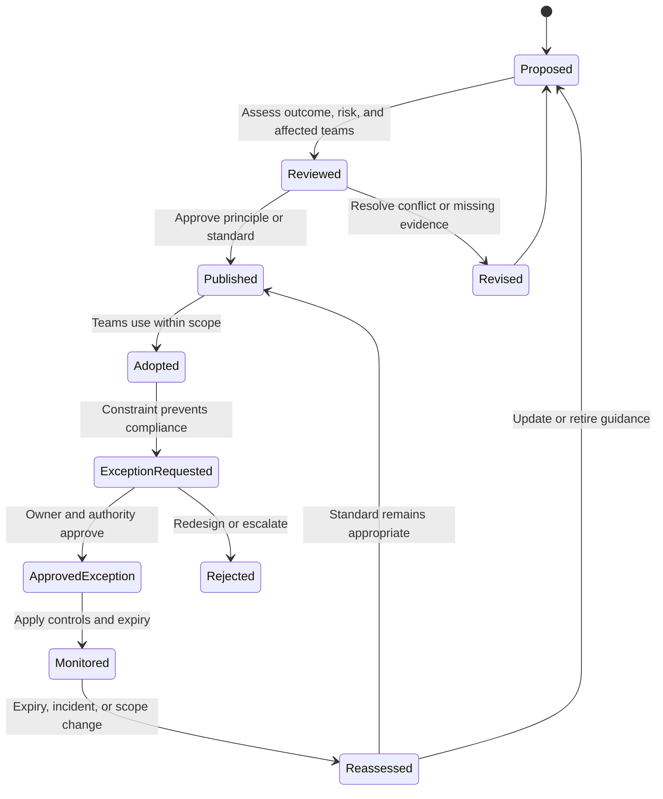
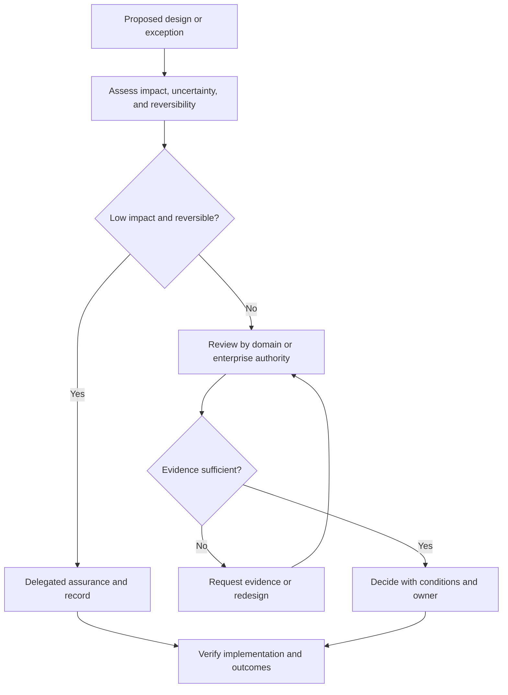
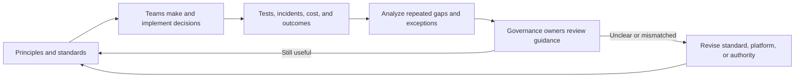
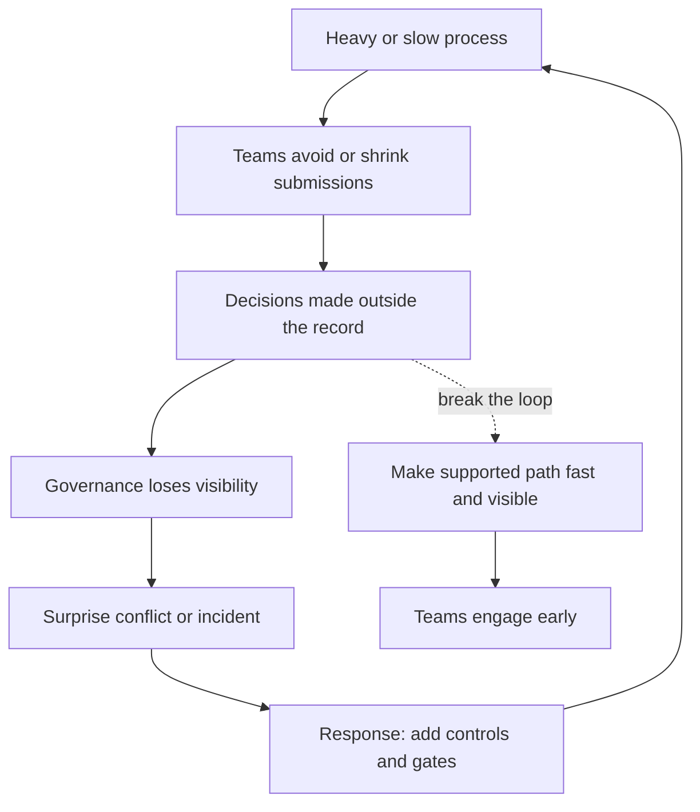
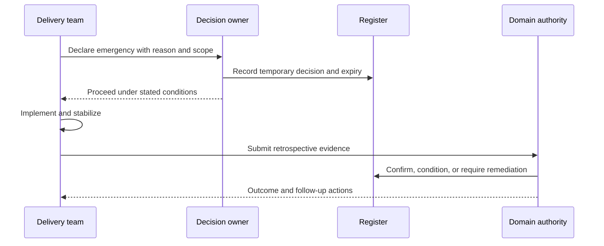
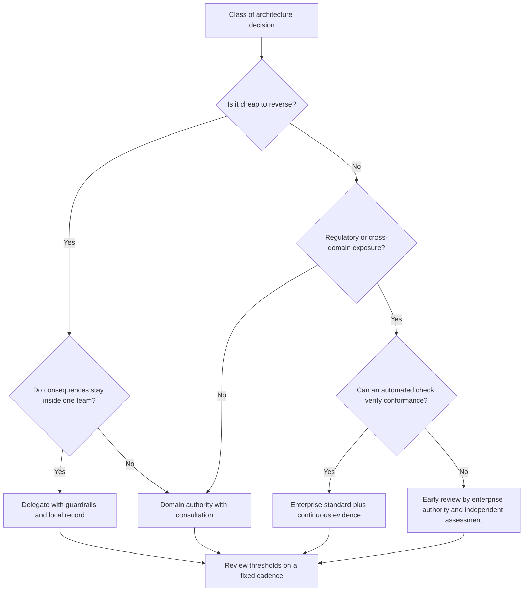
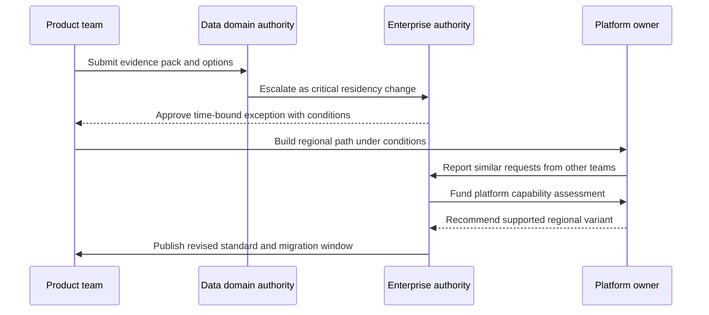

# Architecture Governance

Part: [18 — Enterprise Architecture](PART_OVERVIEW.md) · Status: Drafted

## 1. Introduction

Architecture governance is the set of mechanisms that decide who may make which architecture decisions, which constraints those decisions must respect, how conformance is checked, and what happens when a decision cannot comply. It is not the production of documents and it is not centralized approval of designs. Its purpose is narrower and more practical: to make the aggregate of many independent decisions coherent enough that the enterprise can change safely, while leaving as many decisions as possible with the teams closest to the facts.

Engineers moving into architecture usually experience governance first as an obstacle: a review that arrives late, a standard that does not fit the workload, a form that asks for information the team has already produced elsewhere. That experience is informative, because it describes how governance fails. The same engineers later discover the opposite failure when governance is absent: ten teams solving the same problem ten ways, a data-protection obligation that nobody owns, a shared platform whose consumers each depend on undocumented behaviour. A solution architect operates between these two failures. You are simultaneously a subject of governance (your designs are constrained by principles and standards), a contributor to it (you write the proposals, evidence, and exceptions it consumes), and sometimes an operator of it (you sit on or feed a review forum). Understanding the mechanism lets you work with it deliberately rather than around it.

This chapter owns the design of an architecture governance system: decision rights, the principle-standard-pattern hierarchy, exceptions, assurance, and the feedback loop that keeps the system honest. The boundaries with neighbouring material are deliberate:

- The Architecture Decision Record (ADR) template, worked example, and trade-off facilitation belong to [Architecture Thinking](../01_Architecture_Mindset/CH03_Architecture_Thinking.md). Here an ADR is only one kind of recorded decision.
- The operation of an Architecture Review Board (a standing review forum), including agenda, roles, and cadence, belongs to [Architecture Review Boards](CH09_Architecture_Review_Boards.md). This chapter treats the board as one possible governance body. The formal-versus-lightweight review model is introduced in [Role of a Solution Architect](../01_Architecture_Mindset/CH02_Role_of_a_Solution_Architect.md).
- Architecture fitness functions (automated checks of architectural properties) belong to [What is Software Architecture?](../01_Architecture_Mindset/CH01_What_is_Software_Architecture.md); here they appear only as a way to automate conformance evidence.
- TOGAF's governance checkpoints and Architecture Development Method belong to [TOGAF](CH01_TOGAF.md).
- Reusable structures that standards and patterns point to belong to [Reference Architectures](CH10_Reference_Architectures.md).
- Documentation practice and notation belong to [Part 21 — Architecture Documentation](../21_Architecture_Documentation/PART_OVERVIEW.md).
- Secure development controls belong to [Part 15 — Security](../15_Security/PART_OVERVIEW.md); this chapter covers only how such controls become enterprise standards.

After studying this chapter, a reader should be able to:

1. Explain what architecture governance is for, and distinguish it from management, compliance paperwork, and design review.
2. Allocate decision rights using explicit scope, thresholds, an accountable owner, and an appeal path, and choose between centralized, federated, and delegated structures.
3. Distinguish principles, standards, patterns, and guidelines, and write each so that it can actually be applied and verified.
4. Operate an exception process that prevents exceptions from becoming permanent, undocumented standards.
5. Recognize the common failure modes of governance (bottleneck, theatre, drift, and silent bypass) and the signals that reveal them.
6. Apply these ideas to a concrete, hypothetical situation and decide who decides, on what evidence, and with what conditions.

## 2. Background and History

Governance as an organizational concept long predates software: it describes how an institution assigns authority, sets rules, and holds decision makers accountable. The idea entered technology management through information technology governance, which asks how an organization ensures that technology investment serves its objectives and that its risks are controlled. Architecture governance is the part of that concern that deals with structural technical decisions.

Two facts that are well established are worth stating. First, TOGAF treats governance explicitly: it includes an architecture governance framework and a phase concerned with governing implementation, where delivered projects are checked for conformance with the intended architecture. Consult the current edition for exact structure. Second, the software industry's move to small autonomous teams, continuous delivery, and automated pipelines has pushed practice away from periodic, document-driven approval towards earlier, lighter, and more automated forms of assurance. Both trends coexist in real organizations, and an architect is often asked to reconcile them: a formal governance model inherited from one era, and delivery practices from another.

The practical implication is that "architecture governance" can mean very different things in different organizations, from a monthly committee to a set of pipeline checks owned by a platform team. This chapter describes the underlying mechanisms so that you can recognize them in either form.

## 3. The Problem Governance Solves

Without governance, local rationality produces global incoherence. Each team makes decisions that are reasonable given what it knows, but some consequences only appear in aggregate. The failure patterns below are general, not reported incidents.

| Failure pattern | Mechanism | What governance contributes |
| --- | --- | --- |
| Divergent choices | Teams independently select different technologies for the same need, multiplying support, security patching, and skill requirements | A published set of supported choices with a rationale |
| Unowned cross-cutting concern | Identity, data residency, or resilience targets span many systems but belong to none | A named decision owner for each cross-cutting concern |
| Late discovery of conflict | Two initiatives depend on the same shared service in incompatible ways, and this appears only during integration | Early, risk-triggered review at the point where change is still cheap |
| Silent drift | Delivered systems depart from agreed constraints and nobody records why | Conformance evidence and a recorded exception path |
| Decision paralysis | Nobody is sure who may decide, so decisions wait or are made informally | Explicit decision rights with a bounded time to decide |
| Lost rationale | Constraints persist after the reason is forgotten, so they are neither respected nor removed | Principles and standards that carry rationale and a review date |

Alternatives to formal governance exist. A small organization with one product team can rely on shared context and conversation. A strong platform team can encode decisions as paved paths, so the supported option is also the easiest. Strong individual architects can act as informal arbiters. These alternatives work while the number of owners is small or the platform is trusted. Governance becomes worth its cost when the number of independent owners grows, when the cost of late conflict is high, when regulation demands demonstrable control, or when the same debate keeps recurring. The decision criteria are therefore the number of independent decision makers, the cost and reversibility of mistakes, the audit burden, and the organization's capacity to operate the process rather than merely perform it.

## 4. What Governance Is and Is Not

Three distinctions prevent most confusion.

**Governance versus management.** Governance sets direction, boundaries, and accountability: who may decide, within what limits. Management makes and executes decisions inside those limits. A team choosing a database engine from the supported list is managing; the body that decides which engines are supported, and which decisions need escalation, is governing. When the two blur, governance bodies drift into approving implementation details, and delivery teams lose accountability for their own designs.

**Governance versus review.** A review examines one design at one moment. Governance is the standing system that decides when reviews occur, what they examine, who may overrule them, and how their findings change future guidance. A review without governance is an opinion; governance without reviews is a rulebook nobody checks.

**Governance versus compliance.** Compliance is conformance with a rule, including external regulation. Governance decides which rules the enterprise adopts, interprets them, and handles cases where the rule does not fit. A system can be compliant with a poor standard and still be badly architected, so governance must keep asking whether the standards serve the outcomes.

Four elements recur in every governance system, whatever its form:

| Element | Question it answers | Typical artifact |
| --- | --- | --- |
| Decision rights | Who may decide what, and who is accountable? | A published authority matrix |
| Guidance | What constraints and preferences apply? | Principles, standards, patterns |
| Assurance | How do we know decisions conform and work? | Evidence, reviews, automated checks |
| Feedback | How does experience change the guidance? | Trend analysis, retrospectives, revisions |

The following diagram shows how the elements form a loop rather than a chain, with exceptions as a controlled path out of guidance and back into it.



Two consequences follow. First, a system missing any element is unstable: rights without guidance give authority with no criteria, guidance without assurance is advice, assurance without feedback hardens into ritual, and everything without an exception path pushes teams to bypass the system silently. Second, exceptions return to decision rights because granting one is itself a decision that someone must be authorised to make, which the later discussion of exceptions develops.

## 5. Allocate Decision Rights

A decision right is a statement of the form: for decisions of this kind, this role decides, these roles must be consulted, these are informed, and this path exists to challenge the outcome. Writing it down matters because the default in most organizations is implicit authority: whoever is senior, loudest, or most familiar with the system. Implicit authority is slow (people wait to learn who decides), inconsistent (similar decisions are made differently), and unaccountable (nobody can say afterwards who owned the result).

### 5.1 The Subsidiarity Principle

The most useful rule is subsidiarity: place each decision at the lowest level that can account for its full impact. A team can account for impact on its own service, so choices that stay inside the team's boundary belong to the team. A decision whose consequences land on other teams, on a shared platform, on regulatory exposure, or on long-lived investment needs someone with visibility across those boundaries. The word "account" is the test: the decider must be able to see and bear the consequences, otherwise the decision is made by someone who pays no cost for being wrong.

Each decision needs exactly one accountable owner, even when several people are consulted. Shared accountability, in practice, means no accountability, because each participant can reasonably assume another will catch the problem. Consulted roles advise; the owner decides and records why.

### 5.2 Escalation Thresholds

Decision rights need observable thresholds, so that a team can tell without asking whether a decision is theirs. Useful trigger dimensions are the number of teams affected, reversibility (can the decision be undone within one release cycle?), data sensitivity, regulatory exposure, cost, and whether the choice creates a new dependency on a shared platform. A threshold such as "any decision that introduces a new data store type, changes how identity is verified, or commits a recurring spend above a published amount" can be checked by the team itself. A threshold such as "any significant decision" cannot, and will be interpreted differently by every team.

The flow below shows the general structure. The tiers and thresholds are illustrative and must be calibrated to the organization.



The diagram implies three things. Most decisions should terminate at the first diamond, because a governance system whose default path is escalation will be overloaded. Every path ends in a record, so that a later reader can see who decided and why, including decisions made at team level. And the final test, whether impact exceeds the deciding authority's remit, protects against a decider who underestimates scope: authority is bounded by impact, not by the decider's confidence.

### 5.3 Governance Structures

Decision rights can be organized in three broad structures, and most enterprises combine them by domain.

| Structure | How it works | Strengths | Weaknesses | Fits when |
| --- | --- | --- | --- | --- |
| Centralized | One enterprise body decides all in-scope architecture questions | Consistency, single view of risk | Bottleneck, distance from facts, weak team accountability | Small estate, high regulatory pressure, or early in building shared capability |
| Federated | Domain authorities decide within their domain; an enterprise body handles cross-domain and policy | Domain knowledge, parallel decisions | Domains can diverge; cross-domain issues fall between them | Large organization with distinct domains |
| Delegated with guardrails | Teams decide within published constraints; review is triggered by thresholds or exceptions | Speed, team accountability | Needs good guidance and trustworthy assurance; failures can be found late | Mature teams, strong platform and automation |

Choose by asking what each decision costs when wrong and how quickly it can be corrected. Reversible, local choices suit delegation; irreversible, wide-impact choices suit more central authority. A single structure applied uniformly is usually wrong for some decisions.

### 5.4 Worked Scenario: Choosing Who Decides (Illustrative)

A hypothetical retailer has twenty product teams, a shared messaging platform, and a customer identity service. Three decisions arrive in the same week.

1. A team wants a different charting library for its internal dashboard. It is reversible within a release, affects only that team, and uses no sensitive data. It sits within team guardrails, so the team owner decides and records a short note.
2. A team wants to store a new category of customer contact data in a managed document store not yet on the supported list. This crosses a data-sensitivity threshold and introduces a new store type. The domain authority for customer data decides, consulting security, and records the conditions (encryption, retention, access logging).
3. A programme wants to replace the customer identity service. It affects every team, is hard to reverse, and carries regulatory exposure. The enterprise governance authority owns the decision, with the programme sponsor accountable for funding and the security function consulted.

The same questions sorted three decisions to three levels without anyone consulting a committee for the first. The signs the allocation works are that teams could place each decision themselves, each has one named owner, and the record exists. The signs it fails are teams asking an architect "is this mine?" for routine choices, or the enterprise body receiving the charting-library request.

### 5.5 Failure Modes

- **Bottleneck.** The threshold is too low or the body too central, so everything queues. Teams respond by shrinking the question they bring or by deciding first and informing afterwards.
- **Rubber stamp.** The body lacks time or context and approves what it sees. Accountability appears to exist but does not.
- **Phantom authority.** Rights are published but not backed by consequences, for example funding released without conformance. Teams learn that the rights can be ignored.
- **Unclear appeal.** A team disagrees but has no route to challenge the outcome, so it complies resentfully or bypasses. Publish the appeal path and who hears it.
- **Authority without time bound.** Decisions wait indefinitely. State an expected decision time and what happens when it lapses.

## 6. Principles, Standards, Patterns, and Guidelines

Decision rights say who decides; guidance says what the decider should consider. Guidance comes in distinct forms that are often confused, and each form needs a different level of precision.

### 6.1 Definitions and Differences

| Form | What it states | Binding strength | Example (illustrative) |
| --- | --- | --- | --- |
| Principle | An enduring statement of preference with rationale and consequences, applied by judgment | Guides trade-offs; rarely checkable directly | "Data has one accountable owner" |
| Standard | A specific supported choice or constraint, applicable in a defined scope | Mandatory within scope unless an exception is granted | "Service-to-service calls use mutual authentication" |
| Pattern | A reusable solution structure for a recurring problem | Recommended; deviations need reasons | A documented approach to retrying idempotent requests |
| Reference architecture | A worked composition of patterns for a class of systems | Starting point to adapt | See [Reference Architectures](CH10_Reference_Architectures.md) |
| Guideline | Advice without an enforcement expectation | Optional | Naming suggestions for events |

A principle that cannot guide a real choice is decoration. A useful principle has a name, a statement, a rationale, and consequences, including what it costs. For example, "Prefer buying commodity capability over building" is useful only if it states the rationale (limited engineering capacity is better spent on differentiating work) and a consequence (teams accept vendor constraints and must plan exit options). Without consequences, a principle sounds agreeable and decides nothing.

A standard is different: it should be testable. "Use a secure approach to secrets" is a principle-like aspiration; "Application secrets are retrieved at runtime from the approved secrets service and never stored in source control or images" can be checked. When you cannot say how conformance would be observed, you have a principle, not a standard, and should not govern it as one.

### 6.2 Ownership and Lifecycle

Each piece of guidance needs an owner, a rationale, an applicability scope, evidence for why it is correct, and a review date. Guidance without an owner cannot be updated, and guidance without a review date accumulates until contradictory rules coexist. Treat guidance as a product with consumers: publish it where teams look, state its status, and track how it is used.

### 6.3 Exceptions

A standard will sometimes not fit. The question is not whether exceptions occur but whether they are controlled. A sound exception is scoped to a specific system and need, time-bound, supported by compensating controls that address the risk the standard was meant to control, and approved by someone with authority over that risk. It carries an expiry or reassessment trigger, so that it ends or is renewed deliberately.

The lifecycle below shows the path from proposal to exception and back.



The diagram shows that the exception is not an exit from governance but a loop back into it: every reassessment ends either with the standard confirmed or with the guidance changed. If many teams request the same exception, investigate whether the standard or shared platform is wrong for the actual workload. Do not allow an exception to become a permanent undocumented standard. Publish status and rationale so teams can make consistent local decisions.

An exception record needs only a few fields. A minimal template, with illustrative content:

```markdown
# Exception: EX-0007 (illustrative)

- Standard affected: Application secrets come from the approved secrets service
- System and owner: Reporting batch jobs, Reporting team lead
- Reason: The batch runtime cannot call the secrets service during start-up
- Risk accepted and compensating controls: Credentials held in an encrypted runtime
  store, rotated on a fixed schedule, access logged and reviewed
- Approved by: Domain architecture authority, Security function consulted
- Expiry or trigger: Reassess at runtime upgrade or in six months, whichever is first
- Exit plan: Move to the supported runtime that provides secrets integration
```

### 6.4 Worked Scenario: A Standard That Does Not Fit (Illustrative)

A hypothetical organization publishes a standard that every service must use its approved message broker. A team building a low-volume internal tool requests an exception to use a simple database-backed queue. The reviewer checks the risk the standard was meant to control: operational support burden and inconsistent reliability. For a low-volume, non-critical tool the added support is small, so the exception is approved with a six-month reassessment and a condition that the queue use a pattern already documented. Over the following quarter, several more teams with similar low-volume needs ask for the same exception. The governance owner reads this as evidence about the standard rather than about the teams, and revises it to offer a supported lightweight option with conditions for when the full broker is required. The exceptions then close, and the standard is both more accurate and easier to follow.

The failure alternative is plain to see: approving each exception separately with no expiry, until the organization has twenty undocumented variants, or refusing each one until teams quietly build the queue anyway and governance loses visibility. In both cases the information in the requests was ignored.

## 7. Create an Evidence Path

Sections 5 and 6 defined who decides and against what guidance. This section covers how a decider learns whether a design actually satisfies that guidance. Assurance is the production and evaluation of evidence that decisions conform and will work. Its design question is not "what documents do we collect?" but "what would change the decision, and what is the cheapest reliable way to observe it?"

### 7.1 What Counts as Evidence

Evidence is anything that lets an independent reader check a claim without trusting the claimant. It varies in strength, and the decider should know which kind they are looking at.

| Evidence type | Example (illustrative) | Strength | Weakness |
| --- | --- | --- | --- |
| Assertion | "We encrypt data at rest" in a form | Cheap to produce | Unverifiable; reflects intent only |
| Design artifact | A diagram or ADR stating the intended structure | Shows reasoning and alternatives | Can diverge from the built system |
| Test or scan result | A pipeline report showing the secrets check passed | Repeatable, tied to a build | Proves only what the test covers |
| Runtime observation | Dashboards, audit logs, or traces from production | Reflects actual behaviour | Arrives late, after the decision |
| Independent assessment | A review by a party outside the delivering team | Challenges blind spots | Costly, point-in-time |

Prefer the strongest evidence that is cheap to obtain. A fitness function (an automated architectural check, owned by [What is Software Architecture?](../01_Architecture_Mindset/CH01_What_is_Software_Architecture.md)) that runs on every build converts a periodic claim into continuous evidence, and is the usual way to make a standard from Section 6 verifiable. Evidence from Continuous Integration and Continuous Delivery (CI/CD) pipelines should be reused rather than re-requested: if the pipeline already records that a standard is met, a separate attestation adds cost and no information.

### 7.2 Linking Evidence to Decisions


Evidence should be linked to the exact decision and design version. A passing test does not prove that the requirement is meaningful, while a complete document does not prove that a system conforms. Governance combines evidence with accountable judgment and defines how to revisit it.

The diagram implies a discipline about order. Options and risks come before controls, and controls before verification, so evidence answers a question that was asked in advance rather than being gathered afterwards to justify a choice. The last two steps close the loop: observed outcomes are the evidence that tests whether the standard itself was right.

### 7.3 Evidence Requests Should Be Minimal and Specific

A request for evidence is a cost imposed on a team, so it needs a purpose. For each item, the requester should be able to state which decision it informs and what would happen if it were absent. A short request template keeps this honest:

```markdown
Decision: Introduce a new data store type for customer contact data (illustrative)
Needed to decide:
- Alternatives considered and why rejected (existing ADR link)
- Data classes stored and retention period
- Access model and audit logging (pipeline report or design note)
- Failure and recovery behaviour (existing resilience test results)
Not requested: a new design document; reuse what already exists
Owner of decision: Domain architecture authority
Expected decision time: five working days from complete submission
```

Two failure modes recur. Evidence theatre occurs when forms are completed to satisfy the process and nobody reads them; the cure is to stop requesting any item that has never changed a decision. Evidence staleness occurs when a conformance claim was true at approval but the system changed afterwards; the cure is to tie evidence to automated checks where possible and to define re-review triggers, covered next in Section 8.

## 8. Apply Risk-Based Assurance

Section 7 described what evidence is. Risk-based assurance decides how much of it, how early, and from whom. Uniform assurance fails in both directions: it over-examines trivial choices, which creates delay and teaches teams to avoid the process, and it under-examines the rare consequential choice because reviewers are exhausted. Scale review depth by impact, irreversibility, uncertainty, regulatory exposure, and cross-domain reach.

### 8.1 Classifying Changes

A workable classification uses a small number of tiers, each tied to observable triggers that teams can check themselves, consistent with the thresholds in Section 5.2.

| Tier | Typical triggers (illustrative) | Assurance | Who decides |
| --- | --- | --- | --- |
| Routine | Within supported standards; reversible in one release; single team | Automated checks and a local record | Team owner |
| Notable | New dependency on a shared platform; new store type; moderate data sensitivity | Written proposal, domain consultation, targeted evidence | Domain authority |
| Critical | Identity, data residency, shared infrastructure, or irreversible commitment with regulatory exposure | Early engagement, independent assessment, explicit conditions | Enterprise authority; review forum operation is covered in [Architecture Review Boards](CH09_Architecture_Review_Boards.md) |

The tier is a property of the change, not of the team. A senior team still escalates a critical change, and a junior team still decides a routine one, with different amounts of coaching.



Do not equate assurance with approval of every implementation detail. Review the architectural constraints and consequential decisions, then leave teams accountable for detailed design and delivery. Define what changes require re-review, such as a new data use, expanded user population, or changed failure mode.

The loop in the diagram between the gate and remediation is where most of the cost sits, so submissions should state clearly what "sufficient" means before review begins. Two paths end in monitoring, which matters: approval is not the end of assurance, because a design that was acceptable at approval can drift.

### 8.2 Re-review Triggers and Conditions

Approvals should carry conditions with an owner and a due date, and the approval should name the events that reopen it. Typical triggers are a change in data classification or use, a materially larger or different user population, a new external dependency, a change to the failure mode the design relied on, and expiry of any exception. Without stated triggers, the choice is between never revisiting (drift) and revisiting everything (overload).

### 8.3 Alternatives and Trade-offs

Assurance can be performed at several points, and each has a cost profile.

| Point | Benefit | Cost or risk |
| --- | --- | --- |
| Early, before design is fixed | Cheapest to change; builds shared understanding | Evidence is thin; teams may over-document speculation |
| At a gate before release | Single clear checkpoint; auditable | Late; findings are expensive and invite pressure to waive |
| Continuous, via automation | Scales; catches drift immediately | Only checks what was encoded; false confidence in coverage |
| After the fact, via audit | Independent; low delivery friction | Finds problems when correction is costliest |

Most enterprises combine them: early engagement for critical changes, automation for routine standards, and periodic audit as an independent check on both. Choose the mix by the cost of a late finding and the trustworthiness of the automation. Edge cases deserve explicit handling: an emergency change that cannot wait for review should proceed under a recorded emergency path with retrospective review within a stated window, rather than being allowed to bypass governance silently.

## 9. Learn From Delivery

The feedback element from Section 4 is the one most often missing. Guidance is a hypothesis: "if teams do this, outcomes improve." Delivery supplies the test. Governance should change when evidence shows that standards are unclear, expensive, or ineffective.

### 9.1 What to Measure

| Signal | What it can indicate | Misreading to avoid |
| --- | --- | --- |
| Decision cycle time | Friction in the process or unclear rights | Fast may mean rubber stamp |
| Exception frequency by standard | A standard that does not fit a class of workloads (see Section 6.4) | Low may mean teams stopped reporting |
| Repeated review findings | Guidance that is unclear or not discoverable | Blaming teams rather than the guidance |
| Conformance by automated check | Coverage and drift | Equating checked with correct |
| Delivery rework after approval | Late discovery of issues the review missed | Treating all rework as governance failure |
| Incidents tracing to a standard or its absence | Whether guidance prevents real harm | Over-fitting to the latest incident |

Use the measures to identify friction and risk, not to reward teams for minimizing exceptions at any cost. Targets on these numbers invite gaming: a target on exception count produces unreported deviations.

The diagram's two exits from review matter: guidance that is still useful stays, while mismatched guidance is revised at its source, which may be the standard, the shared platform that implements it, or the authority allocation from Section 5. Revising only the document when the platform is the real constraint repeats the problem.

### 9.2 Retiring and Revising Guidance

Guidance should leave the system as deliberately as it entered. Each review asks whether the original rationale still holds, whether a cheaper way to meet the intent now exists, and whether the scope is still right. When retiring or changing a standard, give existing systems a published migration window rather than leaving them silently non-conforming, and record the change so that exceptions tied to the old version are reassessed. Treat a revision like a release: communicate what changed, why, and who is affected.



Keep governance measures focused on decision quality and cycle time. A low exception count may mean the standard fits, or it may mean teams stopped reporting deviations. Pair quantitative measures with interviews and incident review.

## 10. Failure Scenarios and Common Mistakes

Governance fails in recognizable ways. The catalogue below is general, not a record of reported incidents. For each failure, look first for the symptom, confirm with the detection method, and apply the mitigation at the level of the mechanism rather than blaming individuals.

| Failure | Symptom | Detection | Mitigation |
| --- | --- | --- | --- |
| Review bottleneck | Teams queue for weeks; items shrink or are split to avoid review | Decision cycle time and queue age by tier | Raise thresholds; delegate routine tiers; state a decision time limit |
| Governance theatre | Forms completed, nothing changes, findings never repeated in guidance | Count of evidence items that ever altered a decision | Remove unused requests; tie evidence to decisions |
| Silent bypass | Systems appear in production that were never registered | Compare inventory or cloud account data with recorded decisions | Make the supported path the easy path; amnesty and registration; fund conformance |
| Exception sprawl | Many open exceptions, many past expiry | Exception register ageing report | Mandatory expiry; reassess clusters as signals about the standard |
| Stale standards | Standards cite retired technology or contradict one another | Review-date overdue list; contradictory-guidance audit | Owner and review date per standard; retire deliberately |
| Unowned cross-cutting concern | Everyone assumes another team handles it | Incident reviews finding no accountable owner | Name one owner per concern in the authority matrix |
| Phantom authority | Rights published; funding and releases proceed regardless | Cases where non-conforming work shipped without consequence | Link decision rights to real levers such as funding or release |
| Metric gaming | Exception counts fall while deviations rise | Interviews and sampling against the register | Measure outcomes; avoid targets on counts |
| Gold-plating governance | Controls scaled to rare worst cases applied to all work | Share of reviews that end with no change | Risk-tier assurance per Section 8 |
| Evidence staleness | Approved design no longer matches the system | Automated conformance checks; re-review triggers fired | Continuous checks; stated triggers |

### 10.1 Anti-patterns

- **Ivory-tower standards.** Standards written by people who no longer build systems, so they fit neither workloads nor tooling. The mitigation is to co-author with delivery teams and to read exceptions as feedback.
- **Governance by approval of everything.** Treating every decision as needing sign-off, which erodes team accountability.
- **Standards without a path.** Mandating a choice while providing no supported way to adopt it, which guarantees exceptions.
- **Retrospective-only governance.** Reviewing after build, when only waivers are affordable.
- **Policy as folklore.** Rules known to a few individuals and absent from the register, so enforcement depends on who is asked.
- **One-size tiering.** The same review for every change, which makes the process both too heavy and too light.

The dynamics of silent bypass deserve a closer look because they are self-reinforcing.



The reinforcing loop on the left explains why tightening controls after a surprise often makes things worse: it increases the load that produced the avoidance. The dotted exit shows the structural fix, which is to reduce the cost of the supported path rather than the temptation to bypass it.

### 10.2 Handling the Emergency Case

Emergencies are the edge case that most often creates unrecorded bypass. A recorded emergency path allows speed now and review later.



The sequence implies three controls: the emergency is declared by the team but recorded by the owner before work proceeds, the temporary decision carries its own expiry, and the retrospective review has a stated window so that the exceptional path cannot become the normal one.

## 11. Trade-off Analysis and Decision Framework

Every governance choice trades consistency and control against speed and team autonomy. There is no universally correct point; the right one depends on how costly and reversible mistakes are, how many independent owners exist, how much external scrutiny applies, and how much the organization can operate reliably.

| Option | Consistency | Speed | Team accountability | Operating cost | Main risk | Best when |
| --- | --- | --- | --- | --- | --- | --- |
| Centralized approval | High | Low | Low | High (central staff) | Bottleneck and distance from facts | Small estate or high regulatory pressure |
| Federated domains | Medium | Medium | Medium | Medium | Divergence between domains | Large estate with distinct domains |
| Delegated with guardrails | Medium to high if automated | High | High | Platform and tooling investment | Gaps in automated coverage | Mature teams and strong platform |
| Paved-path platform only | High on supported paths | High | Medium | High up front | Workloads off the path go ungoverned | Many similar workloads |
| Informal arbitration | Variable | High | Variable | Low | Key-person dependence; no audit trail | Very small organizations |

Use the following sequence to choose a mechanism for a class of decisions.



The flowchart implies that mechanism follows decision characteristics, not organizational habit, and that all branches end in a scheduled review of the thresholds, because a classification that was right for last year's estate will drift. Where the answers are uncertain, choose the lighter mechanism for reversible decisions and the heavier for irreversible ones, and record why so the choice can be challenged. A final criterion is organizational capacity: a mechanism that the organization cannot staff or automate will degrade into theatre, so a slightly less ambitious design that is operated faithfully beats an ideal one that is performed.

## 12. Illustrative Composite Case Study

The following case is hypothetical and composite; it is not a report of any real organization. It reframes the data-residency situation from the decision-rights and exception mechanisms above.

**Context.** A multi-team retailer (the same fictional organization as Section 5.4) plans to open a new market where selected customer records must stay in-region. A product team wants to use the shared analytics platform, which currently processes data centrally. The standard in force says all analytics use the shared platform.

**Decision allocation.** The change touches data residency, a cross-domain, hard-to-reverse concern with regulatory exposure, so the decision tier from Section 8.1 is critical. The enterprise authority owns it, with the customer data domain authority and the security function consulted, and the product sponsor accountable for funding.

**Evidence.** The team assembles affected data classes, consumers, alternatives, retention needs, and measurable latency and compliance constraints, reusing existing pipeline and design evidence rather than writing new documents. The alternatives are: run a regional copy of the platform, route only non-restricted fields centrally, or defer the market.

**Exception.** The authority grants a time-bound exception for a regional processing path with explicit identity controls, monitoring, and deletion evidence, with an expiry tied to a platform capability assessment.



**Feedback.** Over the next period, several other teams make similar requests. The enterprise authority reads the cluster as evidence that the shared standard does not cover regional workloads, in the same way as Section 6.4, and revises the standard to offer supported regional variants. Teams then migrate under a published window rather than renewing exceptions indefinitely.

**Lessons.** The decision was placed by observable thresholds rather than rank; evidence was reused; the exception was time-bound and had compensating controls; and the cluster of requests changed the standard and the platform. What could still go wrong: the capability assessment might be underfunded, so exceptions lapse without a supported alternative. The mitigation is to tie expiry to a named funded action and to escalate if it slips.

### 12.1 Architect Review Checklist

Use these questions when reviewing a governance system, or a change that passes through one.

- Are decision rights written, with one accountable owner per decision type and a published appeal path?
- Can a team determine from observable thresholds, without asking, whether a decision is theirs?
- Is each principle accompanied by rationale and consequences, and is each standard testable?
- Does every standard have an owner, scope, rationale, and review date?
- Are exceptions scoped, time-bound, supported by compensating controls, and recorded in one register?
- Is evidence proportional to the tier, reused where possible, and tied to the decision and design version?
- Are re-review triggers and condition owners stated at approval?
- Is there a recorded emergency path with a retrospective window?
- Are clusters of exceptions and repeated findings analyzed and fed back into guidance and platforms?
- Are measures of cycle time and conformance paired with qualitative checks, and free of targets that invite gaming?
- Is the process one the organization can staff and automate, rather than only perform?
- Are items owned by other chapters, such as board operation, linked rather than redefined?

## 13. Interview Questions

1. **What is architecture governance, and how does it differ from design review?** Governance is the standing system that sets decision rights, guidance, assurance, and feedback. A design review is one examination at one moment, and is a mechanism governance may use.
2. **How would you decide which decisions need escalation?** Use observable thresholds such as number of teams affected, reversibility, data sensitivity, regulatory exposure, and new shared dependencies. Most decisions should terminate at team level.
3. **What is the subsidiarity principle?** Place each decision at the lowest level able to account for its full impact, so the decider also bears the consequences.
4. **Distinguish a principle from a standard.** A principle is an enduring preference with rationale and consequences, applied by judgment. A standard is a specific, testable constraint, mandatory in scope unless an exception is granted.
5. **What makes a good exception process?** Exceptions are scoped to a system and need, time-bound, backed by compensating controls, approved by someone with authority over the risk, and reassessed at expiry. Clusters of exceptions are treated as feedback about the standard.
6. **How do you avoid governance becoming a bottleneck?** Tier assurance by risk, delegate routine decisions with guardrails, automate conformance evidence, state decision times, and measure queue age.
7. **How can you tell governance is working?** Decision times are reasonable, repeated findings lead to revised guidance, exceptions are visible and expiring, and incidents show fewer unowned concerns. Verify quantitative measures with interviews to detect gaming.
8. **A team has deployed something that violates a standard. What do you do?** Establish facts and risk first, then decide whether to remediate, grant a time-bound exception, or revise the standard. Examine why the supported path was not used, since silent bypass signals friction.

## 14. Hands-on Exercises

1. **Write an authority matrix.** For an organization you know, list ten recent architecture decisions and assign each to team, domain, or enterprise level using observable thresholds. Identify which thresholds you had to invent and which decisions lacked an owner.
2. **Convert a principle into a standard.** Take "Prefer managed services" and write a testable standard, including scope, verification method, owner, and review date. Note what you had to decide that the principle left open.
3. **Draft an exception record.** Using the template in Section 6.3, write an exception for a plausible mismatch between a standard and a workload. Include compensating controls, expiry, and exit plan, then critique it as the approver.
4. **Audit an exception register.** Create a sample register of twelve exceptions, cluster them by standard, and decide which clusters indicate the standard should change. Propose the revision and migration window.

## 15. Design and Architecture Review Questions

The model reference outlines below are starting points, not the only acceptable answers.

1. **A shared platform team receives frequent ad hoc requests from many product teams, each claiming urgency. How should decision rights be arranged?** The platform owner should be the accountable decider for platform behaviour, with published intake thresholds and a time-bound response. Requests that change shared contracts go to a domain authority, while requests within supported options are self-service. Publish an appeal path for urgent cases and review the pattern of requests for gaps in the platform.
2. **Your organization has one central board that reviews every design and delivery is slowing. What would you change?** Classify changes by risk tier, delegate routine decisions with guardrails, and reserve the board for critical changes, as outlined in Section 8.1. Automate evidence where possible and measure queue age before and after. Keep an emergency path and revisit thresholds after a fixed period.
3. **Twenty exceptions to the same standard are open. What do you do?** Treat the cluster as evidence about the standard rather than twenty team failures. Review whether the standard or platform fits the actual workloads, and revise it with supported variants. Publish a migration window and expire the old exceptions.
4. **A regulator-driven requirement arrives that spans five domains with no clear owner. How do you proceed?** Name one accountable owner for the cross-cutting concern, with domains consulted. Define the standard in testable form, decide evidence and automation, and set re-review triggers. Record the decision, and escalate funding to the level that holds the budget.
5. **Teams report that the review process is not useful, yet exception counts are very low. How do you interpret this?** Low counts alongside low trust suggest bypass or avoided reporting rather than conformance. Compare the inventory of running systems with recorded decisions, and interview teams. Reduce the cost of the supported path and avoid targets on exception counts.

## 16. Summary

Architecture governance is a system, not a committee: it combines decision rights, guidance, assurance, and feedback, with exceptions as a controlled loop back into guidance. Readers should now be able to explain what governance is for and distinguish it from management, review, and compliance. They can allocate decision rights using subsidiarity, observable thresholds, a single accountable owner, and an appeal path, and choose between centralized, federated, and delegated structures by the cost and reversibility of mistakes. They can write principles with consequences and standards that can be tested, and run exceptions that are scoped, time-bound, and fed back into revised guidance. They can scale assurance to risk, reuse evidence, state re-review triggers, and learn from delivery without gaming the measures. They can recognize bottlenecks, theatre, drift, and silent bypass from their symptoms, and apply the decision framework to a concrete situation. Board operation is developed in [Architecture Review Boards](CH09_Architecture_Review_Boards.md), and the review forms introduced earlier remain governed by the mechanisms described here. Effective governance makes authority, evidence, and escalation clear while leaving implementation ownership with delivery teams.
