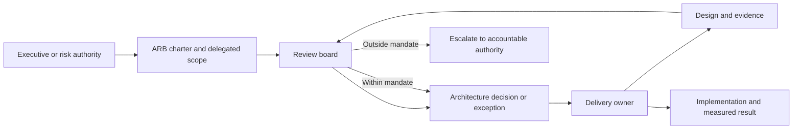
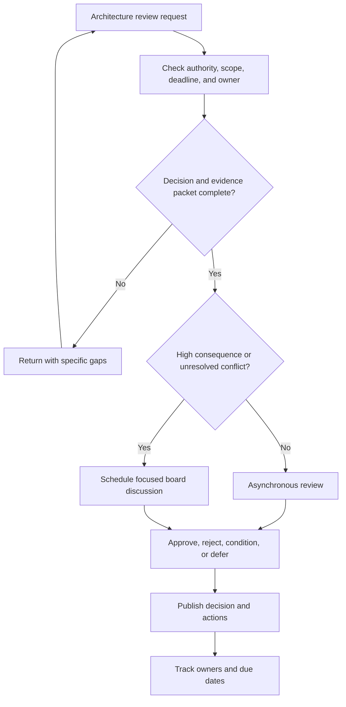
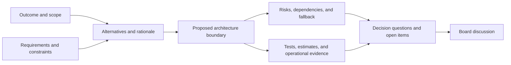
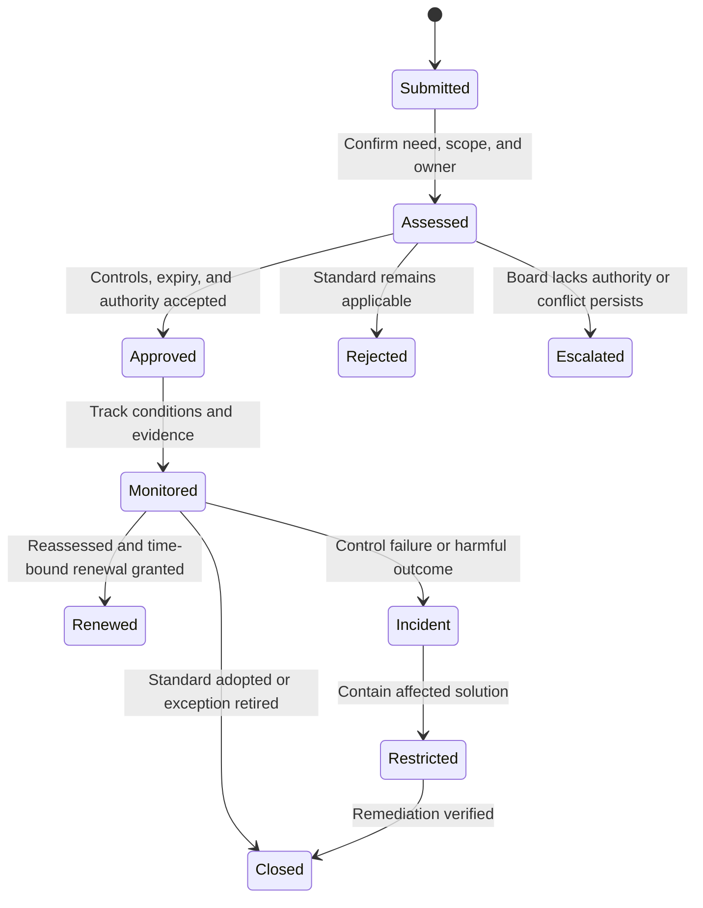
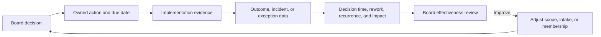

# Architecture Review Boards

Part: [18 — Enterprise Architecture](PART_OVERVIEW.md)

An Architecture Review Board (ARB) is a decision forum for architecture issues within a defined mandate. Its value depends on clear authority, timely evidence, qualified participants, and follow-through. A board should not become a ceremony that approves every design or transfers delivery accountability to reviewers. Part 01 CH03 owns Architecture Decision Records (ADRs); Part 22 owns facilitated trade-off workshops.

## Define the Charter and Decision Rights

A charter names the board's purpose, scope, delegated authority, membership, quorum, decision types, escalation path, and service expectations. The board may advise, approve a defined class of risk, resolve cross-domain conflicts, or grant exceptions. The charter must say which decisions remain with product, business, security, or delivery owners.

Reviewers provide challenge and cross-enterprise perspective, but the delivery owner remains accountable for implementation and operational behavior. Members should disclose conflicts of interest, represent affected domains, and delegate when they lack relevant expertise.

## Run Intake to Decision

Intake should occur early enough to change the design. Screen requests for scope, decision needed, deadlines, affected domains, risk, and completeness. Reject or return submissions that do not name an accountable owner or question. Use asynchronous review for bounded, low-risk topics and reserve meetings for unresolved trade-offs or cross-domain conflict.

Set a decision service level that matches delivery planning. Emergency review needs an explicit route and authority; it should not silently bypass risk owners. Publish decisions promptly so downstream teams do not depend on hallway interpretations.

## Prepare Evidence and Questions

An evidence packet should be concise and decision-oriented: problem and outcomes, constraints, alternatives, selected option and rationale, dependencies, quality scenarios, risks, security and data implications, implementation plan, fallback, and open questions. Link existing diagrams and tests rather than reproducing them. State assumptions and evidence gaps honestly.

Reviewers should ask whether the proposal meets the stated need, whether an alternative is simpler or safer, which assumption can invalidate the decision, how failure is detected and contained, and who owns unresolved risks. Do not demand diagrams or pages that do not help answer those questions.

## Handle Exceptions and Conflicts

An exception decision should identify the standard, affected scope, business need, alternatives, compensating controls, owner, expiry, and reassessment trigger. Conflicts between domains should be framed around consequences and authority rather than seniority alone. The board records the decision, dissent, conditions, and escalation path; it does not hide unresolved disagreement behind “consensus.”

Renewals should require new evidence; they are not automatic. If the same exception recurs, governance owners should review the standard or shared platform rather than treating each request as an isolated event.

## Track Actions and Board Effectiveness

Every decision should record owner, date, scope, rationale, evidence links, conditions, open risks, and review trigger. Action items need one accountable owner and a due date. Track whether implementation conformed, whether conditions were met, and whether the decision produced the intended outcome.

Measure decision latency, percentage of submissions returned for missing basics, repeated findings, overdue actions, exception age, and downstream incident or rework. Interpret metrics carefully: a falling number of findings may mean designs improve, or reviewers no longer surface concerns. Pair counts with stakeholder feedback and outcome evidence.

## Worked Case: Shared Identity Exception

A product team requests a new identity provider for a regional service. The board triages the request because it affects enterprise authentication and data residency. The packet compares the standard provider, the regional alternative, and a constrained application design; it includes identity lifecycle, support coverage, recovery, migration, and security evidence.

The board determines it lacks authority to waive a regulatory control, so it escalates that question to the risk authority while deciding the non-regulatory integration boundary. The board limits the exception to one region and one year. Compensating monitoring and a migration milestone are required. The action owner reports implementation evidence; renewal requires new support and compliance evidence.

## Review Questions

1. What decisions are inside the board's delegated authority?
2. Which submissions should be handled asynchronously?
3. What makes an evidence packet decision-oriented?
4. How does the board record unresolved disagreement and exceptions?
5. Which effectiveness measures detect both delay and weak review?

An effective ARB produces bounded decisions on time. It keeps accountability visible, limits exceptions, and measures outcomes rather than meeting volume.
