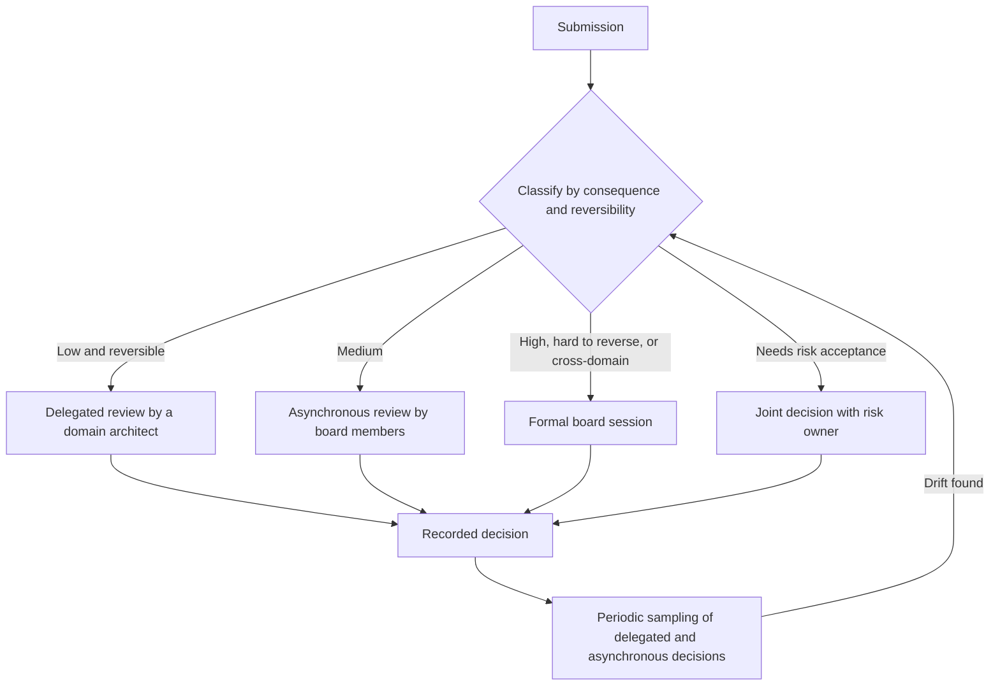
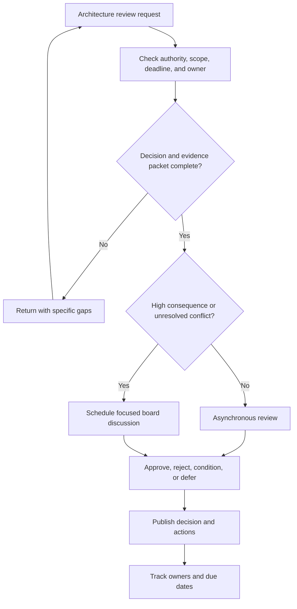
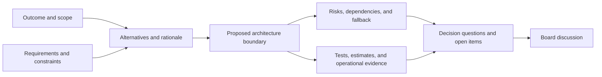
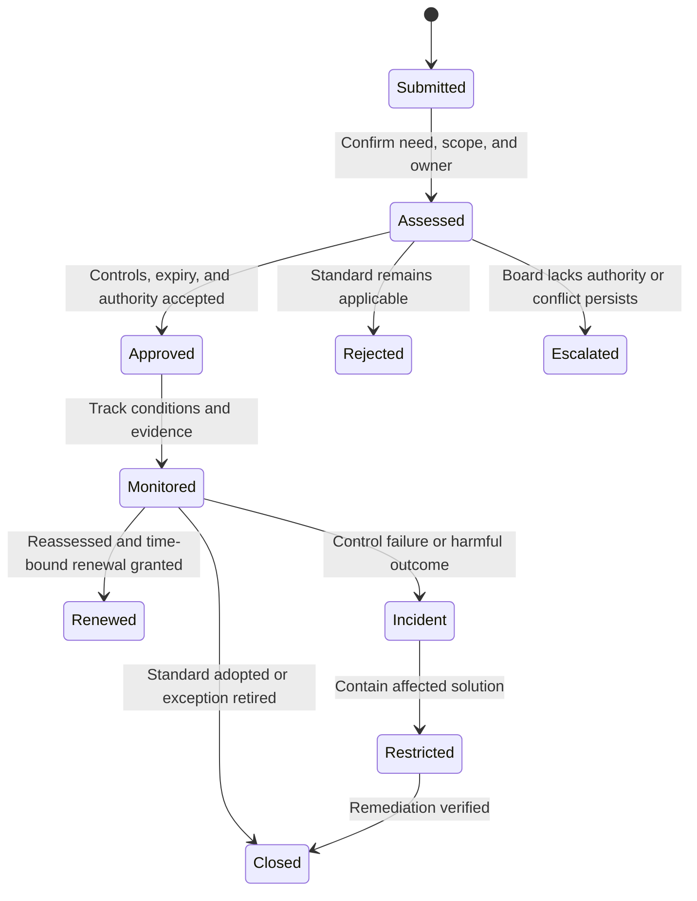
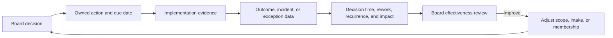
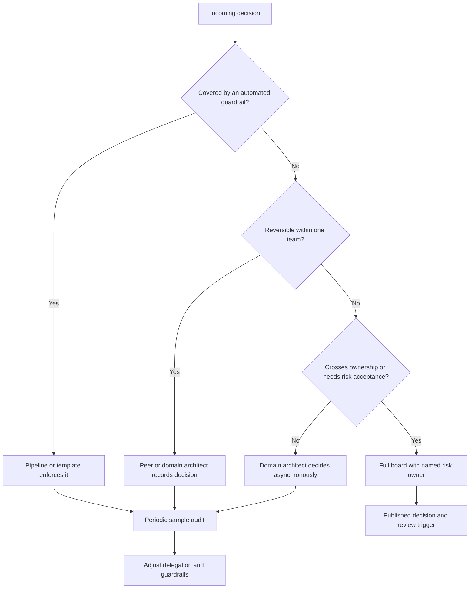
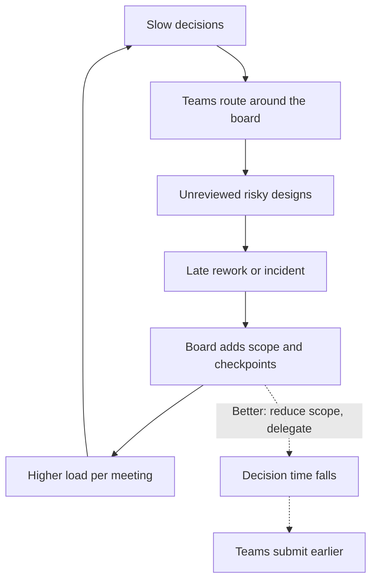
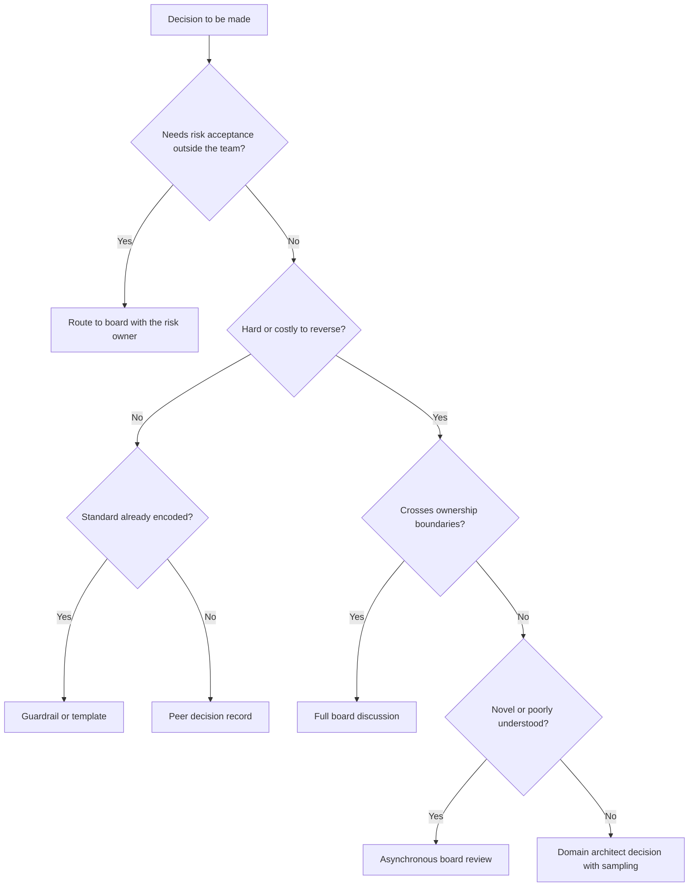
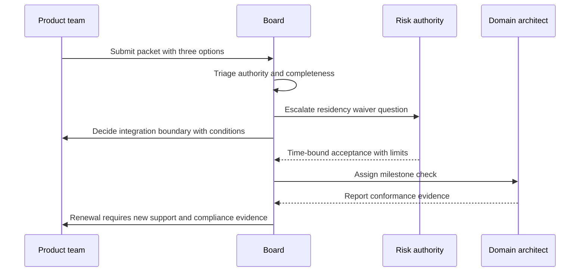

# Architecture Review Boards

Part: [18 — Enterprise Architecture](PART_OVERVIEW.md) · Status: Drafted

## 1. Introduction

An Architecture Review Board (ARB) is a standing forum that reviews architecture proposals and makes bounded decisions about them: approve, reject, approve with conditions, defer, or escalate. It is the most visible and most criticized mechanism of enterprise architecture governance. Done well, it is a small, fast, well-informed group that catches expensive mistakes before they are built and keeps cross-team decisions consistent. Done badly, it is a monthly meeting where teams present slides to people who cannot change the outcome, and delivery teams learn to route around it.

Engineers moving into architecture usually meet a review board from the receiving end: a design is submitted, comments come back, a date slips. Seeing it from the operating side changes the questions. What is the board actually allowed to decide? What does a team have to submit for a decision to be possible? How quickly must it answer so that the schedule is not distorted? How does anyone know afterwards that its decisions were good? These are design questions about a human system, and they have the same shape as design questions about a technical one: purpose, interfaces, throughput, failure modes, and feedback.

This matters to a solution architect in two ways. As a submitter, you will get faster and better outcomes if you understand what evidence a decision requires and which class of decision you are asking for. As a board member or chair, you are responsible for the board being a decision mechanism rather than a ritual. In both roles, the central discipline is the same: keep authority, evidence, and accountability explicit.

This chapter owns the operation of a review board: charter and decision rights, membership, intake, evidence, and the decision itself. The boundaries with neighbouring material are deliberate:

- The governance model as a whole, including formal gated review versus lightweight asynchronous review as organizational choices, is introduced in [Role of a Solution Architect](../01_Architecture_Mindset/CH02_Role_of_a_Solution_Architect.md). This chapter recaps that choice and then operates inside it.
- Governance bodies, principles, standards, and waiver policy at enterprise level belong to [Architecture Governance](CH08_Architecture_Governance.md). The board is one mechanism within that system, not the system.
- The Architecture Decision Record (ADR) template, worked example, and checklist belong to [Architecture Thinking](../01_Architecture_Mindset/CH03_Architecture_Thinking.md). Here an ADR is simply one form a recorded decision may take.
- Facilitated trade-off workshops, pre-mortems, and challenge reviews belong to [Facilitating Architecture Trade-off Workshops](../22_Architectural_Thinking_and_Decision_Practice/CH06_Facilitating_Architecture_Tradeoff_Workshops.md) and [Architecture Pre-Mortems and Challenge Reviews](../22_Architectural_Thinking_and_Decision_Practice/CH08_Architecture_Pre_Mortems_and_Challenge_Reviews.md).
- Documenting a review's outcome as a durable artifact belongs to [Architecture Reviews](../21_Architecture_Documentation/CH11_Architecture_Reviews.md) and [Decision Logs](../21_Architecture_Documentation/CH10_Decision_Logs.md).
- The framework context in which an Architecture Board appears is covered in [TOGAF](CH01_TOGAF.md).

After studying this chapter, a reader should be able to:

1. Explain what a review board is for, what problems it solves, and when a lighter mechanism is a better choice.
2. Write the core elements of a charter: scope, delegated authority, decision types, membership, quorum, and escalation.
3. Distinguish review, approval, advice, and exception-granting, and state which of them a given board holds.
4. Design an intake process that returns incomplete requests quickly and routes work by risk rather than by arrival order.
5. Assemble a decision-oriented evidence packet and ask review questions that test assumptions instead of collecting diagrams.
6. Apply these ideas to a concrete, hypothetical submission and decide the route, the evidence required, and the possible outcomes.

## 2. Background and History

Review of designs before commitment is older than software. Engineering disciplines have long used design reviews at defined stages, and software engineering adopted the practice through formal inspections and milestone design reviews. Enterprise-level review bodies appeared as organizations accumulated many systems that had to interoperate and comply with shared standards. The formal framework most associated with this is TOGAF, which describes an Architecture Board as the body responsible for governing the architecture practice, including conformance review and the handling of change requests and deviations. Its exact composition and wording vary by edition, so consult the edition your organization has adopted.

Two later shifts shaped current practice. First, delivery moved to short iterations and continuous deployment, which made a monthly gate incompatible with the pace of change; many organizations responded with lighter models, such as asynchronous review, delegated authority to domain architects, and recorded decisions in version control. Second, platform engineering offered an alternative to review: if the secure, supported way is also the easiest way, fewer designs need review at all. The review board survives in these environments for the decisions that guardrails cannot encode: novel designs, cross-domain conflicts, and risk acceptance. The implication for the reader is that the board's form is a design choice with alternatives, to be justified by the problem, not inherited as a default.

## 3. The Problem a Review Board Solves

A review board is a response to a specific set of difficulties. The patterns below are general; none describes a reported incident.

| Problem pattern | Mechanism | What a board contributes | Where a board is the wrong tool |
| --- | --- | --- | --- |
| Cross-team inconsistency | Teams make locally sound choices that conflict at the seams | A single place where cross-domain decisions are made and recorded | When a shared platform or template can make the consistent choice the default |
| Concentrated, hard-to-reverse risk | A design commits the organization to a vendor, data store, or integration that is costly to undo | Independent challenge before commitment, when change is cheap | When the decision is cheap to reverse and the team can simply try it |
| Risk acceptance without authority | A team accepts a risk (for example, deviating from a security standard) that belongs to someone else | A defined route to the person or body entitled to accept it | When no one with authority attends; the board then only launders risk |
| Lost rationale | Why a decision was made is unknown after the team changes | A published decision with conditions and review trigger | When decisions are not recorded; the board then adds delay without memory |
| Single-point judgment | One architect's blind spots go unexamined | Diverse perspectives applied to the same evidence | When members lack the expertise to challenge, producing false assurance |

The alternatives are real. A small organization can rely on a single chief architect. Many teams use lightweight decision records reviewed by peers, which scales better and keeps accountability close to the work. Platform guardrails and automated checks (for example, policy-as-code in the pipeline) can enforce known standards without human attendance. A review board is chosen when the decision is consequential, hard to reverse, crosses ownership boundaries, or requires risk acceptance by someone other than the designer. It is a poor choice as the default path for every change: the cost of a review is paid by every submission, but the benefit accrues only to the few where a reviewer would find something.

The decision criteria are therefore:

- **Consequence and reversibility:** the higher the cost of a wrong decision and the harder it is to undo, the stronger the case for independent review.
- **Ownership span:** the more independent owners a decision affects, the more a shared forum is needed.
- **Risk-acceptance authority:** if the standard permits deviation only with approval, some decision-maker must exist.
- **Capacity to operate:** a board that cannot meet its decision service expectations should shrink its scope rather than add reviewers.

The remaining sections describe the mechanism: how authority is set, how work enters, and what evidence a decision rests on.

## 4. Charter, Authority, and Decision Rights

### 4.1 What a Charter Contains

A charter is the board's founding document. Its purpose is to make authority explicit, because most review-board dysfunction traces to ambiguity about what the board may decide. A usable charter names:

- **Purpose:** the problem the board exists to solve, stated so that a submission can be tested against it.
- **Scope:** which kinds of change come to the board (for example, new externally exposed systems, new data stores holding a defined data class, deviations from named standards) and which do not.
- **Delegated authority:** who granted the board its power, and over what. The grantor is normally an executive or risk-owning body, which also defines the escalation target.
- **Decision types:** what outcomes the board can produce (see the next subsection).
- **Membership, quorum, and delegation rules:** who sits, how many must be present to decide, and who may substitute.
- **Service expectations:** the time within which a complete submission receives a decision.
- **Records:** where decisions are published and for how long they remain valid.
- **Review of the charter itself:** when scope and membership are reassessed.

The charter must also say what remains with others. Product, business, security, and delivery owners keep their accountabilities, and the board's decision does not move them.


The diagram shows two flows that must not be confused. Authority flows down from the grantor through the charter to the board; evidence and proposals flow up from delivery owners. The decision path has two exits: inside the mandate, the board decides; outside it, the board escalates rather than improvising. The practical consequence is that a board that decides outside its mandate creates decisions nobody is entitled to rely on, so the first test applied to every submission is whether the question is one the charter lets the board answer.
### 4.2 Decision Types and Who Is Accountable

"Review" is used loosely, and the looseness hides the most important property of a board: what its output binds. Four distinct roles are worth separating.

| Role | Board output | Binding on the delivery team? | Accountability after the decision | Typical use |
| --- | --- | --- | --- | --- |
| Advise | Findings and recommendations | No; the team may decline and record why | Delivery owner | Early design, unfamiliar domains |
| Approve | Permission to proceed within a defined class of risk | Yes, within the stated conditions | Delivery owner for implementation; the approving authority for the accepted risk | Hard-to-reverse choices, new enterprise-wide dependencies |
| Resolve | A ruling between conflicting domain positions | Yes, for the parties named | Parties named in the ruling | Two teams disagree on a shared interface or standard |
| Grant exception | Time-bound permission to deviate from a standard | Yes, with compensating controls and an expiry | Exception owner named in the record | Standard cannot be met for a stated reason |

A board that holds only the first role is a consultancy and should say so; teams then treat its output as input. A board that holds the second must be careful: approval does not transfer accountability for operating the system. Reviewers can be wrong, and if a team believes "the board approved it" absolves them, they stop owning their design's behaviour. The charter should state this in plain terms: approval confirms that the decision was made within the board's scope on the evidence presented; it does not guarantee the design is correct.

The third and fourth roles require authority that a group of architects may not have by default. A standard that protects regulated data may be waivable only by a risk or compliance owner. If the board grants such a waiver on its own initiative, the waiver is invalid in the sense that matters: the person entitled to accept the risk did not. The board should either include that person in the decision or escalate the question to them.

**Illustrative scenario (hypothetical).** A team asks the board to "approve" a new message broker. The board's charter distinguishes the classes of decision it can make. The choice of broker technology is an enterprise technology-standard question the board can approve. The request to hold personal data without the standard encryption configuration is a deviation that the charter reserves for the security risk owner. The board approves the first, escalates the second with its own analysis, and records both in one decision with an explicit dependency: the broker may not carry the affected data class until the security decision exists. This separates what the board can settle from what it can only inform.

### 4.3 Membership and Operating Models

Membership should follow the decision types, not the organization chart. A workable core is a chair with the authority to close discussions, domain architects covering the areas in scope (for example, application, data, infrastructure, security), and a secretary who publishes decisions. Add subject-matter experts for a specific submission rather than enlarging the standing group; a board of fifteen cannot reach a decision in the time available and diffuses responsibility. Business or risk representatives attend when the decision involves risk acceptance or trade-offs against business outcomes.

Three membership rules prevent common failures:

- **Disclose conflicts.** A member who designed, sells, or will operate the proposal discloses it and, where it matters, steps out of the decision.
- **Delegate by expertise.** A member without relevant depth nominates someone who has it; a vote from an uninformed member adds weight without information.
- **Fix quorum to decision types.** An exception affecting regulated data requires the risk representative; a routine standards question does not.

The organization must also choose an operating model. These are the common patterns, and they are not mutually exclusive.



The diagram expresses proportionality: review effort rises with consequence. Its implication is that the formal session is the scarce resource and should be spent on the minority of submissions where discussion changes the outcome. The sampling loop at the bottom is what keeps delegated and asynchronous routes honest; without it, delegation cannot be distinguished from absence of review.

| Model | Strength | Weakness | Choose when |
| --- | --- | --- | --- |
| Formal gated board | Strong, consistent authority and audit trail | Latency, calendar dependence, risk of ceremony | Regulated or high-consequence change with few submissions |
| Asynchronous review | Fast, scales, leaves a written record | Shallow debate; hard to resolve conflicts in comments | Bounded questions with clear owners |
| Delegated domain architects | Closest to the work, lowest latency | Inconsistency between delegates; weak independence | Mature teams with shared principles |
| Guardrails and automated checks | Zero wait; consistent | Cannot judge novelty or trade-offs | Rules that can be stated as testable constraints |

Most organizations settle on a tiered combination, which is the route shown in the diagram.

## 5. Intake to Decision

### 5.1 Intake Mechanics

Intake is where a board's latency is mostly decided. The purpose of intake is to decide, cheaply and quickly, whether a request is ready for a decision and which route it takes. Timing matters as much as mechanics: a review requested after the design is built can only approve or reject a fait accompli, and rejection then costs the most. The charter's triggers should therefore name early points (for example, before funding is committed or before an external contract is signed) rather than late ones.

A triage step checks five things, in this order:

1. **Authority:** is this a question the charter lets the board decide?
2. **Owner:** is a named person accountable for the proposal and for any follow-up?
3. **Decision:** is the question stated as a decision, with options, rather than as "please review"?
4. **Deadline:** is there a real date the decision must meet, and what drives it?
5. **Completeness:** does the packet contain the evidence the decision needs (see the evidence section)?

A request failing any of the first four is returned with the specific gap. Returning quickly is a service: a request that sits for three weeks before being found incomplete has been damaged by the board.



The diagram has one loop and one split. The loop returns incomplete requests to the submitter, which keeps incomplete work out of the board's time and teaches submitters what a complete packet looks like. The split separates routine from contested decisions. The consequence of omitting the split is predictable: every request waits for the next meeting, and the board's calendar becomes the delivery schedule's critical path.

### 5.2 Outcomes, Service Levels, and Emergency Route

The decision itself should be one of a small, defined set, so downstream teams know what they may rely on:

| Outcome | Meaning | What the record must contain |
| --- | --- | --- |
| Approve | Proceed as proposed | Scope of approval and validity period |
| Approve with conditions | Proceed if named conditions are met | Each condition, its owner, and a due date; whether work may start before it is met |
| Defer | Decision cannot be made yet | The specific evidence missing and who supplies it |
| Reject | Proposal does not proceed in this form | Reason and what would change the answer |
| Escalate | Outside the board's authority | Receiving authority and the question sent |

A decision service level, for example a stated number of working days from a complete submission to a published decision, converts the board from a calendar event into a service. Choose the figure from delivery planning, not from the board's convenience, and monitor it (see the effectiveness measures later in this chapter). If the board cannot meet the service level, reduce scope or delegate more; adding agenda items does not help.

An emergency route is necessary because real incidents and deadlines occur. It should be explicit: who may authorize it, which decisions it covers, what compensating controls apply, and when the full review happens afterwards. The failure mode to avoid is a silent bypass in which urgency removes the risk owner from the decision. A well-formed emergency decision is provisional: it carries an expiry and a mandatory retrospective review, so that the exception does not become the permanent design.

Publish decisions promptly in a known place. If teams learn outcomes from conversations, the practical standard becomes whatever was remembered, and two teams will act on different readings of the same decision.

## 6. Evidence Packets and Review Questions

### 6.1 The Decision-Oriented Evidence Packet

A packet exists to make one decision possible. Its test is whether a reviewer who has not seen the project can answer: what is being decided, what are the options, why is this one proposed, what could make it wrong, and what happens if it is. A concise packet usually contains:

| Element | Purpose | Weak version | Strong version |
| --- | --- | --- | --- |
| Problem and outcomes | Anchor the decision to a need | "Modernize the platform" | A measurable outcome and the date it matters |
| Constraints | Show what is fixed | Omitted | Regulatory, contractual, budget, skill, and timing constraints with sources |
| Alternatives and rationale | Show the decision was a choice | One option presented | At least two realistic options, with the reason for rejecting each |
| Proposed boundary | Show what changes | A diagram with no scope | Context and containers, with the interfaces affected |
| Quality scenarios | Make non-functional claims testable | "Highly available" | Stimulus, response, and measure for the few scenarios that drive the design |
| Risks, dependencies, fallback | Show failure was considered | A risk list without owners | Each risk with an owner, a detection signal, and a containment or rollback path |
| Evidence | Support the claims | Assertions | Test results, estimates, or operational data, with their limits stated |
| Open questions | Admit uncertainty | Omitted | Explicit list of unknowns and who resolves them |

Link existing diagrams, tests, and records rather than reproducing them; the packet should add judgment, not duplicate artifacts. State assumptions and evidence gaps openly. A packet that claims no uncertainty is either trivial or incomplete, and a board rewarding confident packets teaches submitters to hide doubt.



The diagram shows that the packet is assembled around a decision, not around the design: problem and constraints feed the options, and only then does a boundary emerge. Risks and evidence converge on questions, which is what the board discusses. The implication is that a packet starting with the solution diagram usually hides the alternatives and reduces the discussion to defending a choice already made.

A short template can keep submissions consistent. It is a starting point, not a mandated form.

```markdown
# Architecture review request: <title>

- Accountable owner: <name>
- Decision requested: <approve / resolve / exception / advice>
- Decision needed by: <date> because <driver>
- Affected domains: <list>

## Problem and outcome
## Constraints (with source)
## Options considered (at least two) and why the proposed one
## Proposed boundary (link to diagrams)
## Quality scenarios that drive the design
## Risks, owners, detection, and fallback
## Evidence and its limits
## Open questions and who resolves them
```

### 6.2 Asking Questions That Test the Decision

Review questions should aim at the points where the decision could fail. Collecting diagrams and pages is not review. Five questions cover most cases:

1. **Need:** does the proposal meet the stated outcome, and is the outcome the real one?
2. **Alternative:** is there a simpler, cheaper, or safer option that the packet dismissed too quickly?
3. **Assumption:** which single assumption, if false, invalidates the decision, and what evidence supports it?
4. **Failure:** how is failure detected, how far does it spread, and how is it contained and reversed?
5. **Ownership:** who owns each unresolved risk, and who accepts it?

Do not demand artifacts that do not help answer these. A request for a full data-flow diagram of a change that touches no data adds delay and teaches submitters that review is paperwork.

**Illustrative scenario (hypothetical).** A team proposes moving a reporting workload from nightly batch exports to a streaming pipeline, claiming "near real-time reporting". Applying the questions: the need question asks who consumes the reports and how fresh they need to be; the team finds that the one consumer needs hourly data. The alternative question surfaces an hourly incremental batch that meets the need with existing tooling. The assumption question exposes that the streaming design assumes the source system can emit change events, which has not been tested. The failure question asks what happens when the stream lags; the packet has no answer. The board does not reject the idea. It returns a decision of defer with specific evidence requested: the consumer's freshness requirement, a test of change-event emission, and a lag scenario. Two weeks later the team proposes the hourly batch, a smaller and reversible decision approved asynchronously. The board's contribution was to change the question, not to judge the original design.

Questions also carry a tone. A board that interrogates produces defensive packets; a board that tests assumptions produces honest ones. Chairs should ensure that critique targets the decision and its evidence, record dissent when members disagree, and avoid closing a discussion with "consensus" when a member holds an unresolved objection. How dissent and exceptions are recorded is covered under exceptions and conflicts later in this chapter.

## 7. Exceptions, Conflicts, and Dissent

### 7.1 Handling an Exception Request

An exception is a request to deviate from a standard for a bounded scope and time. The waiver policy itself, meaning who may grant which class of deviation across the enterprise, belongs to [Architecture Governance](CH08_Architecture_Governance.md). This chapter covers how a board handles the request once it arrives. The board's first task is not to judge the merits but to establish whose decision it is. If the standard is a regulatory or contractual control, the board usually has no authority to waive it, and the correct outcome is an escalation to whoever holds risk-acceptance authority, with the board's technical assessment attached.

An exception record should identify:

- the standard and the specific clause or intent being deviated from;
- the affected scope (systems, regions, data classes) stated narrowly;
- the business need and what happens if the exception is refused;
- alternatives considered, including complying and the cost of doing so;
- compensating controls and how their effectiveness will be observed;
- an accountable owner, an expiry date, and a reassessment trigger.

Expiry matters most. An exception without an end date is a silent change to the standard that nobody approved. The expiry should be tied to a concrete exit condition, such as completing a migration, so that the owner has a plan rather than a calendar reminder.



The state diagram makes the exception a lifecycle with exits, not a one-time approval. The monitored state is where most exceptions fail in practice: nobody owns the evidence that compensating controls still work. The incident path is deliberately present; an exception is an accepted risk, and the plan for its materialization should exist before approval. Renewals should require new evidence and are not automatic. If the same exception recurs across teams, the signal is about the standard or the shared platform, and the governance owners should revisit it rather than treat each request as an isolated event.

### 7.2 Conflicts Between Domains

Conflicts arise when two legitimate owners hold incompatible positions, for example a security owner who wants a central service and a product team that needs regional autonomy. Framing the conflict around seniority produces a winner but not a decision that holds. Framing it around consequences and authority works better:

1. State each position as a consequence if it prevails, with the evidence for the consequence.
2. Identify which owner is accountable for which consequence.
3. Check whether a third option reduces the conflict, for instance a narrower scope or a phased approach.
4. If the conflict remains, name the escalation authority and send a concise question, not the whole dispute.

| Conflict type | Typical resolution | Risk of the wrong resolution |
| --- | --- | --- |
| Standard versus local need | Time-bound exception or standard revision | Standard erodes without a decision |
| Two teams' designs overlap | Assign an owner and a boundary | Duplicate capability and unclear support |
| Cost versus resilience | Escalate to whoever owns the budget and the risk | Risk accepted by someone without authority |
| Speed versus review | Provisional decision with expiry | Provisional design becomes permanent |

### 7.3 Recording Dissent

The board records the decision, the conditions, the escalation path, and any dissent. Recording dissent is not a courtesy; it preserves the reasoning that was set aside, so that if the concern materializes, the organization can see that it was considered and who accepted the risk. A board that hides unresolved disagreement behind a declared consensus loses this information and also loses the trust of members who learn their objection vanished. A short dissent entry states the member's concern, the evidence they cited, and the condition under which they would withdraw it.

## 8. Tracking Actions and Board Effectiveness

### 8.1 Decision Records and Action Tracking

A decision that is not tracked is an opinion. Every decision should record the owner, date, scope, rationale, evidence links, conditions, open risks, and review trigger. The form may be an ADR (the template is owned by [Architecture Thinking](../01_Architecture_Mindset/CH03_Architecture_Thinking.md)) or a row in a decision log, as described in [Decision Logs](../21_Architecture_Documentation/CH10_Decision_Logs.md). Each action item needs one accountable owner and a due date; shared ownership in practice means no ownership.

Three follow-up questions separate a tracked decision from a filed one:

1. **Conformance:** was the approved design the one implemented, and who checked?
2. **Conditions:** were the named conditions met before the dependent work proceeded?
3. **Outcome:** did the decision produce the outcome it was approved for?

Conformance checks need not be heavy. A short check at a defined milestone, performed by a domain architect against the recorded conditions, is usually enough. The third question is the hardest and the most neglected, because the outcome appears long after the meeting. Setting a review trigger at decision time, such as a date or an observable event, gives the question a place to be asked.

### 8.2 Measuring the Board



The diagram closes the loop: the board's own charter is an output of its measured results. Without the return arrow, a board is an open-loop system that cannot correct itself.

| Measure | What it detects | Misleading reading |
| --- | --- | --- |
| Decision latency from complete submission | Delay imposed on delivery | A fast median can hide a slow tail of contested items |
| Share of requests returned for missing basics | Intake quality and submitter understanding | A low share may mean triage is too lax |
| Repeated findings across submissions | A missing standard, template, or platform capability | Repetition may reflect fixed templates, not weak review |
| Overdue actions | Weak follow-through | Few actions may mean conditions are too vague to track |
| Exception age and renewal rate | Exceptions becoming permanent | Zero exceptions may mean teams avoid asking |
| Downstream rework or incident linked to a decision | Weak review or weak evidence | Causation is rarely clean; treat as a prompt for inquiry |

Interpret numbers carefully. A falling count of findings may mean designs are improving, or that reviewers no longer surface concerns. Pair counts with stakeholder feedback from submitters and delivery leads, and sample a few past decisions each period to ask whether they still look sound. Measures chosen as targets, such as a minimum number of reviews, will be met in ways that defeat their purpose.

## 9. Scaling the Board: Tiers, Delegation, and Guardrails

A single board hearing every request does not scale. Throughput is bounded by member time, and queueing delay grows quickly as utilization approaches capacity, which is why a board that is "always busy" is almost always slow. Scaling options are structural, not motivational.

| Option | How it works | Strength | Weakness | Suits |
| --- | --- | --- | --- | --- |
| Single central board | One body hears all in-scope items | Consistency, simple to explain | Bottleneck, distance from delivery | Small organizations, few large decisions |
| Tiered review | Domain architects decide routine items; the board hears cross-domain or high-risk ones | Throughput with retained oversight | Inconsistent delegated decisions unless sampled | Many teams, mixed risk |
| Asynchronous review | Written packet, comment window, decision recorded without a meeting | Low calendar cost, durable record | Weak for contested items | Routine and medium-risk items |
| Guardrails and automation | Standards encoded in templates and pipeline checks | No human wait for known cases | Cannot judge novel designs | Well-understood, repeatable decisions |
| Embedded reviewer | An architect works inside the team during design | Early, low-friction challenge | Reviewer loses independence | High-change, high-uncertainty products |

These are combined in practice. The board defines the classes of decision, delegates the lower classes, and keeps the contested and irreversible ones.



The diagram places the board at the narrow end of a funnel. The implication is that the board's value is concentrated in the few decisions that reach it, so delegating the rest is a way of protecting review quality. Delegation without feedback is the hazard, which is why every delegated route ends in a sample audit: the board periodically re-reads a handful of delegated decisions, and findings tune the delegation rules. If the same finding recurs, the fix is usually a template or a guardrail, which moves that class of decision out of human review entirely. Platform-level enforcement is outside this chapter; the point here is that the board should treat repeated findings as a request to retire part of its own workload.

Edge cases deserve explicit rules. A change that is individually trivial but one of many in sequence can add up to a significant shift, so the charter should name an aggregate trigger, such as a count of related changes in a period. A delegated reviewer who is conflicted, for example the designer's own manager, should pass the item up. When the board's own members are submitters, they leave the room for that decision.

## 10. Failure Scenarios and Common Mistakes

### 10.1 Failure Catalogue

The failures below are general patterns, not reports of specific organizations.

| Failure | Symptom | Detection | Mitigation |
| --- | --- | --- | --- |
| Review after build | Only approvals or expensive rejections | Share of reviews requested after contract or build start | Charter triggers at funding and contracting points |
| Rubber stamping | Near-total approval, few conditions | Sampled decisions show unexamined assumptions | Require an alternative and a failure scenario in every packet |
| Bottleneck | Rising wait, teams skip the board | Latency tail, surveys, unreviewed in-scope work | Tiering, asynchronous routes, stated service level |
| Authority gap | Decisions revisited by executives | Reversal count | Charter names decision rights and escalation |
| Missing risk owner | Risks "accepted" by the board itself | Risk entries with no owner outside the board | Risk owner attends or is consulted for that class |
| Permanent exceptions | Provisional approvals persist | Exception age report | Expiry, exit condition, evidence-based renewal |
| Documentation theatre | Large packets, thin analysis | Reviewer questions not answered by the packet | Page limits and the five test questions |
| Silent bypass | Work proceeds without review | Spend or deployment cross-checks with the decision log | Emergency route with retrospective review |
| Inconsistent delegation | Similar cases decided differently | Sample audits | Written criteria and examples for delegates |
| No follow-up | Conditions never verified | Overdue action list | Owner, due date, and a milestone check |



The solid cycle is a reinforcing loop: a slow board loses visibility, a late problem prompts it to add scope, and the extra scope makes it slower. The dashed path shows the corrective choice. The implication is that the instinctive response to a missed risk, adding review, often worsens the underlying cause, and the better response usually reduces what the board hears while improving what it receives.

### 10.2 Anti-Patterns

- **The tribunal:** the board interrogates submitters, who respond by hiding uncertainty. Counter with questions aimed at the decision, not the person.
- **The museum:** the board reviews exhaustive diagrams of a finished design. Counter with early triggers and decision-oriented packets.
- **The oracle:** one senior member's view prevails regardless of evidence. Counter with recorded rationale and dissent.
- **The launderer:** the board approves what only a risk owner may accept. Counter with explicit authority in the charter.
- **The calendar:** the monthly meeting sets delivery dates. Counter with a decision service level and asynchronous routes.
- **The vanity metric:** reviews held is reported as success. Counter with outcome and latency measures.

## 11. Trade-off Analysis and Decision Framework

Choosing how much review a decision gets is a trade-off between assurance and flow. The table compares the main modes for a given decision.

| Criterion | Full board | Asynchronous review | Domain architect | Peer decision record | Automated guardrail |
| --- | --- | --- | --- | --- | --- |
| Independence of challenge | High | Medium | Medium | Low | Not applicable |
| Latency | Highest | Medium | Low | Lowest | Lowest |
| Suits novel designs | Yes | Partly | Partly | Rarely | No |
| Suits risk acceptance | Yes, with risk owner | If owner responds | Rarely | No | No |
| Record quality | Strong | Strong | Variable | Variable | Implicit in rules |
| Cost per decision | Highest | Medium | Low | Lowest | Low after setup |
| Main failure | Bottleneck | Contested items stall | Inconsistency | Blind spots | Stale rules |

No row dominates. The decision depends on consequence, reversibility, ownership span, and who must accept the risk, so the framework below encodes those questions in the order that eliminates the most cases first.



The flowchart asks about authority first because a missing risk owner cannot be remedied by better analysis. It asks about reversibility next because it is the strongest predictor of how much a mistake costs. The implication is that the same board can responsibly give a two-line response to one request and a two-hour discussion to another, and that doing so is consistent, not arbitrary, provided the criteria are written down and visible to submitters.

Two judgment calls recur. First, whether to trade independence for speed by embedding a reviewer: acceptable when the reviewer's findings are recorded and the board samples them. Second, whether to keep a mandatory gate or move to advice: a gate is justified where an unreviewed mistake is severe and irreversible, and advice is justified where teams hold the accountability and can undo the choice.

## 12. Illustrative Composite Case Study

This case is hypothetical and composite; no real organization or event is described.

**Context.** A retail group operates in several regions. A product team building a loyalty service for one region proposes a locally operated identity provider because the group's standard provider cannot yet meet a regional data-residency requirement. The proposal touches enterprise authentication and an identity standard, so triage routes it to the full board. It is distinct from the earlier reporting example because its central difficulty is authority, not evidence quality.

**Packet.** The team compares three options: the standard provider with a residency workaround, the regional provider, and a constrained design in which the loyalty service holds no credentials and accepts tokens only from a federation point. The packet covers identity lifecycle, support coverage, recovery, migration, and the evidence for the residency claim, with its limits stated. The risk table names the unresolved items and their owners.

**Board handling.** The board first asks whose decision it is. The residency obligation is regulatory, so the board does not hold authority to waive it; it escalates that single question to the risk authority, with the compliance owner's reading attached. In parallel it decides what it does own: the integration boundary. It approves the constrained design with conditions, restricted to one region and one year, with compensating monitoring of sign-in anomalies and a migration milestone to the standard provider once the residency gap closes.



**Outcome and lessons.** The sequence shows two decisions running in parallel under different authorities, which avoids stalling the whole request behind the question the board cannot answer. The record contains the escalated question, the risk authority's response, the conditions, and the expiry. At the review trigger, the domain architect reports whether monitoring ran and whether migration progressed; renewal depends on new evidence, not elapsed time. What the case does not show is whether the constrained design performed well in operation, which is exactly the kind of outcome only follow-up can reveal.

## 13. Architect Review Checklist

Use this list before submitting to a board and when sitting on one.

**Authority and scope**

- [ ] The decision requested is within the charter, or the escalation path is named.
- [ ] A risk owner is identified for any risk acceptance.
- [ ] The accountable owner and decision deadline, with its driver, are stated.

**Evidence**

- [ ] At least two realistic options are compared.
- [ ] Constraints carry their sources.
- [ ] Quality scenarios are measurable and few.
- [ ] Evidence is linked and its limits are stated.
- [ ] The assumption whose failure would invalidate the decision is identified.

**Risk and follow-up**

- [ ] Each risk has an owner, a detection signal, and a fallback.
- [ ] Conditions have owners and due dates.
- [ ] Any exception has scope, expiry, and an exit condition.
- [ ] A review trigger is set.

**Process health**

- [ ] The route (guardrail, delegate, asynchronous, full board) matches consequence and reversibility.
- [ ] Dissent is recorded.
- [ ] The decision is published in the known location.

## 14. Interview Questions

1. **What is an architecture review board for?** It makes bounded, recorded decisions on consequential, hard-to-reverse, or cross-domain proposals, and routes risk acceptance to those entitled to give it. It is not a general approval step for every change.
2. **How do review, approval, advice, and exception-granting differ?** Review tests a design, approval commits the organization to it, advice has no binding force, and exception-granting permits deviation from a standard. A charter should state which the board holds.
3. **What must be in a decision-oriented packet?** The decision requested, constraints, at least two options with reasons, the boundary, a few measurable quality scenarios, risks with owners and fallback, evidence with limits, and open questions.
4. **How do you keep a board from becoming a bottleneck?** Triage quickly, return incomplete requests with specific gaps, route by risk, delegate low classes with sampling, state a service level, and cut scope rather than add agenda items.
5. **When is a board the wrong tool?** When the decision is cheap to reverse, when a guardrail can encode it, when no risk owner attends, or when decisions are not recorded.
6. **How should exceptions be handled?** Record the standard, narrow scope, need, alternatives, compensating controls, owner, expiry, and reassessment trigger. Renew only with new evidence, and treat recurrence as a signal about the standard.
7. **How do you measure whether a board is effective?** Decision latency, returns for missing basics, repeated findings, overdue actions, exception age, and downstream rework, paired with submitter feedback and sampled decision review.
8. **A board member disagrees with the majority. What happens?** The dissent is recorded with the concern, evidence, and condition for withdrawal. Declaring consensus over an unresolved objection discards information and trust.

## 15. Hands-on Exercises

1. **Draft a charter.** For a hypothetical organization with twenty product teams, write a one-page charter listing scope triggers, decision types, quorum, escalation, and a decision service level. Justify the service level from a delivery assumption you state.
2. **Rewrite a weak packet.** Take a one-page proposal that says "migrate to microservices for scalability" and rewrite it using the packet template, adding two alternatives, two quality scenarios with measures, and an assumption-and-evidence list.
3. **Design the routing.** Using the decision flowchart in Section 11, classify eight invented requests of varying risk. For each, state the route and the reasoning, and identify one that the flowchart routes poorly and propose a rule change.
4. **Build an effectiveness review.** Invent a quarter of data for the measures in Section 8.2 for a board with a slow tail and rising exceptions. Write a half-page review stating the likely causes, two misleading readings, and three changes to the charter.

## 16. Design and Architecture Review Questions

1. A team asks for board review of a design already in production testing and says the schedule cannot move. What should the board do, and what should it change in the charter? *Reference outline:* Establish whether anything remaining is still reversible and review that; treat the rest as a retrospective with recorded findings. Do not approve by default because of schedule pressure. Find why the trigger was missed and move it earlier, for example to funding or contract points. Record any risk acceptance with a named owner.
2. The board approves nearly everything and teams find it helpful but never challenged. How do you assess this? *Reference outline:* High approval is ambiguous, so sample past decisions and check whether alternatives, assumptions, and failure scenarios were examined. Compare with downstream rework and incidents. Add required packet elements and a standing assumption question. Seek candid feedback from members who rarely speak.
3. Two domain owners, security and a product line, hold incompatible positions. The chair wants to side with the more senior. What is the alternative? *Reference outline:* State each position as consequences with evidence, and identify who is accountable for each. Look for a narrower or phased third option. If none exists, escalate a concise question to the named authority. Record the dissent and the decision basis.
4. An emergency change bypassed review and is now permanent. How do you remediate and prevent recurrence? *Reference outline:* Run the retrospective review now and decide the design on its merits, with conditions. Record the lapse without assigning blame to the individual. Add an expiry and a mandatory follow-up to the emergency route. Report exception age to the governance owners.
5. The board wants to add a second weekly meeting because the backlog is growing. Evaluate. *Reference outline:* Measure intake quality and the mix of request classes first. Likely options are triage returns, asynchronous review, delegation with sampling, and guardrails for repeated findings. Extra meetings raise load without reducing demand. Keep the full board for cross-domain and high-risk decisions.

## 17. Summary

A review board is a mechanism for making bounded, timely decisions about consequential architecture, and its form should follow the problem rather than habit. The first outcome, knowing what a board is for and when a lighter tool serves better, rests on consequence, reversibility, ownership span, and risk-acceptance authority. The second and third, writing a charter and distinguishing review, approval, advice, and exceptions, depend on explicit decision rights and an honest account of who may accept which risk. The fourth, intake design, relies on quick triage that returns incomplete requests and routes by risk. The fifth, packets and questions, means building evidence around a decision and testing the assumption that could fail it. The sixth, applying the ideas to a concrete case, appears in the reporting example and the composite identity case, where the board separated what it could decide from what it had to escalate.

This chapter added exception lifecycles with expiry, recorded dissent, measured effectiveness, tiered delegation with sampling, and a failure catalogue showing how added review can worsen delay. The practical test of an Architecture Review Board is whether it produces bounded decisions on time, keeps accountability visible, limits exceptions, and learns from outcomes rather than counting meetings.
