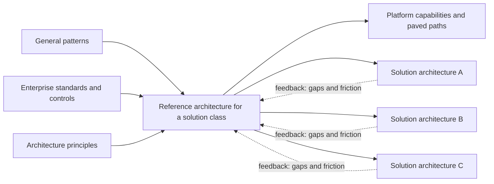
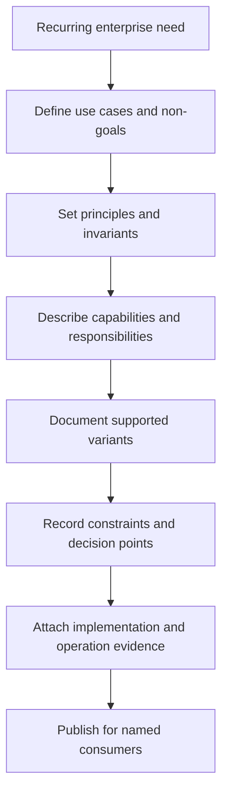
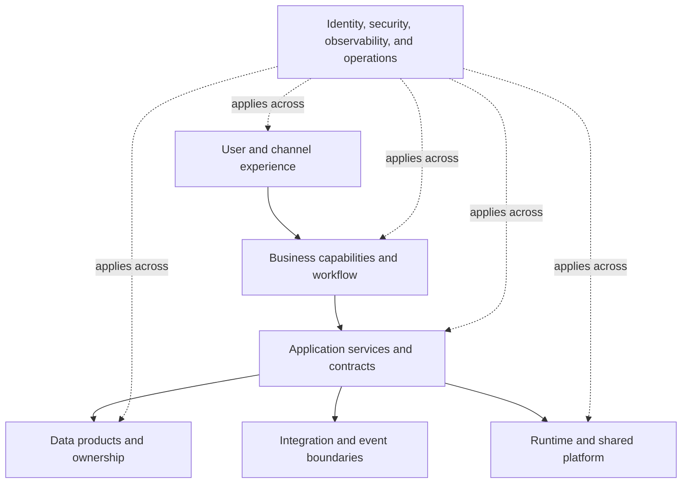
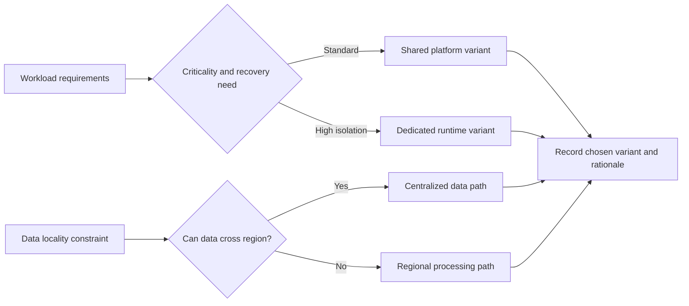
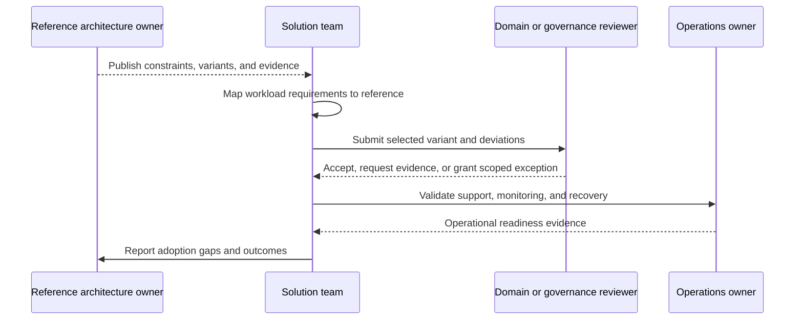
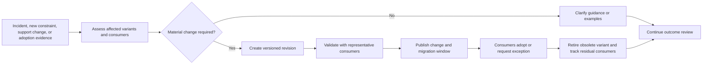
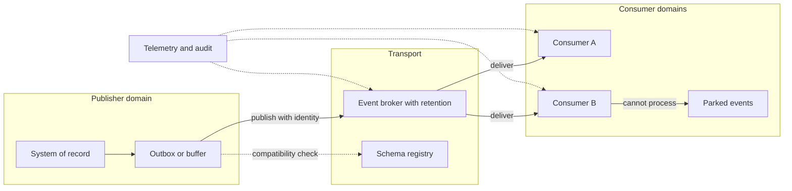
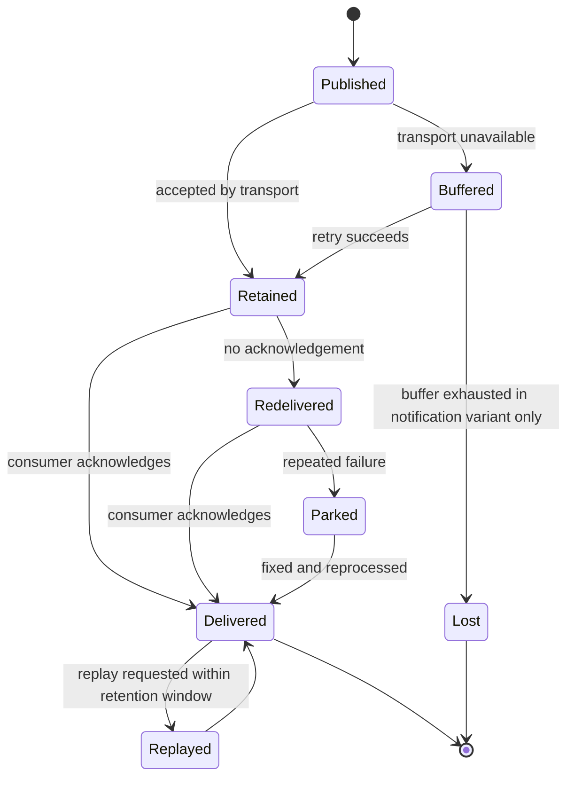
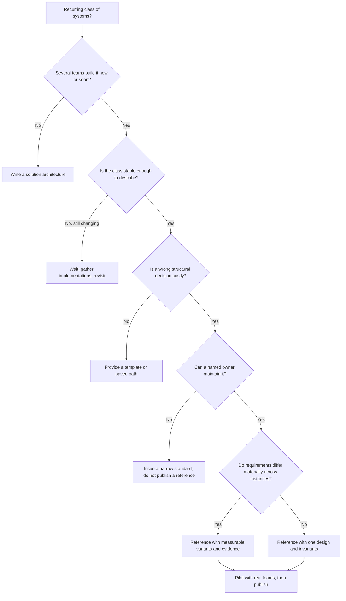

# Reference Architectures

Part: [18 — Enterprise Architecture](PART_OVERVIEW.md) · Status: Drafted

## 1. Introduction

A reference architecture is a reusable, bounded description of a class of solutions. It records the stable decisions that many teams would otherwise remake independently: the responsibilities a solution of that class must cover, the interfaces and contracts between those responsibilities, the constraints every instance must respect, and the variants that are supported when requirements differ. It deliberately leaves context-specific decisions to the solution team. It is not a product catalog, not a copy of one successful system, and not a mandatory blueprint for every workload.

The distinction that matters most is between a reference architecture and a solution architecture. A solution architecture describes one system that will be built and run: its components, its data, its deployment, its risks. A reference architecture describes what is common across many such systems, at a level of abstraction where the description stays true for each of them. Think of the relationship as a template to an instance, with one important refinement: the template is expected to contain explicit decision points, so that instantiating it is a sequence of recorded choices rather than a copy-and-edit exercise.

For a solution architect, this matters in two directions. When you consume a reference architecture, you need to know what it commits you to, what you may vary, and what evidence you owe in return, so that you can use it as leverage instead of treating it as a hurdle. When you author one, usually after noticing that several teams are solving the same problem in incompatible ways, you need to know how to decide what belongs in it, how to keep it honest, and how to prevent it from becoming either a vague poster or a rigid mandate. Both skills are practical: a reference architecture is one of the few enterprise-level artifacts whose value can be observed directly in how fast and how safely solution teams deliver.

This chapter owns the concept of a reference architecture as an enterprise artifact: its purpose, anatomy, layered responsibility model, and variants with their constraints, followed by how it is instantiated, governed, and evolved. The boundaries with neighbouring material are deliberate:

- Provider-specific service guidance belongs to [Part 09 — Cloud Computing](../09_Cloud_Computing/PART_OVERVIEW.md); cross-provider cloud design belongs to [Part 10 — Cloud Architecture](../10_Cloud_Architecture/PART_OVERVIEW.md). A reference architecture may constrain which of those capabilities a solution uses but does not re-explain them.
- General architecture patterns, such as the patterns a reference architecture may adopt, belong to [Part 20 — Architecture Patterns](../20_Architecture_Patterns/PART_OVERVIEW.md).
- Designing one concrete solution belongs to [High-Level Design](../07_System_Design_and_Distributed_Systems/CH03_High_Level_Design.md); this chapter stops where one system's design starts.
- The Architecture Decision Record (ADR) practice belongs to [Architecture Thinking](../01_Architecture_Mindset/CH03_Architecture_Thinking.md); ADRs appear here only as the way a team records which variant it chose and why.
- Diagram and documentation notation belongs to [Part 21 — Architecture Documentation](../21_Architecture_Documentation/PART_OVERVIEW.md).
- The enterprise method that frames architecture work belongs to [TOGAF](CH01_TOGAF.md); the domain views a reference architecture draws on belong to [Business Architecture](CH04_Business_Architecture.md), [Application Architecture](CH05_Application_Architecture.md), [Data Architecture](CH06_Data_Architecture.md), and [Technology Architecture](CH07_Technology_Architecture.md).
- Governance bodies and review mechanics belong to [Architecture Governance](CH08_Architecture_Governance.md) and [Architecture Review Boards](CH09_Architecture_Review_Boards.md); capability mapping belongs to [Capability Mapping](CH11_Capability_Mapping.md).

After studying this chapter, a reader should be able to:

1. Define a reference architecture and distinguish it from a solution architecture, a pattern, a standard, and a product blueprint.
2. Explain the problem it solves and state the conditions under which writing one is worth the cost.
3. Describe the anatomy of a well-formed reference architecture: scope, principles, invariants, responsibilities, variants, and evidence.
4. Decompose a solution class into layers of responsibility with explicit ownership, contracts, and failure behavior at each boundary.
5. Design variation points with measurable triggers, and reject variants that are only preferences.
6. Apply these ideas to a concrete, hypothetical scenario and decide what the reference architecture must fix and what it must leave open.

## 2. Background and History

The idea of reusable architectural guidance is older than the term. Pattern catalogs, published from the 1990s onward, gave practitioners named solutions to recurring design problems, and enterprise frameworks such as [TOGAF](CH01_TOGAF.md) have long described reference models as part of the architecture content an organization maintains. Vendors and standards bodies also publish reference architectures for their own technologies. The details of any particular publication vary and are best taken from the source; what is stable across them is the underlying intent, which is to capture agreed structure once so that it can be reused many times.

The terminology is used loosely in practice. Some organizations call a diagram of an ideal system a reference architecture; others use the term for an approved technology stack; others for a repository of working code. This chapter uses a stricter meaning, built around decision guidance rather than around a diagram or a stack, because that is the meaning under which the artifact can be validated and evolved. When you read another organization's "reference architecture", check which of these it actually is before relying on it.

## 3. The Problem Reference Architectures Solve

Consider what happens in an enterprise with no shared guidance for a recurring class of systems, say customer-facing services that exchange events with other systems. Each failure below is a general pattern, not a reported incident.

| Failure pattern | Mechanism | What a reference architecture contributes |
| --- | --- | --- |
| Repeated rediscovery | Every team works out identity, retry, schema compatibility, and observability from scratch, and each makes different mistakes | The tested choice is made once, with its rationale, and reused |
| Incompatible integration | Systems of the same class expose different contracts and failure semantics, so every connection needs bespoke glue | Common interface and contract expectations at the boundaries |
| Uneven control coverage | Security, recovery, and audit controls are present in some systems and absent in others, depending on team experience | Required controls expressed as invariants every instance must show evidence for |
| Unsupportable diversity | Operations must support many variations that have no differentiating reason to exist | A small set of supported variants with known operational procedures |
| Slow, inconsistent review | Each design is reviewed from first principles, so review time and outcomes depend on who happens to review | Review reduces to checking conformance and examining deviations |

The alternatives are worth taking seriously, because a reference architecture has a real maintenance cost. Teams can rely on experienced individuals, but this does not scale and walks out the door with them. A platform team can provide paved paths, meaning working, supported tooling that makes the right choice the easy one; this is often the strongest mechanism, and a reference architecture and a platform complement each other, with the architecture explaining the reasoning the platform embodies. A written standard can state rules, but standards usually say what is required without explaining the structure that satisfies the requirement. Shared libraries and templates carry code but not the decisions behind it. A reference architecture is the right instrument when the main difficulty is that many teams need to make the same set of structural decisions consistently, when those decisions interact with enterprise concerns such as security and recovery, and when the class of systems recurs often enough to repay the effort of writing and maintaining the guidance.

The decision criteria for writing one are therefore: how many teams will build systems of this class, how costly it is to get the structural decisions wrong, how stable the class is, and whether someone can be named to own the artifact over time. If the class has a single instance, write a solution architecture. If it has two or three instances that are still changing shape, wait; premature abstraction produces a reference architecture that matches nothing. A useful rule of thumb is that a reference architecture should be derived from at least a few real implementations, or from a clearly stated and testable set of requirements, rather than from an imagined ideal.

## 4. Define Purpose, Boundaries, and Anatomy

### 4.1 What it is and what it is not

Several neighbouring artifacts are easily confused with a reference architecture. The differences determine what you may claim for each.

| Artifact | Answers | Scope | Typical failure when confused with a reference architecture |
| --- | --- | --- | --- |
| Pattern | How do I solve this recurring design problem? | One problem, technology-neutral | Treated as complete guidance; says nothing about enterprise controls or ownership |
| Standard | What is required or forbidden? | A rule or interface | Followed to the letter without understanding the structure it presupposes |
| Reference architecture | How should systems of this class be structured, and what varies? | A class of solutions | Written too abstractly to guide, or too concretely to fit |
| Solution architecture | How will this one system be built and run? | One system | Copied into a template, so local accidents become enterprise convention |
| Platform or paved path | What can I run today with minimal effort? | Tooling and runtime | Assumed to carry its reasoning; teams cannot tell when it does not fit |

A reference architecture sits between patterns and a solution. It composes patterns into a structure for a class, attaches the standards that apply, and points at platform capabilities that realize it, without being any of them.



Inputs flow in from patterns, standards, and principles; instances flow out to solutions; and a feedback path returns from each solution. The feedback arrows are not decoration. A reference architecture with no path for solution teams to report friction is a document that was correct on the day it was written, and its accuracy only declines from there.

### 4.2 Purpose and boundaries

Start with a recurring decision or class of systems that would benefit from common guidance. Name the intended users, goals, constraints, non-goals, required controls, and the evidence that validates adoption. State what can vary, what must remain invariant, and who owns the reference architecture. Without these boundaries, a reference design becomes either too generic to help or so prescriptive that teams work around it.



The sequence is an authoring order, and the order is the point: scope and non-goals come before structure, because a reader who cannot tell what the document is for cannot judge whether it applies. Principles and invariants come before layers, because the layers should be derived from them rather than the reverse. Evidence comes last but must be planned from the start; a claim such as "this variant meets the recovery requirement" is only a claim until a test or an operating record supports it.

The reference architecture should answer which decisions it resolves and which remain open. Include assumptions such as scale, criticality, data classification, geographic needs, and operating maturity. If those assumptions do not hold, the consumer should know to select another variant or request a scoped exception.

### 4.3 Anatomy of a well-formed reference architecture

A usable reference architecture has a predictable set of parts, so that a consumer can find the answer to a given question in a known place.

| Part | Content | Question it answers for the consumer |
| --- | --- | --- |
| Purpose and applicability | The class of systems, intended users, and explicit non-goals | Does this apply to what I am building? |
| Assumptions | Scale, criticality, data classification, operating maturity | Are my conditions inside its validity range? |
| Principles | The few ideas that explain every other decision | What should I preserve if I must depart from the details? |
| Invariants | What every instance must do, each with a verification method | What am I not allowed to change, and how will I show it? |
| Responsibility model | Layers or capabilities with owners and contracts | Where does each concern live and who is accountable? |
| Variants | Supported alternatives, each with a trigger and trade-offs | Which version do my requirements select? |
| Decision points | Choices the consumer must make and record | What must I decide, and where do I record it? |
| Evidence | Conformance tests, operating records, validation results | How do I show that my instance is conformant and that the guidance works? |
| Ownership and lifecycle | Owner, version, review date, deprecation policy | Whom do I ask, and how long can I rely on this? |

The distinction between principles and invariants is easy to lose. A principle is a reason ("prefer asynchronous integration across ownership boundaries, to isolate failures"); an invariant is a testable obligation ("every published event carries a schema version and passes a compatibility check before release"). Principles guide judgement where the document is silent. Invariants are what a reviewer checks. A document made only of principles cannot be verified; a document made only of invariants offers no help when a case falls outside them.

A short, machine-readable header makes the metadata consumable by tooling and prevents the ownership and lifecycle fields from being forgotten. The following is an illustrative template, not a standard format:

```yaml
reference_architecture:
  id: RA-EVENT-INTEGRATION
  version: 2.1.0
  owner: integration-architecture-team
  status: supported            # draft | supported | deprecated | retired
  review_by: 2027-03-31
  applies_to: "Business events exchanged between independently owned systems"
  non_goals:
    - "Bulk analytical data movement"
    - "Low-latency request/response between two services"
  assumptions:
    - "Event volume per producer below the documented ceiling"
    - "Consumers tolerate at-least-once delivery"
  invariants:
    - id: INV-01
      statement: "Every event schema is versioned and compatibility-checked before release"
      evidence: "Schema compatibility check in the release pipeline"
    - id: INV-02
      statement: "Every consumer handles duplicate delivery"
      evidence: "Duplicate-injection test result"
  variants: [notification, business-critical, private-network]
```

Every field above exists because a consumer or reviewer would otherwise have to ask. Note the evidence attached to each invariant: an invariant without a named verification method is an aspiration, and a reviewer cannot enforce it consistently.

### 4.4 Failure modes in scoping

Three scoping failures recur. The first is the poster: a polished diagram with generic boxes that matches every system and constrains none, so it gives no guidance. The second is the mandate: a design so specific that any real workload deviates somewhere, so teams fork it and the fork becomes the real standard. The third is the snapshot: a faithful description of one team's system, whose local accidents are mistaken for enterprise requirements. The remedy for all three is the same. Write the non-goals, mark what is invariant versus variable, and derive the document from more than one real or well-specified case.

## 5. Describe Layers and Responsibilities

Organize the design by responsibility: user or channel, business capability, application services, data, integration, platform, security, and operations. Show ownership and interfaces, not just boxes. A layer is useful when it separates concerns and clarifies change boundaries; it should not imply a fixed technology product or deployment unit.



For each boundary, specify the contract owner, failure behavior, and evidence required for implementation. Point to detailed security, data, cloud, and delivery standards rather than copying them into a second source that can drift.

The diagram has an asymmetry worth reading closely. Business capability, application, and data layers form a dependency chain, while the identity, security, observability, and operations concerns apply across every layer rather than sitting on top of one. Drawing controls as a single box at the bottom or top is a common mistake, because it suggests they can be added once and forgotten; in practice each layer needs its own enforcement and evidence for them.

### 5.1 Responsibility model: from box to obligation

A box becomes useful only when it carries obligations. For each layer or boundary, the reference architecture should state the following, using a table so omissions are visible:

| Layer | Owns | Exposes | Must tolerate | Evidence of conformance |
| --- | --- | --- | --- | --- |
| Channel | Presentation, session handling | User-facing interactions | Slow or failed backend calls | Degradation behavior test |
| Business capability and workflow | Business rules, process state | Capability contracts | Partial completion of a multi-step process | Process recovery scenario |
| Application services | Behavior behind a contract | Versioned contracts | Duplicate and out-of-order requests | Contract tests |
| Data | Authoritative records and their lifecycle | Data access contracts, published data products | Replica lag, restore from backup | Restore test result |
| Integration and events | Delivery, routing, schema compatibility | Event and message contracts | Consumer outage, replay | Replay and compatibility checks |
| Platform | Runtime, scaling, deployment | Standard runtime capabilities | Node and zone loss | Failure-injection result |
| Controls (cross-cutting) | Identity, policy, telemetry, operations | Common mechanisms | Partial adoption by layers | Per-layer control checks |

The columns "must tolerate" and "evidence" distinguish a responsibility model from a decorated diagram. The first forces the author to state failure behavior at each boundary, which is where most enterprise incidents originate; the second prevents the claim from being untestable.

### 5.2 Choosing the decomposition

There is no single correct set of layers. The decomposition should follow change boundaries: separate the things that change for different reasons, at different rates, or under different owners. A channel layer exists because user interfaces change faster than business rules; a data layer exists because records outlive applications. Equally, adding a layer has a cost in latency, ownership hand-offs, and cognitive load, so a layer that nobody can name an owner or a distinct reason for should be merged away.

Two failure modes follow. A layering that mirrors the current organization chart will fossilize it, so changes to the organization become changes to the architecture. A layering that is purely technical, with no mapping to business capability, will fail to answer the questions business-facing consumers ask, such as which team is accountable when a capability misbehaves. Mapping layers to capabilities, as described in [Capability Mapping](CH11_Capability_Mapping.md), reduces both risks.

### 5.3 Worked scenario: a regulated customer-service portal

The following scenario is hypothetical. An organization with several lines of business wants a reference architecture for customer-facing portals that read and update account data. Three portal teams already exist, each with its own identity handling and its own approach to caching account balances.

The author begins with non-goals: batch reporting and back-office tools are out of scope. The principles are few: the system of record is never bypassed on writes; every portal action is attributable to an authenticated person; the portal must degrade to read-only rather than fail entirely when a backend is unavailable.

The responsibility model then assigns concerns. The channel layer owns presentation and session handling. The application layer owns the contract with the account system. The data layer states that the authoritative balance lives only in the account system and that any cached copy is labelled with its age. The cross-cutting controls layer owns identity propagation and audit logging.

Two invariants come directly from the principles and are checkable: every write passes through the account contract, with a test that attempts a direct write and expects refusal, and every action emits an audit record carrying the authenticated identity. The read-only degradation principle becomes a failure-behavior entry for the application layer, tested by disabling the account system in a test environment and observing that reads continue from labelled cache while writes are refused with a clear message.

Notice what is not fixed. The caching technology, the portal framework, and the deployment topology remain local decisions, because fixing them would add no control and would cost the teams flexibility. The architect has resolved only what must be consistent: where authority lies, how identity flows, and how failure appears to the user.

## 6. Make Variants and Constraints Explicit

### 6.1 Why variants exist

A single reference design rarely fits every quality or regulatory profile. A notification that can be lost without consequence and a payment event that must never be lost need different delivery, replay, and recovery behavior, and forcing both into one design either over-engineers the first or under-protects the second. The alternatives to variants are worse: one design pitched at the most demanding case imposes its cost everywhere, while leaving the choice open invites each team to invent its own point on the spectrum and take on its own undocumented risk.

Define variation points such as synchronous versus asynchronous integration, regional versus centralized data, or managed versus self-operated runtime. For each, state the trigger that selects the variant, the trade-offs, and the evidence that it was validated. Do not present variants as interchangeable when they differ in recovery, cost, privacy, or support requirements.



This decision view should point to measurable constraints such as recovery time, residency, capacity, or support ownership. A selection matrix without evidence turns into preference matching. Validate variants under realistic traffic and failure conditions before making them supported defaults.

The diagram shows two independent decisions that combine: the runtime variant (shared or dedicated) and the data path (centralized or regional) are chosen separately, and the recorded outcome is their combination. Treating them as a single axis produces a combinatorial explosion in either direction, so keep variation points orthogonal where you can, and state explicitly any combination that is unsupported.

### 6.2 Triggers must be measurable

A variant trigger is only useful if two reviewers would select the same variant from the same facts. Compare these formulations for the same variation point:

| Weak trigger | Why it fails | Measurable trigger |
| --- | --- | --- |
| "Use the high-criticality variant for important systems" | "Important" is a preference and will be argued case by case | "Use it when the business-defined Recovery Time Objective (RTO) is under one hour, or when loss of an event has a defined financial or regulatory consequence" |
| "Use regional processing for sensitive data" | "Sensitive" has no boundary | "Use it when the data classification policy prohibits storage or processing outside the named region" |
| "Use the dedicated runtime when the workload is large" | "Large" is undefined | "Use it when sustained capacity exceeds the documented ceiling of the shared runtime or when contractual isolation is required" |

The numbers inside such triggers belong to the owning organization and should come from its own requirements, not from this handbook. The structure, however, is general: each trigger names an observable property, a threshold or classification, and the authority that defines it.

### 6.3 Constraints and the cost of each variant

A variant is more than a design; it carries obligations on operations, cost, and the consumer. The table below is an illustrative comparison for the event-integration example used later in this chapter. The values are hypothetical and show the form of the comparison, not recommended settings.

| Dimension | Notification variant | Business-critical variant | Private-network variant |
| --- | --- | --- | --- |
| Delivery expectation | Best effort, loss tolerated | At least once, no silent loss | At least once, no silent loss |
| Replay | Not offered | Offered, with a defined retention window | Offered, with a defined retention window |
| Recovery objective | Documented but relaxed | Tight, tested | Tight, tested |
| Operational burden | Low | Higher: replay ownership, on-call procedures | Highest: network path adds a failure domain |
| Consumer obligation | Tolerate missed events | Handle duplicates; reconcile after replay | As business-critical, plus network onboarding |
| Select when | Loss is harmless | Loss has business consequence | Traffic must not cross shared networks |

Reading across a row shows why variants cannot be treated as interchangeable: the same word, such as "recovery", implies different tests and different on-call commitments in each column. Reading down a column shows the total commitment a team accepts by choosing it, which is the information needed to choose responsibly.

### 6.4 Failure modes in variants

Four failure modes are worth watching for. First, variant sprawl: each exception is granted as a new variant, so the supported set grows until operations cannot support it. Second, the phantom variant: a variant is documented but never validated, so teams adopt it on trust and discover its limits in production. Third, the silent downgrade: a team selects the cheaper variant to meet a deadline and never records the choice, so the risk is invisible to those who depend on it. Fourth, the default trap: the lowest-effort variant is the default, and teams drift into it without evaluating their requirements.

Countermeasures follow from each. Cap the supported set, and require a repeated, evidenced need before adding a variant. Mark each variant with its validation status and date. Require the chosen variant and its rationale to be recorded as an ADR, so the decision is visible and revisitable. Make selection an explicit decision point that cannot be skipped, rather than a silent default.

### 6.5 Worked scenario: selecting a variant for a hypothetical workload

Take a team building an order-status feed. Requirements gathered from the business state that missing a status change causes customer-facing errors and manual reconciliation, that the recovery objective for the feed is under the threshold in the trigger above, and that customer addresses in the events may not leave a specific region.

Applying the triggers: loss has business consequence and the recovery objective is tight, so the business-critical variant is selected. The residency requirement selects the regional processing path. The combination is supported, so the team records an ADR stating the requirements, the variants chosen, the variants rejected with reasons, and the evidence it will produce: a duplicate-delivery test and a replay exercise. Had the combination been unsupported, say regional processing together with a dedicated runtime that the platform cannot place in that region, the team would have requested a scoped exception rather than quietly deviating.

The value of the exercise lies in the record. Months later, when an auditor or a new team member asks why the feed has a replay procedure and a regional path, the answer is in one place with its reasoning, and the reference owner can see which requirements are driving which variants across the enterprise.

## 7. Instantiate and Govern Adoption

### 7.1 From reference to solution architecture

Consumers adapt a reference architecture into a solution architecture. Instantiation is a sequence of recorded decisions, not a copy-and-edit exercise. The mapping a team produces should identify five things: the components and contracts reused unchanged, the variants selected (with the trigger facts that selected them), the local decisions the reference deliberately left open, the deviations from invariants, and the validation plan that will produce evidence.

A compact template keeps this mapping reviewable. It can live in the solution's repository next to its ADR, and it replaces the habit of redrawing the reference diagram with a team's logo on it.

```text
Reference:            <name and version>
Workload:             <one-line description>
Variants selected:    <variation point -> variant -> trigger facts>
Variants rejected:    <variant -> reason>
Local decisions:      <items the reference leaves open, with choice>
Deviations:           <invariant -> proposed deviation -> scope and expiry>
Evidence plan:        <invariant or variant -> test or review -> owner -> date>
```

The evidence column is what distinguishes adoption from resemblance. Two systems can look identical on a diagram while one enforces the identity invariant and the other merely draws a box labelled "identity". Evidence can include conformance tests run in a pipeline, a threat review, an operational readiness review, and, later, workload outcomes such as incident rates. Link to the evidence instead of describing it; prose claims age badly.

### 7.2 Types of evidence and what each proves

| Evidence | What it proves | What it does not prove |
| --- | --- | --- |
| Diagram similarity | The team read the reference | That any invariant holds |
| Automated conformance test | A specific invariant held at the time of the run | That untested invariants hold, or that the test is still meaningful |
| Review record | A competent reviewer examined the design | That the implementation matches the design |
| Operational drill (for example, a replay exercise) | The team can execute a recovery procedure | That the procedure meets the objective under production load |
| Outcome measures | The solution behaves acceptably in operation | Why it behaves so, or that it will continue to |

Prefer automated checks for invariants that can be tested mechanically and reserve human review for judgment calls such as whether a deviation is justified. The detailed mechanics of review bodies belong to [Architecture Review Boards](CH09_Architecture_Review_Boards.md) and the wider control model to [Architecture Governance](CH08_Architecture_Governance.md); this section covers only what a reference architecture must supply to make those reviews efficient.



### 7.3 Governing deviations

The sequence shows three outcomes at the review step: accept, request evidence, or grant a scoped exception. Governance should concentrate on invariants and material deviations; reviewing everything dilutes attention and teaches teams to treat review as a gate to be rushed. A reference architecture does not transfer responsibility for a solution's data, risk, or operations to its author. The consuming team owns implementation and evidence; the reference owner maintains the shared guidance and responds to recurring friction.

A scoped exception should state the invariant affected, the reason, the compensating control, the scope (one system, not the class), and an expiry or review date. An exception without an expiry becomes a permanent undocumented variant. Exceptions are also data: the reference owner should read them in aggregate, because several teams asking for the same deviation is a signal that a variant is missing or an invariant is mis-specified (see Section 8).

### 7.4 Failure modes in adoption

- Mandate without usability: teams comply on paper, with diagrams that match and behavior that does not, because following the reference is harder than ignoring it.
- Evidence theatre: the evidence requested is easy to produce and unrelated to the invariants, so every review passes.
- Late engagement: the reference is applied at a final review, when the cost of changing a design is highest, instead of at design time.
- Orphaned adopters: teams that instantiated an older version receive no notice of changes and drift onto an unsupported fork.

The mitigation common to all four is to make the reference cheaper to follow than to avoid, usually by pairing it with a supported platform path and automated checks, and to keep the owner in contact with consumers through the adoption reports shown in the diagram.

## 8. Evolve the Reference Architecture

### 8.1 Why references decay

A reference architecture is valid only against the constraints that existed when it was written. Standards, regulatory obligations, technology support, costs, and workload characteristics all shift, and the reference does not notice unless someone is assigned to look. Decay is usually silent: nothing fails, but new systems quietly diverge from it while old ones stay on superseded guidance. Review the reference when any such signal arrives, and on a fixed cadence even when none does. Track version, owner, supported variants, validation status, deprecation dates, and active consumers; without the consumer list, no one can say who a change will affect.

### 8.2 Versioning and compatibility

Treat the reference like a published interface. A clarification that changes no obligation is a minor revision. Adding a variant is additive and consumers may ignore it. Tightening an invariant, removing a variant, or changing a contract is breaking, and needs migration guidance and a compatibility window; otherwise consumers will stay on undocumented forks rather than absorb unplanned work. State in each revision which consumers are affected and what evidence they must re-produce.

| Change type | Example | Consumer impact | Handling |
| --- | --- | --- | --- |
| Clarification | Better wording of a trigger | None | Publish; no action required |
| Additive | New supported variant | Optional | Publish with validation evidence |
| Tightening | New mandatory control | Re-evidence required | Window, guidance, and tooling support |
| Breaking | Contract change; variant retired | Migration | Versioned release, window, and tracking of residual consumers |



### 8.3 Reading the signals

The flow separates clarification from material change, because most signals do not warrant a new version. Over-reacting produces churn that consumers learn to ignore; under-reacting lets the reference rot.

Measure adoption, exception themes, implementation effort, incidents, and user outcomes. High adoption alone does not prove value; it can reflect mandate. Repeated exceptions may indicate a missing variant, poor usability, or a constraint that should be revisited. A reference that is adopted heavily but whose consumers report long instantiation times is failing in a different way from one that is ignored, and the remedies differ: simplify the first, find out why consumers avoid the second.

### 8.4 Retirement

Retire a variant or a whole reference deliberately: announce the date, name the successor, keep the rationale for the record, and track the residual consumers until the last one migrates or accepts a time-boxed exception. A retired reference that remains discoverable and unmarked will be adopted again by someone who did not read the notice, so mark its status at the top of the document.

## 9. Worked Scenario: Enterprise Event-Driven Integration

This is the event-integration example that Section 6.3 refers to. The scenario is hypothetical and is built to exercise the concepts of this chapter, not to describe any real organization.

### 9.1 Context and scope

An enterprise has accumulated point-to-point integrations between its systems. Each integration handles identity, retries, and failure in its own way, and no one can say with confidence which integrations lose messages when a consumer is down. Several teams are about to build new integrations. The integration architects decide to write a reference architecture for event-driven integration between internal systems.

Scope: events published by a system of record and consumed by other internal systems. Non-goals: bulk data transfer, request-response APIs (Application Programming Interfaces), and integration with external partners, each of which would warrant its own guidance. The principles are few and testable:

1. The publisher owns the event contract and its evolution.
2. Every event is attributable to a publishing identity, and every consumer is authenticated.
3. Delivery behavior is declared per variant, never implied.
4. A consumer outage must not cause the publisher to fail or lose events beyond what the variant declares.

### 9.2 Responsibility model

| Layer | Responsibility | Contract at the boundary | Failure behavior |
| --- | --- | --- | --- |
| Publisher | Emit events when the system of record changes; own schema | Versioned event schema; unique event identifier | If the broker is unreachable, buffer and retry per variant; never drop silently in non-notification variants |
| Transport | Carry events, enforce authentication, retain for the variant's window | Topic or channel naming; delivery semantics declared by variant | Surfaces backlog and delivery failures as signals; does not alter payloads |
| Consumer | Process events idempotently; own reconciliation | Handles duplicates and out-of-order delivery as documented | Parks unprocessable events for inspection instead of blocking the stream |
| Cross-cutting controls | Identity, audit, schema compatibility check, observability | Required telemetry and audit fields | Missing telemetry is itself an alert |

Note what is left open: the broker product, the schema language, and the programming languages are local or platform decisions, in the same way Section 5.3 left caching and frameworks open.

### 9.3 Invariants and how they are tested

| Invariant | Check |
| --- | --- |
| Every event carries a unique identifier and a schema version | Contract test at publish time rejects events without them |
| Schema changes are backward compatible within a major version | Compatibility check in the publisher's build pipeline against the registered previous version |
| Consumers are authenticated and authorized per topic | Negative test: an unauthorized consumer is refused |
| Consumers tolerate duplicates (business-critical and private-network variants) | Replay the same event twice in a test environment and assert one business effect |
| Replay is possible within the declared retention window (same two variants) | Replay exercise in a non-production environment, with the owner and procedure recorded |



The diagram deliberately shows responsibilities rather than products. Two implications follow. First, the outbox or buffer sits in the publisher's domain, which is why the reference can require that a broker outage never makes the publisher lose events: the obligation lies with the publisher and is testable there. Second, parked events are a consumer-owned structure, so a poisoned message blocks neither the stream nor other consumers, but someone must own the parked queue, or it becomes an unmonitored graveyard.

### 9.4 Delivery lifecycle

The behavior that differs between variants is easiest to see as the lifecycle of one event.



Read the diagram per variant. In the notification variant, the transition to `Lost` is allowed and the replay transitions are not offered, which is why that variant is cheap. In the other two variants, `Lost` is not a legal state: every path ends in `Delivered` or in `Parked` with an owner. Redelivery exists only because acknowledgement can fail after processing, so duplicates are a normal state of the system, not a defect, and the consumer obligation in Section 6.3 follows directly from this diagram.

### 9.5 Instantiation: the order-status workflow

The team from Section 6.5 maps its order-status feed to this reference. Using the template in Section 7.1, it records the business-critical variant (loss has consequence, recovery objective is tight) and the regional processing path (address data may not leave a region). Its evidence plan lists a schema compatibility check in the pipeline, a duplicate-delivery test on each consumer, an authorization negative test, and a replay exercise with a named owner. An operations review confirms that on-call has a procedure for a growing backlog and for the parked queue.

During build, one consumer cannot tolerate duplicates because it increments a counter. The team does not request an exception from the invariant; it fixes the consumer by recording processed event identifiers. This is the intended effect of the invariant: the reference moved the problem to design time, where it was cheap.

### 9.6 Growth: the private-network variant

Some time later, several teams report that their traffic may not cross shared networks, and each asks for an exception. The reference owner sees the repeated request, which is the signal described in Section 8.3, and evaluates a private-network variant: the same delivery behavior as business-critical, with a dedicated network path and an onboarding step for consumers. The owner validates it with representative consumers, including a failure test of the network path, which is an additional failure domain, publishes it as an additive revision with its operational burden stated, and closes the open exceptions by migrating the requesting teams. The alternative, approving each exception separately, would have produced several unvalidated private networks with no common operating procedure.

The three variants in the Section 6.3 table are thus the product of one coherent history: the notification and business-critical variants came from the initial scope, and the private-network variant came from observed demand and was accepted only after validation.

## 10. Failure Scenarios and Common Mistakes

### 10.1 Failure catalogue

The catalogue below covers failures of the reference architecture practice itself, with the event-integration example supplying concrete symptoms. All entries are general patterns, not reported incidents.

| Failure | Symptom | Detection | Mitigation |
| --- | --- | --- | --- |
| Reference written from an imagined ideal | No real team can instantiate it without large exceptions | Exception rate and instantiation time at first adopters | Derive from real implementations or testable requirements; pilot with two teams before publishing |
| Scope too broad | Guidance is generic and every invariant has caveats | Reviewers cannot say whether a given system is in scope | Rewrite non-goals; split into separate references |
| Scope too narrow | Teams outside it invent their own, so diversity returns | Parallel unofficial guides appear | Widen only where a shared structural decision exists |
| Unmeasurable variant triggers | Variant choice differs by reviewer | Same facts yield different ADRs | Rewrite triggers as in Section 6.2 |
| Phantom variant | Teams adopt a documented variant and meet its limits in operation | Variant has no validation record | Mark validation status; withdraw unvalidated variants |
| Silent downgrade | A cheaper variant chosen under deadline pressure, unrecorded | Consumers discover missing replay during an outage | Mandatory ADR for variant selection |
| Variant sprawl | Operations cannot support the supported set | Rising number of on-call procedures per reference | Cap the set; require repeated evidenced demand |
| Unowned reference | Guidance outdated; questions unanswered | No revision within the review cadence | Name an owner and a review date in the document header |
| Evidence theatre | All reviews pass; incidents still repeat | Incidents map to invariants no check covered | Tie evidence to invariants; add checks for each incident class |
| Stranded consumers | Teams on old versions never migrate | Consumer list shows old version after window | Track residual consumers; time-box exceptions |
| Duplicate-handling gap | Double business effects after redelivery | Consumers lack the duplicate test result | Make duplicate tolerance an invariant with a test |
| Unowned parked queue | Parked events accumulate unseen | Queue depth alert absent or ignored | Assign an owner and alert on parked-queue age |

### 10.2 Anti-patterns

- The poster: a polished diagram with no invariants, evidence, or owner. It cannot be violated, so it cannot guide.
- The straitjacket: every decision fixed, including technology choices that add no control, so teams either comply at cost or leave.
- The copied success: one system's design declared the reference, so its accidental choices become mandatory.
- The exception factory: exceptions granted individually forever, so the reference describes an ideal that nobody operates.
- The approval substitute: using the reference as proof of quality ("we followed the reference") in place of evidence about the actual system.
- The shelf document: published once, never revisited, consulted only at audits.

### 10.3 Edge cases

Some situations stress the model. A workload that spans two variants, such as notification traffic that occasionally carries a business-critical event, should be split by event type rather than forced into one variant. A legacy system that cannot meet an invariant needs a scoped exception with a retirement plan, not a lowered invariant. A team acquired from another organization may bring its own reference; compare the two on invariants and map differences explicitly rather than choosing by seniority.

## 11. Trade-off Analysis and Decision Framework

### 11.1 Comparing the instruments

A reference architecture is one instrument among several for achieving consistency. The choice depends on the problem.

| Instrument | Strength | Weakness | Best when |
| --- | --- | --- | --- |
| Reference architecture | Carries decisions and rationale, with variants | Costs to write and maintain; can decay | Many teams make the same structural decisions that interact with enterprise concerns |
| Platform or paved path | Makes the right choice easy; enforces by construction | Narrow; carries the decisions but not the reasoning | A single dominant implementation path is acceptable |
| Standard | Clear, auditable rule | Says what, not how | A rule is needed regardless of structure |
| Template or starter code | Fast start | Copies decisions invisibly; drifts | Structure is stable and decisions are minor |
| Expert review per project | Context-sensitive | Does not scale; inconsistent | Few, high-stakes, novel systems |

These are complementary: a reference architecture explains, a platform enforces, and a standard audits. The common failure is choosing one and expecting it to do all three jobs.

### 11.2 Decision flow



The flow places maintainability before design effort: if no one can own the artifact, writing it creates a liability. It also shows that the lighter instruments are legitimate answers, not fallbacks. The cost question carries the most weight in practice; if getting the decision wrong is cheap, templates are enough.

### 11.3 Trade-offs within a reference

Within a reference, the recurring tensions are consistency versus flexibility (more invariants give more control and less local fit), variant count versus supportability (more variants fit more cases and cost more to operate), and specificity versus longevity (naming products ages faster than naming responsibilities). A workable stance is to fix few things firmly, justify each by a control or a dependency, and leave everything else open, with a visible path for adding variants when demand is evidenced.

## 12. Illustrative Composite Case Study and Review Checklist

### 12.1 Composite case study (hypothetical)

This case is a composite constructed for teaching. It describes no real organization, and the figures are absent on purpose.

A mid-sized organization has four teams building customer-facing portals. An architect notices that each team handles identity differently and that two caches show stale balances without saying so. She proposes a reference architecture. Her first draft is a thirty-page document naming a specific framework, caching product, and deployment topology. Two teams read it, redraw its diagram, and carry on as before.

In review the draft is judged against Section 4.3: it has no invariants, no evidence column, and no variants, and it fixes technology choices that add no control. The architect rewrites it. She states non-goals, three principles, and two checkable invariants (writes only through the account contract; every action audited with an authenticated identity). She adds one variant axis, regional versus centralized data, with a measurable trigger tied to the organization's data classification policy. She drops the framework and caching choices and keeps only the requirement that cached data be labelled with its age.

She then pilots with the two most different teams. The pilot shows that the audit invariant is cheap for one team and expensive for the other, whose framework lacks a hook; the reference gains a small supported library as a platform complement. After the pilot, an owner and a review date are named, and conformance checks are added to the pipeline.

Lessons the case illustrates: the first draft failed by being a poster plus a straitjacket; the rewrite succeeded by shrinking the fixed set to what carried a control; the pilot found a usability gap that no amount of reading would have; and the platform complement turned a mandate into a convenience.

### 12.2 Architect review checklist

Use the checklist for a reference architecture before publishing, and for a solution's instantiation before approval.

**Authoring**

- [ ] Purpose, non-goals, and the class of systems in scope are stated.
- [ ] Derived from real implementations or a testable requirements set, and piloted with at least two teams.
- [ ] Principles are few, and each leads to at least one checkable invariant.
- [ ] Each layer has an owner, a boundary contract, and a failure behavior.
- [ ] Every variant has a measurable trigger, trade-offs, validation status, and operational obligations.
- [ ] Unsupported combinations of variants are listed.
- [ ] Technology choices are fixed only where they carry a control or a dependency.
- [ ] Owner, version, review date, and consumer list are recorded.

**Instantiation**

- [ ] The chosen variant, the rejected alternatives, and the trigger facts are recorded in an ADR.
- [ ] Deviations are scoped, with a compensating control and an expiry.
- [ ] The evidence plan maps to invariants, not to diagrams.
- [ ] Operational readiness (support, monitoring, recovery) was checked with the operations owner.
- [ ] The team knows how to report adoption gaps back to the reference owner.

**Evolution**

- [ ] Breaking changes carry migration guidance and a window.
- [ ] Exception themes are reviewed in aggregate.
- [ ] Retired variants are marked and their residual consumers tracked.

## 13. Interview Questions

**1. What is a reference architecture, and how does it differ from a solution architecture?**
It is a reusable, bounded description of a class of solutions that records stable decisions, invariants, and supported variants. A solution architecture describes one system to be built and run. The reference contains decision points; the solution records the choices made at them.

**2. When is writing a reference architecture not worth it?**
When the class has a single instance, when it is still changing shape, when a wrong structural decision is cheap, or when no one can own the artifact. Templates, paved paths, or a narrow standard are better in those cases.

**3. How do you decide what a reference architecture fixes and what it leaves open?**
Fix only what a control or a dependency requires, such as where authority lies, how identity flows, and how failure appears. Leave technology and local design choices open, since fixing them adds cost without adding control.

**4. What makes a variant trigger good?**
Two reviewers reach the same choice from the same facts. It names an observable property, a threshold or classification, and the authority that defines it, instead of words like "important" or "large".

**5. How do you prevent variant sprawl?**
Cap the supported set, require repeated evidenced demand before adding one, validate each before it becomes supported, and record each selection in an ADR so downgrades are visible.

**6. What counts as evidence of adoption?**
Automated conformance checks for invariants, review records, operational drills, and outcome measures. Diagram similarity is not evidence, because it shows that the reference was read, not that any invariant holds.

**7. Why must consumers tolerate duplicates in an at-least-once event variant?**
Acknowledgement can fail after processing, so the transport redelivers. Duplicates are a normal state, and consumers must produce one business effect, for example by recording processed event identifiers.

**8. Several teams ask for the same exception. What do you do?**
Treat it as a signal: a variant may be missing or an invariant mis-specified. Evaluate, validate with representative consumers, and publish a versioned revision, rather than approving unrelated exceptions indefinitely.

## 14. Hands-on Exercises

1. **Scope a reference.** Choose a class of systems from your own experience (for example, batch file ingestion). Write the purpose, three non-goals, three principles, and two invariants, each with a test you could run. Check that no principle lacks an invariant.
2. **Rewrite weak triggers.** Take three informal selection rules you have seen ("use the big database for big data") and rewrite each in the form of Section 6.2: observable property, threshold or classification, defining authority. Identify who owns each number.
3. **Draw a lifecycle.** For a messaging or job-processing flow you know, draw a state diagram like the one in Section 9.4 for one item. Mark which states are illegal in a high-assurance variant and add the detection signal for each failure transition.
4. **Instantiate a reference.** Using the template in Section 7.1, map a hypothetical order-status workflow to the event-integration reference of Section 9. Record two rejected variants with reasons and an evidence plan with owners. Then state which one of your deviations you would refuse to grant and why.

## 15. Design and Architecture Review Questions

**1. A reference architecture has high adoption by diagram, but incidents still repeat. What do you examine?**
Compare incidents with invariants: determine which invariants no check covers. Adoption by diagram suggests mandate without evidence. Add automated checks for each incident class and measure outcomes, not conformance of drawings. Revisit whether the invariants address the actual failure modes.

**2. A team wants to use the notification variant for a feed that triggers refunds. How do you respond?**
Apply the measurable trigger: loss has a financial consequence, so the notification variant is out of bounds. Explain the missing replay and delivery guarantees, and offer the business-critical variant with its operational obligations. If the team contests the facts, record the dispute and the decision in an ADR rather than allowing a silent downgrade.

**3. Operations says it cannot support seven variants. What is your plan?**
Count variants by actual use and validation status. Retire unvalidated or unused variants with notice, merge those differing only by preference, and require evidenced demand for new ones. Keep orthogonal variation points separate so combinations do not multiply the supported set.

**4. A legacy system cannot meet the identity invariant. Do you lower the invariant?**
No. Grant a scoped exception for that system with a compensating control, an owner, and an expiry tied to a retirement or remediation plan. Lowering the invariant weakens every other adopter. Review the exception in aggregate with others.

**5. You are asked to publish a reference architecture based on a single successful project. What concerns do you raise?**
One instance cannot show which choices are essential and which are accidental. Ask for a second, different implementation or a testable requirements set, separate the invariants from the incidental design, and pilot with another team before publishing. Without that, the reference becomes the copied success anti-pattern.

## 16. Summary

A reference architecture is a bounded, owned set of decisions for a class of solutions: scope and principles, invariants with checks, a layered responsibility model, and a small set of variants whose triggers are measurable. It earns its cost only when several teams face the same interacting structural decisions and someone can maintain it.

Instantiation is a recorded set of choices, evidenced against invariants rather than diagrams, with scoped exceptions that expire and are read in aggregate. Evolution is deliberate: versioned changes, compatibility windows, tracked consumers, and honest retirement. The event-integration scenario showed all of this in one coherent story, from initial variants through a validated addition.

Tied to the outcomes in the Introduction, you should now be able to define a reference architecture and distinguish it from its neighbours; judge when writing one is justified; describe its anatomy; decompose a solution class into owned layers with failure behavior; design variation points with measurable triggers and reject preference-based ones; and apply all of this to a concrete scenario by deciding what to fix and what to leave open. The pitfalls to remember are the poster, the straitjacket, the phantom variant, and evidence theatre. The most useful habit is to ask of any reference: what is the evidence, who owns it, and when was it last revisited?
