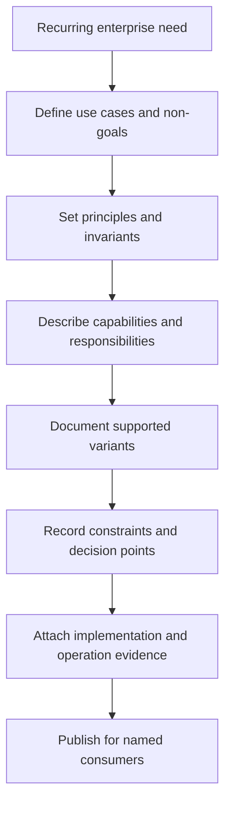
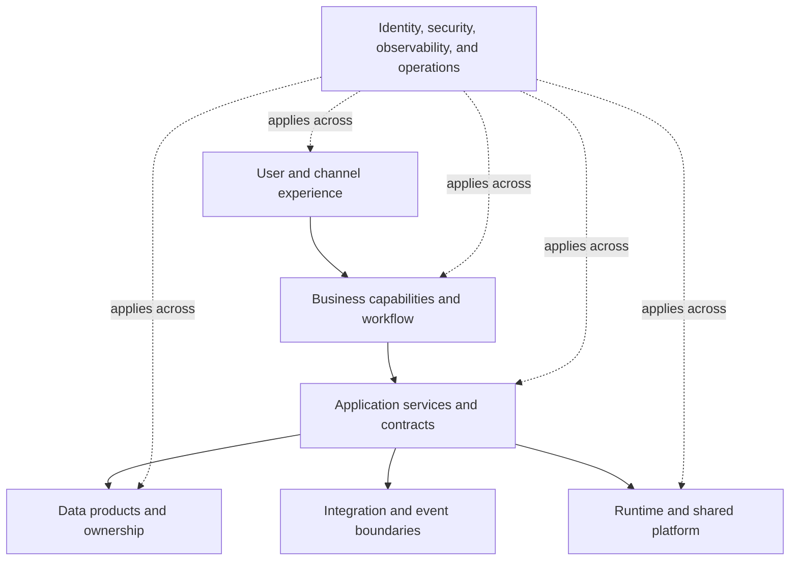
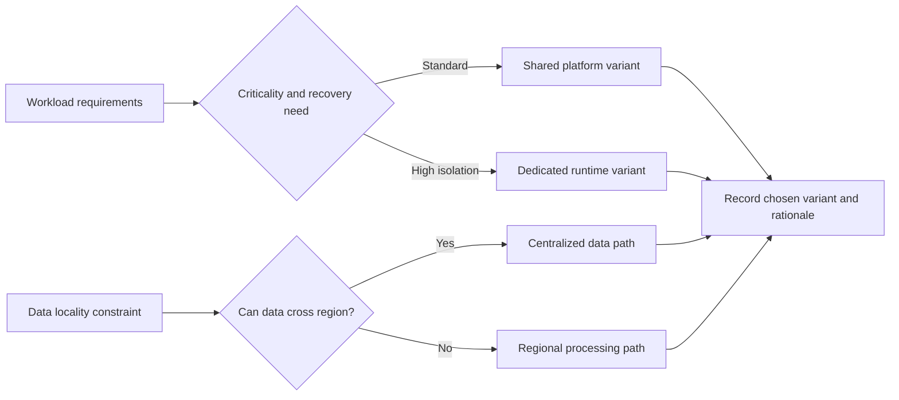
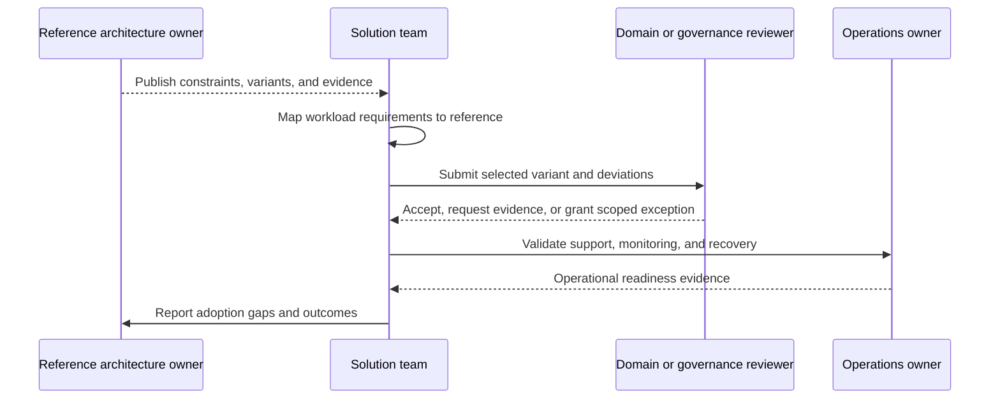
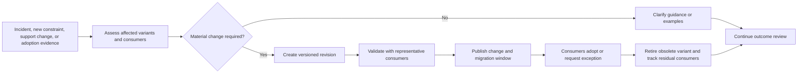

# Reference Architectures

Part: [18 — Enterprise Architecture](PART_OVERVIEW.md)

A reference architecture is a reusable, bounded description of a class of solutions. It captures stable principles, responsibilities, interfaces, constraints, and proven variants while leaving context-specific decisions to solution teams. It is not a product catalog or a mandatory blueprint for every workload. Part 09 owns provider service guidance, Part 20 owns general architecture patterns, and Part 07 owns solution-specific design.

## Define Purpose and Boundaries

Start with a recurring decision or class of systems that would benefit from common guidance. Name intended users, goals, constraints, non-goals, required controls, and evidence that validates adoption. State what can vary, what must remain invariant, and who owns the reference architecture. Without these boundaries, a reference design becomes either too generic to help or so prescriptive that teams work around it.

The reference architecture should answer which decisions it resolves and which remain open. Include assumptions such as scale, criticality, data classification, geographic needs, and operating maturity. If those assumptions do not hold, the consumer should know to select another variant or request a scoped exception.

## Describe Layers and Responsibilities

Organize the design by responsibility: user or channel, business capability, application services, data, integration, platform, security, and operations. Show ownership and interfaces, not just boxes. A layer is useful when it separates concerns and clarifies change boundaries; it should not imply a fixed technology product or deployment unit.

For each boundary, specify the contract owner, failure behavior, and evidence required for implementation. Point to detailed security, data, cloud, and delivery standards rather than copying them into a second source that can drift.

## Make Variants and Constraints Explicit

A single reference design rarely fits every quality or regulatory profile. Define variation points such as synchronous versus asynchronous integration, regional versus centralized data, or managed versus self-operated runtime. State the trigger for each variant and its trade-offs. Do not present variants as interchangeable when they differ in recovery, cost, privacy, or support requirements.

This decision view should point to measurable constraints such as recovery time, residency, capacity, or support ownership. A selection matrix without evidence turns into preference matching. Validate variants under realistic traffic and failure conditions before making them supported defaults.

## Instantiate and Govern Adoption

Consumers adapt a reference architecture into a solution architecture. The mapping should identify reused components, selected variants, local decisions, deviations, and validation plans. Adoption evidence can include conformance tests, threat review, operational readiness, and successful workload outcomes. Avoid requiring teams to recreate reference diagrams when a linked decision and test evidence are enough.

Governance should focus on invariants and material deviations. A reference architecture does not transfer responsibility for a solution's data, risk, or operations to its author. The consuming team owns implementation and evidence; the reference owner maintains the shared guidance and responds to recurring friction.

## Evolve the Reference Architecture

Review references when standards, regulatory obligations, incidents, costs, technology support, or workload characteristics change. Track version, owner, supported variants, deprecation date, and active consumers. A breaking change needs migration guidance and a compatibility window; otherwise consumers may remain on undocumented forks.

Measure adoption, exception themes, implementation effort, incidents, and user outcomes. High adoption alone does not prove value; it can reflect mandate. Repeated exceptions may indicate a missing variant, poor usability, or a constraint that should be revisited.

## Worked Case: Enterprise Event-Driven Integration

An enterprise sees repeated use of point-to-point integrations with inconsistent security and recovery. A reference architecture defines event ownership, schema and compatibility expectations, identity, delivery guarantees, observability, and operational responsibility. It supports variants for low-volume notifications and high-criticality business events. The variants differ in replay expectations and recovery requirements.

A solution team maps an order-status workflow to the reference, chooses the high-criticality variant, and documents a regional data constraint. A conformance test verifies schema compatibility and identity; an operations review verifies replay ownership and incident procedures. Multiple teams later request a supported private-network variant, so the reference owner evaluates it, tests with representative consumers, and publishes a versioned update rather than approving unrelated exceptions indefinitely.

## Review Questions

1. Which decisions should a reference architecture resolve, and which remain local?
2. What assumptions make a variant valid?
3. What evidence demonstrates adoption beyond diagram similarity?
4. Who owns solution risk versus shared-reference maintenance?
5. Which signals trigger a breaking revision or retirement?

Reference architectures create leverage when they encode tested choices without erasing workload context. Bound their scope, name supported variants and assumptions, require evidence at adoption, and evolve them from real outcomes and consumer friction.
