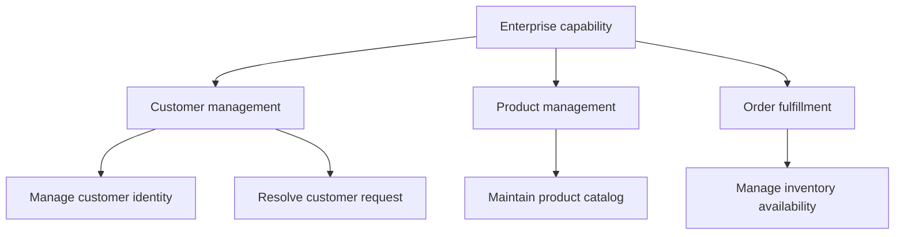
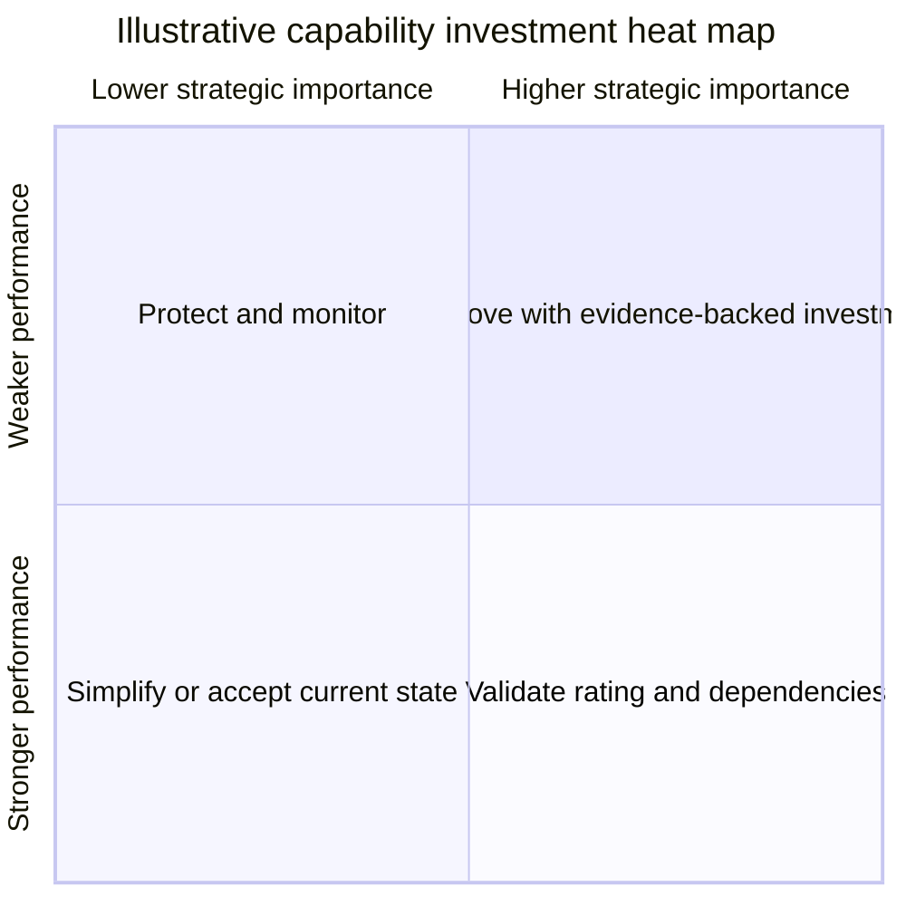
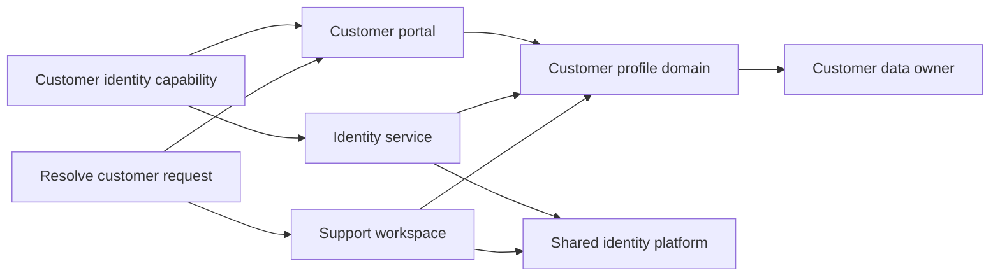
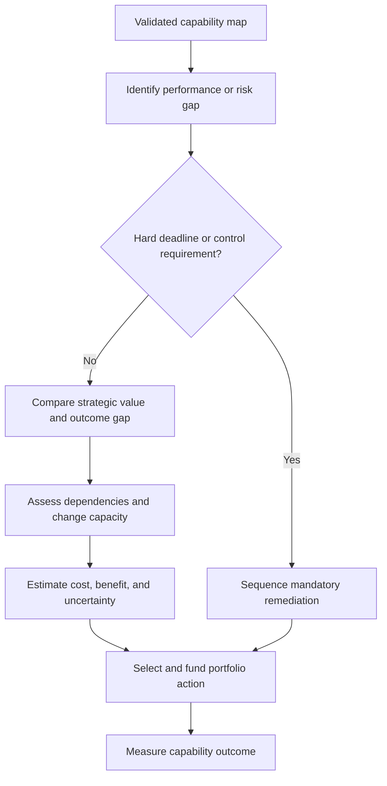
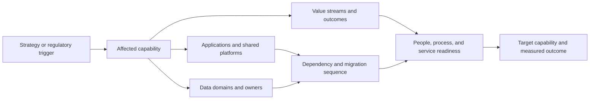

# Capability Mapping

Part: [18 — Enterprise Architecture](PART_OVERVIEW.md)

A business capability map describes what an organization must be able to do to deliver outcomes, independent of the current teams and applications that perform the work. It provides a stable lens for investment, ownership, application alignment, and change impact. Part 18 CH04 owns the broader business-architecture context; Part 02 owns product and market strategy.

## Define and Decompose Capabilities

Start with the enterprise's purpose and value streams, then identify the abilities required to produce outcomes. Use stable business language such as “manage customer identity” rather than “operate application X.” Decompose only to the level needed to assign ownership, compare performance, or make an investment decision. Excessive depth creates a process inventory rather than a useful map.

Capability boundaries should be mutually understandable and collectively useful, but they need not form a mathematically perfect taxonomy. Avoid decomposition that mixes business outcomes, organizational units, process steps, and software modules at the same level. Validate names and scope with business owners who perform or consume the capability.

## Map Performance and Strategic Importance

Capability heat maps can display current performance, strategic importance, risk, cost, maturity, or change readiness. Choose one dimension per view and define its scale, evidence, owner, and date. Do not blend several scores into an opaque color. A weak rating can reflect poor outcomes, missing evidence, or disagreement about the capability boundary; distinguish those cases.

Heat maps prioritize investigation, not funding by themselves. Validate critical ratings with measures such as cycle time, service reliability, customer outcomes, control exceptions, and cost. Include confidence and disagreement so a visually precise color does not hide uncertain evidence.

## Connect Capabilities to Applications and Data

Map which applications, data domains, and shared services realize each capability. This exposes unsupported capabilities, application duplication, dependency concentration, and ownership gaps. Many-to-many relationships are normal: a capability may use several applications and one application may enable several capabilities. The map should show authority and criticality where they affect change.

Confirm the map with both application owners and data owners. If a capability depends on an application with unclear support, identify it as a risk rather than inferring its maturity from the application inventory. Part 18 CH05 owns enterprise application portfolio analysis; CH06 owns data-domain ownership.

## Prioritize Investment Transparently

Investment priority should combine strategic contribution, performance gap, risk, dependency reach, cost, readiness, and expected outcome. Use hard constraints such as regulatory deadline or end-of-support separately from preference scores. Identify the decision owner and the evidence that would change the ranking.

Avoid false precision in scoring. Use a small number of explainable criteria and preserve rationale. A lower-scoring capability may still be the prerequisite for several high-value changes; dependency sequence and portfolio capacity can outweigh a simple ranking.

## Trace Change Impact

When a strategy, regulation, acquisition, or platform decision changes, identify affected capabilities and their owners, value streams, applications, data domains, and investments. Separate direct impact from downstream dependency effects. Plan the transition so that critical capabilities remain available while ownership and systems change.

Use the map to scope analysis, not to infer implementation effort directly. Validate hidden manual work, contract dependencies, regional variants, and transition constraints with affected teams. Update the map after material change so future decisions do not rely on a stale baseline.

## Worked Case: Claims Processing Capability

An insurer wants to reduce claim resolution time without increasing incorrect denials. The map decomposes claims management into intake, coverage verification, damage assessment, adjudication, payment, and customer communication. A heat map shows assessment and adjudication as high-importance areas with weak measured throughput, but interviews reveal that missing data and manual handoffs drive much of the delay.

Application mapping shows that three claims tools share one policy-data source and lack a common status contract. The investment plan first improves data completeness and case ownership, then evaluates workflow automation. Success is measured by resolution time, reopen rate, denial appeal rate, and customer communication quality. A new compliance requirement changes evidence-retention needs, so the data owner and application owners validate the impact before rollout.

## Review Questions

1. What distinguishes a capability from a process, team, or application?
2. At what decomposition level does the map support the decision at hand?
3. What evidence and date support each heat-map rating?
4. How do application and data maps reveal a capability risk?
5. Which dependencies or hard constraints alter an investment ranking?

Capability mapping creates a stable business-centered view for portfolio and change decisions. Keep the taxonomy understandable, tie ratings to dated evidence, connect capabilities to owners and realizations, and use dependencies to sequence investment rather than trusting color or score alone.
