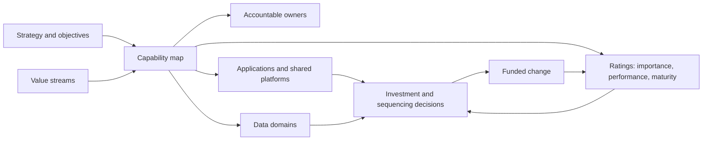
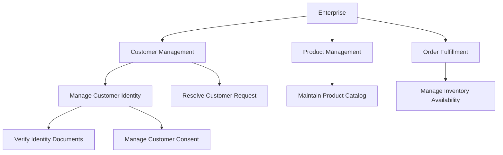
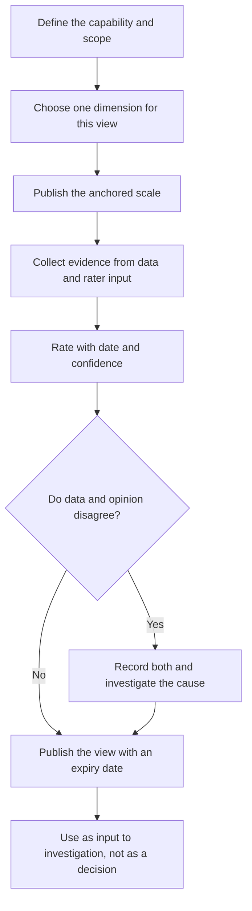
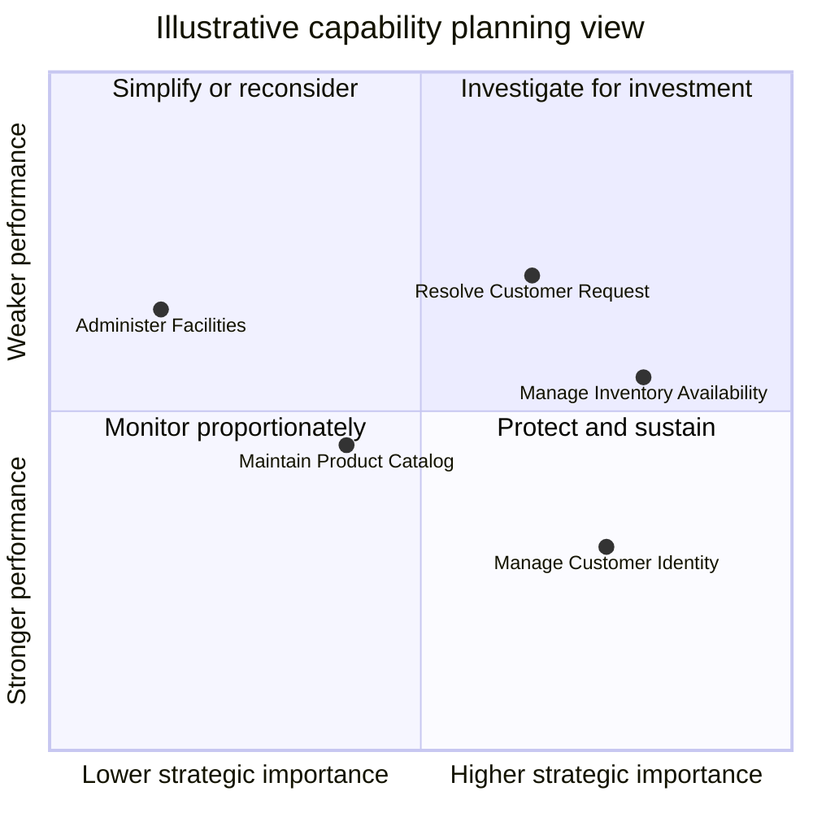
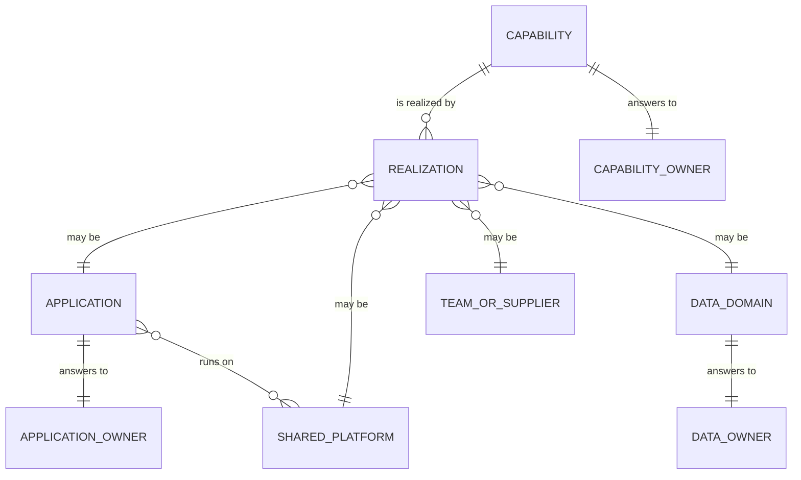
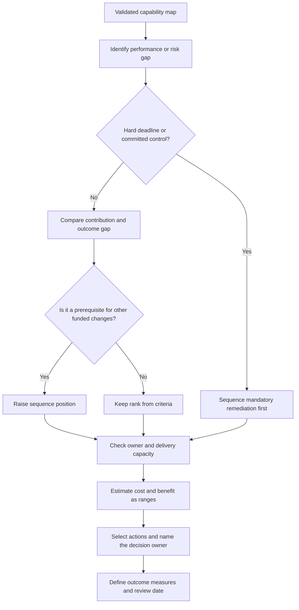
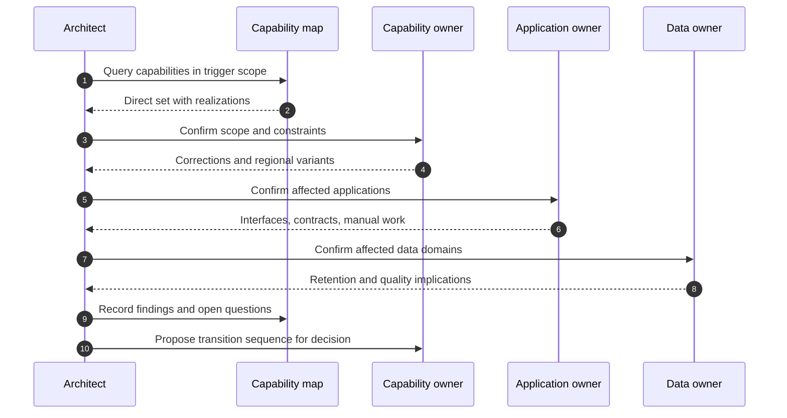
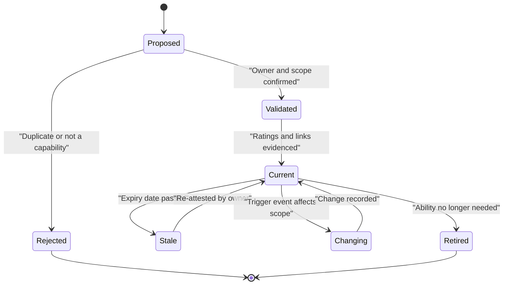
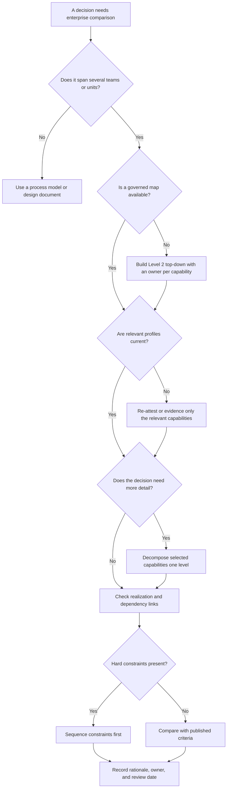

# Capability Mapping

Part: [18 — Enterprise Architecture](PART_OVERVIEW.md) · Status: Drafted

## 1. Introduction

A business capability map is a structured, shared description of what an organization must be able to do in order to deliver outcomes, drawn independently of the teams, processes, and applications that perform the work today. Each box on the map is a capability: a stable ability such as "Manage Customer Identity" or "Assess Claim Damage". The map is useful because it is the one enterprise view that survives reorganizations, vendor changes, and system replacements. Everything that changes faster than the business purpose (org charts, project portfolios, application estates) can be attached to it and compared.

For an engineer moving into architecture, a capability map is the bridge between two worlds. On one side are business leaders who talk about growth, risk, and cost. On the other are engineers who see services, databases, and pipelines. The map gives both a common index. It lets you answer questions that neither side can answer alone: which applications realize this ability, who is accountable for it, how well does it perform against what the strategy needs, and what is affected if we change it.

### 1.1 Why it matters to an architect

Solution architects are constantly asked to justify a design against enterprise intent. A capability map lets you do that concretely: your solution strengthens one named capability, depends on three others, and overlaps with an application already serving a fourth. Without the map, these conversations become arguments about whose project matters more. With it, they become comparisons of evidence against a shared structure.

The map also changes how you scope work. A request phrased as "replace the claims system" becomes "improve adjudication throughput without increasing incorrect denials", which opens options (data fixes, ownership changes, workflow) that a system-replacement framing would hide.

### 1.2 Scope and ownership boundaries

This chapter owns the construction and use of a capability map: taxonomy and decomposition rules, capability attributes and ownership, rating scales and maturity, the mapping of capabilities to applications and data, investment prioritization, and change-impact tracing. Neighbouring material is recapped or linked, never re-taught:

- [Business Architecture](CH04_Business_Architecture.md) owns the definitions of capability and value stream, the strategy-to-change translation, and how to read a heat map as decision evidence. This chapter builds on those and does not redefine them.
- Product and market strategy, discovery, and roadmaps belong to [Product Strategy](../02_Design_Thinking_and_Product_Management/CH15_Product_Strategy.md) and [Roadmaps](../02_Design_Thinking_and_Product_Management/CH21_Roadmaps.md).
- The enterprise view of the application portfolio, dependency analysis, and lifecycle risk belong to [Application Architecture](CH05_Application_Architecture.md); information ownership and data domains belong to [Data Architecture](CH06_Data_Architecture.md).
- Framework context and modelling notation belong to [TOGAF](CH01_TOGAF.md) and [ArchiMate](CH03_ArchiMate.md).
- Decision authority, review, and exceptions belong to [Architecture Governance](CH08_Architecture_Governance.md) and [Architecture Review Boards](CH09_Architecture_Review_Boards.md).

### 1.3 Reader outcomes

After studying this chapter, a reader should be able to:

1. Explain what a capability map is for, and which decisions it supports better than process models, organization charts, or application inventories.
2. Build a hierarchy by applying explicit decomposition rules, and stop at the depth the decision needs.
3. Write a capability profile with an accountable owner, a definition, scope boundaries, and dated evidence.
4. Define rating scales (performance, maturity, importance) with anchored descriptions and confidence, and avoid the common scoring failures.
5. Recognize when a map is wrong (mixed abstraction levels, duplicated capabilities, hidden dependencies) and correct it.
6. Apply the method to a concrete, hypothetical scenario and decide what evidence to collect next.

## 2. Background and History

Planning around capabilities rather than around specific systems has roots in defence planning, where the question "what must we be able to do?" is asked before "which equipment do we buy?". Enterprise architecture practice adopted the idea: the [TOGAF](CH01_TOGAF.md) documentation includes capability-based planning as a technique, and [ArchiMate](CH03_ArchiMate.md) includes a capability element in its strategy-oriented modelling. Practitioner bodies have also published business architecture guidance that treats capability maps as a core artifact. The exact vocabulary, levels, and notation differ between sources, so this chapter uses plain definitions and asks you to write down the local conventions your organization adopts.

The practical lesson of this history is that "capability map" is a method, not a standard. Two organizations can both have a legitimate map with different depth, naming rules, and attributes. What matters is that the rules are explicit and applied consistently.

## 3. The Problem a Capability Map Solves

Enterprises struggle to compare and plan change because every function describes itself in its own units. The patterns below are general, not reported incidents.

| Problem | Mechanism | What the capability map contributes |
| --- | --- | --- |
| Investment by org chart | Budgets follow departments, so cross-cutting abilities are funded by nobody | A unit of planning that is independent of the reporting structure |
| Duplicate spend | Several teams build or buy overlapping solutions for one ability | Visible overlap when applications are traced to one capability |
| Unowned abilities | An ability spans teams and no single role is accountable for its outcome | A named accountable owner per capability |
| Unclear change reach | A regulation or acquisition lands and nobody knows what it touches | A shared index to trace impact |
| Opaque priorities | Strategy discussions compare projects, not the abilities they would change | A common structure for gap and importance discussion |
| Language mismatch | Business and technology describe the same thing with different names | Stable business-language names that both sides can map onto |

### 3.1 Why a map rather than the alternatives

Alternatives exist, and each answers a different question.

| Alternative | Strength | Why it is not enough alone |
| --- | --- | --- |
| Process models | Precise on steps, rules, and exceptions | Too detailed to compare enterprise-wide, and change whenever procedures change |
| Organization chart | Clear on reporting and cost centres | Changes with every reorganization and hides cross-team abilities |
| Application inventory | Accurate on what runs | Silent on business purpose and mixes many abilities per application |
| Value streams | Show stakeholder outcomes end to end | Show how work flows, not what the enterprise must be good at; see [Business Architecture](CH04_Business_Architecture.md) |

A map is chosen when decisions must compare many parts of the enterprise on a stable basis. It is a poor choice for a single-team change with no cross-team dependencies, where a process model or a design document is cheaper and sufficient.



The diagram shows the map as a hub: it receives intent from strategy and value streams and fans out to owners, realizations, and assessments, which in turn feed investment and are refreshed by the results of change. The implication is that the map is only as useful as its links. A beautiful hierarchy with no owners, no evidence, and no realization links is a poster, not an architecture artifact.

## 4. Building the Capability Hierarchy

### 4.1 Recap and what this chapter adds

[Business Architecture](CH04_Business_Architecture.md) defines a capability as what the enterprise can do, named as a noun phrase independent of who does it or how. This chapter takes that definition as given and focuses on the mechanics of building a whole map: how to find capabilities, how to arrange them into levels, how to decide where to stop, and how to test that the result is sound.

### 4.2 Levels and what each level is for

Most maps use three or four levels. The labels vary; the roles are consistent.

| Level | Typical content | Primary use |
| --- | --- | --- |
| Level 1 (top) | Broad enterprise areas, for example Customer Management, Product Management, Order Fulfillment | Executive orientation and portfolio framing |
| Level 2 | Distinct abilities within an area, for example Manage Customer Identity, Resolve Customer Request | Ownership assignment, heat maps, investment comparison |
| Level 3 | Components of an ability that may be owned or improved separately | Detailed assessment where a decision requires it |
| Level 4 and below | Close to process steps | Usually a sign of drift into process modelling |

Level 2 is commonly the workhorse: coarse enough to be comparable across the enterprise, fine enough to have one accountable owner. Go deeper only where a specific decision (an investment, a regulatory change, a divestiture) cannot be made at the higher level.



The hierarchy is a taxonomy for navigation and ownership, not an organization chart or a process flow. The implication is that two capabilities can sit side by side even if different departments run them, and one department can own several. Use the structure to ask "which level carries the decision?" rather than "what does the tree look like?".

### 4.3 Finding capabilities

Three complementary approaches are common, and most teams combine them.

1. **Top-down from purpose and value streams.** Start from what the enterprise exists to deliver, list the stakeholder outcomes in its value streams, and ask what abilities each stage needs. This yields stable names and ensures coverage of strategic needs.
2. **Bottom-up from existing assets.** Start from applications, teams, and processes and ask what ability each provides. This finds real abilities that top-down workshops miss, but carries the risk of copying current structure into the map.
3. **Reference models.** Start from an industry or internal reference map and adapt it. This is fast and gives a consistent vocabulary, but fits poorly if adopted without adaptation, and it can import names that nobody at your organization recognizes.

Prefer top-down for the first draft and use bottom-up as a coverage check: every significant application or team should map to at least one capability, and any that does not signals either a gap in the map or an asset with no business purpose.

### 4.4 Decomposition rules

Apply the following rules, and record any deliberate exceptions.

- **One abstraction type per level.** Siblings should all be capabilities, not a mix of capabilities, departments, processes, and systems.
- **Noun-phrase naming that outlives the implementation.** "Manage Customer Identity", not "Operate the Identity Service" and not "Customer Onboarding Team".
- **Collectively sufficient for the purpose.** The children together should describe the parent's ability for the decisions you need to make, not necessarily every conceivable detail.
- **Understandable, not mathematically exclusive.** Overlap at the edges is normal; resolve it by writing scope notes that state which capability owns the contested work.
- **Single accountable owner where practical.** If no single role can be accountable, the boundary is probably wrong or the capability is really two.
- **Stop when the decision no longer needs depth.** Detail beyond the needed level costs maintenance and adds no decision value.

### 4.5 Testing the hierarchy

Before the map is used, test it with four quick checks.

| Test | Question | A failure suggests |
| --- | --- | --- |
| Coverage | Does every significant value-stream stage map to at least one capability? | Missing capabilities |
| Ownership | Can a named role be accountable for each Level 2 capability? | Boundaries cut across ownership, or an unowned ability |
| Recognition | Do the people who perform the work recognize the names? | Jargon, or a reference model not adapted to the enterprise |
| Independence | If the org chart changed tomorrow, would the map still make sense? | Hidden organizational structure |

### 4.6 Worked scenario: untangling a mixed-level map (illustrative)

A hypothetical retail group presents a first-draft map with these siblings under "Customer": "Customer Service Team", "Loyalty Scheme", "Operate CRM", and "Handle Complaints". Applying the rules:

- "Customer Service Team" is an organizational unit, so it is removed as a capability. The abilities the team performs are named instead.
- "Operate CRM" is a system, so it is removed and recorded later as a realization of the abilities it supports.
- "Loyalty Scheme" is a programme name, so it is reframed as "Manage Customer Rewards".
- "Handle Complaints" is a process-flavoured verb phrase, so it is reframed as "Resolve Customer Complaints" and checked against "Resolve Customer Request" for overlap; the scope note states that complaints are a regulated subset with their own reporting obligation.

The revised Level 2 list has stable noun-phrase-like names, no systems or departments, and one explicit overlap note. The point of the exercise is the method: the map improves not by adding boxes but by removing mixed abstractions.

### 4.7 Failure modes and edge cases

- **Process inventory.** Depth drifts until the map lists procedures. Remedy: stop at the level that supports the decision and move step-level detail to process models.
- **Org chart in disguise.** The first-level boxes mirror departments. Remedy: run the independence test.
- **Duplicate capabilities.** Two business units name the same ability differently. Remedy: merge, and record regional or unit variants as attributes rather than separate boxes.
- **Capabilities nobody owns.** Remedy: assign an interim owner and flag the gap; do not hide it.
- **Shared or enabling capabilities.** Abilities such as Manage Identity or Manage Records serve many others. Show them as distinct capabilities with many consumers rather than burying them inside one business area.
- **Variants across regions or products.** If the ability is the same but performed differently, keep one capability and record variants; split only if ownership, regulation, or investment decisions truly differ.

## 5. Capability Profiles, Ownership, and Maturity

### 5.1 The capability profile

A box and a name are not enough to support decisions. Each capability at the assessed level should have a short profile, ideally held in a shared repository or modelling tool so that other artifacts can link to it.

| Field | Content | Why it matters |
| --- | --- | --- |
| Stable identifier | A key that survives renaming | Links from applications and investments stay valid |
| Name and definition | Noun phrase plus one or two sentences | Prevents drift in meaning |
| Scope note | What is in, what is explicitly out, and which neighbour owns the edge | Resolves overlap |
| Accountable owner | A role, with a named holder and review date | Decisions and evidence need a person |
| Parent and related capabilities | Hierarchy and key dependencies | Navigation and impact tracing |
| Value-stream links | Stages that depend on it | Shows outcome relevance |
| Realizations | Applications, data domains, teams, and suppliers | Filled in by the mapping work |
| Ratings | Importance, performance, maturity, with scale, evidence, date, confidence | Supports comparison |
| Constraints | Regulation, contracts, regional variants | Prevents naive consolidation |

A minimal machine-readable template keeps profiles consistent and reviewable in version control. The field names below are illustrative, not a standard.

```yaml
id: CAP-CUST-020
name: Manage Customer Identity
definition: Establish, verify, and maintain the identity of a customer for the services they use.
scope:
  includes: [registration, document verification, credential lifecycle]
  excludes: [marketing preference management]
owner:
  role: Head of Customer Operations
  reviewed: 2026-09-01
parent: CAP-CUST-000
valueStreamStages: [VS-ONBOARD/verify, VS-SERVICE/authenticate]
constraints: [identity-verification obligations, regional variants]
ratings:
  performance: { value: 2, scale: P-v1, evidence: [cycle-time report], date: 2026-08-15, confidence: medium }
```

### 5.2 Ownership: what accountable means

An accountable owner is the person who answers for the capability's outcome, approves significant change to it, and attests that its profile is correct. This differs from the manager of a team, the owner of an application, and the data steward of an information domain; see [Business Architecture](CH04_Business_Architecture.md) for the ownership roles and [Data Architecture](CH06_Data_Architecture.md) for data ownership. A capability can be performed by several teams and still have one owner. When no single owner is possible, you have discovered a design problem to surface, not a field to leave empty.

| Ownership pattern | Typical consequence | Mitigation |
| --- | --- | --- |
| One clear owner | Fast decisions, clear evidence | Maintain attestation on a schedule |
| Shared across units | Slow decisions, finger-pointing | Name a lead owner and document the decision rights |
| Owner is a committee | Nobody answers for outcomes | Appoint a single accountable role with the committee advising |
| Owner has no budget influence | Ratings with no consequence | Link the capability to a funding path |

### 5.3 Rating scales and maturity

Ratings are only comparable if the scale is defined. Three dimensions are most often useful, and per the guidance in [Business Architecture](CH04_Business_Architecture.md) you should show them separately, not blended.

| Dimension | Question | Typical evidence |
| --- | --- | --- |
| Strategic importance | How much do current strategic objectives depend on this ability? | Objective-to-capability trace |
| Performance | Does it deliver the outcomes expected of it today? | Cycle time, defect rates, service levels, customer measures |
| Maturity | How repeatable, measured, and well-governed is it? | Evidence against an anchored scale |

Performance and maturity are different. A capability can perform well by heroic individual effort while being immature (undocumented, unrepeatable), or be mature and perform poorly because the outcome targets are wrong. A maturity scale is a local definition: publish a short description for each level.

An illustrative anchored scale, which you would adapt rather than adopt:

| Level | Description |
| --- | --- |
| 1 Ad hoc | Done differently each time; depends on individuals; not measured |
| 2 Repeatable | Done consistently by the main team; basic measures exist |
| 3 Defined | Documented, with roles and handoffs defined across teams |
| 4 Managed | Measured against targets; variation is analysed and acted on |
| 5 Optimizing | Continuously improved with evidence; used as a reference |

Maturity models can tempt organizations to chase level 5 everywhere. That is usually waste. A capability of low strategic importance may rationally stay at level 2, and the model should say so explicitly as a target, not a deficiency.



The flow shows that a rating is a produced artifact with a lifecycle, not a fact. The implication is that every published view needs an owner for its scale, an evidence source, and an expiry, and that disagreement is a finding to investigate rather than something to average out.

### 5.4 Worked scenario: rating one capability (illustrative)

A hypothetical logistics firm rates Resolve Delivery Exceptions. Workshop participants rate performance low because of a recent visible incident. The operations dashboard shows median exception resolution time stable over several quarters and within its target, but a long tail of unresolved cases from one region. The architect records both: workshop perception low, data medium overall, and a note that the tail concentrates in one region.

Instead of funding the whole capability, the finding becomes a question: what is different in that region? The investigation finds a different carrier hand-off in that region, which is a regional variant of a constraint. The decision narrows to a targeted change rather than an enterprise programme. The method matters more than the numbers: separating perception from data, and splitting a capability by variant only when the evidence calls for it, produced a smaller and better-aimed action.

### 5.5 Failure modes

- **Rating without evidence.** Remedy: require an evidence link and date for every published rating.
- **Scale drift.** Different facilitators interpret levels differently. Remedy: anchored descriptions and calibration sessions.
- **Maturity as a target everywhere.** Remedy: set target levels per capability from its importance.
- **Owner as figurehead.** The owner never reviews. Remedy: attestation dates and consequences for stale profiles.
- **Map without links.** Profiles lack realizations. Remedy: treat linking as part of building, not a later phase.

## 6. Producing Assessment Views from the Map

### 6.1 Recap and what this section adds

[Business Architecture](CH04_Business_Architecture.md) explains how to read a heat map without misleading yourself: separate dimensions, treat perception and data differently, and expect staleness. This section covers the production side: how a view is specified and generated from capability profiles so that it is repeatable and auditable.

### 6.2 View specification

Define each view before generating it. A view specification is a short record that answers what is being shown and why it can be trusted.

| Element | Content |
| --- | --- |
| Question | The decision the view informs, for example "where should next year's improvement budget be investigated first?" |
| Level | The hierarchy level shown (usually Level 2) |
| Dimension | One dimension per colour, with at most one more on a second axis |
| Scale | Reference to the anchored scale and version |
| Evidence rule | Which sources count, and minimum evidence for a rating to display |
| Date and expiry | When assessed and when the view must be refreshed |
| Owner | Who answers for the view's accuracy |

Without a specification, two views with identical colours can mean different things, and the reader cannot tell.

### 6.3 Showing uncertainty

A coloured box implies precision. Add cues for confidence and disagreement: a pattern or border for low-confidence ratings and a marker where data and workshop rating diverge. Capabilities with no evidence should be shown as "not assessed", not as a default colour. The decision implication is that a grey box is an action item for data collection, whereas a falsely green box is an invisible risk.

### 6.4 A planning view in two dimensions

When two dimensions are shown, the quadrant chart below is a standard way to structure the discussion. Positions are invented for illustration.



The chart assigns each capability to a conversation, not a verdict. The implication is that the upper-right quadrant lists candidates for evidence gathering, while a capability in the upper left prompts the question of whether to simplify or stop investing. Constraints (regulatory deadlines, contract end dates, dependencies) can override any quadrant, which the later treatment of prioritization addresses in depth.

### 6.5 Failure modes

- **View without specification.** Colours are compared across views with different scales. Remedy: reference scale and date on every view.
- **Averaging disagreement.** Data and workshop ratings blended into one. Remedy: show both.
- **Colour as funding signal.** Remedy: treat the view as input to investigation.
- **Over-wide scope.** Dozens of capabilities on one slide hide the decision. Remedy: filter to the question.
- **Stale snapshots in circulation.** Remedy: expiry date visible on every copy.

## 7. Connecting Capabilities to Applications and Data

### 7.1 Recap and what this section adds

[Application Architecture](CH05_Application_Architecture.md) owns portfolio analysis and lifecycle risk, and [Data Architecture](CH06_Data_Architecture.md) owns data domains and information ownership. This section covers only the join: how a capability's profile records which applications, data domains, shared platforms, teams, and suppliers realize it, and what the join lets you see.

A running illustrative scenario starts here and continues through Sections 8 to 10 and 13. A hypothetical insurer wants to reduce claim resolution time without increasing incorrect denials. Its Level 2 capabilities under Claims Management are Register Claim, Verify Coverage, Assess Damage, Adjudicate Claim, Settle Payment, and Communicate Claim Status. All names, tools, and numbers are invented.

### 7.2 What a realization link records

A realization link is a statement that something supports a capability, so it needs attributes that make it useful, not just a line on a diagram.

| Attribute | Meaning | Decision it supports |
| --- | --- | --- |
| Realization type | Application, data domain, shared platform, team, supplier | Which owner to consult |
| Role | Primary, supporting, or fallback | Whether replacing it changes the capability |
| Authority | Whether it is the system of record for the data the capability needs | Where corrections must be made |
| Criticality | What happens to the capability if it is unavailable | Transition and resilience planning |
| Coverage | Share of the capability's scope it supports; remainder is manual or unsupported | Gap analysis |
| Evidence and date | Source of the link, such as an interview or interface catalogue | Trust and refresh |

Many-to-many is normal. One application may support several capabilities, and one capability may rely on several applications. The point of coverage is to make manual work visible: "supported by a spreadsheet and two people" is a legitimate realization and often the most important one.



The diagram models the join as its own entity rather than a direct capability-to-application line. The implication is that role, authority, criticality, and coverage attach to the link, so the same application can be primary for one capability and fallback for another. It also shows three different owners who must each confirm their part of the picture.

### 7.3 What the join reveals

Read the joined map with specific questions in mind, each producing a different finding.

| Question | Finding if the answer is unexpected | Typical next step |
| --- | --- | --- |
| Which capabilities have no primary realization? | Unsupported or manual capability | Quantify manual effort before proposing a system |
| Which capabilities have several primary realizations? | Possible duplication or legitimate variants | Check scope notes and regional constraints |
| Which application supports many important capabilities? | Concentration risk | Review resilience and change reach |
| Which applications support no capability? | Retirement candidate or a gap in the map | Ask owners what it is for |
| Which capabilities depend on a non-authoritative copy of data? | Quality and reconciliation risk | Involve the data owner |
| Which realizations have no recent evidence? | Stale or guessed links | Re-validate before use |

### 7.4 Worked scenario: claims realizations (illustrative)

For the insurer, the join shows that Verify Coverage, Assess Damage, and Adjudicate Claim are each supported by a different claims tool, but all three read policy data from one shared source. None of the tools exposes a common claim status, so Communicate Claim Status is supported mainly by staff copying status between screens. Coverage for that capability is therefore low even though three applications touch it.

Heat-map ratings alone suggested weak throughput in Assess Damage and Adjudicate Claim. The join adds a different hypothesis: the delay may come from missing data and manual handoffs between them, not from either capability's own tooling. The architect does not conclude this. The finding is recorded as a hypothesis with the evidence needed to test it, which Section 8 uses to shape the investment question.

### 7.5 Failure modes

- **Inventory copied as truth.** Links inferred from application names rather than confirmed. Remedy: owners confirm each link and date it.
- **Maturity inferred from tooling.** A modern tool is assumed to mean a mature capability. Remedy: rate capabilities from outcomes, not tools.
- **Hidden manual realizations.** Spreadsheets, shared mailboxes, and individual expertise missing from the map. Remedy: ask performers, not only application owners.
- **One-way maintenance.** The application inventory changes and the links do not. Remedy: tie link review to change events described in Section 10.
- **Over-modelling.** Every interface drawn as a link. Remedy: record only links that a decision would use.

## 8. Prioritizing Investment Transparently

### 8.1 What the map contributes, and what it does not

The map supplies the units that are compared, the evidence attached to each, and the dependencies between them. It does not supply a ranking. How to read a heat map as decision evidence is covered in [Business Architecture](CH04_Business_Architecture.md); portfolio governance and exceptions belong to [Architecture Governance](CH08_Architecture_Governance.md). This section covers how to turn the map into a defensible, explainable priority discussion.

### 8.2 Separate constraints from preferences

Treat two kinds of input differently.

| Kind | Examples | Handling |
| --- | --- | --- |
| Hard constraints | A regulatory deadline, a contract end date, a vendor end-of-support date, a control the organization has committed to implement | Sequence first; they are not scored against preferences |
| Preferences | Strategic contribution, performance gap, expected benefit, dependency reach, cost, readiness | Compare using a small set of explicit criteria |

Mixing the two lets a high preference score appear to outrank a legal deadline, or lets a deadline be used to justify unrelated work. Record the constraint, its source, and the date it was last confirmed.

### 8.3 Criteria and how to keep them honest

A short criteria set is easier to explain and to challenge than a long weighted model.

| Criterion | Question | Evidence form |
| --- | --- | --- |
| Strategic contribution | Which stated objectives does improvement serve? | Objective-to-capability trace |
| Outcome gap | How far is measured performance from the target? | Dated measures with confidence |
| Risk | What is the exposure if nothing changes? | Risk register reference, constraint list |
| Dependency reach | How many other capabilities or changes wait on this one? | Dependency view from the map |
| Readiness | Does the owner have capacity and a clear scope? | Owner confirmation |
| Cost and uncertainty | What range, not what point, is expected? | Estimate with stated assumptions |

Weights, if used, should be agreed before scoring and published with the result. Scores communicate rank order only roughly; two items separated by a small margin should be treated as tied and decided by dependency and capacity. Preserve the rationale, because the next review will ask why something was excluded as readily as why something was chosen.

### 8.4 Why dependencies can outweigh rank

A capability with a modest score may be a prerequisite for several high-value changes. Funding the highest-ranked item first can then waste money, because it cannot deliver its benefit until the prerequisite exists. Conversely, a prerequisite with no downstream commitment is a weak case. The map's dependency links make this visible, which is a primary reason to maintain them.



The flow places constraints before preferences and dependency before rank. The implication is that the output of prioritization is an ordered, owned set of actions with measures, not a scored list. The step "check owner and delivery capacity" is where many technically sound rankings fail, because change capacity is finite and the map does not show it unless it is added deliberately.

### 8.5 Worked scenario: sequencing the claims improvement (illustrative)

Continuing the insurer from Section 7, the stated outcome is faster claim resolution without more incorrect denials. Three candidate actions emerge.

| Candidate | Rationale | Evidence still needed |
| --- | --- | --- |
| Improve data completeness at Register Claim | Missing data is a hypothesised cause of delay in Assess Damage and Adjudicate Claim | Sample of delayed claims, categorized by cause |
| Define one shared claim-status contract across the three claims tools | Removes manual copying and supports Communicate Claim Status | Interface owners' effort estimates |
| Automate adjudication workflow | High strategic contribution | Whether delays are workflow-related at all |

The workflow automation has the highest apparent contribution but depends on the first two: automating a process fed with incomplete data and no common status is likely to automate the delay. The architect proposes sequencing the data and status work first, with an explicit checkpoint to re-evaluate automation once measures are available. The decision owner is the accountable owner of Adjudicate Claim, with the data owner consulted. The alternative of funding all three in parallel is rejected for this scenario because delivery capacity in the shared policy-data team is limited, and this is recorded as an assumption that the owner can challenge.

### 8.6 Failure modes

- **False precision.** Decimal scores that imply accuracy the evidence cannot support. Remedy: use ranges and tied bands.
- **Criteria drift.** Criteria changed after seeing the results. Remedy: agree and publish them first.
- **Deadline laundering.** A real constraint used to carry unrelated scope. Remedy: scope the mandatory work narrowly.
- **Capacity ignored.** Everything is ranked as if teams were free. Remedy: add capacity as an explicit gate.
- **No outcome measure.** Funding ends at delivery rather than at the capability improving. Remedy: define the measure and review date at selection.

## 9. Tracing Change Impact

### 9.1 The question impact tracing answers

When a strategy shift, regulation, acquisition, divestiture, or platform decision arrives, the first question is "what does this touch?". The map provides the index for answering it systematically: from the trigger to affected capabilities, then to owners, value streams, realizations, data domains, and in-flight investments. The result is a scoping aid, not an effort estimate.

### 9.2 Direct and downstream impact

Separate two layers so that the analysis does not either overreach or miss real dependencies.

| Layer | Definition | Example (illustrative) |
| --- | --- | --- |
| Direct impact | Capabilities whose scope, rules, or obligations change because of the trigger | A new evidence-retention rule changes Adjudicate Claim and Settle Payment |
| Downstream impact | Capabilities, applications, or data domains that depend on a directly affected one | Communicate Claim Status reads the retained evidence indirectly |
| Adjacent impact | Items affected only by the transition, such as shared teams or release windows | The shared policy-data team is also committed to another change |

### 9.3 A repeatable procedure

1. State the trigger precisely, with its source and date, and what is known versus assumed.
2. Identify directly affected capabilities using scope notes and constraints in the profiles.
3. Follow realization and dependency links to find downstream items, and note which links are stale.
4. Ask each affected owner to confirm, correct, and add what the map cannot show: contracts, manual work, regional variants.
5. Check in-flight investments against the affected set for conflict or opportunity.
6. Record findings, assumptions, and open questions, and name who decides what happens next.



The sequence shows that the map starts the analysis and the owners finish it. The implication is that impact analysis requires conversation time and named respondents; if the owners are not identified in profiles, step four stalls. It also shows why the findings return to the map: otherwise the next trigger starts from a stale baseline.

### 9.4 Worked scenario: a retention rule (illustrative)

In the insurer scenario, suppose a hypothetical new requirement lengthens how long claim evidence must be retained. Tracing finds Adjudicate Claim and Settle Payment as direct impacts. Downstream, the data owner of the claims-evidence domain must confirm storage and deletion behaviour, and one of the three claims tools is found to delete attachments when a case closes, a behaviour not visible in the map. The status-contract work from Section 8 is unaffected but shares the same team, so it is flagged as an adjacent impact on sequencing.

The decision is to treat the retention change as a hard constraint under Section 8.2, scoped to the affected data and tool, and to keep the claims-resolution work moving with an adjusted schedule. The method found a hidden behaviour only because the data owner was asked directly, which is why the procedure ends in conversation rather than a generated report.

### 9.5 Transition and availability

Capabilities cannot pause while ownership and systems change. For each affected capability, state how it remains available during the transition: parallel running, phased cutover, temporary manual procedure, or deferred change. The map supports this by showing which realizations are primary and which fallbacks exist; if there is no fallback, the sequence must be conservative. Detailed migration design belongs to the solution and technology architecture work, not to the map.

### 9.6 Failure modes

- **Scope inferred as effort.** Number of boxes touched mistaken for work required. Remedy: use the map to scope questions, not to estimate.
- **Stale baseline.** Links not updated after previous change. Remedy: record findings back into the map.
- **Owners not consulted.** Analysis completed from the diagram alone. Remedy: make owner confirmation a required step.
- **Direct impacts only.** Downstream and adjacent effects missed. Remedy: use the three layers explicitly.
- **Everything is impacted.** Scope so wide that nothing is prioritised. Remedy: restrict to capabilities whose obligations or scope actually change.

## 10. Keeping the Map Alive

### 10.1 Why maps decay

A map is accurate on the day it is validated and drifts afterwards, through reorganizations, acquisitions, application changes, and shifts in strategy. A map that is not maintained loses trust, and a map that is not trusted is not used, which removes the pressure that would have maintained it. Maintenance must therefore be cheap and tied to events that already happen.

### 10.2 Lifecycle of a capability profile



The states make staleness explicit rather than silent. The implication is that "Stale" is a legitimate visible state that appears automatically when an expiry passes, so a reader can see the difference between a current rating and an old one. Rejected and retired entries should be kept with a reason, because the same proposals tend to return.

### 10.3 Maintenance triggers and cadence

| Trigger | Action | Responsible |
| --- | --- | --- |
| Profile expiry date reached | Owner re-attests or updates | Capability owner |
| Material application change or retirement | Update realization links | Application owner with the architect |
| Reorganization | Run the independence test from Section 4.5; update owners only | Architect |
| Acquisition or divestiture | Trace impact (Section 9) and revise scope notes | Architect with owners |
| Strategy refresh | Revisit importance ratings and objective links | Strategy owner with architect |
| Funded change completes | Measure outcome; update performance and maturity | Capability owner |

Decision rights over the taxonomy itself, such as adding a Level 2 capability or merging two, should be named in the governance arrangements described in [Architecture Governance](CH08_Architecture_Governance.md), so that the map does not fragment into competing versions.

### 10.4 Failure modes

- **Big-bang refresh.** An annual project nobody owns. Remedy: attach updates to events and expiry dates.
- **Competing maps.** Different units keep private versions. Remedy: one governed source with named decision rights.
- **No retirement.** Dead capabilities accumulate. Remedy: record retired entries with reasons.
- **Maintenance cost invisible.** Remedy: budget a small recurring effort and report map usage so its value is visible.

## 11. Failure Scenarios and Common Mistakes

### 11.1 Failure catalogue

The failures below are general patterns, described as illustrations rather than reported incidents.

| Failure | Symptom | Detection | Mitigation |
| --- | --- | --- | --- |
| Mixed abstraction levels | Siblings include teams, systems, and processes | Rule check from Section 4.4; independence test | Remove or reframe non-capabilities; record systems as realizations |
| Map too deep | Hundreds of boxes; nobody can review them | Count of Level 3+ entries with no decision attached | Prune to the level a decision needs |
| Map too shallow | Every heat-map box is "Customer" or "Operations" | Decisions cannot be taken at the shown level | Decompose only where a decision requires |
| Unowned capability | Owner field empty or a committee | Profile audit | Interim single owner; surface as a design problem |
| Figurehead owner | Owner never reviews or attests | Stale attestation dates | Expiry, escalation, link to funding path |
| Ratings without evidence | Colours trace to a workshop only | Evidence field blank | Require evidence and date to publish |
| Scale drift | Same score means different things between facilitators | Calibration comparison on a sample | Anchored descriptions and calibration sessions |
| Maturity chased everywhere | Uniform target of the top level | Targets not tied to importance | Set targets per capability |
| Tooling mistaken for capability | "We bought a platform, so it is mature" | Outcomes unchanged after delivery | Rate from outcomes; review after funded change |
| Unlinked map | Hierarchy with no realizations | Empty realization field | Treat linking as part of building |
| Stale snapshot in circulation | Old colours quoted in a funding discussion | No expiry on the view | Expiry date on every copy |
| Colour treated as decision | Funding follows red boxes automatically | Decision record cites colour alone | Require investigation findings and owner rationale |
| Hidden manual realization | Plans assume a system does what staff do | Performers' interviews contradict map | Interview performers; record manual realizations |
| Impact analysis from the diagram only | A change surprises an owner | Owner confirmation missing | Required confirmation step (Section 9.3) |
| Competing maps | Units keep private versions | Different names for one ability | Governed source and named decision rights |

### 11.2 Anti-patterns

- **The poster.** A well-designed one-page map used for presentations, with no owners, evidence, or links behind it. It informs nobody and cannot be tested.
- **The reorganization map.** Boxes renamed to match a new structure. It fails the independence test and loses the one property that made it stable.
- **The score factory.** A large rating exercise producing a dense spreadsheet that nobody uses for a decision. Effort should be proportionate to the decision the output supports.
- **The reference-model transplant.** An industry model adopted wholesale with names the performers do not recognise. Adapt it and run the recognition test.
- **The map as mandate.** Using the map to dictate a design to teams rather than to compare options. The map informs decisions; it does not replace the decision-making roles in [Architecture Governance](CH08_Architecture_Governance.md).
- **The capability per application.** One capability for each system, producing an application inventory with a new title.

### 11.3 Edge cases worth deciding in advance

- **Capabilities provided by suppliers.** Keep the capability in the map and show the supplier as a realization; accountability remains internal even if performance is external.
- **Capabilities the enterprise wants but lacks.** Show them as planned, with a target, rather than omitting them; otherwise the map shows only the present.
- **Capabilities that straddle two owners after a merger.** Keep one capability with a lead owner and temporary variants, and set a review date for consolidation.
- **Very small or very new capabilities.** Include them if a decision needs them; otherwise a scope note under the parent is enough.

## 12. Trade-off Analysis and Decision Framework

### 12.1 Choices an architect makes when using the map

Capability mapping is a set of choices, each with alternatives. The table compares the main ones.

| Decision | Option A | Option B | Prefer A when | Prefer B when |
| --- | --- | --- | --- | --- |
| Build approach | Top-down workshops | Bottom-up from assets | Strategy and coverage matter most | Asset knowledge is the main gap |
| Starting point | Adapted reference model | Blank sheet | Speed and shared vocabulary matter | The business is unusual and names would not be recognised |
| Depth | Level 2 only | Level 3 for selected areas | Comparison across the enterprise is the goal | A specific investment or regulatory decision needs detail |
| Rating source | Data-driven measures | Workshop perception | Reliable measures exist | Measures are missing; mark as low confidence |
| Rating scope | Few capabilities, deep evidence | All capabilities, light evidence | A decision is imminent | The first goal is orientation |
| Maintenance | Event-driven updates | Periodic refresh project | Owners exist and links are cheap to update | The map is new and needs a baseline |
| Tooling | Modelling tool | Spreadsheet or version-controlled files | Many linked views are required | Few users and a small map; simplicity wins |
| Splitting variants | One capability with variant attributes | Separate capabilities | Ownership and investment are shared | Ownership, regulation, or investment truly differ |

No option dominates. A common sequence is an adapted reference model, a top-down first draft at Level 2, a bottom-up coverage check, and evidence-based ratings for the few capabilities a live decision concerns.

### 12.2 Decision flowchart: is a capability map the right tool, and at what depth?



The flow limits effort to what the decision needs: a purely local change skips the map, an existing map is refreshed only where relevant, and depth is added selectively. The implication is that the map is a shared asset used by many decisions, so each decision should leave it better, by recording what was learned, rather than building a private copy.

### 12.3 What you give up with each approach

- **Wide and shallow** gives comparability and risks no actionable detail.
- **Narrow and deep** gives detail and risks missing cross-cutting dependencies.
- **Heavy evidence** gives trust and costs effort that may not be proportionate to low-stakes decisions.
- **Light evidence** gives speed and must be labelled as low confidence so that it is not mistaken for measurement.
- **Strict governance of the taxonomy** gives consistency and can slow legitimate local variation; variants as attributes are the usual compromise.

## 13. Illustrative Composite Case Study: Faster Claims Without More Wrongful Denials

This case is hypothetical and composite. The organization, people, tools, and figures are invented to demonstrate the method; they do not describe any real company.

### 13.1 Situation

A mid-sized insurer, referred to here as the Company, sets a strategic objective: reduce the time to resolve a standard claim while keeping incorrect denials from rising. The head of claims asks for a "new claims platform". The enterprise architect proposes first using the capability map to establish what the problem is.

### 13.2 Steps taken

1. **Scope the question.** The architect restates the request as an outcome and names the Level 2 capabilities under Claims Management: Register Claim, Verify Coverage, Assess Damage, Adjudicate Claim, Settle Payment, and Communicate Claim Status. Profiles exist for each, and the architect confirms an accountable owner for every one.
2. **Rate with evidence.** Workshop perception puts Assess Damage and Adjudicate Claim as weak. Dashboards show long-tailed resolution times, concentrated in claims returned for missing information. The architect records both, with confidence, and does not blend them.
3. **Join to realizations.** Three claims tools share one policy-data source and have no common status contract; Communicate Claim Status relies on manual copying (Section 7.4).
4. **Form hypotheses.** Delay is driven by incomplete data at registration and manual handoffs, not by missing workflow tooling. A sample audit of delayed claims is agreed to test this, owned by the owner of Register Claim.
5. **Prioritize.** After the audit supports the hypothesis, data completeness and a shared status contract are sequenced before any workflow automation, with a checkpoint to revisit automation (Section 8.5).
6. **Trace a new constraint.** A hypothetical retention rule arrives. Impact tracing finds a tool that deletes attachments on case closure, which is fixed as a hard constraint (Section 9.4).
7. **Measure and record.** Outcome measures are resolution time, reopen rate, appeal rate for denials, and customer communication quality, reviewed on an agreed date. Findings are written back into the profiles.

```mermaid
flowchart LR
    Ask["Request: new claims platform"] --> Reframe["Reframe as outcome and capabilities"]
    Reframe --> Rate["Rate with evidence and confidence"]
    Rate --> Join["Join to applications and data"]
    Join --> Hyp["Form and test hypotheses"]
    Hyp --> Seq["Sequence data and status work first"]
    Seq --> Constraint["Trace retention constraint"]
    Constraint --> Measure["Measure outcomes and update map"]
    Measure --> Revisit["Revisit workflow automation"]
```



The flow shows the request evolving from a product to an outcome and then to a sequence of evidence-gated actions. The implication is that the capability map did not choose the answer; it structured the questions, exposed the owners, and prevented the organization from buying a platform to fix a data problem. Had the audit contradicted the hypothesis, the same structure would have supported a different sequence.

### 13.3 Alternatives considered

| Alternative | Why it was not chosen in this scenario |
| --- | --- |
| Replace the three claims tools | Would not address missing data or manual status copying; large change with unclear benefit |
| Automate adjudication immediately | Depends on data quality and status work; risk of automating delay |
| Fund every red capability | Colour alone was low-confidence evidence; capacity limited in the shared data team |
| Do nothing until a full map is complete | The Level 2 map and a few evidenced profiles were sufficient for this decision |

### 13.4 Lessons

- A request framed as a system is often an outcome problem in disguise.
- Separating perception from data produced the most useful finding.
- The join to data and applications changed the hypothesis, not just the picture.
- Owner confirmation found a behaviour the diagram could not show.
- Recording the results in the map made the next decision cheaper.

## 14. Architect Review Checklist

Use this checklist when reviewing a capability map or a decision that relies on one.

#### Taxonomy

- [ ] Siblings at each level are capabilities, not teams, systems, processes, or programmes.
- [ ] Names are noun phrases that would survive a reorganization or a system replacement.
- [ ] The map passes the coverage, ownership, recognition, and independence tests in Section 4.5.
- [ ] Depth matches the decisions the map supports; deeper levels exist only where justified.
- [ ] Overlaps are resolved with scope notes, not left implicit.

#### Profiles and ownership

- [ ] Each assessed capability has an identifier, definition, scope note, and constraints.
- [ ] Each has one accountable owner with a review date, and the owner has a funding path.
- [ ] Variants are recorded as attributes unless ownership or investment truly differ.

#### Ratings and views

- [ ] Importance, performance, and maturity are shown separately with anchored scales.
- [ ] Every rating has evidence, a date, and a confidence level.
- [ ] Data and workshop views are both shown where they disagree.
- [ ] Unassessed capabilities are labelled as such, and each view has a specification and expiry.

#### Links and dependencies

- [ ] Realizations include role, authority, criticality, and coverage, with manual realizations recorded.
- [ ] Application and data owners have confirmed the links.
- [ ] Dependencies between capabilities are visible for sequencing.

#### Decisions

- [ ] Hard constraints are separated from preferences and sourced.
- [ ] Criteria were published before scoring, and scores are treated as bands.
- [ ] Delivery capacity is considered, and outcome measures and a review date are defined.
- [ ] Impact analysis includes owner confirmation, downstream, and adjacent effects.

#### Maintenance

- [ ] Triggers and cadence are defined, and the governed source and decision rights are named.
- [ ] Findings from each decision are written back to the map.

## 15. Interview Questions

1. **What is a business capability, and how does it differ from a process or an application?**
   A capability is a stable ability the enterprise needs, named independently of who performs it and how. A process describes steps and changes with procedure; an application is one possible realization. One application may support many capabilities and one capability may use many applications.

2. **At what level would you assign ownership and compare capabilities, and why?**
   Usually Level 2, where capabilities are coarse enough to compare enterprise-wide and fine enough for one accountable owner. Deeper levels are used only where a specific decision needs detail, since each extra level adds maintenance cost.

3. **How do you detect that a capability map has mixed abstraction levels?**
   Check whether siblings include teams, systems, programmes, or process steps. Run the independence test: if a reorganization would change the map, organizational structure has leaked in. Reframe items as noun-phrase abilities and move systems to realizations.

4. **How do performance and maturity differ, and why show them separately?**
   Performance is whether the outcome is delivered today; maturity is how repeatable, measured, and governed the ability is. A capability can perform well through individual effort while being immature, or be mature against the wrong target. Blending hides which action is needed.

5. **A workshop rates a capability red but dashboards look stable. What do you do?**
   Record both ratings with confidence, look for what the divergence reveals (a regional tail, a recent visible event, a measure that misses the real outcome), and form a question for investigation instead of averaging the two.

6. **How would you decide whether to split a capability for regional variants?**
   Keep one capability and record variants unless ownership, regulation, or investment decisions genuinely differ by region. Splitting creates duplicate maintenance and complicates comparison.

7. **How do you prioritise investment using the map without trusting colours blindly?**
   Treat hard constraints separately and sequence them first. Compare the rest on a small set of published criteria, treat close scores as ties, and let dependency and delivery capacity adjust the order. Define the outcome measure and the decision owner.

8. **A regulation changes. How do you use the map to scope the response?**
   Identify directly affected capabilities from scope notes, follow realization and dependency links for downstream effects, and ask owners to confirm and add hidden manual work, contracts, and variants. Record assumptions and write findings back to the map. Do not infer effort from the number of boxes.

## 16. Hands-on Exercises

1. **Repair a map.** Take this invented list under "Operations": "Warehouse Team", "Run ERP (enterprise resource planning)", "Pick and Pack", "Supplier Onboarding Programme", "Manage Stock Accuracy". Classify each item, rewrite non-capabilities as noun-phrase capabilities or realizations, and write one scope note for any overlap you find. Deliverable: a corrected list and a short note on which rule applied to each item.
2. **Write a capability profile.** Choose a capability from a domain you know. Complete every field in the table in Section 5.1, including at least two constraints and an owner role. State what evidence you would collect for each rating and how you would show confidence. Deliverable: one profile in YAML or a table.
3. **Build a realization view.** For a capability you choose, list at least four realizations including one manual or supplier realization. Record role, authority, criticality, and coverage. Identify one concentration risk and one question you would put to a data owner. Deliverable: a table and a one-paragraph finding.
4. **Trace an impact.** Invent a trigger, such as a new requirement to retain a type of record for longer. Using a small map of eight capabilities, identify direct, downstream, and adjacent impacts, name whom you would consult, and list three assumptions that could change your answer. Deliverable: a three-layer impact table and an open-questions list.

## 17. Design and Architecture Review Questions

1. **A programme sponsor shows a capability heat map, mostly red, and requests funding for all red capabilities. How do you respond?**
   Ask what the colour measures, its evidence, date, and confidence, and whether data and perception agree. Separate hard constraints from preferences, then compare the remainder on published criteria. Examine dependencies and capacity, since several red items may rest on one prerequisite. Recommend funding investigation or a sequenced set of actions with outcome measures, not a blanket allocation.

2. **Two business units each present their own capability map for the same domain, with different names and depth. What do you do?**
   Compare them against the decomposition rules and run the recognition and independence tests. Identify true differences, such as regulation or ownership, from naming differences. Merge to one governed taxonomy with variants as attributes where possible. Agree decision rights for the shared map in the governance forum and set a review date for remaining differences.

3. **A capability has no single owner because three directors share it. What is your recommendation?**
   Treat it as a design finding. Either appoint a lead accountable owner, with the others consulted under documented decision rights, or split the capability if the scopes are truly different. A committee should advise and not be the owner. Link the owner to a funding path so that ratings have consequences.

4. **An architect reports that the retiring of an application "affects only two capabilities" based on the map. How do you test the claim?**
   Check when the links were last confirmed and by whom. Ask whether manual realizations, supplier dependencies, data copies, and regional variants are recorded. Have the application, data, and capability owners confirm. Distinguish direct, downstream, and adjacent impact, and treat the result as scope for questions, not as an effort estimate.

5. **A team wants to go three levels deeper across the whole map for completeness. How do you advise?**
   Ask which decision the detail supports. Depth is expensive to maintain and drifts toward process modelling. Recommend decomposing only selected capabilities where a specific investment or regulatory decision requires it, moving step-level detail to process models, and keeping the enterprise view at the level that supports comparison.

## 18. Summary

A capability map is a stable, business-language index of what an enterprise must be able to do, and its value depends on discipline, not decoration. Following the reader outcomes in Section 1.3: the map supports cross-enterprise comparison where process models, organization charts, and application inventories cannot (outcome 1); the hierarchy is built with explicit decomposition rules and stops at the depth a decision needs (outcome 2); each capability carries a profile with an accountable owner, scope note, and dated evidence (outcome 3); ratings use anchored scales for importance, performance, and maturity, shown separately with confidence (outcome 4); and a map is recognised as wrong when levels are mixed, capabilities duplicate, or dependencies are hidden (outcome 5).

This half of the chapter extended those ideas into use. Realization links to applications, data, and manual work expose gaps, duplication, and concentration. Investment is prioritised by separating hard constraints from preferences, using a small set of published criteria, and letting dependencies and capacity adjust the order. Change impact is traced in direct, downstream, and adjacent layers with owner confirmation, and the map is kept alive by events and expiry dates rather than periodic projects. The illustrative insurer case (outcome 6) showed the method turning a platform request into an evidence-gated sequence. Colour and score inform investigation; owners and evidence make the decision.
